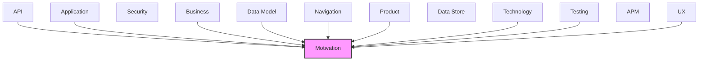

# Motivation

[← Back to README](../README.md)

Goals, requirements, drivers, and strategic outcomes of the architecture.

## Report Index

- [Layer Introduction](#layer-introduction)
- [Intra-Layer Relationships](#intra-layer-relationships)
- [Inter-Layer Dependencies](#inter-layer-dependencies)
- [Inter-Layer Relationships Table](#inter-layer-relationships-table)
- [Element Reference](#element-reference)

## Layer Introduction

| Metric                    | Count |
| ------------------------- | ----- |
| Elements                  | 32    |
| Intra-Layer Relationships | 37    |
| Inter-Layer Relationships | 98    |
| Inbound Relationships     | 98    |
| Outbound Relationships    | 0     |

**Cross-Layer References**:

- **Upstream layers**: [API](./07-api-layer-report.md), [Application](./05-application-layer-report.md), [Business](./02-business-layer-report.md), [Data Model](./08-data-model-layer-report.md), [Navigation](./11-navigation-layer-report.md), [Product](./03-product-layer-report.md), [Technology](./06-technology-layer-report.md), [Testing](./13-testing-layer-report.md), [UX](./10-ux-layer-report.md)

## Intra-Layer Relationships

*This layer has >30 elements. Summary table shown instead of diagram.*

| Element                                                             | Type          | Relationships |
| ------------------------------------------------------------------- | ------------- | ------------- |
| `motivation.constraint.browser-only-deployment`                     | `constraint`  | 1             |
| `motivation.constraint.dr-cli-server-dependency`                    | `constraint`  | 2             |
| `motivation.constraint.type-script-strict-mode`                     | `constraint`  | 2             |
| `motivation.driver.architecture-documentation-complexity`           | `driver`      | 2             |
| `motivation.driver.team-distributed-review-needs`                   | `driver`      | 2             |
| `motivation.goal.accelerate-architecture-documentation`             | `goal`        | 5             |
| `motivation.goal.enable-real-time-collaboration`                    | `goal`        | 4             |
| `motivation.goal.ensure-accessible-architecture-views`              | `goal`        | 2             |
| `motivation.goal.visualize-multi-layer-architecture-models`         | `goal`        | 17            |
| `motivation.principle.core-app-architectural-separation`            | `principle`   | 3             |
| `motivation.principle.read-first-always`                            | `principle`   | 2             |
| `motivation.principle.zustand-only-state-management`                | `principle`   | 2             |
| `motivation.requirement.apply-shows-commit-progress`                | `requirement` | 1             |
| `motivation.requirement.architecture-reads-as-c4-diagrams`          | `requirement` | 1             |
| `motivation.requirement.back-and-forward-replay-graph-moves`        | `requirement` | 0             |
| `motivation.requirement.changesets-read-as-architecture-change`     | `requirement` | 1             |
| `motivation.requirement.diagrams-travel-outside-the-viewer`         | `requirement` | 1             |
| `motivation.requirement.dr-bot-opens-without-reflowing-the-canvas`  | `requirement` | 1             |
| `motivation.requirement.dr-cli-server-integration`                  | `requirement` | 5             |
| `motivation.requirement.drift-shows-before-apply`                   | `requirement` | 1             |
| `motivation.requirement.each-review-change-reads-on-its-own`        | `requirement` | 1             |
| `motivation.requirement.embedded-deployment-mode`                   | `requirement` | 2             |
| `motivation.requirement.find-anything-by-name`                      | `requirement` | 1             |
| `motivation.requirement.keep-checkouts-apart-in-one-browser`        | `requirement` | 1             |
| `motivation.requirement.only-the-servers-allowed-moves-are-offered` | `requirement` | 1             |
| `motivation.requirement.open-the-checkout-a-link-names`             | `requirement` | 1             |
| `motivation.requirement.plan-outcome-reads-as-architecture`         | `requirement` | 1             |
| `motivation.requirement.viewer-covers-every-spec-layer`             | `requirement` | 1             |
| `motivation.requirement.wcag-21-aa-compliance`                      | `requirement` | 4             |
| `motivation.stakeholder.architecture-team`                          | `stakeholder` | 2             |
| `motivation.stakeholder.development-team`                           | `stakeholder` | 2             |
| `motivation.stakeholder.dr-cli-server`                              | `stakeholder` | 2             |

## Inter-Layer Dependencies

## Inter-Layer Relationships Table

| Relationship ID                                                                       | Source Node                                                                                                                         | Dest Node                                                           | Dest Layer   | Predicate    | Cardinality  | Strength |
| ------------------------------------------------------------------------------------- | ----------------------------------------------------------------------------------------------------------------------------------- | ------------------------------------------------------------------- | ------------ | ------------ | ------------ | -------- |
| `03823476-93f8-4ab4-8c51-cd93bf459ff0-realizes-59d25358-33d1-4c2d-b8fb-2a03ab216ae6`  | `03823476-93f8-4ab4-8c51-cd93bf459ff0`                                                                                              | `59d25358-33d1-4c2d-b8fb-2a03ab216ae6`                              | `motivation` | `realizes`   | unknown      | unknown  |
| `35295e18-08a8-4ca0-ada3-40a017cb4318-realizes-462e2931-4c7c-4051-a9ac-8817c270d650`  | `35295e18-08a8-4ca0-ada3-40a017cb4318`                                                                                              | `462e2931-4c7c-4051-a9ac-8817c270d650`                              | `motivation` | `realizes`   | unknown      | unknown  |
| `35295e18-08a8-4ca0-ada3-40a017cb4318-satisfies-e748118c-b989-43fe-b0d2-9121e931fcd2` | `35295e18-08a8-4ca0-ada3-40a017cb4318`                                                                                              | `e748118c-b989-43fe-b0d2-9121e931fcd2`                              | `motivation` | `satisfies`  | unknown      | unknown  |
| `5308e41f-71c9-4ca6-8dfc-11d8b0483ce8-realizes-59d25358-33d1-4c2d-b8fb-2a03ab216ae6`  | `5308e41f-71c9-4ca6-8dfc-11d8b0483ce8`                                                                                              | `59d25358-33d1-4c2d-b8fb-2a03ab216ae6`                              | `motivation` | `realizes`   | unknown      | unknown  |
| `83c81f34-4376-4ff9-8fb4-98f3ecbc6d68-satisfies-e748118c-b989-43fe-b0d2-9121e931fcd2` | `83c81f34-4376-4ff9-8fb4-98f3ecbc6d68`                                                                                              | `e748118c-b989-43fe-b0d2-9121e931fcd2`                              | `motivation` | `satisfies`  | unknown      | unknown  |
| `api.operation.satisfies.motivation.requirement`                                      | `api.operation.get-changeset-verification`                                                                                          | `motivation.requirement.plan-outcome-reads-as-architecture`         | `motivation` | `satisfies`  | many-to-many | medium   |
| `application.applicationfunction.satisfies.motivation.requirement`                    | `application.applicationfunction.chat-frame-routing`                                                                                | `motivation.requirement.keep-checkouts-apart-in-one-browser`        | `motivation` | `satisfies`  | many-to-many | medium   |
| `application.applicationfunction.satisfies.motivation.requirement`                    | `application.applicationfunction.checkout-feed-subscription`                                                                        | `motivation.requirement.keep-checkouts-apart-in-one-browser`        | `motivation` | `satisfies`  | many-to-many | medium   |
| `application.applicationservice.satisfies.motivation.requirement`                     | `application.applicationservice.c4-changeset-diff`                                                                                  | `motivation.requirement.changesets-read-as-architecture-change`     | `motivation` | `satisfies`  | many-to-many | medium   |
| `application.applicationservice.satisfies.motivation.requirement`                     | `application.applicationservice.c4-diagram-export`                                                                                  | `motivation.requirement.diagrams-travel-outside-the-viewer`         | `motivation` | `satisfies`  | many-to-many | medium   |
| `application.applicationservice.satisfies.motivation.requirement`                     | `application.applicationservice.c4-model-transform`                                                                                 | `motivation.requirement.architecture-reads-as-c4-diagrams`          | `motivation` | `satisfies`  | many-to-many | medium   |
| `application.applicationservice.satisfies.motivation.requirement`                     | `application.applicationservice.c4-plan-comparison`                                                                                 | `motivation.requirement.plan-outcome-reads-as-architecture`         | `motivation` | `satisfies`  | many-to-many | medium   |
| `application.applicationservice.satisfies.motivation.requirement`                     | `application.applicationservice.changeset-drift`                                                                                    | `motivation.requirement.drift-shows-before-apply`                   | `motivation` | `satisfies`  | many-to-many | medium   |
| `application.applicationservice.satisfies.motivation.requirement`                     | `application.applicationservice.changeset-impact-analysis`                                                                          | `motivation.requirement.each-review-change-reads-on-its-own`        | `motivation` | `satisfies`  | many-to-many | medium   |
| `application.applicationservice.satisfies.motivation.requirement`                     | `application.applicationservice.changeset-purpose`                                                                                  | `motivation.requirement.only-the-servers-allowed-moves-are-offered` | `motivation` | `satisfies`  | many-to-many | medium   |
| `application.applicationservice.satisfies.motivation.requirement`                     | `application.applicationservice.changeset-review-model`                                                                             | `motivation.requirement.each-review-change-reads-on-its-own`        | `motivation` | `satisfies`  | many-to-many | medium   |
| `application.applicationservice.satisfies.motivation.requirement`                     | `application.applicationservice.chat-service`                                                                                       | `motivation.requirement.keep-checkouts-apart-in-one-browser`        | `motivation` | `satisfies`  | many-to-many | medium   |
| `application.applicationservice.satisfies.motivation.requirement`                     | `application.applicationservice.checkout-scope`                                                                                     | `motivation.requirement.keep-checkouts-apart-in-one-browser`        | `motivation` | `satisfies`  | many-to-many | medium   |
| `application.applicationservice.satisfies.motivation.requirement`                     | `application.applicationservice.commit-progress`                                                                                    | `motivation.requirement.apply-shows-commit-progress`                | `motivation` | `satisfies`  | many-to-many | medium   |
| `application.applicationservice.satisfies.motivation.requirement`                     | `application.applicationservice.history-policy`                                                                                     | `motivation.requirement.back-and-forward-replay-graph-moves`        | `motivation` | `satisfies`  | many-to-many | medium   |
| `application.applicationservice.satisfies.motivation.requirement`                     | `application.applicationservice.layer-domain-palette`                                                                               | `motivation.requirement.viewer-covers-every-spec-layer`             | `motivation` | `satisfies`  | many-to-many | medium   |
| `application.applicationservice.satisfies.motivation.requirement`                     | `application.applicationservice.plan-verification`                                                                                  | `motivation.requirement.plan-outcome-reads-as-architecture`         | `motivation` | `satisfies`  | many-to-many | medium   |
| `application.applicationservice.satisfies.motivation.requirement`                     | `application.applicationservice.search-index`                                                                                       | `motivation.requirement.find-anything-by-name`                      | `motivation` | `satisfies`  | many-to-many | medium   |
| `application.applicationservice.satisfies.motivation.requirement`                     | `application.applicationservice.shell-params`                                                                                       | `motivation.requirement.back-and-forward-replay-graph-moves`        | `motivation` | `satisfies`  | many-to-many | medium   |
| `application.applicationservice.satisfies.motivation.requirement`                     | `application.applicationservice.use-changeset-review`                                                                               | `motivation.requirement.each-review-change-reads-on-its-own`        | `motivation` | `satisfies`  | many-to-many | medium   |
| `application.applicationservice.satisfies.motivation.requirement`                     | `application.applicationservice.use-viewport-history`                                                                               | `motivation.requirement.back-and-forward-replay-graph-moves`        | `motivation` | `satisfies`  | many-to-many | medium   |
| `application.applicationservice.satisfies.motivation.requirement`                     | `application.applicationservice.web-socket-client`                                                                                  | `motivation.requirement.keep-checkouts-apart-in-one-browser`        | `motivation` | `satisfies`  | many-to-many | medium   |
| `b66b613e-27b6-4d90-909f-3aa81570de15-satisfies-fc86a033-81bd-4933-abb8-b24076577123` | `b66b613e-27b6-4d90-909f-3aa81570de15`                                                                                              | `fc86a033-81bd-4933-abb8-b24076577123`                              | `motivation` | `satisfies`  | unknown      | unknown  |
| `business.businessservice.realizes.motivation.goal`                                   | `business.businessservice.schema-exploration`                                                                                       | `motivation.goal.visualize-multi-layer-architecture-models`         | `motivation` | `realizes`   | many-to-many | medium   |
| `data-model.schemadefinition.satisfies.motivation.constraint`                         | `data-model.schemadefinition.annotation-id`                                                                                         | `motivation.constraint.type-script-strict-mode`                     | `motivation` | `satisfies`  | many-to-many | medium   |
| `data-model.schemadefinition.satisfies.motivation.constraint`                         | `data-model.schemadefinition.changeset-id`                                                                                          | `motivation.constraint.type-script-strict-mode`                     | `motivation` | `satisfies`  | many-to-many | medium   |
| `data-model.schemadefinition.satisfies.motivation.constraint`                         | `data-model.schemadefinition.element-id`                                                                                            | `motivation.constraint.type-script-strict-mode`                     | `motivation` | `satisfies`  | many-to-many | medium   |
| `dc2da0b6-3de0-44d1-840f-5d49cc976cd9-satisfies-e748118c-b989-43fe-b0d2-9121e931fcd2` | `dc2da0b6-3de0-44d1-840f-5d49cc976cd9`                                                                                              | `e748118c-b989-43fe-b0d2-9121e931fcd2`                              | `motivation` | `satisfies`  | unknown      | unknown  |
| `de956804-eabb-4548-8389-73cb6c63ef2f-satisfies-53fad2bb-e97d-44a2-83cf-61201e992163` | `de956804-eabb-4548-8389-73cb6c63ef2f`                                                                                              | `53fad2bb-e97d-44a2-83cf-61201e992163`                              | `motivation` | `satisfies`  | unknown      | unknown  |
| `de956804-eabb-4548-8389-73cb6c63ef2f-satisfies-6ffaff00-8bf8-4580-98ff-8d2a612a9021` | `de956804-eabb-4548-8389-73cb6c63ef2f`                                                                                              | `6ffaff00-8bf8-4580-98ff-8d2a612a9021`                              | `motivation` | `satisfies`  | unknown      | unknown  |
| `de956804-eabb-4548-8389-73cb6c63ef2f-satisfies-9df37bbd-8ffd-4d80-899f-9437aa03282a` | `de956804-eabb-4548-8389-73cb6c63ef2f`                                                                                              | `9df37bbd-8ffd-4d80-899f-9437aa03282a`                              | `motivation` | `satisfies`  | unknown      | unknown  |
| `de956804-eabb-4548-8389-73cb6c63ef2f-satisfies-9fe1281a-2547-416f-872f-38e1b066db15` | `de956804-eabb-4548-8389-73cb6c63ef2f`                                                                                              | `9fe1281a-2547-416f-872f-38e1b066db15`                              | `motivation` | `satisfies`  | unknown      | unknown  |
| `de956804-eabb-4548-8389-73cb6c63ef2f-satisfies-b3d7f834-dc3f-49fd-8044-8b6aca045dbe` | `de956804-eabb-4548-8389-73cb6c63ef2f`                                                                                              | `b3d7f834-dc3f-49fd-8044-8b6aca045dbe`                              | `motivation` | `satisfies`  | unknown      | unknown  |
| `de956804-eabb-4548-8389-73cb6c63ef2f-satisfies-e748118c-b989-43fe-b0d2-9121e931fcd2` | `de956804-eabb-4548-8389-73cb6c63ef2f`                                                                                              | `e748118c-b989-43fe-b0d2-9121e931fcd2`                              | `motivation` | `satisfies`  | unknown      | unknown  |
| `de956804-eabb-4548-8389-73cb6c63ef2f-supports-462e2931-4c7c-4051-a9ac-8817c270d650`  | `de956804-eabb-4548-8389-73cb6c63ef2f`                                                                                              | `462e2931-4c7c-4051-a9ac-8817c270d650`                              | `motivation` | `supports`   | unknown      | unknown  |
| `de956804-eabb-4548-8389-73cb6c63ef2f-supports-ef84b64d-883c-4471-9b56-a58574bac2b9`  | `de956804-eabb-4548-8389-73cb6c63ef2f`                                                                                              | `ef84b64d-883c-4471-9b56-a58574bac2b9`                              | `motivation` | `supports`   | unknown      | unknown  |
| `e642ad79-62ea-47a4-ae04-d512d0ef7881-realizes-731285cc-dc15-4c64-a342-a933ce00bd61`  | `e642ad79-62ea-47a4-ae04-d512d0ef7881`                                                                                              | `731285cc-dc15-4c64-a342-a933ce00bd61`                              | `motivation` | `realizes`   | unknown      | unknown  |
| `navigation.route.satisfies.motivation.requirement`                                   | `navigation.route.checkout-index-route`                                                                                             | `motivation.requirement.open-the-checkout-a-link-names`             | `motivation` | `satisfies`  | many-to-many | medium   |
| `navigation.route.satisfies.motivation.requirement`                                   | `navigation.route.checkout-shell-route`                                                                                             | `motivation.requirement.keep-checkouts-apart-in-one-browser`        | `motivation` | `satisfies`  | many-to-many | medium   |
| `navigation.route.satisfies.motivation.requirement`                                   | `navigation.route.checkout-shell-route`                                                                                             | `motivation.requirement.open-the-checkout-a-link-names`             | `motivation` | `satisfies`  | many-to-many | medium   |
| `product.feature.satisfies.motivation.requirement`                                    | `product.feature.c4-architecture-diagrams`                                                                                          | `motivation.requirement.architecture-reads-as-c4-diagrams`          | `motivation` | `satisfies`  | many-to-many | medium   |
| `product.feature.satisfies.motivation.requirement`                                    | `product.feature.c4-architecture-diagrams`                                                                                          | `motivation.requirement.wcag-21-aa-compliance`                      | `motivation` | `satisfies`  | many-to-many | medium   |
| `product.feature.satisfies.motivation.requirement`                                    | `product.feature.c4-changeset-overlay`                                                                                              | `motivation.requirement.architecture-reads-as-c4-diagrams`          | `motivation` | `satisfies`  | many-to-many | medium   |
| `product.feature.satisfies.motivation.requirement`                                    | `product.feature.c4-changeset-overlay`                                                                                              | `motivation.requirement.changesets-read-as-architecture-change`     | `motivation` | `satisfies`  | many-to-many | medium   |
| `product.feature.satisfies.motivation.requirement`                                    | `product.feature.c4-changeset-overlay`                                                                                              | `motivation.requirement.wcag-21-aa-compliance`                      | `motivation` | `satisfies`  | many-to-many | medium   |
| `product.feature.satisfies.motivation.requirement`                                    | `product.feature.c4-diagram-export`                                                                                                 | `motivation.requirement.diagrams-travel-outside-the-viewer`         | `motivation` | `satisfies`  | many-to-many | medium   |
| `product.feature.satisfies.motivation.requirement`                                    | `product.feature.c4-diagram-export`                                                                                                 | `motivation.requirement.wcag-21-aa-compliance`                      | `motivation` | `satisfies`  | many-to-many | medium   |
| `product.feature.satisfies.motivation.requirement`                                    | `product.feature.c4-overlay-change-counts`                                                                                          | `motivation.requirement.changesets-read-as-architecture-change`     | `motivation` | `satisfies`  | many-to-many | medium   |
| `product.feature.satisfies.motivation.requirement`                                    | `product.feature.c4-overlay-change-counts`                                                                                          | `motivation.requirement.wcag-21-aa-compliance`                      | `motivation` | `satisfies`  | many-to-many | medium   |
| `product.feature.satisfies.motivation.requirement`                                    | `product.feature.c4-plan-vs-as-built`                                                                                               | `motivation.requirement.architecture-reads-as-c4-diagrams`          | `motivation` | `satisfies`  | many-to-many | medium   |
| `product.feature.satisfies.motivation.requirement`                                    | `product.feature.c4-plan-vs-as-built`                                                                                               | `motivation.requirement.plan-outcome-reads-as-architecture`         | `motivation` | `satisfies`  | many-to-many | medium   |
| `product.feature.satisfies.motivation.requirement`                                    | `product.feature.c4-plan-vs-as-built`                                                                                               | `motivation.requirement.wcag-21-aa-compliance`                      | `motivation` | `satisfies`  | many-to-many | medium   |
| `product.feature.satisfies.motivation.requirement`                                    | `product.feature.dr-bot-chat-drawer`                                                                                                | `motivation.requirement.dr-bot-opens-without-reflowing-the-canvas`  | `motivation` | `satisfies`  | many-to-many | medium   |
| `product.feature.satisfies.motivation.requirement`                                    | `product.feature.dr-bot-chat-drawer`                                                                                                | `motivation.requirement.wcag-21-aa-compliance`                      | `motivation` | `satisfies`  | many-to-many | medium   |
| `product.feature.satisfies.motivation.requirement`                                    | `product.feature.model-graph-view`                                                                                                  | `motivation.requirement.viewer-covers-every-spec-layer`             | `motivation` | `satisfies`  | many-to-many | medium   |
| `product.feature.satisfies.motivation.requirement`                                    | `product.feature.model-view-by-type`                                                                                                | `motivation.requirement.wcag-21-aa-compliance`                      | `motivation` | `satisfies`  | many-to-many | medium   |
| `product.feature.satisfies.motivation.requirement`                                    | `product.feature.per-change-review`                                                                                                 | `motivation.requirement.apply-shows-commit-progress`                | `motivation` | `satisfies`  | many-to-many | medium   |
| `product.feature.satisfies.motivation.requirement`                                    | `product.feature.per-change-review`                                                                                                 | `motivation.requirement.each-review-change-reads-on-its-own`        | `motivation` | `satisfies`  | many-to-many | medium   |
| `product.feature.satisfies.motivation.requirement`                                    | `product.feature.topbar-search`                                                                                                     | `motivation.requirement.find-anything-by-name`                      | `motivation` | `satisfies`  | many-to-many | medium   |
| `product.feature.satisfies.motivation.requirement`                                    | `product.feature.topbar-search`                                                                                                     | `motivation.requirement.wcag-21-aa-compliance`                      | `motivation` | `satisfies`  | many-to-many | medium   |
| `product.persona.references.motivation.stakeholder`                                   | `product.persona.architecture-reviewer`                                                                                             | `motivation.stakeholder.architecture-team`                          | `motivation` | `references` | many-to-many | medium   |
| `product.persona.references.motivation.stakeholder`                                   | `product.persona.model-author`                                                                                                      | `motivation.stakeholder.development-team`                           | `motivation` | `references` | many-to-many | medium   |
| `product.softwarecapability.supports.motivation.goal`                                 | `product.softwarecapability.changeset-review`                                                                                       | `motivation.goal.accelerate-architecture-documentation`             | `motivation` | `supports`   | many-to-many | medium   |
| `product.softwarecapability.supports.motivation.goal`                                 | `product.softwarecapability.model-annotation`                                                                                       | `motivation.goal.enable-real-time-collaboration`                    | `motivation` | `supports`   | many-to-many | medium   |
| `product.softwarecapability.supports.motivation.goal`                                 | `product.softwarecapability.model-chat`                                                                                             | `motivation.goal.accelerate-architecture-documentation`             | `motivation` | `supports`   | many-to-many | medium   |
| `product.softwarecapability.supports.motivation.goal`                                 | `product.softwarecapability.model-visualization`                                                                                    | `motivation.goal.visualize-multi-layer-architecture-models`         | `motivation` | `supports`   | many-to-many | medium   |
| `product.softwarecapability.supports.motivation.goal`                                 | `product.softwarecapability.schema-exploration`                                                                                     | `motivation.goal.visualize-multi-layer-architecture-models`         | `motivation` | `supports`   | many-to-many | medium   |
| `technology.systemsoftware.satisfies.motivation.constraint`                           | `technology.systemsoftware.elk`                                                                                                     | `motivation.constraint.browser-only-deployment`                     | `motivation` | `satisfies`  | many-to-many | medium   |
| `testing.testcasesketch.satisfies.motivation.requirement`                             | `testing.testcasesketch.accessibility-axe-wcag-2-1-aa-topbar-search-open-topbar-search-with-results-open-tone-canvas-zero-e9283739` | `motivation.requirement.wcag-21-aa-compliance`                      | `motivation` | `satisfies`  | many-to-many | high     |
| `testing.testcasesketch.satisfies.motivation.requirement`                             | `testing.testcasesketch.back-steps-through-graph-moves-in-each-view`                                                                | `motivation.requirement.back-and-forward-replay-graph-moves`        | `motivation` | `satisfies`  | many-to-many | high     |
| `testing.testcasesketch.satisfies.motivation.requirement`                             | `testing.testcasesketch.c4-model-relationships-keeps-the-source-ids-of-every-element-and-relationship`                              | `motivation.requirement.architecture-reads-as-c4-diagrams`          | `motivation` | `satisfies`  | many-to-many | high     |
| `testing.testcasesketch.satisfies.motivation.requirement`                             | `testing.testcasesketch.c4diagram-keyboard-moves-between-cards-with-the-arrow-keys-and-drills-in-with-enter`                        | `motivation.requirement.wcag-21-aa-compliance`                      | `motivation` | `satisfies`  | many-to-many | high     |
| `testing.testcasesketch.satisfies.motivation.requirement`                             | `testing.testcasesketch.drbot-panel-steps-left-of-an-open-inspector-drawer`                                                         | `motivation.requirement.dr-bot-opens-without-reflowing-the-canvas`  | `motivation` | `satisfies`  | many-to-many | high     |
| `testing.testcasesketch.satisfies.motivation.requirement`                             | `testing.testcasesketch.drbot-panel-takes-the-drawers-place-when-both-dont-fit`                                                     | `motivation.requirement.dr-bot-opens-without-reflowing-the-canvas`  | `motivation` | `satisfies`  | many-to-many | high     |
| `testing.testcasesketch.satisfies.motivation.requirement`                             | `testing.testcasesketch.escape-inside-the-drbot-panel-closes-it-and-returns-focus-to-the-launcher`                                  | `motivation.requirement.wcag-21-aa-compliance`                      | `motivation` | `satisfies`  | many-to-many | high     |
| `testing.testcasesketch.satisfies.motivation.requirement`                             | `testing.testcasesketch.topbar-search-keyboard-slash-and-cmd-k-focus-it-arrows-move-aria-activedescendant-escape-closes`            | `motivation.requirement.wcag-21-aa-compliance`                      | `motivation` | `satisfies`  | many-to-many | high     |
| `testing.testcasesketch.satisfies.motivation.requirement`                             | `testing.testcasesketch.topbar-search-typing-lists-grouped-results-and-enter-on-an-element-navigates-as-a-nav-tree-leaf-does`       | `motivation.requirement.find-anything-by-name`                      | `motivation` | `satisfies`  | many-to-many | high     |
| `ux.uxspec.satisfies.motivation.requirement`                                          | `ux.uxspec.architecture-exploration-spec`                                                                                           | `motivation.requirement.viewer-covers-every-spec-layer`             | `motivation` | `satisfies`  | many-to-many | medium   |
| `ux.view.satisfies.motivation.requirement`                                            | `ux.view.architecture-view`                                                                                                         | `motivation.requirement.architecture-reads-as-c4-diagrams`          | `motivation` | `satisfies`  | many-to-many | medium   |
| `ux.view.satisfies.motivation.requirement`                                            | `ux.view.architecture-view`                                                                                                         | `motivation.requirement.changesets-read-as-architecture-change`     | `motivation` | `satisfies`  | many-to-many | medium   |
| `ux.view.satisfies.motivation.requirement`                                            | `ux.view.architecture-view`                                                                                                         | `motivation.requirement.diagrams-travel-outside-the-viewer`         | `motivation` | `satisfies`  | many-to-many | medium   |
| `ux.view.satisfies.motivation.requirement`                                            | `ux.view.architecture-view`                                                                                                         | `motivation.requirement.plan-outcome-reads-as-architecture`         | `motivation` | `satisfies`  | many-to-many | medium   |
| `ux.view.satisfies.motivation.requirement`                                            | `ux.view.architecture-view`                                                                                                         | `motivation.requirement.wcag-21-aa-compliance`                      | `motivation` | `satisfies`  | many-to-many | medium   |
| `ux.view.supports.motivation.goal`                                                    | `ux.view.architecture-view`                                                                                                         | `motivation.goal.visualize-multi-layer-architecture-models`         | `motivation` | `supports`   | many-to-many | medium   |
| `ux.view.satisfies.motivation.requirement`                                            | `ux.view.changesets-view`                                                                                                           | `motivation.requirement.each-review-change-reads-on-its-own`        | `motivation` | `satisfies`  | many-to-many | medium   |
| `ux.view.satisfies.motivation.requirement`                                            | `ux.view.changesets-view`                                                                                                           | `motivation.requirement.wcag-21-aa-compliance`                      | `motivation` | `satisfies`  | many-to-many | medium   |
| `ux.view.supports.motivation.goal`                                                    | `ux.view.changesets-view`                                                                                                           | `motivation.goal.enable-real-time-collaboration`                    | `motivation` | `supports`   | many-to-many | medium   |
| `ux.view.satisfies.motivation.requirement`                                            | `ux.view.checkout-picker-view`                                                                                                      | `motivation.requirement.open-the-checkout-a-link-names`             | `motivation` | `satisfies`  | many-to-many | medium   |
| `ux.view.satisfies.motivation.requirement`                                            | `ux.view.model-view`                                                                                                                | `motivation.requirement.wcag-21-aa-compliance`                      | `motivation` | `satisfies`  | many-to-many | medium   |
| `ux.view.supports.motivation.goal`                                                    | `ux.view.model-view`                                                                                                                | `motivation.goal.visualize-multi-layer-architecture-models`         | `motivation` | `supports`   | many-to-many | medium   |
| `ux.view.satisfies.motivation.requirement`                                            | `ux.view.schema-view`                                                                                                               | `motivation.requirement.wcag-21-aa-compliance`                      | `motivation` | `satisfies`  | many-to-many | medium   |
| `ux.view.satisfies.motivation.requirement`                                            | `ux.view.topbar-search`                                                                                                             | `motivation.requirement.wcag-21-aa-compliance`                      | `motivation` | `satisfies`  | many-to-many | medium   |
| `ux.view.supports.motivation.goal`                                                    | `ux.view.topbar-search`                                                                                                             | `motivation.goal.ensure-accessible-architecture-views`              | `motivation` | `supports`   | many-to-many | medium   |

## Element Reference

### Browser-Only Deployment {#browser-only-deployment}

**ID**: `motivation.constraint.browser-only-deployment`

**Type**: `constraint`

Viewer is a pure browser SPA with no server-side rendering; all data fetched from external DR CLI server

#### Attributes

| Name           | Value     |
| -------------- | --------- |
| constraintType | technical |

#### Relationships

| Type        | Related Element                                   | Predicate    | Direction |
| ----------- | ------------------------------------------------- | ------------ | --------- |
| inter-layer | `technology.systemsoftware.elk`                   | `satisfies`  | inbound   |
| intra-layer | `motivation.requirement.embedded-deployment-mode` | `constrains` | outbound  |

### DR CLI Server Dependency {#dr-cli-server-dependency}

**ID**: `motivation.constraint.dr-cli-server-dependency`

**Type**: `constraint`

Viewer has no standalone mode; requires a running DR CLI server at localhost:8080 to load model data

#### Attributes

| Name           | Value          |
| -------------- | -------------- |
| constraintType | organizational |

#### Relationships

| Type        | Related Element                                    | Predicate         | Direction |
| ----------- | -------------------------------------------------- | ----------------- | --------- |
| intra-layer | `motivation.requirement.dr-cli-server-integration` | `constrains`      | outbound  |
| intra-layer | `motivation.stakeholder.dr-cli-server`             | `associated-with` | inbound   |

### TypeScript Strict Mode {#typescript-strict-mode}

**ID**: `motivation.constraint.type-script-strict-mode`

**Type**: `constraint`

All source files must be strongly typed TypeScript; no any types in production code

#### Attributes

| Name           | Value     |
| -------------- | --------- |
| constraintType | technical |

#### Relationships

| Type        | Related Element                                    | Predicate    | Direction |
| ----------- | -------------------------------------------------- | ------------ | --------- |
| inter-layer | `data-model.schemadefinition.annotation-id`        | `satisfies`  | inbound   |
| inter-layer | `data-model.schemadefinition.changeset-id`         | `satisfies`  | inbound   |
| inter-layer | `data-model.schemadefinition.element-id`           | `satisfies`  | inbound   |
| intra-layer | `motivation.requirement.dr-cli-server-integration` | `constrains` | outbound  |
| intra-layer | `motivation.requirement.wcag-21-aa-compliance`     | `constrains` | outbound  |

### Architecture Documentation Complexity {#architecture-documentation-complexity}

**ID**: `motivation.driver.architecture-documentation-complexity`

**Type**: `driver`

A 13-layer architecture model spanning motivation through testing is too complex to communicate via static diagrams; interactive tooling needed

#### Attributes

| Name     | Value       |
| -------- | ----------- |
| category | operational |

#### Relationships

| Type        | Related Element                                             | Predicate         | Direction |
| ----------- | ----------------------------------------------------------- | ----------------- | --------- |
| intra-layer | `motivation.goal.visualize-multi-layer-architecture-models` | `influence`       | outbound  |
| intra-layer | `motivation.stakeholder.dr-cli-server`                      | `associated-with` | inbound   |

### Team Distributed Review Needs {#team-distributed-review-needs}

**ID**: `motivation.driver.team-distributed-review-needs`

**Type**: `driver`

Architecture review must support asynchronous collaboration; annotations and real-time sync reduce review cycle time

#### Attributes

| Name     | Value       |
| -------- | ----------- |
| category | operational |

#### Relationships

| Type        | Related Element                                         | Predicate   | Direction |
| ----------- | ------------------------------------------------------- | ----------- | --------- |
| intra-layer | `motivation.goal.accelerate-architecture-documentation` | `influence` | outbound  |
| intra-layer | `motivation.goal.enable-real-time-collaboration`        | `influence` | outbound  |

### Accelerate Architecture Documentation {#accelerate-architecture-documentation}

**ID**: `motivation.goal.accelerate-architecture-documentation`

**Type**: `goal`

Reduce friction in creating and reviewing architecture documentation by integrating directly with DR CLI model files

#### Attributes

| Name     | Value |
| -------- | ----- |
| priority | high  |

#### Relationships

| Type        | Related Element                                          | Predicate   | Direction |
| ----------- | -------------------------------------------------------- | ----------- | --------- |
| inter-layer | `product.softwarecapability.changeset-review`            | `supports`  | inbound   |
| inter-layer | `product.softwarecapability.model-chat`                  | `supports`  | inbound   |
| intra-layer | `motivation.driver.team-distributed-review-needs`        | `influence` | inbound   |
| intra-layer | `motivation.principle.read-first-always`                 | `influence` | outbound  |
| intra-layer | `motivation.principle.core-app-architectural-separation` | `influence` | inbound   |
| intra-layer | `motivation.principle.read-first-always`                 | `influence` | inbound   |
| intra-layer | `motivation.requirement.embedded-deployment-mode`        | `realizes`  | inbound   |

### Enable Real-Time Collaboration {#enable-real-time-collaboration}

**ID**: `motivation.goal.enable-real-time-collaboration`

**Type**: `goal`

Support concurrent architecture review via real-time WebSocket model sync and collaborative annotations

#### Attributes

| Name     | Value |
| -------- | ----- |
| priority | high  |

#### Relationships

| Type        | Related Element                                              | Predicate   | Direction |
| ----------- | ------------------------------------------------------------ | ----------- | --------- |
| inter-layer | `product.softwarecapability.model-annotation`                | `supports`  | inbound   |
| inter-layer | `ux.view.changesets-view`                                    | `supports`  | inbound   |
| intra-layer | `motivation.driver.team-distributed-review-needs`            | `influence` | inbound   |
| intra-layer | `motivation.principle.zustand-only-state-management`         | `influence` | outbound  |
| intra-layer | `motivation.requirement.keep-checkouts-apart-in-one-browser` | `realizes`  | inbound   |
| intra-layer | `motivation.stakeholder.development-team`                    | `influence` | inbound   |

### Ensure Accessible Architecture Views {#ensure-accessible-architecture-views}

**ID**: `motivation.goal.ensure-accessible-architecture-views`

**Type**: `goal`

Meet WCAG 2.1 AA accessibility standards so all team members can use the viewer regardless of assistive technology needs; standard now documented directly in CLAUDE.md (documentation/ACCESSIBILITY.md was removed in the Heimdall rebuild) and enforced by axe-core Playwright checks on every view in light + dark

#### Attributes

| Name     | Value  |
| -------- | ------ |
| priority | medium |

#### Relationships

| Type        | Related Element                                | Predicate   | Direction |
| ----------- | ---------------------------------------------- | ----------- | --------- |
| inter-layer | `ux.view.topbar-search`                        | `supports`  | inbound   |
| intra-layer | `motivation.requirement.wcag-21-aa-compliance` | `influence` | outbound  |
| intra-layer | `motivation.requirement.wcag-21-aa-compliance` | `realizes`  | inbound   |

### Visualize Multi-Layer Architecture Models {#visualize-multi-layer-architecture-models}

**ID**: `motivation.goal.visualize-multi-layer-architecture-models`

**Type**: `goal`

Provide interactive, navigable visualization of the DR spec's multi-layer architecture models (13 layers as of spec 0.12, Product included), rendered with the Heimdall design system's graph canvas

#### Attributes

| Name     | Value    |
| -------- | -------- |
| priority | critical |

#### Relationships

| Type        | Related Element                                                     | Predicate   | Direction |
| ----------- | ------------------------------------------------------------------- | ----------- | --------- |
| inter-layer | `business.businessservice.schema-exploration`                       | `realizes`  | inbound   |
| inter-layer | `product.softwarecapability.model-visualization`                    | `supports`  | inbound   |
| inter-layer | `product.softwarecapability.schema-exploration`                     | `supports`  | inbound   |
| inter-layer | `ux.view.architecture-view`                                         | `supports`  | inbound   |
| inter-layer | `ux.view.model-view`                                                | `supports`  | inbound   |
| intra-layer | `motivation.driver.architecture-documentation-complexity`           | `influence` | inbound   |
| intra-layer | `motivation.principle.core-app-architectural-separation`            | `influence` | outbound  |
| intra-layer | `motivation.principle.core-app-architectural-separation`            | `influence` | inbound   |
| intra-layer | `motivation.requirement.apply-shows-commit-progress`                | `realizes`  | inbound   |
| intra-layer | `motivation.requirement.architecture-reads-as-c4-diagrams`          | `realizes`  | inbound   |
| intra-layer | `motivation.requirement.changesets-read-as-architecture-change`     | `realizes`  | inbound   |
| intra-layer | `motivation.requirement.diagrams-travel-outside-the-viewer`         | `realizes`  | inbound   |
| intra-layer | `motivation.requirement.dr-bot-opens-without-reflowing-the-canvas`  | `realizes`  | inbound   |
| intra-layer | `motivation.requirement.dr-cli-server-integration`                  | `realizes`  | inbound   |
| intra-layer | `motivation.requirement.drift-shows-before-apply`                   | `realizes`  | inbound   |
| intra-layer | `motivation.requirement.each-review-change-reads-on-its-own`        | `realizes`  | inbound   |
| intra-layer | `motivation.requirement.find-anything-by-name`                      | `realizes`  | inbound   |
| intra-layer | `motivation.requirement.only-the-servers-allowed-moves-are-offered` | `realizes`  | inbound   |
| intra-layer | `motivation.requirement.open-the-checkout-a-link-names`             | `realizes`  | inbound   |
| intra-layer | `motivation.requirement.plan-outcome-reads-as-architecture`         | `realizes`  | inbound   |
| intra-layer | `motivation.requirement.viewer-covers-every-spec-layer`             | `realizes`  | inbound   |
| intra-layer | `motivation.stakeholder.architecture-team`                          | `influence` | inbound   |

### Core-App Architectural Separation {#core-app-architectural-separation}

**ID**: `motivation.principle.core-app-architectural-separation`

**Type**: `principle`

Strict boundary: Core layer has no route/store dependencies; only App components may use embedded stores and route context

#### Attributes

| Name     | Value        |
| -------- | ------------ |
| category | architecture |

#### Relationships

| Type        | Related Element                                             | Predicate   | Direction |
| ----------- | ----------------------------------------------------------- | ----------- | --------- |
| intra-layer | `motivation.goal.visualize-multi-layer-architecture-models` | `influence` | inbound   |
| intra-layer | `motivation.goal.accelerate-architecture-documentation`     | `influence` | outbound  |
| intra-layer | `motivation.goal.visualize-multi-layer-architecture-models` | `influence` | outbound  |

### Read First, Always {#read-first-always}

**ID**: `motivation.principle.read-first-always`

**Type**: `principle`

Never modify code without reading it first; always understand existing patterns before introducing changes

#### Attributes

| Name     | Value       |
| -------- | ----------- |
| category | operational |

#### Relationships

| Type        | Related Element                                         | Predicate   | Direction |
| ----------- | ------------------------------------------------------- | ----------- | --------- |
| intra-layer | `motivation.goal.accelerate-architecture-documentation` | `influence` | inbound   |
| intra-layer | `motivation.goal.accelerate-architecture-documentation` | `influence` | outbound  |

### Zustand-Only State Management {#zustand-only-state-management}

**ID**: `motivation.principle.zustand-only-state-management`

**Type**: `principle`

All global state managed via Zustand stores; no Redux, no React Context for state — Context used only for providers

#### Attributes

| Name     | Value        |
| -------- | ------------ |
| category | architecture |

#### Relationships

| Type        | Related Element                                    | Predicate   | Direction |
| ----------- | -------------------------------------------------- | ----------- | --------- |
| intra-layer | `motivation.goal.enable-real-time-collaboration`   | `influence` | inbound   |
| intra-layer | `motivation.requirement.dr-cli-server-integration` | `influence` | outbound  |

### Apply shows commit progress {#apply-shows-commit-progress}

**ID**: `motivation.requirement.apply-shows-commit-progress`

**Type**: `requirement`

While a changeset commits, the person who pressed Apply sees how far it has got (applied of total, and the phase when the server says), or at least that it is still working on a dr CLI that reports no progress; Apply stays shut until the commit answers. Progress is announced to assistive technology now and then, not on every update.

#### Attributes

| Name            | Value      |
| --------------- | ---------- |
| priority        | medium     |
| requirementType | functional |

#### Relationships

| Type        | Related Element                                             | Predicate   | Direction |
| ----------- | ----------------------------------------------------------- | ----------- | --------- |
| inter-layer | `application.applicationservice.commit-progress`            | `satisfies` | inbound   |
| inter-layer | `product.feature.per-change-review`                         | `satisfies` | inbound   |
| intra-layer | `motivation.goal.visualize-multi-layer-architecture-models` | `realizes`  | outbound  |

### Architecture reads as C4 diagrams {#architecture-reads-as-c4-diagrams}

**ID**: `motivation.requirement.architecture-reads-as-c4-diagrams`

**Type**: `requirement`

A person can read the modelled system as the established C4 diagrams (Context, Container, Component), derived from the DR model by rule, without learning DR's layers or node types. Every box and arrow traces back to the model elements it came from, and nothing is drawn that the model doesn't hold.

#### Attributes

| Name            | Value      |
| --------------- | ---------- |
| priority        | high       |
| requirementType | functional |

#### Relationships

| Type        | Related Element                                                                                        | Predicate   | Direction |
| ----------- | ------------------------------------------------------------------------------------------------------ | ----------- | --------- |
| inter-layer | `application.applicationservice.c4-model-transform`                                                    | `satisfies` | inbound   |
| inter-layer | `product.feature.c4-architecture-diagrams`                                                             | `satisfies` | inbound   |
| inter-layer | `product.feature.c4-changeset-overlay`                                                                 | `satisfies` | inbound   |
| inter-layer | `product.feature.c4-plan-vs-as-built`                                                                  | `satisfies` | inbound   |
| inter-layer | `testing.testcasesketch.c4-model-relationships-keeps-the-source-ids-of-every-element-and-relationship` | `satisfies` | inbound   |
| inter-layer | `ux.view.architecture-view`                                                                            | `satisfies` | inbound   |
| intra-layer | `motivation.goal.visualize-multi-layer-architecture-models`                                            | `realizes`  | outbound  |

### Back and Forward replay graph moves {#back-and-forward-replay-graph-moves}

**ID**: `motivation.requirement.back-and-forward-replay-graph-moves`

**Type**: `requirement`

In the Model, Schema, Impact, by-type lanes and Architecture views, Back undoes the last graph move (selection, recentre, focus, expand) and Forward redoes it, with the viewport restored; a copied URL reopens that state; panning and zooming alone never add history entries (#619).

#### Attributes

| Name            | Value      |
| --------------- | ---------- |
| priority        | medium     |
| requirementType | functional |

#### Relationships

| Type        | Related Element                                                      | Predicate   | Direction |
| ----------- | -------------------------------------------------------------------- | ----------- | --------- |
| inter-layer | `application.applicationservice.history-policy`                      | `satisfies` | inbound   |
| inter-layer | `application.applicationservice.shell-params`                        | `satisfies` | inbound   |
| inter-layer | `application.applicationservice.use-viewport-history`                | `satisfies` | inbound   |
| inter-layer | `testing.testcasesketch.back-steps-through-graph-moves-in-each-view` | `satisfies` | inbound   |

### Changesets read as architecture change {#changesets-read-as-architecture-change}

**ID**: `motivation.requirement.changesets-read-as-architecture-change`

**Type**: `requirement`

A reviewer can see what a changeset does to the C4 diagrams (boxes and arrows added, removed or changed) before Apply, each mark traced to the changes behind it.

#### Attributes

| Name            | Value      |
| --------------- | ---------- |
| priority        | high       |
| requirementType | functional |

#### Relationships

| Type        | Related Element                                             | Predicate   | Direction |
| ----------- | ----------------------------------------------------------- | ----------- | --------- |
| inter-layer | `application.applicationservice.c4-changeset-diff`          | `satisfies` | inbound   |
| inter-layer | `product.feature.c4-changeset-overlay`                      | `satisfies` | inbound   |
| inter-layer | `product.feature.c4-overlay-change-counts`                  | `satisfies` | inbound   |
| inter-layer | `ux.view.architecture-view`                                 | `satisfies` | inbound   |
| intra-layer | `motivation.goal.visualize-multi-layer-architecture-models` | `realizes`  | outbound  |

### Diagrams travel outside the viewer {#diagrams-travel-outside-the-viewer}

**ID**: `motivation.requirement.diagrams-travel-outside-the-viewer`

**Type**: `requirement`

A C4 diagram on screen, with its changeset overlay or plan comparison, can be taken out of the viewer as an image (SVG, PNG) or as diagram source the C4 tools read (Structurizr DSL, C4-PlantUML), so it can go into a document, a review or another tool without a screenshot.

#### Attributes

| Name            | Value      |
| --------------- | ---------- |
| priority        | medium     |
| requirementType | functional |

#### Relationships

| Type        | Related Element                                             | Predicate   | Direction |
| ----------- | ----------------------------------------------------------- | ----------- | --------- |
| inter-layer | `application.applicationservice.c4-diagram-export`          | `satisfies` | inbound   |
| inter-layer | `product.feature.c4-diagram-export`                         | `satisfies` | inbound   |
| inter-layer | `ux.view.architecture-view`                                 | `satisfies` | inbound   |
| intra-layer | `motivation.goal.visualize-multi-layer-architecture-models` | `realizes`  | outbound  |

### DrBot opens without reflowing the canvas {#drbot-opens-without-reflowing-the-canvas}

**ID**: `motivation.requirement.dr-bot-opens-without-reflowing-the-canvas`

**Type**: `requirement`

Opening DrBot must not resize the canvas, wrap the page header or cover the Inspector drawer or the graph toolbar while there is room for both.

#### Attributes

| Name            | Value                                                                                                                                                                                                                                                                      |
| --------------- | -------------------------------------------------------------------------------------------------------------------------------------------------------------------------------------------------------------------------------------------------------------------------- |
| documentation   | Acceptance: with the Inspector open at 1440px wide, opening DrBot leaves the canvas width and the page header unchanged and the panel sits left of the drawer; on a window too narrow for both, the panel takes the drawer's place until DrBot closes. Source: issue #597. |
| priority        | medium                                                                                                                                                                                                                                                                     |
| requirementType | non-functional                                                                                                                                                                                                                                                             |

#### Relationships

| Type        | Related Element                                                                 | Predicate   | Direction |
| ----------- | ------------------------------------------------------------------------------- | ----------- | --------- |
| inter-layer | `product.feature.dr-bot-chat-drawer`                                            | `satisfies` | inbound   |
| inter-layer | `testing.testcasesketch.drbot-panel-steps-left-of-an-open-inspector-drawer`     | `satisfies` | inbound   |
| inter-layer | `testing.testcasesketch.drbot-panel-takes-the-drawers-place-when-both-dont-fit` | `satisfies` | inbound   |
| intra-layer | `motivation.goal.visualize-multi-layer-architecture-models`                     | `realizes`  | outbound  |

### DR CLI Server Integration {#dr-cli-server-integration}

**ID**: `motivation.requirement.dr-cli-server-integration`

**Type**: `requirement`

Viewer must connect to DR CLI REST API and WebSocket JSON-RPC endpoint to load and sync model data

#### Attributes

| Name            | Value      |
| --------------- | ---------- |
| priority        | critical   |
| requirementType | functional |

#### Relationships

| Type        | Related Element                                             | Predicate         | Direction |
| ----------- | ----------------------------------------------------------- | ----------------- | --------- |
| intra-layer | `motivation.constraint.dr-cli-server-dependency`            | `constrains`      | inbound   |
| intra-layer | `motivation.constraint.type-script-strict-mode`             | `constrains`      | inbound   |
| intra-layer | `motivation.principle.zustand-only-state-management`        | `influence`       | inbound   |
| intra-layer | `motivation.goal.visualize-multi-layer-architecture-models` | `realizes`        | outbound  |
| intra-layer | `motivation.stakeholder.architecture-team`                  | `associated-with` | inbound   |

### Drift shows before Apply {#drift-shows-before-apply}

**ID**: `motivation.requirement.drift-shows-before-apply`

**Type**: `requirement`

A reviewer learns that a changeset's base changed under it before reviewing and before confirming Apply, not from the commit's refusal; drift that doesn't block (content-free, a verification record, a settled changeset) is never shown as a problem.

#### Attributes

| Name            | Value      |
| --------------- | ---------- |
| priority        | high       |
| requirementType | functional |

#### Relationships

| Type        | Related Element                                             | Predicate   | Direction |
| ----------- | ----------------------------------------------------------- | ----------- | --------- |
| inter-layer | `application.applicationservice.changeset-drift`            | `satisfies` | inbound   |
| intra-layer | `motivation.goal.visualize-multi-layer-architecture-models` | `realizes`  | outbound  |

### Each review change reads on its own {#each-review-change-reads-on-its-own}

**ID**: `motivation.requirement.each-review-change-reads-on-its-own`

**Type**: `requirement`

A reviewer can judge any change in a changeset from the review list and the change inspector alone: what it does, what they decided, which layer it lands in, and how a link's ends connect, without reading its raw id.

#### Attributes

| Name            | Value                                                                                                                                                                                                                                                                                                                                                                                                     |
| --------------- | --------------------------------------------------------------------------------------------------------------------------------------------------------------------------------------------------------------------------------------------------------------------------------------------------------------------------------------------------------------------------------------------------------- |
| documentation   | Verified on a large changeset (mcp-gateway-use-cases, 293 changes): the change chip and the decision are labelled and shaped differently; no chip reuses the word 'source' for anything but a source reference; a link shows source → predicate → target with each end's type, layer and whether this changeset adds it; an element's links list direction, predicate and the other end's type and layer. |
| priority        | high                                                                                                                                                                                                                                                                                                                                                                                                      |
| requirementType | functional                                                                                                                                                                                                                                                                                                                                                                                                |

#### Relationships

| Type        | Related Element                                             | Predicate   | Direction |
| ----------- | ----------------------------------------------------------- | ----------- | --------- |
| inter-layer | `application.applicationservice.changeset-impact-analysis`  | `satisfies` | inbound   |
| inter-layer | `application.applicationservice.changeset-review-model`     | `satisfies` | inbound   |
| inter-layer | `application.applicationservice.use-changeset-review`       | `satisfies` | inbound   |
| inter-layer | `product.feature.per-change-review`                         | `satisfies` | inbound   |
| inter-layer | `ux.view.changesets-view`                                   | `satisfies` | inbound   |
| intra-layer | `motivation.goal.visualize-multi-layer-architecture-models` | `realizes`  | outbound  |

### Embedded Deployment Mode {#embedded-deployment-mode}

**ID**: `motivation.requirement.embedded-deployment-mode`

**Type**: `requirement`

Viewer must support deployment as an embedded iframe within the DR CLI local web interface using hash-based routing

#### Attributes

| Name            | Value      |
| --------------- | ---------- |
| priority        | high       |
| requirementType | functional |

#### Relationships

| Type        | Related Element                                         | Predicate    | Direction |
| ----------- | ------------------------------------------------------- | ------------ | --------- |
| intra-layer | `motivation.constraint.browser-only-deployment`         | `constrains` | inbound   |
| intra-layer | `motivation.goal.accelerate-architecture-documentation` | `realizes`   | outbound  |

### Find anything by name {#find-anything-by-name}

**ID**: `motivation.requirement.find-anything-by-name`

**Type**: `requirement`

From any view, a person can reach any model element or spec node type by typing part of its name, without knowing its layer or browsing the nav tree, using the keyboard alone.

#### Attributes

| Name            | Value      |
| --------------- | ---------- |
| priority        | medium     |
| requirementType | functional |

#### Relationships

| Type        | Related Element                                                                                                               | Predicate   | Direction |
| ----------- | ----------------------------------------------------------------------------------------------------------------------------- | ----------- | --------- |
| inter-layer | `application.applicationservice.search-index`                                                                                 | `satisfies` | inbound   |
| inter-layer | `product.feature.topbar-search`                                                                                               | `satisfies` | inbound   |
| inter-layer | `testing.testcasesketch.topbar-search-typing-lists-grouped-results-and-enter-on-an-element-navigates-as-a-nav-tree-leaf-does` | `satisfies` | inbound   |
| intra-layer | `motivation.goal.visualize-multi-layer-architecture-models`                                                                   | `realizes`  | outbound  |

### Keep Checkouts Apart in One Browser {#keep-checkouts-apart-in-one-browser}

**ID**: `motivation.requirement.keep-checkouts-apart-in-one-browser`

**Type**: `requirement`

Two tabs on two checkouts of one project never cross: each tab's data, websocket events and DrBot chat belong to the checkout it shows.

#### Attributes

| Name            | Value      |
| --------------- | ---------- |
| priority        | high       |
| requirementType | functional |

#### Relationships

| Type        | Related Element                                              | Predicate   | Direction |
| ----------- | ------------------------------------------------------------ | ----------- | --------- |
| inter-layer | `application.applicationfunction.chat-frame-routing`         | `satisfies` | inbound   |
| inter-layer | `application.applicationfunction.checkout-feed-subscription` | `satisfies` | inbound   |
| inter-layer | `application.applicationservice.chat-service`                | `satisfies` | inbound   |
| inter-layer | `application.applicationservice.checkout-scope`              | `satisfies` | inbound   |
| inter-layer | `application.applicationservice.web-socket-client`           | `satisfies` | inbound   |
| inter-layer | `navigation.route.checkout-shell-route`                      | `satisfies` | inbound   |
| intra-layer | `motivation.goal.enable-real-time-collaboration`             | `realizes`  | outbound  |

### Only the server's allowed moves are offered {#only-the-server-s-allowed-moves-are-offered}

**ID**: `motivation.requirement.only-the-servers-allowed-moves-are-offered`

**Type**: `requirement`

The viewer offers Apply and Discard for a changeset only when the dr CLI's actions allow them, and treats each changeset by its declared purpose: a verification record is never offered as a plan to apply. An older dr CLI that sends no purpose or actions keeps today's behaviour.

#### Attributes

| Name            | Value      |
| --------------- | ---------- |
| priority        | high       |
| requirementType | functional |

#### Relationships

| Type        | Related Element                                             | Predicate   | Direction |
| ----------- | ----------------------------------------------------------- | ----------- | --------- |
| inter-layer | `application.applicationservice.changeset-purpose`          | `satisfies` | inbound   |
| intra-layer | `motivation.goal.visualize-multi-layer-architecture-models` | `realizes`  | outbound  |

### Open the Checkout a Link Names {#open-the-checkout-a-link-names}

**ID**: `motivation.requirement.open-the-checkout-a-link-names`

**Type**: `requirement`

A viewer link from the dr CLI's central process (review_open, project_status, dr visualize) of the form /#/p/&lt;project&gt;/c/&lt;checkout&gt;/\[changesets/&lt;id&gt;\[?element=&lt;id&gt;\] \| elements/&lt;id&gt;\]?token=&lt;token&gt; opens that project's checkout, and the changeset or element it names, never the process's default checkout.

#### Attributes

| Name            | Value      |
| --------------- | ---------- |
| priority        | critical   |
| requirementType | functional |

#### Relationships

| Type        | Related Element                                             | Predicate   | Direction |
| ----------- | ----------------------------------------------------------- | ----------- | --------- |
| inter-layer | `navigation.route.checkout-index-route`                     | `satisfies` | inbound   |
| inter-layer | `navigation.route.checkout-shell-route`                     | `satisfies` | inbound   |
| inter-layer | `ux.view.checkout-picker-view`                              | `satisfies` | inbound   |
| intra-layer | `motivation.goal.visualize-multi-layer-architecture-models` | `realizes`  | outbound  |

### Plan outcome reads as architecture {#plan-outcome-reads-as-architecture}

**ID**: `motivation.requirement.plan-outcome-reads-as-architecture`

**Type**: `requirement`

A person can see, on the C4 diagrams, whether a plan was built as planned: which planned boxes and arrows were built, which were not, and what was built that the plan didn't name. The verdicts are the ones the dr CLI's plan verification gives, never a second matcher of the viewer's own.

#### Attributes

| Name            | Value      |
| --------------- | ---------- |
| priority        | high       |
| requirementType | functional |

#### Relationships

| Type        | Related Element                                             | Predicate   | Direction |
| ----------- | ----------------------------------------------------------- | ----------- | --------- |
| inter-layer | `api.operation.get-changeset-verification`                  | `satisfies` | inbound   |
| inter-layer | `application.applicationservice.c4-plan-comparison`         | `satisfies` | inbound   |
| inter-layer | `application.applicationservice.plan-verification`          | `satisfies` | inbound   |
| inter-layer | `product.feature.c4-plan-vs-as-built`                       | `satisfies` | inbound   |
| inter-layer | `ux.view.architecture-view`                                 | `satisfies` | inbound   |
| intra-layer | `motivation.goal.visualize-multi-layer-architecture-models` | `realizes`  | outbound  |

### Viewer covers every spec layer {#viewer-covers-every-spec-layer}

**ID**: `motivation.requirement.viewer-covers-every-spec-layer`

**Type**: `requirement`

Every layer in the DR spec the server reports has a colour, a label and a place in the layer order; nothing falls back to grey, and no count of layers is written into the UI.

#### Attributes

| Name            | Value                                                                                                                                                     |
| --------------- | --------------------------------------------------------------------------------------------------------------------------------------------------------- |
| documentation   | Spec 0.12+ has 13 layers with Product as layer 3; the viewer knew 12, so Product elements rendered with a grey swatch and the left rail said '12 layers'. |
| priority        | high                                                                                                                                                      |
| requirementType | functional                                                                                                                                                |

#### Relationships

| Type        | Related Element                                             | Predicate   | Direction |
| ----------- | ----------------------------------------------------------- | ----------- | --------- |
| inter-layer | `application.applicationservice.layer-domain-palette`       | `satisfies` | inbound   |
| inter-layer | `product.feature.model-graph-view`                          | `satisfies` | inbound   |
| inter-layer | `ux.uxspec.architecture-exploration-spec`                   | `satisfies` | inbound   |
| intra-layer | `motivation.goal.visualize-multi-layer-architecture-models` | `realizes`  | outbound  |

### WCAG 2.1 AA Compliance {#wcag-2-1-aa-compliance}

**ID**: `motivation.requirement.wcag-21-aa-compliance`

**Type**: `requirement`

All interactive components must pass axe-core automated accessibility testing and meet WCAG 2.1 Level AA; verified via @axe-core/playwright in tests/e2e/a11y.spec.ts against every view in light + dark canvas mode

#### Attributes

| Name            | Value   |
| --------------- | ------- |
| priority        | high    |
| requirementType | quality |

#### Relationships

| Type        | Related Element                                                                                                                     | Predicate         | Direction |
| ----------- | ----------------------------------------------------------------------------------------------------------------------------------- | ----------------- | --------- |
| inter-layer | `product.feature.c4-architecture-diagrams`                                                                                          | `satisfies`       | inbound   |
| inter-layer | `product.feature.c4-changeset-overlay`                                                                                              | `satisfies`       | inbound   |
| inter-layer | `product.feature.c4-diagram-export`                                                                                                 | `satisfies`       | inbound   |
| inter-layer | `product.feature.c4-overlay-change-counts`                                                                                          | `satisfies`       | inbound   |
| inter-layer | `product.feature.c4-plan-vs-as-built`                                                                                               | `satisfies`       | inbound   |
| inter-layer | `product.feature.dr-bot-chat-drawer`                                                                                                | `satisfies`       | inbound   |
| inter-layer | `product.feature.model-view-by-type`                                                                                                | `satisfies`       | inbound   |
| inter-layer | `product.feature.topbar-search`                                                                                                     | `satisfies`       | inbound   |
| inter-layer | `testing.testcasesketch.accessibility-axe-wcag-2-1-aa-topbar-search-open-topbar-search-with-results-open-tone-canvas-zero-e9283739` | `satisfies`       | inbound   |
| inter-layer | `testing.testcasesketch.c4diagram-keyboard-moves-between-cards-with-the-arrow-keys-and-drills-in-with-enter`                        | `satisfies`       | inbound   |
| inter-layer | `testing.testcasesketch.escape-inside-the-drbot-panel-closes-it-and-returns-focus-to-the-launcher`                                  | `satisfies`       | inbound   |
| inter-layer | `testing.testcasesketch.topbar-search-keyboard-slash-and-cmd-k-focus-it-arrows-move-aria-activedescendant-escape-closes`            | `satisfies`       | inbound   |
| inter-layer | `ux.view.architecture-view`                                                                                                         | `satisfies`       | inbound   |
| inter-layer | `ux.view.changesets-view`                                                                                                           | `satisfies`       | inbound   |
| inter-layer | `ux.view.model-view`                                                                                                                | `satisfies`       | inbound   |
| inter-layer | `ux.view.schema-view`                                                                                                               | `satisfies`       | inbound   |
| inter-layer | `ux.view.topbar-search`                                                                                                             | `satisfies`       | inbound   |
| intra-layer | `motivation.constraint.type-script-strict-mode`                                                                                     | `constrains`      | inbound   |
| intra-layer | `motivation.goal.ensure-accessible-architecture-views`                                                                              | `influence`       | inbound   |
| intra-layer | `motivation.goal.ensure-accessible-architecture-views`                                                                              | `realizes`        | outbound  |
| intra-layer | `motivation.stakeholder.development-team`                                                                                           | `associated-with` | inbound   |

### Architecture Team {#architecture-team}

**ID**: `motivation.stakeholder.architecture-team`

**Type**: `stakeholder`

Architects who create DR models and use the viewer to communicate architecture decisions

#### Attributes

| Name | Value    |
| ---- | -------- |
| type | internal |

#### Relationships

| Type        | Related Element                                             | Predicate         | Direction |
| ----------- | ----------------------------------------------------------- | ----------------- | --------- |
| inter-layer | `product.persona.architecture-reviewer`                     | `references`      | inbound   |
| intra-layer | `motivation.requirement.dr-cli-server-integration`          | `associated-with` | outbound  |
| intra-layer | `motivation.goal.visualize-multi-layer-architecture-models` | `influence`       | outbound  |

### Development Team {#development-team}

**ID**: `motivation.stakeholder.development-team`

**Type**: `stakeholder`

Internal engineering team that builds and maintains the documentation_robotics_viewer

#### Attributes

| Name | Value    |
| ---- | -------- |
| type | internal |

#### Relationships

| Type        | Related Element                                  | Predicate         | Direction |
| ----------- | ------------------------------------------------ | ----------------- | --------- |
| inter-layer | `product.persona.model-author`                   | `references`      | inbound   |
| intra-layer | `motivation.requirement.wcag-21-aa-compliance`   | `associated-with` | outbound  |
| intra-layer | `motivation.goal.enable-real-time-collaboration` | `influence`       | outbound  |

### DR CLI Server {#dr-cli-server}

**ID**: `motivation.stakeholder.dr-cli-server`

**Type**: `stakeholder`

System dependency: DR CLI server that must be running to serve model data to the viewer

#### Attributes

| Name | Value    |
| ---- | -------- |
| type | external |

#### Relationships

| Type        | Related Element                                           | Predicate         | Direction |
| ----------- | --------------------------------------------------------- | ----------------- | --------- |
| intra-layer | `motivation.constraint.dr-cli-server-dependency`          | `associated-with` | outbound  |
| intra-layer | `motivation.driver.architecture-documentation-complexity` | `associated-with` | outbound  |

---

Generated: 2026-11-25T14:21:11.200Z | Model Version: 0.1.0
