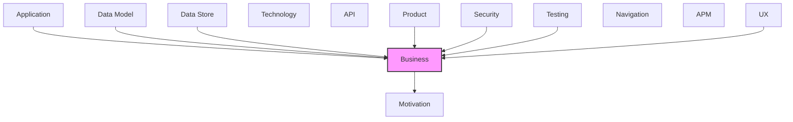

# Business

[← Back to README](../README.md)

Business processes, functions, roles, and services.

## Report Index

- [Layer Introduction](#layer-introduction)
- [Intra-Layer Relationships](#intra-layer-relationships)
- [Inter-Layer Dependencies](#inter-layer-dependencies)
- [Inter-Layer Relationships Table](#inter-layer-relationships-table)
- [Element Reference](#element-reference)

## Layer Introduction

| Metric                    | Count |
| ------------------------- | ----- |
| Elements                  | 14    |
| Intra-Layer Relationships | 16    |
| Inter-Layer Relationships | 167   |
| Inbound Relationships     | 160   |
| Outbound Relationships    | 7     |

**Cross-Layer References**:

- **Upstream layers**: [Application](./05-application-layer-report.md), [Data Model](./08-data-model-layer-report.md), [Data Store](./09-data-store-layer-report.md), [Product](./03-product-layer-report.md), [Security](./04-security-layer-report.md), [Testing](./13-testing-layer-report.md), [UX](./10-ux-layer-report.md)
- **Downstream layers**: [Motivation](./01-motivation-layer-report.md)

## Intra-Layer Relationships

```mermaid
flowchart LR
  subgraph business
    business_businessfunction_cross_layer_reference_resolution["Cross-Layer Reference Resolution"]
    business_businessobject_annotation["Annotation"]
    business_businessobject_architecture_model["Architecture Model"]
    business_businessobject_changeset["Changeset"]
    business_businessprocess_authentication_flow["Authentication Flow"]
    business_businessprocess_changeset_review_flow["Changeset Review Flow"]
    business_businessprocess_real_time_model_synchronization["Real-time Model Synchronization"]
    business_businessrole_architecture_reviewer["Architecture Reviewer"]
    business_businessrole_model_author["Model Author"]
    business_businessservice_ai_assisted_architecture_chat["AI-Assisted Architecture Chat"]
    business_businessservice_architecture_model_visualization["Architecture Model Visualization"]
    business_businessservice_changeset_review["Changeset Review"]
    business_businessservice_model_annotation["Model Annotation"]
    business_businessservice_schema_exploration["Schema Exploration"]
    03823476_93f8_4ab4_8c51_cd93bf459ff0 -->|delivers| 99380a26_1064_4515_9d15_fec7620549cd
    35295e18_08a8_4ca0_ada3_40a017cb4318 -->|delivers| ffa6bf4a_5281_402f_90d8_a895173fc4ba
    af8620f0_9b01_41f2_992c_b90355d2e92c -->|delivers| ea84399d_45dc_4fef_a5a1_759c9b5b5870
    business_businessfunction_cross_layer_reference_resolution -->|accesses| business_businessobject_architecture_model
    business_businessfunction_cross_layer_reference_resolution -->|realizes| business_businessservice_architecture_model_visualization
    business_businessobject_architecture_model -->|composes| business_businessobject_annotation
    business_businessobject_architecture_model -->|composes| business_businessobject_changeset
    business_businessprocess_authentication_flow -->|realizes| business_businessservice_ai_assisted_architecture_chat
    business_businessprocess_changeset_review_flow -->|accesses| business_businessobject_architecture_model
    business_businessprocess_changeset_review_flow -->|accesses| business_businessobject_changeset
    business_businessprocess_changeset_review_flow -->|realizes| business_businessservice_changeset_review
    business_businessprocess_real_time_model_synchronization -->|realizes| business_businessservice_architecture_model_visualization
    business_businessrole_architecture_reviewer -->|assigned-to| business_businessprocess_changeset_review_flow
    business_businessservice_architecture_model_visualization -->|delivers| business_businessobject_architecture_model
    business_businessservice_changeset_review -->|delivers| business_businessobject_changeset
    business_businessservice_model_annotation -->|delivers| business_businessobject_annotation
  end
```

## Inter-Layer Dependencies

## Inter-Layer Relationships Table

| Relationship ID                                                                       | Source Node                                                                                                                                              | Dest Node                                                    | Dest Layer   | Predicate    | Cardinality  | Strength |
| ------------------------------------------------------------------------------------- | -------------------------------------------------------------------------------------------------------------------------------------------------------- | ------------------------------------------------------------ | ------------ | ------------ | ------------ | -------- |
| `03823476-93f8-4ab4-8c51-cd93bf459ff0-realizes-59d25358-33d1-4c2d-b8fb-2a03ab216ae6`  | `03823476-93f8-4ab4-8c51-cd93bf459ff0`                                                                                                                   | `59d25358-33d1-4c2d-b8fb-2a03ab216ae6`                       | `motivation` | `realizes`   | unknown      | unknown  |
| `35295e18-08a8-4ca0-ada3-40a017cb4318-realizes-462e2931-4c7c-4051-a9ac-8817c270d650`  | `35295e18-08a8-4ca0-ada3-40a017cb4318`                                                                                                                   | `462e2931-4c7c-4051-a9ac-8817c270d650`                       | `motivation` | `realizes`   | unknown      | unknown  |
| `35295e18-08a8-4ca0-ada3-40a017cb4318-satisfies-e748118c-b989-43fe-b0d2-9121e931fcd2` | `35295e18-08a8-4ca0-ada3-40a017cb4318`                                                                                                                   | `e748118c-b989-43fe-b0d2-9121e931fcd2`                       | `motivation` | `satisfies`  | unknown      | unknown  |
| `5308e41f-71c9-4ca6-8dfc-11d8b0483ce8-realizes-59d25358-33d1-4c2d-b8fb-2a03ab216ae6`  | `5308e41f-71c9-4ca6-8dfc-11d8b0483ce8`                                                                                                                   | `59d25358-33d1-4c2d-b8fb-2a03ab216ae6`                       | `motivation` | `realizes`   | unknown      | unknown  |
| `582fd707-9e0d-4a98-9b47-b3cda7b26c3d-realizes-ea84399d-45dc-4fef-a5a1-759c9b5b5870`  | `582fd707-9e0d-4a98-9b47-b3cda7b26c3d`                                                                                                                   | `ea84399d-45dc-4fef-a5a1-759c9b5b5870`                       | `business`   | `realizes`   | unknown      | unknown  |
| `6b2f9b1a-bd90-4b1e-9ee2-bed4cbb73a04-realizes-c20e00b6-ef86-415a-92a3-3e9fd9dc7cd6`  | `6b2f9b1a-bd90-4b1e-9ee2-bed4cbb73a04`                                                                                                                   | `c20e00b6-ef86-415a-92a3-3e9fd9dc7cd6`                       | `business`   | `realizes`   | unknown      | unknown  |
| `83c81f34-4376-4ff9-8fb4-98f3ecbc6d68-satisfies-e748118c-b989-43fe-b0d2-9121e931fcd2` | `83c81f34-4376-4ff9-8fb4-98f3ecbc6d68`                                                                                                                   | `e748118c-b989-43fe-b0d2-9121e931fcd2`                       | `motivation` | `satisfies`  | unknown      | unknown  |
| `a0080aee-7e84-4c2c-8d76-0cd604bfd7f5-realizes-ea84399d-45dc-4fef-a5a1-759c9b5b5870`  | `a0080aee-7e84-4c2c-8d76-0cd604bfd7f5`                                                                                                                   | `ea84399d-45dc-4fef-a5a1-759c9b5b5870`                       | `business`   | `realizes`   | unknown      | unknown  |
| `a77489e0-4e1f-42b1-b3e1-b1b534e6e7f8-accesses-ea84399d-45dc-4fef-a5a1-759c9b5b5870`  | `a77489e0-4e1f-42b1-b3e1-b1b534e6e7f8`                                                                                                                   | `ea84399d-45dc-4fef-a5a1-759c9b5b5870`                       | `business`   | `accesses`   | unknown      | unknown  |
| `a77489e0-4e1f-42b1-b3e1-b1b534e6e7f8-realizes-35295e18-08a8-4ca0-ada3-40a017cb4318`  | `a77489e0-4e1f-42b1-b3e1-b1b534e6e7f8`                                                                                                                   | `35295e18-08a8-4ca0-ada3-40a017cb4318`                       | `business`   | `realizes`   | unknown      | unknown  |
| `a920ab1c-c481-46b6-bdb4-4050501adeac-realizes-e642ad79-62ea-47a4-ae04-d512d0ef7881`  | `a920ab1c-c481-46b6-bdb4-4050501adeac`                                                                                                                   | `e642ad79-62ea-47a4-ae04-d512d0ef7881`                       | `business`   | `realizes`   | unknown      | unknown  |
| `a920ab1c-c481-46b6-bdb4-4050501adeac-serves-c20e00b6-ef86-415a-92a3-3e9fd9dc7cd6`    | `a920ab1c-c481-46b6-bdb4-4050501adeac`                                                                                                                   | `c20e00b6-ef86-415a-92a3-3e9fd9dc7cd6`                       | `business`   | `serves`     | unknown      | unknown  |
| `application.applicationservice.realizes.business.businessservice`                    | `application.applicationservice.c4-changeset-diff`                                                                                                       | `business.businessservice.architecture-model-visualization`  | `business`   | `realizes`   | many-to-many | medium   |
| `application.applicationservice.realizes.business.businessservice`                    | `application.applicationservice.c4-model-transform`                                                                                                      | `business.businessservice.architecture-model-visualization`  | `business`   | `realizes`   | many-to-many | medium   |
| `application.applicationservice.realizes.business.businessservice`                    | `application.applicationservice.c4-plan-comparison`                                                                                                      | `business.businessservice.architecture-model-visualization`  | `business`   | `realizes`   | many-to-many | medium   |
| `application.applicationservice.realizes.business.businessservice`                    | `application.applicationservice.c4-view-scoping`                                                                                                         | `business.businessservice.architecture-model-visualization`  | `business`   | `realizes`   | many-to-many | medium   |
| `application.applicationservice.realizes.business.businessservice`                    | `application.applicationservice.changeset-drift`                                                                                                         | `business.businessservice.changeset-review`                  | `business`   | `realizes`   | many-to-many | medium   |
| `application.applicationservice.accesses.business.businessobject`                     | `application.applicationservice.changeset-impact-analysis`                                                                                               | `business.businessobject.changeset`                          | `business`   | `accesses`   | many-to-many | medium   |
| `application.applicationservice.realizes.business.businessservice`                    | `application.applicationservice.changeset-impact-analysis`                                                                                               | `business.businessservice.changeset-review`                  | `business`   | `realizes`   | many-to-many | medium   |
| `application.applicationservice.realizes.business.businessservice`                    | `application.applicationservice.changeset-model-overlay`                                                                                                 | `business.businessservice.architecture-model-visualization`  | `business`   | `realizes`   | many-to-many | medium   |
| `application.applicationservice.realizes.business.businessservice`                    | `application.applicationservice.changeset-purpose`                                                                                                       | `business.businessservice.changeset-review`                  | `business`   | `realizes`   | many-to-many | medium   |
| `application.applicationservice.realizes.business.businessservice`                    | `application.applicationservice.changeset-review-model`                                                                                                  | `business.businessservice.changeset-review`                  | `business`   | `realizes`   | many-to-many | medium   |
| `application.applicationservice.serves.business.businessprocess`                      | `application.applicationservice.changeset-review-model`                                                                                                  | `business.businessprocess.changeset-review-flow`             | `business`   | `serves`     | many-to-many | medium   |
| `application.applicationservice.realizes.business.businessservice`                    | `application.applicationservice.chat-anchor`                                                                                                             | `business.businessservice.ai-assisted-architecture-chat`     | `business`   | `realizes`   | many-to-many | medium   |
| `application.applicationservice.realizes.business.businessservice`                    | `application.applicationservice.chat-panel-layout`                                                                                                       | `business.businessservice.ai-assisted-architecture-chat`     | `business`   | `realizes`   | many-to-many | medium   |
| `application.applicationservice.realizes.business.businessservice`                    | `application.applicationservice.chat-validation`                                                                                                         | `business.businessservice.ai-assisted-architecture-chat`     | `business`   | `realizes`   | many-to-many | medium   |
| `application.applicationservice.serves.business.businessprocess`                      | `application.applicationservice.generated-api-client`                                                                                                    | `business.businessprocess.changeset-review-flow`             | `business`   | `serves`     | many-to-many | medium   |
| `application.applicationservice.serves.business.businessprocess`                      | `application.applicationservice.json-rpc-handler`                                                                                                        | `business.businessprocess.real-time-model-synchronization`   | `business`   | `serves`     | many-to-many | medium   |
| `application.applicationservice.realizes.business.businessservice`                    | `application.applicationservice.layer-domain-palette`                                                                                                    | `business.businessservice.architecture-model-visualization`  | `business`   | `realizes`   | many-to-many | medium   |
| `application.applicationservice.realizes.business.businessservice`                    | `application.applicationservice.markdown-excerpt`                                                                                                        | `business.businessservice.changeset-review`                  | `business`   | `realizes`   | many-to-many | medium   |
| `application.applicationservice.realizes.business.businessservice`                    | `application.applicationservice.model-graph-transform`                                                                                                   | `business.businessservice.architecture-model-visualization`  | `business`   | `realizes`   | many-to-many | medium   |
| `application.applicationservice.realizes.business.businessservice`                    | `application.applicationservice.node-type-label`                                                                                                         | `business.businessservice.schema-exploration`                | `business`   | `realizes`   | many-to-many | medium   |
| `application.applicationservice.realizes.business.businessservice`                    | `application.applicationservice.plan-verification`                                                                                                       | `business.businessservice.architecture-model-visualization`  | `business`   | `realizes`   | many-to-many | medium   |
| `application.applicationservice.realizes.business.businessservice`                    | `application.applicationservice.search-index`                                                                                                            | `business.businessservice.architecture-model-visualization`  | `business`   | `realizes`   | many-to-many | medium   |
| `application.applicationservice.realizes.business.businessservice`                    | `application.applicationservice.search-index`                                                                                                            | `business.businessservice.schema-exploration`                | `business`   | `realizes`   | many-to-many | medium   |
| `application.applicationservice.realizes.business.businessservice`                    | `application.applicationservice.spec-graph-transform`                                                                                                    | `business.businessservice.schema-exploration`                | `business`   | `realizes`   | many-to-many | medium   |
| `application.applicationservice.realizes.business.businessservice`                    | `application.applicationservice.use-annotations`                                                                                                         | `business.businessservice.model-annotation`                  | `business`   | `realizes`   | many-to-many | medium   |
| `application.applicationservice.accesses.business.businessobject`                     | `application.applicationservice.use-c4model`                                                                                                             | `business.businessobject.changeset`                          | `business`   | `accesses`   | many-to-many | medium   |
| `application.applicationservice.realizes.business.businessservice`                    | `application.applicationservice.use-c4model`                                                                                                             | `business.businessservice.architecture-model-visualization`  | `business`   | `realizes`   | many-to-many | medium   |
| `application.applicationservice.accesses.business.businessobject`                     | `application.applicationservice.use-changeset-review`                                                                                                    | `business.businessobject.changeset`                          | `business`   | `accesses`   | many-to-many | medium   |
| `application.applicationservice.realizes.business.businessservice`                    | `application.applicationservice.use-changeset-review`                                                                                                    | `business.businessservice.changeset-review`                  | `business`   | `realizes`   | many-to-many | medium   |
| `application.applicationservice.realizes.business.businessservice`                    | `application.applicationservice.use-changesets`                                                                                                          | `business.businessservice.changeset-review`                  | `business`   | `realizes`   | many-to-many | medium   |
| `application.applicationservice.serves.business.businessprocess`                      | `application.applicationservice.use-changesets`                                                                                                          | `business.businessprocess.changeset-review-flow`             | `business`   | `serves`     | many-to-many | medium   |
| `application.applicationservice.realizes.business.businessservice`                    | `application.applicationservice.use-model`                                                                                                               | `business.businessservice.architecture-model-visualization`  | `business`   | `realizes`   | many-to-many | medium   |
| `application.applicationservice.serves.business.businessprocess`                      | `application.applicationservice.use-model`                                                                                                               | `business.businessprocess.changeset-review-flow`             | `business`   | `serves`     | many-to-many | medium   |
| `application.applicationservice.realizes.business.businessservice`                    | `application.applicationservice.use-spec`                                                                                                                | `business.businessservice.schema-exploration`                | `business`   | `realizes`   | many-to-many | medium   |
| `application.applicationservice.serves.business.businessprocess`                      | `application.applicationservice.web-socket-client`                                                                                                       | `business.businessprocess.real-time-model-synchronization`   | `business`   | `serves`     | many-to-many | medium   |
| `b7775f1a-2418-4c7a-84aa-997efd658a97-realizes-35295e18-08a8-4ca0-ada3-40a017cb4318`  | `b7775f1a-2418-4c7a-84aa-997efd658a97`                                                                                                                   | `35295e18-08a8-4ca0-ada3-40a017cb4318`                       | `business`   | `realizes`   | unknown      | unknown  |
| `b7775f1a-2418-4c7a-84aa-997efd658a97-serves-83c81f34-4376-4ff9-8fb4-98f3ecbc6d68`    | `b7775f1a-2418-4c7a-84aa-997efd658a97`                                                                                                                   | `83c81f34-4376-4ff9-8fb4-98f3ecbc6d68`                       | `business`   | `serves`     | unknown      | unknown  |
| `business.businessservice.realizes.motivation.goal`                                   | `business.businessservice.schema-exploration`                                                                                                            | `motivation.goal.visualize-multi-layer-architecture-models`  | `motivation` | `realizes`   | many-to-many | medium   |
| `cfe8d725-4f64-4eae-b2fa-825e4a774a3a-realizes-ffa6bf4a-5281-402f-90d8-a895173fc4ba`  | `cfe8d725-4f64-4eae-b2fa-825e4a774a3a`                                                                                                                   | `ffa6bf4a-5281-402f-90d8-a895173fc4ba`                       | `business`   | `realizes`   | unknown      | unknown  |
| `data-model.objectschema.realizes.business.businessobject`                            | `data-model.objectschema.c4-model`                                                                                                                       | `business.businessobject.architecture-model`                 | `business`   | `realizes`   | many-to-many | medium   |
| `data-model.objectschema.realizes.business.businessobject`                            | `data-model.objectschema.c4-plan-comparison`                                                                                                             | `business.businessobject.architecture-model`                 | `business`   | `realizes`   | many-to-many | medium   |
| `data-model.objectschema.realizes.business.businessobject`                            | `data-model.objectschema.changeset-detail`                                                                                                               | `business.businessobject.changeset`                          | `business`   | `realizes`   | many-to-many | medium   |
| `data-model.objectschema.realizes.business.businessobject`                            | `data-model.objectschema.changeset-summary`                                                                                                              | `business.businessobject.changeset`                          | `business`   | `realizes`   | many-to-many | medium   |
| `data-model.objectschema.realizes.business.businessobject`                            | `data-model.objectschema.extracted-reference`                                                                                                            | `business.businessobject.architecture-model`                 | `business`   | `realizes`   | many-to-many | medium   |
| `data-model.objectschema.realizes.business.businessobject`                            | `data-model.objectschema.model-metadata`                                                                                                                 | `business.businessobject.architecture-model`                 | `business`   | `realizes`   | many-to-many | medium   |
| `data-model.objectschema.realizes.business.businessobject`                            | `data-model.objectschema.plan-verification`                                                                                                              | `business.businessobject.changeset`                          | `business`   | `realizes`   | many-to-many | medium   |
| `data-model.objectschema.realizes.business.businessobject`                            | `data-model.objectschema.reference`                                                                                                                      | `business.businessobject.architecture-model`                 | `business`   | `realizes`   | many-to-many | medium   |
| `data-store.collection.realizes.business.businessobject`                              | `data-store.collection.changeset-files`                                                                                                                  | `business.businessobject.changeset`                          | `business`   | `realizes`   | many-to-many | medium   |
| `data-store.collection.realizes.business.businessobject`                              | `data-store.collection.model-manifest`                                                                                                                   | `business.businessobject.architecture-model`                 | `business`   | `realizes`   | many-to-many | medium   |
| `e642ad79-62ea-47a4-ae04-d512d0ef7881-realizes-731285cc-dc15-4c64-a342-a933ce00bd61`  | `e642ad79-62ea-47a4-ae04-d512d0ef7881`                                                                                                                   | `731285cc-dc15-4c64-a342-a933ce00bd61`                       | `motivation` | `realizes`   | unknown      | unknown  |
| `fbd68c51-36fa-48ef-b381-5599d2678a90-serves-83c81f34-4376-4ff9-8fb4-98f3ecbc6d68`    | `fbd68c51-36fa-48ef-b381-5599d2678a90`                                                                                                                   | `83c81f34-4376-4ff9-8fb4-98f3ecbc6d68`                       | `business`   | `serves`     | unknown      | unknown  |
| `product.persona.references.business.businessrole`                                    | `product.persona.architecture-reviewer`                                                                                                                  | `business.businessrole.architecture-reviewer`                | `business`   | `references` | many-to-many | medium   |
| `product.persona.references.business.businessrole`                                    | `product.persona.model-author`                                                                                                                           | `business.businessrole.model-author`                         | `business`   | `references` | many-to-many | medium   |
| `product.softwarecapability.realizes.business.businessfunction`                       | `product.softwarecapability.model-visualization`                                                                                                         | `business.businessfunction.cross-layer-reference-resolution` | `business`   | `realizes`   | many-to-many | medium   |
| `product.userworkflow.realizes.business.businessprocess`                              | `product.userworkflow.review-a-staged-changeset`                                                                                                         | `business.businessprocess.changeset-review-flow`             | `business`   | `realizes`   | many-to-many | medium   |
| `security.secureresource.references.business.businessobject`                          | `security.secureresource.model-rest-api`                                                                                                                 | `business.businessobject.architecture-model`                 | `business`   | `references` | many-to-many | medium   |
| `security.secureresource.references.business.businessobject`                          | `security.secureresource.web-socket-json-rpc-channel`                                                                                                    | `business.businessobject.architecture-model`                 | `business`   | `references` | many-to-many | medium   |
| `testing.testcasesketch.tests.business.businessservice`                               | `testing.testcasesketch.annotations-mutations-invalidate-refetch-create-adds-an-annotation-and-the-element-list-refetches-2bad9889`                      | `business.businessservice.model-annotation`                  | `business`   | `tests`      | many-to-many | medium   |
| `testing.testcasesketch.tests.business.businessservice`                               | `testing.testcasesketch.annotations-mutations-invalidate-refetch-delete-removes-an-annotation-and-the-list-refetches-cdc2828e`                           | `business.businessservice.model-annotation`                  | `business`   | `tests`      | many-to-many | medium   |
| `testing.testcasesketch.tests.business.businessservice`                               | `testing.testcasesketch.annotations-mutations-invalidate-refetch-patch-updates-content-resolved-and-the-list-reflects-it-accf90b4`                       | `business.businessservice.model-annotation`                  | `business`   | `tests`      | many-to-many | medium   |
| `testing.testcasesketch.tests.business.businessservice`                               | `testing.testcasesketch.changeset-canvas-header-op-rows-lists-the-committed-changeset-read-only-30-changes-to-review-4-3a85b24b`                         | `business.businessservice.changeset-review`                  | `business`   | `tests`      | many-to-many | medium   |
| `testing.testcasesketch.tests.business.businessservice`                               | `testing.testcasesketch.changeset-canvas-header-op-rows-marks-the-changed-field-of-an-update-and-its-op`                                                 | `business.businessservice.changeset-review`                  | `business`   | `tests`      | many-to-many | medium   |
| `testing.testcasesketch.tests.business.businessservice`                               | `testing.testcasesketch.changeset-canvas-header-op-rows-renders-a-markdown-description-and-folds-a-long-one`                                             | `business.businessservice.changeset-review`                  | `business`   | `tests`      | many-to-many | medium   |
| `testing.testcasesketch.tests.business.businessservice`                               | `testing.testcasesketch.changeset-canvas-header-op-rows-shows-the-changeset-name-status-chip-and-change-count-in-the-header`                             | `business.businessservice.changeset-review`                  | `business`   | `tests`      | many-to-many | medium   |
| `testing.testcasesketch.tests.business.businessservice`                               | `testing.testcasesketch.changeset-canvas-impact-tab-shares-its-follow-depth-with-the-model-inspector`                                                    | `business.businessservice.changeset-review`                  | `business`   | `tests`      | many-to-many | medium   |
| `testing.testcasesketch.tests.business.businessservice`                               | `testing.testcasesketch.changeset-canvas-impact-tab-switches-from-the-change-list-to-the-impact-lanes-and-back`                                          | `business.businessservice.changeset-review`                  | `business`   | `tests`      | many-to-many | medium   |
| `testing.testcasesketch.tests.business.businessservice`                               | `testing.testcasesketch.changeset-canvas-open-in-architecture-is-not-offered-for-a-discarded-changeset`                                                  | `business.businessservice.changeset-review`                  | `business`   | `tests`      | many-to-many | medium   |
| `testing.testcasesketch.tests.business.businessservice`                               | `testing.testcasesketch.changeset-canvas-open-in-architecture-is-not-offered-for-a-staged-changeset-with-no-changes`                                     | `business.businessservice.changeset-review`                  | `business`   | `tests`      | many-to-many | medium   |
| `testing.testcasesketch.tests.business.businessservice`                               | `testing.testcasesketch.changeset-canvas-open-in-architecture-is-offered-for-a-staged-changeset`                                                         | `business.businessservice.changeset-review`                  | `business`   | `tests`      | many-to-many | medium   |
| `testing.testcasesketch.tests.business.businessservice`                               | `testing.testcasesketch.changeset-canvas-open-in-architecture-opens-an-applied-changeset-on-the-context-diagram-as-the-b15183bf`                         | `business.businessservice.changeset-review`                  | `business`   | `tests`      | many-to-many | medium   |
| `testing.testcasesketch.tests.business.businessservice`                               | `testing.testcasesketch.changeset-canvas-purpose-leads-a-verification-record-with-the-plan-it-verifies-and-what-extraction-read`                         | `business.businessservice.changeset-review`                  | `business`   | `tests`      | many-to-many | medium   |
| `testing.testcasesketch.tests.business.businessservice`                               | `testing.testcasesketch.changeset-canvas-purpose-says-a-changeset-is-gone-when-the-server-no-longer-has-it`                                              | `business.businessservice.changeset-review`                  | `business`   | `tests`      | many-to-many | medium   |
| `testing.testcasesketch.tests.business.businessservice`                               | `testing.testcasesketch.changeset-inbox-badges-a-drifted-plan-on-its-card-and-not-a-record-or-content-free-drift`                                        | `business.businessservice.changeset-review`                  | `business`   | `tests`      | many-to-many | medium   |
| `testing.testcasesketch.tests.business.businessservice`                               | `testing.testcasesketch.changeset-inbox-counts-verdicts-kept-in-this-browser-for-an-older-dr-cli-by-the-shared-definition`                               | `business.businessservice.changeset-review`                  | `business`   | `tests`      | many-to-many | medium   |
| `testing.testcasesketch.tests.business.businessservice`                               | `testing.testcasesketch.changeset-inbox-keeps-a-verification-record-out-of-waiting-on-you-and-pairs-it-with-its-plan`                                    | `business.businessservice.changeset-review`                  | `business`   | `tests`      | many-to-many | medium   |
| `testing.testcasesketch.tests.business.businessservice`                               | `testing.testcasesketch.changeset-inbox-lists-an-upgrade-record-under-its-own-heading-never-under-waiting-on-you`                                        | `business.businessservice.changeset-review`                  | `business`   | `tests`      | many-to-many | medium   |
| `testing.testcasesketch.tests.business.businessservice`                               | `testing.testcasesketch.changeset-inbox-opens-a-changeset-from-its-card`                                                                                 | `business.businessservice.changeset-review`                  | `business`   | `tests`      | many-to-many | medium   |
| `testing.testcasesketch.tests.business.businessservice`                               | `testing.testcasesketch.changeset-inbox-shows-a-one-paragraph-inline-excerpt-of-a-markdown-description-on-the-card`                                      | `business.businessservice.changeset-review`                  | `business`   | `tests`      | many-to-many | medium   |
| `testing.testcasesketch.tests.business.businessservice`                               | `testing.testcasesketch.changeset-inbox-shows-each-changesets-purpose-in-the-history`                                                                    | `business.businessservice.changeset-review`                  | `business`   | `tests`      | many-to-many | medium   |
| `testing.testcasesketch.tests.business.businessservice`                               | `testing.testcasesketch.changeset-inbox-sorts-staged-changesets-into-waiting-on-you-and-on-dr-bot-with-the-history-below`                                | `business.businessservice.changeset-review`                  | `business`   | `tests`      | many-to-many | medium   |
| `testing.testcasesketch.tests.business.businessservice`                               | `testing.testcasesketch.origin-badges-gives-the-same-details-in-the-change-inspector`                                                                    | `business.businessservice.changeset-review`                  | `business`   | `tests`      | many-to-many | medium   |
| `testing.testcasesketch.tests.business.businessservice`                               | `testing.testcasesketch.origin-badges-leaves-the-inspector-section-out-for-a-change-without-an-origin`                                                   | `business.businessservice.changeset-review`                  | `business`   | `tests`      | many-to-many | medium   |
| `testing.testcasesketch.tests.business.businessservice`                               | `testing.testcasesketch.origin-badges-marks-who-decided-each-change-and-nothing-on-a-change-without-an-origin`                                           | `business.businessservice.changeset-review`                  | `business`   | `tests`      | many-to-many | medium   |
| `testing.testcasesketch.tests.business.businessservice`                               | `testing.testcasesketch.origin-badges-shows-a-tier-0-rule-on-hover`                                                                                      | `business.businessservice.changeset-review`                  | `business`   | `tests`      | many-to-many | medium   |
| `testing.testcasesketch.tests.business.businessservice`                               | `testing.testcasesketch.origin-badges-shows-the-model-probabilities-rule-upstream-and-confirmation-on-hover`                                             | `business.businessservice.changeset-review`                  | `business`   | `tests`      | many-to-many | medium   |
| `testing.testcasesketch.tests.business.businessservice`                               | `testing.testcasesketch.origin-filter-and-the-since-your-review-section-counts-only-the-changes-the-filter-shows-and-says-6ce4e8a2`                      | `business.businessservice.changeset-review`                  | `business`   | `tests`      | many-to-many | medium   |
| `testing.testcasesketch.tests.business.businessservice`                               | `testing.testcasesketch.origin-filter-is-not-offered-and-no-badge-shows-when-no-change-carries-an-origin`                                                | `business.businessservice.changeset-review`                  | `business`   | `tests`      | many-to-many | medium   |
| `testing.testcasesketch.tests.business.businessservice`                               | `testing.testcasesketch.origin-filter-keeps-in-bulk-only-the-routine-changes-the-filter-shows`                                                           | `business.businessservice.changeset-review`                  | `business`   | `tests`      | many-to-many | medium   |
| `testing.testcasesketch.tests.business.businessservice`                               | `testing.testcasesketch.origin-filter-narrows-the-list-to-one-decider-and-back`                                                                          | `business.businessservice.changeset-review`                  | `business`   | `tests`      | many-to-many | medium   |
| `testing.testcasesketch.tests.business.businessservice`                               | `testing.testcasesketch.origin-filter-offers-each-decider-with-its-count-and-no-origin`                                                                  | `business.businessservice.changeset-review`                  | `business`   | `tests`      | many-to-many | medium   |
| `testing.testcasesketch.tests.business.businessservice`                               | `testing.testcasesketch.origin-robustness-a-click-in-the-tooltip-card-does-not-select-or-deselect-the-row`                                               | `business.businessservice.changeset-review`                  | `business`   | `tests`      | many-to-many | medium   |
| `testing.testcasesketch.tests.business.businessservice`                               | `testing.testcasesketch.origin-robustness-cuts-a-long-unknown-decider-name-short-in-the-badge`                                                           | `business.businessservice.changeset-review`                  | `business`   | `tests`      | many-to-many | medium   |
| `testing.testcasesketch.tests.business.businessservice`                               | `testing.testcasesketch.origin-robustness-renders-a-hand-edited-origin-with-fields-of-the-wrong-type-keeping-only-what-is-dec2784c`                      | `business.businessservice.changeset-review`                  | `business`   | `tests`      | many-to-many | medium   |
| `testing.testcasesketch.tests.business.businessprocess`                               | `testing.testcasesketch.revert-decisions-undoes-only-the-given-verdicts-restoring-what-was-there-before`                                                 | `business.businessprocess.changeset-review-flow`             | `business`   | `tests`      | many-to-many | medium   |
| `testing.testcasesketch.tests.business.businessservice`                               | `testing.testcasesketch.review-a-blocked-delete-clearing-and-a-blocker-that-appears-later-clears-a-verdict-with-clear-bfa5296a`                          | `business.businessservice.changeset-review`                  | `business`   | `tests`      | many-to-many | medium   |
| `testing.testcasesketch.tests.business.businessservice`                               | `testing.testcasesketch.review-a-blocked-delete-clearing-and-a-blocker-that-appears-later-puts-a-kept-delete-back-to-needs-f38a0f1b`                     | `business.businessservice.changeset-review`                  | `business`   | `tests`      | many-to-many | medium   |
| `testing.testcasesketch.tests.business.businessservice`                               | `testing.testcasesketch.review-a-delete-still-in-use-groups-it-under-blocked-deletes-and-resolves-it-by-deleting-the-links-f143583c`                     | `business.businessservice.changeset-review`                  | `business`   | `tests`      | many-to-many | medium   |
| `testing.testcasesketch.tests.business.businessservice`                               | `testing.testcasesketch.review-a-delete-still-in-use-holds-apply-while-the-blocked-delete-is-undecided`                                                  | `business.businessservice.changeset-review`                  | `business`   | `tests`      | many-to-many | medium   |
| `testing.testcasesketch.tests.business.businessservice`                               | `testing.testcasesketch.review-a-settled-changeset-shows-each-change-of-a-discarded-changeset-as-not-applied`                                            | `business.businessservice.changeset-review`                  | `business`   | `tests`      | many-to-many | medium   |
| `testing.testcasesketch.tests.business.businessservice`                               | `testing.testcasesketch.review-a-settled-changeset-shows-each-change-of-an-applied-changeset-as-landed-not-as-needing-a-1501a795`                        | `business.businessservice.changeset-review`                  | `business`   | `tests`      | many-to-many | medium   |
| `testing.testcasesketch.tests.business.businessservice`                               | `testing.testcasesketch.review-an-older-dr-cli-no-review-api-falls-back-to-this-browser-when-put-review-is-missing-404-no-1b316742`                      | `business.businessservice.changeset-review`                  | `business`   | `tests`      | many-to-many | medium   |
| `testing.testcasesketch.tests.business.businessservice`                               | `testing.testcasesketch.review-an-older-dr-cli-no-review-api-keeps-verdicts-in-this-browser-hides-drop-and-applies-without-3e32c29d`                     | `business.businessservice.changeset-review`                  | `business`   | `tests`      | many-to-many | medium   |
| `testing.testcasesketch.tests.business.businessservice`                               | `testing.testcasesketch.review-apply-applies-with-changes-undecided-says-how-many-land-as-kept-and-drops-nothing-it-wasnt-told-to`                       | `business.businessservice.changeset-review`                  | `business`   | `tests`      | many-to-many | medium   |
| `testing.testcasesketch.tests.business.businessservice`                               | `testing.testcasesketch.review-apply-discards-after-confirmation`                                                                                        | `business.businessservice.changeset-review`                  | `business`   | `tests`      | many-to-many | medium   |
| `testing.testcasesketch.tests.business.businessservice`                               | `testing.testcasesketch.review-apply-keeps-apply-shut-after-it-succeeds-until-the-changeset-reads-as-committed`                                          | `business.businessservice.changeset-review`                  | `business`   | `tests`      | many-to-many | medium   |
| `testing.testcasesketch.tests.business.businessservice`                               | `testing.testcasesketch.review-apply-lists-what-lands-and-what-is-left-out-then-commits-with-the-drop-list`                                              | `business.businessservice.changeset-review`                  | `business`   | `tests`      | many-to-many | medium   |
| `testing.testcasesketch.tests.business.businessservice`                               | `testing.testcasesketch.review-apply-names-the-links-a-refused-delete-still-has-422-blockers`                                                            | `business.businessservice.changeset-review`                  | `business`   | `tests`      | many-to-many | medium   |
| `testing.testcasesketch.tests.business.businessservice`                               | `testing.testcasesketch.review-apply-says-nothing-was-written-when-the-model-drifted-409`                                                                | `business.businessservice.changeset-review`                  | `business`   | `tests`      | many-to-many | medium   |
| `testing.testcasesketch.tests.business.businessservice`                               | `testing.testcasesketch.review-apply-shows-the-servers-reason-for-any-other-refusal`                                                                     | `business.businessservice.changeset-review`                  | `business`   | `tests`      | many-to-many | medium   |
| `testing.testcasesketch.tests.business.businessservice`                               | `testing.testcasesketch.review-apply-waits-on-dr-bot-while-a-change-is-asked-about`                                                                      | `business.businessservice.changeset-review`                  | `business`   | `tests`      | many-to-many | medium   |
| `testing.testcasesketch.tests.business.businessservice`                               | `testing.testcasesketch.review-ask-dr-bot-doesnt-post-a-comment-on-an-element-this-changeset-adds-and-says-so`                                           | `business.businessservice.changeset-review`                  | `business`   | `tests`      | many-to-many | medium   |
| `testing.testcasesketch.tests.business.businessservice`                               | `testing.testcasesketch.review-ask-dr-bot-posts-the-note-as-a-comment-on-a-model-element-and-reports-a-failed-post`                                      | `business.businessservice.changeset-review`                  | `business`   | `tests`      | many-to-many | medium   |
| `testing.testcasesketch.tests.business.businessservice`                               | `testing.testcasesketch.review-deciding-changes-dr-cli-with-review-finds-an-element-in-impact-and-focuses-it-with-enter`                                 | `business.businessservice.changeset-review`                  | `business`   | `tests`      | many-to-many | medium   |
| `testing.testcasesketch.tests.business.businessservice`                               | `testing.testcasesketch.review-deciding-changes-dr-cli-with-review-heads-an-added-elements-inspector-with-its-layer-acc002c5`                            | `business.businessservice.changeset-review`                  | `business`   | `tests`      | many-to-many | medium   |
| `testing.testcasesketch.tests.business.businessservice`                               | `testing.testcasesketch.review-deciding-changes-dr-cli-with-review-keeps-the-routine-updates-in-bulk`                                                    | `business.businessservice.changeset-review`                  | `business`   | `tests`      | many-to-many | medium   |
| `testing.testcasesketch.tests.business.businessservice`                               | `testing.testcasesketch.review-deciding-changes-dr-cli-with-review-labels-the-columns-and-the-two-chip-shapes-and-draws-a-aab3c51b`                      | `business.businessservice.changeset-review`                  | `business`   | `tests`      | many-to-many | medium   |
| `testing.testcasesketch.tests.business.businessservice`                               | `testing.testcasesketch.review-deciding-changes-dr-cli-with-review-names-the-bulk-keep-by-whats-decided-all-the-other-n-or-37bc6707`                     | `business.businessservice.changeset-review`                  | `business`   | `tests`      | many-to-many | medium   |
| `testing.testcasesketch.tests.business.businessservice`                               | `testing.testcasesketch.review-deciding-changes-dr-cli-with-review-opens-a-change-from-the-list-in-the-inspector`                                        | `business.businessservice.changeset-review`                  | `business`   | `tests`      | many-to-many | medium   |
| `testing.testcasesketch.tests.business.businessservice`                               | `testing.testcasesketch.review-deciding-changes-dr-cli-with-review-opens-the-element-in-impact-from-its-neighbourhood`                                   | `business.businessservice.changeset-review`                  | `business`   | `tests`      | many-to-many | medium   |
| `testing.testcasesketch.tests.business.businessservice`                               | `testing.testcasesketch.review-deciding-changes-dr-cli-with-review-records-keep-from-the-inspector-and-flips-the-row`                                    | `business.businessservice.changeset-review`                  | `business`   | `tests`      | many-to-many | medium   |
| `testing.testcasesketch.tests.business.businessservice`                               | `testing.testcasesketch.review-deciding-changes-dr-cli-with-review-rolls-the-verdict-back-and-says-why-when-the-server-6b8c52a0`                         | `business.businessservice.changeset-review`                  | `business`   | `tests`      | many-to-many | medium   |
| `testing.testcasesketch.tests.business.businessservice`                               | `testing.testcasesketch.review-deciding-changes-dr-cli-with-review-says-when-an-element-has-no-source-reference-instead-of-20ca3a62`                     | `business.businessservice.changeset-review`                  | `business`   | `tests`      | many-to-many | medium   |
| `testing.testcasesketch.tests.business.businessservice`                               | `testing.testcasesketch.review-deciding-changes-dr-cli-with-review-sends-the-note-with-a-drop-and-warns-what-a-dropped-add-cab1e232`                     | `business.businessservice.changeset-review`                  | `business`   | `tests`      | many-to-many | medium   |
| `testing.testcasesketch.tests.business.businessservice`                               | `testing.testcasesketch.review-deciding-changes-dr-cli-with-review-shows-a-link-change-as-a-card-source-predicate-target`                                | `business.businessservice.changeset-review`                  | `business`   | `tests`      | many-to-many | medium   |
| `testing.testcasesketch.tests.business.businessservice`                               | `testing.testcasesketch.review-deciding-changes-dr-cli-with-review-summarises-what-needs-a-decision-and-offers-apply-with-the-undecided-landing-as-kept` | `business.businessservice.changeset-review`                  | `business`   | `tests`      | many-to-many | medium   |
| `testing.testcasesketch.tests.business.businessservice`                               | `testing.testcasesketch.review-drift-before-apply-badges-a-drifted-plan-in-the-canvas-header-and-the-inspector`                                          | `business.businessservice.changeset-review`                  | `business`   | `tests`      | many-to-many | medium   |
| `testing.testcasesketch.tests.business.businessservice`                               | `testing.testcasesketch.review-drift-before-apply-explains-the-drift-on-the-summary-card-and-in-the-confirm-dialog-leaving-apply-to-the-person`          | `business.businessservice.changeset-review`                  | `business`   | `tests`      | many-to-many | medium   |
| `testing.testcasesketch.tests.business.businessservice`                               | `testing.testcasesketch.review-drift-before-apply-keeps-apply-and-the-409-backstop-on-an-older-dr-cli-without-drift`                                     | `business.businessservice.changeset-review`                  | `business`   | `tests`      | many-to-many | medium   |
| `testing.testcasesketch.tests.business.businessservice`                               | `testing.testcasesketch.review-drift-before-apply-lists-what-the-base-changed-under-the-changeset-in-the-inspector-overview`                             | `business.businessservice.changeset-review`                  | `business`   | `tests`      | many-to-many | medium   |
| `testing.testcasesketch.tests.business.businessservice`                               | `testing.testcasesketch.review-drift-before-apply-says-plainly-when-drift-could-not-be-checked-without-holding-apply`                                    | `business.businessservice.changeset-review`                  | `business`   | `tests`      | many-to-many | medium   |
| `testing.testcasesketch.tests.business.businessservice`                               | `testing.testcasesketch.review-drift-before-apply-shows-no-drift-badge-on-a-verification-record-or-on-content-free-drift`                                | `business.businessservice.changeset-review`                  | `business`   | `tests`      | many-to-many | medium   |
| `testing.testcasesketch.tests.business.businessservice`                               | `testing.testcasesketch.review-purpose-and-actions-explains-a-refused-commit-of-a-verification-record-inline-not-as-drift`                               | `business.businessservice.changeset-review`                  | `business`   | `tests`      | many-to-many | medium   |
| `testing.testcasesketch.tests.business.businessservice`                               | `testing.testcasesketch.review-purpose-and-actions-keeps-apply-and-discard-on-an-older-dr-cli-that-sends-no-actions`                                     | `business.businessservice.changeset-review`                  | `business`   | `tests`      | many-to-many | medium   |
| `testing.testcasesketch.tests.business.businessservice`                               | `testing.testcasesketch.review-purpose-and-actions-offers-a-verification-record-discard-but-no-apply`                                                    | `business.businessservice.changeset-review`                  | `business`   | `tests`      | many-to-many | medium   |
| `testing.testcasesketch.tests.business.businessservice`                               | `testing.testcasesketch.review-purpose-and-actions-offers-an-upgrade-record-discard-but-no-apply-and-says-what-to-do-with-it`                            | `business.businessservice.changeset-review`                  | `business`   | `tests`      | many-to-many | medium   |
| `testing.testcasesketch.tests.business.businessservice`                               | `testing.testcasesketch.review-put-ordering-and-rollback-on-a-refused-put-restores-only-the-verdict-keeping-a-refetch-that-f02fdd5f`                     | `business.businessservice.changeset-review`                  | `business`   | `tests`      | many-to-many | medium   |
| `testing.testcasesketch.tests.business.businessservice`                               | `testing.testcasesketch.review-put-ordering-and-rollback-serialises-back-to-back-puts-in-order-and-keeps-both-verdicts`                                  | `business.businessservice.changeset-review`                  | `business`   | `tests`      | many-to-many | medium   |
| `testing.testcasesketch.tests.business.businessservice`                               | `testing.testcasesketch.review-since-your-last-review-opens-on-what-dr-bot-changed-revised-new-and-withdrawn`                                            | `business.businessservice.changeset-review`                  | `business`   | `tests`      | many-to-many | medium   |
| `testing.testcasesketch.tests.business.businessservice`                               | `testing.testcasesketch.use-annotations-get-filtered-by-element-id-is-disabled-no-request-when-element-id-is-null`                                       | `business.businessservice.model-annotation`                  | `business`   | `tests`      | many-to-many | medium   |
| `testing.testcasesketch.tests.business.businessservice`                               | `testing.testcasesketch.use-annotations-get-filtered-by-element-id-returns-only-annotations-for-the-requested-element`                                   | `business.businessservice.model-annotation`                  | `business`   | `tests`      | many-to-many | medium   |
| `testing.testcasesketch.tests.business.businessservice`                               | `testing.testcasesketch.use-replies-lazy-does-not-fetch-on-initial-render-when-disabled`                                                                 | `business.businessservice.model-annotation`                  | `business`   | `tests`      | many-to-many | medium   |
| `testing.testcasesketch.tests.business.businessservice`                               | `testing.testcasesketch.use-replies-lazy-fetches-replies-when-enabled`                                                                                   | `business.businessservice.model-annotation`                  | `business`   | `tests`      | many-to-many | medium   |
| `ux.view.references.business.businessobject`                                          | `ux.view.architecture-view`                                                                                                                              | `business.businessobject.architecture-model`                 | `business`   | `references` | many-to-many | medium   |
| `ux.view.serves.business.businessrole`                                                | `ux.view.architecture-view`                                                                                                                              | `business.businessrole.architecture-reviewer`                | `business`   | `serves`     | many-to-many | medium   |
| `ux.view.serves.business.businessrole`                                                | `ux.view.architecture-view`                                                                                                                              | `business.businessrole.model-author`                         | `business`   | `serves`     | many-to-many | medium   |
| `ux.view.references.business.businessobject`                                          | `ux.view.changesets-view`                                                                                                                                | `business.businessobject.changeset`                          | `business`   | `references` | many-to-many | medium   |
| `ux.view.serves.business.businessrole`                                                | `ux.view.changesets-view`                                                                                                                                | `business.businessrole.architecture-reviewer`                | `business`   | `serves`     | many-to-many | medium   |
| `ux.view.serves.business.businessrole`                                                | `ux.view.dr-bot-chat-drawer`                                                                                                                             | `business.businessrole.model-author`                         | `business`   | `serves`     | many-to-many | medium   |
| `ux.view.references.business.businessobject`                                          | `ux.view.inspector-drawer`                                                                                                                               | `business.businessobject.annotation`                         | `business`   | `references` | many-to-many | medium   |
| `ux.view.references.business.businessobject`                                          | `ux.view.model-view`                                                                                                                                     | `business.businessobject.architecture-model`                 | `business`   | `references` | many-to-many | medium   |
| `ux.view.serves.business.businessrole`                                                | `ux.view.model-view`                                                                                                                                     | `business.businessrole.architecture-reviewer`                | `business`   | `serves`     | many-to-many | medium   |
| `ux.view.references.business.businessobject`                                          | `ux.view.schema-view`                                                                                                                                    | `business.businessobject.architecture-model`                 | `business`   | `references` | many-to-many | medium   |
| `ux.view.references.business.businessobject`                                          | `ux.view.topbar-search`                                                                                                                                  | `business.businessobject.architecture-model`                 | `business`   | `references` | many-to-many | medium   |
| `ux.view.serves.business.businessrole`                                                | `ux.view.topbar-search`                                                                                                                                  | `business.businessrole.architecture-reviewer`                | `business`   | `serves`     | many-to-many | medium   |
| `ux.view.serves.business.businessrole`                                                | `ux.view.topbar-search`                                                                                                                                  | `business.businessrole.model-author`                         | `business`   | `serves`     | many-to-many | medium   |

## Element Reference

### Cross-Layer Reference Resolution {#cross-layer-reference-resolution}

**ID**: `business.businessfunction.cross-layer-reference-resolution`

**Type**: `businessfunction`

Resolution of cross-layer relationship links between model elements across every layer the spec defines; links in the /api/model payload reference endpoints by canonical dotted id (layer.type.slug) or raw UUID, resolved via a dual-index (data/modelGraph.ts) so relationship swatches and click-to-navigate work across layers. Reimplemented client-side in the June 2026 Heimdall UX rebuild, replacing the old crossLayerReferenceExtractor.ts/crossLayerProcessor.ts/crossLayerLinksExtractor.ts services.

#### Relationships

| Type        | Related Element                                             | Predicate  | Direction |
| ----------- | ----------------------------------------------------------- | ---------- | --------- |
| inter-layer | `product.softwarecapability.model-visualization`            | `realizes` | inbound   |
| intra-layer | `business.businessobject.architecture-model`                | `accesses` | outbound  |
| intra-layer | `business.businessservice.architecture-model-visualization` | `realizes` | outbound  |

### Annotation {#annotation}

**ID**: `business.businessobject.annotation`

**Type**: `businessobject`

User-created comment or markup attached to a specific model element for collaborative review

#### Relationships

| Type        | Related Element                              | Predicate    | Direction |
| ----------- | -------------------------------------------- | ------------ | --------- |
| inter-layer | `ux.view.inspector-drawer`                   | `references` | inbound   |
| intra-layer | `business.businessobject.architecture-model` | `composes`   | inbound   |
| intra-layer | `business.businessservice.model-annotation`  | `delivers`   | inbound   |

### Architecture Model {#architecture-model}

**ID**: `business.businessobject.architecture-model`

**Type**: `businessobject`

The multi-layer YAML architecture model managed by DR CLI and visualized by the viewer

#### Relationships

| Type        | Related Element                                              | Predicate    | Direction |
| ----------- | ------------------------------------------------------------ | ------------ | --------- |
| inter-layer | `data-model.objectschema.c4-model`                           | `realizes`   | inbound   |
| inter-layer | `data-model.objectschema.c4-plan-comparison`                 | `realizes`   | inbound   |
| inter-layer | `data-model.objectschema.extracted-reference`                | `realizes`   | inbound   |
| inter-layer | `data-model.objectschema.model-metadata`                     | `realizes`   | inbound   |
| inter-layer | `data-model.objectschema.reference`                          | `realizes`   | inbound   |
| inter-layer | `data-store.collection.model-manifest`                       | `realizes`   | inbound   |
| inter-layer | `security.secureresource.model-rest-api`                     | `references` | inbound   |
| inter-layer | `security.secureresource.web-socket-json-rpc-channel`        | `references` | inbound   |
| inter-layer | `ux.view.architecture-view`                                  | `references` | inbound   |
| inter-layer | `ux.view.model-view`                                         | `references` | inbound   |
| inter-layer | `ux.view.schema-view`                                        | `references` | inbound   |
| inter-layer | `ux.view.topbar-search`                                      | `references` | inbound   |
| intra-layer | `business.businessfunction.cross-layer-reference-resolution` | `accesses`   | inbound   |
| intra-layer | `business.businessobject.annotation`                         | `composes`   | outbound  |
| intra-layer | `business.businessobject.changeset`                          | `composes`   | outbound  |
| intra-layer | `business.businessprocess.changeset-review-flow`             | `accesses`   | inbound   |
| intra-layer | `business.businessservice.architecture-model-visualization`  | `delivers`   | inbound   |

### Changeset {#changeset}

**ID**: `business.businessobject.changeset`

**Type**: `businessobject`

A proposed set of architecture model changes that can be reviewed, staged, and committed

#### Relationships

| Type        | Related Element                                            | Predicate    | Direction |
| ----------- | ---------------------------------------------------------- | ------------ | --------- |
| inter-layer | `application.applicationservice.changeset-impact-analysis` | `accesses`   | inbound   |
| inter-layer | `application.applicationservice.use-c4model`               | `accesses`   | inbound   |
| inter-layer | `application.applicationservice.use-changeset-review`      | `accesses`   | inbound   |
| inter-layer | `data-model.objectschema.changeset-detail`                 | `realizes`   | inbound   |
| inter-layer | `data-model.objectschema.changeset-summary`                | `realizes`   | inbound   |
| inter-layer | `data-model.objectschema.plan-verification`                | `realizes`   | inbound   |
| inter-layer | `data-store.collection.changeset-files`                    | `realizes`   | inbound   |
| inter-layer | `ux.view.changesets-view`                                  | `references` | inbound   |
| intra-layer | `business.businessobject.architecture-model`               | `composes`   | inbound   |
| intra-layer | `business.businessprocess.changeset-review-flow`           | `accesses`   | inbound   |
| intra-layer | `business.businessservice.changeset-review`                | `delivers`   | inbound   |

### Authentication Flow {#authentication-flow}

**ID**: `business.businessprocess.authentication-flow`

**Type**: `businessprocess`

Magic-link token receipt, storage, and injection into all subsequent API requests

#### Relationships

| Type        | Related Element                                          | Predicate  | Direction |
| ----------- | -------------------------------------------------------- | ---------- | --------- |
| intra-layer | `business.businessservice.ai-assisted-architecture-chat` | `realizes` | outbound  |

### Changeset Review Flow {#changeset-review-flow}

**ID**: `business.businessprocess.changeset-review-flow`

**Type**: `businessprocess`

Process of fetching proposed changesets, visualizing diffs, and presenting them for review

#### Relationships

| Type        | Related Element                                                                                          | Predicate     | Direction |
| ----------- | -------------------------------------------------------------------------------------------------------- | ------------- | --------- |
| inter-layer | `application.applicationservice.changeset-review-model`                                                  | `serves`      | inbound   |
| inter-layer | `application.applicationservice.generated-api-client`                                                    | `serves`      | inbound   |
| inter-layer | `application.applicationservice.use-changesets`                                                          | `serves`      | inbound   |
| inter-layer | `application.applicationservice.use-model`                                                               | `serves`      | inbound   |
| inter-layer | `product.userworkflow.review-a-staged-changeset`                                                         | `realizes`    | inbound   |
| inter-layer | `testing.testcasesketch.revert-decisions-undoes-only-the-given-verdicts-restoring-what-was-there-before` | `tests`       | inbound   |
| intra-layer | `business.businessobject.architecture-model`                                                             | `accesses`    | outbound  |
| intra-layer | `business.businessobject.changeset`                                                                      | `accesses`    | outbound  |
| intra-layer | `business.businessservice.changeset-review`                                                              | `realizes`    | outbound  |
| intra-layer | `business.businessrole.architecture-reviewer`                                                            | `assigned-to` | inbound   |

### Real-time Model Synchronization {#real-time-model-synchronization}

**ID**: `business.businessprocess.real-time-model-synchronization`

**Type**: `businessprocess`

Continuous synchronization of model state via WebSocket JSON-RPC connection to DR CLI server

#### Relationships

| Type        | Related Element                                             | Predicate  | Direction |
| ----------- | ----------------------------------------------------------- | ---------- | --------- |
| inter-layer | `application.applicationservice.json-rpc-handler`           | `serves`   | inbound   |
| inter-layer | `application.applicationservice.web-socket-client`          | `serves`   | inbound   |
| intra-layer | `business.businessservice.architecture-model-visualization` | `realizes` | outbound  |

### Architecture Reviewer {#architecture-reviewer}

**ID**: `business.businessrole.architecture-reviewer`

**Type**: `businessrole`

Team member who uses the viewer to review, annotate, and discuss architecture models and changesets

#### Relationships

| Type        | Related Element                                  | Predicate     | Direction |
| ----------- | ------------------------------------------------ | ------------- | --------- |
| inter-layer | `product.persona.architecture-reviewer`          | `references`  | inbound   |
| inter-layer | `ux.view.architecture-view`                      | `serves`      | inbound   |
| inter-layer | `ux.view.changesets-view`                        | `serves`      | inbound   |
| inter-layer | `ux.view.model-view`                             | `serves`      | inbound   |
| inter-layer | `ux.view.topbar-search`                          | `serves`      | inbound   |
| intra-layer | `business.businessprocess.changeset-review-flow` | `assigned-to` | outbound  |

### Model Author {#model-author}

**ID**: `business.businessrole.model-author`

**Type**: `businessrole`

Architect who creates and updates the DR model via DR CLI; views results in the viewer

#### Relationships

| Type        | Related Element                | Predicate    | Direction |
| ----------- | ------------------------------ | ------------ | --------- |
| inter-layer | `product.persona.model-author` | `references` | inbound   |
| inter-layer | `ux.view.architecture-view`    | `serves`     | inbound   |
| inter-layer | `ux.view.dr-bot-chat-drawer`   | `serves`     | inbound   |
| inter-layer | `ux.view.topbar-search`        | `serves`     | inbound   |

### AI-Assisted Architecture Chat {#ai-assisted-architecture-chat}

**ID**: `business.businessservice.ai-assisted-architecture-chat`

**Type**: `businessservice`

DrBot: a chat drawer scoped to the current selection that answers questions about the model and can stage changesets for review, streamed over the DR CLI's JSON-RPC WebSocket.

#### Relationships

| Type        | Related Element                                    | Predicate  | Direction |
| ----------- | -------------------------------------------------- | ---------- | --------- |
| inter-layer | `application.applicationservice.chat-anchor`       | `realizes` | inbound   |
| inter-layer | `application.applicationservice.chat-panel-layout` | `realizes` | inbound   |
| inter-layer | `application.applicationservice.chat-validation`   | `realizes` | inbound   |
| intra-layer | `business.businessprocess.authentication-flow`     | `realizes` | inbound   |

### Architecture Model Visualization {#architecture-model-visualization}

**ID**: `business.businessservice.architecture-model-visualization`

**Type**: `businessservice`

Interactive multi-layer graph visualization of architecture models loaded from DR CLI YAML

#### Relationships

| Type        | Related Element                                              | Predicate  | Direction |
| ----------- | ------------------------------------------------------------ | ---------- | --------- |
| inter-layer | `application.applicationservice.c4-changeset-diff`           | `realizes` | inbound   |
| inter-layer | `application.applicationservice.c4-model-transform`          | `realizes` | inbound   |
| inter-layer | `application.applicationservice.c4-plan-comparison`          | `realizes` | inbound   |
| inter-layer | `application.applicationservice.c4-view-scoping`             | `realizes` | inbound   |
| inter-layer | `application.applicationservice.changeset-model-overlay`     | `realizes` | inbound   |
| inter-layer | `application.applicationservice.layer-domain-palette`        | `realizes` | inbound   |
| inter-layer | `application.applicationservice.model-graph-transform`       | `realizes` | inbound   |
| inter-layer | `application.applicationservice.plan-verification`           | `realizes` | inbound   |
| inter-layer | `application.applicationservice.search-index`                | `realizes` | inbound   |
| inter-layer | `application.applicationservice.use-c4model`                 | `realizes` | inbound   |
| inter-layer | `application.applicationservice.use-model`                   | `realizes` | inbound   |
| intra-layer | `business.businessfunction.cross-layer-reference-resolution` | `realizes` | inbound   |
| intra-layer | `business.businessprocess.real-time-model-synchronization`   | `realizes` | inbound   |
| intra-layer | `business.businessobject.architecture-model`                 | `delivers` | outbound  |

### Changeset Review {#changeset-review}

**ID**: `business.businessservice.changeset-review`

**Type**: `businessservice`

Review a changeset before it lands, change by change: each change labelled with what it does and what you decided (Keep / Drop / Ask DrBot), links shown source → predicate → target, its Impact (what it reaches outside itself, with find, filters and focus), and Apply / Discard for a staged changeset.

#### Relationships

| Type        | Related Element                                                                                                                                          | Predicate  | Direction |
| ----------- | -------------------------------------------------------------------------------------------------------------------------------------------------------- | ---------- | --------- |
| inter-layer | `application.applicationservice.changeset-drift`                                                                                                         | `realizes` | inbound   |
| inter-layer | `application.applicationservice.changeset-impact-analysis`                                                                                               | `realizes` | inbound   |
| inter-layer | `application.applicationservice.changeset-purpose`                                                                                                       | `realizes` | inbound   |
| inter-layer | `application.applicationservice.changeset-review-model`                                                                                                  | `realizes` | inbound   |
| inter-layer | `application.applicationservice.markdown-excerpt`                                                                                                        | `realizes` | inbound   |
| inter-layer | `application.applicationservice.use-changeset-review`                                                                                                    | `realizes` | inbound   |
| inter-layer | `application.applicationservice.use-changesets`                                                                                                          | `realizes` | inbound   |
| inter-layer | `testing.testcasesketch.changeset-canvas-header-op-rows-lists-the-committed-changeset-read-only-30-changes-to-review-4-3a85b24b`                         | `tests`    | inbound   |
| inter-layer | `testing.testcasesketch.changeset-canvas-header-op-rows-marks-the-changed-field-of-an-update-and-its-op`                                                 | `tests`    | inbound   |
| inter-layer | `testing.testcasesketch.changeset-canvas-header-op-rows-renders-a-markdown-description-and-folds-a-long-one`                                             | `tests`    | inbound   |
| inter-layer | `testing.testcasesketch.changeset-canvas-header-op-rows-shows-the-changeset-name-status-chip-and-change-count-in-the-header`                             | `tests`    | inbound   |
| inter-layer | `testing.testcasesketch.changeset-canvas-impact-tab-shares-its-follow-depth-with-the-model-inspector`                                                    | `tests`    | inbound   |
| inter-layer | `testing.testcasesketch.changeset-canvas-impact-tab-switches-from-the-change-list-to-the-impact-lanes-and-back`                                          | `tests`    | inbound   |
| inter-layer | `testing.testcasesketch.changeset-canvas-open-in-architecture-is-not-offered-for-a-discarded-changeset`                                                  | `tests`    | inbound   |
| inter-layer | `testing.testcasesketch.changeset-canvas-open-in-architecture-is-not-offered-for-a-staged-changeset-with-no-changes`                                     | `tests`    | inbound   |
| inter-layer | `testing.testcasesketch.changeset-canvas-open-in-architecture-is-offered-for-a-staged-changeset`                                                         | `tests`    | inbound   |
| inter-layer | `testing.testcasesketch.changeset-canvas-open-in-architecture-opens-an-applied-changeset-on-the-context-diagram-as-the-b15183bf`                         | `tests`    | inbound   |
| inter-layer | `testing.testcasesketch.changeset-canvas-purpose-leads-a-verification-record-with-the-plan-it-verifies-and-what-extraction-read`                         | `tests`    | inbound   |
| inter-layer | `testing.testcasesketch.changeset-canvas-purpose-says-a-changeset-is-gone-when-the-server-no-longer-has-it`                                              | `tests`    | inbound   |
| inter-layer | `testing.testcasesketch.changeset-inbox-badges-a-drifted-plan-on-its-card-and-not-a-record-or-content-free-drift`                                        | `tests`    | inbound   |
| inter-layer | `testing.testcasesketch.changeset-inbox-counts-verdicts-kept-in-this-browser-for-an-older-dr-cli-by-the-shared-definition`                               | `tests`    | inbound   |
| inter-layer | `testing.testcasesketch.changeset-inbox-keeps-a-verification-record-out-of-waiting-on-you-and-pairs-it-with-its-plan`                                    | `tests`    | inbound   |
| inter-layer | `testing.testcasesketch.changeset-inbox-lists-an-upgrade-record-under-its-own-heading-never-under-waiting-on-you`                                        | `tests`    | inbound   |
| inter-layer | `testing.testcasesketch.changeset-inbox-opens-a-changeset-from-its-card`                                                                                 | `tests`    | inbound   |
| inter-layer | `testing.testcasesketch.changeset-inbox-shows-a-one-paragraph-inline-excerpt-of-a-markdown-description-on-the-card`                                      | `tests`    | inbound   |
| inter-layer | `testing.testcasesketch.changeset-inbox-shows-each-changesets-purpose-in-the-history`                                                                    | `tests`    | inbound   |
| inter-layer | `testing.testcasesketch.changeset-inbox-sorts-staged-changesets-into-waiting-on-you-and-on-dr-bot-with-the-history-below`                                | `tests`    | inbound   |
| inter-layer | `testing.testcasesketch.origin-badges-gives-the-same-details-in-the-change-inspector`                                                                    | `tests`    | inbound   |
| inter-layer | `testing.testcasesketch.origin-badges-leaves-the-inspector-section-out-for-a-change-without-an-origin`                                                   | `tests`    | inbound   |
| inter-layer | `testing.testcasesketch.origin-badges-marks-who-decided-each-change-and-nothing-on-a-change-without-an-origin`                                           | `tests`    | inbound   |
| inter-layer | `testing.testcasesketch.origin-badges-shows-a-tier-0-rule-on-hover`                                                                                      | `tests`    | inbound   |
| inter-layer | `testing.testcasesketch.origin-badges-shows-the-model-probabilities-rule-upstream-and-confirmation-on-hover`                                             | `tests`    | inbound   |
| inter-layer | `testing.testcasesketch.origin-filter-and-the-since-your-review-section-counts-only-the-changes-the-filter-shows-and-says-6ce4e8a2`                      | `tests`    | inbound   |
| inter-layer | `testing.testcasesketch.origin-filter-is-not-offered-and-no-badge-shows-when-no-change-carries-an-origin`                                                | `tests`    | inbound   |
| inter-layer | `testing.testcasesketch.origin-filter-keeps-in-bulk-only-the-routine-changes-the-filter-shows`                                                           | `tests`    | inbound   |
| inter-layer | `testing.testcasesketch.origin-filter-narrows-the-list-to-one-decider-and-back`                                                                          | `tests`    | inbound   |
| inter-layer | `testing.testcasesketch.origin-filter-offers-each-decider-with-its-count-and-no-origin`                                                                  | `tests`    | inbound   |
| inter-layer | `testing.testcasesketch.origin-robustness-a-click-in-the-tooltip-card-does-not-select-or-deselect-the-row`                                               | `tests`    | inbound   |
| inter-layer | `testing.testcasesketch.origin-robustness-cuts-a-long-unknown-decider-name-short-in-the-badge`                                                           | `tests`    | inbound   |
| inter-layer | `testing.testcasesketch.origin-robustness-renders-a-hand-edited-origin-with-fields-of-the-wrong-type-keeping-only-what-is-dec2784c`                      | `tests`    | inbound   |
| inter-layer | `testing.testcasesketch.review-a-blocked-delete-clearing-and-a-blocker-that-appears-later-clears-a-verdict-with-clear-bfa5296a`                          | `tests`    | inbound   |
| inter-layer | `testing.testcasesketch.review-a-blocked-delete-clearing-and-a-blocker-that-appears-later-puts-a-kept-delete-back-to-needs-f38a0f1b`                     | `tests`    | inbound   |
| inter-layer | `testing.testcasesketch.review-a-delete-still-in-use-groups-it-under-blocked-deletes-and-resolves-it-by-deleting-the-links-f143583c`                     | `tests`    | inbound   |
| inter-layer | `testing.testcasesketch.review-a-delete-still-in-use-holds-apply-while-the-blocked-delete-is-undecided`                                                  | `tests`    | inbound   |
| inter-layer | `testing.testcasesketch.review-a-settled-changeset-shows-each-change-of-a-discarded-changeset-as-not-applied`                                            | `tests`    | inbound   |
| inter-layer | `testing.testcasesketch.review-a-settled-changeset-shows-each-change-of-an-applied-changeset-as-landed-not-as-needing-a-1501a795`                        | `tests`    | inbound   |
| inter-layer | `testing.testcasesketch.review-an-older-dr-cli-no-review-api-falls-back-to-this-browser-when-put-review-is-missing-404-no-1b316742`                      | `tests`    | inbound   |
| inter-layer | `testing.testcasesketch.review-an-older-dr-cli-no-review-api-keeps-verdicts-in-this-browser-hides-drop-and-applies-without-3e32c29d`                     | `tests`    | inbound   |
| inter-layer | `testing.testcasesketch.review-apply-applies-with-changes-undecided-says-how-many-land-as-kept-and-drops-nothing-it-wasnt-told-to`                       | `tests`    | inbound   |
| inter-layer | `testing.testcasesketch.review-apply-discards-after-confirmation`                                                                                        | `tests`    | inbound   |
| inter-layer | `testing.testcasesketch.review-apply-keeps-apply-shut-after-it-succeeds-until-the-changeset-reads-as-committed`                                          | `tests`    | inbound   |
| inter-layer | `testing.testcasesketch.review-apply-lists-what-lands-and-what-is-left-out-then-commits-with-the-drop-list`                                              | `tests`    | inbound   |
| inter-layer | `testing.testcasesketch.review-apply-names-the-links-a-refused-delete-still-has-422-blockers`                                                            | `tests`    | inbound   |
| inter-layer | `testing.testcasesketch.review-apply-says-nothing-was-written-when-the-model-drifted-409`                                                                | `tests`    | inbound   |
| inter-layer | `testing.testcasesketch.review-apply-shows-the-servers-reason-for-any-other-refusal`                                                                     | `tests`    | inbound   |
| inter-layer | `testing.testcasesketch.review-apply-waits-on-dr-bot-while-a-change-is-asked-about`                                                                      | `tests`    | inbound   |
| inter-layer | `testing.testcasesketch.review-ask-dr-bot-doesnt-post-a-comment-on-an-element-this-changeset-adds-and-says-so`                                           | `tests`    | inbound   |
| inter-layer | `testing.testcasesketch.review-ask-dr-bot-posts-the-note-as-a-comment-on-a-model-element-and-reports-a-failed-post`                                      | `tests`    | inbound   |
| inter-layer | `testing.testcasesketch.review-deciding-changes-dr-cli-with-review-finds-an-element-in-impact-and-focuses-it-with-enter`                                 | `tests`    | inbound   |
| inter-layer | `testing.testcasesketch.review-deciding-changes-dr-cli-with-review-heads-an-added-elements-inspector-with-its-layer-acc002c5`                            | `tests`    | inbound   |
| inter-layer | `testing.testcasesketch.review-deciding-changes-dr-cli-with-review-keeps-the-routine-updates-in-bulk`                                                    | `tests`    | inbound   |
| inter-layer | `testing.testcasesketch.review-deciding-changes-dr-cli-with-review-labels-the-columns-and-the-two-chip-shapes-and-draws-a-aab3c51b`                      | `tests`    | inbound   |
| inter-layer | `testing.testcasesketch.review-deciding-changes-dr-cli-with-review-names-the-bulk-keep-by-whats-decided-all-the-other-n-or-37bc6707`                     | `tests`    | inbound   |
| inter-layer | `testing.testcasesketch.review-deciding-changes-dr-cli-with-review-opens-a-change-from-the-list-in-the-inspector`                                        | `tests`    | inbound   |
| inter-layer | `testing.testcasesketch.review-deciding-changes-dr-cli-with-review-opens-the-element-in-impact-from-its-neighbourhood`                                   | `tests`    | inbound   |
| inter-layer | `testing.testcasesketch.review-deciding-changes-dr-cli-with-review-records-keep-from-the-inspector-and-flips-the-row`                                    | `tests`    | inbound   |
| inter-layer | `testing.testcasesketch.review-deciding-changes-dr-cli-with-review-rolls-the-verdict-back-and-says-why-when-the-server-6b8c52a0`                         | `tests`    | inbound   |
| inter-layer | `testing.testcasesketch.review-deciding-changes-dr-cli-with-review-says-when-an-element-has-no-source-reference-instead-of-20ca3a62`                     | `tests`    | inbound   |
| inter-layer | `testing.testcasesketch.review-deciding-changes-dr-cli-with-review-sends-the-note-with-a-drop-and-warns-what-a-dropped-add-cab1e232`                     | `tests`    | inbound   |
| inter-layer | `testing.testcasesketch.review-deciding-changes-dr-cli-with-review-shows-a-link-change-as-a-card-source-predicate-target`                                | `tests`    | inbound   |
| inter-layer | `testing.testcasesketch.review-deciding-changes-dr-cli-with-review-summarises-what-needs-a-decision-and-offers-apply-with-the-undecided-landing-as-kept` | `tests`    | inbound   |
| inter-layer | `testing.testcasesketch.review-drift-before-apply-badges-a-drifted-plan-in-the-canvas-header-and-the-inspector`                                          | `tests`    | inbound   |
| inter-layer | `testing.testcasesketch.review-drift-before-apply-explains-the-drift-on-the-summary-card-and-in-the-confirm-dialog-leaving-apply-to-the-person`          | `tests`    | inbound   |
| inter-layer | `testing.testcasesketch.review-drift-before-apply-keeps-apply-and-the-409-backstop-on-an-older-dr-cli-without-drift`                                     | `tests`    | inbound   |
| inter-layer | `testing.testcasesketch.review-drift-before-apply-lists-what-the-base-changed-under-the-changeset-in-the-inspector-overview`                             | `tests`    | inbound   |
| inter-layer | `testing.testcasesketch.review-drift-before-apply-says-plainly-when-drift-could-not-be-checked-without-holding-apply`                                    | `tests`    | inbound   |
| inter-layer | `testing.testcasesketch.review-drift-before-apply-shows-no-drift-badge-on-a-verification-record-or-on-content-free-drift`                                | `tests`    | inbound   |
| inter-layer | `testing.testcasesketch.review-purpose-and-actions-explains-a-refused-commit-of-a-verification-record-inline-not-as-drift`                               | `tests`    | inbound   |
| inter-layer | `testing.testcasesketch.review-purpose-and-actions-keeps-apply-and-discard-on-an-older-dr-cli-that-sends-no-actions`                                     | `tests`    | inbound   |
| inter-layer | `testing.testcasesketch.review-purpose-and-actions-offers-a-verification-record-discard-but-no-apply`                                                    | `tests`    | inbound   |
| inter-layer | `testing.testcasesketch.review-purpose-and-actions-offers-an-upgrade-record-discard-but-no-apply-and-says-what-to-do-with-it`                            | `tests`    | inbound   |
| inter-layer | `testing.testcasesketch.review-put-ordering-and-rollback-on-a-refused-put-restores-only-the-verdict-keeping-a-refetch-that-f02fdd5f`                     | `tests`    | inbound   |
| inter-layer | `testing.testcasesketch.review-put-ordering-and-rollback-serialises-back-to-back-puts-in-order-and-keeps-both-verdicts`                                  | `tests`    | inbound   |
| inter-layer | `testing.testcasesketch.review-since-your-last-review-opens-on-what-dr-bot-changed-revised-new-and-withdrawn`                                            | `tests`    | inbound   |
| intra-layer | `business.businessprocess.changeset-review-flow`                                                                                                         | `realizes` | inbound   |
| intra-layer | `business.businessobject.changeset`                                                                                                                      | `delivers` | outbound  |

### Model Annotation {#model-annotation}

**ID**: `business.businessservice.model-annotation`

**Type**: `businessservice`

Collaborative annotation of architecture model elements with comments and markup

#### Relationships

| Type        | Related Element                                                                                                                     | Predicate  | Direction |
| ----------- | ----------------------------------------------------------------------------------------------------------------------------------- | ---------- | --------- |
| inter-layer | `application.applicationservice.use-annotations`                                                                                    | `realizes` | inbound   |
| inter-layer | `testing.testcasesketch.annotations-mutations-invalidate-refetch-create-adds-an-annotation-and-the-element-list-refetches-2bad9889` | `tests`    | inbound   |
| inter-layer | `testing.testcasesketch.annotations-mutations-invalidate-refetch-delete-removes-an-annotation-and-the-list-refetches-cdc2828e`      | `tests`    | inbound   |
| inter-layer | `testing.testcasesketch.annotations-mutations-invalidate-refetch-patch-updates-content-resolved-and-the-list-reflects-it-accf90b4`  | `tests`    | inbound   |
| inter-layer | `testing.testcasesketch.use-annotations-get-filtered-by-element-id-is-disabled-no-request-when-element-id-is-null`                  | `tests`    | inbound   |
| inter-layer | `testing.testcasesketch.use-annotations-get-filtered-by-element-id-returns-only-annotations-for-the-requested-element`              | `tests`    | inbound   |
| inter-layer | `testing.testcasesketch.use-replies-lazy-does-not-fetch-on-initial-render-when-disabled`                                            | `tests`    | inbound   |
| inter-layer | `testing.testcasesketch.use-replies-lazy-fetches-replies-when-enabled`                                                              | `tests`    | inbound   |
| intra-layer | `business.businessobject.annotation`                                                                                                | `delivers` | outbound  |

### Schema Exploration {#schema-exploration}

**ID**: `business.businessservice.schema-exploration`

**Type**: `businessservice`

Browse and inspect layer specification schemas to understand the architecture meta-model

#### Relationships

| Type        | Related Element                                             | Predicate  | Direction |
| ----------- | ----------------------------------------------------------- | ---------- | --------- |
| inter-layer | `application.applicationservice.node-type-label`            | `realizes` | inbound   |
| inter-layer | `application.applicationservice.search-index`               | `realizes` | inbound   |
| inter-layer | `application.applicationservice.spec-graph-transform`       | `realizes` | inbound   |
| inter-layer | `application.applicationservice.use-spec`                   | `realizes` | inbound   |
| inter-layer | `motivation.goal.visualize-multi-layer-architecture-models` | `realizes` | outbound  |

---

Generated: 2026-11-23T20:18:09.920Z | Model Version: 0.1.0
