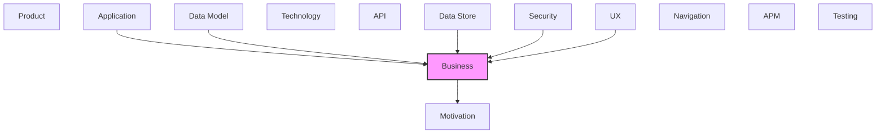

# Business

[← Back to README](../README.md)

Business processes, functions, roles, and services.

## Report Index

- [Layer Introduction](#layer-introduction)
- [Intra-Layer Relationships](#intra-layer-relationships)
- [Inter-Layer Dependencies](#inter-layer-dependencies)
- [Inter-Layer Relationships Table](#inter-layer-relationships-table)
- [Element Reference](#element-reference)

## Layer Introduction

| Metric                    | Count |
| ------------------------- | ----- |
| Elements                  | 14    |
| Intra-Layer Relationships | 16    |
| Inter-Layer Relationships | 40    |
| Inbound Relationships     | 33    |
| Outbound Relationships    | 7     |

**Cross-Layer References**:

- **Upstream layers**: [Application](./05-application-layer-report.md), [Data Model](./08-data-model-layer-report.md), [Data Store](./09-data-store-layer-report.md), [Security](./04-security-layer-report.md), [UX](./10-ux-layer-report.md)
- **Downstream layers**: [Motivation](./01-motivation-layer-report.md)

## Intra-Layer Relationships

```mermaid
flowchart LR
  subgraph business
    business_businessfunction_cross_layer_reference_resolution["Cross-Layer Reference Resolution"]
    business_businessobject_annotation["Annotation"]
    business_businessobject_architecture_model["Architecture Model"]
    business_businessobject_changeset["Changeset"]
    business_businessprocess_authentication_flow["Authentication Flow"]
    business_businessprocess_changeset_review_flow["Changeset Review Flow"]
    business_businessprocess_real_time_model_synchronization["Real-time Model Synchronization"]
    business_businessrole_architecture_reviewer["Architecture Reviewer"]
    business_businessrole_model_author["Model Author"]
    business_businessservice_ai_assisted_architecture_chat["AI-Assisted Architecture Chat"]
    business_businessservice_architecture_model_visualization["Architecture Model Visualization"]
    business_businessservice_changeset_review["Changeset Review"]
    business_businessservice_model_annotation["Model Annotation"]
    business_businessservice_schema_exploration["Schema Exploration"]
    03823476_93f8_4ab4_8c51_cd93bf459ff0 -->|delivers| 99380a26_1064_4515_9d15_fec7620549cd
    35295e18_08a8_4ca0_ada3_40a017cb4318 -->|delivers| ffa6bf4a_5281_402f_90d8_a895173fc4ba
    af8620f0_9b01_41f2_992c_b90355d2e92c -->|delivers| ea84399d_45dc_4fef_a5a1_759c9b5b5870
    business_businessfunction_cross_layer_reference_resolution -->|accesses| business_businessobject_architecture_model
    business_businessfunction_cross_layer_reference_resolution -->|realizes| business_businessservice_architecture_model_visualization
    business_businessobject_architecture_model -->|composes| business_businessobject_annotation
    business_businessobject_architecture_model -->|composes| business_businessobject_changeset
    business_businessprocess_authentication_flow -->|realizes| business_businessservice_ai_assisted_architecture_chat
    business_businessprocess_changeset_review_flow -->|accesses| business_businessobject_architecture_model
    business_businessprocess_changeset_review_flow -->|accesses| business_businessobject_changeset
    business_businessprocess_changeset_review_flow -->|realizes| business_businessservice_changeset_review
    business_businessprocess_real_time_model_synchronization -->|realizes| business_businessservice_architecture_model_visualization
    business_businessrole_architecture_reviewer -->|assigned-to| business_businessprocess_changeset_review_flow
    business_businessservice_architecture_model_visualization -->|delivers| business_businessobject_architecture_model
    business_businessservice_changeset_review -->|delivers| business_businessobject_changeset
    business_businessservice_model_annotation -->|delivers| business_businessobject_annotation
  end
```

## Inter-Layer Dependencies

## Inter-Layer Relationships Table

| Relationship ID                                                                       | Source Node                                                | Dest Node                                                   | Dest Layer   | Predicate    | Cardinality  | Strength |
| ------------------------------------------------------------------------------------- | ---------------------------------------------------------- | ----------------------------------------------------------- | ------------ | ------------ | ------------ | -------- |
| `03823476-93f8-4ab4-8c51-cd93bf459ff0-realizes-59d25358-33d1-4c2d-b8fb-2a03ab216ae6`  | `03823476-93f8-4ab4-8c51-cd93bf459ff0`                     | `59d25358-33d1-4c2d-b8fb-2a03ab216ae6`                      | `motivation` | `realizes`   | unknown      | unknown  |
| `35295e18-08a8-4ca0-ada3-40a017cb4318-realizes-462e2931-4c7c-4051-a9ac-8817c270d650`  | `35295e18-08a8-4ca0-ada3-40a017cb4318`                     | `462e2931-4c7c-4051-a9ac-8817c270d650`                      | `motivation` | `realizes`   | unknown      | unknown  |
| `35295e18-08a8-4ca0-ada3-40a017cb4318-satisfies-e748118c-b989-43fe-b0d2-9121e931fcd2` | `35295e18-08a8-4ca0-ada3-40a017cb4318`                     | `e748118c-b989-43fe-b0d2-9121e931fcd2`                      | `motivation` | `satisfies`  | unknown      | unknown  |
| `5308e41f-71c9-4ca6-8dfc-11d8b0483ce8-realizes-59d25358-33d1-4c2d-b8fb-2a03ab216ae6`  | `5308e41f-71c9-4ca6-8dfc-11d8b0483ce8`                     | `59d25358-33d1-4c2d-b8fb-2a03ab216ae6`                      | `motivation` | `realizes`   | unknown      | unknown  |
| `582fd707-9e0d-4a98-9b47-b3cda7b26c3d-realizes-ea84399d-45dc-4fef-a5a1-759c9b5b5870`  | `582fd707-9e0d-4a98-9b47-b3cda7b26c3d`                     | `ea84399d-45dc-4fef-a5a1-759c9b5b5870`                      | `business`   | `realizes`   | unknown      | unknown  |
| `6b2f9b1a-bd90-4b1e-9ee2-bed4cbb73a04-realizes-c20e00b6-ef86-415a-92a3-3e9fd9dc7cd6`  | `6b2f9b1a-bd90-4b1e-9ee2-bed4cbb73a04`                     | `c20e00b6-ef86-415a-92a3-3e9fd9dc7cd6`                      | `business`   | `realizes`   | unknown      | unknown  |
| `83c81f34-4376-4ff9-8fb4-98f3ecbc6d68-satisfies-e748118c-b989-43fe-b0d2-9121e931fcd2` | `83c81f34-4376-4ff9-8fb4-98f3ecbc6d68`                     | `e748118c-b989-43fe-b0d2-9121e931fcd2`                      | `motivation` | `satisfies`  | unknown      | unknown  |
| `a0080aee-7e84-4c2c-8d76-0cd604bfd7f5-realizes-ea84399d-45dc-4fef-a5a1-759c9b5b5870`  | `a0080aee-7e84-4c2c-8d76-0cd604bfd7f5`                     | `ea84399d-45dc-4fef-a5a1-759c9b5b5870`                      | `business`   | `realizes`   | unknown      | unknown  |
| `a77489e0-4e1f-42b1-b3e1-b1b534e6e7f8-accesses-ea84399d-45dc-4fef-a5a1-759c9b5b5870`  | `a77489e0-4e1f-42b1-b3e1-b1b534e6e7f8`                     | `ea84399d-45dc-4fef-a5a1-759c9b5b5870`                      | `business`   | `accesses`   | unknown      | unknown  |
| `a77489e0-4e1f-42b1-b3e1-b1b534e6e7f8-realizes-35295e18-08a8-4ca0-ada3-40a017cb4318`  | `a77489e0-4e1f-42b1-b3e1-b1b534e6e7f8`                     | `35295e18-08a8-4ca0-ada3-40a017cb4318`                      | `business`   | `realizes`   | unknown      | unknown  |
| `a920ab1c-c481-46b6-bdb4-4050501adeac-realizes-e642ad79-62ea-47a4-ae04-d512d0ef7881`  | `a920ab1c-c481-46b6-bdb4-4050501adeac`                     | `e642ad79-62ea-47a4-ae04-d512d0ef7881`                      | `business`   | `realizes`   | unknown      | unknown  |
| `a920ab1c-c481-46b6-bdb4-4050501adeac-serves-c20e00b6-ef86-415a-92a3-3e9fd9dc7cd6`    | `a920ab1c-c481-46b6-bdb4-4050501adeac`                     | `c20e00b6-ef86-415a-92a3-3e9fd9dc7cd6`                      | `business`   | `serves`     | unknown      | unknown  |
| `application.applicationservice.accesses.business.businessobject`                     | `application.applicationservice.changeset-impact-analysis` | `business.businessobject.changeset`                         | `business`   | `accesses`   | many-to-many | medium   |
| `application.applicationservice.realizes.business.businessservice`                    | `application.applicationservice.changeset-impact-analysis` | `business.businessservice.changeset-review`                 | `business`   | `realizes`   | many-to-many | medium   |
| `application.applicationservice.realizes.business.businessservice`                    | `application.applicationservice.chat-validation`           | `business.businessservice.ai-assisted-architecture-chat`    | `business`   | `realizes`   | many-to-many | medium   |
| `application.applicationservice.realizes.business.businessservice`                    | `application.applicationservice.embedded-data-loader`      | `business.businessservice.architecture-model-visualization` | `business`   | `realizes`   | many-to-many | medium   |
| `application.applicationservice.serves.business.businessprocess`                      | `application.applicationservice.json-rpc-handler`          | `business.businessprocess.real-time-model-synchronization`  | `business`   | `serves`     | many-to-many | medium   |
| `application.applicationservice.realizes.business.businessservice`                    | `application.applicationservice.model-graph-transform`     | `business.businessservice.architecture-model-visualization` | `business`   | `realizes`   | many-to-many | medium   |
| `application.applicationservice.realizes.business.businessservice`                    | `application.applicationservice.spec-graph-transform`      | `business.businessservice.schema-exploration`               | `business`   | `realizes`   | many-to-many | medium   |
| `application.applicationservice.serves.business.businessprocess`                      | `application.applicationservice.web-socket-client`         | `business.businessprocess.real-time-model-synchronization`  | `business`   | `serves`     | many-to-many | medium   |
| `b7775f1a-2418-4c7a-84aa-997efd658a97-realizes-35295e18-08a8-4ca0-ada3-40a017cb4318`  | `b7775f1a-2418-4c7a-84aa-997efd658a97`                     | `35295e18-08a8-4ca0-ada3-40a017cb4318`                      | `business`   | `realizes`   | unknown      | unknown  |
| `b7775f1a-2418-4c7a-84aa-997efd658a97-serves-83c81f34-4376-4ff9-8fb4-98f3ecbc6d68`    | `b7775f1a-2418-4c7a-84aa-997efd658a97`                     | `83c81f34-4376-4ff9-8fb4-98f3ecbc6d68`                      | `business`   | `serves`     | unknown      | unknown  |
| `business.businessservice.realizes.motivation.goal`                                   | `business.businessservice.schema-exploration`              | `motivation.goal.visualize-multi-layer-architecture-models` | `motivation` | `realizes`   | many-to-many | medium   |
| `cfe8d725-4f64-4eae-b2fa-825e4a774a3a-realizes-ffa6bf4a-5281-402f-90d8-a895173fc4ba`  | `cfe8d725-4f64-4eae-b2fa-825e4a774a3a`                     | `ffa6bf4a-5281-402f-90d8-a895173fc4ba`                      | `business`   | `realizes`   | unknown      | unknown  |
| `data-model.objectschema.realizes.business.businessobject`                            | `data-model.objectschema.extracted-reference`              | `business.businessobject.architecture-model`                | `business`   | `realizes`   | many-to-many | medium   |
| `data-model.objectschema.realizes.business.businessobject`                            | `data-model.objectschema.model-metadata`                   | `business.businessobject.architecture-model`                | `business`   | `realizes`   | many-to-many | medium   |
| `data-model.objectschema.realizes.business.businessobject`                            | `data-model.objectschema.reference`                        | `business.businessobject.architecture-model`                | `business`   | `realizes`   | many-to-many | medium   |
| `data-store.collection.realizes.business.businessobject`                              | `data-store.collection.changeset-files`                    | `business.businessobject.changeset`                         | `business`   | `realizes`   | many-to-many | medium   |
| `data-store.collection.realizes.business.businessobject`                              | `data-store.collection.model-manifest`                     | `business.businessobject.architecture-model`                | `business`   | `realizes`   | many-to-many | medium   |
| `e642ad79-62ea-47a4-ae04-d512d0ef7881-realizes-731285cc-dc15-4c64-a342-a933ce00bd61`  | `e642ad79-62ea-47a4-ae04-d512d0ef7881`                     | `731285cc-dc15-4c64-a342-a933ce00bd61`                      | `motivation` | `realizes`   | unknown      | unknown  |
| `fbd68c51-36fa-48ef-b381-5599d2678a90-serves-83c81f34-4376-4ff9-8fb4-98f3ecbc6d68`    | `fbd68c51-36fa-48ef-b381-5599d2678a90`                     | `83c81f34-4376-4ff9-8fb4-98f3ecbc6d68`                      | `business`   | `serves`     | unknown      | unknown  |
| `security.secureresource.references.business.businessobject`                          | `security.secureresource.model-rest-api`                   | `business.businessobject.architecture-model`                | `business`   | `references` | many-to-many | medium   |
| `security.secureresource.references.business.businessobject`                          | `security.secureresource.web-socket-json-rpc-channel`      | `business.businessobject.architecture-model`                | `business`   | `references` | many-to-many | medium   |
| `ux.view.references.business.businessobject`                                          | `ux.view.changesets-view`                                  | `business.businessobject.changeset`                         | `business`   | `references` | many-to-many | medium   |
| `ux.view.serves.business.businessrole`                                                | `ux.view.changesets-view`                                  | `business.businessrole.architecture-reviewer`               | `business`   | `serves`     | many-to-many | medium   |
| `ux.view.serves.business.businessrole`                                                | `ux.view.dr-bot-chat-drawer`                               | `business.businessrole.model-author`                        | `business`   | `serves`     | many-to-many | medium   |
| `ux.view.references.business.businessobject`                                          | `ux.view.inspector-drawer`                                 | `business.businessobject.annotation`                        | `business`   | `references` | many-to-many | medium   |
| `ux.view.references.business.businessobject`                                          | `ux.view.model-view`                                       | `business.businessobject.architecture-model`                | `business`   | `references` | many-to-many | medium   |
| `ux.view.serves.business.businessrole`                                                | `ux.view.model-view`                                       | `business.businessrole.architecture-reviewer`               | `business`   | `serves`     | many-to-many | medium   |
| `ux.view.references.business.businessobject`                                          | `ux.view.schema-view`                                      | `business.businessobject.architecture-model`                | `business`   | `references` | many-to-many | medium   |

## Element Reference

### Cross-Layer Reference Resolution {#cross-layer-reference-resolution}

**ID**: `business.businessfunction.cross-layer-reference-resolution`

**Type**: `businessfunction`

Resolution of cross-layer relationship links between model elements across all 12 architecture layers; links in the /api/model payload reference endpoints by canonical dotted id (layer.type.slug) or raw UUID, resolved via a dual-index (data/modelGraph.ts) so relationship swatches and click-to-navigate work across layers. Reimplemented client-side in the June 2026 Heimdall UX rebuild, replacing the old crossLayerReferenceExtractor.ts/crossLayerProcessor.ts/crossLayerLinksExtractor.ts services.

#### Relationships

| Type        | Related Element                                             | Predicate  | Direction |
| ----------- | ----------------------------------------------------------- | ---------- | --------- |
| intra-layer | `business.businessobject.architecture-model`                | `accesses` | outbound  |
| intra-layer | `business.businessservice.architecture-model-visualization` | `realizes` | outbound  |

### Annotation {#annotation}

**ID**: `business.businessobject.annotation`

**Type**: `businessobject`

User-created comment or markup attached to a specific model element for collaborative review

#### Relationships

| Type        | Related Element                              | Predicate    | Direction |
| ----------- | -------------------------------------------- | ------------ | --------- |
| inter-layer | `ux.view.inspector-drawer`                   | `references` | inbound   |
| intra-layer | `business.businessobject.architecture-model` | `composes`   | inbound   |
| intra-layer | `business.businessservice.model-annotation`  | `delivers`   | inbound   |

### Architecture Model {#architecture-model}

**ID**: `business.businessobject.architecture-model`

**Type**: `businessobject`

The multi-layer YAML architecture model managed by DR CLI and visualized by the viewer

#### Relationships

| Type        | Related Element                                              | Predicate    | Direction |
| ----------- | ------------------------------------------------------------ | ------------ | --------- |
| inter-layer | `data-model.objectschema.extracted-reference`                | `realizes`   | inbound   |
| inter-layer | `data-model.objectschema.model-metadata`                     | `realizes`   | inbound   |
| inter-layer | `data-model.objectschema.reference`                          | `realizes`   | inbound   |
| inter-layer | `data-store.collection.model-manifest`                       | `realizes`   | inbound   |
| inter-layer | `security.secureresource.model-rest-api`                     | `references` | inbound   |
| inter-layer | `security.secureresource.web-socket-json-rpc-channel`        | `references` | inbound   |
| inter-layer | `ux.view.model-view`                                         | `references` | inbound   |
| inter-layer | `ux.view.schema-view`                                        | `references` | inbound   |
| intra-layer | `business.businessfunction.cross-layer-reference-resolution` | `accesses`   | inbound   |
| intra-layer | `business.businessobject.annotation`                         | `composes`   | outbound  |
| intra-layer | `business.businessobject.changeset`                          | `composes`   | outbound  |
| intra-layer | `business.businessprocess.changeset-review-flow`             | `accesses`   | inbound   |
| intra-layer | `business.businessservice.architecture-model-visualization`  | `delivers`   | inbound   |

### Changeset {#changeset}

**ID**: `business.businessobject.changeset`

**Type**: `businessobject`

A proposed set of architecture model changes that can be reviewed, staged, and committed

#### Relationships

| Type        | Related Element                                            | Predicate    | Direction |
| ----------- | ---------------------------------------------------------- | ------------ | --------- |
| inter-layer | `application.applicationservice.changeset-impact-analysis` | `accesses`   | inbound   |
| inter-layer | `data-store.collection.changeset-files`                    | `realizes`   | inbound   |
| inter-layer | `ux.view.changesets-view`                                  | `references` | inbound   |
| intra-layer | `business.businessobject.architecture-model`               | `composes`   | inbound   |
| intra-layer | `business.businessprocess.changeset-review-flow`           | `accesses`   | inbound   |
| intra-layer | `business.businessservice.changeset-review`                | `delivers`   | inbound   |

### Authentication Flow {#authentication-flow}

**ID**: `business.businessprocess.authentication-flow`

**Type**: `businessprocess`

Magic-link token receipt, storage, and injection into all subsequent API requests

#### Relationships

| Type        | Related Element                                          | Predicate  | Direction |
| ----------- | -------------------------------------------------------- | ---------- | --------- |
| intra-layer | `business.businessservice.ai-assisted-architecture-chat` | `realizes` | outbound  |

### Changeset Review Flow {#changeset-review-flow}

**ID**: `business.businessprocess.changeset-review-flow`

**Type**: `businessprocess`

Process of fetching proposed changesets, visualizing diffs, and presenting them for review

#### Relationships

| Type        | Related Element                               | Predicate     | Direction |
| ----------- | --------------------------------------------- | ------------- | --------- |
| intra-layer | `business.businessobject.architecture-model`  | `accesses`    | outbound  |
| intra-layer | `business.businessobject.changeset`           | `accesses`    | outbound  |
| intra-layer | `business.businessservice.changeset-review`   | `realizes`    | outbound  |
| intra-layer | `business.businessrole.architecture-reviewer` | `assigned-to` | inbound   |

### Real-time Model Synchronization {#real-time-model-synchronization}

**ID**: `business.businessprocess.real-time-model-synchronization`

**Type**: `businessprocess`

Continuous synchronization of model state via WebSocket JSON-RPC connection to DR CLI server

#### Relationships

| Type        | Related Element                                             | Predicate  | Direction |
| ----------- | ----------------------------------------------------------- | ---------- | --------- |
| inter-layer | `application.applicationservice.json-rpc-handler`           | `serves`   | inbound   |
| inter-layer | `application.applicationservice.web-socket-client`          | `serves`   | inbound   |
| intra-layer | `business.businessservice.architecture-model-visualization` | `realizes` | outbound  |

### Architecture Reviewer {#architecture-reviewer}

**ID**: `business.businessrole.architecture-reviewer`

**Type**: `businessrole`

Team member who uses the viewer to review, annotate, and discuss architecture models and changesets

#### Relationships

| Type        | Related Element                                  | Predicate     | Direction |
| ----------- | ------------------------------------------------ | ------------- | --------- |
| inter-layer | `ux.view.changesets-view`                        | `serves`      | inbound   |
| inter-layer | `ux.view.model-view`                             | `serves`      | inbound   |
| intra-layer | `business.businessprocess.changeset-review-flow` | `assigned-to` | outbound  |

### Model Author {#model-author}

**ID**: `business.businessrole.model-author`

**Type**: `businessrole`

Architect who creates and updates the DR model via DR CLI; views results in the viewer

#### Relationships

| Type        | Related Element              | Predicate | Direction |
| ----------- | ---------------------------- | --------- | --------- |
| inter-layer | `ux.view.dr-bot-chat-drawer` | `serves`  | inbound   |

### AI-Assisted Architecture Chat {#ai-assisted-architecture-chat}

**ID**: `business.businessservice.ai-assisted-architecture-chat`

**Type**: `businessservice`

DrBot: a chat drawer scoped to the current selection that answers questions about the model and can stage changesets for review, streamed over the DR CLI's JSON-RPC WebSocket.

#### Relationships

| Type        | Related Element                                  | Predicate  | Direction |
| ----------- | ------------------------------------------------ | ---------- | --------- |
| inter-layer | `application.applicationservice.chat-validation` | `realizes` | inbound   |
| intra-layer | `business.businessprocess.authentication-flow`   | `realizes` | inbound   |

### Architecture Model Visualization {#architecture-model-visualization}

**ID**: `business.businessservice.architecture-model-visualization`

**Type**: `businessservice`

Interactive multi-layer graph visualization of architecture models loaded from DR CLI YAML

#### Relationships

| Type        | Related Element                                              | Predicate  | Direction |
| ----------- | ------------------------------------------------------------ | ---------- | --------- |
| inter-layer | `application.applicationservice.embedded-data-loader`        | `realizes` | inbound   |
| inter-layer | `application.applicationservice.model-graph-transform`       | `realizes` | inbound   |
| intra-layer | `business.businessfunction.cross-layer-reference-resolution` | `realizes` | inbound   |
| intra-layer | `business.businessprocess.real-time-model-synchronization`   | `realizes` | inbound   |
| intra-layer | `business.businessobject.architecture-model`                 | `delivers` | outbound  |

### Changeset Review {#changeset-review}

**ID**: `business.businessservice.changeset-review`

**Type**: `businessservice`

Review a changeset before it lands: its op-coded change list with before/after diffs, its Impact (what it reaches outside itself, as layer lanes, plus a blast-radius summary), and Apply / Discard for a staged changeset.

#### Relationships

| Type        | Related Element                                            | Predicate  | Direction |
| ----------- | ---------------------------------------------------------- | ---------- | --------- |
| inter-layer | `application.applicationservice.changeset-impact-analysis` | `realizes` | inbound   |
| intra-layer | `business.businessprocess.changeset-review-flow`           | `realizes` | inbound   |
| intra-layer | `business.businessobject.changeset`                        | `delivers` | outbound  |

### Model Annotation {#model-annotation}

**ID**: `business.businessservice.model-annotation`

**Type**: `businessservice`

Collaborative annotation of architecture model elements with comments and markup

#### Relationships

| Type        | Related Element                      | Predicate  | Direction |
| ----------- | ------------------------------------ | ---------- | --------- |
| intra-layer | `business.businessobject.annotation` | `delivers` | outbound  |

### Schema Exploration {#schema-exploration}

**ID**: `business.businessservice.schema-exploration`

**Type**: `businessservice`

Browse and inspect layer specification schemas to understand the architecture meta-model

#### Relationships

| Type        | Related Element                                             | Predicate  | Direction |
| ----------- | ----------------------------------------------------------- | ---------- | --------- |
| inter-layer | `application.applicationservice.spec-graph-transform`       | `realizes` | inbound   |
| inter-layer | `motivation.goal.visualize-multi-layer-architecture-models` | `realizes` | outbound  |

---

Generated: 2026-11-12T13:57:21.197Z | Model Version: 0.1.0
