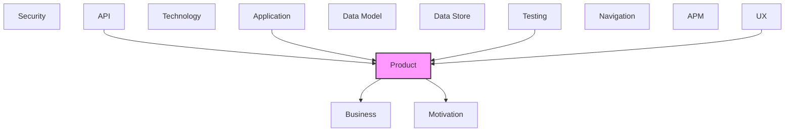

# Product

[← Back to README](../README.md)

Product features, capabilities, personas, and milestones.

## Report Index

- [Layer Introduction](#layer-introduction)
- [Intra-Layer Relationships](#intra-layer-relationships)
- [Inter-Layer Dependencies](#inter-layer-dependencies)
- [Inter-Layer Relationships Table](#inter-layer-relationships-table)
- [Element Reference](#element-reference)

## Layer Introduction

| Metric                    | Count |
| ------------------------- | ----- |
| Elements                  | 31    |
| Intra-Layer Relationships | 59    |
| Inter-Layer Relationships | 85    |
| Inbound Relationships     | 59    |
| Outbound Relationships    | 26    |

**Cross-Layer References**:

- **Upstream layers**: [API](./07-api-layer-report.md), [Application](./05-application-layer-report.md), [Testing](./13-testing-layer-report.md), [UX](./10-ux-layer-report.md)
- **Downstream layers**: [Business](./02-business-layer-report.md), [Motivation](./01-motivation-layer-report.md)

## Intra-Layer Relationships

*This layer has >30 elements. Summary table shown instead of diagram.*

| Element                                           | Type                 | Relationships |
| ------------------------------------------------- | -------------------- | ------------- |
| `product.feature.c4-architecture-diagrams`        | `feature`            | 3             |
| `product.feature.c4-changeset-overlay`            | `feature`            | 3             |
| `product.feature.c4-plan-vs-as-built`             | `feature`            | 3             |
| `product.feature.change-origin-badges`            | `feature`            | 2             |
| `product.feature.changeset-impact-tab`            | `feature`            | 3             |
| `product.feature.changeset-inbox`                 | `feature`            | 3             |
| `product.feature.cross-layer-follow`              | `feature`            | 2             |
| `product.feature.dr-bot-chat-drawer`              | `feature`            | 2             |
| `product.feature.element-annotations`             | `feature`            | 2             |
| `product.feature.model-graph-view`                | `feature`            | 3             |
| `product.feature.model-view-by-type`              | `feature`            | 3             |
| `product.feature.nav-tree-type-groups`            | `feature`            | 3             |
| `product.feature.page-view`                       | `feature`            | 2             |
| `product.feature.per-change-review`               | `feature`            | 4             |
| `product.feature.schema-graph-view`               | `feature`            | 2             |
| `product.feature.tier1-mode-and-routing`          | `feature`            | 3             |
| `product.feature.tier1-spend-panel`               | `feature`            | 4             |
| `product.feature.tier1-warming-progress`          | `feature`            | 3             |
| `product.feature.topbar-search`                   | `feature`            | 4             |
| `product.persona.architecture-reviewer`           | `persona`            | 15            |
| `product.persona.model-author`                    | `persona`            | 10            |
| `product.softwarecapability.changeset-review`     | `softwarecapability` | 7             |
| `product.softwarecapability.model-annotation`     | `softwarecapability` | 1             |
| `product.softwarecapability.model-chat`           | `softwarecapability` | 1             |
| `product.softwarecapability.model-visualization`  | `softwarecapability` | 9             |
| `product.softwarecapability.schema-exploration`   | `softwarecapability` | 2             |
| `product.userworkflow.review-a-staged-changeset`  | `userworkflow`       | 5             |
| `product.workflowstep.apply-the-kept-changes`     | `workflowstep`       | 3             |
| `product.workflowstep.check-the-reach`            | `workflowstep`       | 4             |
| `product.workflowstep.decide-each-change`         | `workflowstep`       | 4             |
| `product.workflowstep.pick-a-changeset-to-review` | `workflowstep`       | 3             |

## Inter-Layer Dependencies

## Inter-Layer Relationships Table

| Relationship ID                                                      | Source Node                                                                                                                           | Dest Node                                                          | Dest Layer   | Predicate    | Cardinality  | Strength |
| -------------------------------------------------------------------- | ------------------------------------------------------------------------------------------------------------------------------------- | ------------------------------------------------------------------ | ------------ | ------------ | ------------ | -------- |
| `api.operation.exposes.product.feature`                              | `api.operation.get-api-tier1`                                                                                                         | `product.feature.tier1-mode-and-routing`                           | `product`    | `exposes`    | many-to-many | medium   |
| `api.operation.exposes.product.feature`                              | `api.operation.get-api-tier1`                                                                                                         | `product.feature.tier1-spend-panel`                                | `product`    | `exposes`    | many-to-many | medium   |
| `api.operation.exposes.product.feature`                              | `api.operation.get-api-tier1`                                                                                                         | `product.feature.tier1-warming-progress`                           | `product`    | `exposes`    | many-to-many | medium   |
| `api.operation.exposes.product.feature`                              | `api.operation.get-changeset-verification`                                                                                            | `product.feature.c4-plan-vs-as-built`                              | `product`    | `exposes`    | many-to-many | medium   |
| `api.operation.exposes.product.feature`                              | `api.operation.put-api-changesets-changeset-id-review`                                                                                | `product.feature.per-change-review`                                | `product`    | `exposes`    | many-to-many | medium   |
| `application.applicationservice.realizes.product.feature`            | `application.applicationservice.c4-changeset-diff`                                                                                    | `product.feature.c4-changeset-overlay`                             | `product`    | `realizes`   | many-to-many | medium   |
| `application.applicationservice.realizes.product.feature`            | `application.applicationservice.c4-diagram-layout`                                                                                    | `product.feature.c4-architecture-diagrams`                         | `product`    | `realizes`   | many-to-many | medium   |
| `application.applicationservice.realizes.product.feature`            | `application.applicationservice.c4-model-transform`                                                                                   | `product.feature.c4-architecture-diagrams`                         | `product`    | `realizes`   | many-to-many | medium   |
| `application.applicationservice.realizes.product.feature`            | `application.applicationservice.c4-plan-comparison`                                                                                   | `product.feature.c4-plan-vs-as-built`                              | `product`    | `realizes`   | many-to-many | medium   |
| `application.applicationservice.realizes.product.feature`            | `application.applicationservice.c4-view-scoping`                                                                                      | `product.feature.c4-architecture-diagrams`                         | `product`    | `realizes`   | many-to-many | medium   |
| `application.applicationservice.realizes.product.feature`            | `application.applicationservice.change-origin-helpers`                                                                                | `product.feature.change-origin-badges`                             | `product`    | `realizes`   | many-to-many | medium   |
| `application.applicationservice.realizes.product.feature`            | `application.applicationservice.changeset-impact-analysis`                                                                            | `product.feature.changeset-impact-tab`                             | `product`    | `realizes`   | many-to-many | medium   |
| `application.applicationservice.realizes.product.feature`            | `application.applicationservice.changeset-model-overlay`                                                                              | `product.feature.c4-changeset-overlay`                             | `product`    | `realizes`   | many-to-many | medium   |
| `application.applicationservice.realizes.product.softwarecapability` | `application.applicationservice.changeset-review-model`                                                                               | `product.softwarecapability.changeset-review`                      | `product`    | `realizes`   | many-to-many | medium   |
| `application.applicationservice.realizes.product.softwarecapability` | `application.applicationservice.chat-service`                                                                                         | `product.softwarecapability.model-chat`                            | `product`    | `realizes`   | many-to-many | medium   |
| `application.applicationservice.realizes.product.feature`            | `application.applicationservice.layered-reach`                                                                                        | `product.feature.cross-layer-follow`                               | `product`    | `realizes`   | many-to-many | medium   |
| `application.applicationservice.realizes.product.softwarecapability` | `application.applicationservice.model-graph-transform`                                                                                | `product.softwarecapability.model-visualization`                   | `product`    | `realizes`   | many-to-many | medium   |
| `application.applicationservice.realizes.product.feature`            | `application.applicationservice.nav-tree-groups`                                                                                      | `product.feature.nav-tree-type-groups`                             | `product`    | `realizes`   | many-to-many | medium   |
| `application.applicationservice.realizes.product.feature`            | `application.applicationservice.node-type-label`                                                                                      | `product.feature.model-view-by-type`                               | `product`    | `realizes`   | many-to-many | medium   |
| `application.applicationservice.realizes.product.feature`            | `application.applicationservice.node-type-label`                                                                                      | `product.feature.nav-tree-type-groups`                             | `product`    | `realizes`   | many-to-many | medium   |
| `application.applicationservice.realizes.product.feature`            | `application.applicationservice.page-data-builder`                                                                                    | `product.feature.page-view`                                        | `product`    | `realizes`   | many-to-many | medium   |
| `application.applicationservice.realizes.product.feature`            | `application.applicationservice.plan-verification`                                                                                    | `product.feature.c4-plan-vs-as-built`                              | `product`    | `realizes`   | many-to-many | medium   |
| `application.applicationservice.realizes.product.feature`            | `application.applicationservice.search-index`                                                                                         | `product.feature.topbar-search`                                    | `product`    | `realizes`   | many-to-many | medium   |
| `application.applicationservice.realizes.product.softwarecapability` | `application.applicationservice.spec-graph-transform`                                                                                 | `product.softwarecapability.schema-exploration`                    | `product`    | `realizes`   | many-to-many | medium   |
| `application.applicationservice.realizes.product.feature`            | `application.applicationservice.type-bands`                                                                                           | `product.feature.model-view-by-type`                               | `product`    | `realizes`   | many-to-many | medium   |
| `application.applicationservice.realizes.product.softwarecapability` | `application.applicationservice.use-annotations`                                                                                      | `product.softwarecapability.model-annotation`                      | `product`    | `realizes`   | many-to-many | medium   |
| `application.applicationservice.realizes.product.feature`            | `application.applicationservice.use-c4model`                                                                                          | `product.feature.c4-architecture-diagrams`                         | `product`    | `realizes`   | many-to-many | medium   |
| `application.applicationservice.realizes.product.feature`            | `application.applicationservice.use-changeset-review`                                                                                 | `product.feature.per-change-review`                                | `product`    | `realizes`   | many-to-many | medium   |
| `application.applicationservice.realizes.product.feature`            | `application.applicationservice.use-tier1`                                                                                            | `product.feature.tier1-mode-and-routing`                           | `product`    | `realizes`   | many-to-many | medium   |
| `application.applicationservice.realizes.product.feature`            | `application.applicationservice.use-tier1`                                                                                            | `product.feature.tier1-spend-panel`                                | `product`    | `realizes`   | many-to-many | medium   |
| `application.applicationservice.realizes.product.feature`            | `application.applicationservice.use-tier1`                                                                                            | `product.feature.tier1-warming-progress`                           | `product`    | `realizes`   | many-to-many | medium   |
| `product.feature.satisfies.motivation.requirement`                   | `product.feature.c4-architecture-diagrams`                                                                                            | `motivation.requirement.architecture-reads-as-c4-diagrams`         | `motivation` | `satisfies`  | many-to-many | medium   |
| `product.feature.satisfies.motivation.requirement`                   | `product.feature.c4-architecture-diagrams`                                                                                            | `motivation.requirement.wcag-21-aa-compliance`                     | `motivation` | `satisfies`  | many-to-many | medium   |
| `product.feature.satisfies.motivation.requirement`                   | `product.feature.c4-changeset-overlay`                                                                                                | `motivation.requirement.architecture-reads-as-c4-diagrams`         | `motivation` | `satisfies`  | many-to-many | medium   |
| `product.feature.satisfies.motivation.requirement`                   | `product.feature.c4-changeset-overlay`                                                                                                | `motivation.requirement.changesets-read-as-architecture-change`    | `motivation` | `satisfies`  | many-to-many | medium   |
| `product.feature.satisfies.motivation.requirement`                   | `product.feature.c4-changeset-overlay`                                                                                                | `motivation.requirement.wcag-21-aa-compliance`                     | `motivation` | `satisfies`  | many-to-many | medium   |
| `product.feature.satisfies.motivation.requirement`                   | `product.feature.c4-plan-vs-as-built`                                                                                                 | `motivation.requirement.architecture-reads-as-c4-diagrams`         | `motivation` | `satisfies`  | many-to-many | medium   |
| `product.feature.satisfies.motivation.requirement`                   | `product.feature.c4-plan-vs-as-built`                                                                                                 | `motivation.requirement.plan-outcome-reads-as-architecture`        | `motivation` | `satisfies`  | many-to-many | medium   |
| `product.feature.satisfies.motivation.requirement`                   | `product.feature.c4-plan-vs-as-built`                                                                                                 | `motivation.requirement.wcag-21-aa-compliance`                     | `motivation` | `satisfies`  | many-to-many | medium   |
| `product.feature.satisfies.motivation.requirement`                   | `product.feature.dr-bot-chat-drawer`                                                                                                  | `motivation.requirement.dr-bot-opens-without-reflowing-the-canvas` | `motivation` | `satisfies`  | many-to-many | medium   |
| `product.feature.satisfies.motivation.requirement`                   | `product.feature.dr-bot-chat-drawer`                                                                                                  | `motivation.requirement.wcag-21-aa-compliance`                     | `motivation` | `satisfies`  | many-to-many | medium   |
| `product.feature.satisfies.motivation.requirement`                   | `product.feature.model-graph-view`                                                                                                    | `motivation.requirement.viewer-covers-every-spec-layer`            | `motivation` | `satisfies`  | many-to-many | medium   |
| `product.feature.satisfies.motivation.requirement`                   | `product.feature.model-view-by-type`                                                                                                  | `motivation.requirement.wcag-21-aa-compliance`                     | `motivation` | `satisfies`  | many-to-many | medium   |
| `product.feature.satisfies.motivation.requirement`                   | `product.feature.per-change-review`                                                                                                   | `motivation.requirement.each-review-change-reads-on-its-own`       | `motivation` | `satisfies`  | many-to-many | medium   |
| `product.feature.satisfies.motivation.requirement`                   | `product.feature.topbar-search`                                                                                                       | `motivation.requirement.find-anything-by-name`                     | `motivation` | `satisfies`  | many-to-many | medium   |
| `product.feature.satisfies.motivation.requirement`                   | `product.feature.topbar-search`                                                                                                       | `motivation.requirement.wcag-21-aa-compliance`                     | `motivation` | `satisfies`  | many-to-many | medium   |
| `product.persona.references.business.businessrole`                   | `product.persona.architecture-reviewer`                                                                                               | `business.businessrole.architecture-reviewer`                      | `business`   | `references` | many-to-many | medium   |
| `product.persona.references.motivation.stakeholder`                  | `product.persona.architecture-reviewer`                                                                                               | `motivation.stakeholder.architecture-team`                         | `motivation` | `references` | many-to-many | medium   |
| `product.persona.references.business.businessrole`                   | `product.persona.model-author`                                                                                                        | `business.businessrole.model-author`                               | `business`   | `references` | many-to-many | medium   |
| `product.persona.references.motivation.stakeholder`                  | `product.persona.model-author`                                                                                                        | `motivation.stakeholder.development-team`                          | `motivation` | `references` | many-to-many | medium   |
| `product.softwarecapability.supports.motivation.goal`                | `product.softwarecapability.changeset-review`                                                                                         | `motivation.goal.accelerate-architecture-documentation`            | `motivation` | `supports`   | many-to-many | medium   |
| `product.softwarecapability.supports.motivation.goal`                | `product.softwarecapability.model-annotation`                                                                                         | `motivation.goal.enable-real-time-collaboration`                   | `motivation` | `supports`   | many-to-many | medium   |
| `product.softwarecapability.supports.motivation.goal`                | `product.softwarecapability.model-chat`                                                                                               | `motivation.goal.accelerate-architecture-documentation`            | `motivation` | `supports`   | many-to-many | medium   |
| `product.softwarecapability.realizes.business.businessfunction`      | `product.softwarecapability.model-visualization`                                                                                      | `business.businessfunction.cross-layer-reference-resolution`       | `business`   | `realizes`   | many-to-many | medium   |
| `product.softwarecapability.supports.motivation.goal`                | `product.softwarecapability.model-visualization`                                                                                      | `motivation.goal.visualize-multi-layer-architecture-models`        | `motivation` | `supports`   | many-to-many | medium   |
| `product.softwarecapability.supports.motivation.goal`                | `product.softwarecapability.schema-exploration`                                                                                       | `motivation.goal.visualize-multi-layer-architecture-models`        | `motivation` | `supports`   | many-to-many | medium   |
| `product.userworkflow.realizes.business.businessprocess`             | `product.userworkflow.review-a-staged-changeset`                                                                                      | `business.businessprocess.changeset-review-flow`                   | `business`   | `realizes`   | many-to-many | medium   |
| `testing.testcasesketch.tests.product.feature`                       | `testing.testcasesketch.architecture-canvas-drills-from-a-container-into-its-components-and-back`                                     | `product.feature.c4-architecture-diagrams`                         | `product`    | `tests`      | many-to-many | medium   |
| `testing.testcasesketch.tests.product.feature`                       | `testing.testcasesketch.architecture-view-c4-diagrams-drills-from-a-container-into-its-components-and-down-to-graph-canvas-ef259c90`  | `product.feature.c4-architecture-diagrams`                         | `product`    | `tests`      | many-to-many | medium   |
| `testing.testcasesketch.tests.product.feature`                       | `testing.testcasesketch.architecture-view-c4-diagrams-the-container-diagram-shows-the-people-the-viewer-app-its-storage-and-2589fb8a` | `product.feature.c4-architecture-diagrams`                         | `product`    | `tests`      | many-to-many | medium   |
| `testing.testcasesketch.tests.product.feature`                       | `testing.testcasesketch.architecture-view-plan-vs-as-built-passes-axe-in-light-and-dark`                                              | `product.feature.c4-plan-vs-as-built`                              | `product`    | `tests`      | many-to-many | medium   |
| `testing.testcasesketch.tests.product.feature`                       | `testing.testcasesketch.model-view-control-switches-between-graph-lanes-and-hive-and-persists`                                        | `product.feature.model-view-by-type`                               | `product`    | `tests`      | many-to-many | medium   |
| `testing.testcasesketch.tests.product.feature`                       | `testing.testcasesketch.nav-tree-type-groups-a-layer-opens-onto-collapsed-groups-and-a-group-opens-without-history`                   | `product.feature.nav-tree-type-groups`                             | `product`    | `tests`      | many-to-many | medium   |
| `testing.testcasesketch.tests.product.feature`                       | `testing.testcasesketch.nav-tree-type-groups-a-selection-made-elsewhere-opens-its-group-and-reveals-its-row`                          | `product.feature.nav-tree-type-groups`                             | `product`    | `tests`      | many-to-many | medium   |
| `testing.testcasesketch.tests.product.feature`                       | `testing.testcasesketch.tier1panel-mode-and-routing-lists-open-routers-allowed-upstreams-no-fallbacks-and-no-data-collection`         | `product.feature.tier1-mode-and-routing`                           | `product`    | `tests`      | many-to-many | medium   |
| `testing.testcasesketch.tests.product.feature`                       | `testing.testcasesketch.tier1panel-mode-and-routing-says-whether-tier-1-stages-without-the-agent-and-why`                             | `product.feature.tier1-mode-and-routing`                           | `product`    | `tests`      | many-to-many | medium   |
| `testing.testcasesketch.tests.product.feature`                       | `testing.testcasesketch.tier1panel-warming-says-the-cards-are-still-being-built-while-cards-is-null`                                  | `product.feature.tier1-warming-progress`                           | `product`    | `tests`      | many-to-many | medium   |
| `testing.testcasesketch.tests.product.feature`                       | `testing.testcasesketch.tier1panel-warming-shows-the-fills-progress-time-left-and-cost-so-far`                                        | `product.feature.tier1-warming-progress`                           | `product`    | `tests`      | many-to-many | medium   |
| `testing.testcasesketch.tests.product.feature`                       | `testing.testcasesketch.topbar-search-a-node-type-result-opens-it-in-the-schema-view`                                                 | `product.feature.topbar-search`                                    | `product`    | `tests`      | many-to-many | medium   |
| `testing.testcasesketch.tests.product.feature`                       | `testing.testcasesketch.topbar-search-says-so-when-nothing-matches`                                                                   | `product.feature.topbar-search`                                    | `product`    | `tests`      | many-to-many | medium   |
| `testing.testcasesketch.tests.product.feature`                       | `testing.testcasesketch.topbar-search-typing-lists-grouped-results-and-enter-on-an-element-navigates-as-a-nav-tree-leaf-does`         | `product.feature.topbar-search`                                    | `product`    | `tests`      | many-to-many | medium   |
| `ux.view.realizes.product.feature`                                   | `ux.view.architecture-view`                                                                                                           | `product.feature.c4-architecture-diagrams`                         | `product`    | `realizes`   | many-to-many | medium   |
| `ux.view.realizes.product.feature`                                   | `ux.view.architecture-view`                                                                                                           | `product.feature.c4-changeset-overlay`                             | `product`    | `realizes`   | many-to-many | medium   |
| `ux.view.realizes.product.feature`                                   | `ux.view.architecture-view`                                                                                                           | `product.feature.c4-plan-vs-as-built`                              | `product`    | `realizes`   | many-to-many | medium   |
| `ux.view.realizes.product.feature`                                   | `ux.view.changesets-view`                                                                                                             | `product.feature.changeset-inbox`                                  | `product`    | `realizes`   | many-to-many | medium   |
| `ux.view.realizes.product.feature`                                   | `ux.view.changesets-view`                                                                                                             | `product.feature.per-change-review`                                | `product`    | `realizes`   | many-to-many | medium   |
| `ux.view.realizes.product.feature`                                   | `ux.view.changesets-view`                                                                                                             | `product.feature.tier1-mode-and-routing`                           | `product`    | `realizes`   | many-to-many | medium   |
| `ux.view.realizes.product.feature`                                   | `ux.view.changesets-view`                                                                                                             | `product.feature.tier1-warming-progress`                           | `product`    | `realizes`   | many-to-many | medium   |
| `ux.view.realizes.product.feature`                                   | `ux.view.dr-bot-chat-drawer`                                                                                                          | `product.feature.dr-bot-chat-drawer`                               | `product`    | `realizes`   | many-to-many | medium   |
| `ux.view.realizes.product.feature`                                   | `ux.view.inspector-drawer`                                                                                                            | `product.feature.cross-layer-follow`                               | `product`    | `realizes`   | many-to-many | medium   |
| `ux.view.realizes.product.feature`                                   | `ux.view.inspector-drawer`                                                                                                            | `product.feature.element-annotations`                              | `product`    | `realizes`   | many-to-many | medium   |
| `ux.view.realizes.product.feature`                                   | `ux.view.model-view`                                                                                                                  | `product.feature.model-graph-view`                                 | `product`    | `realizes`   | many-to-many | medium   |
| `ux.view.realizes.product.feature`                                   | `ux.view.model-view`                                                                                                                  | `product.feature.model-view-by-type`                               | `product`    | `realizes`   | many-to-many | medium   |
| `ux.view.realizes.product.feature`                                   | `ux.view.schema-view`                                                                                                                 | `product.feature.schema-graph-view`                                | `product`    | `realizes`   | many-to-many | medium   |
| `ux.view.realizes.product.feature`                                   | `ux.view.topbar-search`                                                                                                               | `product.feature.topbar-search`                                    | `product`    | `realizes`   | many-to-many | medium   |

## Element Reference

### C4 Architecture Diagrams {#c4-architecture-diagrams}

**ID**: `product.feature.c4-architecture-diagrams`

**Type**: `feature`

The model as a C4 diagram set in a top-level Architecture view: System Context, Containers and Components, with drill-down into any container or component that has parts. People, the system, external systems, containers and components are derived from the DR model by rules keyed on spec types; a box opens the model elements behind it. Proof of concept: Deployment and Dynamic diagrams not yet; the changeset overlay is the C4 Changeset Overlay feature.

#### Attributes

| Name     | Value   |
| -------- | ------- |
| priority | high    |
| size     | l       |
| status   | planned |

#### Relationships

| Type        | Related Element                                                                                                                       | Predicate   | Direction |
| ----------- | ------------------------------------------------------------------------------------------------------------------------------------- | ----------- | --------- |
| inter-layer | `application.applicationservice.c4-diagram-layout`                                                                                    | `realizes`  | inbound   |
| inter-layer | `application.applicationservice.c4-model-transform`                                                                                   | `realizes`  | inbound   |
| inter-layer | `application.applicationservice.c4-view-scoping`                                                                                      | `realizes`  | inbound   |
| inter-layer | `application.applicationservice.use-c4model`                                                                                          | `realizes`  | inbound   |
| inter-layer | `motivation.requirement.architecture-reads-as-c4-diagrams`                                                                            | `satisfies` | outbound  |
| inter-layer | `motivation.requirement.wcag-21-aa-compliance`                                                                                        | `satisfies` | outbound  |
| inter-layer | `testing.testcasesketch.architecture-canvas-drills-from-a-container-into-its-components-and-back`                                     | `tests`     | inbound   |
| inter-layer | `testing.testcasesketch.architecture-view-c4-diagrams-drills-from-a-container-into-its-components-and-down-to-graph-canvas-ef259c90`  | `tests`     | inbound   |
| inter-layer | `testing.testcasesketch.architecture-view-c4-diagrams-the-container-diagram-shows-the-people-the-viewer-app-its-storage-and-2589fb8a` | `tests`     | inbound   |
| inter-layer | `ux.view.architecture-view`                                                                                                           | `realizes`  | inbound   |
| intra-layer | `product.softwarecapability.model-visualization`                                                                                      | `realizes`  | outbound  |
| intra-layer | `product.persona.architecture-reviewer`                                                                                               | `serves`    | outbound  |
| intra-layer | `product.persona.model-author`                                                                                                        | `serves`    | outbound  |

### C4 Changeset Overlay {#c4-changeset-overlay}

**ID**: `product.feature.c4-changeset-overlay`

**Type**: `feature`

A changeset laid over the Architecture view's C4 diagrams: op marks on cards and arrows (never colour alone), roll-up counts on boxes whose parts changed, removed boxes and arrows drawn back as ghosts, and an "In this changeset" drawer section. Opened with `?changeset=` from a picker in the Architecture view or from the Changesets view. A staged changeset reads base to after; an applied one is reverted, before to current.

#### Attributes

| Name     | Value   |
| -------- | ------- |
| priority | high    |
| size     | m       |
| status   | planned |

#### Relationships

| Type        | Related Element                                                 | Predicate    | Direction |
| ----------- | --------------------------------------------------------------- | ------------ | --------- |
| inter-layer | `application.applicationservice.c4-changeset-diff`              | `realizes`   | inbound   |
| inter-layer | `application.applicationservice.changeset-model-overlay`        | `realizes`   | inbound   |
| inter-layer | `motivation.requirement.architecture-reads-as-c4-diagrams`      | `satisfies`  | outbound  |
| inter-layer | `motivation.requirement.changesets-read-as-architecture-change` | `satisfies`  | outbound  |
| inter-layer | `motivation.requirement.wcag-21-aa-compliance`                  | `satisfies`  | outbound  |
| inter-layer | `ux.view.architecture-view`                                     | `realizes`   | inbound   |
| intra-layer | `product.softwarecapability.model-visualization`                | `realizes`   | outbound  |
| intra-layer | `product.persona.architecture-reviewer`                         | `serves`     | outbound  |
| intra-layer | `product.feature.c4-plan-vs-as-built`                           | `depends-on` | inbound   |

### C4 Plan vs As-Built {#c4-plan-vs-as-built}

**ID**: `product.feature.c4-plan-vs-as-built`

**Type**: `feature`

A plan changeset compared with what was built, on the Architecture view's C4 diagrams. The diagram is the model as the plan leaves it, with the as-built record's unplanned elements laid over it. Each box and arrow gets the plan verification's verdict (built as planned, probable, built differently, planned but not built, can't be checked, built but not planned): a glyph and a line style, never colour alone, rolled up to the boxes above it. A verification record pairs with the plan it verifies; any as-built or reconcile changeset can be picked by hand.

#### Attributes

| Name     | Value   |
| -------- | ------- |
| priority | high    |
| size     | m       |
| status   | planned |

#### Relationships

| Type        | Related Element                                                                          | Predicate    | Direction |
| ----------- | ---------------------------------------------------------------------------------------- | ------------ | --------- |
| inter-layer | `api.operation.get-changeset-verification`                                               | `exposes`    | inbound   |
| inter-layer | `application.applicationservice.c4-plan-comparison`                                      | `realizes`   | inbound   |
| inter-layer | `application.applicationservice.plan-verification`                                       | `realizes`   | inbound   |
| inter-layer | `motivation.requirement.architecture-reads-as-c4-diagrams`                               | `satisfies`  | outbound  |
| inter-layer | `motivation.requirement.plan-outcome-reads-as-architecture`                              | `satisfies`  | outbound  |
| inter-layer | `motivation.requirement.wcag-21-aa-compliance`                                           | `satisfies`  | outbound  |
| inter-layer | `testing.testcasesketch.architecture-view-plan-vs-as-built-passes-axe-in-light-and-dark` | `tests`      | inbound   |
| inter-layer | `ux.view.architecture-view`                                                              | `realizes`   | inbound   |
| intra-layer | `product.feature.c4-changeset-overlay`                                                   | `depends-on` | outbound  |
| intra-layer | `product.softwarecapability.model-visualization`                                         | `realizes`   | outbound  |
| intra-layer | `product.persona.architecture-reviewer`                                                  | `serves`     | outbound  |

### Change Origin Badges {#change-origin-badges}

**ID**: `product.feature.change-origin-badges`

**Type**: `feature`

Who decided each staged change (Tier 0 rule, Tier 1 model, agent), with a Decided by filter.

#### Attributes

| Name     | Value     |
| -------- | --------- |
| priority | medium    |
| status   | delivered |

#### Relationships

| Type        | Related Element                                        | Predicate  | Direction |
| ----------- | ------------------------------------------------------ | ---------- | --------- |
| inter-layer | `application.applicationservice.change-origin-helpers` | `realizes` | inbound   |
| intra-layer | `product.softwarecapability.changeset-review`          | `realizes` | outbound  |
| intra-layer | `product.persona.architecture-reviewer`                | `serves`   | outbound  |

### Changeset Impact Tab {#changeset-impact-tab}

**ID**: `product.feature.changeset-impact-tab`

**Type**: `feature`

What a changeset reaches outside itself, as layer lanes, before Apply.

#### Attributes

| Name     | Value     |
| -------- | --------- |
| priority | high      |
| status   | delivered |

#### Relationships

| Type        | Related Element                                            | Predicate  | Direction |
| ----------- | ---------------------------------------------------------- | ---------- | --------- |
| inter-layer | `application.applicationservice.changeset-impact-analysis` | `realizes` | inbound   |
| intra-layer | `product.softwarecapability.changeset-review`              | `realizes` | outbound  |
| intra-layer | `product.persona.architecture-reviewer`                    | `serves`   | outbound  |
| intra-layer | `product.workflowstep.check-the-reach`                     | `uses`     | inbound   |

### Changeset Inbox {#changeset-inbox}

**ID**: `product.feature.changeset-inbox`

**Type**: `feature`

Changesets sorted by what they need from you: plans and DrBot's changes waiting on you or on DrBot (with review progress), extracted changes ready to land as built, verification records paired with the plan they verify, then the history.

#### Attributes

| Name     | Value     |
| -------- | --------- |
| priority | high      |
| status   | delivered |

#### Relationships

| Type        | Related Element                                   | Predicate  | Direction |
| ----------- | ------------------------------------------------- | ---------- | --------- |
| inter-layer | `ux.view.changesets-view`                         | `realizes` | inbound   |
| intra-layer | `product.softwarecapability.changeset-review`     | `realizes` | outbound  |
| intra-layer | `product.persona.architecture-reviewer`           | `serves`   | outbound  |
| intra-layer | `product.workflowstep.pick-a-changeset-to-review` | `uses`     | inbound   |

### Cross-Layer Follow {#cross-layer-follow}

**ID**: `product.feature.cross-layer-follow`

**Type**: `feature`

The inspector's Followed across layers section: the selection's reach past its direct links, by layer.

#### Attributes

| Name     | Value     |
| -------- | --------- |
| priority | medium    |
| status   | delivered |

#### Relationships

| Type        | Related Element                                  | Predicate  | Direction |
| ----------- | ------------------------------------------------ | ---------- | --------- |
| inter-layer | `application.applicationservice.layered-reach`   | `realizes` | inbound   |
| inter-layer | `ux.view.inspector-drawer`                       | `realizes` | inbound   |
| intra-layer | `product.softwarecapability.model-visualization` | `realizes` | outbound  |
| intra-layer | `product.persona.architecture-reviewer`          | `serves`   | outbound  |

### DrBot Chat Drawer {#drbot-chat-drawer}

**ID**: `product.feature.dr-bot-chat-drawer`

**Type**: `feature`

Streaming chat with DrBot that carries the current view and selection as context, in a floating panel that leaves the canvas and the Inspector in place (or a docked column, by choice).

#### Attributes

| Name     | Value     |
| -------- | --------- |
| priority | high      |
| status   | delivered |

#### Relationships

| Type        | Related Element                                                    | Predicate   | Direction |
| ----------- | ------------------------------------------------------------------ | ----------- | --------- |
| inter-layer | `motivation.requirement.dr-bot-opens-without-reflowing-the-canvas` | `satisfies` | outbound  |
| inter-layer | `motivation.requirement.wcag-21-aa-compliance`                     | `satisfies` | outbound  |
| inter-layer | `ux.view.dr-bot-chat-drawer`                                       | `realizes`  | inbound   |
| intra-layer | `product.softwarecapability.model-chat`                            | `realizes`  | outbound  |
| intra-layer | `product.persona.model-author`                                     | `serves`    | outbound  |

### Element Annotations {#element-annotations}

**ID**: `product.feature.element-annotations`

**Type**: `feature`

Comments and replies on model elements in the inspector, resolved or edited in place.

#### Attributes

| Name     | Value     |
| -------- | --------- |
| priority | medium    |
| status   | delivered |

#### Relationships

| Type        | Related Element                               | Predicate  | Direction |
| ----------- | --------------------------------------------- | ---------- | --------- |
| inter-layer | `ux.view.inspector-drawer`                    | `realizes` | inbound   |
| intra-layer | `product.softwarecapability.model-annotation` | `realizes` | outbound  |
| intra-layer | `product.persona.architecture-reviewer`       | `serves`   | outbound  |

### Model Graph View {#model-graph-view}

**ID**: `product.feature.model-graph-view`

**Type**: `feature`

Per-layer instance graph with Clustered, Organic and Orthogonal layouts, card or pill nodes and the inspector drawer.

#### Attributes

| Name     | Value     |
| -------- | --------- |
| priority | critical  |
| status   | delivered |

#### Relationships

| Type        | Related Element                                         | Predicate   | Direction |
| ----------- | ------------------------------------------------------- | ----------- | --------- |
| inter-layer | `motivation.requirement.viewer-covers-every-spec-layer` | `satisfies` | outbound  |
| inter-layer | `ux.view.model-view`                                    | `realizes`  | inbound   |
| intra-layer | `product.softwarecapability.model-visualization`        | `realizes`  | outbound  |
| intra-layer | `product.persona.architecture-reviewer`                 | `serves`    | outbound  |
| intra-layer | `product.persona.model-author`                          | `serves`    | outbound  |

### Model View by Type {#model-view-by-type}

**ID**: `product.feature.model-view-by-type`

**Type**: `feature`

See one DR layer's elements grouped by node type: lanes (one per type, linked types adjacent) or a hive (one axis per type), chosen in the Model view's View control beside Layout.

#### Attributes

| Name     | Value   |
| -------- | ------- |
| priority | medium  |
| size     | m       |
| status   | planned |

#### Relationships

| Type        | Related Element                                                                                | Predicate   | Direction |
| ----------- | ---------------------------------------------------------------------------------------------- | ----------- | --------- |
| inter-layer | `application.applicationservice.node-type-label`                                               | `realizes`  | inbound   |
| inter-layer | `application.applicationservice.type-bands`                                                    | `realizes`  | inbound   |
| inter-layer | `motivation.requirement.wcag-21-aa-compliance`                                                 | `satisfies` | outbound  |
| inter-layer | `testing.testcasesketch.model-view-control-switches-between-graph-lanes-and-hive-and-persists` | `tests`     | inbound   |
| inter-layer | `ux.view.model-view`                                                                           | `realizes`  | inbound   |
| intra-layer | `product.softwarecapability.model-visualization`                                               | `realizes`  | outbound  |
| intra-layer | `product.persona.architecture-reviewer`                                                        | `serves`    | outbound  |
| intra-layer | `product.persona.model-author`                                                                 | `serves`    | outbound  |

### Nav Tree Type Groups {#nav-tree-type-groups}

**ID**: `product.feature.nav-tree-type-groups`

**Type**: `feature`

The left rail's Model tree groups each layer's elements under their node type with a count (Layer › Node type (n) › Element). Groups start collapsed and sort A–Z by type label, elements A–Z inside; a type with one element still gets a group. The selected element's group opens wherever it was chosen. Opening a group pushes no history. The Schema tree is unchanged.

#### Attributes

| Name     | Value   |
| -------- | ------- |
| priority | medium  |
| size     | s       |
| status   | planned |

#### Relationships

| Type        | Related Element                                                                                                     | Predicate  | Direction |
| ----------- | ------------------------------------------------------------------------------------------------------------------- | ---------- | --------- |
| inter-layer | `application.applicationservice.nav-tree-groups`                                                                    | `realizes` | inbound   |
| inter-layer | `application.applicationservice.node-type-label`                                                                    | `realizes` | inbound   |
| inter-layer | `testing.testcasesketch.nav-tree-type-groups-a-layer-opens-onto-collapsed-groups-and-a-group-opens-without-history` | `tests`    | inbound   |
| inter-layer | `testing.testcasesketch.nav-tree-type-groups-a-selection-made-elsewhere-opens-its-group-and-reveals-its-row`        | `tests`    | inbound   |
| intra-layer | `product.softwarecapability.model-visualization`                                                                    | `realizes` | outbound  |
| intra-layer | `product.persona.architecture-reviewer`                                                                             | `serves`   | outbound  |
| intra-layer | `product.persona.model-author`                                                                                      | `serves`   | outbound  |

### Page View {#page-view}

**ID**: `product.feature.page-view`

**Type**: `feature`

Layer, node type and element detail pages with tables and a neighbourhood graph.

#### Attributes

| Name     | Value     |
| -------- | --------- |
| priority | medium    |
| status   | delivered |

#### Relationships

| Type        | Related Element                                    | Predicate  | Direction |
| ----------- | -------------------------------------------------- | ---------- | --------- |
| inter-layer | `application.applicationservice.page-data-builder` | `realizes` | inbound   |
| intra-layer | `product.softwarecapability.model-visualization`   | `realizes` | outbound  |
| intra-layer | `product.persona.architecture-reviewer`            | `serves`   | outbound  |

### Per-Change Review {#per-change-review}

**ID**: `product.feature.per-change-review`

**Type**: `feature`

Keep, Drop or Ask DrBot on each change, grouped by review weight, with the change inspector and Apply of the kept ones.

#### Attributes

| Name     | Value     |
| -------- | --------- |
| priority | critical  |
| status   | delivered |

#### Relationships

| Type        | Related Element                                              | Predicate   | Direction |
| ----------- | ------------------------------------------------------------ | ----------- | --------- |
| inter-layer | `api.operation.put-api-changesets-changeset-id-review`       | `exposes`   | inbound   |
| inter-layer | `application.applicationservice.use-changeset-review`        | `realizes`  | inbound   |
| inter-layer | `motivation.requirement.each-review-change-reads-on-its-own` | `satisfies` | outbound  |
| inter-layer | `ux.view.changesets-view`                                    | `realizes`  | inbound   |
| intra-layer | `product.softwarecapability.changeset-review`                | `realizes`  | outbound  |
| intra-layer | `product.persona.architecture-reviewer`                      | `serves`    | outbound  |
| intra-layer | `product.workflowstep.apply-the-kept-changes`                | `uses`      | inbound   |
| intra-layer | `product.workflowstep.decide-each-change`                    | `uses`      | inbound   |

### Schema Graph View {#schema-graph-view}

**ID**: `product.feature.schema-graph-view`

**Type**: `feature`

Per-layer node-type graph with predicates and cardinality.

#### Attributes

| Name     | Value     |
| -------- | --------- |
| priority | medium    |
| status   | delivered |

#### Relationships

| Type        | Related Element                                 | Predicate  | Direction |
| ----------- | ----------------------------------------------- | ---------- | --------- |
| inter-layer | `ux.view.schema-view`                           | `realizes` | inbound   |
| intra-layer | `product.softwarecapability.schema-exploration` | `realizes` | outbound  |
| intra-layer | `product.persona.model-author`                  | `serves`   | outbound  |

### Tier1 Mode And Routing {#tier1-mode-and-routing}

**ID**: `product.feature.tier1-mode-and-routing`

**Type**: `feature`

The Tier 1 panel says whether Tier 1 stages changes without the agent or only suggests them (with the server's reason), and, for OpenRouter, which upstreams may receive card text, with no fallbacks, no data collection and zero data retention when set.

#### Attributes

| Name     | Value   |
| -------- | ------- |
| priority | low     |
| size     | s       |
| status   | planned |

#### Relationships

| Type        | Related Element                                                                                                               | Predicate    | Direction |
| ----------- | ----------------------------------------------------------------------------------------------------------------------------- | ------------ | --------- |
| inter-layer | `api.operation.get-api-tier1`                                                                                                 | `exposes`    | inbound   |
| inter-layer | `application.applicationservice.use-tier1`                                                                                    | `realizes`   | inbound   |
| inter-layer | `testing.testcasesketch.tier1panel-mode-and-routing-lists-open-routers-allowed-upstreams-no-fallbacks-and-no-data-collection` | `tests`      | inbound   |
| inter-layer | `testing.testcasesketch.tier1panel-mode-and-routing-says-whether-tier-1-stages-without-the-agent-and-why`                     | `tests`      | inbound   |
| inter-layer | `ux.view.changesets-view`                                                                                                     | `realizes`   | inbound   |
| intra-layer | `product.feature.tier1-spend-panel`                                                                                           | `depends-on` | outbound  |
| intra-layer | `product.softwarecapability.changeset-review`                                                                                 | `realizes`   | outbound  |
| intra-layer | `product.persona.model-author`                                                                                                | `serves`     | outbound  |

### Tier1 Spend Panel {#tier1-spend-panel}

**ID**: `product.feature.tier1-spend-panel`

**Type**: `feature`

Tier 1's state and this month's spend against the cap, in the changeset inbox. The warming progress and the mode and routing rows build on it.

#### Attributes

| Name     | Value     |
| -------- | --------- |
| priority | low       |
| status   | delivered |

#### Relationships

| Type        | Related Element                               | Predicate    | Direction |
| ----------- | --------------------------------------------- | ------------ | --------- |
| inter-layer | `api.operation.get-api-tier1`                 | `exposes`    | inbound   |
| inter-layer | `application.applicationservice.use-tier1`    | `realizes`   | inbound   |
| intra-layer | `product.feature.tier1-mode-and-routing`      | `depends-on` | inbound   |
| intra-layer | `product.softwarecapability.changeset-review` | `realizes`   | outbound  |
| intra-layer | `product.persona.model-author`                | `serves`     | outbound  |
| intra-layer | `product.feature.tier1-warming-progress`      | `depends-on` | inbound   |

### Tier1 Warming Progress {#tier1-warming-progress}

**ID**: `product.feature.tier1-warming-progress`

**Type**: `feature`

While Tier 1 warms up (a codebase_index job filling the answer cache), the Tier 1 panel shows how many cards are done out of the total (or that the cards are still being built), when the fill started, about how long it has left and what it has cost so far, and refreshes until the fill ends.

#### Attributes

| Name     | Value   |
| -------- | ------- |
| priority | low     |
| size     | s       |
| status   | planned |

#### Relationships

| Type        | Related Element                                                                                      | Predicate    | Direction |
| ----------- | ---------------------------------------------------------------------------------------------------- | ------------ | --------- |
| inter-layer | `api.operation.get-api-tier1`                                                                        | `exposes`    | inbound   |
| inter-layer | `application.applicationservice.use-tier1`                                                           | `realizes`   | inbound   |
| inter-layer | `testing.testcasesketch.tier1panel-warming-says-the-cards-are-still-being-built-while-cards-is-null` | `tests`      | inbound   |
| inter-layer | `testing.testcasesketch.tier1panel-warming-shows-the-fills-progress-time-left-and-cost-so-far`       | `tests`      | inbound   |
| inter-layer | `ux.view.changesets-view`                                                                            | `realizes`   | inbound   |
| intra-layer | `product.feature.tier1-spend-panel`                                                                  | `depends-on` | outbound  |
| intra-layer | `product.softwarecapability.changeset-review`                                                        | `realizes`   | outbound  |
| intra-layer | `product.persona.model-author`                                                                       | `serves`     | outbound  |

### Topbar Search {#topbar-search}

**ID**: `product.feature.topbar-search`

**Type**: `feature`

Find an element or a Schema node type by name from the topbar: type-ahead results grouped by layer (swatch, name, type, the match highlighted); choosing one goes there as the nav tree does. `/` or ⌘K/Ctrl+K focuses it.

#### Attributes

| Name     | Value   |
| -------- | ------- |
| priority | medium  |
| size     | m       |
| status   | planned |

#### Relationships

| Type        | Related Element                                                                                                               | Predicate   | Direction |
| ----------- | ----------------------------------------------------------------------------------------------------------------------------- | ----------- | --------- |
| inter-layer | `application.applicationservice.search-index`                                                                                 | `realizes`  | inbound   |
| inter-layer | `motivation.requirement.find-anything-by-name`                                                                                | `satisfies` | outbound  |
| inter-layer | `motivation.requirement.wcag-21-aa-compliance`                                                                                | `satisfies` | outbound  |
| inter-layer | `testing.testcasesketch.topbar-search-a-node-type-result-opens-it-in-the-schema-view`                                         | `tests`     | inbound   |
| inter-layer | `testing.testcasesketch.topbar-search-says-so-when-nothing-matches`                                                           | `tests`     | inbound   |
| inter-layer | `testing.testcasesketch.topbar-search-typing-lists-grouped-results-and-enter-on-an-element-navigates-as-a-nav-tree-leaf-does` | `tests`     | inbound   |
| inter-layer | `ux.view.topbar-search`                                                                                                       | `realizes`  | inbound   |
| intra-layer | `product.softwarecapability.model-visualization`                                                                              | `realizes`  | outbound  |
| intra-layer | `product.softwarecapability.schema-exploration`                                                                               | `realizes`  | outbound  |
| intra-layer | `product.persona.architecture-reviewer`                                                                                       | `serves`    | outbound  |
| intra-layer | `product.persona.model-author`                                                                                                | `serves`    | outbound  |

### Architecture Reviewer {#architecture-reviewer}

**ID**: `product.persona.architecture-reviewer`

**Type**: `persona`

Reads a DR model and the changesets proposed against it, decides each change, and leaves comments; usually an architect or engineer reviewing an agent's or a colleague's plan.

#### Attributes

| Name        | Value        |
| ----------- | ------------ |
| category    | primary      |
| proficiency | intermediate |

#### Relationships

| Type        | Related Element                                  | Predicate    | Direction |
| ----------- | ------------------------------------------------ | ------------ | --------- |
| inter-layer | `business.businessrole.architecture-reviewer`    | `references` | outbound  |
| inter-layer | `motivation.stakeholder.architecture-team`       | `references` | outbound  |
| intra-layer | `product.feature.c4-architecture-diagrams`       | `serves`     | inbound   |
| intra-layer | `product.feature.c4-changeset-overlay`           | `serves`     | inbound   |
| intra-layer | `product.feature.c4-plan-vs-as-built`            | `serves`     | inbound   |
| intra-layer | `product.feature.change-origin-badges`           | `serves`     | inbound   |
| intra-layer | `product.feature.changeset-impact-tab`           | `serves`     | inbound   |
| intra-layer | `product.feature.changeset-inbox`                | `serves`     | inbound   |
| intra-layer | `product.feature.cross-layer-follow`             | `serves`     | inbound   |
| intra-layer | `product.feature.element-annotations`            | `serves`     | inbound   |
| intra-layer | `product.feature.model-graph-view`               | `serves`     | inbound   |
| intra-layer | `product.feature.model-view-by-type`             | `serves`     | inbound   |
| intra-layer | `product.feature.nav-tree-type-groups`           | `serves`     | inbound   |
| intra-layer | `product.feature.page-view`                      | `serves`     | inbound   |
| intra-layer | `product.feature.per-change-review`              | `serves`     | inbound   |
| intra-layer | `product.feature.topbar-search`                  | `serves`     | inbound   |
| intra-layer | `product.userworkflow.review-a-staged-changeset` | `serves`     | inbound   |

### Model Author {#model-author}

**ID**: `product.persona.model-author`

**Type**: `persona`

Builds and evolves the DR model with the dr CLI and its agents; uses the viewer to see the result, explore the schema and ask DrBot.

#### Attributes

| Name        | Value    |
| ----------- | -------- |
| category    | primary  |
| proficiency | advanced |

#### Relationships

| Type        | Related Element                            | Predicate    | Direction |
| ----------- | ------------------------------------------ | ------------ | --------- |
| inter-layer | `business.businessrole.model-author`       | `references` | outbound  |
| inter-layer | `motivation.stakeholder.development-team`  | `references` | outbound  |
| intra-layer | `product.feature.c4-architecture-diagrams` | `serves`     | inbound   |
| intra-layer | `product.feature.dr-bot-chat-drawer`       | `serves`     | inbound   |
| intra-layer | `product.feature.model-graph-view`         | `serves`     | inbound   |
| intra-layer | `product.feature.model-view-by-type`       | `serves`     | inbound   |
| intra-layer | `product.feature.nav-tree-type-groups`     | `serves`     | inbound   |
| intra-layer | `product.feature.schema-graph-view`        | `serves`     | inbound   |
| intra-layer | `product.feature.tier1-mode-and-routing`   | `serves`     | inbound   |
| intra-layer | `product.feature.tier1-spend-panel`        | `serves`     | inbound   |
| intra-layer | `product.feature.tier1-warming-progress`   | `serves`     | inbound   |
| intra-layer | `product.feature.topbar-search`            | `serves`     | inbound   |

### Changeset Review {#changeset-review}

**ID**: `product.softwarecapability.changeset-review`

**Type**: `softwarecapability`

Review a staged changeset change by change, see what it reaches, and apply or discard it.

#### Attributes

| Name   | Value     |
| ------ | --------- |
| status | delivered |

#### Relationships

| Type        | Related Element                                         | Predicate  | Direction |
| ----------- | ------------------------------------------------------- | ---------- | --------- |
| inter-layer | `application.applicationservice.changeset-review-model` | `realizes` | inbound   |
| inter-layer | `motivation.goal.accelerate-architecture-documentation` | `supports` | outbound  |
| intra-layer | `product.feature.change-origin-badges`                  | `realizes` | inbound   |
| intra-layer | `product.feature.changeset-impact-tab`                  | `realizes` | inbound   |
| intra-layer | `product.feature.changeset-inbox`                       | `realizes` | inbound   |
| intra-layer | `product.feature.per-change-review`                     | `realizes` | inbound   |
| intra-layer | `product.feature.tier1-mode-and-routing`                | `realizes` | inbound   |
| intra-layer | `product.feature.tier1-spend-panel`                     | `realizes` | inbound   |
| intra-layer | `product.feature.tier1-warming-progress`                | `realizes` | inbound   |

### Model Annotation {#model-annotation}

**ID**: `product.softwarecapability.model-annotation`

**Type**: `softwarecapability`

Comment on model elements, with replies, live across viewers and agents.

#### Attributes

| Name   | Value     |
| ------ | --------- |
| status | delivered |

#### Relationships

| Type        | Related Element                                  | Predicate  | Direction |
| ----------- | ------------------------------------------------ | ---------- | --------- |
| inter-layer | `application.applicationservice.use-annotations` | `realizes` | inbound   |
| inter-layer | `motivation.goal.enable-real-time-collaboration` | `supports` | outbound  |
| intra-layer | `product.feature.element-annotations`            | `realizes` | inbound   |

### Model Chat {#model-chat}

**ID**: `product.softwarecapability.model-chat`

**Type**: `softwarecapability`

Ask DrBot about the model, scoped to what is on screen.

#### Attributes

| Name   | Value     |
| ------ | --------- |
| status | delivered |

#### Relationships

| Type        | Related Element                                         | Predicate  | Direction |
| ----------- | ------------------------------------------------------- | ---------- | --------- |
| inter-layer | `application.applicationservice.chat-service`           | `realizes` | inbound   |
| inter-layer | `motivation.goal.accelerate-architecture-documentation` | `supports` | outbound  |
| intra-layer | `product.feature.dr-bot-chat-drawer`                    | `realizes` | inbound   |

### Model Visualization {#model-visualization}

**ID**: `product.softwarecapability.model-visualization`

**Type**: `softwarecapability`

Render a DR model layer by layer as a navigable graph or as pages, with relationships followed across layers.

#### Attributes

| Name   | Value     |
| ------ | --------- |
| status | delivered |

#### Relationships

| Type        | Related Element                                              | Predicate  | Direction |
| ----------- | ------------------------------------------------------------ | ---------- | --------- |
| inter-layer | `application.applicationservice.model-graph-transform`       | `realizes` | inbound   |
| inter-layer | `business.businessfunction.cross-layer-reference-resolution` | `realizes` | outbound  |
| inter-layer | `motivation.goal.visualize-multi-layer-architecture-models`  | `supports` | outbound  |
| intra-layer | `product.feature.c4-architecture-diagrams`                   | `realizes` | inbound   |
| intra-layer | `product.feature.c4-changeset-overlay`                       | `realizes` | inbound   |
| intra-layer | `product.feature.c4-plan-vs-as-built`                        | `realizes` | inbound   |
| intra-layer | `product.feature.cross-layer-follow`                         | `realizes` | inbound   |
| intra-layer | `product.feature.model-graph-view`                           | `realizes` | inbound   |
| intra-layer | `product.feature.model-view-by-type`                         | `realizes` | inbound   |
| intra-layer | `product.feature.nav-tree-type-groups`                       | `realizes` | inbound   |
| intra-layer | `product.feature.page-view`                                  | `realizes` | inbound   |
| intra-layer | `product.feature.topbar-search`                              | `realizes` | inbound   |

### Schema Exploration {#schema-exploration}

**ID**: `product.softwarecapability.schema-exploration`

**Type**: `softwarecapability`

Show the DR spec's node types and allowed relationships per layer.

#### Attributes

| Name   | Value     |
| ------ | --------- |
| status | delivered |

#### Relationships

| Type        | Related Element                                             | Predicate  | Direction |
| ----------- | ----------------------------------------------------------- | ---------- | --------- |
| inter-layer | `application.applicationservice.spec-graph-transform`       | `realizes` | inbound   |
| inter-layer | `motivation.goal.visualize-multi-layer-architecture-models` | `supports` | outbound  |
| intra-layer | `product.feature.schema-graph-view`                         | `realizes` | inbound   |
| intra-layer | `product.feature.topbar-search`                             | `realizes` | inbound   |

### Review a Staged Changeset {#review-a-staged-changeset}

**ID**: `product.userworkflow.review-a-staged-changeset`

**Type**: `userworkflow`

From the inbox to an applied changeset: open it, decide each change, check its reach, apply what was kept.

#### Attributes

| Name       | Value    |
| ---------- | -------- |
| complexity | moderate |

#### Relationships

| Type        | Related Element                                   | Predicate  | Direction |
| ----------- | ------------------------------------------------- | ---------- | --------- |
| inter-layer | `business.businessprocess.changeset-review-flow`  | `realizes` | outbound  |
| intra-layer | `product.workflowstep.apply-the-kept-changes`     | `composes` | outbound  |
| intra-layer | `product.workflowstep.check-the-reach`            | `composes` | outbound  |
| intra-layer | `product.workflowstep.decide-each-change`         | `composes` | outbound  |
| intra-layer | `product.workflowstep.pick-a-changeset-to-review` | `composes` | outbound  |
| intra-layer | `product.persona.architecture-reviewer`           | `serves`   | outbound  |

### Apply the Kept Changes {#apply-the-kept-changes}

**ID**: `product.workflowstep.apply-the-kept-changes`

**Type**: `workflowstep`

The reviewer confirms what lands and what is left out, and the kept changes are written to the model.

#### Attributes

| Name     | Value               |
| -------- | ------------------- |
| action   | Apply the changeset |
| sequence | 4                   |

#### Relationships

| Type        | Related Element                                  | Predicate  | Direction |
| ----------- | ------------------------------------------------ | ---------- | --------- |
| intra-layer | `product.userworkflow.review-a-staged-changeset` | `composes` | inbound   |
| intra-layer | `product.feature.per-change-review`              | `uses`     | outbound  |
| intra-layer | `product.workflowstep.check-the-reach`           | `flows-to` | inbound   |

### Check the Reach {#check-the-reach}

**ID**: `product.workflowstep.check-the-reach`

**Type**: `workflowstep`

The reviewer sees which existing elements the change reaches in other layers.

#### Attributes

| Name     | Value                                          |
| -------- | ---------------------------------------------- |
| action   | Look at the changeset's impact before applying |
| sequence | 3                                              |

#### Relationships

| Type        | Related Element                                  | Predicate  | Direction |
| ----------- | ------------------------------------------------ | ---------- | --------- |
| intra-layer | `product.userworkflow.review-a-staged-changeset` | `composes` | inbound   |
| intra-layer | `product.workflowstep.apply-the-kept-changes`    | `flows-to` | outbound  |
| intra-layer | `product.feature.changeset-impact-tab`           | `uses`     | outbound  |
| intra-layer | `product.workflowstep.decide-each-change`        | `flows-to` | inbound   |

### Decide Each Change {#decide-each-change}

**ID**: `product.workflowstep.decide-each-change`

**Type**: `workflowstep`

The reviewer keeps, drops or asks about each change, reading its before and after and its links.

#### Attributes

| Name     | Value                       |
| -------- | --------------------------- |
| action   | Give every change a verdict |
| sequence | 2                           |

#### Relationships

| Type        | Related Element                                   | Predicate  | Direction |
| ----------- | ------------------------------------------------- | ---------- | --------- |
| intra-layer | `product.userworkflow.review-a-staged-changeset`  | `composes` | inbound   |
| intra-layer | `product.workflowstep.check-the-reach`            | `flows-to` | outbound  |
| intra-layer | `product.feature.per-change-review`               | `uses`     | outbound  |
| intra-layer | `product.workflowstep.pick-a-changeset-to-review` | `flows-to` | inbound   |

### Pick a Changeset to Review {#pick-a-changeset-to-review}

**ID**: `product.workflowstep.pick-a-changeset-to-review`

**Type**: `workflowstep`

The reviewer sees which staged changesets wait on them and opens one.

#### Attributes

| Name     | Value                                          |
| -------- | ---------------------------------------------- |
| action   | Open a changeset waiting on you from the inbox |
| sequence | 1                                              |

#### Relationships

| Type        | Related Element                                  | Predicate  | Direction |
| ----------- | ------------------------------------------------ | ---------- | --------- |
| intra-layer | `product.userworkflow.review-a-staged-changeset` | `composes` | inbound   |
| intra-layer | `product.workflowstep.decide-each-change`        | `flows-to` | outbound  |
| intra-layer | `product.feature.changeset-inbox`                | `uses`     | outbound  |

---

Generated: 2026-11-23T20:18:09.920Z | Model Version: 0.1.0
