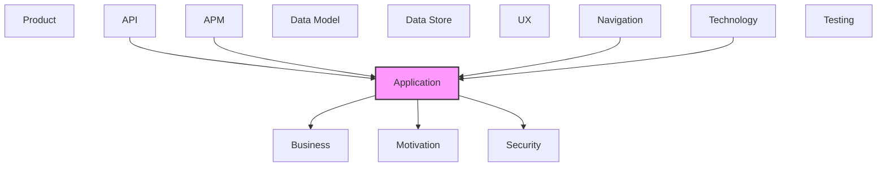

# Application

[← Back to README](../README.md)

Application components, services, and interactions.

## Report Index

- [Layer Introduction](#layer-introduction)
- [Intra-Layer Relationships](#intra-layer-relationships)
- [Inter-Layer Dependencies](#inter-layer-dependencies)
- [Inter-Layer Relationships Table](#inter-layer-relationships-table)
- [Element Reference](#element-reference)

## Layer Introduction

| Metric                    | Count |
| ------------------------- | ----- |
| Elements                  | 23    |
| Intra-Layer Relationships | 15    |
| Inter-Layer Relationships | 50    |
| Inbound Relationships     | 17    |
| Outbound Relationships    | 33    |

**Cross-Layer References**:

- **Upstream layers**: [API](./07-api-layer-report.md), [APM](./12-apm-layer-report.md), [Navigation](./11-navigation-layer-report.md), [Technology](./06-technology-layer-report.md)
- **Downstream layers**: [Business](./02-business-layer-report.md), [Motivation](./01-motivation-layer-report.md), [Security](./04-security-layer-report.md)

## Intra-Layer Relationships

```mermaid
flowchart LR
  subgraph application
    application_applicationcomponent_graph_canvas["Graph Canvas"]
    application_applicationfunction_annotation_store["Annotation Store"]
    application_applicationfunction_auth_store["Auth Store"]
    application_applicationfunction_changeset_store["Changeset Store"]
    application_applicationfunction_chat_store["Chat Store"]
    application_applicationfunction_connection_store["Connection Store"]
    application_applicationfunction_cross_layer_store["Cross-Layer Store"]
    application_applicationfunction_element_store["Element Store"]
    application_applicationfunction_layer_store["Layer Store"]
    application_applicationfunction_model_store["Model Store"]
    application_applicationinterface_dr_cli_rest_interface["DR CLI REST Interface"]
    application_applicationinterface_dr_cli_web_socket_interface["DR CLI WebSocket Interface"]
    application_applicationprocess_auth_route["Auth Route"]
    application_applicationservice_chat_service["Chat Service"]
    application_applicationservice_chat_validation["Chat Validation"]
    application_applicationservice_embedded_data_loader["Embedded Data Loader"]
    application_applicationservice_error_tracker["Error Tracker"]
    application_applicationservice_exception_classifier["Exception Classifier"]
    application_applicationservice_generated_api_client["Generated API Client"]
    application_applicationservice_json_rpc_handler["JSON-RPC Handler"]
    application_applicationservice_model_graph_transform["Model Graph Transform"]
    application_applicationservice_relationship_derivation["Relationship Derivation"]
    application_applicationservice_web_socket_client["WebSocket Client"]
    application_applicationcomponent_graph_canvas -->|realizes| application_applicationservice_model_graph_transform
    application_applicationcomponent_graph_canvas -->|realizes| application_applicationservice_relationship_derivation
    application_applicationfunction_annotation_store -->|depends-on| application_applicationfunction_auth_store
    application_applicationfunction_auth_store -->|delivers-value| application_applicationservice_generated_api_client
    application_applicationfunction_changeset_store -->|depends-on| application_applicationfunction_connection_store
    application_applicationfunction_chat_store -->|depends-on| application_applicationfunction_connection_store
    application_applicationfunction_connection_store -->|delivers-value| application_applicationservice_web_socket_client
    application_applicationfunction_cross_layer_store -->|depends-on| application_applicationfunction_model_store
    application_applicationfunction_element_store -->|depends-on| application_applicationfunction_model_store
    application_applicationfunction_layer_store -->|depends-on| application_applicationfunction_model_store
    application_applicationinterface_dr_cli_rest_interface -->|depends-on| application_applicationservice_generated_api_client
    application_applicationinterface_dr_cli_web_socket_interface -->|depends-on| application_applicationservice_web_socket_client
    application_applicationinterface_dr_cli_web_socket_interface -->|serves| application_applicationservice_json_rpc_handler
    application_applicationprocess_auth_route -->|depends-on| application_applicationfunction_auth_store
    application_applicationservice_model_graph_transform -->|depends-on| application_applicationservice_generated_api_client
  end
```

## Inter-Layer Dependencies

## Inter-Layer Relationships Table

| Relationship ID                                                                            | Source Node                                                    | Dest Node                                                  | Dest Layer    | Predicate        | Cardinality  | Strength |
| ------------------------------------------------------------------------------------------ | -------------------------------------------------------------- | ---------------------------------------------------------- | ------------- | ---------------- | ------------ | -------- |
| `13b1a5ff-1cea-4ca0-b557-81f4629f2736-satisfies-6ffaff00-8bf8-4580-98ff-8d2a612a9021`      | `13b1a5ff-1cea-4ca0-b557-81f4629f2736`                         | `6ffaff00-8bf8-4580-98ff-8d2a612a9021`                     | `motivation`  | `satisfies`      | unknown      | unknown  |
| `16fa387e-b1fd-4daf-9811-c3a0b4fd3d05-realizes-5308e41f-71c9-4ca6-8dfc-11d8b0483ce8`       | `16fa387e-b1fd-4daf-9811-c3a0b4fd3d05`                         | `5308e41f-71c9-4ca6-8dfc-11d8b0483ce8`                     | `business`    | `realizes`       | unknown      | unknown  |
| `283a8b3d-01cb-4964-b4d0-f04e2df1f2bd-satisfies-1723e358-12bc-460d-ae1d-6d9420128c6a`      | `283a8b3d-01cb-4964-b4d0-f04e2df1f2bd`                         | `1723e358-12bc-460d-ae1d-6d9420128c6a`                     | `motivation`  | `satisfies`      | unknown      | unknown  |
| `29f33e20-2acf-46e3-9f18-02ebd34fc734-accesses-99380a26-1064-4515-9d15-fec7620549cd`       | `29f33e20-2acf-46e3-9f18-02ebd34fc734`                         | `99380a26-1064-4515-9d15-fec7620549cd`                     | `business`    | `accesses`       | unknown      | unknown  |
| `29f33e20-2acf-46e3-9f18-02ebd34fc734-realizes-03823476-93f8-4ab4-8c51-cd93bf459ff0`       | `29f33e20-2acf-46e3-9f18-02ebd34fc734`                         | `03823476-93f8-4ab4-8c51-cd93bf459ff0`                     | `business`    | `realizes`       | unknown      | unknown  |
| `3dee662b-7dc2-4fcc-8677-15a2ba06136e-references-a77489e0-4e1f-42b1-b3e1-b1b534e6e7f8`     | `3dee662b-7dc2-4fcc-8677-15a2ba06136e`                         | `a77489e0-4e1f-42b1-b3e1-b1b534e6e7f8`                     | `application` | `references`     | unknown      | unknown  |
| `3e532c87-b3b7-4473-bd47-81bfd5de6507-realizes-c4ba5c59-3f4e-49a9-9915-a48049ddb68e`       | `3e532c87-b3b7-4473-bd47-81bfd5de6507`                         | `c4ba5c59-3f4e-49a9-9915-a48049ddb68e`                     | `business`    | `realizes`       | unknown      | unknown  |
| `406200e9-ef8b-46c9-a1fe-1ff06d6d5602-references-a77489e0-4e1f-42b1-b3e1-b1b534e6e7f8`     | `406200e9-ef8b-46c9-a1fe-1ff06d6d5602`                         | `a77489e0-4e1f-42b1-b3e1-b1b534e6e7f8`                     | `application` | `references`     | unknown      | unknown  |
| `4d7f0994-8c0d-4148-9eba-a3479a1f8947-realizes-a138ca69-d437-4841-b96f-5fb5dd703380`       | `4d7f0994-8c0d-4148-9eba-a3479a1f8947`                         | `a138ca69-d437-4841-b96f-5fb5dd703380`                     | `business`    | `realizes`       | unknown      | unknown  |
| `63c97821-401c-40cd-a076-ef84e06f5442-realizes-35295e18-08a8-4ca0-ada3-40a017cb4318`       | `63c97821-401c-40cd-a076-ef84e06f5442`                         | `35295e18-08a8-4ca0-ada3-40a017cb4318`                     | `business`    | `realizes`       | unknown      | unknown  |
| `6b2f9b1a-bd90-4b1e-9ee2-bed4cbb73a04-realizes-c20e00b6-ef86-415a-92a3-3e9fd9dc7cd6`       | `6b2f9b1a-bd90-4b1e-9ee2-bed4cbb73a04`                         | `c20e00b6-ef86-415a-92a3-3e9fd9dc7cd6`                     | `business`    | `realizes`       | unknown      | unknown  |
| `6f75bbfc-c13c-4c87-83e5-32f134902391-accesses-76929fbe-36ea-4c4f-80d5-eb054598571b`       | `6f75bbfc-c13c-4c87-83e5-32f134902391`                         | `76929fbe-36ea-4c4f-80d5-eb054598571b`                     | `security`    | `accesses`       | unknown      | unknown  |
| `6f75bbfc-c13c-4c87-83e5-32f134902391-constrained-by-f502d58f-1a96-44d5-8fb8-c7e5e67f3f0d` | `6f75bbfc-c13c-4c87-83e5-32f134902391`                         | `f502d58f-1a96-44d5-8fb8-c7e5e67f3f0d`                     | `security`    | `constrained-by` | unknown      | unknown  |
| `6f75bbfc-c13c-4c87-83e5-32f134902391-mitigates-e15b6b69-cc67-4ab9-a3f9-566de56b4804`      | `6f75bbfc-c13c-4c87-83e5-32f134902391`                         | `e15b6b69-cc67-4ab9-a3f9-566de56b4804`                     | `security`    | `mitigates`      | unknown      | unknown  |
| `6f75bbfc-c13c-4c87-83e5-32f134902391-realizes-35295e18-08a8-4ca0-ada3-40a017cb4318`       | `6f75bbfc-c13c-4c87-83e5-32f134902391`                         | `35295e18-08a8-4ca0-ada3-40a017cb4318`                     | `business`    | `realizes`       | unknown      | unknown  |
| `6f75bbfc-c13c-4c87-83e5-32f134902391-serves-fb417c37-45b0-460f-80bb-4782d6c1a11a`         | `6f75bbfc-c13c-4c87-83e5-32f134902391`                         | `fb417c37-45b0-460f-80bb-4782d6c1a11a`                     | `business`    | `serves`         | unknown      | unknown  |
| `80e6c89f-70ba-4183-909f-0457abdf9fa7-realizes-35295e18-08a8-4ca0-ada3-40a017cb4318`       | `80e6c89f-70ba-4183-909f-0457abdf9fa7`                         | `35295e18-08a8-4ca0-ada3-40a017cb4318`                     | `business`    | `realizes`       | unknown      | unknown  |
| `8630981b-236c-47ed-b99b-e977c56bdc63-realizes-71f9eb72-20e1-4ae6-be30-425c11e59edb`       | `8630981b-236c-47ed-b99b-e977c56bdc63`                         | `71f9eb72-20e1-4ae6-be30-425c11e59edb`                     | `application` | `realizes`       | unknown      | unknown  |
| `8630981b-236c-47ed-b99b-e977c56bdc63-references-a77489e0-4e1f-42b1-b3e1-b1b534e6e7f8`     | `8630981b-236c-47ed-b99b-e977c56bdc63`                         | `a77489e0-4e1f-42b1-b3e1-b1b534e6e7f8`                     | `application` | `references`     | unknown      | unknown  |
| `a5342d6f-daf4-4a6e-a98b-7fada2561798-accesses-ffa6bf4a-5281-402f-90d8-a895173fc4ba`       | `a5342d6f-daf4-4a6e-a98b-7fada2561798`                         | `ffa6bf4a-5281-402f-90d8-a895173fc4ba`                     | `business`    | `accesses`       | unknown      | unknown  |
| `a5342d6f-daf4-4a6e-a98b-7fada2561798-realizes-35295e18-08a8-4ca0-ada3-40a017cb4318`       | `a5342d6f-daf4-4a6e-a98b-7fada2561798`                         | `35295e18-08a8-4ca0-ada3-40a017cb4318`                     | `business`    | `realizes`       | unknown      | unknown  |
| `a5342d6f-daf4-4a6e-a98b-7fada2561798-satisfies-9fe1281a-2547-416f-872f-38e1b066db15`      | `a5342d6f-daf4-4a6e-a98b-7fada2561798`                         | `9fe1281a-2547-416f-872f-38e1b066db15`                     | `motivation`  | `satisfies`      | unknown      | unknown  |
| `a5342d6f-daf4-4a6e-a98b-7fada2561798-serves-a138ca69-d437-4841-b96f-5fb5dd703380`         | `a5342d6f-daf4-4a6e-a98b-7fada2561798`                         | `a138ca69-d437-4841-b96f-5fb5dd703380`                     | `business`    | `serves`         | unknown      | unknown  |
| `a77489e0-4e1f-42b1-b3e1-b1b534e6e7f8-accesses-ea84399d-45dc-4fef-a5a1-759c9b5b5870`       | `a77489e0-4e1f-42b1-b3e1-b1b534e6e7f8`                         | `ea84399d-45dc-4fef-a5a1-759c9b5b5870`                     | `business`    | `accesses`       | unknown      | unknown  |
| `a77489e0-4e1f-42b1-b3e1-b1b534e6e7f8-realizes-35295e18-08a8-4ca0-ada3-40a017cb4318`       | `a77489e0-4e1f-42b1-b3e1-b1b534e6e7f8`                         | `35295e18-08a8-4ca0-ada3-40a017cb4318`                     | `business`    | `realizes`       | unknown      | unknown  |
| `a77489e0-4e1f-42b1-b3e1-b1b534e6e7f8-requires-a47870bf-898b-425f-9f73-92663193355a`       | `a77489e0-4e1f-42b1-b3e1-b1b534e6e7f8`                         | `a47870bf-898b-425f-9f73-92663193355a`                     | `security`    | `requires`       | unknown      | unknown  |
| `a920ab1c-c481-46b6-bdb4-4050501adeac-realizes-e642ad79-62ea-47a4-ae04-d512d0ef7881`       | `a920ab1c-c481-46b6-bdb4-4050501adeac`                         | `e642ad79-62ea-47a4-ae04-d512d0ef7881`                     | `business`    | `realizes`       | unknown      | unknown  |
| `a920ab1c-c481-46b6-bdb4-4050501adeac-serves-c20e00b6-ef86-415a-92a3-3e9fd9dc7cd6`         | `a920ab1c-c481-46b6-bdb4-4050501adeac`                         | `c20e00b6-ef86-415a-92a3-3e9fd9dc7cd6`                     | `business`    | `serves`         | unknown      | unknown  |
| `apm.metricinstrument.monitors.application.applicationservice`                             | `apm.metricinstrument.web-socket-reconnection-attempt-counter` | `application.applicationservice.web-socket-client`         | `application` | `monitors`       | many-to-many | medium   |
| `application.applicationservice.realizes.business.businessservice`                         | `application.applicationservice.chat-validation`               | `business.businessservice.ai-assisted-architecture-chat`   | `business`    | `realizes`       | many-to-many | medium   |
| `application.applicationservice.serves.business.businessprocess`                           | `application.applicationservice.json-rpc-handler`              | `business.businessprocess.real-time-model-synchronization` | `business`    | `serves`         | many-to-many | medium   |
| `application.applicationservice.serves.business.businessprocess`                           | `application.applicationservice.web-socket-client`             | `business.businessprocess.real-time-model-synchronization` | `business`    | `serves`         | many-to-many | medium   |
| `b4784daf-706d-4f78-b522-165057df8110-realizes-5308e41f-71c9-4ca6-8dfc-11d8b0483ce8`       | `b4784daf-706d-4f78-b522-165057df8110`                         | `5308e41f-71c9-4ca6-8dfc-11d8b0483ce8`                     | `business`    | `realizes`       | unknown      | unknown  |
| `b66b613e-27b6-4d90-909f-3aa81570de15-references-b7775f1a-2418-4c7a-84aa-997efd658a97`     | `b66b613e-27b6-4d90-909f-3aa81570de15`                         | `b7775f1a-2418-4c7a-84aa-997efd658a97`                     | `application` | `references`     | unknown      | unknown  |
| `b7775f1a-2418-4c7a-84aa-997efd658a97-realizes-35295e18-08a8-4ca0-ada3-40a017cb4318`       | `b7775f1a-2418-4c7a-84aa-997efd658a97`                         | `35295e18-08a8-4ca0-ada3-40a017cb4318`                     | `business`    | `realizes`       | unknown      | unknown  |
| `b7775f1a-2418-4c7a-84aa-997efd658a97-requires-a47870bf-898b-425f-9f73-92663193355a`       | `b7775f1a-2418-4c7a-84aa-997efd658a97`                         | `a47870bf-898b-425f-9f73-92663193355a`                     | `security`    | `requires`       | unknown      | unknown  |
| `b7775f1a-2418-4c7a-84aa-997efd658a97-serves-83c81f34-4376-4ff9-8fb4-98f3ecbc6d68`         | `b7775f1a-2418-4c7a-84aa-997efd658a97`                         | `83c81f34-4376-4ff9-8fb4-98f3ecbc6d68`                     | `business`    | `serves`         | unknown      | unknown  |
| `dc2da0b6-3de0-44d1-840f-5d49cc976cd9-references-b4784daf-706d-4f78-b522-165057df8110`     | `dc2da0b6-3de0-44d1-840f-5d49cc976cd9`                         | `b4784daf-706d-4f78-b522-165057df8110`                     | `application` | `references`     | unknown      | unknown  |
| `dfc6509e-98f5-479a-bfe9-14bfddbb838a-realizes-3b08f432-72aa-4df6-978c-d76d3312f72b`       | `dfc6509e-98f5-479a-bfe9-14bfddbb838a`                         | `3b08f432-72aa-4df6-978c-d76d3312f72b`                     | `application` | `realizes`       | unknown      | unknown  |
| `dfc6509e-98f5-479a-bfe9-14bfddbb838a-references-a5342d6f-daf4-4a6e-a98b-7fada2561798`     | `dfc6509e-98f5-479a-bfe9-14bfddbb838a`                         | `a5342d6f-daf4-4a6e-a98b-7fada2561798`                     | `application` | `references`     | unknown      | unknown  |
| `e067f83f-1f31-44d7-a5d0-86059f8beb9f-references-29f33e20-2acf-46e3-9f18-02ebd34fc734`     | `e067f83f-1f31-44d7-a5d0-86059f8beb9f`                         | `29f33e20-2acf-46e3-9f18-02ebd34fc734`                     | `application` | `references`     | unknown      | unknown  |
| `f952fcc0-7c42-4586-a306-a5f2f94a3068-realizes-f1edef84-1298-486c-b347-f47c3b0f9712`       | `f952fcc0-7c42-4586-a306-a5f2f94a3068`                         | `f1edef84-1298-486c-b347-f47c3b0f9712`                     | `application` | `realizes`       | unknown      | unknown  |
| `f952fcc0-7c42-4586-a306-a5f2f94a3068-references-29f33e20-2acf-46e3-9f18-02ebd34fc734`     | `f952fcc0-7c42-4586-a306-a5f2f94a3068`                         | `29f33e20-2acf-46e3-9f18-02ebd34fc734`                     | `application` | `references`     | unknown      | unknown  |
| `fbd68c51-36fa-48ef-b381-5599d2678a90-serves-83c81f34-4376-4ff9-8fb4-98f3ecbc6d68`         | `fbd68c51-36fa-48ef-b381-5599d2678a90`                         | `83c81f34-4376-4ff9-8fb4-98f3ecbc6d68`                     | `business`    | `serves`         | unknown      | unknown  |
| `fd2f4ab4-7477-4ec5-aac4-37aa1d78af4c-realizes-35295e18-08a8-4ca0-ada3-40a017cb4318`       | `fd2f4ab4-7477-4ec5-aac4-37aa1d78af4c`                         | `35295e18-08a8-4ca0-ada3-40a017cb4318`                     | `business`    | `realizes`       | unknown      | unknown  |
| `ff16c609-618e-4dd9-b477-12e17c000df8-realizes-71f9eb72-20e1-4ae6-be30-425c11e59edb`       | `ff16c609-618e-4dd9-b477-12e17c000df8`                         | `71f9eb72-20e1-4ae6-be30-425c11e59edb`                     | `application` | `realizes`       | unknown      | unknown  |
| `ff16c609-618e-4dd9-b477-12e17c000df8-references-a77489e0-4e1f-42b1-b3e1-b1b534e6e7f8`     | `ff16c609-618e-4dd9-b477-12e17c000df8`                         | `a77489e0-4e1f-42b1-b3e1-b1b534e6e7f8`                     | `application` | `references`     | unknown      | unknown  |
| `navigation.navigationflow.realizes.application.applicationprocess`                        | `navigation.navigationflow.authentication-to-model-flow`       | `application.applicationprocess.auth-route`                | `application` | `realizes`       | many-to-many | medium   |
| `technology.systemsoftware.serves.application.applicationcomponent`                        | `technology.systemsoftware.heimdall-ui`                        | `application.applicationcomponent.graph-canvas`            | `application` | `serves`         | many-to-many | medium   |
| `technology.systemsoftware.serves.application.applicationcomponent`                        | `technology.systemsoftware.tan-stack-react-query`              | `application.applicationcomponent.graph-canvas`            | `application` | `serves`         | many-to-many | medium   |

## Element Reference

### Graph Canvas {#graph-canvas}

**ID**: `application.applicationcomponent.graph-canvas`

**Type**: `applicationcomponent`

The primary graph-view component for the Model and Schema views; mounts Heimdall's GraphCanvas (@tinkermonkey/heimdall-ui) with layout="force", keyed by view:layerId so it recenters on layer/view switch. Replaced the old React Flow-based GraphViewer + pluggable Dagre/ELK/D3-Force/Graphviz layout-engine registry in the June 2026 Heimdall UX rebuild — GraphCanvas's force layout is now the only layout mode the app renders, and is the exact integration point the sibling heimdall-layout-loop harness targets for layout improvements.

#### Attributes

| Name | Value    |
| ---- | -------- |
| type | internal |

#### Relationships

| Type        | Related Element                                          | Predicate  | Direction |
| ----------- | -------------------------------------------------------- | ---------- | --------- |
| inter-layer | `technology.systemsoftware.heimdall-ui`                  | `serves`   | inbound   |
| inter-layer | `technology.systemsoftware.tan-stack-react-query`        | `serves`   | inbound   |
| intra-layer | `application.applicationservice.model-graph-transform`   | `realizes` | outbound  |
| intra-layer | `application.applicationservice.relationship-derivation` | `realizes` | outbound  |

### Annotation Store {#annotation-store}

**ID**: `application.applicationfunction.annotation-store`

**Type**: `applicationfunction`

Zustand store managing user annotations on model elements; syncs with DR CLI server via REST API

#### Relationships

| Type        | Related Element                              | Predicate    | Direction |
| ----------- | -------------------------------------------- | ------------ | --------- |
| intra-layer | `application.applicationfunction.auth-store` | `depends-on` | outbound  |

### Auth Store {#auth-store}

**ID**: `application.applicationfunction.auth-store`

**Type**: `applicationfunction`

Zustand store managing the DR CLI auth token, authentication state, and magic-link token extraction

#### Relationships

| Type        | Related Element                                       | Predicate        | Direction |
| ----------- | ----------------------------------------------------- | ---------------- | --------- |
| intra-layer | `application.applicationfunction.annotation-store`    | `depends-on`     | inbound   |
| intra-layer | `application.applicationservice.generated-api-client` | `delivers-value` | outbound  |
| intra-layer | `application.applicationprocess.auth-route`           | `depends-on`     | inbound   |

### Changeset Store {#changeset-store}

**ID**: `application.applicationfunction.changeset-store`

**Type**: `applicationfunction`

Zustand store managing the active changeset list, selected changeset, and changeset diff state

#### Relationships

| Type        | Related Element                                    | Predicate    | Direction |
| ----------- | -------------------------------------------------- | ------------ | --------- |
| intra-layer | `application.applicationfunction.connection-store` | `depends-on` | outbound  |

### Chat Store {#chat-store}

**ID**: `application.applicationfunction.chat-store`

**Type**: `applicationfunction`

Zustand store managing chat conversation history, streaming state, and active tool invocations for the AI assistant

#### Relationships

| Type        | Related Element                                    | Predicate    | Direction |
| ----------- | -------------------------------------------------- | ------------ | --------- |
| intra-layer | `application.applicationfunction.connection-store` | `depends-on` | outbound  |

### Connection Store {#connection-store}

**ID**: `application.applicationfunction.connection-store`

**Type**: `applicationfunction`

Zustand store tracking WebSocket connection state (connected/disconnected/reconnecting) to the DR CLI server

#### Relationships

| Type        | Related Element                                    | Predicate        | Direction |
| ----------- | -------------------------------------------------- | ---------------- | --------- |
| intra-layer | `application.applicationfunction.changeset-store`  | `depends-on`     | inbound   |
| intra-layer | `application.applicationfunction.chat-store`       | `depends-on`     | inbound   |
| intra-layer | `application.applicationservice.web-socket-client` | `delivers-value` | outbound  |

### Cross-Layer Store {#cross-layer-store}

**ID**: `application.applicationfunction.cross-layer-store`

**Type**: `applicationfunction`

Zustand store holding resolved cross-layer references and edge data for the graph

#### Relationships

| Type        | Related Element                               | Predicate    | Direction |
| ----------- | --------------------------------------------- | ------------ | --------- |
| intra-layer | `application.applicationfunction.model-store` | `depends-on` | outbound  |

### Element Store {#element-store}

**ID**: `application.applicationfunction.element-store`

**Type**: `applicationfunction`

Zustand store tracking selected element, highlighted paths, and focus mode state

#### Relationships

| Type        | Related Element                               | Predicate    | Direction |
| ----------- | --------------------------------------------- | ------------ | --------- |
| intra-layer | `application.applicationfunction.model-store` | `depends-on` | outbound  |

### Layer Store {#layer-store}

**ID**: `application.applicationfunction.layer-store`

**Type**: `applicationfunction`

Zustand store managing active layer selection and layer visibility filters

#### Relationships

| Type        | Related Element                               | Predicate    | Direction |
| ----------- | --------------------------------------------- | ------------ | --------- |
| intra-layer | `application.applicationfunction.model-store` | `depends-on` | outbound  |

### Model Store {#model-store}

**ID**: `application.applicationfunction.model-store`

**Type**: `applicationfunction`

Global Zustand store holding the parsed architecture model, loading state, and error state

#### Relationships

| Type        | Related Element                                     | Predicate    | Direction |
| ----------- | --------------------------------------------------- | ------------ | --------- |
| intra-layer | `application.applicationfunction.cross-layer-store` | `depends-on` | inbound   |
| intra-layer | `application.applicationfunction.element-store`     | `depends-on` | inbound   |
| intra-layer | `application.applicationfunction.layer-store`       | `depends-on` | inbound   |

### DR CLI REST Interface {#dr-cli-rest-interface}

**ID**: `application.applicationinterface.dr-cli-rest-interface`

**Type**: `applicationinterface`

The HTTP REST interface through which the embedded app communicates with the DR CLI visualization server

#### Attributes

| Name     | Value |
| -------- | ----- |
| protocol | REST  |

#### Relationships

| Type        | Related Element                                       | Predicate    | Direction |
| ----------- | ----------------------------------------------------- | ------------ | --------- |
| intra-layer | `application.applicationservice.generated-api-client` | `depends-on` | outbound  |

### DR CLI WebSocket Interface {#dr-cli-websocket-interface}

**ID**: `application.applicationinterface.dr-cli-web-socket-interface`

**Type**: `applicationinterface`

The WebSocket interface for subscribing to real-time model/changeset/annotation update events

#### Attributes

| Name     | Value     |
| -------- | --------- |
| protocol | WebSocket |

#### Relationships

| Type        | Related Element                                    | Predicate    | Direction |
| ----------- | -------------------------------------------------- | ------------ | --------- |
| intra-layer | `application.applicationservice.web-socket-client` | `depends-on` | outbound  |
| intra-layer | `application.applicationservice.json-rpc-handler`  | `serves`     | outbound  |

### Auth Route {#auth-route}

**ID**: `application.applicationprocess.auth-route`

**Type**: `applicationprocess`

TanStack Router route handling token-based authentication via magic link; extracts token from URL query params

#### Relationships

| Type        | Related Element                                          | Predicate    | Direction |
| ----------- | -------------------------------------------------------- | ------------ | --------- |
| inter-layer | `navigation.navigationflow.authentication-to-model-flow` | `realizes`   | inbound   |
| intra-layer | `application.applicationfunction.auth-store`             | `depends-on` | outbound  |

### Chat Service {#chat-service}

**ID**: `application.applicationservice.chat-service`

**Type**: `applicationservice`

Interfaces with the Claude AI API to provide architectural assistant chat functionality; manages message streaming and tool invocations

#### Attributes

| Name        | Value        |
| ----------- | ------------ |
| serviceType | asynchronous |

### Chat Validation {#chat-validation}

**ID**: `application.applicationservice.chat-validation`

**Type**: `applicationservice`

Validates chat message content and enforces conversation constraints before submission

#### Attributes

| Name        | Value       |
| ----------- | ----------- |
| serviceType | synchronous |

#### Relationships

| Type        | Related Element                                          | Predicate  | Direction |
| ----------- | -------------------------------------------------------- | ---------- | --------- |
| inter-layer | `business.businessservice.ai-assisted-architecture-chat` | `realizes` | outbound  |

### Embedded Data Loader {#embedded-data-loader}

**ID**: `application.applicationservice.embedded-data-loader`

**Type**: `applicationservice`

Coordinates data loading for the embedded app; selects between DR CLI server, GitHub, or local file sources based on connection state

#### Attributes

| Name        | Value        |
| ----------- | ------------ |
| serviceType | asynchronous |

### Error Tracker {#error-tracker}

**ID**: `application.applicationservice.error-tracker`

**Type**: `applicationservice`

Captures and categorizes runtime errors with context for display in the UI and structured logging

#### Attributes

| Name        | Value       |
| ----------- | ----------- |
| serviceType | synchronous |

### Exception Classifier {#exception-classifier}

**ID**: `application.applicationservice.exception-classifier`

**Type**: `applicationservice`

Classifies runtime exceptions into categories for structured error reporting and Storybook story error filtering

#### Attributes

| Name        | Value       |
| ----------- | ----------- |
| serviceType | synchronous |

### Generated API Client {#generated-api-client}

**ID**: `application.applicationservice.generated-api-client`

**Type**: `applicationservice`

Auto-generated TypeScript HTTP client from the OpenAPI spec; provides typed methods for all DR CLI REST endpoints

#### Attributes

| Name        | Value       |
| ----------- | ----------- |
| serviceType | synchronous |

#### Relationships

| Type        | Related Element                                          | Predicate        | Direction |
| ----------- | -------------------------------------------------------- | ---------------- | --------- |
| intra-layer | `application.applicationfunction.auth-store`             | `delivers-value` | inbound   |
| intra-layer | `application.applicationinterface.dr-cli-rest-interface` | `depends-on`     | inbound   |
| intra-layer | `application.applicationservice.model-graph-transform`   | `depends-on`     | inbound   |

### JSON-RPC Handler {#json-rpc-handler}

**ID**: `application.applicationservice.json-rpc-handler`

**Type**: `applicationservice`

Processes incoming JSON-RPC 2.0 messages from the WebSocket connection; routes model/changeset/annotation update events to the appropriate stores

#### Attributes

| Name        | Value        |
| ----------- | ------------ |
| serviceType | event-driven |

#### Relationships

| Type        | Related Element                                                | Predicate | Direction |
| ----------- | -------------------------------------------------------------- | --------- | --------- |
| inter-layer | `business.businessprocess.real-time-model-synchronization`     | `serves`  | outbound  |
| intra-layer | `application.applicationinterface.dr-cli-web-socket-interface` | `serves`  | inbound   |

### Model Graph Transform {#model-graph-transform}

**ID**: `application.applicationservice.model-graph-transform`

**Type**: `applicationservice`

Pure transforms of the /api/model payload into per-layer Heimdall GraphCanvas view models (nodes + edges); builds the dual-index (UUID + derived dotted id) used to resolve every link endpoint, since links reference nodes by either form. Replaced the old dataLoader.ts/crossLayerReferenceExtractor.ts/nodeTransformer.ts/yamlParser.ts client-side YAML-parsing pipeline — the app now consumes pre-parsed JSON from the DR CLI REST API via React Query.

#### Attributes

| Name        | Value       |
| ----------- | ----------- |
| serviceType | synchronous |

#### Relationships

| Type        | Related Element                                       | Predicate    | Direction |
| ----------- | ----------------------------------------------------- | ------------ | --------- |
| intra-layer | `application.applicationcomponent.graph-canvas`       | `realizes`   | inbound   |
| intra-layer | `application.applicationservice.generated-api-client` | `depends-on` | outbound  |

### Relationship Derivation {#relationship-derivation}

**ID**: `application.applicationservice.relationship-derivation`

**Type**: `applicationservice`

Derives a selected element's inbound/outbound relationship links (including cross-layer links, with targetDomain set to the other endpoint's layer for swatch coloring and cross-layer navigation) from the /api/model payload for the GraphInspector/Inspector click-to-navigate feature.

#### Attributes

| Name        | Value       |
| ----------- | ----------- |
| serviceType | synchronous |

#### Relationships

| Type        | Related Element                                 | Predicate  | Direction |
| ----------- | ----------------------------------------------- | ---------- | --------- |
| intra-layer | `application.applicationcomponent.graph-canvas` | `realizes` | inbound   |

### WebSocket Client {#websocket-client}

**ID**: `application.applicationservice.web-socket-client`

**Type**: `applicationservice`

Manages the persistent WebSocket connection to the DR CLI server; handles reconnection, topic subscriptions, and JSON-RPC message dispatch

#### Attributes

| Name        | Value        |
| ----------- | ------------ |
| serviceType | event-driven |

#### Relationships

| Type        | Related Element                                                | Predicate        | Direction |
| ----------- | -------------------------------------------------------------- | ---------------- | --------- |
| inter-layer | `apm.metricinstrument.web-socket-reconnection-attempt-counter` | `monitors`       | inbound   |
| inter-layer | `business.businessprocess.real-time-model-synchronization`     | `serves`         | outbound  |
| intra-layer | `application.applicationfunction.connection-store`             | `delivers-value` | inbound   |
| intra-layer | `application.applicationinterface.dr-cli-web-socket-interface` | `depends-on`     | inbound   |

---

Generated: 2026-09-19T15:37:38.405Z | Model Version: 0.1.0
