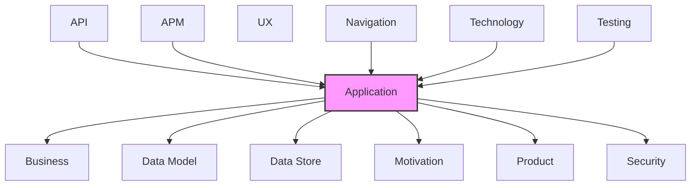

# Application

[← Back to README](../README.md)

Application components, services, and interactions.

## Report Index

- [Layer Introduction](#layer-introduction)
- [Intra-Layer Relationships](#intra-layer-relationships)
- [Inter-Layer Dependencies](#inter-layer-dependencies)
- [Inter-Layer Relationships Table](#inter-layer-relationships-table)
- [Element Reference](#element-reference)

## Layer Introduction

| Metric                    | Count |
| ------------------------- | ----- |
| Elements                  | 80    |
| Intra-Layer Relationships | 176   |
| Inter-Layer Relationships | 919   |
| Inbound Relationships     | 860   |
| Outbound Relationships    | 59    |

**Cross-Layer References**:

- **Upstream layers**: [API](./07-api-layer-report.md), [APM](./12-apm-layer-report.md), [Navigation](./11-navigation-layer-report.md), [Technology](./06-technology-layer-report.md), [Testing](./13-testing-layer-report.md)
- **Downstream layers**: [Business](./02-business-layer-report.md), [Data Model](./08-data-model-layer-report.md), [Data Store](./09-data-store-layer-report.md), [Motivation](./01-motivation-layer-report.md), [Product](./03-product-layer-report.md), [Security](./04-security-layer-report.md)

## Intra-Layer Relationships

*This layer has >30 elements. Summary table shown instead of diagram.*

| Element                                                          | Type                   | Relationships |
| ---------------------------------------------------------------- | ---------------------- | ------------- |
| `application.applicationcomponent.annotations-section`           | `applicationcomponent` | 4             |
| `application.applicationcomponent.app-shell`                     | `applicationcomponent` | 14            |
| `application.applicationcomponent.apply-review`                  | `applicationcomponent` | 2             |
| `application.applicationcomponent.change-inspector`              | `applicationcomponent` | 11            |
| `application.applicationcomponent.change-link-card`              | `applicationcomponent` | 7             |
| `application.applicationcomponent.change-neighbourhood`          | `applicationcomponent` | 5             |
| `application.applicationcomponent.changeset-canvas`              | `applicationcomponent` | 8             |
| `application.applicationcomponent.changeset-impact-view`         | `applicationcomponent` | 4             |
| `application.applicationcomponent.changeset-inbox`               | `applicationcomponent` | 5             |
| `application.applicationcomponent.changeset-inspector`           | `applicationcomponent` | 9             |
| `application.applicationcomponent.changeset-review-panel`        | `applicationcomponent` | 10            |
| `application.applicationcomponent.chat-drawer`                   | `applicationcomponent` | 4             |
| `application.applicationcomponent.chat-panel`                    | `applicationcomponent` | 6             |
| `application.applicationcomponent.drift-notice`                  | `applicationcomponent` | 5             |
| `application.applicationcomponent.edge-inspector`                | `applicationcomponent` | 5             |
| `application.applicationcomponent.error-boundary`                | `applicationcomponent` | 1             |
| `application.applicationcomponent.graph-canvas`                  | `applicationcomponent` | 17            |
| `application.applicationcomponent.inspector-drawer`              | `applicationcomponent` | 13            |
| `application.applicationcomponent.left-rail`                     | `applicationcomponent` | 4             |
| `application.applicationcomponent.markdown-text`                 | `applicationcomponent` | 1             |
| `application.applicationcomponent.model-card-node`               | `applicationcomponent` | 2             |
| `application.applicationcomponent.nav-tree`                      | `applicationcomponent` | 7             |
| `application.applicationcomponent.neighborhood-graph-view`       | `applicationcomponent` | 3             |
| `application.applicationcomponent.node-type-badge`               | `applicationcomponent` | 5             |
| `application.applicationcomponent.node-type-tooltip`             | `applicationcomponent` | 2             |
| `application.applicationcomponent.page-view`                     | `applicationcomponent` | 7             |
| `application.applicationcomponent.pill-node`                     | `applicationcomponent` | 3             |
| `application.applicationcomponent.predicate-tooltip`             | `applicationcomponent` | 4             |
| `application.applicationcomponent.relationships-with-tooltips`   | `applicationcomponent` | 3             |
| `application.applicationcomponent.review-parts`                  | `applicationcomponent` | 5             |
| `application.applicationcomponent.rich-tooltip`                  | `applicationcomponent` | 2             |
| `application.applicationcomponent.status-bar`                    | `applicationcomponent` | 3             |
| `application.applicationcomponent.tier1-panel`                   | `applicationcomponent` | 2             |
| `application.applicationcomponent.topbar`                        | `applicationcomponent` | 2             |
| `application.applicationcomponent.type-hive-view`                | `applicationcomponent` | 4             |
| `application.applicationcomponent.type-lanes-view`               | `applicationcomponent` | 5             |
| `application.applicationfunction.auth-store`                     | `applicationfunction`  | 2             |
| `application.applicationfunction.chat-store`                     | `applicationfunction`  | 2             |
| `application.applicationfunction.connection-store`               | `applicationfunction`  | 2             |
| `application.applicationfunction.local-review-store`             | `applicationfunction`  | 1             |
| `application.applicationfunction.ui-store`                       | `applicationfunction`  | 2             |
| `application.applicationinterface.dr-cli-rest-interface`         | `applicationinterface` | 1             |
| `application.applicationinterface.dr-cli-web-socket-interface`   | `applicationinterface` | 2             |
| `application.applicationprocess.auth-route`                      | `applicationprocess`   | 1             |
| `application.applicationservice.change-origin-helpers`           | `applicationservice`   | 3             |
| `application.applicationservice.changeset-drift`                 | `applicationservice`   | 4             |
| `application.applicationservice.changeset-impact-analysis`       | `applicationservice`   | 5             |
| `application.applicationservice.changeset-op-rows`               | `applicationservice`   | 2             |
| `application.applicationservice.changeset-purpose`               | `applicationservice`   | 7             |
| `application.applicationservice.changeset-review-model`          | `applicationservice`   | 7             |
| `application.applicationservice.chat-adapter`                    | `applicationservice`   | 2             |
| `application.applicationservice.chat-context-builder`            | `applicationservice`   | 2             |
| `application.applicationservice.chat-service`                    | `applicationservice`   | 3             |
| `application.applicationservice.chat-validation`                 | `applicationservice`   | 1             |
| `application.applicationservice.error-tracker`                   | `applicationservice`   | 4             |
| `application.applicationservice.exception-classifier`            | `applicationservice`   | 2             |
| `application.applicationservice.generated-api-client`            | `applicationservice`   | 13            |
| `application.applicationservice.graph-viewport-key`              | `applicationservice`   | 2             |
| `application.applicationservice.json-rpc-handler`                | `applicationservice`   | 4             |
| `application.applicationservice.layer-domain-palette`            | `applicationservice`   | 5             |
| `application.applicationservice.layered-reach`                   | `applicationservice`   | 4             |
| `application.applicationservice.model-graph-transform`           | `applicationservice`   | 11            |
| `application.applicationservice.neighborhood-graph`              | `applicationservice`   | 1             |
| `application.applicationservice.page-data-builder`               | `applicationservice`   | 4             |
| `application.applicationservice.predicate-definitions`           | `applicationservice`   | 2             |
| `application.applicationservice.relationship-derivation`         | `applicationservice`   | 3             |
| `application.applicationservice.spec-graph-transform`            | `applicationservice`   | 3             |
| `application.applicationservice.structural-predicate-classifier` | `applicationservice`   | 1             |
| `application.applicationservice.type-bands`                      | `applicationservice`   | 4             |
| `application.applicationservice.use-annotations`                 | `applicationservice`   | 2             |
| `application.applicationservice.use-changeset-review`            | `applicationservice`   | 7             |
| `application.applicationservice.use-changesets`                  | `applicationservice`   | 6             |
| `application.applicationservice.use-cli-version`                 | `applicationservice`   | 2             |
| `application.applicationservice.use-edge-interaction`            | `applicationservice`   | 1             |
| `application.applicationservice.use-hover-dwell`                 | `applicationservice`   | 1             |
| `application.applicationservice.use-model`                       | `applicationservice`   | 11            |
| `application.applicationservice.use-spec`                        | `applicationservice`   | 7             |
| `application.applicationservice.use-tier1`                       | `applicationservice`   | 3             |
| `application.applicationservice.use-viewport-history`            | `applicationservice`   | 2             |
| `application.applicationservice.web-socket-client`               | `applicationservice`   | 4             |

## Inter-Layer Dependencies

## Inter-Layer Relationships Table

| Relationship ID                                                                        | Source Node                                                                                                                                              | Dest Node                                                           | Dest Layer    | Predicate    | Cardinality  | Strength |
| -------------------------------------------------------------------------------------- | -------------------------------------------------------------------------------------------------------------------------------------------------------- | ------------------------------------------------------------------- | ------------- | ------------ | ------------ | -------- |
| `3dee662b-7dc2-4fcc-8677-15a2ba06136e-references-a77489e0-4e1f-42b1-b3e1-b1b534e6e7f8` | `3dee662b-7dc2-4fcc-8677-15a2ba06136e`                                                                                                                   | `a77489e0-4e1f-42b1-b3e1-b1b534e6e7f8`                              | `application` | `references` | unknown      | unknown  |
| `406200e9-ef8b-46c9-a1fe-1ff06d6d5602-references-a77489e0-4e1f-42b1-b3e1-b1b534e6e7f8` | `406200e9-ef8b-46c9-a1fe-1ff06d6d5602`                                                                                                                   | `a77489e0-4e1f-42b1-b3e1-b1b534e6e7f8`                              | `application` | `references` | unknown      | unknown  |
| `6b2f9b1a-bd90-4b1e-9ee2-bed4cbb73a04-realizes-c20e00b6-ef86-415a-92a3-3e9fd9dc7cd6`   | `6b2f9b1a-bd90-4b1e-9ee2-bed4cbb73a04`                                                                                                                   | `c20e00b6-ef86-415a-92a3-3e9fd9dc7cd6`                              | `business`    | `realizes`   | unknown      | unknown  |
| `8630981b-236c-47ed-b99b-e977c56bdc63-references-a77489e0-4e1f-42b1-b3e1-b1b534e6e7f8` | `8630981b-236c-47ed-b99b-e977c56bdc63`                                                                                                                   | `a77489e0-4e1f-42b1-b3e1-b1b534e6e7f8`                              | `application` | `references` | unknown      | unknown  |
| `a77489e0-4e1f-42b1-b3e1-b1b534e6e7f8-accesses-ea84399d-45dc-4fef-a5a1-759c9b5b5870`   | `a77489e0-4e1f-42b1-b3e1-b1b534e6e7f8`                                                                                                                   | `ea84399d-45dc-4fef-a5a1-759c9b5b5870`                              | `business`    | `accesses`   | unknown      | unknown  |
| `a77489e0-4e1f-42b1-b3e1-b1b534e6e7f8-realizes-35295e18-08a8-4ca0-ada3-40a017cb4318`   | `a77489e0-4e1f-42b1-b3e1-b1b534e6e7f8`                                                                                                                   | `35295e18-08a8-4ca0-ada3-40a017cb4318`                              | `business`    | `realizes`   | unknown      | unknown  |
| `a77489e0-4e1f-42b1-b3e1-b1b534e6e7f8-requires-a47870bf-898b-425f-9f73-92663193355a`   | `a77489e0-4e1f-42b1-b3e1-b1b534e6e7f8`                                                                                                                   | `a47870bf-898b-425f-9f73-92663193355a`                              | `security`    | `requires`   | unknown      | unknown  |
| `a920ab1c-c481-46b6-bdb4-4050501adeac-realizes-e642ad79-62ea-47a4-ae04-d512d0ef7881`   | `a920ab1c-c481-46b6-bdb4-4050501adeac`                                                                                                                   | `e642ad79-62ea-47a4-ae04-d512d0ef7881`                              | `business`    | `realizes`   | unknown      | unknown  |
| `a920ab1c-c481-46b6-bdb4-4050501adeac-serves-c20e00b6-ef86-415a-92a3-3e9fd9dc7cd6`     | `a920ab1c-c481-46b6-bdb4-4050501adeac`                                                                                                                   | `c20e00b6-ef86-415a-92a3-3e9fd9dc7cd6`                              | `business`    | `serves`     | unknown      | unknown  |
| `api.operation.references.application.applicationservice`                              | `api.operation.commit-changeset`                                                                                                                         | `application.applicationservice.generated-api-client`               | `application` | `references` | many-to-many | medium   |
| `api.operation.references.application.applicationservice`                              | `api.operation.commit-changeset`                                                                                                                         | `application.applicationservice.use-changesets`                     | `application` | `references` | many-to-many | medium   |
| `api.operation.references.application.applicationservice`                              | `api.operation.create-annotation`                                                                                                                        | `application.applicationservice.use-annotations`                    | `application` | `references` | many-to-many | medium   |
| `api.operation.references.application.applicationservice`                              | `api.operation.create-annotation-reply`                                                                                                                  | `application.applicationservice.generated-api-client`               | `application` | `references` | many-to-many | medium   |
| `api.operation.references.application.applicationservice`                              | `api.operation.create-annotation-reply`                                                                                                                  | `application.applicationservice.use-annotations`                    | `application` | `references` | many-to-many | medium   |
| `api.operation.references.application.applicationservice`                              | `api.operation.discard-changeset`                                                                                                                        | `application.applicationservice.generated-api-client`               | `application` | `references` | many-to-many | medium   |
| `api.operation.references.application.applicationservice`                              | `api.operation.discard-changeset`                                                                                                                        | `application.applicationservice.use-changesets`                     | `application` | `references` | many-to-many | medium   |
| `api.operation.references.application.applicationservice`                              | `api.operation.get-annotation`                                                                                                                           | `application.applicationservice.generated-api-client`               | `application` | `references` | many-to-many | medium   |
| `api.operation.references.application.applicationservice`                              | `api.operation.get-annotations`                                                                                                                          | `application.applicationservice.use-annotations`                    | `application` | `references` | many-to-many | medium   |
| `api.operation.references.application.applicationservice`                              | `api.operation.get-api-tier1`                                                                                                                            | `application.applicationservice.use-tier1`                          | `application` | `references` | many-to-many | medium   |
| `api.operation.references.application.applicationservice`                              | `api.operation.get-architecture-model`                                                                                                                   | `application.applicationservice.use-model`                          | `application` | `references` | many-to-many | medium   |
| `api.operation.references.application.applicationservice`                              | `api.operation.get-layer`                                                                                                                                | `application.applicationservice.generated-api-client`               | `application` | `references` | many-to-many | medium   |
| `api.operation.references.application.applicationservice`                              | `api.operation.list-annotation-replies`                                                                                                                  | `application.applicationservice.generated-api-client`               | `application` | `references` | many-to-many | medium   |
| `api.operation.references.application.applicationservice`                              | `api.operation.list-annotation-replies`                                                                                                                  | `application.applicationservice.use-annotations`                    | `application` | `references` | many-to-many | medium   |
| `api.operation.references.application.applicationservice`                              | `api.operation.list-changesets`                                                                                                                          | `application.applicationservice.use-changesets`                     | `application` | `references` | many-to-many | medium   |
| `api.operation.references.application.applicationservice`                              | `api.operation.put-api-changesets-changeset-id-review`                                                                                                   | `application.applicationservice.use-changeset-review`               | `application` | `references` | many-to-many | medium   |
| `api.operation.references.application.applicationservice`                              | `api.operation.replace-annotation`                                                                                                                       | `application.applicationservice.generated-api-client`               | `application` | `references` | many-to-many | medium   |
| `apm.metricinstrument.monitors.application.applicationservice`                         | `apm.metricinstrument.web-socket-reconnection-attempt-counter`                                                                                           | `application.applicationservice.web-socket-client`                  | `application` | `monitors`   | many-to-many | medium   |
| `application.applicationcomponent.accesses.data-model.objectschema`                    | `application.applicationcomponent.change-inspector`                                                                                                      | `data-model.objectschema.delete-blocker`                            | `data-model`  | `accesses`   | many-to-many | medium   |
| `application.applicationcomponent.accesses.data-model.objectschema`                    | `application.applicationcomponent.changeset-canvas`                                                                                                      | `data-model.objectschema.changeset-detail`                          | `data-model`  | `accesses`   | many-to-many | medium   |
| `application.applicationcomponent.accesses.data-model.objectschema`                    | `application.applicationcomponent.changeset-review-panel`                                                                                                | `data-model.objectschema.changeset-detail`                          | `data-model`  | `accesses`   | many-to-many | medium   |
| `application.applicationcomponent.accesses.data-model.objectschema`                    | `application.applicationcomponent.changeset-review-panel`                                                                                                | `data-model.objectschema.review-decision`                           | `data-model`  | `accesses`   | many-to-many | medium   |
| `application.applicationcomponent.accesses.data-model.objectschema`                    | `application.applicationcomponent.drift-notice`                                                                                                          | `data-model.objectschema.changeset-detail`                          | `data-model`  | `accesses`   | many-to-many | medium   |
| `application.applicationcomponent.accesses.data-model.objectschema`                    | `application.applicationcomponent.review-parts`                                                                                                          | `data-model.objectschema.change-origin`                             | `data-model`  | `accesses`   | many-to-many | medium   |
| `application.applicationcomponent.accesses.data-model.objectschema`                    | `application.applicationcomponent.tier1-panel`                                                                                                           | `data-model.objectschema.tier1status`                               | `data-model`  | `accesses`   | many-to-many | medium   |
| `application.applicationfunction.accesses.data-model.objectschema`                     | `application.applicationfunction.chat-store`                                                                                                             | `data-model.objectschema.chat-message`                              | `data-model`  | `accesses`   | many-to-many | medium   |
| `application.applicationfunction.accesses.data-model.objectschema`                     | `application.applicationfunction.chat-store`                                                                                                             | `data-model.objectschema.tool-invocation-content`                   | `data-model`  | `accesses`   | many-to-many | medium   |
| `application.applicationfunction.accesses.data-model.objectschema`                     | `application.applicationfunction.local-review-store`                                                                                                     | `data-model.objectschema.review-decision`                           | `data-model`  | `accesses`   | many-to-many | medium   |
| `application.applicationfunction.accesses.data-store.collection`                       | `application.applicationfunction.local-review-store`                                                                                                     | `data-store.collection.local-review-verdicts`                       | `data-store`  | `accesses`   | many-to-many | medium   |
| `application.applicationfunction.accesses.data-store.collection`                       | `application.applicationfunction.ui-store`                                                                                                               | `data-store.collection.ui-preferences`                              | `data-store`  | `accesses`   | many-to-many | medium   |
| `application.applicationservice.realizes.product.feature`                              | `application.applicationservice.change-origin-helpers`                                                                                                   | `product.feature.change-origin-badges`                              | `product`     | `realizes`   | many-to-many | medium   |
| `application.applicationservice.realizes.business.businessservice`                     | `application.applicationservice.changeset-drift`                                                                                                         | `business.businessservice.changeset-review`                         | `business`    | `realizes`   | many-to-many | medium   |
| `application.applicationservice.satisfies.motivation.requirement`                      | `application.applicationservice.changeset-drift`                                                                                                         | `motivation.requirement.drift-shows-before-apply`                   | `motivation`  | `satisfies`  | many-to-many | medium   |
| `application.applicationservice.accesses.business.businessobject`                      | `application.applicationservice.changeset-impact-analysis`                                                                                               | `business.businessobject.changeset`                                 | `business`    | `accesses`   | many-to-many | medium   |
| `application.applicationservice.realizes.business.businessservice`                     | `application.applicationservice.changeset-impact-analysis`                                                                                               | `business.businessservice.changeset-review`                         | `business`    | `realizes`   | many-to-many | medium   |
| `application.applicationservice.realizes.product.feature`                              | `application.applicationservice.changeset-impact-analysis`                                                                                               | `product.feature.changeset-impact-tab`                              | `product`     | `realizes`   | many-to-many | medium   |
| `application.applicationservice.satisfies.motivation.requirement`                      | `application.applicationservice.changeset-impact-analysis`                                                                                               | `motivation.requirement.each-review-change-reads-on-its-own`        | `motivation`  | `satisfies`  | many-to-many | medium   |
| `application.applicationservice.realizes.business.businessservice`                     | `application.applicationservice.changeset-purpose`                                                                                                       | `business.businessservice.changeset-review`                         | `business`    | `realizes`   | many-to-many | medium   |
| `application.applicationservice.satisfies.motivation.requirement`                      | `application.applicationservice.changeset-purpose`                                                                                                       | `motivation.requirement.only-the-servers-allowed-moves-are-offered` | `motivation`  | `satisfies`  | many-to-many | medium   |
| `application.applicationservice.realizes.business.businessservice`                     | `application.applicationservice.changeset-review-model`                                                                                                  | `business.businessservice.changeset-review`                         | `business`    | `realizes`   | many-to-many | medium   |
| `application.applicationservice.realizes.product.softwarecapability`                   | `application.applicationservice.changeset-review-model`                                                                                                  | `product.softwarecapability.changeset-review`                       | `product`     | `realizes`   | many-to-many | medium   |
| `application.applicationservice.satisfies.motivation.requirement`                      | `application.applicationservice.changeset-review-model`                                                                                                  | `motivation.requirement.each-review-change-reads-on-its-own`        | `motivation`  | `satisfies`  | many-to-many | medium   |
| `application.applicationservice.realizes.product.softwarecapability`                   | `application.applicationservice.chat-service`                                                                                                            | `product.softwarecapability.model-chat`                             | `product`     | `realizes`   | many-to-many | medium   |
| `application.applicationservice.realizes.business.businessservice`                     | `application.applicationservice.chat-validation`                                                                                                         | `business.businessservice.ai-assisted-architecture-chat`            | `business`    | `realizes`   | many-to-many | medium   |
| `application.applicationservice.serves.business.businessprocess`                       | `application.applicationservice.json-rpc-handler`                                                                                                        | `business.businessprocess.real-time-model-synchronization`          | `business`    | `serves`     | many-to-many | medium   |
| `application.applicationservice.realizes.business.businessservice`                     | `application.applicationservice.layer-domain-palette`                                                                                                    | `business.businessservice.architecture-model-visualization`         | `business`    | `realizes`   | many-to-many | medium   |
| `application.applicationservice.satisfies.motivation.requirement`                      | `application.applicationservice.layer-domain-palette`                                                                                                    | `motivation.requirement.viewer-covers-every-spec-layer`             | `motivation`  | `satisfies`  | many-to-many | medium   |
| `application.applicationservice.realizes.product.feature`                              | `application.applicationservice.layered-reach`                                                                                                           | `product.feature.cross-layer-follow`                                | `product`     | `realizes`   | many-to-many | medium   |
| `application.applicationservice.realizes.business.businessservice`                     | `application.applicationservice.model-graph-transform`                                                                                                   | `business.businessservice.architecture-model-visualization`         | `business`    | `realizes`   | many-to-many | medium   |
| `application.applicationservice.realizes.product.softwarecapability`                   | `application.applicationservice.model-graph-transform`                                                                                                   | `product.softwarecapability.model-visualization`                    | `product`     | `realizes`   | many-to-many | medium   |
| `application.applicationservice.realizes.product.feature`                              | `application.applicationservice.page-data-builder`                                                                                                       | `product.feature.page-view`                                         | `product`     | `realizes`   | many-to-many | medium   |
| `application.applicationservice.realizes.business.businessservice`                     | `application.applicationservice.spec-graph-transform`                                                                                                    | `business.businessservice.schema-exploration`                       | `business`    | `realizes`   | many-to-many | medium   |
| `application.applicationservice.realizes.product.softwarecapability`                   | `application.applicationservice.spec-graph-transform`                                                                                                    | `product.softwarecapability.schema-exploration`                     | `product`     | `realizes`   | many-to-many | medium   |
| `application.applicationservice.realizes.product.feature`                              | `application.applicationservice.type-bands`                                                                                                              | `product.feature.model-view-by-type`                                | `product`     | `realizes`   | many-to-many | medium   |
| `application.applicationservice.realizes.business.businessservice`                     | `application.applicationservice.use-annotations`                                                                                                         | `business.businessservice.model-annotation`                         | `business`    | `realizes`   | many-to-many | medium   |
| `application.applicationservice.realizes.product.softwarecapability`                   | `application.applicationservice.use-annotations`                                                                                                         | `product.softwarecapability.model-annotation`                       | `product`     | `realizes`   | many-to-many | medium   |
| `application.applicationservice.accesses.business.businessobject`                      | `application.applicationservice.use-changeset-review`                                                                                                    | `business.businessobject.changeset`                                 | `business`    | `accesses`   | many-to-many | medium   |
| `application.applicationservice.realizes.business.businessservice`                     | `application.applicationservice.use-changeset-review`                                                                                                    | `business.businessservice.changeset-review`                         | `business`    | `realizes`   | many-to-many | medium   |
| `application.applicationservice.realizes.product.feature`                              | `application.applicationservice.use-changeset-review`                                                                                                    | `product.feature.per-change-review`                                 | `product`     | `realizes`   | many-to-many | medium   |
| `application.applicationservice.satisfies.motivation.requirement`                      | `application.applicationservice.use-changeset-review`                                                                                                    | `motivation.requirement.each-review-change-reads-on-its-own`        | `motivation`  | `satisfies`  | many-to-many | medium   |
| `application.applicationservice.realizes.business.businessservice`                     | `application.applicationservice.use-changesets`                                                                                                          | `business.businessservice.changeset-review`                         | `business`    | `realizes`   | many-to-many | medium   |
| `application.applicationservice.realizes.business.businessservice`                     | `application.applicationservice.use-model`                                                                                                               | `business.businessservice.architecture-model-visualization`         | `business`    | `realizes`   | many-to-many | medium   |
| `application.applicationservice.realizes.business.businessservice`                     | `application.applicationservice.use-spec`                                                                                                                | `business.businessservice.schema-exploration`                       | `business`    | `realizes`   | many-to-many | medium   |
| `application.applicationservice.realizes.product.feature`                              | `application.applicationservice.use-tier1`                                                                                                               | `product.feature.tier1-mode-and-routing`                            | `product`     | `realizes`   | many-to-many | medium   |
| `application.applicationservice.realizes.product.feature`                              | `application.applicationservice.use-tier1`                                                                                                               | `product.feature.tier1-spend-panel`                                 | `product`     | `realizes`   | many-to-many | medium   |
| `application.applicationservice.realizes.product.feature`                              | `application.applicationservice.use-tier1`                                                                                                               | `product.feature.tier1-warming-progress`                            | `product`     | `realizes`   | many-to-many | medium   |
| `application.applicationservice.serves.business.businessprocess`                       | `application.applicationservice.web-socket-client`                                                                                                       | `business.businessprocess.real-time-model-synchronization`          | `business`    | `serves`     | many-to-many | medium   |
| `b66b613e-27b6-4d90-909f-3aa81570de15-references-b7775f1a-2418-4c7a-84aa-997efd658a97` | `b66b613e-27b6-4d90-909f-3aa81570de15`                                                                                                                   | `b7775f1a-2418-4c7a-84aa-997efd658a97`                              | `application` | `references` | unknown      | unknown  |
| `b7775f1a-2418-4c7a-84aa-997efd658a97-realizes-35295e18-08a8-4ca0-ada3-40a017cb4318`   | `b7775f1a-2418-4c7a-84aa-997efd658a97`                                                                                                                   | `35295e18-08a8-4ca0-ada3-40a017cb4318`                              | `business`    | `realizes`   | unknown      | unknown  |
| `b7775f1a-2418-4c7a-84aa-997efd658a97-requires-a47870bf-898b-425f-9f73-92663193355a`   | `b7775f1a-2418-4c7a-84aa-997efd658a97`                                                                                                                   | `a47870bf-898b-425f-9f73-92663193355a`                              | `security`    | `requires`   | unknown      | unknown  |
| `b7775f1a-2418-4c7a-84aa-997efd658a97-serves-83c81f34-4376-4ff9-8fb4-98f3ecbc6d68`     | `b7775f1a-2418-4c7a-84aa-997efd658a97`                                                                                                                   | `83c81f34-4376-4ff9-8fb4-98f3ecbc6d68`                              | `business`    | `serves`     | unknown      | unknown  |
| `fbd68c51-36fa-48ef-b381-5599d2678a90-serves-83c81f34-4376-4ff9-8fb4-98f3ecbc6d68`     | `fbd68c51-36fa-48ef-b381-5599d2678a90`                                                                                                                   | `83c81f34-4376-4ff9-8fb4-98f3ecbc6d68`                              | `business`    | `serves`     | unknown      | unknown  |
| `ff16c609-618e-4dd9-b477-12e17c000df8-references-a77489e0-4e1f-42b1-b3e1-b1b534e6e7f8` | `ff16c609-618e-4dd9-b477-12e17c000df8`                                                                                                                   | `a77489e0-4e1f-42b1-b3e1-b1b534e6e7f8`                              | `application` | `references` | unknown      | unknown  |
| `navigation.navigationflow.realizes.application.applicationprocess`                    | `navigation.navigationflow.authentication-to-model-flow`                                                                                                 | `application.applicationprocess.auth-route`                         | `application` | `realizes`   | many-to-many | medium   |
| `navigation.route.depends-on.application.applicationcomponent`                         | `navigation.route.app-shell-sectionview-route`                                                                                                           | `application.applicationcomponent.app-shell`                        | `application` | `depends-on` | many-to-many | medium   |
| `technology.node.serves.application.applicationcomponent`                              | `technology.node.vite-dev-server`                                                                                                                        | `application.applicationcomponent.app-shell`                        | `application` | `serves`     | many-to-many | medium   |
| `technology.systemsoftware.serves.application.applicationcomponent`                    | `technology.systemsoftware.heimdall-ui`                                                                                                                  | `application.applicationcomponent.app-shell`                        | `application` | `serves`     | many-to-many | medium   |
| `technology.systemsoftware.serves.application.applicationcomponent`                    | `technology.systemsoftware.heimdall-ui`                                                                                                                  | `application.applicationcomponent.change-inspector`                 | `application` | `serves`     | many-to-many | medium   |
| `technology.systemsoftware.serves.application.applicationcomponent`                    | `technology.systemsoftware.heimdall-ui`                                                                                                                  | `application.applicationcomponent.change-link-card`                 | `application` | `serves`     | many-to-many | medium   |
| `technology.systemsoftware.serves.application.applicationcomponent`                    | `technology.systemsoftware.heimdall-ui`                                                                                                                  | `application.applicationcomponent.change-neighbourhood`             | `application` | `serves`     | many-to-many | medium   |
| `technology.systemsoftware.serves.application.applicationcomponent`                    | `technology.systemsoftware.heimdall-ui`                                                                                                                  | `application.applicationcomponent.changeset-impact-view`            | `application` | `serves`     | many-to-many | medium   |
| `technology.systemsoftware.serves.application.applicationcomponent`                    | `technology.systemsoftware.heimdall-ui`                                                                                                                  | `application.applicationcomponent.changeset-review-panel`           | `application` | `serves`     | many-to-many | medium   |
| `technology.systemsoftware.serves.application.applicationcomponent`                    | `technology.systemsoftware.heimdall-ui`                                                                                                                  | `application.applicationcomponent.drift-notice`                     | `application` | `serves`     | many-to-many | medium   |
| `technology.systemsoftware.serves.application.applicationcomponent`                    | `technology.systemsoftware.heimdall-ui`                                                                                                                  | `application.applicationcomponent.graph-canvas`                     | `application` | `serves`     | many-to-many | medium   |
| `technology.systemsoftware.serves.application.applicationcomponent`                    | `technology.systemsoftware.heimdall-ui`                                                                                                                  | `application.applicationcomponent.markdown-text`                    | `application` | `serves`     | many-to-many | medium   |
| `technology.systemsoftware.serves.application.applicationcomponent`                    | `technology.systemsoftware.heimdall-ui`                                                                                                                  | `application.applicationcomponent.review-parts`                     | `application` | `serves`     | many-to-many | medium   |
| `technology.systemsoftware.serves.application.applicationcomponent`                    | `technology.systemsoftware.heimdall-ui`                                                                                                                  | `application.applicationcomponent.type-hive-view`                   | `application` | `serves`     | many-to-many | medium   |
| `technology.systemsoftware.serves.application.applicationcomponent`                    | `technology.systemsoftware.heimdall-ui`                                                                                                                  | `application.applicationcomponent.type-lanes-view`                  | `application` | `serves`     | many-to-many | medium   |
| `technology.systemsoftware.serves.application.applicationcomponent`                    | `technology.systemsoftware.tailwind-css-v4`                                                                                                              | `application.applicationcomponent.app-shell`                        | `application` | `serves`     | many-to-many | medium   |
| `technology.systemsoftware.serves.application.applicationcomponent`                    | `technology.systemsoftware.tan-stack-react-query`                                                                                                        | `application.applicationcomponent.graph-canvas`                     | `application` | `serves`     | many-to-many | medium   |
| `testing.testcasesketch.tests.application.applicationcomponent`                        | `testing.testcasesketch.accessibility-axe-wcag-2-1-aa-page-view-mode-view-name-view-page-mode-tone-canvas-zero-serious-80c4c060`                         | `application.applicationcomponent.app-shell`                        | `application` | `tests`      | many-to-many | medium   |
| `testing.testcasesketch.tests.application.applicationcomponent`                        | `testing.testcasesketch.accessibility-axe-wcag-2-1-aa-view-name-view-tone-canvas-no-serious-critical-violations-except-f5cdbb26`                         | `application.applicationcomponent.app-shell`                        | `application` | `tests`      | many-to-many | medium   |
| `testing.testcasesketch.tests.application.applicationcomponent`                        | `testing.testcasesketch.annotations-create-edit-reply-resolve-delete-an-annotation`                                                                      | `application.applicationcomponent.annotations-section`              | `application` | `tests`      | many-to-many | medium   |
| `testing.testcasesketch.tests.application.applicationservice`                          | `testing.testcasesketch.annotations-mutations-invalidate-refetch-create-adds-an-annotation-and-the-element-list-refetches-2bad9889`                      | `application.applicationservice.use-annotations`                    | `application` | `tests`      | many-to-many | medium   |
| `testing.testcasesketch.tests.application.applicationservice`                          | `testing.testcasesketch.annotations-mutations-invalidate-refetch-delete-removes-an-annotation-and-the-list-refetches-cdc2828e`                           | `application.applicationservice.use-annotations`                    | `application` | `tests`      | many-to-many | medium   |
| `testing.testcasesketch.tests.application.applicationservice`                          | `testing.testcasesketch.annotations-mutations-invalidate-refetch-patch-updates-content-resolved-and-the-list-reflects-it-accf90b4`                       | `application.applicationservice.use-annotations`                    | `application` | `tests`      | many-to-many | medium   |
| `testing.testcasesketch.tests.application.applicationcomponent`                        | `testing.testcasesketch.annotations-section-add-adds-an-annotation-via-post-and-it-appears-in-the-list`                                                  | `application.applicationcomponent.annotations-section`              | `application` | `tests`      | many-to-many | medium   |
| `testing.testcasesketch.tests.application.applicationcomponent`                        | `testing.testcasesketch.annotations-section-delete-deletes-via-a-confirm-dialog-delete-and-removes-the-annotation`                                       | `application.applicationcomponent.annotations-section`              | `application` | `tests`      | many-to-many | medium   |
| `testing.testcasesketch.tests.application.applicationcomponent`                        | `testing.testcasesketch.annotations-section-edit-edits-an-annotation-via-patch-and-the-new-content-renders`                                              | `application.applicationcomponent.annotations-section`              | `application` | `tests`      | many-to-many | medium   |
| `testing.testcasesketch.tests.application.applicationcomponent`                        | `testing.testcasesketch.annotations-section-list-empty-state-lists-the-seeded-annotations-for-the-element-with-a-count`                                  | `application.applicationcomponent.annotations-section`              | `application` | `tests`      | many-to-many | medium   |
| `testing.testcasesketch.tests.application.applicationcomponent`                        | `testing.testcasesketch.annotations-section-list-empty-state-shows-the-empty-state-for-an-element-with-no-annotations`                                   | `application.applicationcomponent.annotations-section`              | `application` | `tests`      | many-to-many | medium   |
| `testing.testcasesketch.tests.application.applicationcomponent`                        | `testing.testcasesketch.annotations-section-replies-lazily-loads-posts-a-reply-via-the-disclosure`                                                       | `application.applicationcomponent.annotations-section`              | `application` | `tests`      | many-to-many | medium   |
| `testing.testcasesketch.tests.application.applicationcomponent`                        | `testing.testcasesketch.annotations-section-resolve-resolves-an-open-annotation-via-patch-and-shows-the-resolved-chip`                                   | `application.applicationcomponent.annotations-section`              | `application` | `tests`      | many-to-many | medium   |
| `testing.testcasesketch.tests.application.applicationservice`                          | `testing.testcasesketch.build-chat-context-describes-a-schema-node-type-and-a-relationship`                                                              | `application.applicationservice.chat-context-builder`               | `application` | `tests`      | many-to-many | medium   |
| `testing.testcasesketch.tests.application.applicationservice`                          | `testing.testcasesketch.build-chat-context-describes-the-selected-changeset-in-the-changesets-view`                                                      | `application.applicationservice.chat-context-builder`               | `application` | `tests`      | many-to-many | medium   |
| `testing.testcasesketch.tests.application.applicationservice`                          | `testing.testcasesketch.build-chat-context-names-the-selected-element-by-display-name-dotted-id-type-and-uuid`                                           | `application.applicationservice.chat-context-builder`               | `application` | `tests`      | many-to-many | medium   |
| `testing.testcasesketch.tests.application.applicationservice`                          | `testing.testcasesketch.build-chat-context-returns-null-when-nothing-is-open-beyond-the-view`                                                            | `application.applicationservice.chat-context-builder`               | `application` | `tests`      | many-to-many | medium   |
| `testing.testcasesketch.tests.application.applicationservice`                          | `testing.testcasesketch.build-chat-context-says-when-only-a-layer-is-open`                                                                               | `application.applicationservice.chat-context-builder`               | `application` | `tests`      | many-to-many | medium   |
| `testing.testcasesketch.tests.application.applicationservice`                          | `testing.testcasesketch.build-diff-lines-add-null-before-all-lines-are-added`                                                                            | `application.applicationservice.changeset-op-rows`                  | `application` | `tests`      | many-to-many | medium   |
| `testing.testcasesketch.tests.application.applicationservice`                          | `testing.testcasesketch.build-diff-lines-both-sides-null-empty-diff`                                                                                     | `application.applicationservice.changeset-op-rows`                  | `application` | `tests`      | many-to-many | medium   |
| `testing.testcasesketch.tests.application.applicationservice`                          | `testing.testcasesketch.build-diff-lines-delete-null-after-all-lines-are-removed`                                                                        | `application.applicationservice.changeset-op-rows`                  | `application` | `tests`      | many-to-many | medium   |
| `testing.testcasesketch.tests.application.applicationservice`                          | `testing.testcasesketch.build-diff-lines-update-unchanged-lines-drop-out-only-diffed-lines-appear`                                                       | `application.applicationservice.changeset-op-rows`                  | `application` | `tests`      | many-to-many | medium   |
| `testing.testcasesketch.tests.application.applicationservice`                          | `testing.testcasesketch.build-model-index-445-link-resolution-regression-exercises-both-endpoint-forms-links-reference-a4b0d394`                         | `application.applicationservice.model-graph-transform`              | `application` | `tests`      | many-to-many | medium   |
| `testing.testcasesketch.tests.application.applicationservice`                          | `testing.testcasesketch.build-model-index-445-link-resolution-regression-has-zero-dotted-id-collisions-across-the-model`                                 | `application.applicationservice.model-graph-transform`              | `application` | `tests`      | many-to-many | medium   |
| `testing.testcasesketch.tests.application.applicationservice`                          | `testing.testcasesketch.build-model-index-445-link-resolution-regression-indexes-every-node-under-both-its-uuid-and-its-cb640c5b`                        | `application.applicationservice.model-graph-transform`              | `application` | `tests`      | many-to-many | medium   |
| `testing.testcasesketch.tests.application.applicationservice`                          | `testing.testcasesketch.build-model-index-445-link-resolution-regression-resolve-endpoint-returns-undefined-for-an-unknown-ab483634`                     | `application.applicationservice.model-graph-transform`              | `application` | `tests`      | many-to-many | medium   |
| `testing.testcasesketch.tests.application.applicationservice`                          | `testing.testcasesketch.build-model-index-445-link-resolution-regression-resolves-all-445-link-endpoints-zero-unresolved`                                | `application.applicationservice.model-graph-transform`              | `application` | `tests`      | many-to-many | medium   |
| `testing.testcasesketch.tests.application.applicationservice`                          | `testing.testcasesketch.build-model-index-445-link-resolution-regression-the-fixture-really-has-285-nodes-and-445-links`                                 | `application.applicationservice.model-graph-transform`              | `application` | `tests`      | many-to-many | medium   |
| `testing.testcasesketch.tests.application.applicationservice`                          | `testing.testcasesketch.build-model-layered-index-indexes-every-element-in-the-dr-layers-in-spec-order`                                                  | `application.applicationservice.layered-reach`                      | `application` | `tests`      | many-to-many | medium   |
| `testing.testcasesketch.tests.application.applicationservice`                          | `testing.testcasesketch.build-model-layered-index-resolves-every-link-endpoint-uuid-or-dotted-id-no-dangling-edges`                                      | `application.applicationservice.layered-reach`                      | `application` | `tests`      | many-to-many | medium   |
| `testing.testcasesketch.tests.application.applicationservice`                          | `testing.testcasesketch.build-review-model-a-cascaded-change-needs-no-decision-of-its-own`                                                               | `application.applicationservice.changeset-review-model`             | `application` | `tests`      | many-to-many | medium   |
| `testing.testcasesketch.tests.application.applicationservice`                          | `testing.testcasesketch.build-review-model-cascades-a-dropped-add-to-its-links-and-updates-and-drops-only-the-explicit-seq-e16da9a7`                     | `application.applicationservice.changeset-review-model`             | `application` | `tests`      | many-to-many | medium   |
| `testing.testcasesketch.tests.application.applicationservice`                          | `testing.testcasesketch.build-review-model-counts-a-link-between-two-kept-deletes-once`                                                                  | `application.applicationservice.changeset-review-model`             | `application` | `tests`      | many-to-many | medium   |
| `testing.testcasesketch.tests.application.applicationservice`                          | `testing.testcasesketch.build-review-model-flags-a-dropped-link-delete-whose-element-a-kept-delete-removes-and-holds-apply`                              | `application.applicationservice.changeset-review-model`             | `application` | `tests`      | many-to-many | medium   |
| `testing.testcasesketch.tests.application.applicationservice`                          | `testing.testcasesketch.build-review-model-holds-apply-while-a-blocked-delete-is-undecided`                                                              | `application.applicationservice.changeset-review-model`             | `application` | `tests`      | many-to-many | medium   |
| `testing.testcasesketch.tests.application.applicationservice`                          | `testing.testcasesketch.build-review-model-ignores-a-decision-on-a-change-revised-after-it`                                                              | `application.applicationservice.changeset-review-model`             | `application` | `tests`      | many-to-many | medium   |
| `testing.testcasesketch.tests.application.applicationservice`                          | `testing.testcasesketch.build-review-model-is-ready-once-every-change-is-kept-or-dropped-the-body-still-names-both-lists`                                | `application.applicationservice.changeset-review-model`             | `application` | `tests`      | many-to-many | medium   |
| `testing.testcasesketch.tests.application.applicationservice`                          | `testing.testcasesketch.build-review-model-lets-apply-land-undecided-changes-as-kept-the-body-drops-and-deletes-only-what-was-decided`                   | `application.applicationservice.changeset-review-model`             | `application` | `tests`      | many-to-many | medium   |
| `testing.testcasesketch.tests.application.applicationservice`                          | `testing.testcasesketch.build-review-model-names-link-ends-from-the-changesets-own-adds-when-the-model-lacks-them`                                       | `application.applicationservice.changeset-review-model`             | `application` | `tests`      | many-to-many | medium   |
| `testing.testcasesketch.tests.application.applicationservice`                          | `testing.testcasesketch.build-review-model-previews-the-cascade-into-a-cancel-out-pair-member-as-the-server-drops-it`                                    | `application.applicationservice.changeset-review-model`             | `application` | `tests`      | many-to-many | medium   |
| `testing.testcasesketch.tests.application.applicationservice`                          | `testing.testcasesketch.build-review-model-re-opens-a-kept-delete-that-gained-a-blocker-since-it-was-kept-here`                                          | `application.applicationservice.changeset-review-model`             | `application` | `tests`      | many-to-many | medium   |
| `testing.testcasesketch.tests.application.applicationservice`                          | `testing.testcasesketch.build-review-model-sends-kept-blocked-deletes-as-delete-blocked-links-and-counts-their-links`                                    | `application.applicationservice.changeset-review-model`             | `application` | `tests`      | many-to-many | medium   |
| `testing.testcasesketch.tests.application.applicationservice`                          | `testing.testcasesketch.build-review-model-tallies-decisions-and-is-not-ready-while-changes-are-undecided`                                               | `application.applicationservice.changeset-review-model`             | `application` | `tests`      | many-to-many | medium   |
| `testing.testcasesketch.tests.application.applicationservice`                          | `testing.testcasesketch.cancel-pairs-folds-an-element-add-and-its-delete-an-update-between-stays-a-change-to-decide`                                     | `application.applicationservice.changeset-review-model`             | `application` | `tests`      | many-to-many | medium   |
| `testing.testcasesketch.tests.application.applicationservice`                          | `testing.testcasesketch.cancel-pairs-leaves-a-delete-of-a-model-element-no-earlier-add-alone`                                                            | `application.applicationservice.changeset-review-model`             | `application` | `tests`      | many-to-many | medium   |
| `testing.testcasesketch.tests.application.applicationservice`                          | `testing.testcasesketch.cancel-pairs-never-folds-a-delete-that-has-blockers-it-stays-a-blocked-delete-to-resolve`                                        | `application.applicationservice.changeset-review-model`             | `application` | `tests`      | many-to-many | medium   |
| `testing.testcasesketch.tests.application.applicationservice`                          | `testing.testcasesketch.cancel-pairs-pairs-the-fixtures-four-link-adds-that-a-later-link-delete-removes`                                                 | `application.applicationservice.changeset-review-model`             | `application` | `tests`      | many-to-many | medium   |
| `testing.testcasesketch.tests.application.applicationcomponent`                        | `testing.testcasesketch.canvas-background-click-deselects-inspector-auto-hide-reachable-clicking-the-graph-background-cd2f7c86`                          | `application.applicationcomponent.graph-canvas`                     | `application` | `tests`      | many-to-many | medium   |
| `testing.testcasesketch.tests.application.applicationcomponent`                        | `testing.testcasesketch.canvas-card-node-presentation-default-vs-pill-display-control-clicking-a-card-node-selects-it-and-af7cd081`                      | `application.applicationcomponent.graph-canvas`                     | `application` | `tests`      | many-to-many | medium   |
| `testing.testcasesketch.tests.application.applicationcomponent`                        | `testing.testcasesketch.canvas-card-node-presentation-default-vs-pill-display-control-model-view-pill-mode-nodes-show-the-a652750f`                      | `application.applicationcomponent.graph-canvas`                     | `application` | `tests`      | many-to-many | medium   |
| `testing.testcasesketch.tests.application.applicationcomponent`                        | `testing.testcasesketch.canvas-card-node-presentation-default-vs-pill-display-control-renders-model-view-nodes-as-cards-by-4b53099b`                     | `application.applicationcomponent.graph-canvas`                     | `application` | `tests`      | many-to-many | medium   |
| `testing.testcasesketch.tests.application.applicationcomponent`                        | `testing.testcasesketch.canvas-card-node-presentation-default-vs-pill-display-control-schema-view-always-renders-the-567be1ea`                           | `application.applicationcomponent.graph-canvas`                     | `application` | `tests`      | many-to-many | medium   |
| `testing.testcasesketch.tests.application.applicationcomponent`                        | `testing.testcasesketch.canvas-card-node-presentation-default-vs-pill-display-control-schema-view-pill-nodes-show-the-node-8f1d1e84`                     | `application.applicationcomponent.graph-canvas`                     | `application` | `tests`      | many-to-many | medium   |
| `testing.testcasesketch.tests.application.applicationcomponent`                        | `testing.testcasesketch.canvas-card-node-presentation-default-vs-pill-display-control-switching-display-to-pill-re-renders-c2879f33`                     | `application.applicationcomponent.graph-canvas`                     | `application` | `tests`      | many-to-many | medium   |
| `testing.testcasesketch.tests.application.applicationcomponent`                        | `testing.testcasesketch.canvas-card-node-presentation-default-vs-pill-display-control-the-display-control-is-shown-in-model-18cdba76`                    | `application.applicationcomponent.graph-canvas`                     | `application` | `tests`      | many-to-many | medium   |
| `testing.testcasesketch.tests.application.applicationcomponent`                        | `testing.testcasesketch.canvas-edge-selection-highlighting-and-the-edge-inspector-clicking-a-cross-layer-relationship-1fd1c5bd`                          | `application.applicationcomponent.graph-canvas`                     | `application` | `tests`      | many-to-many | medium   |
| `testing.testcasesketch.tests.application.applicationcomponent`                        | `testing.testcasesketch.canvas-edge-selection-highlighting-and-the-edge-inspector-clicking-an-edge-predicate-selects-it-05f6330f`                        | `application.applicationcomponent.graph-canvas`                     | `application` | `tests`      | many-to-many | medium   |
| `testing.testcasesketch.tests.application.applicationcomponent`                        | `testing.testcasesketch.canvas-edge-selection-highlighting-and-the-edge-inspector-clicking-the-graph-background-clears-an-b1fc08a0`                      | `application.applicationcomponent.graph-canvas`                     | `application` | `tests`      | many-to-many | medium   |
| `testing.testcasesketch.tests.application.applicationcomponent`                        | `testing.testcasesketch.canvas-edge-selection-highlighting-and-the-edge-inspector-selecting-a-node-clears-an-edge-selection-b4f82fc6`                    | `application.applicationcomponent.graph-canvas`                     | `application` | `tests`      | many-to-many | medium   |
| `testing.testcasesketch.tests.application.applicationcomponent`                        | `testing.testcasesketch.canvas-empty-state-shows-the-model-empty-hint-when-no-layer-is-selected`                                                         | `application.applicationcomponent.graph-canvas`                     | `application` | `tests`      | many-to-many | medium   |
| `testing.testcasesketch.tests.application.applicationcomponent`                        | `testing.testcasesketch.canvas-graph-controls-flyout-keyboard-click-activation-escape-closes-the-panel-and-returns-focus-to-14b9637b`                    | `application.applicationcomponent.graph-canvas`                     | `application` | `tests`      | many-to-many | medium   |
| `testing.testcasesketch.tests.application.applicationcomponent`                        | `testing.testcasesketch.canvas-graph-controls-flyout-keyboard-click-activation-the-toggle-button-itself-opens-the-panel-on-cd02a9a6`                     | `application.applicationcomponent.graph-canvas`                     | `application` | `tests`      | many-to-many | medium   |
| `testing.testcasesketch.tests.application.applicationcomponent`                        | `testing.testcasesketch.canvas-graph-layout-display-control-strip-clicking-each-segmented-control-option-updates-the-975ca64c`                           | `application.applicationcomponent.graph-canvas`                     | `application` | `tests`      | many-to-many | medium   |
| `testing.testcasesketch.tests.application.applicationcomponent`                        | `testing.testcasesketch.canvas-graph-layout-display-control-strip-collapses-to-a-transparent-icon-by-default-and-expands-a002a4fb`                       | `application.applicationcomponent.graph-canvas`                     | `application` | `tests`      | many-to-many | medium   |
| `testing.testcasesketch.tests.application.applicationcomponent`                        | `testing.testcasesketch.canvas-graph-layout-display-control-strip-floats-graph-controls-over-the-graph-absolutely-28eee1a4`                              | `application.applicationcomponent.graph-canvas`                     | `application` | `tests`      | many-to-many | medium   |
| `testing.testcasesketch.tests.application.applicationcomponent`                        | `testing.testcasesketch.canvas-graph-layout-display-control-strip-is-hidden-with-no-layer-selected-and-in-page-mode`                                     | `application.applicationcomponent.graph-canvas`                     | `application` | `tests`      | many-to-many | medium   |
| `testing.testcasesketch.tests.application.applicationcomponent`                        | `testing.testcasesketch.canvas-graph-layout-display-control-strip-keeps-display-and-node-margin-in-the-settings-flyout-with-baab0b26`                    | `application.applicationcomponent.graph-canvas`                     | `application` | `tests`      | many-to-many | medium   |
| `testing.testcasesketch.tests.application.applicationcomponent`                        | `testing.testcasesketch.canvas-graph-layout-display-control-strip-pins-the-built-in-graph-toolbar-bottom-left-not-bottom-71aea5e1`                       | `application.applicationcomponent.graph-canvas`                     | `application` | `tests`      | many-to-many | medium   |
| `testing.testcasesketch.tests.application.applicationcomponent`                        | `testing.testcasesketch.canvas-graph-layout-display-control-strip-puts-layout-relations-and-inter-layer-in-the-page-header-ae017541`                     | `application.applicationcomponent.graph-canvas`                     | `application` | `tests`      | many-to-many | medium   |
| `testing.testcasesketch.tests.application.applicationcomponent`                        | `testing.testcasesketch.canvas-graph-layout-display-control-strip-stays-expanded-while-focus-moves-onto-a-control-inside-87092302`                       | `application.applicationcomponent.graph-canvas`                     | `application` | `tests`      | many-to-many | medium   |
| `testing.testcasesketch.tests.application.applicationcomponent`                        | `testing.testcasesketch.canvas-graph-page-mode-toggle-clicking-the-page-segment-swaps-graph-canvas-for-the-page-view-04041e08`                           | `application.applicationcomponent.graph-canvas`                     | `application` | `tests`      | many-to-many | medium   |
| `testing.testcasesketch.tests.application.applicationcomponent`                        | `testing.testcasesketch.canvas-graph-page-mode-toggle-layer-focus-page-mode-overrides-the-header-with-the-layer-page-data-105ec488`                      | `application.applicationcomponent.graph-canvas`                     | `application` | `tests`      | many-to-many | medium   |
| `testing.testcasesketch.tests.application.applicationcomponent`                        | `testing.testcasesketch.canvas-graph-page-mode-toggle-mode-persists-across-a-layer-switch-design-mode-toggle-persists-dd0eefb2`                          | `application.applicationcomponent.graph-canvas`                     | `application` | `tests`      | many-to-many | medium   |
| `testing.testcasesketch.tests.application.applicationcomponent`                        | `testing.testcasesketch.canvas-graph-page-mode-toggle-node-focus-page-mode-a-selected-model-element-renders-the-element-3b254150`                        | `application.applicationcomponent.graph-canvas`                     | `application` | `tests`      | many-to-many | medium   |
| `testing.testcasesketch.tests.application.applicationcomponent`                        | `testing.testcasesketch.canvas-graph-page-mode-toggle-page-mode-with-a-layer-selected-but-no-node-focused-shows-the-select-363158ec`                     | `application.applicationcomponent.graph-canvas`                     | `application` | `tests`      | many-to-many | medium   |
| `testing.testcasesketch.tests.application.applicationcomponent`                        | `testing.testcasesketch.canvas-heimdall-ui-0-7-0-prop-wiring-passes-center-on-select-and-a-fullscreen-container-ref-ce9665bc`                            | `application.applicationcomponent.graph-canvas`                     | `application` | `tests`      | many-to-many | medium   |
| `testing.testcasesketch.tests.application.applicationcomponent`                        | `testing.testcasesketch.canvas-heimdall-ui-0-7-0-prop-wiring-shows-the-edge-predicate-card-only-after-3s-of-hover-in-our-b31527f8`                       | `application.applicationcomponent.graph-canvas`                     | `application` | `tests`      | many-to-many | medium   |
| `testing.testcasesketch.tests.application.applicationcomponent`                        | `testing.testcasesketch.canvas-heimdall-ui-0-7-0-prop-wiring-turns-center-on-select-off-for-a-click-on-a-graph-node-and-7c973b0d`                        | `application.applicationcomponent.graph-canvas`                     | `application` | `tests`      | many-to-many | medium   |
| `testing.testcasesketch.tests.application.applicationcomponent`                        | `testing.testcasesketch.canvas-inter-layer-nodes-control-dark-and-light-canvas-modes-both-render-foreign-nodes-correctly`                                | `application.applicationcomponent.graph-canvas`                     | `application` | `tests`      | many-to-many | medium   |
| `testing.testcasesketch.tests.application.applicationcomponent`                        | `testing.testcasesketch.canvas-inter-layer-nodes-control-foreign-nodes-render-with-distinct-styling-without-fading-their-66cf3649`                       | `application.applicationcomponent.graph-canvas`                     | `application` | `tests`      | many-to-many | medium   |
| `testing.testcasesketch.tests.application.applicationcomponent`                        | `testing.testcasesketch.canvas-inter-layer-nodes-control-foreign-nodes-respect-show-all-relations-filter-exclude-orphans-b20714d2`                       | `application.applicationcomponent.graph-canvas`                     | `application` | `tests`      | many-to-many | medium   |
| `testing.testcasesketch.tests.application.applicationcomponent`                        | `testing.testcasesketch.canvas-inter-layer-nodes-control-shows-the-inter-layer-toggle-only-in-model-view`                                                | `application.applicationcomponent.graph-canvas`                     | `application` | `tests`      | many-to-many | medium   |
| `testing.testcasesketch.tests.application.applicationcomponent`                        | `testing.testcasesketch.canvas-inter-layer-nodes-control-switching-layouts-preserves-inter-layer-nodes-c8d03f6e`                                         | `application.applicationcomponent.graph-canvas`                     | `application` | `tests`      | many-to-many | medium   |
| `testing.testcasesketch.tests.application.applicationcomponent`                        | `testing.testcasesketch.canvas-inter-layer-nodes-control-toggles-inter-layer-nodes-on-and-off`                                                           | `application.applicationcomponent.graph-canvas`                     | `application` | `tests`      | many-to-many | medium   |
| `testing.testcasesketch.tests.application.applicationcomponent`                        | `testing.testcasesketch.canvas-inter-layer-nodes-control-toggling-inter-layer-nodes-on-and-off-updates-the-graph-composition`                            | `application.applicationcomponent.graph-canvas`                     | `application` | `tests`      | many-to-many | medium   |
| `testing.testcasesketch.tests.application.applicationcomponent`                        | `testing.testcasesketch.canvas-keyed-remount-on-view-layer-switch-switching-modelschema-for-one-layer-swaps-instances-for-b6ea5719`                      | `application.applicationcomponent.graph-canvas`                     | `application` | `tests`      | many-to-many | medium   |
| `testing.testcasesketch.tests.application.applicationcomponent`                        | `testing.testcasesketch.canvas-keyed-remount-on-view-layer-switch-switching-the-layer-swaps-the-rendered-node-set`                                       | `application.applicationcomponent.graph-canvas`                     | `application` | `tests`      | many-to-many | medium   |
| `testing.testcasesketch.tests.application.applicationcomponent`                        | `testing.testcasesketch.canvas-model-view-page-header-renders-instance-model-eyebrow-layer-title-id-chip-and-element-meta`                               | `application.applicationcomponent.graph-canvas`                     | `application` | `tests`      | many-to-many | medium   |
| `testing.testcasesketch.tests.application.applicationcomponent`                        | `testing.testcasesketch.canvas-model-view-page-header-renders-the-selected-layer-graph-nodes`                                                            | `application.applicationcomponent.graph-canvas`                     | `application` | `tests`      | many-to-many | medium   |
| `testing.testcasesketch.tests.application.applicationcomponent`                        | `testing.testcasesketch.canvas-relations-toggle-actually-filters-rendered-edges-structural-hides-non-structural-edges-all-5d627845`                      | `application.applicationcomponent.graph-canvas`                     | `application` | `tests`      | many-to-many | medium   |
| `testing.testcasesketch.tests.application.applicationcomponent`                        | `testing.testcasesketch.canvas-schema-view-page-header-renders-meta-model-eyebrow-layer-schema-title-and-node-type-meta`                                 | `application.applicationcomponent.graph-canvas`                     | `application` | `tests`      | many-to-many | medium   |
| `testing.testcasesketch.tests.application.applicationcomponent`                        | `testing.testcasesketch.canvas-settings-flyout-hover-path-regression-it-closed-before-the-pointer-reached-it-keeps-working-509d4bba`                     | `application.applicationcomponent.graph-canvas`                     | `application` | `tests`      | many-to-many | medium   |
| `testing.testcasesketch.tests.application.applicationcomponent`                        | `testing.testcasesketch.canvas-settings-flyout-hover-path-regression-it-closed-before-the-pointer-reached-it-stays-open-1df0bf29`                        | `application.applicationcomponent.graph-canvas`                     | `application` | `tests`      | many-to-many | medium   |
| `testing.testcasesketch.tests.application.applicationservice`                          | `testing.testcasesketch.card-short-card-shortj-j`                                                                                                        | `application.applicationservice.spec-graph-transform`               | `application` | `tests`      | many-to-many | medium   |
| `testing.testcasesketch.tests.application.applicationservice`                          | `testing.testcasesketch.change-detail-add-of-an-element-added-type`                                                                                      | `application.applicationservice.changeset-op-rows`                  | `application` | `tests`      | many-to-many | medium   |
| `testing.testcasesketch.tests.application.applicationservice`                          | `testing.testcasesketch.change-detail-delete-of-an-element-removed-type`                                                                                 | `application.applicationservice.changeset-op-rows`                  | `application` | `tests`      | many-to-many | medium   |
| `testing.testcasesketch.tests.application.applicationservice`                          | `testing.testcasesketch.change-detail-relationship-add-added-relationship`                                                                               | `application.applicationservice.changeset-op-rows`                  | `application` | `tests`      | many-to-many | medium   |
| `testing.testcasesketch.tests.application.applicationservice`                          | `testing.testcasesketch.change-detail-relationship-delete-removed-relationship`                                                                          | `application.applicationservice.changeset-op-rows`                  | `application` | `tests`      | many-to-many | medium   |
| `testing.testcasesketch.tests.application.applicationservice`                          | `testing.testcasesketch.change-detail-update-lists-the-changed-top-level-fields`                                                                         | `application.applicationservice.changeset-op-rows`                  | `application` | `tests`      | many-to-many | medium   |
| `testing.testcasesketch.tests.application.applicationservice`                          | `testing.testcasesketch.change-detail-update-with-3-changed-fields-shows-n-more`                                                                         | `application.applicationservice.changeset-op-rows`                  | `application` | `tests`      | many-to-many | medium   |
| `testing.testcasesketch.tests.application.applicationservice`                          | `testing.testcasesketch.change-detail-update-with-no-field-differences-updated-type`                                                                     | `application.applicationservice.changeset-op-rows`                  | `application` | `tests`      | many-to-many | medium   |
| `testing.testcasesketch.tests.application.applicationservice`                          | `testing.testcasesketch.changed-paths-ignores-metadata-id-and-path`                                                                                      | `application.applicationservice.changeset-review-model`             | `application` | `tests`      | many-to-many | medium   |
| `testing.testcasesketch.tests.application.applicationservice`                          | `testing.testcasesketch.changeset-action-error-message-falls-back-to-the-raw-body-then-the-error-message`                                                | `application.applicationservice.generated-api-client`               | `application` | `tests`      | many-to-many | medium   |
| `testing.testcasesketch.tests.application.applicationservice`                          | `testing.testcasesketch.changeset-action-error-message-returns-the-servers-error-message`                                                                | `application.applicationservice.generated-api-client`               | `application` | `tests`      | many-to-many | medium   |
| `testing.testcasesketch.tests.application.applicationcomponent`                        | `testing.testcasesketch.changeset-canvas-a-changeset-that-fails-to-load-says-why-instead-of-loading-changeset-forever-845ed2cf`                          | `application.applicationcomponent.changeset-canvas`                 | `application` | `tests`      | many-to-many | medium   |
| `testing.testcasesketch.tests.application.applicationcomponent`                        | `testing.testcasesketch.changeset-canvas-purpose-leads-a-verification-record-with-the-plan-it-verifies-and-what-extraction-read`                         | `application.applicationcomponent.changeset-canvas`                 | `application` | `tests`      | many-to-many | medium   |
| `testing.testcasesketch.tests.application.applicationcomponent`                        | `testing.testcasesketch.changeset-canvas-purpose-leads-a-verification-record-with-the-plan-it-verifies-and-what-extraction-read`                         | `application.applicationcomponent.changeset-inspector`              | `application` | `tests`      | many-to-many | medium   |
| `testing.testcasesketch.tests.application.applicationcomponent`                        | `testing.testcasesketch.changeset-canvas-purpose-says-a-changeset-is-gone-when-the-server-no-longer-has-it`                                              | `application.applicationcomponent.changeset-canvas`                 | `application` | `tests`      | many-to-many | medium   |
| `testing.testcasesketch.tests.application.applicationcomponent`                        | `testing.testcasesketch.changeset-canvas-purpose-says-a-changeset-is-gone-when-the-server-no-longer-has-it`                                              | `application.applicationcomponent.changeset-inspector`              | `application` | `tests`      | many-to-many | medium   |
| `testing.testcasesketch.tests.application.applicationservice`                          | `testing.testcasesketch.changeset-drift-keeps-the-details-overlaps-and-base-changes-dropping-malformed-entries`                                          | `application.applicationservice.changeset-drift`                    | `application` | `tests`      | many-to-many | medium   |
| `testing.testcasesketch.tests.application.applicationservice`                          | `testing.testcasesketch.changeset-drift-reads-no-drift-from-an-older-dr-cli`                                                                             | `application.applicationservice.changeset-drift`                    | `application` | `tests`      | many-to-many | medium   |
| `testing.testcasesketch.tests.application.applicationservice`                          | `testing.testcasesketch.changeset-drift-reads-the-summary-and-drops-a-malformed-drift`                                                                   | `application.applicationservice.changeset-drift`                    | `application` | `tests`      | many-to-many | medium   |
| `testing.testcasesketch.tests.application.applicationservice`                          | `testing.testcasesketch.changeset-drift-tells-a-blocking-drift-from-a-quiet-note-and-an-unchecked-one`                                                   | `application.applicationservice.changeset-drift`                    | `application` | `tests`      | many-to-many | medium   |
| `testing.testcasesketch.tests.application.applicationservice`                          | `testing.testcasesketch.changeset-impact-focus-finds-no-origin-for-an-element-the-model-and-the-changeset-lack`                                          | `application.applicationservice.changeset-impact-analysis`          | `application` | `tests`      | many-to-many | medium   |
| `testing.testcasesketch.tests.application.applicationservice`                          | `testing.testcasesketch.changeset-impact-focus-reaches-from-the-focused-element-only-and-still-marks-every-change`                                       | `application.applicationservice.changeset-impact-analysis`          | `application` | `tests`      | many-to-many | medium   |
| `testing.testcasesketch.tests.application.applicationservice`                          | `testing.testcasesketch.changeset-impact-focus-records-which-changes-touch-each-element`                                                                 | `application.applicationservice.changeset-impact-analysis`          | `application` | `tests`      | many-to-many | medium   |
| `testing.testcasesketch.tests.application.applicationservice`                          | `testing.testcasesketch.changeset-impact-net-ops-over-a-sequence-of-changes-cancels-a-relationship-added-and-then-deleted-9c1a5476`                      | `application.applicationservice.changeset-impact-analysis`          | `application` | `tests`      | many-to-many | medium   |
| `testing.testcasesketch.tests.application.applicationservice`                          | `testing.testcasesketch.changeset-impact-net-ops-over-a-sequence-of-changes-drops-an-element-the-changeset-adds-and-then-5d507275`                       | `application.applicationservice.changeset-impact-analysis`          | `application` | `tests`      | many-to-many | medium   |
| `testing.testcasesketch.tests.application.applicationservice`                          | `testing.testcasesketch.changeset-impact-net-ops-over-a-sequence-of-changes-keeps-an-element-the-changeset-adds-and-then-bdf8a330`                       | `application.applicationservice.changeset-impact-analysis`          | `application` | `tests`      | many-to-many | medium   |
| `testing.testcasesketch.tests.application.applicationservice`                          | `testing.testcasesketch.changeset-impact-net-ops-over-a-sequence-of-changes-nets-two-changes-to-one-element`                                             | `application.applicationservice.changeset-impact-analysis`          | `application` | `tests`      | many-to-many | medium   |
| `testing.testcasesketch.tests.application.applicationservice`                          | `testing.testcasesketch.changeset-impact-origins-adds-a-staged-element-and-relationship-that-the-model-does-not-have-yet`                                | `application.applicationservice.changeset-impact-analysis`          | `application` | `tests`      | many-to-many | medium   |
| `testing.testcasesketch.tests.application.applicationservice`                          | `testing.testcasesketch.changeset-impact-origins-counts-changes-it-cannot-place-instead-of-dropping-them-silently`                                       | `application.applicationservice.changeset-impact-analysis`          | `application` | `tests`      | many-to-many | medium   |
| `testing.testcasesketch.tests.application.applicationservice`                          | `testing.testcasesketch.changeset-impact-origins-is-empty-without-changes-or-without-a-model`                                                            | `application.applicationservice.changeset-impact-analysis`          | `application` | `tests`      | many-to-many | medium   |
| `testing.testcasesketch.tests.application.applicationservice`                          | `testing.testcasesketch.changeset-impact-origins-marks-every-changed-element-with-its-op-and-relationship-ends-as-relink`                                | `application.applicationservice.changeset-impact-analysis`          | `application` | `tests`      | many-to-many | medium   |
| `testing.testcasesketch.tests.application.applicationservice`                          | `testing.testcasesketch.changeset-impact-reach-and-blast-radius-reaches-further-as-follow-grows-and-direct-still-reaches-aa2d8c08`                       | `application.applicationservice.changeset-impact-analysis`          | `application` | `tests`      | many-to-many | medium   |
| `testing.testcasesketch.tests.application.applicationservice`                          | `testing.testcasesketch.changeset-impact-reach-and-blast-radius-returns-only-the-reached-subgraph-every-node-reached-every-0780aa71`                     | `application.applicationservice.changeset-impact-analysis`          | `application` | `tests`      | many-to-many | medium   |
| `testing.testcasesketch.tests.application.applicationservice`                          | `testing.testcasesketch.changeset-impact-reach-and-blast-radius-summarizes-reached-elements-outside-the-changeset-per-layer-40c51d6e`                    | `application.applicationservice.changeset-impact-analysis`          | `application` | `tests`      | many-to-many | medium   |
| `testing.testcasesketch.tests.application.applicationcomponent`                        | `testing.testcasesketch.changeset-inbox-badges-a-drifted-plan-on-its-card-and-not-a-record-or-content-free-drift`                                        | `application.applicationcomponent.changeset-inbox`                  | `application` | `tests`      | many-to-many | medium   |
| `testing.testcasesketch.tests.application.applicationcomponent`                        | `testing.testcasesketch.changeset-inbox-keeps-a-verification-record-out-of-waiting-on-you-and-pairs-it-with-its-plan`                                    | `application.applicationcomponent.changeset-inbox`                  | `application` | `tests`      | many-to-many | medium   |
| `testing.testcasesketch.tests.application.applicationcomponent`                        | `testing.testcasesketch.changeset-inbox-shows-each-changesets-purpose-in-the-history`                                                                    | `application.applicationcomponent.changeset-inbox`                  | `application` | `tests`      | many-to-many | medium   |
| `testing.testcasesketch.tests.application.applicationcomponent`                        | `testing.testcasesketch.changeset-inspector-blast-radius-keeps-its-scrolling-body-reachable-by-keyboard`                                                 | `application.applicationcomponent.changeset-inspector`              | `application` | `tests`      | many-to-many | medium   |
| `testing.testcasesketch.tests.application.applicationcomponent`                        | `testing.testcasesketch.changeset-inspector-blast-radius-summarizes-what-the-changeset-reaches-outside-itself-per-layer`                                 | `application.applicationcomponent.changeset-inspector`              | `application` | `tests`      | many-to-many | medium   |
| `testing.testcasesketch.tests.application.applicationcomponent`                        | `testing.testcasesketch.changeset-inspector-stat-tiles-status-pill-shows-additions-modifications-deletions-stat-tiles-from-fb524050`                     | `application.applicationcomponent.changeset-inspector`              | `application` | `tests`      | many-to-many | medium   |
| `testing.testcasesketch.tests.application.applicationcomponent`                        | `testing.testcasesketch.changeset-inspector-stat-tiles-status-pill-shows-the-committed-status-label`                                                     | `application.applicationcomponent.changeset-inspector`              | `application` | `tests`      | many-to-many | medium   |
| `testing.testcasesketch.tests.application.applicationcomponent`                        | `testing.testcasesketch.changeset-inspector-stat-tiles-status-pill-shows-the-empty-state-when-no-changeset-is-selected`                                  | `application.applicationcomponent.changeset-canvas`                 | `application` | `tests`      | many-to-many | medium   |
| `testing.testcasesketch.tests.application.applicationservice`                          | `testing.testcasesketch.changeset-purpose-keeps-known-actions-drops-unknown-ones-and-reads-no-array-as-an-older-dr-cli`                                  | `application.applicationservice.changeset-purpose`                  | `application` | `tests`      | many-to-many | medium   |
| `testing.testcasesketch.tests.application.applicationservice`                          | `testing.testcasesketch.changeset-purpose-offers-apply-and-discard-from-the-servers-actions-or-from-a-staged-status-on-an-older-dr-cli`                  | `application.applicationservice.changeset-purpose`                  | `application` | `tests`      | many-to-many | medium   |
| `testing.testcasesketch.tests.application.applicationservice`                          | `testing.testcasesketch.changeset-purpose-reads-a-known-purpose-and-ignores-an-unknown-one`                                                              | `application.applicationservice.changeset-purpose`                  | `application` | `tests`      | many-to-many | medium   |
| `testing.testcasesketch.tests.application.applicationservice`                          | `testing.testcasesketch.changeset-purpose-sorts-the-inbox-by-purpose-and-pairs-each-verification-record-with-its-plan`                                   | `application.applicationservice.changeset-purpose`                  | `application` | `tests`      | many-to-many | medium   |
| `testing.testcasesketch.tests.application.applicationservice`                          | `testing.testcasesketch.changeset-summary-falls-back-to-the-name-when-stats-are-missing`                                                                 | `application.applicationservice.changeset-op-rows`                  | `application` | `tests`      | many-to-many | medium   |
| `testing.testcasesketch.tests.application.applicationservice`                          | `testing.testcasesketch.changeset-summary-renders-the-additions-modifications-deletions-sentence`                                                        | `application.applicationservice.changeset-op-rows`                  | `application` | `tests`      | many-to-many | medium   |
| `testing.testcasesketch.tests.application.applicationcomponent`                        | `testing.testcasesketch.changesets-opens-on-the-inbox-a-changeset-shows-review-rows-and-stat-tiles-matching-the-api-stats`                               | `application.applicationcomponent.changeset-canvas`                 | `application` | `tests`      | many-to-many | medium   |
| `testing.testcasesketch.tests.application.applicationcomponent`                        | `testing.testcasesketch.changesets-switching-changesets-updates-the-content`                                                                             | `application.applicationcomponent.changeset-canvas`                 | `application` | `tests`      | many-to-many | medium   |
| `testing.testcasesketch.tests.application.applicationcomponent`                        | `testing.testcasesketch.chat-panel-composer-scope-label-falls-back-to-layer-layer-when-only-a-layer-is-selected`                                         | `application.applicationcomponent.chat-panel`                       | `application` | `tests`      | many-to-many | medium   |
| `testing.testcasesketch.tests.application.applicationcomponent`                        | `testing.testcasesketch.chat-panel-composer-scope-label-reflects-the-selected-element-name-from-the-ui-store`                                            | `application.applicationcomponent.chat-panel`                       | `application` | `tests`      | many-to-many | medium   |
| `testing.testcasesketch.tests.application.applicationcomponent`                        | `testing.testcasesketch.chat-panel-composer-submit-clicking-a-suggestion-sends-it`                                                                       | `application.applicationcomponent.chat-panel`                       | `application` | `tests`      | many-to-many | medium   |
| `testing.testcasesketch.tests.application.applicationcomponent`                        | `testing.testcasesketch.chat-panel-composer-submit-sends-what-the-user-has-open-layer-selected-element-with-the-question`                                | `application.applicationcomponent.chat-panel`                       | `application` | `tests`      | many-to-many | medium   |
| `testing.testcasesketch.tests.application.applicationcomponent`                        | `testing.testcasesketch.chat-panel-composer-submit-submitting-the-composer-calls-chat-service-send-message-with-the-text`                                | `application.applicationcomponent.chat-panel`                       | `application` | `tests`      | many-to-many | medium   |
| `testing.testcasesketch.tests.application.applicationcomponent`                        | `testing.testcasesketch.chat-panel-composer-submit-surfaces-the-sdk-unavailable-error-from-the-store`                                                    | `application.applicationcomponent.chat-panel`                       | `application` | `tests`      | many-to-many | medium   |
| `testing.testcasesketch.tests.application.applicationcomponent`                        | `testing.testcasesketch.chat-panel-message-rendering-via-the-adapter-renders-a-user-bubble-and-a-bot-markdown-body`                                      | `application.applicationcomponent.chat-panel`                       | `application` | `tests`      | many-to-many | medium   |
| `testing.testcasesketch.tests.application.applicationcomponent`                        | `testing.testcasesketch.chat-panel-message-rendering-via-the-adapter-renders-tool-and-thinking-blocks-from-interleaved-bot-60c713b7`                     | `application.applicationcomponent.chat-panel`                       | `application` | `tests`      | many-to-many | medium   |
| `testing.testcasesketch.tests.application.applicationcomponent`                        | `testing.testcasesketch.chat-panel-suggestions-gating-hides-suggestions-once-the-thread-has-more-than-one-message`                                       | `application.applicationcomponent.chat-panel`                       | `application` | `tests`      | many-to-many | medium   |
| `testing.testcasesketch.tests.application.applicationcomponent`                        | `testing.testcasesketch.chat-panel-suggestions-gating-shows-suggestions-when-the-thread-is-empty-1-message`                                              | `application.applicationcomponent.chat-panel`                       | `application` | `tests`      | many-to-many | medium   |
| `testing.testcasesketch.tests.application.applicationservice`                          | `testing.testcasesketch.chat-service-chat-error-sets-the-store-error-stops-streaming-and-appends-an-error-part`                                          | `application.applicationservice.chat-service`                       | `application` | `tests`      | many-to-many | medium   |
| `testing.testcasesketch.tests.application.applicationservice`                          | `testing.testcasesketch.chat-service-chat-response-chunk-appends-streamed-text-to-the-current-streaming-assistant-message`                               | `application.applicationservice.chat-service`                       | `application` | `tests`      | many-to-many | medium   |
| `testing.testcasesketch.tests.application.applicationservice`                          | `testing.testcasesketch.chat-service-chat-response-chunk-does-not-throw-when-no-streaming-message-exists-logs-a-warning-f9e38281`                        | `application.applicationservice.chat-service`                       | `application` | `tests`      | many-to-many | medium   |
| `testing.testcasesketch.tests.application.applicationservice`                          | `testing.testcasesketch.chat-service-chat-response-chunk-targets-the-streaming-assistant-message-not-an-earlier-non-c683d47f`                            | `application.applicationservice.chat-service`                       | `application` | `tests`      | many-to-many | medium   |
| `testing.testcasesketch.tests.application.applicationservice`                          | `testing.testcasesketch.chat-service-chat-send-timeout-allows-long-tool-heavy-answers-well-over-the-old-60s-cap`                                         | `application.applicationservice.chat-service`                       | `application` | `tests`      | many-to-many | medium   |
| `testing.testcasesketch.tests.application.applicationservice`                          | `testing.testcasesketch.chat-service-chat-thinking-chat-usage-appends-a-thinking-part-with-the-provided-content`                                         | `application.applicationservice.chat-service`                       | `application` | `tests`      | many-to-many | medium   |
| `testing.testcasesketch.tests.application.applicationservice`                          | `testing.testcasesketch.chat-service-chat-thinking-chat-usage-appends-a-usage-part-mapping-snake-case-token-counts-to-camel-45865e0b`                    | `application.applicationservice.chat-service`                       | `application` | `tests`      | many-to-many | medium   |
| `testing.testcasesketch.tests.application.applicationservice`                          | `testing.testcasesketch.chat-service-chat-tool-invoke-adds-a-tool-invocation-keyed-by-tool-use-id-mapping-executingexecuting`                            | `application.applicationservice.chat-service`                       | `application` | `tests`      | many-to-many | medium   |
| `testing.testcasesketch.tests.application.applicationservice`                          | `testing.testcasesketch.chat-service-chat-tool-invoke-completes-a-tool-sent-with-a-tool-use-id-but-no-status-once-the-reply-51e37d9b`                    | `application.applicationservice.chat-service`                       | `application` | `tests`      | many-to-many | medium   |
| `testing.testcasesketch.tests.application.applicationservice`                          | `testing.testcasesketch.chat-service-chat-tool-invoke-in-the-dr-visualize-wire-shape-adds-each-call-as-its-own-tool-part-8142d265`                       | `application.applicationservice.chat-service`                       | `application` | `tests`      | many-to-many | medium   |
| `testing.testcasesketch.tests.application.applicationservice`                          | `testing.testcasesketch.chat-service-chat-tool-invoke-in-the-dr-visualize-wire-shape-marks-a-call-completed-once-the-reply-c09c276a`                     | `application.applicationservice.chat-service`                       | `application` | `tests`      | many-to-many | medium   |
| `testing.testcasesketch.tests.application.applicationservice`                          | `testing.testcasesketch.chat-service-chat-tool-invoke-maps-failed-state-failed-error`                                                                    | `application.applicationservice.chat-service`                       | `application` | `tests`      | many-to-many | medium   |
| `testing.testcasesketch.tests.application.applicationservice`                          | `testing.testcasesketch.chat-service-chat-tool-invoke-updates-an-existing-tool-by-tool-use-id-in-place-completedresult`                                  | `application.applicationservice.chat-service`                       | `application` | `tests`      | many-to-many | medium   |
| `testing.testcasesketch.tests.application.applicationservice`                          | `testing.testcasesketch.chat-service-conversation-id-cancels-the-current-conversation-by-id`                                                             | `application.applicationservice.chat-service`                       | `application` | `tests`      | many-to-many | medium   |
| `testing.testcasesketch.tests.application.applicationservice`                          | `testing.testcasesketch.chat-service-conversation-id-sends-the-same-conversation-id-with-every-message-so-dr-bot-resumes-cf426d4d`                       | `application.applicationservice.chat-service`                       | `application` | `tests`      | many-to-many | medium   |
| `testing.testcasesketch.tests.application.applicationservice`                          | `testing.testcasesketch.chat-service-conversation-id-starts-a-new-conversation-with-a-new-id-after-reset`                                                | `application.applicationservice.chat-service`                       | `application` | `tests`      | many-to-many | medium   |
| `testing.testcasesketch.tests.application.applicationservice`                          | `testing.testcasesketch.chat-service-notification-handler-registration-registers-exactly-5-notification-handlers-one-per-fe7c07bc`                       | `application.applicationservice.chat-service`                       | `application` | `tests`      | many-to-many | medium   |
| `testing.testcasesketch.tests.application.applicationservice`                          | `testing.testcasesketch.chat-service-send-message-32001-sdk-unavailable-path-surfaces-gracefully-sets-store-error-stops-6aada0d7`                        | `application.applicationservice.chat-service`                       | `application` | `tests`      | many-to-many | medium   |
| `testing.testcasesketch.tests.application.applicationservice`                          | `testing.testcasesketch.chat-service-send-message-success-path-clears-the-assistant-is-streaming-flag-and-store-is-dd0f6815`                             | `application.applicationservice.chat-service`                       | `application` | `tests`      | many-to-many | medium   |
| `testing.testcasesketch.tests.application.applicationservice`                          | `testing.testcasesketch.chat-service-viewer-context-sends-the-context-with-the-question-but-shows-only-the-question-in-the-ae72b4ff`                     | `application.applicationservice.chat-service`                       | `application` | `tests`      | many-to-many | medium   |
| `testing.testcasesketch.tests.application.applicationcomponent`                        | `testing.testcasesketch.chat-streamed-answer-renders-exactly-once-double-emit-regression`                                                                | `application.applicationcomponent.chat-panel`                       | `application` | `tests`      | many-to-many | medium   |
| `testing.testcasesketch.tests.application.applicationcomponent`                        | `testing.testcasesketch.compute-tooltip-position-clamps-left-within-the-viewport-margin-near-the-left-edge`                                              | `application.applicationcomponent.rich-tooltip`                     | `application` | `tests`      | many-to-many | medium   |
| `testing.testcasesketch.tests.application.applicationcomponent`                        | `testing.testcasesketch.compute-tooltip-position-clamps-left-within-the-viewport-margin-near-the-right-edge`                                             | `application.applicationcomponent.rich-tooltip`                     | `application` | `tests`      | many-to-many | medium   |
| `testing.testcasesketch.tests.application.applicationcomponent`                        | `testing.testcasesketch.compute-tooltip-position-does-not-flag-overlaps-anchor-for-a-normal-placement`                                                   | `application.applicationcomponent.rich-tooltip`                     | `application` | `tests`      | many-to-many | medium   |
| `testing.testcasesketch.tests.application.applicationcomponent`                        | `testing.testcasesketch.compute-tooltip-position-falls-back-to-a-perpendicular-side-when-neither-top-nor-bottom-fits`                                    | `application.applicationcomponent.rich-tooltip`                     | `application` | `tests`      | many-to-many | medium   |
| `testing.testcasesketch.tests.application.applicationcomponent`                        | `testing.testcasesketch.compute-tooltip-position-flags-overlaps-anchor-when-no-side-fits-and-clamping-covers-the-trigger`                                | `application.applicationcomponent.rich-tooltip`                     | `application` | `tests`      | many-to-many | medium   |
| `testing.testcasesketch.tests.application.applicationcomponent`                        | `testing.testcasesketch.compute-tooltip-position-flips-to-bottom-when-top-has-no-room`                                                                   | `application.applicationcomponent.rich-tooltip`                     | `application` | `tests`      | many-to-many | medium   |
| `testing.testcasesketch.tests.application.applicationcomponent`                        | `testing.testcasesketch.compute-tooltip-position-flips-to-top-when-bottom-has-no-room`                                                                   | `application.applicationcomponent.rich-tooltip`                     | `application` | `tests`      | many-to-many | medium   |
| `testing.testcasesketch.tests.application.applicationcomponent`                        | `testing.testcasesketch.compute-tooltip-position-places-the-card-above-the-anchor-for-the-preferred-top-placement-when-it-c2af8640`                      | `application.applicationcomponent.rich-tooltip`                     | `application` | `tests`      | many-to-many | medium   |
| `testing.testcasesketch.tests.application.applicationservice`                          | `testing.testcasesketch.dotted-id-composes-layer-id-type-slugname`                                                                                       | `application.applicationservice.model-graph-transform`              | `application` | `tests`      | many-to-many | medium   |
| `testing.testcasesketch.tests.application.applicationservice`                          | `testing.testcasesketch.dotted-id-drops-dots-in-the-name-segment-2-1-21`                                                                                 | `application.applicationservice.model-graph-transform`              | `application` | `tests`      | many-to-many | medium   |
| `testing.testcasesketch.tests.application.applicationservice`                          | `testing.testcasesketch.dotted-id-matches-slugify-name-for-the-name-segment-on-every-fixture-node`                                                       | `application.applicationservice.model-graph-transform`              | `application` | `tests`      | many-to-many | medium   |
| `testing.testcasesketch.tests.application.applicationcomponent`                        | `testing.testcasesketch.drbot-panel-resizes-from-its-edge-and-docks-as-a-column`                                                                         | `application.applicationcomponent.chat-drawer`                      | `application` | `tests`      | many-to-many | medium   |
| `testing.testcasesketch.tests.application.applicationcomponent`                        | `testing.testcasesketch.drbot-panel-steps-left-of-an-open-inspector-drawer`                                                                              | `application.applicationcomponent.chat-drawer`                      | `application` | `tests`      | many-to-many | medium   |
| `testing.testcasesketch.tests.application.applicationcomponent`                        | `testing.testcasesketch.drbot-panel-takes-the-drawers-place-when-both-dont-fit`                                                                          | `application.applicationcomponent.chat-drawer`                      | `application` | `tests`      | many-to-many | medium   |
| `testing.testcasesketch.tests.application.applicationcomponent`                        | `testing.testcasesketch.edge-inspector-cross-view-navigation-clicking-the-destination-kind-badge-navigates-to-that-types-de9439b0`                       | `application.applicationcomponent.inspector-drawer`                 | `application` | `tests`      | many-to-many | medium   |
| `testing.testcasesketch.tests.application.applicationcomponent`                        | `testing.testcasesketch.edge-inspector-cross-view-navigation-clicking-the-predicate-badge-navigates-to-the-edges-source-acb06194`                        | `application.applicationcomponent.inspector-drawer`                 | `application` | `tests`      | many-to-many | medium   |
| `testing.testcasesketch.tests.application.applicationcomponent`                        | `testing.testcasesketch.edge-inspector-cross-view-navigation-clicking-the-source-kind-badge-navigates-to-that-types-schema-c007cb73`                     | `application.applicationcomponent.inspector-drawer`                 | `application` | `tests`      | many-to-many | medium   |
| `testing.testcasesketch.tests.application.applicationcomponent`                        | `testing.testcasesketch.edge-inspector-node-type-tooltips-on-source-destination-kind-badges-shows-the-destination-element-f7a73fef`                      | `application.applicationcomponent.inspector-drawer`                 | `application` | `tests`      | many-to-many | medium   |
| `testing.testcasesketch.tests.application.applicationcomponent`                        | `testing.testcasesketch.edge-inspector-node-type-tooltips-on-source-destination-kind-badges-shows-the-source-element-type-473a48f0`                      | `application.applicationcomponent.inspector-drawer`                 | `application` | `tests`      | many-to-many | medium   |
| `testing.testcasesketch.tests.application.applicationcomponent`                        | `testing.testcasesketch.edge-inspector-predicate-tooltip-on-the-edge-badge-shows-the-predicate-tooltip-with-the-known-b4883951`                          | `application.applicationcomponent.inspector-drawer`                 | `application` | `tests`      | many-to-many | medium   |
| `testing.testcasesketch.tests.application.applicationservice`                          | `testing.testcasesketch.edge-metadata-leaves-spec-relationship-undefined-when-no-spec-relationship-schema-matches`                                       | `application.applicationservice.model-graph-transform`              | `application` | `tests`      | many-to-many | medium   |
| `testing.testcasesketch.tests.application.applicationservice`                          | `testing.testcasesketch.edge-metadata-resolves-a-cross-layer-edge-whose-spec-relationship-is-declared-in-the-source-layer-847b57ae`                      | `application.applicationservice.model-graph-transform`              | `application` | `tests`      | many-to-many | medium   |
| `testing.testcasesketch.tests.application.applicationservice`                          | `testing.testcasesketch.edge-metadata-resolves-a-real-edge-to-source-target-identity-type-predicate`                                                     | `application.applicationservice.model-graph-transform`              | `application` | `tests`      | many-to-many | medium   |
| `testing.testcasesketch.tests.application.applicationservice`                          | `testing.testcasesketch.edge-metadata-resolves-the-matching-spec-relationship-schema-when-one-is-declared`                                               | `application.applicationservice.model-graph-transform`              | `application` | `tests`      | many-to-many | medium   |
| `testing.testcasesketch.tests.application.applicationservice`                          | `testing.testcasesketch.edge-metadata-returns-undefined-for-an-unknown-edge-id`                                                                          | `application.applicationservice.model-graph-transform`              | `application` | `tests`      | many-to-many | medium   |
| `testing.testcasesketch.tests.application.applicationservice`                          | `testing.testcasesketch.edge-metadata-returns-undefined-when-an-endpoint-fails-to-resolve`                                                               | `application.applicationservice.model-graph-transform`              | `application` | `tests`      | many-to-many | medium   |
| `testing.testcasesketch.tests.application.applicationservice`                          | `testing.testcasesketch.edge-metadata-works-with-an-undefined-spec-payload-spec-relationship-stays-undefined`                                            | `application.applicationservice.model-graph-transform`              | `application` | `tests`      | many-to-many | medium   |
| `testing.testcasesketch.tests.application.applicationcomponent`                        | `testing.testcasesketch.edge-tooltip-anchor-rect-anchors-to-the-edges-own-predicate-label-found-by-exact-id`                                             | `application.applicationcomponent.graph-canvas`                     | `application` | `tests`      | many-to-many | medium   |
| `testing.testcasesketch.tests.application.applicationcomponent`                        | `testing.testcasesketch.edge-tooltip-anchor-rect-falls-back-to-the-middle-of-the-edge-line-when-there-is-no-label`                                       | `application.applicationcomponent.graph-canvas`                     | `application` | `tests`      | many-to-many | medium   |
| `testing.testcasesketch.tests.application.applicationcomponent`                        | `testing.testcasesketch.edge-tooltip-anchor-rect-returns-null-for-an-edge-that-is-not-rendered`                                                          | `application.applicationcomponent.graph-canvas`                     | `application` | `tests`      | many-to-many | medium   |
| `testing.testcasesketch.tests.application.applicationservice`                          | `testing.testcasesketch.edges-for-layer-edge-count-intra-rel-count-minus-self-loops`                                                                     | `application.applicationservice.spec-graph-transform`               | `application` | `tests`      | many-to-many | medium   |
| `testing.testcasesketch.tests.application.applicationservice`                          | `testing.testcasesketch.edges-for-layer-excludes-cross-layer-links-from-the-layer-graph`                                                                 | `application.applicationservice.model-graph-transform`              | `application` | `tests`      | many-to-many | medium   |
| `testing.testcasesketch.tests.application.applicationservice`                          | `testing.testcasesketch.edges-for-layer-includes-an-edge-only-when-both-endpoints-resolve-into-the-layer`                                                | `application.applicationservice.model-graph-transform`              | `application` | `tests`      | many-to-many | medium   |
| `testing.testcasesketch.tests.application.applicationservice`                          | `testing.testcasesketch.edges-for-layer-includes-only-intra-layer-relationships-source-layer-dest-layer-slug`                                            | `application.applicationservice.spec-graph-transform`               | `application` | `tests`      | many-to-many | medium   |
| `testing.testcasesketch.tests.application.applicationservice`                          | `testing.testcasesketch.edges-for-layer-label-is-the-predicate`                                                                                          | `application.applicationservice.spec-graph-transform`               | `application` | `tests`      | many-to-many | medium   |
| `testing.testcasesketch.tests.application.applicationservice`                          | `testing.testcasesketch.edges-for-layer-maps-endpoints-to-node-uuids-and-label-to-link-type`                                                             | `application.applicationservice.model-graph-transform`              | `application` | `tests`      | many-to-many | medium   |
| `testing.testcasesketch.tests.application.applicationservice`                          | `testing.testcasesketch.edges-for-layer-produces-zero-edges-for-a-layer-with-no-nodes`                                                                   | `application.applicationservice.model-graph-transform`              | `application` | `tests`      | many-to-many | medium   |
| `testing.testcasesketch.tests.application.applicationservice`                          | `testing.testcasesketch.element-reach-by-layer-counts-every-reached-element-once-per-layer-in-layer-order`                                               | `application.applicationservice.layered-reach`                      | `application` | `tests`      | many-to-many | medium   |
| `testing.testcasesketch.tests.application.applicationservice`                          | `testing.testcasesketch.element-reach-every-single-predicate-followed-row-names-a-real-link-in-its-direction-with-the-type-06a4ec8c`                     | `application.applicationservice.layered-reach`                      | `application` | `tests`      | many-to-many | medium   |
| `testing.testcasesketch.tests.application.applicationservice`                          | `testing.testcasesketch.element-reach-follow-0-lists-no-followed-rows-the-reach-is-exactly-the-direct-neighbours`                                        | `application.applicationservice.layered-reach`                      | `application` | `tests`      | many-to-many | medium   |
| `testing.testcasesketch.tests.application.applicationservice`                          | `testing.testcasesketch.element-reach-follow-1-rows-are-hop-2-outside-the-origin-layer-reached-over-a-real-cross-layer-link-2b4032cc`                    | `application.applicationservice.layered-reach`                      | `application` | `tests`      | many-to-many | medium   |
| `testing.testcasesketch.tests.application.applicationservice`                          | `testing.testcasesketch.element-reach-follow-2-extends-follow-1-with-hop-3-rows-reached-from-hop-2-elements`                                             | `application.applicationservice.layered-reach`                      | `application` | `tests`      | many-to-many | medium   |
| `testing.testcasesketch.tests.application.applicationservice`                          | `testing.testcasesketch.element-reach-link-direction-and-bundling-synthetic-models-joins-a-bundled-links-predicates-and-a57cc350`                        | `application.applicationservice.layered-reach`                      | `application` | `tests`      | many-to-many | medium   |
| `testing.testcasesketch.tests.application.applicationservice`                          | `testing.testcasesketch.element-reach-link-direction-and-bundling-synthetic-models-joins-a-bundled-links-predicates-and-a57cc350`                        | `application.applicationservice.model-graph-transform`              | `application` | `tests`      | many-to-many | medium   |
| `testing.testcasesketch.tests.application.applicationservice`                          | `testing.testcasesketch.element-reach-link-direction-and-bundling-synthetic-models-reads-an-incoming-link-from-the-via-ff8cabf9`                         | `application.applicationservice.layered-reach`                      | `application` | `tests`      | many-to-many | medium   |
| `testing.testcasesketch.tests.application.applicationservice`                          | `testing.testcasesketch.element-reach-link-direction-and-bundling-synthetic-models-reads-an-incoming-link-from-the-via-ff8cabf9`                         | `application.applicationservice.model-graph-transform`              | `application` | `tests`      | many-to-many | medium   |
| `testing.testcasesketch.tests.application.applicationservice`                          | `testing.testcasesketch.element-reach-returns-nothing-for-an-unknown-element-id`                                                                         | `application.applicationservice.layered-reach`                      | `application` | `tests`      | many-to-many | medium   |
| `testing.testcasesketch.tests.application.applicationservice`                          | `testing.testcasesketch.element-reach-sorts-rows-nearest-hop-first-then-by-layer-order`                                                                  | `application.applicationservice.layered-reach`                      | `application` | `tests`      | many-to-many | medium   |
| `testing.testcasesketch.tests.application.applicationcomponent`                        | `testing.testcasesketch.error-boundary-gets-a-fresh-try-when-its-key-changes`                                                                            | `application.applicationcomponent.error-boundary`                   | `application` | `tests`      | many-to-many | medium   |
| `testing.testcasesketch.tests.application.applicationcomponent`                        | `testing.testcasesketch.error-boundary-renders-its-children-when-nothing-throws`                                                                         | `application.applicationcomponent.error-boundary`                   | `application` | `tests`      | many-to-many | medium   |
| `testing.testcasesketch.tests.application.applicationcomponent`                        | `testing.testcasesketch.error-boundary-shows-what-failed-in-place-and-keeps-the-rest-of-the-view`                                                        | `application.applicationcomponent.error-boundary`                   | `application` | `tests`      | many-to-many | medium   |
| `testing.testcasesketch.tests.application.applicationservice`                          | `testing.testcasesketch.filter-structural-inter-layer-filters-out-edges-whose-nodes-were-removed`                                                        | `application.applicationservice.model-graph-transform`              | `application` | `tests`      | many-to-many | medium   |
| `testing.testcasesketch.tests.application.applicationservice`                          | `testing.testcasesketch.filter-structural-inter-layer-filters-out-foreign-nodes-without-structural-predicates`                                           | `application.applicationservice.model-graph-transform`              | `application` | `tests`      | many-to-many | medium   |
| `testing.testcasesketch.tests.application.applicationservice`                          | `testing.testcasesketch.filter-structural-inter-layer-handles-reverse-direction-foreign-native-with-structural-predicate`                                | `application.applicationservice.model-graph-transform`              | `application` | `tests`      | many-to-many | medium   |
| `testing.testcasesketch.tests.application.applicationservice`                          | `testing.testcasesketch.filter-structural-inter-layer-keeps-all-nodes-when-all-have-structural-predicates`                                               | `application.applicationservice.model-graph-transform`              | `application` | `tests`      | many-to-many | medium   |
| `testing.testcasesketch.tests.application.applicationservice`                          | `testing.testcasesketch.filter-structural-inter-layer-maintains-invariant-foreign-node-ids-matches-filtered-foreign-nodes`                               | `application.applicationservice.model-graph-transform`              | `application` | `tests`      | many-to-many | medium   |
| `testing.testcasesketch.tests.application.applicationservice`                          | `testing.testcasesketch.filter-structural-inter-layer-returns-early-when-foreign-nodes-is-empty`                                                         | `application.applicationservice.model-graph-transform`              | `application` | `tests`      | many-to-many | medium   |
| `testing.testcasesketch.tests.application.applicationservice`                          | `testing.testcasesketch.first-node-type-id-returns-the-first-slug-shortname-for-a-populated-layer`                                                       | `application.applicationservice.spec-graph-transform`               | `application` | `tests`      | many-to-many | medium   |
| `testing.testcasesketch.tests.application.applicationservice`                          | `testing.testcasesketch.first-node-type-id-returns-undefined-for-a-layer-with-no-schema`                                                                 | `application.applicationservice.spec-graph-transform`               | `application` | `tests`      | many-to-many | medium   |
| `testing.testcasesketch.tests.application.applicationfunction`                         | `testing.testcasesketch.focus-page-view-target-layer-overview-vs-node-detail-select-layer-sets-focus-to-layer`                                           | `application.applicationfunction.ui-store`                          | `application` | `tests`      | many-to-many | medium   |
| `testing.testcasesketch.tests.application.applicationfunction`                         | `testing.testcasesketch.focus-page-view-target-layer-overview-vs-node-detail-select-node-select-graph-node-navigate-to-6a261bdc`                         | `application.applicationfunction.ui-store`                          | `application` | `tests`      | many-to-many | medium   |
| `testing.testcasesketch.tests.application.applicationfunction`                         | `testing.testcasesketch.focus-page-view-target-layer-overview-vs-node-detail-starts-as-layer`                                                            | `application.applicationfunction.ui-store`                          | `application` | `tests`      | many-to-many | medium   |
| `testing.testcasesketch.tests.application.applicationfunction`                         | `testing.testcasesketch.focus-page-view-target-layer-overview-vs-node-detail-toggle-layer-sets-focus-to-layer-when-ba1fdca1`                             | `application.applicationfunction.ui-store`                          | `application` | `tests`      | many-to-many | medium   |
| `testing.testcasesketch.tests.application.applicationservice`                          | `testing.testcasesketch.generated-api-client-auth-token-still-prefers-a-token-set-explicitly-with-set-token`                                             | `application.applicationservice.generated-api-client`               | `application` | `tests`      | many-to-many | medium   |
| `testing.testcasesketch.tests.application.applicationservice`                          | `testing.testcasesketch.generated-api-client-auth-token-uses-a-token-stored-after-the-module-was-imported`                                               | `application.applicationservice.generated-api-client`               | `application` | `tests`      | many-to-many | medium   |
| `testing.testcasesketch.tests.application.applicationservice`                          | `testing.testcasesketch.graph-canvas-key-changes-with-every-input-that-remounts-the-canvas`                                                              | `application.applicationservice.graph-viewport-key`                 | `application` | `tests`      | many-to-many | medium   |
| `testing.testcasesketch.tests.application.applicationfunction`                         | `testing.testcasesketch.graph-layout-display-preferences-default-to-organic-layout-boundaries-on-every-relation-visible-c5a4dba8`                        | `application.applicationfunction.ui-store`                          | `application` | `tests`      | many-to-many | medium   |
| `testing.testcasesketch.tests.application.applicationfunction`                         | `testing.testcasesketch.graph-layout-display-preferences-set-graph-layout-switches-the-layout-engine`                                                    | `application.applicationfunction.ui-store`                          | `application` | `tests`      | many-to-many | medium   |
| `testing.testcasesketch.tests.application.applicationfunction`                         | `testing.testcasesketch.graph-layout-display-preferences-set-node-display-switches-between-card-and-pill`                                                | `application.applicationfunction.ui-store`                          | `application` | `tests`      | many-to-many | medium   |
| `testing.testcasesketch.tests.application.applicationfunction`                         | `testing.testcasesketch.graph-layout-display-preferences-set-node-margin-preset-switches-the-preset`                                                     | `application.applicationfunction.ui-store`                          | `application` | `tests`      | many-to-many | medium   |
| `testing.testcasesketch.tests.application.applicationfunction`                         | `testing.testcasesketch.graph-layout-display-preferences-toggle-cluster-boundaries-flips-show-cluster-boundaries`                                        | `application.applicationfunction.ui-store`                          | `application` | `tests`      | many-to-many | medium   |
| `testing.testcasesketch.tests.application.applicationfunction`                         | `testing.testcasesketch.graph-layout-display-preferences-toggle-show-all-relations-flips-show-all-relations`                                             | `application.applicationfunction.ui-store`                          | `application` | `tests`      | many-to-many | medium   |
| `testing.testcasesketch.tests.application.applicationfunction`                         | `testing.testcasesketch.graph-layout-display-preferences-toggle-show-inter-layer-nodes-flips-show-inter-layer-nodes`                                     | `application.applicationfunction.ui-store`                          | `application` | `tests`      | many-to-many | medium   |
| `testing.testcasesketch.tests.application.applicationservice`                          | `testing.testcasesketch.grid-layout-clamps-columns-to-24`                                                                                                | `application.applicationservice.model-graph-transform`              | `application` | `tests`      | many-to-many | medium   |
| `testing.testcasesketch.tests.application.applicationservice`                          | `testing.testcasesketch.grid-layout-is-deterministic-same-ids-produce-identical-positions`                                                               | `application.applicationservice.model-graph-transform`              | `application` | `tests`      | many-to-many | medium   |
| `testing.testcasesketch.tests.application.applicationservice`                          | `testing.testcasesketch.grid-layout-positions-every-id-and-is-recentered-on-the-origin-mean-ish-0`                                                       | `application.applicationservice.model-graph-transform`              | `application` | `tests`      | many-to-many | medium   |
| `testing.testcasesketch.tests.application.applicationservice`                          | `testing.testcasesketch.group-review-items-filters-to-needs-decision-and-decided`                                                                        | `application.applicationservice.changeset-review-model`             | `application` | `tests`      | many-to-many | medium   |
| `testing.testcasesketch.tests.application.applicationservice`                          | `testing.testcasesketch.group-review-items-groups-by-layer-in-layer-order`                                                                               | `application.applicationservice.changeset-review-model`             | `application` | `tests`      | many-to-many | medium   |
| `testing.testcasesketch.tests.application.applicationservice`                          | `testing.testcasesketch.group-review-items-groups-by-review-weight-with-a-bulk-keep-over-the-undecided-routine-updates`                                  | `application.applicationservice.changeset-review-model`             | `application` | `tests`      | many-to-many | medium   |
| `testing.testcasesketch.tests.application.applicationfunction`                         | `testing.testcasesketch.highlighted-edge-id-transient-cross-view-highlight-clears-on-the-next-explicit-selection-a-fresh-2a3d8b66`                       | `application.applicationfunction.ui-store`                          | `application` | `tests`      | many-to-many | medium   |
| `testing.testcasesketch.tests.application.applicationfunction`                         | `testing.testcasesketch.highlighted-edge-id-transient-cross-view-highlight-clears-on-the-next-explicit-selection-select-9ffca8bf`                        | `application.applicationfunction.ui-store`                          | `application` | `tests`      | many-to-many | medium   |
| `testing.testcasesketch.tests.application.applicationfunction`                         | `testing.testcasesketch.highlighted-edge-id-transient-cross-view-highlight-clears-on-the-next-explicit-selection-toggle-1a7a2152`                        | `application.applicationfunction.ui-store`                          | `application` | `tests`      | many-to-many | medium   |
| `testing.testcasesketch.tests.application.applicationfunction`                         | `testing.testcasesketch.highlighted-edge-id-transient-cross-view-highlight-clears-on-the-next-explicit-selection-toggle-e5ecd4a2`                        | `application.applicationfunction.ui-store`                          | `application` | `tests`      | many-to-many | medium   |
| `testing.testcasesketch.tests.application.applicationservice`                          | `testing.testcasesketch.impact-filters-search-and-grouped-lanes-counts-each-facet-over-the-whole-impact`                                                 | `application.applicationservice.changeset-impact-analysis`          | `application` | `tests`      | many-to-many | medium   |
| `testing.testcasesketch.tests.application.applicationservice`                          | `testing.testcasesketch.impact-filters-search-and-grouped-lanes-drops-a-hidden-op-layer-or-type-with-its-links`                                          | `application.applicationservice.changeset-impact-analysis`          | `application` | `tests`      | many-to-many | medium   |
| `testing.testcasesketch.tests.application.applicationservice`                          | `testing.testcasesketch.impact-filters-search-and-grouped-lanes-finds-elements-by-name-changed-ones-first`                                               | `application.applicationservice.changeset-impact-analysis`          | `application` | `tests`      | many-to-many | medium   |
| `testing.testcasesketch.tests.application.applicationservice`                          | `testing.testcasesketch.impact-filters-search-and-grouped-lanes-folds-a-large-lane-by-type-keeping-what-it-is-told-to-and-e41db012`                      | `application.applicationservice.changeset-impact-analysis`          | `application` | `tests`      | many-to-many | medium   |
| `testing.testcasesketch.tests.application.applicationservice`                          | `testing.testcasesketch.impact-filters-search-and-grouped-lanes-leaves-small-lanes-and-opened-groups-alone`                                              | `application.applicationservice.changeset-impact-analysis`          | `application` | `tests`      | many-to-many | medium   |
| `testing.testcasesketch.tests.application.applicationservice`                          | `testing.testcasesketch.impact-filters-search-and-grouped-lanes-shows-everything-with-no-filter-and-only-changes-with-1a772d3d`                          | `application.applicationservice.changeset-impact-analysis`          | `application` | `tests`      | many-to-many | medium   |
| `testing.testcasesketch.tests.application.applicationcomponent`                        | `testing.testcasesketch.inspector-annotations-section-mounting-does-not-mount-the-annotations-section-for-a-schema-node`                                 | `application.applicationcomponent.inspector-drawer`                 | `application` | `tests`      | many-to-many | medium   |
| `testing.testcasesketch.tests.application.applicationcomponent`                        | `testing.testcasesketch.inspector-annotations-section-mounting-does-not-mount-the-annotations-section-when-nothing-is-724ec8a2`                          | `application.applicationcomponent.inspector-drawer`                 | `application` | `tests`      | many-to-many | medium   |
| `testing.testcasesketch.tests.application.applicationcomponent`                        | `testing.testcasesketch.inspector-annotations-section-mounting-mounts-the-annotations-section-for-a-selected-model-element`                              | `application.applicationcomponent.inspector-drawer`                 | `application` | `tests`      | many-to-many | medium   |
| `testing.testcasesketch.tests.application.applicationcomponent`                        | `testing.testcasesketch.inspector-followed-across-layers-heimdall-ui-0-10-reach-2-layers-adds-rows-carrying-a-2-hop-badge`                               | `application.applicationcomponent.inspector-drawer`                 | `application` | `tests`      | many-to-many | medium   |
| `testing.testcasesketch.tests.application.applicationcomponent`                        | `testing.testcasesketch.inspector-followed-across-layers-heimdall-ui-0-10-reach-clicking-a-followed-row-navigates-to-that-65384139`                      | `application.applicationcomponent.inspector-drawer`                 | `application` | `tests`      | many-to-many | medium   |
| `testing.testcasesketch.tests.application.applicationcomponent`                        | `testing.testcasesketch.inspector-followed-across-layers-heimdall-ui-0-10-reach-draws-a-reach-strip-with-one-segment-per-4502fbdc`                       | `application.applicationcomponent.inspector-drawer`                 | `application` | `tests`      | many-to-many | medium   |
| `testing.testcasesketch.tests.application.applicationcomponent`                        | `testing.testcasesketch.inspector-followed-across-layers-heimdall-ui-0-10-reach-gives-followed-rows-an-accessible-name-with-eb6c5f4a`                    | `application.applicationcomponent.inspector-drawer`                 | `application` | `tests`      | many-to-many | medium   |
| `testing.testcasesketch.tests.application.applicationcomponent`                        | `testing.testcasesketch.inspector-followed-across-layers-heimdall-ui-0-10-reach-is-not-shown-for-a-schema-node`                                          | `application.applicationcomponent.inspector-drawer`                 | `application` | `tests`      | many-to-many | medium   |
| `testing.testcasesketch.tests.application.applicationcomponent`                        | `testing.testcasesketch.inspector-followed-across-layers-heimdall-ui-0-10-reach-lists-a-hop-2-element-with-its-1-badge-a-f56cff95`                       | `application.applicationcomponent.inspector-drawer`                 | `application` | `tests`      | many-to-many | medium   |
| `testing.testcasesketch.tests.application.applicationcomponent`                        | `testing.testcasesketch.inspector-followed-across-layers-heimdall-ui-0-10-reach-names-the-other-layer-on-direct-cross-layer-e7907a84`                    | `application.applicationcomponent.inspector-drawer`                 | `application` | `tests`      | many-to-many | medium   |
| `testing.testcasesketch.tests.application.applicationcomponent`                        | `testing.testcasesketch.inspector-followed-across-layers-heimdall-ui-0-10-reach-shows-nothing-further-across-layers-outside-97d7340f`                    | `application.applicationcomponent.inspector-drawer`                 | `application` | `tests`      | many-to-many | medium   |
| `testing.testcasesketch.tests.application.applicationcomponent`                        | `testing.testcasesketch.inspector-followed-across-layers-heimdall-ui-0-10-reach-switching-follow-to-direct-empties-the-305d2dd2`                         | `application.applicationcomponent.inspector-drawer`                 | `application` | `tests`      | many-to-many | medium   |
| `testing.testcasesketch.tests.application.applicationcomponent`                        | `testing.testcasesketch.inspector-kind-badge-cross-view-navigation-clicking-the-kind-badge-navigates-to-the-node-types-b00e3fe9`                         | `application.applicationcomponent.inspector-drawer`                 | `application` | `tests`      | many-to-many | medium   |
| `testing.testcasesketch.tests.application.applicationcomponent`                        | `testing.testcasesketch.inspector-model-element-detail-renders-outgoing-incoming-relationship-rows`                                                      | `application.applicationcomponent.inspector-drawer`                 | `application` | `tests`      | many-to-many | medium   |
| `testing.testcasesketch.tests.application.applicationcomponent`                        | `testing.testcasesketch.inspector-model-element-detail-renders-the-element-title-id-and-a-curated-properties-grid`                                       | `application.applicationcomponent.inspector-drawer`                 | `application` | `tests`      | many-to-many | medium   |
| `testing.testcasesketch.tests.application.applicationcomponent`                        | `testing.testcasesketch.inspector-model-kind-badge-node-type-tooltip-does-not-duplicate-the-plain-kind-badge-graph-cc447a60`                             | `application.applicationcomponent.inspector-drawer`                 | `application` | `tests`      | many-to-many | medium   |
| `testing.testcasesketch.tests.application.applicationcomponent`                        | `testing.testcasesketch.inspector-model-kind-badge-node-type-tooltip-shows-the-rich-node-type-tooltip-on-hover-focus-of-the-49a8d91b`                    | `application.applicationcomponent.inspector-drawer`                 | `application` | `tests`      | many-to-many | medium   |
| `testing.testcasesketch.tests.application.applicationcomponent`                        | `testing.testcasesketch.inspector-relationship-navigation-clicking-a-cross-layer-relationship-target-navigates-switches-5cd2039e`                        | `application.applicationcomponent.inspector-drawer`                 | `application` | `tests`      | many-to-many | medium   |
| `testing.testcasesketch.tests.application.applicationcomponent`                        | `testing.testcasesketch.inspector-relationship-navigation-shows-the-rich-predicate-tooltip-on-hover-focus-of-relationship-40d419e9`                      | `application.applicationcomponent.inspector-drawer`                 | `application` | `tests`      | many-to-many | medium   |
| `testing.testcasesketch.tests.application.applicationcomponent`                        | `testing.testcasesketch.inspector-stale-edge-selection-guard-clears-selected-edge-id-once-the-model-has-loaded-and-the-id-d9d8262c`                      | `application.applicationcomponent.inspector-drawer`                 | `application` | `tests`      | many-to-many | medium   |
| `testing.testcasesketch.tests.application.applicationcomponent`                        | `testing.testcasesketch.inspector-stale-edge-selection-guard-leaves-a-resolvable-selected-edge-id-untouched`                                             | `application.applicationcomponent.inspector-drawer`                 | `application` | `tests`      | many-to-many | medium   |
| `testing.testcasesketch.tests.application.applicationservice`                          | `testing.testcasesketch.inter-layer-nodes-and-edges-assigns-each-foreign-node-its-own-layers-domain-color-not-the-active-ee72e1e3`                       | `application.applicationservice.model-graph-transform`              | `application` | `tests`      | many-to-many | medium   |
| `testing.testcasesketch.tests.application.applicationservice`                          | `testing.testcasesketch.inter-layer-nodes-and-edges-covers-both-incoming-and-outgoing-cross-layer-links`                                                 | `application.applicationservice.model-graph-transform`              | `application` | `tests`      | many-to-many | medium   |
| `testing.testcasesketch.tests.application.applicationservice`                          | `testing.testcasesketch.inter-layer-nodes-and-edges-cross-layer-edges-carry-opacity-0-4-and-stroke-dash-6-4`                                             | `application.applicationservice.model-graph-transform`              | `application` | `tests`      | many-to-many | medium   |
| `testing.testcasesketch.tests.application.applicationservice`                          | `testing.testcasesketch.inter-layer-nodes-and-edges-cross-layer-edges-carry-the-link-predicate-as-label`                                                 | `application.applicationservice.model-graph-transform`              | `application` | `tests`      | many-to-many | medium   |
| `testing.testcasesketch.tests.application.applicationservice`                          | `testing.testcasesketch.inter-layer-nodes-and-edges-cross-layer-edges-map-source-id-target-id-to-node-uuids`                                             | `application.applicationservice.model-graph-transform`              | `application` | `tests`      | many-to-many | medium   |
| `testing.testcasesketch.tests.application.applicationservice`                          | `testing.testcasesketch.inter-layer-nodes-and-edges-deduplicates-foreign-nodes-by-uuid-a-node-linked-via-multiple-00f445bc`                              | `application.applicationservice.model-graph-transform`              | `application` | `tests`      | many-to-many | medium   |
| `testing.testcasesketch.tests.application.applicationservice`                          | `testing.testcasesketch.inter-layer-nodes-and-edges-includes-foreign-nodes-for-every-cross-layer-link-where-the-layer-has-5a137101`                      | `application.applicationservice.model-graph-transform`              | `application` | `tests`      | many-to-many | medium   |
| `testing.testcasesketch.tests.application.applicationservice`                          | `testing.testcasesketch.inter-layer-nodes-and-edges-leaves-foreign-nodes-unpositioned-for-the-layout-engine-grouped-by-layer`                            | `application.applicationservice.model-graph-transform`              | `application` | `tests`      | many-to-many | medium   |
| `testing.testcasesketch.tests.application.applicationservice`                          | `testing.testcasesketch.inter-layer-nodes-and-edges-manually-counts-cross-layer-links-for-a-layer-and-matches-the-result`                                | `application.applicationservice.model-graph-transform`              | `application` | `tests`      | many-to-many | medium   |
| `testing.testcasesketch.tests.application.applicationservice`                          | `testing.testcasesketch.inter-layer-nodes-and-edges-maps-foreign-node-properties-id-uuid-label-name-kind-type`                                           | `application.applicationservice.model-graph-transform`              | `application` | `tests`      | many-to-many | medium   |
| `testing.testcasesketch.tests.application.applicationservice`                          | `testing.testcasesketch.inter-layer-nodes-and-edges-returns-empty-arrays-for-a-layer-with-no-cross-layer-links`                                          | `application.applicationservice.model-graph-transform`              | `application` | `tests`      | many-to-many | medium   |
| `testing.testcasesketch.tests.application.applicationservice`                          | `testing.testcasesketch.inter-layer-nodes-and-edges-returns-the-expected-data-structure-with-foreign-nodes-cross-edges-and-d2b1801f`                     | `application.applicationservice.model-graph-transform`              | `application` | `tests`      | many-to-many | medium   |
| `testing.testcasesketch.tests.application.applicationservice`                          | `testing.testcasesketch.is-layer-slug-narrows-valid-slugs-and-rejects-unknown-ones`                                                                      | `application.applicationservice.layer-domain-palette`               | `application` | `tests`      | many-to-many | medium   |
| `testing.testcasesketch.tests.application.applicationservice`                          | `testing.testcasesketch.is-structural-edge-reads-the-edge-label-as-the-predicate`                                                                        | `application.applicationservice.structural-predicate-classifier`    | `application` | `tests`      | many-to-many | medium   |
| `testing.testcasesketch.tests.application.applicationservice`                          | `testing.testcasesketch.is-structural-predicate-classifies-behavioral-dependency-other-category-predicates-as-non-structural`                            | `application.applicationservice.structural-predicate-classifier`    | `application` | `tests`      | many-to-many | medium   |
| `testing.testcasesketch.tests.application.applicationservice`                          | `testing.testcasesketch.is-structural-predicate-classifies-dr-structural-category-predicates-as-structural`                                              | `application.applicationservice.structural-predicate-classifier`    | `application` | `tests`      | many-to-many | medium   |
| `testing.testcasesketch.tests.application.applicationservice`                          | `testing.testcasesketch.is-structural-predicate-exports-exactly-the-12-predicate-structural-category`                                                    | `application.applicationservice.structural-predicate-classifier`    | `application` | `tests`      | many-to-many | medium   |
| `testing.testcasesketch.tests.application.applicationservice`                          | `testing.testcasesketch.is-structural-predicate-treats-undefined-unknown-predicates-as-non-structural`                                                   | `application.applicationservice.structural-predicate-classifier`    | `application` | `tests`      | many-to-many | medium   |
| `testing.testcasesketch.tests.application.applicationservice`                          | `testing.testcasesketch.is-tier1unavailable-treats-a-missing-route-or-a-non-json-body-as-an-older-server`                                                | `application.applicationservice.generated-api-client`               | `application` | `tests`      | many-to-many | medium   |
| `testing.testcasesketch.tests.application.applicationservice`                          | `testing.testcasesketch.is-tier1unavailable-treats-anything-else-as-an-error-worth-showing`                                                              | `application.applicationservice.generated-api-client`               | `application` | `tests`      | many-to-many | medium   |
| `testing.testcasesketch.tests.application.applicationservice`                          | `testing.testcasesketch.json-rpc-handler-connection-close-rejects-pending-requests-as-soon-as-the-socket-closes-not-at-6e371d2b`                         | `application.applicationservice.json-rpc-handler`                   | `application` | `tests`      | many-to-many | medium   |
| `testing.testcasesketch.tests.application.applicationservice`                          | `testing.testcasesketch.json-rpc-handler-on-notification-dispatch-dispatches-a-notification-to-handlers-registered-for-its-797b1838`                     | `application.applicationservice.json-rpc-handler`                   | `application` | `tests`      | many-to-many | medium   |
| `testing.testcasesketch.tests.application.applicationservice`                          | `testing.testcasesketch.json-rpc-handler-on-notification-dispatch-does-not-invoke-handlers-for-a-different-method-and-47d6ebb5`                          | `application.applicationservice.json-rpc-handler`                   | `application` | `tests`      | many-to-many | medium   |
| `testing.testcasesketch.tests.application.applicationservice`                          | `testing.testcasesketch.json-rpc-handler-send-request-correlation-ignores-a-late-duplicate-response-after-the-request-7cb4f53b`                          | `application.applicationservice.json-rpc-handler`                   | `application` | `tests`      | many-to-many | medium   |
| `testing.testcasesketch.tests.application.applicationservice`                          | `testing.testcasesketch.json-rpc-handler-send-request-correlation-ignores-a-response-whose-id-matches-no-pending-request`                                | `application.applicationservice.json-rpc-handler`                   | `application` | `tests`      | many-to-many | medium   |
| `testing.testcasesketch.tests.application.applicationservice`                          | `testing.testcasesketch.json-rpc-handler-send-request-correlation-rejects-with-a-json-rpc-error-result-when-an-error-fe592f8d`                           | `application.applicationservice.json-rpc-handler`                   | `application` | `tests`      | many-to-many | medium   |
| `testing.testcasesketch.tests.application.applicationservice`                          | `testing.testcasesketch.json-rpc-handler-send-request-correlation-resolves-when-a-response-with-the-matching-id-arrives`                                 | `application.applicationservice.json-rpc-handler`                   | `application` | `tests`      | many-to-many | medium   |
| `testing.testcasesketch.tests.application.applicationservice`                          | `testing.testcasesketch.json-rpc-handler-timeout-rejects-after-the-request-timeout-elapses-with-no-response`                                             | `application.applicationservice.json-rpc-handler`                   | `application` | `tests`      | many-to-many | medium   |
| `testing.testcasesketch.tests.application.applicationservice`                          | `testing.testcasesketch.labels-cascade-of-drops-is-empty-without-dropped-adds`                                                                           | `application.applicationservice.changeset-review-model`             | `application` | `tests`      | many-to-many | medium   |
| `testing.testcasesketch.tests.application.applicationservice`                          | `testing.testcasesketch.labels-cascade-of-drops-matches-a-link-that-names-the-dropped-add-by-uuid`                                                       | `application.applicationservice.changeset-review-model`             | `application` | `tests`      | many-to-many | medium   |
| `testing.testcasesketch.tests.application.applicationservice`                          | `testing.testcasesketch.labels-kind-counts-label-leaves-zeros-out`                                                                                       | `application.applicationservice.changeset-review-model`             | `application` | `tests`      | many-to-many | medium   |
| `testing.testcasesketch.tests.application.applicationservice`                          | `testing.testcasesketch.labels-landed-by-layer-counts-per-layer`                                                                                         | `application.applicationservice.changeset-review-model`             | `application` | `tests`      | many-to-many | medium   |
| `testing.testcasesketch.tests.application.applicationservice`                          | `testing.testcasesketch.labels-origin-label`                                                                                                             | `application.applicationservice.changeset-review-model`             | `application` | `tests`      | many-to-many | medium   |
| `testing.testcasesketch.tests.application.applicationservice`                          | `testing.testcasesketch.layer-color-falls-back-to-gray-for-unknown-empty-null-slugs`                                                                     | `application.applicationservice.layer-domain-palette`               | `application` | `tests`      | many-to-many | medium   |
| `testing.testcasesketch.tests.application.applicationservice`                          | `testing.testcasesketch.layer-color-layer-colors-domain-colorss`                                                                                         | `application.applicationservice.layer-domain-palette`               | `application` | `tests`      | many-to-many | medium   |
| `testing.testcasesketch.tests.application.applicationservice`                          | `testing.testcasesketch.layer-color-returns-a-distinct-hex-color-for-every-one-of-the-13-slugs`                                                          | `application.applicationservice.layer-domain-palette`               | `application` | `tests`      | many-to-many | medium   |
| `testing.testcasesketch.tests.application.applicationservice`                          | `testing.testcasesketch.layer-label-layer-labels-domain-labelss`                                                                                         | `application.applicationservice.layer-domain-palette`               | `application` | `tests`      | many-to-many | medium   |
| `testing.testcasesketch.tests.application.applicationservice`                          | `testing.testcasesketch.layer-label-renders-the-known-special-case-labels`                                                                               | `application.applicationservice.layer-domain-palette`               | `application` | `tests`      | many-to-many | medium   |
| `testing.testcasesketch.tests.application.applicationservice`                          | `testing.testcasesketch.layer-label-returns-empty-string-for-null-undefined`                                                                             | `application.applicationservice.layer-domain-palette`               | `application` | `tests`      | many-to-many | medium   |
| `testing.testcasesketch.tests.application.applicationservice`                          | `testing.testcasesketch.layer-label-title-cases-an-unknown-hyphenated-slug-as-a-fallback`                                                                | `application.applicationservice.layer-domain-palette`               | `application` | `tests`      | many-to-many | medium   |
| `testing.testcasesketch.tests.application.applicationservice`                          | `testing.testcasesketch.layer-order-has-no-duplicates`                                                                                                   | `application.applicationservice.layer-domain-palette`               | `application` | `tests`      | many-to-many | medium   |
| `testing.testcasesketch.tests.application.applicationservice`                          | `testing.testcasesketch.layer-order-has-the-13-spec-layers-product-third`                                                                                | `application.applicationservice.layer-domain-palette`               | `application` | `tests`      | many-to-many | medium   |
| `testing.testcasesketch.tests.application.applicationservice`                          | `testing.testcasesketch.layer-order-matches-the-spec-manifest-order-derived-from-the-api-spec-fixture`                                                   | `application.applicationservice.layer-domain-palette`               | `application` | `tests`      | many-to-many | medium   |
| `testing.testcasesketch.tests.application.applicationservice`                          | `testing.testcasesketch.layer-page-data-builds-the-header-crumbs-description-from-real-spec-model-data`                                                  | `application.applicationservice.page-data-builder`                  | `application` | `tests`      | many-to-many | medium   |
| `testing.testcasesketch.tests.application.applicationservice`                          | `testing.testcasesketch.layer-page-data-carries-the-4-stats-in-node-types-relationships-elements-layer-order`                                            | `application.applicationservice.page-data-builder`                  | `application` | `tests`      | many-to-many | medium   |
| `testing.testcasesketch.tests.application.applicationservice`                          | `testing.testcasesketch.layer-page-data-cross-layer-references-predicate-cells-carry-no-edge-info-every-row-here-is-cross-2930a453`                      | `application.applicationservice.page-data-builder`                  | `application` | `tests`      | many-to-many | medium   |
| `testing.testcasesketch.tests.application.applicationservice`                          | `testing.testcasesketch.layer-page-data-cross-layer-references-row-carries-predicate-node-type-tooltips`                                                 | `application.applicationservice.page-data-builder`                  | `application` | `tests`      | many-to-many | medium   |
| `testing.testcasesketch.tests.application.applicationservice`                          | `testing.testcasesketch.layer-page-data-cross-layer-references-table-lists-meta-model-business-twice-navigating-to-the-e5a7a199`                         | `application.applicationservice.page-data-builder`                  | `application` | `tests`      | many-to-many | medium   |
| `testing.testcasesketch.tests.application.applicationservice`                          | `testing.testcasesketch.layer-page-data-elements-in-model-row-carries-a-node-type-tooltip-on-the-type-cell`                                              | `application.applicationservice.page-data-builder`                  | `application` | `tests`      | many-to-many | medium   |
| `testing.testcasesketch.tests.application.applicationservice`                          | `testing.testcasesketch.layer-page-data-elements-in-model-table-has-one-row-per-element-in-the-layer-navigating-to-it`                                   | `application.applicationservice.page-data-builder`                  | `application` | `tests`      | many-to-many | medium   |
| `testing.testcasesketch.tests.application.applicationservice`                          | `testing.testcasesketch.layer-page-data-layer-spec-facts-read-the-real-inspired-by-description-fields`                                                   | `application.applicationservice.page-data-builder`                  | `application` | `tests`      | many-to-many | medium   |
| `testing.testcasesketch.tests.application.applicationservice`                          | `testing.testcasesketch.layer-page-data-returns-null-for-a-layer-slug-that-is-not-one-of-the-12-domains`                                                 | `application.applicationservice.page-data-builder`                  | `application` | `tests`      | many-to-many | medium   |
| `testing.testcasesketch.tests.application.applicationservice`                          | `testing.testcasesketch.layer-page-data-spec-node-types-row-carries-a-node-type-tooltip-on-the-type-cell`                                                | `application.applicationservice.page-data-builder`                  | `application` | `tests`      | many-to-many | medium   |
| `testing.testcasesketch.tests.application.applicationservice`                          | `testing.testcasesketch.layer-page-data-spec-node-types-table-has-one-row-per-node-schemas-entry-navigating-to-the-spec-node`                            | `application.applicationservice.page-data-builder`                  | `application` | `tests`      | many-to-many | medium   |
| `testing.testcasesketch.tests.application.applicationservice`                          | `testing.testcasesketch.layer-standard-resolves-the-inspiring-standard-for-a-known-slug`                                                                 | `application.applicationservice.layer-domain-palette`               | `application` | `tests`      | many-to-many | medium   |
| `testing.testcasesketch.tests.application.applicationservice`                          | `testing.testcasesketch.layer-standard-returns-empty-string-for-unknown-slugs`                                                                           | `application.applicationservice.layer-domain-palette`               | `application` | `tests`      | many-to-many | medium   |
| `testing.testcasesketch.tests.application.applicationfunction`                         | `testing.testcasesketch.local-storage-persistence-canvas-theme-dark-by-default-persists-across-a-reload`                                                 | `application.applicationfunction.ui-store`                          | `application` | `tests`      | many-to-many | medium   |
| `testing.testcasesketch.tests.application.applicationfunction`                         | `testing.testcasesketch.local-storage-persistence-dr-bot-open-closed-state-persists-across-a-reload`                                                     | `application.applicationfunction.ui-store`                          | `application` | `tests`      | many-to-many | medium   |
| `testing.testcasesketch.tests.application.applicationfunction`                         | `testing.testcasesketch.local-storage-persistence-graph-layout-setting-persists-across-a-reload`                                                         | `application.applicationfunction.ui-store`                          | `application` | `tests`      | many-to-many | medium   |
| `testing.testcasesketch.tests.application.applicationcomponent`                        | `testing.testcasesketch.markdown-text-renders-headings-lists-code-and-links-shows-raw-html-as-text-and-plain-text-as-one-paragraph`                      | `application.applicationcomponent.markdown-text`                    | `application` | `tests`      | many-to-many | medium   |
| `testing.testcasesketch.tests.application.applicationservice`                          | `testing.testcasesketch.metadata-for-element-curates-a-fixed-properties-set-layer-type-provenance-source-no-attribute-spread`                            | `application.applicationservice.relationship-derivation`            | `application` | `tests`      | many-to-many | medium   |
| `testing.testcasesketch.tests.application.applicationservice`                          | `testing.testcasesketch.metadata-for-element-defaults-provenance-to-authored-and-omits-source-when-no-reference`                                         | `application.applicationservice.relationship-derivation`            | `application` | `tests`      | many-to-many | medium   |
| `testing.testcasesketch.tests.application.applicationservice`                          | `testing.testcasesketch.metadata-for-element-falls-back-to-the-file-path-when-a-location-has-only-a-file`                                                | `application.applicationservice.relationship-derivation`            | `application` | `tests`      | many-to-many | medium   |
| `testing.testcasesketch.tests.application.applicationservice`                          | `testing.testcasesketch.metadata-for-element-works-on-a-real-fixture-node-provenance-source-resolve`                                                     | `application.applicationservice.relationship-derivation`            | `application` | `tests`      | many-to-many | medium   |
| `testing.testcasesketch.tests.application.applicationfunction`                         | `testing.testcasesketch.mode-graph-page-toggle-persists-across-a-layer-node-selection-design-mode-toggle-persists-across-3ccf9f32`                       | `application.applicationfunction.ui-store`                          | `application` | `tests`      | many-to-many | medium   |
| `testing.testcasesketch.tests.application.applicationfunction`                         | `testing.testcasesketch.mode-graph-page-toggle-set-mode-switches-the-mode`                                                                               | `application.applicationfunction.ui-store`                          | `application` | `tests`      | many-to-many | medium   |
| `testing.testcasesketch.tests.application.applicationcomponent`                        | `testing.testcasesketch.model-card-node-connection-counts-caps-enumeration-at-5-and-shows-a-overflow-indicator-beyond-that`                              | `application.applicationcomponent.model-card-node`                  | `application` | `tests`      | many-to-many | medium   |
| `testing.testcasesketch.tests.application.applicationcomponent`                        | `testing.testcasesketch.model-card-node-connection-counts-enumerates-some-5-inter-layer-connections-with-no-overflow-78c270b8`                           | `application.applicationcomponent.model-card-node`                  | `application` | `tests`      | many-to-many | medium   |
| `testing.testcasesketch.tests.application.applicationcomponent`                        | `testing.testcasesketch.model-card-node-connection-counts-renders-0-inter-layer-connections-with-no-cross-links-section`                                 | `application.applicationcomponent.model-card-node`                  | `application` | `tests`      | many-to-many | medium   |
| `testing.testcasesketch.tests.application.applicationcomponent`                        | `testing.testcasesketch.model-card-node-connection-counts-renders-with-no-card-data-at-all-defaults-to-zero-counts-no-cross-ec32c80f`                    | `application.applicationcomponent.model-card-node`                  | `application` | `tests`      | many-to-many | medium   |
| `testing.testcasesketch.tests.application.applicationcomponent`                        | `testing.testcasesketch.model-card-node-kind-badge-node-type-tooltip-phase-5-renders-the-plain-kind-badge-no-tooltip-when-3c8225f1`                      | `application.applicationcomponent.model-card-node`                  | `application` | `tests`      | many-to-many | medium   |
| `testing.testcasesketch.tests.application.applicationcomponent`                        | `testing.testcasesketch.model-card-node-kind-badge-node-type-tooltip-phase-5-shows-the-node-type-tooltip-on-hover-of-the-08af4dba`                       | `application.applicationcomponent.model-card-node`                  | `application` | `tests`      | many-to-many | medium   |
| `testing.testcasesketch.tests.application.applicationcomponent`                        | `testing.testcasesketch.model-card-node-selection-accessibility-parity-with-the-pill-graph-node-clicking-the-card-calls-on-3d529f5a`                     | `application.applicationcomponent.model-card-node`                  | `application` | `tests`      | many-to-many | medium   |
| `testing.testcasesketch.tests.application.applicationcomponent`                        | `testing.testcasesketch.model-card-node-selection-accessibility-parity-with-the-pill-graph-node-has-no-role-tab-index-when-e65d7473`                     | `application.applicationcomponent.model-card-node`                  | `application` | `tests`      | many-to-many | medium   |
| `testing.testcasesketch.tests.application.applicationcomponent`                        | `testing.testcasesketch.model-card-node-selection-accessibility-parity-with-the-pill-graph-node-is-a-keyboard-focusable-e717918e`                        | `application.applicationcomponent.model-card-node`                  | `application` | `tests`      | many-to-many | medium   |
| `testing.testcasesketch.tests.application.applicationcomponent`                        | `testing.testcasesketch.model-card-node-selection-accessibility-parity-with-the-pill-graph-node-reflects-selected-state-via-191c1f99`                    | `application.applicationcomponent.model-card-node`                  | `application` | `tests`      | many-to-many | medium   |
| `testing.testcasesketch.tests.application.applicationservice`                          | `testing.testcasesketch.model-element-neighborhood-graph-center-element-appears-exactly-once-even-with-self-referential-8e12388b`                        | `application.applicationservice.model-graph-transform`              | `application` | `tests`      | many-to-many | medium   |
| `testing.testcasesketch.tests.application.applicationservice`                          | `testing.testcasesketch.model-element-neighborhood-graph-center-element-appears-exactly-once-even-with-self-referential-8e12388b`                        | `application.applicationservice.neighborhood-graph`                 | `application` | `tests`      | many-to-many | medium   |
| `testing.testcasesketch.tests.application.applicationservice`                          | `testing.testcasesketch.model-element-neighborhood-graph-creates-edges-for-each-incoming-relationship`                                                   | `application.applicationservice.neighborhood-graph`                 | `application` | `tests`      | many-to-many | medium   |
| `testing.testcasesketch.tests.application.applicationservice`                          | `testing.testcasesketch.model-element-neighborhood-graph-creates-edges-for-each-outgoing-relationship`                                                   | `application.applicationservice.neighborhood-graph`                 | `application` | `tests`      | many-to-many | medium   |
| `testing.testcasesketch.tests.application.applicationservice`                          | `testing.testcasesketch.model-element-neighborhood-graph-deduplicates-neighbors-reachable-via-multiple-edges`                                            | `application.applicationservice.neighborhood-graph`                 | `application` | `tests`      | many-to-many | medium   |
| `testing.testcasesketch.tests.application.applicationservice`                          | `testing.testcasesketch.model-element-neighborhood-graph-edge-count-matches-the-number-of-relationships`                                                 | `application.applicationservice.neighborhood-graph`                 | `application` | `tests`      | many-to-many | medium   |
| `testing.testcasesketch.tests.application.applicationservice`                          | `testing.testcasesketch.model-element-neighborhood-graph-excludes-self-referential-relationships-from-neighbors`                                         | `application.applicationservice.model-graph-transform`              | `application` | `tests`      | many-to-many | medium   |
| `testing.testcasesketch.tests.application.applicationservice`                          | `testing.testcasesketch.model-element-neighborhood-graph-excludes-self-referential-relationships-from-neighbors`                                         | `application.applicationservice.neighborhood-graph`                 | `application` | `tests`      | many-to-many | medium   |
| `testing.testcasesketch.tests.application.applicationservice`                          | `testing.testcasesketch.model-element-neighborhood-graph-includes-all-directly-connected-neighbors-with-is-centerfalse`                                  | `application.applicationservice.neighborhood-graph`                 | `application` | `tests`      | many-to-many | medium   |
| `testing.testcasesketch.tests.application.applicationservice`                          | `testing.testcasesketch.model-element-neighborhood-graph-includes-cross-layer-neighbors-from-different-layers`                                           | `application.applicationservice.neighborhood-graph`                 | `application` | `tests`      | many-to-many | medium   |
| `testing.testcasesketch.tests.application.applicationservice`                          | `testing.testcasesketch.model-element-neighborhood-graph-includes-the-center-element-with-is-centertrue`                                                 | `application.applicationservice.neighborhood-graph`                 | `application` | `tests`      | many-to-many | medium   |
| `testing.testcasesketch.tests.application.applicationservice`                          | `testing.testcasesketch.model-element-neighborhood-graph-marks-element-with-no-connections-as-empty`                                                     | `application.applicationservice.model-graph-transform`              | `application` | `tests`      | many-to-many | medium   |
| `testing.testcasesketch.tests.application.applicationservice`                          | `testing.testcasesketch.model-element-neighborhood-graph-marks-element-with-no-connections-as-empty`                                                     | `application.applicationservice.neighborhood-graph`                 | `application` | `tests`      | many-to-many | medium   |
| `testing.testcasesketch.tests.application.applicationservice`                          | `testing.testcasesketch.model-element-neighborhood-graph-preserves-node-type-and-layer-information-per-neighbor`                                         | `application.applicationservice.neighborhood-graph`                 | `application` | `tests`      | many-to-many | medium   |
| `testing.testcasesketch.tests.application.applicationservice`                          | `testing.testcasesketch.model-element-neighborhood-graph-returns-empty-result-for-unknown-element-id`                                                    | `application.applicationservice.neighborhood-graph`                 | `application` | `tests`      | many-to-many | medium   |
| `testing.testcasesketch.tests.application.applicationservice`                          | `testing.testcasesketch.model-node-page-data-an-intra-layer-outgoing-predicate-cell-carries-edge-info-pointing-at-the-real-a6465e0b`                     | `application.applicationservice.page-data-builder`                  | `application` | `tests`      | many-to-many | medium   |
| `testing.testcasesketch.tests.application.applicationservice`                          | `testing.testcasesketch.model-node-page-data-builds-header-stats-facts-for-meta-model-from-real-links-metadata`                                          | `application.applicationservice.page-data-builder`                  | `application` | `tests`      | many-to-many | medium   |
| `testing.testcasesketch.tests.application.applicationservice`                          | `testing.testcasesketch.model-node-page-data-conforms-to-outgoing-incoming-rows-carry-node-type-predicate-tooltips`                                      | `application.applicationservice.page-data-builder`                  | `application` | `tests`      | many-to-many | medium   |
| `testing.testcasesketch.tests.application.applicationservice`                          | `testing.testcasesketch.model-node-page-data-conforms-to-table-points-at-the-owning-spec-node-type`                                                      | `application.applicationservice.page-data-builder`                  | `application` | `tests`      | many-to-many | medium   |
| `testing.testcasesketch.tests.application.applicationservice`                          | `testing.testcasesketch.model-node-page-data-outgoing-relationships-table-lists-all-3-real-links-intra-cross-layer-by-name`                              | `application.applicationservice.page-data-builder`                  | `application` | `tests`      | many-to-many | medium   |
| `testing.testcasesketch.tests.application.applicationservice`                          | `testing.testcasesketch.model-node-page-data-returns-null-when-the-element-does-not-exist-or-lives-in-another-layer`                                     | `application.applicationservice.page-data-builder`                  | `application` | `tests`      | many-to-many | medium   |
| `testing.testcasesketch.tests.application.applicationservice`                          | `testing.testcasesketch.model-node-page-data-the-intra-layer-incoming-predicate-cell-carries-edge-info-pointing-at-the-real-b753a6c1`                    | `application.applicationservice.page-data-builder`                  | `application` | `tests`      | many-to-many | medium   |
| `testing.testcasesketch.tests.application.applicationcomponent`                        | `testing.testcasesketch.model-view-clicking-a-cross-layer-relationship-target-switches-layer-and-selects-the-target`                                     | `application.applicationcomponent.graph-canvas`                     | `application` | `tests`      | many-to-many | medium   |
| `testing.testcasesketch.tests.application.applicationcomponent`                        | `testing.testcasesketch.model-view-clicking-a-node-populates-the-inspector-and-highlights-it`                                                            | `application.applicationcomponent.graph-canvas`                     | `application` | `tests`      | many-to-many | medium   |
| `testing.testcasesketch.tests.application.applicationcomponent`                        | `testing.testcasesketch.model-view-control-switches-between-graph-lanes-and-hive-and-persists`                                                           | `application.applicationcomponent.type-hive-view`                   | `application` | `tests`      | many-to-many | medium   |
| `testing.testcasesketch.tests.application.applicationcomponent`                        | `testing.testcasesketch.model-view-control-switches-between-graph-lanes-and-hive-and-persists`                                                           | `application.applicationcomponent.type-lanes-view`                  | `application` | `tests`      | many-to-many | medium   |
| `testing.testcasesketch.tests.application.applicationcomponent`                        | `testing.testcasesketch.model-view-graph-nodes-render-with-the-layer-domain-color-data-model-swatch-2dd4bf`                                              | `application.applicationcomponent.graph-canvas`                     | `application` | `tests`      | many-to-many | medium   |
| `testing.testcasesketch.tests.application.applicationcomponent`                        | `testing.testcasesketch.model-view-hovering-an-edge-predicate-for-3s-explains-it-beside-the-label-not-on-top-of-it`                                      | `application.applicationcomponent.graph-canvas`                     | `application` | `tests`      | many-to-many | medium   |
| `testing.testcasesketch.tests.application.applicationcomponent`                        | `testing.testcasesketch.model-view-settings-flyout-stays-open-on-a-slow-move-from-the-gear-to-the-panel-before-and-after-91e8f948`                       | `application.applicationcomponent.graph-canvas`                     | `application` | `tests`      | many-to-many | medium   |
| `testing.testcasesketch.tests.application.applicationcomponent`                        | `testing.testcasesketch.nav-tree-clicks-drive-the-ui-store-clicking-a-changeset-leaf-selects-it-and-switches-to-the-6d6cf0ee`                            | `application.applicationcomponent.nav-tree`                         | `application` | `tests`      | many-to-many | medium   |
| `testing.testcasesketch.tests.application.applicationcomponent`                        | `testing.testcasesketch.nav-tree-clicks-drive-the-ui-store-clicking-a-layer-row-sets-layer-id-selects-no-node`                                           | `application.applicationcomponent.nav-tree`                         | `application` | `tests`      | many-to-many | medium   |
| `testing.testcasesketch.tests.application.applicationcomponent`                        | `testing.testcasesketch.nav-tree-clicks-drive-the-ui-store-clicking-a-leaf-under-a-different-layer-switches-to-that-layer`                               | `application.applicationcomponent.nav-tree`                         | `application` | `tests`      | many-to-many | medium   |
| `testing.testcasesketch.tests.application.applicationcomponent`                        | `testing.testcasesketch.nav-tree-clicks-drive-the-ui-store-clicking-a-model-leaf-navigates-to-that-element-with-full-c1acae56`                           | `application.applicationcomponent.nav-tree`                         | `application` | `tests`      | many-to-many | medium   |
| `testing.testcasesketch.tests.application.applicationcomponent`                        | `testing.testcasesketch.nav-tree-clicks-drive-the-ui-store-clicking-a-schema-leaf-navigates-to-that-node-type-with-full-5867a3be`                        | `application.applicationcomponent.nav-tree`                         | `application` | `tests`      | many-to-many | medium   |
| `testing.testcasesketch.tests.application.applicationcomponent`                        | `testing.testcasesketch.nav-tree-clicks-drive-the-ui-store-clicking-the-schema-section-switches-the-view-to-spec`                                        | `application.applicationcomponent.nav-tree`                         | `application` | `tests`      | many-to-many | medium   |
| `testing.testcasesketch.tests.application.applicationcomponent`                        | `testing.testcasesketch.nav-tree-model-layers-each-model-layer-row-shows-its-live-element-count`                                                         | `application.applicationcomponent.nav-tree`                         | `application` | `tests`      | many-to-many | medium   |
| `testing.testcasesketch.tests.application.applicationcomponent`                        | `testing.testcasesketch.nav-tree-model-layers-expands-a-layer-to-reveal-its-element-leaves`                                                              | `application.applicationcomponent.nav-tree`                         | `application` | `tests`      | many-to-many | medium   |
| `testing.testcasesketch.tests.application.applicationcomponent`                        | `testing.testcasesketch.nav-tree-model-layers-expands-the-model-section-into-12-layer-rows`                                                              | `application.applicationcomponent.nav-tree`                         | `application` | `tests`      | many-to-many | medium   |
| `testing.testcasesketch.tests.application.applicationcomponent`                        | `testing.testcasesketch.nav-tree-reveals-the-selection-scrolls-to-a-deep-linked-leaf-once-the-model-loads-not-just-its-layer`                            | `application.applicationcomponent.nav-tree`                         | `application` | `tests`      | many-to-many | medium   |
| `testing.testcasesketch.tests.application.applicationcomponent`                        | `testing.testcasesketch.nav-tree-schema-counts-differ-from-model-collapses-sibling-sections-on-a-url-driven-view-change-and-6c119aef`                    | `application.applicationcomponent.nav-tree`                         | `application` | `tests`      | many-to-many | medium   |
| `testing.testcasesketch.tests.application.applicationcomponent`                        | `testing.testcasesketch.nav-tree-schema-counts-differ-from-model-opens-one-section-at-a-time-and-reports-it-with-aria-89a421e8`                          | `application.applicationcomponent.nav-tree`                         | `application` | `tests`      | many-to-many | medium   |
| `testing.testcasesketch.tests.application.applicationcomponent`                        | `testing.testcasesketch.nav-tree-schema-counts-differ-from-model-schema-layer-counts-come-from-spec-node-types-data-model-9b436e7e`                      | `application.applicationcomponent.nav-tree`                         | `application` | `tests`      | many-to-many | medium   |
| `testing.testcasesketch.tests.application.applicationcomponent`                        | `testing.testcasesketch.nav-tree-sections-renders-all-three-sections-model-schema-changesets`                                                            | `application.applicationcomponent.nav-tree`                         | `application` | `tests`      | many-to-many | medium   |
| `testing.testcasesketch.tests.application.applicationcomponent`                        | `testing.testcasesketch.nav-tree-sections-shows-12-on-the-model-section-and-the-live-changeset-count-on-changesets`                                      | `application.applicationcomponent.nav-tree`                         | `application` | `tests`      | many-to-many | medium   |
| `testing.testcasesketch.tests.application.applicationfunction`                         | `testing.testcasesketch.navigate-to-element-cross-layer-navigation-same-layer-navigation-keeps-the-expanded-layers-set-c59270be`                         | `application.applicationfunction.ui-store`                          | `application` | `tests`      | many-to-many | medium   |
| `testing.testcasesketch.tests.application.applicationfunction`                         | `testing.testcasesketch.navigate-to-element-cross-layer-navigation-switches-layer-id-keeps-the-model-view-and-expands-the-58e03b42`                      | `application.applicationfunction.ui-store`                          | `application` | `tests`      | many-to-many | medium   |
| `testing.testcasesketch.tests.application.applicationfunction`                         | `testing.testcasesketch.navigate-to-element-with-edge-cross-view-navigation-from-a-predicate-click-behaves-like-navigate-to-0232fbdd`                    | `application.applicationfunction.ui-store`                          | `application` | `tests`      | many-to-many | medium   |
| `testing.testcasesketch.tests.application.applicationfunction`                         | `testing.testcasesketch.navigate-to-element-with-edge-cross-view-navigation-from-a-predicate-click-does-not-persist-953ed5f4`                            | `application.applicationfunction.ui-store`                          | `application` | `tests`      | many-to-many | medium   |
| `testing.testcasesketch.tests.application.applicationfunction`                         | `testing.testcasesketch.navigate-to-spec-node-cross-layer-navigation-in-schema-view-stays-in-the-schema-view-and-switches-99f64adb`                      | `application.applicationfunction.ui-store`                          | `application` | `tests`      | many-to-many | medium   |
| `testing.testcasesketch.tests.application.applicationservice`                          | `testing.testcasesketch.neighborhood-graph-integration-with-page-data-model-element-page-data-includes-neighborhood-graph`                               | `application.applicationservice.neighborhood-graph`                 | `application` | `tests`      | many-to-many | medium   |
| `testing.testcasesketch.tests.application.applicationservice`                          | `testing.testcasesketch.neighborhood-graph-integration-with-page-data-spec-node-page-data-includes-neighborhood-graph`                                   | `application.applicationservice.neighborhood-graph`                 | `application` | `tests`      | many-to-many | medium   |
| `testing.testcasesketch.tests.application.applicationcomponent`                        | `testing.testcasesketch.neighborhood-graph-view-incoming-and-outgoing-edges-renders-edges-in-both-directions-correctly`                                  | `application.applicationcomponent.neighborhood-graph-view`          | `application` | `tests`      | many-to-many | medium   |
| `testing.testcasesketch.tests.application.applicationcomponent`                        | `testing.testcasesketch.neighborhood-graph-view-navigation-on-neighbor-click-does-not-navigate-when-clicking-the-center-node`                            | `application.applicationcomponent.neighborhood-graph-view`          | `application` | `tests`      | many-to-many | medium   |
| `testing.testcasesketch.tests.application.applicationcomponent`                        | `testing.testcasesketch.neighborhood-graph-view-navigation-on-neighbor-click-does-not-navigate-when-node-id-not-found`                                   | `application.applicationcomponent.neighborhood-graph-view`          | `application` | `tests`      | many-to-many | medium   |
| `testing.testcasesketch.tests.application.applicationcomponent`                        | `testing.testcasesketch.neighborhood-graph-view-navigation-on-neighbor-click-navigates-to-a-neighbor-element-in-model-view`                              | `application.applicationcomponent.neighborhood-graph-view`          | `application` | `tests`      | many-to-many | medium   |
| `testing.testcasesketch.tests.application.applicationcomponent`                        | `testing.testcasesketch.neighborhood-graph-view-navigation-on-neighbor-click-navigates-to-a-neighbor-spec-node-in-spec-view`                             | `application.applicationcomponent.neighborhood-graph-view`          | `application` | `tests`      | many-to-many | medium   |
| `testing.testcasesketch.tests.application.applicationcomponent`                        | `testing.testcasesketch.neighborhood-graph-view-rendering-behavior-renders-an-empty-state-when-neighborhood-is-empty`                                    | `application.applicationcomponent.neighborhood-graph-view`          | `application` | `tests`      | many-to-many | medium   |
| `testing.testcasesketch.tests.application.applicationcomponent`                        | `testing.testcasesketch.neighborhood-graph-view-rendering-behavior-renders-the-graph-container-when-neighborhood-has-nodes`                              | `application.applicationcomponent.neighborhood-graph-view`          | `application` | `tests`      | many-to-many | medium   |
| `testing.testcasesketch.tests.application.applicationcomponent`                        | `testing.testcasesketch.neighborhood-graph-view-styling-and-accessibility-keeps-the-graph-in-normal-flow-inside-a-box-no-d897e125`                       | `application.applicationcomponent.neighborhood-graph-view`          | `application` | `tests`      | many-to-many | medium   |
| `testing.testcasesketch.tests.application.applicationservice`                          | `testing.testcasesketch.net-stats-leaves-the-stats-alone-when-nothing-cancels-out`                                                                       | `application.applicationservice.changeset-review-model`             | `application` | `tests`      | many-to-many | medium   |
| `testing.testcasesketch.tests.application.applicationservice`                          | `testing.testcasesketch.net-stats-takes-each-cancel-out-pair-off-additions-and-deletions-as-the-review-counts-do`                                        | `application.applicationservice.changeset-review-model`             | `application` | `tests`      | many-to-many | medium   |
| `testing.testcasesketch.tests.application.applicationcomponent`                        | `testing.testcasesketch.node-page-accessibility-axe-wcag-2-1-aa-view-name-node-page-tone-canvas-no-serious-critical-123b5d26`                            | `application.applicationcomponent.page-view`                        | `application` | `tests`      | many-to-many | medium   |
| `testing.testcasesketch.tests.application.applicationcomponent`                        | `testing.testcasesketch.node-page-e2e-navigation-graph-clicking-a-neighbor-in-the-connections-graph-navigates-to-that-78810ff7`                          | `application.applicationcomponent.page-view`                        | `application` | `tests`      | many-to-many | medium   |
| `testing.testcasesketch.tests.application.applicationcomponent`                        | `testing.testcasesketch.node-page-e2e-navigation-graph-model-node-page-graph-and-table-rows-are-navigable-and-styled`                                    | `application.applicationcomponent.page-view`                        | `application` | `tests`      | many-to-many | medium   |
| `testing.testcasesketch.tests.application.applicationcomponent`                        | `testing.testcasesketch.node-page-e2e-navigation-graph-navigating-from-layer-page-link-into-node-page-continues-to-work`                                 | `application.applicationcomponent.page-view`                        | `application` | `tests`      | many-to-many | medium   |
| `testing.testcasesketch.tests.application.applicationcomponent`                        | `testing.testcasesketch.node-page-e2e-navigation-graph-node-page-without-connections-graph-empty-neighborhood-doesnt-crash`                              | `application.applicationcomponent.page-view`                        | `application` | `tests`      | many-to-many | medium   |
| `testing.testcasesketch.tests.application.applicationcomponent`                        | `testing.testcasesketch.node-page-e2e-navigation-graph-schema-node-page-graph-and-table-rows-are-navigable-and-styled`                                   | `application.applicationcomponent.page-view`                        | `application` | `tests`      | many-to-many | medium   |
| `testing.testcasesketch.tests.application.applicationcomponent`                        | `testing.testcasesketch.node-page-e2e-navigation-graph-sidebar-click-model-element-node-page-renders-with-neighborhood-graph`                            | `application.applicationcomponent.page-view`                        | `application` | `tests`      | many-to-many | medium   |
| `testing.testcasesketch.tests.application.applicationcomponent`                        | `testing.testcasesketch.node-page-e2e-navigation-graph-sidebar-click-schema-node-type-node-page-renders-with-neighborhood-288eddb3`                      | `application.applicationcomponent.page-view`                        | `application` | `tests`      | many-to-many | medium   |
| `testing.testcasesketch.tests.application.applicationcomponent`                        | `testing.testcasesketch.node-page-graph-table-row-click-flow-from-sidebar-node-page-neighborhood-click-neighbor-page-back-5a8a652e`                      | `application.applicationcomponent.page-view`                        | `application` | `tests`      | many-to-many | medium   |
| `testing.testcasesketch.tests.application.applicationcomponent`                        | `testing.testcasesketch.node-page-graph-table-row-click-flow-table-row-navigation-from-node-page-opens-target-node-page`                                 | `application.applicationcomponent.page-view`                        | `application` | `tests`      | many-to-many | medium   |
| `testing.testcasesketch.tests.application.applicationcomponent`                        | `testing.testcasesketch.node-type-badge-renders-the-trigger-unwrapped-no-tooltip-when-the-type-is-unknown-to-the-spec`                                   | `application.applicationcomponent.node-type-badge`                  | `application` | `tests`      | many-to-many | medium   |
| `testing.testcasesketch.tests.application.applicationcomponent`                        | `testing.testcasesketch.node-type-badge-renders-the-trigger-unwrapped-when-spec-is-undefined`                                                            | `application.applicationcomponent.node-type-badge`                  | `application` | `tests`      | many-to-many | medium   |
| `testing.testcasesketch.tests.application.applicationcomponent`                        | `testing.testcasesketch.node-type-badge-wraps-the-trigger-in-a-node-type-tooltip-resolved-from-the-spec`                                                 | `application.applicationcomponent.node-type-badge`                  | `application` | `tests`      | many-to-many | medium   |
| `testing.testcasesketch.tests.application.applicationservice`                          | `testing.testcasesketch.node-type-connections-inbound-entries-carry-the-source-type`                                                                     | `application.applicationservice.spec-graph-transform`               | `application` | `tests`      | many-to-many | medium   |
| `testing.testcasesketch.tests.application.applicationservice`                          | `testing.testcasesketch.node-type-connections-outbound-entries-carry-the-raw-predicate-no-cardinality-suffix-the-7e4da5c7`                               | `application.applicationservice.spec-graph-transform`               | `application` | `tests`      | many-to-many | medium   |
| `testing.testcasesketch.tests.application.applicationservice`                          | `testing.testcasesketch.node-type-connections-returns-empty-lists-for-a-node-type-with-no-relationship-schemas`                                          | `application.applicationservice.spec-graph-transform`               | `application` | `tests`      | many-to-many | medium   |
| `testing.testcasesketch.tests.application.applicationcomponent`                        | `testing.testcasesketch.node-type-tooltip-caps-the-connection-list-and-folds-the-remainder-into-a-n-more-row`                                            | `application.applicationcomponent.node-type-tooltip`                | `application` | `tests`      | many-to-many | medium   |
| `testing.testcasesketch.tests.application.applicationservice`                          | `testing.testcasesketch.node-type-tooltip-data-resolves-specifier-title-description-connections-for-a-known-node-type`                                   | `application.applicationservice.spec-graph-transform`               | `application` | `tests`      | many-to-many | medium   |
| `testing.testcasesketch.tests.application.applicationservice`                          | `testing.testcasesketch.node-type-tooltip-data-returns-null-for-an-undefined-spec`                                                                       | `application.applicationservice.spec-graph-transform`               | `application` | `tests`      | many-to-many | medium   |
| `testing.testcasesketch.tests.application.applicationservice`                          | `testing.testcasesketch.node-type-tooltip-data-returns-null-for-an-unpublished-node-type`                                                                | `application.applicationservice.spec-graph-transform`               | `application` | `tests`      | many-to-many | medium   |
| `testing.testcasesketch.tests.application.applicationcomponent`                        | `testing.testcasesketch.node-type-tooltip-enumerates-connections-up-to-the-cap-with-no-overflow-indicator-when-within-it`                                | `application.applicationcomponent.node-type-tooltip`                | `application` | `tests`      | many-to-many | medium   |
| `testing.testcasesketch.tests.application.applicationcomponent`                        | `testing.testcasesketch.node-type-tooltip-renders-the-specifier-title-and-description`                                                                   | `application.applicationcomponent.node-type-tooltip`                | `application` | `tests`      | many-to-many | medium   |
| `testing.testcasesketch.tests.application.applicationcomponent`                        | `testing.testcasesketch.node-type-tooltip-shows-an-empty-state-message-when-a-direction-has-no-connection-types`                                         | `application.applicationcomponent.node-type-tooltip`                | `application` | `tests`      | many-to-many | medium   |
| `testing.testcasesketch.tests.application.applicationservice`                          | `testing.testcasesketch.node-types-for-layer-uses-node-schemas-even-when-layer-node-types-is-data-model-has-an-empty-layer-f8e2471c`                     | `application.applicationservice.spec-graph-transform`               | `application` | `tests`      | many-to-many | medium   |
| `testing.testcasesketch.tests.application.applicationservice`                          | `testing.testcasesketch.node-types-for-layer-uses-node-schemas-even-when-layer-node-types-is-id-is-slug-shortname-label-is-b935f9f8`                     | `application.applicationservice.spec-graph-transform`               | `application` | `tests`      | many-to-many | medium   |
| `testing.testcasesketch.tests.application.applicationservice`                          | `testing.testcasesketch.node-types-for-layer-uses-node-schemas-even-when-layer-node-types-is-returns-for-a-layer-with-no-b6df00e5`                       | `application.applicationservice.spec-graph-transform`               | `application` | `tests`      | many-to-many | medium   |
| `testing.testcasesketch.tests.application.applicationservice`                          | `testing.testcasesketch.node-types-for-layer-uses-node-schemas-even-when-layer-node-types-is-returns-one-node-type-per-node-2011b8a5`                    | `application.applicationservice.spec-graph-transform`               | `application` | `tests`      | many-to-many | medium   |
| `testing.testcasesketch.tests.application.applicationservice`                          | `testing.testcasesketch.nodes-for-layer-ids-are-the-node-uuids-selectable-by-graph-canvas`                                                               | `application.applicationservice.model-graph-transform`              | `application` | `tests`      | many-to-many | medium   |
| `testing.testcasesketch.tests.application.applicationservice`                          | `testing.testcasesketch.nodes-for-layer-returns-an-empty-array-for-a-layer-with-no-elements`                                                             | `application.applicationservice.model-graph-transform`              | `application` | `tests`      | many-to-many | medium   |
| `testing.testcasesketch.tests.application.applicationservice`                          | `testing.testcasesketch.nodes-for-layer-returns-exactly-the-layer-resident-nodes-mapped-to-graph-node-data`                                              | `application.applicationservice.model-graph-transform`              | `application` | `tests`      | many-to-many | medium   |
| `testing.testcasesketch.tests.application.applicationservice`                          | `testing.testcasesketch.nodes-with-card-data-a-node-with-no-cross-layer-links-gets-an-empty-cross-links-array-and-zero-28cb7eb0`                         | `application.applicationservice.model-graph-transform`              | `application` | `tests`      | many-to-many | medium   |
| `testing.testcasesketch.tests.application.applicationservice`                          | `testing.testcasesketch.nodes-with-card-data-counts-intra-layer-connections-per-node-developer-4-security-model-5`                                       | `application.applicationservice.model-graph-transform`              | `application` | `tests`      | many-to-many | medium   |
| `testing.testcasesketch.tests.application.applicationservice`                          | `testing.testcasesketch.nodes-with-card-data-enumerates-inter-layer-connections-with-predicate-target-name-and-target-layer`                             | `application.applicationservice.model-graph-transform`              | `application` | `tests`      | many-to-many | medium   |
| `testing.testcasesketch.tests.application.applicationservice`                          | `testing.testcasesketch.nodes-with-card-data-has-intra-count-matching-edges-for-layer-degree-for-every-node-cross-check-be4095a1`                        | `application.applicationservice.model-graph-transform`              | `application` | `tests`      | many-to-many | medium   |
| `testing.testcasesketch.tests.application.applicationservice`                          | `testing.testcasesketch.nodes-with-card-data-returns-empty-nodes-card-data-for-a-layer-with-no-elements`                                                 | `application.applicationservice.model-graph-transform`              | `application` | `tests`      | many-to-many | medium   |
| `testing.testcasesketch.tests.application.applicationservice`                          | `testing.testcasesketch.nodes-with-card-data-returns-the-same-nodes-as-nodes-for-layer-plus-one-card-data-entry-per-node`                                | `application.applicationservice.model-graph-transform`              | `application` | `tests`      | many-to-many | medium   |
| `testing.testcasesketch.tests.application.applicationservice`                          | `testing.testcasesketch.nodes-with-card-data-sums-to-the-manually-counted-intra-cross-link-totals-for-a-layer-api-19-intra-811b6b34`                     | `application.applicationservice.model-graph-transform`              | `application` | `tests`      | many-to-many | medium   |
| `testing.testcasesketch.tests.application.applicationservice`                          | `testing.testcasesketch.normalize-op-normalize-opj-j`                                                                                                    | `application.applicationservice.changeset-op-rows`                  | `application` | `tests`      | many-to-many | medium   |
| `testing.testcasesketch.tests.application.applicationservice`                          | `testing.testcasesketch.op-meta-add-emerald-add`                                                                                                         | `application.applicationservice.changeset-op-rows`                  | `application` | `tests`      | many-to-many | medium   |
| `testing.testcasesketch.tests.application.applicationservice`                          | `testing.testcasesketch.op-meta-background-is-a-translucent-tint-of-the-color`                                                                           | `application.applicationservice.changeset-op-rows`                  | `application` | `tests`      | many-to-many | medium   |
| `testing.testcasesketch.tests.application.applicationservice`                          | `testing.testcasesketch.op-meta-color-light-is-the-darker-light-canvas-shade-for-every-op`                                                               | `application.applicationservice.changeset-op-rows`                  | `application` | `tests`      | many-to-many | medium   |
| `testing.testcasesketch.tests.application.applicationservice`                          | `testing.testcasesketch.op-meta-delete-rose-del`                                                                                                         | `application.applicationservice.changeset-op-rows`                  | `application` | `tests`      | many-to-many | medium   |
| `testing.testcasesketch.tests.application.applicationservice`                          | `testing.testcasesketch.op-meta-update-cyan-mod`                                                                                                         | `application.applicationservice.changeset-op-rows`                  | `application` | `tests`      | many-to-many | medium   |
| `testing.testcasesketch.tests.application.applicationservice`                          | `testing.testcasesketch.op-row-counts-reconcile-with-stats-relationship-folded-every-row-has-a-stable-unique-key-and-d619e523`                           | `application.applicationservice.changeset-op-rows`                  | `application` | `tests`      | many-to-many | medium   |
| `testing.testcasesketch.tests.application.applicationservice`                          | `testing.testcasesketch.op-row-counts-reconcile-with-stats-relationship-folded-folded-add-update-delete-counts-equal-stats-858c257f`                     | `application.applicationservice.changeset-op-rows`                  | `application` | `tests`      | many-to-many | medium   |
| `testing.testcasesketch.tests.application.applicationservice`                          | `testing.testcasesketch.op-row-counts-reconcile-with-stats-relationship-folded-the-fixture-has-the-pr-497-style-mix-12-add-7c541989`                     | `application.applicationservice.changeset-op-rows`                  | `application` | `tests`      | many-to-many | medium   |
| `testing.testcasesketch.tests.application.applicationservice`                          | `testing.testcasesketch.op-row-counts-reconcile-with-stats-relationship-folded-to-change-rowsundefined-is`                                               | `application.applicationservice.changeset-op-rows`                  | `application` | `tests`      | many-to-many | medium   |
| `testing.testcasesketch.tests.application.applicationcomponent`                        | `testing.testcasesketch.origin-badges-gives-the-same-details-in-the-change-inspector`                                                                    | `application.applicationcomponent.changeset-inspector`              | `application` | `tests`      | many-to-many | medium   |
| `testing.testcasesketch.tests.application.applicationcomponent`                        | `testing.testcasesketch.origin-badges-leaves-the-inspector-section-out-for-a-change-without-an-origin`                                                   | `application.applicationcomponent.changeset-inspector`              | `application` | `tests`      | many-to-many | medium   |
| `testing.testcasesketch.tests.application.applicationcomponent`                        | `testing.testcasesketch.origin-badges-marks-who-decided-each-change-and-nothing-on-a-change-without-an-origin`                                           | `application.applicationcomponent.changeset-inspector`              | `application` | `tests`      | many-to-many | medium   |
| `testing.testcasesketch.tests.application.applicationcomponent`                        | `testing.testcasesketch.origin-badges-shows-a-tier-0-rule-on-hover`                                                                                      | `application.applicationcomponent.changeset-inspector`              | `application` | `tests`      | many-to-many | medium   |
| `testing.testcasesketch.tests.application.applicationcomponent`                        | `testing.testcasesketch.origin-badges-shows-the-model-probabilities-rule-upstream-and-confirmation-on-hover`                                             | `application.applicationcomponent.changeset-inspector`              | `application` | `tests`      | many-to-many | medium   |
| `testing.testcasesketch.tests.application.applicationservice`                          | `testing.testcasesketch.origin-details-formats-probabilities-as-whole-percentages-clamped-to-0100`                                                       | `application.applicationservice.change-origin-helpers`              | `application` | `tests`      | many-to-many | medium   |
| `testing.testcasesketch.tests.application.applicationservice`                          | `testing.testcasesketch.origin-details-lists-rule-provider-model-upstream-probabilities-and-confirmation-in-order`                                       | `application.applicationservice.change-origin-helpers`              | `application` | `tests`      | many-to-many | medium   |
| `testing.testcasesketch.tests.application.applicationservice`                          | `testing.testcasesketch.origin-details-says-the-type-was-not-asked-when-its-probability-is-null`                                                         | `application.applicationservice.change-origin-helpers`              | `application` | `tests`      | many-to-many | medium   |
| `testing.testcasesketch.tests.application.applicationservice`                          | `testing.testcasesketch.origin-details-shows-only-what-a-tier-0-origin-carries`                                                                          | `application.applicationservice.change-origin-helpers`              | `application` | `tests`      | many-to-many | medium   |
| `testing.testcasesketch.tests.application.applicationcomponent`                        | `testing.testcasesketch.origin-filter-and-the-since-your-review-section-counts-only-the-changes-the-filter-shows-and-says-6ce4e8a2`                      | `application.applicationcomponent.changeset-inspector`              | `application` | `tests`      | many-to-many | medium   |
| `testing.testcasesketch.tests.application.applicationservice`                          | `testing.testcasesketch.origin-filter-cuts-a-long-decider-name-short-in-the-filter`                                                                      | `application.applicationservice.change-origin-helpers`              | `application` | `tests`      | many-to-many | medium   |
| `testing.testcasesketch.tests.application.applicationcomponent`                        | `testing.testcasesketch.origin-filter-is-not-offered-and-no-badge-shows-when-no-change-carries-an-origin`                                                | `application.applicationcomponent.changeset-inspector`              | `application` | `tests`      | many-to-many | medium   |
| `testing.testcasesketch.tests.application.applicationservice`                          | `testing.testcasesketch.origin-filter-keeps-deciders-named-all-or-none-apart-from-the-fixed-keys`                                                        | `application.applicationservice.change-origin-helpers`              | `application` | `tests`      | many-to-many | medium   |
| `testing.testcasesketch.tests.application.applicationcomponent`                        | `testing.testcasesketch.origin-filter-keeps-in-bulk-only-the-routine-changes-the-filter-shows`                                                           | `application.applicationcomponent.changeset-inspector`              | `application` | `tests`      | many-to-many | medium   |
| `testing.testcasesketch.tests.application.applicationservice`                          | `testing.testcasesketch.origin-filter-matches-by-decider-or-the-changes-without-one`                                                                     | `application.applicationservice.change-origin-helpers`              | `application` | `tests`      | many-to-many | medium   |
| `testing.testcasesketch.tests.application.applicationcomponent`                        | `testing.testcasesketch.origin-filter-narrows-the-list-to-one-decider-and-back`                                                                          | `application.applicationcomponent.changeset-inspector`              | `application` | `tests`      | many-to-many | medium   |
| `testing.testcasesketch.tests.application.applicationservice`                          | `testing.testcasesketch.origin-filter-offers-all-the-deciders-in-a-fixed-order-then-no-origin-with-counts`                                               | `application.applicationservice.change-origin-helpers`              | `application` | `tests`      | many-to-many | medium   |
| `testing.testcasesketch.tests.application.applicationcomponent`                        | `testing.testcasesketch.origin-filter-offers-each-decider-with-its-count-and-no-origin`                                                                  | `application.applicationcomponent.changeset-inspector`              | `application` | `tests`      | many-to-many | medium   |
| `testing.testcasesketch.tests.application.applicationservice`                          | `testing.testcasesketch.origin-filter-offers-nothing-when-no-change-carries-an-origin`                                                                   | `application.applicationservice.change-origin-helpers`              | `application` | `tests`      | many-to-many | medium   |
| `testing.testcasesketch.tests.application.applicationservice`                          | `testing.testcasesketch.origin-of-drops-every-field-that-is-not-of-its-documented-type`                                                                  | `application.applicationservice.change-origin-helpers`              | `application` | `tests`      | many-to-many | medium   |
| `testing.testcasesketch.tests.application.applicationservice`                          | `testing.testcasesketch.origin-of-keeps-a-numeric-layer-probability-with-a-null-or-bad-type-probability-as-not-asked`                                    | `application.applicationservice.change-origin-helpers`              | `application` | `tests`      | many-to-many | medium   |
| `testing.testcasesketch.tests.application.applicationservice`                          | `testing.testcasesketch.origin-of-keeps-an-origin-from-a-newer-cli-under-its-own-name`                                                                   | `application.applicationservice.change-origin-helpers`              | `application` | `tests`      | many-to-many | medium   |
| `testing.testcasesketch.tests.application.applicationservice`                          | `testing.testcasesketch.origin-of-reads-a-well-formed-origin-and-ignores-a-missing-or-malformed-one`                                                     | `application.applicationservice.change-origin-helpers`              | `application` | `tests`      | many-to-many | medium   |
| `testing.testcasesketch.tests.application.applicationcomponent`                        | `testing.testcasesketch.origin-robustness-a-click-in-the-tooltip-card-does-not-select-or-deselect-the-row`                                               | `application.applicationcomponent.changeset-inspector`              | `application` | `tests`      | many-to-many | medium   |
| `testing.testcasesketch.tests.application.applicationcomponent`                        | `testing.testcasesketch.origin-robustness-cuts-a-long-unknown-decider-name-short-in-the-badge`                                                           | `application.applicationcomponent.changeset-inspector`              | `application` | `tests`      | many-to-many | medium   |
| `testing.testcasesketch.tests.application.applicationcomponent`                        | `testing.testcasesketch.origin-robustness-renders-a-hand-edited-origin-with-fields-of-the-wrong-type-keeping-only-what-is-dec2784c`                      | `application.applicationcomponent.changeset-inspector`              | `application` | `tests`      | many-to-many | medium   |
| `testing.testcasesketch.tests.application.applicationcomponent`                        | `testing.testcasesketch.page-view-accessible-structure-tables-expose-aria-table-row-columnheader-cell-roles-for-header-to-2286fcf9`                      | `application.applicationcomponent.page-view`                        | `application` | `tests`      | many-to-many | medium   |
| `testing.testcasesketch.tests.application.applicationcomponent`                        | `testing.testcasesketch.page-view-accessible-structure-wraps-the-breadcrumb-in-a-labeled-nav-landmark`                                                   | `application.applicationcomponent.page-view`                        | `application` | `tests`      | many-to-many | medium   |
| `testing.testcasesketch.tests.application.applicationcomponent`                        | `testing.testcasesketch.page-view-breadcrumb-navigation-clicking-a-layer-crumb-calls-set-view-select-layer`                                              | `application.applicationcomponent.page-view`                        | `application` | `tests`      | many-to-many | medium   |
| `testing.testcasesketch.tests.application.applicationcomponent`                        | `testing.testcasesketch.page-view-breadcrumb-navigation-clicking-a-section-crumb-calls-set-view`                                                         | `application.applicationcomponent.page-view`                        | `application` | `tests`      | many-to-many | medium   |
| `testing.testcasesketch.tests.application.applicationcomponent`                        | `testing.testcasesketch.page-view-breadcrumb-navigation-the-current-terminal-crumb-has-no-target-and-renders-as-plain-text-e07a5fed`                     | `application.applicationcomponent.page-view`                        | `application` | `tests`      | many-to-many | medium   |
| `testing.testcasesketch.tests.application.applicationcomponent`                        | `testing.testcasesketch.page-view-cross-view-navigation-from-node-types-edge-predicates-a-rows-remaining-plain-cell-still-5272f0b7`                      | `application.applicationcomponent.page-view`                        | `application` | `tests`      | many-to-many | medium   |
| `testing.testcasesketch.tests.application.applicationcomponent`                        | `testing.testcasesketch.page-view-cross-view-navigation-from-node-types-edge-predicates-clicking-a-node-type-cell-navigates-46d00779`                    | `application.applicationcomponent.page-view`                        | `application` | `tests`      | many-to-many | medium   |
| `testing.testcasesketch.tests.application.applicationcomponent`                        | `testing.testcasesketch.page-view-cross-view-navigation-from-node-types-edge-predicates-clicking-a-predicate-cell-backed-by-09004ddc`                    | `application.applicationcomponent.page-view`                        | `application` | `tests`      | many-to-many | medium   |
| `testing.testcasesketch.tests.application.applicationcomponent`                        | `testing.testcasesketch.page-view-cross-view-navigation-from-node-types-edge-predicates-the-highlight-from-a-predicate-95568654`                         | `application.applicationcomponent.page-view`                        | `application` | `tests`      | many-to-many | medium   |
| `testing.testcasesketch.tests.application.applicationcomponent`                        | `testing.testcasesketch.page-view-node-type-predicate-cell-tooltips-a-cell-without-tooltip-metadata-renders-as-plain-non-aa6c2af9`                       | `application.applicationcomponent.page-view`                        | `application` | `tests`      | many-to-many | medium   |
| `testing.testcasesketch.tests.application.applicationcomponent`                        | `testing.testcasesketch.page-view-node-type-predicate-cell-tooltips-a-node-type-cell-triggers-the-rich-node-type-tooltip-on-af1188a9`                    | `application.applicationcomponent.page-view`                        | `application` | `tests`      | many-to-many | medium   |
| `testing.testcasesketch.tests.application.applicationcomponent`                        | `testing.testcasesketch.page-view-node-type-predicate-cell-tooltips-a-predicate-cell-triggers-the-rich-predicate-tooltip-on-88492b13`                    | `application.applicationcomponent.page-view`                        | `application` | `tests`      | many-to-many | medium   |
| `testing.testcasesketch.tests.application.applicationcomponent`                        | `testing.testcasesketch.page-view-shows-the-description-above-the-facts-as-markdown-and-leaves-it-out-of-the-facts-grid`                                 | `application.applicationcomponent.page-view`                        | `application` | `tests`      | many-to-many | medium   |
| `testing.testcasesketch.tests.application.applicationcomponent`                        | `testing.testcasesketch.page-view-table-row-navigation-a-row-without-a-target-renders-as-plain-text-not-an-interactive-row`                              | `application.applicationcomponent.page-view`                        | `application` | `tests`      | many-to-many | medium   |
| `testing.testcasesketch.tests.application.applicationcomponent`                        | `testing.testcasesketch.page-view-table-row-navigation-clicking-a-node-type-cell-calls-navigate-to-spec-node-using-its-own-5450ce17`                     | `application.applicationcomponent.page-view`                        | `application` | `tests`      | many-to-many | medium   |
| `testing.testcasesketch.tests.application.applicationcomponent`                        | `testing.testcasesketch.page-view-table-row-navigation-clicking-a-rows-fallback-cell-calls-navigate-to-element-using-the-7ea3282d`                       | `application.applicationcomponent.page-view`                        | `application` | `tests`      | many-to-many | medium   |
| `testing.testcasesketch.tests.application.applicationfunction`                         | `testing.testcasesketch.persist-hydration-validates-graph-layout-node-margin-preset-show-inter-layer-nodes-falls-back-to-98f0a96f`                       | `application.applicationfunction.ui-store`                          | `application` | `tests`      | many-to-many | medium   |
| `testing.testcasesketch.tests.application.applicationfunction`                         | `testing.testcasesketch.persist-hydration-validates-graph-layout-node-margin-preset-show-inter-layer-nodes-falls-back-to-a76359d4`                       | `application.applicationfunction.ui-store`                          | `application` | `tests`      | many-to-many | medium   |
| `testing.testcasesketch.tests.application.applicationfunction`                         | `testing.testcasesketch.persist-hydration-validates-graph-layout-node-margin-preset-show-inter-layer-nodes-keeps-a-09783d4e`                             | `application.applicationfunction.ui-store`                          | `application` | `tests`      | many-to-many | medium   |
| `testing.testcasesketch.tests.application.applicationfunction`                         | `testing.testcasesketch.persist-hydration-validates-graph-layout-node-margin-preset-show-inter-layer-nodes-keeps-the-7dacf17c`                           | `application.applicationfunction.ui-store`                          | `application` | `tests`      | many-to-many | medium   |
| `testing.testcasesketch.tests.application.applicationfunction`                         | `testing.testcasesketch.persist-hydration-validates-inspector-follow-falls-back-to-1-layer-for-an-invalid-stored-value-s`                                | `application.applicationfunction.ui-store`                          | `application` | `tests`      | many-to-many | medium   |
| `testing.testcasesketch.tests.application.applicationfunction`                         | `testing.testcasesketch.persist-hydration-validates-inspector-follow-keeps-a-valid-stored-depth-s`                                                       | `application.applicationfunction.ui-store`                          | `application` | `tests`      | many-to-many | medium   |
| `testing.testcasesketch.tests.application.applicationcomponent`                        | `testing.testcasesketch.pill-node-kind-label-node-type-tooltip-renders-no-kind-label-at-all-when-kind-is-omitted`                                        | `application.applicationcomponent.pill-node`                        | `application` | `tests`      | many-to-many | medium   |
| `testing.testcasesketch.tests.application.applicationcomponent`                        | `testing.testcasesketch.pill-node-kind-label-node-type-tooltip-renders-the-plain-kind-label-no-tooltip-when-spec-is-not-444f17d5`                        | `application.applicationcomponent.pill-node`                        | `application` | `tests`      | many-to-many | medium   |
| `testing.testcasesketch.tests.application.applicationcomponent`                        | `testing.testcasesketch.pill-node-kind-label-node-type-tooltip-shows-the-node-type-tooltip-on-hover-using-kind-as-the-type-03cdd7bb`                     | `application.applicationcomponent.pill-node`                        | `application` | `tests`      | many-to-many | medium   |
| `testing.testcasesketch.tests.application.applicationcomponent`                        | `testing.testcasesketch.pill-node-kind-label-node-type-tooltip-shows-the-node-type-tooltip-using-an-explicit-type-id-7954ff92`                           | `application.applicationcomponent.pill-node`                        | `application` | `tests`      | many-to-many | medium   |
| `testing.testcasesketch.tests.application.applicationcomponent`                        | `testing.testcasesketch.pill-node-selection-accessibility-parity-with-the-default-graph-node-clicking-the-node-calls-on-0ee0ccc9`                        | `application.applicationcomponent.pill-node`                        | `application` | `tests`      | many-to-many | medium   |
| `testing.testcasesketch.tests.application.applicationcomponent`                        | `testing.testcasesketch.pill-node-selection-accessibility-parity-with-the-default-graph-node-has-no-role-tab-index-when-on-48439e30`                     | `application.applicationcomponent.pill-node`                        | `application` | `tests`      | many-to-many | medium   |
| `testing.testcasesketch.tests.application.applicationcomponent`                        | `testing.testcasesketch.pill-node-selection-accessibility-parity-with-the-default-graph-node-is-a-keyboard-focusable-button-19db9652`                    | `application.applicationcomponent.pill-node`                        | `application` | `tests`      | many-to-many | medium   |
| `testing.testcasesketch.tests.application.applicationcomponent`                        | `testing.testcasesketch.pill-node-selection-accessibility-parity-with-the-default-graph-node-reflects-selected-state-via-14e2c308`                       | `application.applicationcomponent.pill-node`                        | `application` | `tests`      | many-to-many | medium   |
| `testing.testcasesketch.tests.application.applicationservice`                          | `testing.testcasesketch.predicate-definitions-predicate-definition-defines-every-predicate-used-in-the-live-fixture-model`                               | `application.applicationservice.predicate-definitions`              | `application` | `tests`      | many-to-many | medium   |
| `testing.testcasesketch.tests.application.applicationservice`                          | `testing.testcasesketch.predicate-definitions-predicate-definition-every-catalog-entry-has-a-non-empty-description-and-a-af566223`                       | `application.applicationservice.predicate-definitions`              | `application` | `tests`      | many-to-many | medium   |
| `testing.testcasesketch.tests.application.applicationservice`                          | `testing.testcasesketch.predicate-definitions-predicate-definition-every-predicates-ts-structural-predicates-entry-resolves-5732ed6f`                    | `application.applicationservice.predicate-definitions`              | `application` | `tests`      | many-to-many | medium   |
| `testing.testcasesketch.tests.application.applicationservice`                          | `testing.testcasesketch.predicate-definitions-predicate-definition-predicate-definition-returns-the-same-entry-as-the-raw-a817d5b6`                      | `application.applicationservice.predicate-definitions`              | `application` | `tests`      | many-to-many | medium   |
| `testing.testcasesketch.tests.application.applicationservice`                          | `testing.testcasesketch.predicate-definitions-predicate-definition-predicate-definition-returns-undefined-for-an-unknown-aa3a7492`                       | `application.applicationservice.predicate-definitions`              | `application` | `tests`      | many-to-many | medium   |
| `testing.testcasesketch.tests.application.applicationservice`                          | `testing.testcasesketch.predicate-definitions-predicate-definition-predicate-definition-returns-undefined-for-undefined-32705097`                        | `application.applicationservice.predicate-definitions`              | `application` | `tests`      | many-to-many | medium   |
| `testing.testcasesketch.tests.application.applicationservice`                          | `testing.testcasesketch.predicate-definitions-predicate-definition-spot-checks-a-few-well-known-predicates`                                              | `application.applicationservice.predicate-definitions`              | `application` | `tests`      | many-to-many | medium   |
| `testing.testcasesketch.tests.application.applicationservice`                          | `testing.testcasesketch.predicate-definitions-predicate-definition-the-fixture-model-really-uses-66-distinct-predicates`                                 | `application.applicationservice.predicate-definitions`              | `application` | `tests`      | many-to-many | medium   |
| `testing.testcasesketch.tests.application.applicationcomponent`                        | `testing.testcasesketch.predicate-tooltip-falls-back-to-a-generic-message-for-an-unrecognized-predicate`                                                 | `application.applicationcomponent.predicate-tooltip`                | `application` | `tests`      | many-to-many | medium   |
| `testing.testcasesketch.tests.application.applicationcomponent`                        | `testing.testcasesketch.predicate-tooltip-hover-delay-never-opens-if-the-pointer-leaves-before-the-delay`                                                | `application.applicationcomponent.predicate-tooltip`                | `application` | `tests`      | many-to-many | medium   |
| `testing.testcasesketch.tests.application.applicationcomponent`                        | `testing.testcasesketch.predicate-tooltip-hover-delay-waits-3s-of-hover-before-opening-so-it-does-not-compete-with-clicking-f19f6762`                    | `application.applicationcomponent.predicate-tooltip`                | `application` | `tests`      | many-to-many | medium   |
| `testing.testcasesketch.tests.application.applicationcomponent`                        | `testing.testcasesketch.predicate-tooltip-renders-the-predicate-name-its-known-definition-and-the-type-diagram`                                          | `application.applicationcomponent.predicate-tooltip`                | `application` | `tests`      | many-to-many | medium   |
| `testing.testcasesketch.tests.application.applicationservice`                          | `testing.testcasesketch.relationships-for-element-counts-reconcile-with-the-raw-links-touching-the-element`                                              | `application.applicationservice.relationship-derivation`            | `application` | `tests`      | many-to-many | medium   |
| `testing.testcasesketch.tests.application.applicationservice`                          | `testing.testcasesketch.relationships-for-element-derives-out-in-links-with-correct-target-title-domain-predicate-direction`                             | `application.applicationservice.relationship-derivation`            | `application` | `tests`      | many-to-many | medium   |
| `testing.testcasesketch.tests.application.applicationservice`                          | `testing.testcasesketch.relationships-for-element-every-relationship-link-has-a-unique-id-no-react-key-clashes`                                          | `application.applicationservice.relationship-derivation`            | `application` | `tests`      | many-to-many | medium   |
| `testing.testcasesketch.tests.application.applicationservice`                          | `testing.testcasesketch.relationships-for-element-includes-tooltip-metadata-source-type-label-destination-type-label`                                    | `application.applicationservice.relationship-derivation`            | `application` | `tests`      | many-to-many | medium   |
| `testing.testcasesketch.tests.application.applicationservice`                          | `testing.testcasesketch.relationships-for-element-returns-for-an-unknown-element-id`                                                                     | `application.applicationservice.relationship-derivation`            | `application` | `tests`      | many-to-many | medium   |
| `testing.testcasesketch.tests.application.applicationservice`                          | `testing.testcasesketch.relationships-for-element-target-domain-is-the-other-endpoint-layer-cross-layer-rels-carry-it`                                   | `application.applicationservice.relationship-derivation`            | `application` | `tests`      | many-to-many | medium   |
| `testing.testcasesketch.tests.application.applicationservice`                          | `testing.testcasesketch.revert-decisions-undoes-only-the-given-verdicts-restoring-what-was-there-before`                                                 | `application.applicationservice.changeset-review-model`             | `application` | `tests`      | many-to-many | medium   |
| `testing.testcasesketch.tests.application.applicationcomponent`                        | `testing.testcasesketch.review-a-blocked-delete-clearing-and-a-blocker-that-appears-later-clears-a-verdict-with-clear-bfa5296a`                          | `application.applicationcomponent.changeset-inspector`              | `application` | `tests`      | many-to-many | medium   |
| `testing.testcasesketch.tests.application.applicationcomponent`                        | `testing.testcasesketch.review-a-blocked-delete-clearing-and-a-blocker-that-appears-later-puts-a-kept-delete-back-to-needs-f38a0f1b`                     | `application.applicationcomponent.changeset-inspector`              | `application` | `tests`      | many-to-many | medium   |
| `testing.testcasesketch.tests.application.applicationcomponent`                        | `testing.testcasesketch.review-a-delete-still-in-use-groups-it-under-blocked-deletes-and-resolves-it-by-deleting-the-links-f143583c`                     | `application.applicationcomponent.changeset-inspector`              | `application` | `tests`      | many-to-many | medium   |
| `testing.testcasesketch.tests.application.applicationcomponent`                        | `testing.testcasesketch.review-a-delete-still-in-use-holds-apply-while-the-blocked-delete-is-undecided`                                                  | `application.applicationcomponent.changeset-inspector`              | `application` | `tests`      | many-to-many | medium   |
| `testing.testcasesketch.tests.application.applicationcomponent`                        | `testing.testcasesketch.review-a-delete-still-in-use-holds-apply-while-the-blocked-delete-is-undecided`                                                  | `application.applicationcomponent.changeset-review-panel`           | `application` | `tests`      | many-to-many | medium   |
| `testing.testcasesketch.tests.application.applicationcomponent`                        | `testing.testcasesketch.review-a-settled-changeset-shows-each-change-of-a-discarded-changeset-as-not-applied`                                            | `application.applicationcomponent.changeset-inspector`              | `application` | `tests`      | many-to-many | medium   |
| `testing.testcasesketch.tests.application.applicationcomponent`                        | `testing.testcasesketch.review-a-settled-changeset-shows-each-change-of-an-applied-changeset-as-landed-not-as-needing-a-1501a795`                        | `application.applicationcomponent.changeset-inspector`              | `application` | `tests`      | many-to-many | medium   |
| `testing.testcasesketch.tests.application.applicationcomponent`                        | `testing.testcasesketch.review-an-older-dr-cli-no-review-api-falls-back-to-this-browser-when-put-review-is-missing-404-no-1b316742`                      | `application.applicationcomponent.changeset-inspector`              | `application` | `tests`      | many-to-many | medium   |
| `testing.testcasesketch.tests.application.applicationcomponent`                        | `testing.testcasesketch.review-an-older-dr-cli-no-review-api-keeps-verdicts-in-this-browser-hides-drop-and-applies-without-3e32c29d`                     | `application.applicationcomponent.changeset-inspector`              | `application` | `tests`      | many-to-many | medium   |
| `testing.testcasesketch.tests.application.applicationcomponent`                        | `testing.testcasesketch.review-apply-applies-with-changes-undecided-says-how-many-land-as-kept-and-drops-nothing-it-wasnt-told-to`                       | `application.applicationcomponent.apply-review`                     | `application` | `tests`      | many-to-many | medium   |
| `testing.testcasesketch.tests.application.applicationcomponent`                        | `testing.testcasesketch.review-apply-applies-with-changes-undecided-says-how-many-land-as-kept-and-drops-nothing-it-wasnt-told-to`                       | `application.applicationcomponent.changeset-inspector`              | `application` | `tests`      | many-to-many | medium   |
| `testing.testcasesketch.tests.application.applicationcomponent`                        | `testing.testcasesketch.review-apply-applies-with-changes-undecided-says-how-many-land-as-kept-and-drops-nothing-it-wasnt-told-to`                       | `application.applicationcomponent.changeset-review-panel`           | `application` | `tests`      | many-to-many | medium   |
| `testing.testcasesketch.tests.application.applicationcomponent`                        | `testing.testcasesketch.review-apply-discards-after-confirmation`                                                                                        | `application.applicationcomponent.changeset-inspector`              | `application` | `tests`      | many-to-many | medium   |
| `testing.testcasesketch.tests.application.applicationcomponent`                        | `testing.testcasesketch.review-apply-keeps-apply-shut-after-it-succeeds-until-the-changeset-reads-as-committed`                                          | `application.applicationcomponent.changeset-inspector`              | `application` | `tests`      | many-to-many | medium   |
| `testing.testcasesketch.tests.application.applicationcomponent`                        | `testing.testcasesketch.review-apply-lists-what-lands-and-what-is-left-out-then-commits-with-the-drop-list`                                              | `application.applicationcomponent.changeset-inspector`              | `application` | `tests`      | many-to-many | medium   |
| `testing.testcasesketch.tests.application.applicationcomponent`                        | `testing.testcasesketch.review-apply-names-the-links-a-refused-delete-still-has-422-blockers`                                                            | `application.applicationcomponent.changeset-inspector`              | `application` | `tests`      | many-to-many | medium   |
| `testing.testcasesketch.tests.application.applicationcomponent`                        | `testing.testcasesketch.review-apply-says-nothing-was-written-when-the-model-drifted-409`                                                                | `application.applicationcomponent.changeset-inspector`              | `application` | `tests`      | many-to-many | medium   |
| `testing.testcasesketch.tests.application.applicationcomponent`                        | `testing.testcasesketch.review-apply-shows-the-servers-reason-for-any-other-refusal`                                                                     | `application.applicationcomponent.changeset-inspector`              | `application` | `tests`      | many-to-many | medium   |
| `testing.testcasesketch.tests.application.applicationcomponent`                        | `testing.testcasesketch.review-apply-waits-on-dr-bot-while-a-change-is-asked-about`                                                                      | `application.applicationcomponent.changeset-inspector`              | `application` | `tests`      | many-to-many | medium   |
| `testing.testcasesketch.tests.application.applicationcomponent`                        | `testing.testcasesketch.review-ask-dr-bot-doesnt-post-a-comment-on-an-element-this-changeset-adds-and-says-so`                                           | `application.applicationcomponent.changeset-inspector`              | `application` | `tests`      | many-to-many | medium   |
| `testing.testcasesketch.tests.application.applicationcomponent`                        | `testing.testcasesketch.review-ask-dr-bot-posts-the-note-as-a-comment-on-a-model-element-and-reports-a-failed-post`                                      | `application.applicationcomponent.changeset-inspector`              | `application` | `tests`      | many-to-many | medium   |
| `testing.testcasesketch.tests.application.applicationservice`                          | `testing.testcasesketch.review-counts-the-definition-shared-with-the-dr-cli-list-counts-a-delete-with-blockers-not-a-pair-efde28cd`                      | `application.applicationservice.changeset-review-model`             | `application` | `tests`      | many-to-many | medium   |
| `testing.testcasesketch.tests.application.applicationservice`                          | `testing.testcasesketch.review-counts-the-definition-shared-with-the-dr-cli-list-total-excludes-cancel-pair-members-decided-4d377468`                    | `application.applicationservice.changeset-review-model`             | `application` | `tests`      | many-to-many | medium   |
| `testing.testcasesketch.tests.application.applicationcomponent`                        | `testing.testcasesketch.review-deciding-changes-dr-cli-with-review-finds-an-element-in-impact-and-focuses-it-with-enter`                                 | `application.applicationcomponent.changeset-inspector`              | `application` | `tests`      | many-to-many | medium   |
| `testing.testcasesketch.tests.application.applicationcomponent`                        | `testing.testcasesketch.review-deciding-changes-dr-cli-with-review-heads-an-added-elements-inspector-with-its-layer-acc002c5`                            | `application.applicationcomponent.changeset-inspector`              | `application` | `tests`      | many-to-many | medium   |
| `testing.testcasesketch.tests.application.applicationcomponent`                        | `testing.testcasesketch.review-deciding-changes-dr-cli-with-review-keeps-the-routine-updates-in-bulk`                                                    | `application.applicationcomponent.changeset-inspector`              | `application` | `tests`      | many-to-many | medium   |
| `testing.testcasesketch.tests.application.applicationcomponent`                        | `testing.testcasesketch.review-deciding-changes-dr-cli-with-review-labels-the-columns-and-the-two-chip-shapes-and-draws-a-aab3c51b`                      | `application.applicationcomponent.changeset-inspector`              | `application` | `tests`      | many-to-many | medium   |
| `testing.testcasesketch.tests.application.applicationcomponent`                        | `testing.testcasesketch.review-deciding-changes-dr-cli-with-review-opens-a-change-from-the-list-in-the-inspector`                                        | `application.applicationcomponent.changeset-inspector`              | `application` | `tests`      | many-to-many | medium   |
| `testing.testcasesketch.tests.application.applicationcomponent`                        | `testing.testcasesketch.review-deciding-changes-dr-cli-with-review-opens-the-element-in-impact-from-its-neighbourhood`                                   | `application.applicationcomponent.changeset-inspector`              | `application` | `tests`      | many-to-many | medium   |
| `testing.testcasesketch.tests.application.applicationcomponent`                        | `testing.testcasesketch.review-deciding-changes-dr-cli-with-review-records-keep-from-the-inspector-and-flips-the-row`                                    | `application.applicationcomponent.changeset-inspector`              | `application` | `tests`      | many-to-many | medium   |
| `testing.testcasesketch.tests.application.applicationcomponent`                        | `testing.testcasesketch.review-deciding-changes-dr-cli-with-review-rolls-the-verdict-back-and-says-why-when-the-server-6b8c52a0`                         | `application.applicationcomponent.changeset-inspector`              | `application` | `tests`      | many-to-many | medium   |
| `testing.testcasesketch.tests.application.applicationcomponent`                        | `testing.testcasesketch.review-deciding-changes-dr-cli-with-review-says-when-an-element-has-no-source-reference-instead-of-20ca3a62`                     | `application.applicationcomponent.changeset-inspector`              | `application` | `tests`      | many-to-many | medium   |
| `testing.testcasesketch.tests.application.applicationcomponent`                        | `testing.testcasesketch.review-deciding-changes-dr-cli-with-review-sends-the-note-with-a-drop-and-warns-what-a-dropped-add-cab1e232`                     | `application.applicationcomponent.changeset-inspector`              | `application` | `tests`      | many-to-many | medium   |
| `testing.testcasesketch.tests.application.applicationcomponent`                        | `testing.testcasesketch.review-deciding-changes-dr-cli-with-review-shows-a-link-change-as-a-card-source-predicate-target`                                | `application.applicationcomponent.changeset-inspector`              | `application` | `tests`      | many-to-many | medium   |
| `testing.testcasesketch.tests.application.applicationcomponent`                        | `testing.testcasesketch.review-deciding-changes-dr-cli-with-review-summarises-what-needs-a-decision-and-offers-apply-with-the-undecided-landing-as-kept` | `application.applicationcomponent.changeset-inspector`              | `application` | `tests`      | many-to-many | medium   |
| `testing.testcasesketch.tests.application.applicationcomponent`                        | `testing.testcasesketch.review-deciding-changes-dr-cli-with-review-summarises-what-needs-a-decision-and-offers-apply-with-the-undecided-landing-as-kept` | `application.applicationcomponent.changeset-review-panel`           | `application` | `tests`      | many-to-many | medium   |
| `testing.testcasesketch.tests.application.applicationcomponent`                        | `testing.testcasesketch.review-drift-before-apply-badges-a-drifted-plan-in-the-canvas-header-and-the-inspector`                                          | `application.applicationcomponent.changeset-canvas`                 | `application` | `tests`      | many-to-many | medium   |
| `testing.testcasesketch.tests.application.applicationcomponent`                        | `testing.testcasesketch.review-drift-before-apply-badges-a-drifted-plan-in-the-canvas-header-and-the-inspector`                                          | `application.applicationcomponent.changeset-inspector`              | `application` | `tests`      | many-to-many | medium   |
| `testing.testcasesketch.tests.application.applicationcomponent`                        | `testing.testcasesketch.review-drift-before-apply-badges-a-drifted-plan-in-the-canvas-header-and-the-inspector`                                          | `application.applicationcomponent.drift-notice`                     | `application` | `tests`      | many-to-many | medium   |
| `testing.testcasesketch.tests.application.applicationcomponent`                        | `testing.testcasesketch.review-drift-before-apply-explains-the-drift-on-the-summary-card-and-in-the-confirm-dialog-leaving-apply-to-the-person`          | `application.applicationcomponent.changeset-inspector`              | `application` | `tests`      | many-to-many | medium   |
| `testing.testcasesketch.tests.application.applicationcomponent`                        | `testing.testcasesketch.review-drift-before-apply-explains-the-drift-on-the-summary-card-and-in-the-confirm-dialog-leaving-apply-to-the-person`          | `application.applicationcomponent.changeset-review-panel`           | `application` | `tests`      | many-to-many | medium   |
| `testing.testcasesketch.tests.application.applicationcomponent`                        | `testing.testcasesketch.review-drift-before-apply-explains-the-drift-on-the-summary-card-and-in-the-confirm-dialog-leaving-apply-to-the-person`          | `application.applicationcomponent.drift-notice`                     | `application` | `tests`      | many-to-many | medium   |
| `testing.testcasesketch.tests.application.applicationcomponent`                        | `testing.testcasesketch.review-drift-before-apply-keeps-apply-and-the-409-backstop-on-an-older-dr-cli-without-drift`                                     | `application.applicationcomponent.changeset-inspector`              | `application` | `tests`      | many-to-many | medium   |
| `testing.testcasesketch.tests.application.applicationcomponent`                        | `testing.testcasesketch.review-drift-before-apply-keeps-apply-and-the-409-backstop-on-an-older-dr-cli-without-drift`                                     | `application.applicationcomponent.changeset-review-panel`           | `application` | `tests`      | many-to-many | medium   |
| `testing.testcasesketch.tests.application.applicationcomponent`                        | `testing.testcasesketch.review-drift-before-apply-lists-what-the-base-changed-under-the-changeset-in-the-inspector-overview`                             | `application.applicationcomponent.changeset-inspector`              | `application` | `tests`      | many-to-many | medium   |
| `testing.testcasesketch.tests.application.applicationcomponent`                        | `testing.testcasesketch.review-drift-before-apply-says-plainly-when-drift-could-not-be-checked-without-holding-apply`                                    | `application.applicationcomponent.changeset-inspector`              | `application` | `tests`      | many-to-many | medium   |
| `testing.testcasesketch.tests.application.applicationcomponent`                        | `testing.testcasesketch.review-drift-before-apply-says-plainly-when-drift-could-not-be-checked-without-holding-apply`                                    | `application.applicationcomponent.changeset-review-panel`           | `application` | `tests`      | many-to-many | medium   |
| `testing.testcasesketch.tests.application.applicationcomponent`                        | `testing.testcasesketch.review-drift-before-apply-shows-no-drift-badge-on-a-verification-record-or-on-content-free-drift`                                | `application.applicationcomponent.changeset-inspector`              | `application` | `tests`      | many-to-many | medium   |
| `testing.testcasesketch.tests.application.applicationcomponent`                        | `testing.testcasesketch.review-drift-before-apply-shows-no-drift-badge-on-a-verification-record-or-on-content-free-drift`                                | `application.applicationcomponent.drift-notice`                     | `application` | `tests`      | many-to-many | medium   |
| `testing.testcasesketch.tests.application.applicationcomponent`                        | `testing.testcasesketch.review-purpose-and-actions-explains-a-refused-commit-of-a-verification-record-inline-not-as-drift`                               | `application.applicationcomponent.changeset-inspector`              | `application` | `tests`      | many-to-many | medium   |
| `testing.testcasesketch.tests.application.applicationcomponent`                        | `testing.testcasesketch.review-purpose-and-actions-explains-a-refused-commit-of-a-verification-record-inline-not-as-drift`                               | `application.applicationcomponent.changeset-review-panel`           | `application` | `tests`      | many-to-many | medium   |
| `testing.testcasesketch.tests.application.applicationcomponent`                        | `testing.testcasesketch.review-purpose-and-actions-keeps-apply-and-discard-on-an-older-dr-cli-that-sends-no-actions`                                     | `application.applicationcomponent.changeset-inspector`              | `application` | `tests`      | many-to-many | medium   |
| `testing.testcasesketch.tests.application.applicationcomponent`                        | `testing.testcasesketch.review-purpose-and-actions-keeps-apply-and-discard-on-an-older-dr-cli-that-sends-no-actions`                                     | `application.applicationcomponent.changeset-review-panel`           | `application` | `tests`      | many-to-many | medium   |
| `testing.testcasesketch.tests.application.applicationcomponent`                        | `testing.testcasesketch.review-purpose-and-actions-offers-a-verification-record-discard-but-no-apply`                                                    | `application.applicationcomponent.changeset-inspector`              | `application` | `tests`      | many-to-many | medium   |
| `testing.testcasesketch.tests.application.applicationcomponent`                        | `testing.testcasesketch.review-purpose-and-actions-offers-a-verification-record-discard-but-no-apply`                                                    | `application.applicationcomponent.changeset-review-panel`           | `application` | `tests`      | many-to-many | medium   |
| `testing.testcasesketch.tests.application.applicationcomponent`                        | `testing.testcasesketch.review-put-ordering-and-rollback-on-a-refused-put-restores-only-the-verdict-keeping-a-refetch-that-f02fdd5f`                     | `application.applicationcomponent.changeset-inspector`              | `application` | `tests`      | many-to-many | medium   |
| `testing.testcasesketch.tests.application.applicationcomponent`                        | `testing.testcasesketch.review-put-ordering-and-rollback-serialises-back-to-back-puts-in-order-and-keeps-both-verdicts`                                  | `application.applicationcomponent.changeset-inspector`              | `application` | `tests`      | many-to-many | medium   |
| `testing.testcasesketch.tests.application.applicationcomponent`                        | `testing.testcasesketch.review-since-your-last-review-opens-on-what-dr-bot-changed-revised-new-and-withdrawn`                                            | `application.applicationcomponent.changeset-inspector`              | `application` | `tests`      | many-to-many | medium   |
| `testing.testcasesketch.tests.application.applicationservice`                          | `testing.testcasesketch.revision-diff-via-build-review-model-is-null-before-any-review`                                                                  | `application.applicationservice.changeset-review-model`             | `application` | `tests`      | many-to-many | medium   |
| `testing.testcasesketch.tests.application.applicationservice`                          | `testing.testcasesketch.revision-diff-via-build-review-model-splits-revised-new-withdrawn-and-carried-over`                                              | `application.applicationservice.changeset-review-model`             | `application` | `tests`      | many-to-many | medium   |
| `testing.testcasesketch.tests.application.applicationservice`                          | `testing.testcasesketch.revision-diff-via-build-review-model-the-since-filter-shows-only-revised-and-new-changes`                                        | `application.applicationservice.changeset-review-model`             | `application` | `tests`      | many-to-many | medium   |
| `testing.testcasesketch.tests.application.applicationcomponent`                        | `testing.testcasesketch.rich-tooltip-show-hide-accessibility-closes-on-escape-without-stealing-focus-from-the-trigger`                                   | `application.applicationcomponent.rich-tooltip`                     | `application` | `tests`      | many-to-many | medium   |
| `testing.testcasesketch.tests.application.applicationcomponent`                        | `testing.testcasesketch.rich-tooltip-show-hide-accessibility-is-not-rendered-until-triggered`                                                            | `application.applicationcomponent.rich-tooltip`                     | `application` | `tests`      | many-to-many | medium   |
| `testing.testcasesketch.tests.application.applicationcomponent`                        | `testing.testcasesketch.rich-tooltip-show-hide-accessibility-keeps-the-triggers-own-aria-describedby-and-restores-it-on-1142ca9b`                        | `application.applicationcomponent.rich-tooltip`                     | `application` | `tests`      | many-to-many | medium   |
| `testing.testcasesketch.tests.application.applicationcomponent`                        | `testing.testcasesketch.rich-tooltip-show-hide-accessibility-opens-immediately-on-focus-and-closes-immediately-on-blur`                                  | `application.applicationcomponent.rich-tooltip`                     | `application` | `tests`      | many-to-many | medium   |
| `testing.testcasesketch.tests.application.applicationcomponent`                        | `testing.testcasesketch.rich-tooltip-show-hide-accessibility-opens-on-hover-after-the-open-delay-and-closes-after-the-close-2b314c59`                    | `application.applicationcomponent.rich-tooltip`                     | `application` | `tests`      | many-to-many | medium   |
| `testing.testcasesketch.tests.application.applicationcomponent`                        | `testing.testcasesketch.rich-tooltip-show-hide-accessibility-puts-aria-describedby-on-the-wrapper-when-the-trigger-has-8abe8ea6`                         | `application.applicationcomponent.rich-tooltip`                     | `application` | `tests`      | many-to-many | medium   |
| `testing.testcasesketch.tests.application.applicationcomponent`                        | `testing.testcasesketch.rich-tooltip-show-hide-accessibility-stays-open-while-the-pointer-moves-into-the-card-itself`                                    | `application.applicationcomponent.rich-tooltip`                     | `application` | `tests`      | many-to-many | medium   |
| `testing.testcasesketch.tests.application.applicationcomponent`                        | `testing.testcasesketch.rich-tooltip-show-hide-accessibility-wires-aria-describedby-on-the-focusable-trigger-not-the-371d848e`                           | `application.applicationcomponent.rich-tooltip`                     | `application` | `tests`      | many-to-many | medium   |
| `testing.testcasesketch.tests.application.applicationservice`                          | `testing.testcasesketch.same-viewport-compares-values-and-treats-two-nulls-as-equal`                                                                     | `application.applicationservice.graph-viewport-key`                 | `application` | `tests`      | many-to-many | medium   |
| `testing.testcasesketch.tests.application.applicationservice`                          | `testing.testcasesketch.schema-for-layer-resolves-the-slug-json-schema-entry`                                                                            | `application.applicationservice.spec-graph-transform`               | `application` | `tests`      | many-to-many | medium   |
| `testing.testcasesketch.tests.application.applicationservice`                          | `testing.testcasesketch.schema-for-layer-returns-undefined-for-an-undefined-spec`                                                                        | `application.applicationservice.spec-graph-transform`               | `application` | `tests`      | many-to-many | medium   |
| `testing.testcasesketch.tests.application.applicationservice`                          | `testing.testcasesketch.schema-for-layer-returns-undefined-for-an-unknown-layer`                                                                         | `application.applicationservice.spec-graph-transform`               | `application` | `tests`      | many-to-many | medium   |
| `testing.testcasesketch.tests.application.applicationcomponent`                        | `testing.testcasesketch.schema-view-renders-node-type-nodes-and-predicate-edges-for-a-layer`                                                             | `application.applicationcomponent.graph-canvas`                     | `application` | `tests`      | many-to-many | medium   |
| `testing.testcasesketch.tests.application.applicationcomponent`                        | `testing.testcasesketch.schema-view-toggling-the-same-layer-between-model-and-schema-shows-different-content`                                            | `application.applicationcomponent.graph-canvas`                     | `application` | `tests`      | many-to-many | medium   |
| `testing.testcasesketch.tests.application.applicationfunction`                         | `testing.testcasesketch.select-edge-set-highlighted-edge-id-edge-selection-mutually-exclusive-with-node-a-node-selection-d5ef826a`                       | `application.applicationfunction.ui-store`                          | `application` | `tests`      | many-to-many | medium   |
| `testing.testcasesketch.tests.application.applicationfunction`                         | `testing.testcasesketch.select-edge-set-highlighted-edge-id-edge-selection-mutually-exclusive-with-node-clear-edge-5c674d20`                             | `application.applicationfunction.ui-store`                          | `application` | `tests`      | many-to-many | medium   |
| `testing.testcasesketch.tests.application.applicationfunction`                         | `testing.testcasesketch.select-edge-set-highlighted-edge-id-edge-selection-mutually-exclusive-with-node-does-not-persist-b09a8cde`                       | `application.applicationfunction.ui-store`                          | `application` | `tests`      | many-to-many | medium   |
| `testing.testcasesketch.tests.application.applicationfunction`                         | `testing.testcasesketch.select-edge-set-highlighted-edge-id-edge-selection-mutually-exclusive-with-node-select-edge-sets-bc239ee3`                       | `application.applicationfunction.ui-store`                          | `application` | `tests`      | many-to-many | medium   |
| `testing.testcasesketch.tests.application.applicationfunction`                         | `testing.testcasesketch.select-edge-set-highlighted-edge-id-edge-selection-mutually-exclusive-with-node-select-layer-and-76820b98`                       | `application.applicationfunction.ui-store`                          | `application` | `tests`      | many-to-many | medium   |
| `testing.testcasesketch.tests.application.applicationfunction`                         | `testing.testcasesketch.select-edge-set-highlighted-edge-id-edge-selection-mutually-exclusive-with-node-select-node-select-5e30da1e`                     | `application.applicationfunction.ui-store`                          | `application` | `tests`      | many-to-many | medium   |
| `testing.testcasesketch.tests.application.applicationfunction`                         | `testing.testcasesketch.select-edge-set-highlighted-edge-id-edge-selection-mutually-exclusive-with-node-set-highlighted-bda650c6`                        | `application.applicationfunction.ui-store`                          | `application` | `tests`      | many-to-many | medium   |
| `testing.testcasesketch.tests.application.applicationfunction`                         | `testing.testcasesketch.select-edge-set-highlighted-edge-id-edge-selection-mutually-exclusive-with-node-toggle-layer-cbdf5693`                           | `application.applicationfunction.ui-store`                          | `application` | `tests`      | many-to-many | medium   |
| `testing.testcasesketch.tests.application.applicationfunction`                         | `testing.testcasesketch.select-edge-set-highlighted-edge-id-edge-selection-mutually-exclusive-with-node-toggle-section-dadd2e34`                         | `application.applicationfunction.ui-store`                          | `application` | `tests`      | many-to-many | medium   |
| `testing.testcasesketch.tests.application.applicationfunction`                         | `testing.testcasesketch.select-layer-select-changeset-toggle-chat-set-wide-select-changeset-switches-to-the-changesets-view`                             | `application.applicationfunction.ui-store`                          | `application` | `tests`      | many-to-many | medium   |
| `testing.testcasesketch.tests.application.applicationfunction`                         | `testing.testcasesketch.select-layer-select-changeset-toggle-chat-set-wide-select-layer-clears-selection-and-expands-the-c6b80944`                       | `application.applicationfunction.ui-store`                          | `application` | `tests`      | many-to-many | medium   |
| `testing.testcasesketch.tests.application.applicationfunction`                         | `testing.testcasesketch.select-layer-select-changeset-toggle-chat-set-wide-toggle-chat-flips-chat-open-set-wide-sets-the-d407ed7f`                       | `application.applicationfunction.ui-store`                          | `application` | `tests`      | many-to-many | medium   |
| `testing.testcasesketch.tests.application.applicationfunction`                         | `testing.testcasesketch.select-node-select-graph-node-select-graph-node-expands-the-active-section-and-layer-when-set`                                   | `application.applicationfunction.ui-store`                          | `application` | `tests`      | many-to-many | medium   |
| `testing.testcasesketch.tests.application.applicationfunction`                         | `testing.testcasesketch.select-node-select-graph-node-select-node-sets-selected-id-without-touching-the-view`                                            | `application.applicationfunction.ui-store`                          | `application` | `tests`      | many-to-many | medium   |
| `testing.testcasesketch.tests.application.applicationservice`                          | `testing.testcasesketch.server-versions-never-takes-healths-api-version-for-the-clis`                                                                    | `application.applicationservice.use-cli-version`                    | `application` | `tests`      | many-to-many | medium   |
| `testing.testcasesketch.tests.application.applicationservice`                          | `testing.testcasesketch.server-versions-reads-the-spec-version-from-the-spec-manifest-not-the-responses-version`                                         | `application.applicationservice.use-spec`                           | `application` | `tests`      | many-to-many | medium   |
| `testing.testcasesketch.tests.application.applicationcomponent`                        | `testing.testcasesketch.shell-connection-dot-reports-connected`                                                                                          | `application.applicationcomponent.app-shell`                        | `application` | `tests`      | many-to-many | medium   |
| `testing.testcasesketch.tests.application.applicationcomponent`                        | `testing.testcasesketch.shell-favicon-is-linked-and-served-no-favicon-ico-404`                                                                           | `application.applicationcomponent.app-shell`                        | `application` | `tests`      | many-to-many | medium   |
| `testing.testcasesketch.tests.application.applicationcomponent`                        | `testing.testcasesketch.shell-footer-shows-the-spec-manifests-version-and-the-cli-version-health-reports`                                                | `application.applicationcomponent.left-rail`                        | `application` | `tests`      | many-to-many | medium   |
| `testing.testcasesketch.tests.application.applicationcomponent`                        | `testing.testcasesketch.shell-footer-shows-the-spec-manifests-version-and-the-cli-version-health-reports`                                                | `application.applicationcomponent.status-bar`                       | `application` | `tests`      | many-to-many | medium   |
| `testing.testcasesketch.tests.application.applicationcomponent`                        | `testing.testcasesketch.shell-footer-shows-when-the-server-sends-no-spec-or-cli-version`                                                                 | `application.applicationcomponent.left-rail`                        | `application` | `tests`      | many-to-many | medium   |
| `testing.testcasesketch.tests.application.applicationcomponent`                        | `testing.testcasesketch.shell-footer-shows-when-the-server-sends-no-spec-or-cli-version`                                                                 | `application.applicationcomponent.status-bar`                       | `application` | `tests`      | many-to-many | medium   |
| `testing.testcasesketch.tests.application.applicationcomponent`                        | `testing.testcasesketch.shell-nav-rail-shows-the-3-sections-and-when-model-is-expanded-12-layers-with-api-counts`                                        | `application.applicationcomponent.app-shell`                        | `application` | `tests`      | many-to-many | medium   |
| `testing.testcasesketch.tests.application.applicationcomponent`                        | `testing.testcasesketch.shell-statusbar-shows-the-rel-count-and-the-cli-version-the-rail-the-spec-version`                                               | `application.applicationcomponent.app-shell`                        | `application` | `tests`      | many-to-many | medium   |
| `testing.testcasesketch.tests.application.applicationcomponent`                        | `testing.testcasesketch.shell-statusbar-shows-the-rel-count-and-the-cli-version-the-rail-the-spec-version`                                               | `application.applicationcomponent.status-bar`                       | `application` | `tests`      | many-to-many | medium   |
| `testing.testcasesketch.tests.application.applicationcomponent`                        | `testing.testcasesketch.shell-the-light-dark-segmented-control-toggles-body-dark-canvas-and-flips-a-canvas-color`                                        | `application.applicationcomponent.app-shell`                        | `application` | `tests`      | many-to-many | medium   |
| `testing.testcasesketch.tests.application.applicationcomponent`                        | `testing.testcasesketch.shell-topbar-nav-rail-and-statusbar-are-present-and-sized-54-244-28`                                                             | `application.applicationcomponent.app-shell`                        | `application` | `tests`      | many-to-many | medium   |
| `testing.testcasesketch.tests.application.applicationservice`                          | `testing.testcasesketch.short-name-falls-back-to-the-segment-after-the-last-dot-when-prefix-differs`                                                     | `application.applicationservice.spec-graph-transform`               | `application` | `tests`      | many-to-many | medium   |
| `testing.testcasesketch.tests.application.applicationservice`                          | `testing.testcasesketch.short-name-returns-the-id-unchanged-when-there-is-no-dot`                                                                        | `application.applicationservice.spec-graph-transform`               | `application` | `tests`      | many-to-many | medium   |
| `testing.testcasesketch.tests.application.applicationservice`                          | `testing.testcasesketch.short-name-strips-the-owning-layer-prefix`                                                                                       | `application.applicationservice.spec-graph-transform`               | `application` | `tests`      | many-to-many | medium   |
| `testing.testcasesketch.tests.application.applicationservice`                          | `testing.testcasesketch.slugify-name-is-idempotent-slug-of-a-slug-is-itself-for-clean-inputs`                                                            | `application.applicationservice.model-graph-transform`              | `application` | `tests`      | many-to-many | medium   |
| `testing.testcasesketch.tests.application.applicationservice`                          | `testing.testcasesketch.slugify-name-only-hyphenates-at-lowerupper-boundaries-never-digitupper`                                                          | `application.applicationservice.model-graph-transform`              | `application` | `tests`      | many-to-many | medium   |
| `testing.testcasesketch.tests.application.applicationservice`                          | `testing.testcasesketch.slugify-name-slugify-namej-j-s`                                                                                                  | `application.applicationservice.model-graph-transform`              | `application` | `tests`      | many-to-many | medium   |
| `testing.testcasesketch.tests.application.applicationservice`                          | `testing.testcasesketch.slugify-name-trims-both-leading-and-trailing-hyphen-runs`                                                                        | `application.applicationservice.model-graph-transform`              | `application` | `tests`      | many-to-many | medium   |
| `testing.testcasesketch.tests.application.applicationservice`                          | `testing.testcasesketch.spec-metadata-for-node-returns-null-when-the-node-type-has-no-schema`                                                            | `application.applicationservice.spec-graph-transform`               | `application` | `tests`      | many-to-many | medium   |
| `testing.testcasesketch.tests.application.applicationservice`                          | `testing.testcasesketch.spec-metadata-for-node-surfaces-the-node-type-attributes-as-the-metadata-grid`                                                   | `application.applicationservice.spec-graph-transform`               | `application` | `tests`      | many-to-many | medium   |
| `testing.testcasesketch.tests.application.applicationservice`                          | `testing.testcasesketch.spec-node-neighborhood-graph-center-spec-node-appears-exactly-once-even-with-self-referential-278126ce`                          | `application.applicationservice.neighborhood-graph`                 | `application` | `tests`      | many-to-many | medium   |
| `testing.testcasesketch.tests.application.applicationservice`                          | `testing.testcasesketch.spec-node-neighborhood-graph-creates-edges-for-incoming-relationships`                                                           | `application.applicationservice.neighborhood-graph`                 | `application` | `tests`      | many-to-many | medium   |
| `testing.testcasesketch.tests.application.applicationservice`                          | `testing.testcasesketch.spec-node-neighborhood-graph-creates-edges-for-outgoing-relationships`                                                           | `application.applicationservice.neighborhood-graph`                 | `application` | `tests`      | many-to-many | medium   |
| `testing.testcasesketch.tests.application.applicationservice`                          | `testing.testcasesketch.spec-node-neighborhood-graph-deduplicates-node-types-reachable-via-multiple-predicates`                                          | `application.applicationservice.neighborhood-graph`                 | `application` | `tests`      | many-to-many | medium   |
| `testing.testcasesketch.tests.application.applicationservice`                          | `testing.testcasesketch.spec-node-neighborhood-graph-edge-predicates-are-actual-relationship-predicates`                                                 | `application.applicationservice.neighborhood-graph`                 | `application` | `tests`      | many-to-many | medium   |
| `testing.testcasesketch.tests.application.applicationservice`                          | `testing.testcasesketch.spec-node-neighborhood-graph-excludes-self-referential-relationships-from-neighbors`                                             | `application.applicationservice.neighborhood-graph`                 | `application` | `tests`      | many-to-many | medium   |
| `testing.testcasesketch.tests.application.applicationservice`                          | `testing.testcasesketch.spec-node-neighborhood-graph-includes-all-related-node-types-with-is-centerfalse`                                                | `application.applicationservice.neighborhood-graph`                 | `application` | `tests`      | many-to-many | medium   |
| `testing.testcasesketch.tests.application.applicationservice`                          | `testing.testcasesketch.spec-node-neighborhood-graph-includes-cross-layer-related-node-types`                                                            | `application.applicationservice.neighborhood-graph`                 | `application` | `tests`      | many-to-many | medium   |
| `testing.testcasesketch.tests.application.applicationservice`                          | `testing.testcasesketch.spec-node-neighborhood-graph-includes-the-center-spec-node-with-is-centertrue`                                                   | `application.applicationservice.neighborhood-graph`                 | `application` | `tests`      | many-to-many | medium   |
| `testing.testcasesketch.tests.application.applicationservice`                          | `testing.testcasesketch.spec-node-neighborhood-graph-marks-node-type-with-no-relationships-as-empty`                                                     | `application.applicationservice.neighborhood-graph`                 | `application` | `tests`      | many-to-many | medium   |
| `testing.testcasesketch.tests.application.applicationservice`                          | `testing.testcasesketch.spec-node-neighborhood-graph-preserves-node-title-and-layer-information-per-neighbor`                                            | `application.applicationservice.neighborhood-graph`                 | `application` | `tests`      | many-to-many | medium   |
| `testing.testcasesketch.tests.application.applicationservice`                          | `testing.testcasesketch.spec-node-neighborhood-graph-returns-empty-result-for-unknown-spec-node-id`                                                      | `application.applicationservice.neighborhood-graph`                 | `application` | `tests`      | many-to-many | medium   |
| `testing.testcasesketch.tests.application.applicationservice`                          | `testing.testcasesketch.spec-node-neighborhood-graph-self-referential-relationships-do-not-create-edges-in-the-result`                                   | `application.applicationservice.neighborhood-graph`                 | `application` | `tests`      | many-to-many | medium   |
| `testing.testcasesketch.tests.application.applicationservice`                          | `testing.testcasesketch.spec-node-page-data-attributes-table-flags-only-the-schema-required-attribute`                                                   | `application.applicationservice.page-data-builder`                  | `application` | `tests`      | many-to-many | medium   |
| `testing.testcasesketch.tests.application.applicationservice`                          | `testing.testcasesketch.spec-node-page-data-builds-header-stats-from-the-real-object-schema-node-schema`                                                 | `application.applicationservice.page-data-builder`                  | `application` | `tests`      | many-to-many | medium   |
| `testing.testcasesketch.tests.application.applicationservice`                          | `testing.testcasesketch.spec-node-page-data-returns-null-when-the-node-type-is-not-published-for-the-layer`                                              | `application.applicationservice.page-data-builder`                  | `application` | `tests`      | many-to-many | medium   |
| `testing.testcasesketch.tests.application.applicationservice`                          | `testing.testcasesketch.spec-node-page-data-spec-node-facts-read-all-of-id-from-the-real-payload-and-required-is-honest-2b967e94`                        | `application.applicationservice.page-data-builder`                  | `application` | `tests`      | many-to-many | medium   |
| `testing.testcasesketch.tests.application.applicationservice`                          | `testing.testcasesketch.spec-node-page-data-valid-incoming-relationships-scans-every-layer-schema-not-just-the-owning-layer`                             | `application.applicationservice.page-data-builder`                  | `application` | `tests`      | many-to-many | medium   |
| `testing.testcasesketch.tests.application.applicationservice`                          | `testing.testcasesketch.spec-node-page-data-valid-outgoing-incoming-predicate-cells-carry-no-edge-info-these-are-2ff6b195`                               | `application.applicationservice.page-data-builder`                  | `application` | `tests`      | many-to-many | medium   |
| `testing.testcasesketch.tests.application.applicationservice`                          | `testing.testcasesketch.spec-node-page-data-valid-outgoing-incoming-rows-carry-predicate-node-type-tooltips`                                             | `application.applicationservice.page-data-builder`                  | `application` | `tests`      | many-to-many | medium   |
| `testing.testcasesketch.tests.application.applicationservice`                          | `testing.testcasesketch.spec-relationships-for-node-a-cross-layer-outgoing-rel-carries-the-other-layer-slug-as-target-domain`                            | `application.applicationservice.spec-graph-transform`               | `application` | `tests`      | many-to-many | medium   |
| `testing.testcasesketch.tests.application.applicationservice`                          | `testing.testcasesketch.spec-relationships-for-node-every-relationship-link-has-a-unique-id`                                                             | `application.applicationservice.spec-graph-transform`               | `application` | `tests`      | many-to-many | medium   |
| `testing.testcasesketch.tests.application.applicationservice`                          | `testing.testcasesketch.spec-relationships-for-node-incoming-rels-are-surfaced-with-direction-in-and-the-source-as-target`                               | `application.applicationservice.spec-graph-transform`               | `application` | `tests`      | many-to-many | medium   |
| `testing.testcasesketch.tests.application.applicationservice`                          | `testing.testcasesketch.spec-relationships-for-node-outgoing-rels-point-at-the-destination-predicate-carries-cardinality`                                | `application.applicationservice.spec-graph-transform`               | `application` | `tests`      | many-to-many | medium   |
| `testing.testcasesketch.tests.application.applicationservice`                          | `testing.testcasesketch.spend-colours-the-bar-by-state-and-never-red-for-a-cap-of-0`                                                                     | `application.applicationservice.change-origin-helpers`              | `application` | `tests`      | many-to-many | medium   |
| `testing.testcasesketch.tests.application.applicationservice`                          | `testing.testcasesketch.spend-finds-the-80-warning-in-the-summary`                                                                                       | `application.applicationservice.change-origin-helpers`              | `application` | `tests`      | many-to-many | medium   |
| `testing.testcasesketch.tests.application.applicationservice`                          | `testing.testcasesketch.spend-formats-dollars-thousands-sub-cent-counts-the-reset-date-utc-and-bytes`                                                    | `application.applicationservice.change-origin-helpers`              | `application` | `tests`      | many-to-many | medium   |
| `testing.testcasesketch.tests.application.applicationservice`                          | `testing.testcasesketch.spend-orders-the-sources-extract-index-classify-probe`                                                                           | `application.applicationservice.change-origin-helpers`              | `application` | `tests`      | many-to-many | medium   |
| `testing.testcasesketch.tests.application.applicationservice`                          | `testing.testcasesketch.spend-uses-the-servers-percent-used-else-rounds-down-as-the-cli-does`                                                            | `application.applicationservice.change-origin-helpers`              | `application` | `tests`      | many-to-many | medium   |
| `testing.testcasesketch.tests.application.applicationservice`                          | `testing.testcasesketch.split-code-leaves-an-unpaired-backtick-as-text-and-yields-nothing-for-a-non-string`                                              | `application.applicationservice.change-origin-helpers`              | `application` | `tests`      | many-to-many | medium   |
| `testing.testcasesketch.tests.application.applicationservice`                          | `testing.testcasesketch.split-code-splits-backtick-spans-into-code`                                                                                      | `application.applicationservice.change-origin-helpers`              | `application` | `tests`      | many-to-many | medium   |
| `testing.testcasesketch.tests.application.applicationcomponent`                        | `testing.testcasesketch.tier1panel-cap-edge-cases-rounds-down-like-the-cli-without-percent-used`                                                         | `application.applicationcomponent.tier1-panel`                      | `application` | `tests`      | many-to-many | medium   |
| `testing.testcasesketch.tests.application.applicationcomponent`                        | `testing.testcasesketch.tier1panel-cap-edge-cases-says-the-cap-is-reached-in-its-own-words-for-a-cli-that-sends-no-reason-3f8b6dcd`                      | `application.applicationcomponent.tier1-panel`                      | `application` | `tests`      | many-to-many | medium   |
| `testing.testcasesketch.tests.application.applicationcomponent`                        | `testing.testcasesketch.tier1panel-cap-edge-cases-says-tier-1-asks-nothing-at-a-0-cap-no-bar-no-reset-date-no-red`                                       | `application.applicationcomponent.tier1-panel`                      | `application` | `tests`      | many-to-many | medium   |
| `testing.testcasesketch.tests.application.applicationcomponent`                        | `testing.testcasesketch.tier1panel-cap-edge-cases-shows-the-servers-reason-when-capped-not-its-own-words`                                                | `application.applicationcomponent.tier1-panel`                      | `application` | `tests`      | many-to-many | medium   |
| `testing.testcasesketch.tests.application.applicationcomponent`                        | `testing.testcasesketch.tier1panel-cap-edge-cases-uses-the-servers-percent-used-for-the-bar-and-the-fallback-warning`                                    | `application.applicationcomponent.tier1-panel`                      | `application` | `tests`      | many-to-many | medium   |
| `testing.testcasesketch.tests.application.applicationcomponent`                        | `testing.testcasesketch.tier1panel-folds-to-one-line-when-off-with-the-reason-and-the-enable-command-inside`                                             | `application.applicationcomponent.tier1-panel`                      | `application` | `tests`      | many-to-many | medium   |
| `testing.testcasesketch.tests.application.applicationcomponent`                        | `testing.testcasesketch.tier1panel-gives-the-reason-and-the-missing-key-without-credentials`                                                             | `application.applicationcomponent.tier1-panel`                      | `application` | `tests`      | many-to-many | medium   |
| `testing.testcasesketch.tests.application.applicationcomponent`                        | `testing.testcasesketch.tier1panel-gives-the-reason-and-the-warnings-when-misconfigured-without-a-spend-bar`                                             | `application.applicationcomponent.tier1-panel`                      | `application` | `tests`      | many-to-many | medium   |
| `testing.testcasesketch.tests.application.applicationcomponent`                        | `testing.testcasesketch.tier1panel-gives-the-servers-reason-when-capped`                                                                                 | `application.applicationcomponent.tier1-panel`                      | `application` | `tests`      | many-to-many | medium   |
| `testing.testcasesketch.tests.application.applicationcomponent`                        | `testing.testcasesketch.tier1panel-malformed-bodies-render-never-crash-s`                                                                                | `application.applicationcomponent.tier1-panel`                      | `application` | `tests`      | many-to-many | medium   |
| `testing.testcasesketch.tests.application.applicationcomponent`                        | `testing.testcasesketch.tier1panel-malformed-bodies-render-never-crash-shows-the-count-and-what-is-left-when-the-body-c7614575`                          | `application.applicationcomponent.tier1-panel`                      | `application` | `tests`      | many-to-many | medium   |
| `testing.testcasesketch.tests.application.applicationcomponent`                        | `testing.testcasesketch.tier1panel-mode-and-routing-lists-open-routers-allowed-upstreams-no-fallbacks-and-no-data-collection`                            | `application.applicationcomponent.tier1-panel`                      | `application` | `tests`      | many-to-many | medium   |
| `testing.testcasesketch.tests.application.applicationcomponent`                        | `testing.testcasesketch.tier1panel-mode-and-routing-says-whether-tier-1-stages-without-the-agent-and-why`                                                | `application.applicationcomponent.tier1-panel`                      | `application` | `tests`      | many-to-many | medium   |
| `testing.testcasesketch.tests.application.applicationcomponent`                        | `testing.testcasesketch.tier1panel-mode-and-routing-shows-no-routing-row-for-other-providers`                                                            | `application.applicationcomponent.tier1-panel`                      | `application` | `tests`      | many-to-many | medium   |
| `testing.testcasesketch.tests.application.applicationcomponent`                        | `testing.testcasesketch.tier1panel-only-reads-a-get-with-no-body`                                                                                        | `application.applicationcomponent.tier1-panel`                      | `application` | `tests`      | many-to-many | medium   |
| `testing.testcasesketch.tests.application.applicationcomponent`                        | `testing.testcasesketch.tier1panel-renders-nothing-for-a-json-body-that-is-not-a-tier-1-status`                                                          | `application.applicationcomponent.tier1-panel`                      | `application` | `tests`      | many-to-many | medium   |
| `testing.testcasesketch.tests.application.applicationcomponent`                        | `testing.testcasesketch.tier1panel-renders-nothing-on-s-from-a-dr-cli-without-api-tier1-after-one-fetch-and-no-retry`                                    | `application.applicationcomponent.tier1-panel`                      | `application` | `tests`      | many-to-many | medium   |
| `testing.testcasesketch.tests.application.applicationcomponent`                        | `testing.testcasesketch.tier1panel-retries-a-server-error-once-before-saying-so`                                                                         | `application.applicationcomponent.tier1-panel`                      | `application` | `tests`      | many-to-many | medium   |
| `testing.testcasesketch.tests.application.applicationcomponent`                        | `testing.testcasesketch.tier1panel-says-the-status-couldnt-be-read-on-a-server-error`                                                                    | `application.applicationcomponent.tier1-panel`                      | `application` | `tests`      | many-to-many | medium   |
| `testing.testcasesketch.tests.application.applicationcomponent`                        | `testing.testcasesketch.tier1panel-says-where-each-credential-comes-from-never-more`                                                                     | `application.applicationcomponent.tier1-panel`                      | `application` | `tests`      | many-to-many | medium   |
| `testing.testcasesketch.tests.application.applicationcomponent`                        | `testing.testcasesketch.tier1panel-shows-no-warning-below-80-of-the-cap`                                                                                 | `application.applicationcomponent.tier1-panel`                      | `application` | `tests`      | many-to-many | medium   |
| `testing.testcasesketch.tests.application.applicationcomponent`                        | `testing.testcasesketch.tier1panel-shows-state-provider-and-model-and-the-spend-against-the-cap-with-the-80-warning`                                     | `application.applicationcomponent.tier1-panel`                      | `application` | `tests`      | many-to-many | medium   |
| `testing.testcasesketch.tests.application.applicationcomponent`                        | `testing.testcasesketch.tier1panel-sits-in-the-changesets-inbox`                                                                                         | `application.applicationcomponent.tier1-panel`                      | `application` | `tests`      | many-to-many | medium   |
| `testing.testcasesketch.tests.application.applicationcomponent`                        | `testing.testcasesketch.tier1panel-warming-gives-the-servers-reason-when-the-warming-object-is-malformed`                                                | `application.applicationcomponent.tier1-panel`                      | `application` | `tests`      | many-to-many | medium   |
| `testing.testcasesketch.tests.application.applicationservice`                          | `testing.testcasesketch.tier1panel-warming-refetches-while-warming-and-stops-once-tier-1-is-on`                                                          | `application.applicationservice.use-tier1`                          | `application` | `tests`      | many-to-many | medium   |
| `testing.testcasesketch.tests.application.applicationcomponent`                        | `testing.testcasesketch.tier1panel-warming-says-the-cards-are-still-being-built-while-cards-is-null`                                                     | `application.applicationcomponent.tier1-panel`                      | `application` | `tests`      | many-to-many | medium   |
| `testing.testcasesketch.tests.application.applicationcomponent`                        | `testing.testcasesketch.tier1panel-warming-shows-the-fills-progress-time-left-and-cost-so-far`                                                           | `application.applicationcomponent.tier1-panel`                      | `application` | `tests`      | many-to-many | medium   |
| `testing.testcasesketch.tests.application.applicationservice`                          | `testing.testcasesketch.to-change-row-derives-op-meta-element-id-layer-detail-and-has-diff`                                                              | `application.applicationservice.changeset-op-rows`                  | `application` | `tests`      | many-to-many | medium   |
| `testing.testcasesketch.tests.application.applicationservice`                          | `testing.testcasesketch.to-change-row-falls-back-to-index-for-the-key-when-sequence-number-is-absent`                                                    | `application.applicationservice.changeset-op-rows`                  | `application` | `tests`      | many-to-many | medium   |
| `testing.testcasesketch.tests.application.applicationservice`                          | `testing.testcasesketch.to-change-row-uses-unknown-when-element-id-is-missing`                                                                           | `application.applicationservice.changeset-op-rows`                  | `application` | `tests`      | many-to-many | medium   |
| `testing.testcasesketch.tests.application.applicationservice`                          | `testing.testcasesketch.to-heimdall-messages-consecutive-text-parts-coalesce-merges-adjacent-text-parts-into-one-markdown-2f926961`                      | `application.applicationservice.chat-adapter`                       | `application` | `tests`      | many-to-many | medium   |
| `testing.testcasesketch.tests.application.applicationservice`                          | `testing.testcasesketch.to-heimdall-messages-error-and-usage-parts-error-part-inline-error-row-body-kind-error-not-streaming`                            | `application.applicationservice.chat-adapter`                       | `application` | `tests`      | many-to-many | medium   |
| `testing.testcasesketch.tests.application.applicationservice`                          | `testing.testcasesketch.to-heimdall-messages-error-and-usage-parts-usage-part-meta-row-with-tokens-cost`                                                 | `application.applicationservice.chat-adapter`                       | `application` | `tests`      | many-to-many | medium   |
| `testing.testcasesketch.tests.application.applicationservice`                          | `testing.testcasesketch.to-heimdall-messages-error-and-usage-parts-usage-with-zero-cost-omits-the-cost-suffix`                                           | `application.applicationservice.chat-adapter`                       | `application` | `tests`      | many-to-many | medium   |
| `testing.testcasesketch.tests.application.applicationservice`                          | `testing.testcasesketch.to-heimdall-messages-interleaved-text-thinking-tool-ordering-a-standalone-thinking-part-no-284ca8c8`                             | `application.applicationservice.chat-adapter`                       | `application` | `tests`      | many-to-many | medium   |
| `testing.testcasesketch.tests.application.applicationservice`                          | `testing.testcasesketch.to-heimdall-messages-interleaved-text-thinking-tool-ordering-splits-into-correctly-ordered-bot-rows-b24e5a60`                    | `application.applicationservice.chat-adapter`                       | `application` | `tests`      | many-to-many | medium   |
| `testing.testcasesketch.tests.application.applicationservice`                          | `testing.testcasesketch.to-heimdall-messages-interleaved-text-thinking-tool-ordering-two-consecutive-tool-parts-each-get-b44c1cd0`                       | `application.applicationservice.chat-adapter`                       | `application` | `tests`      | many-to-many | medium   |
| `testing.testcasesketch.tests.application.applicationservice`                          | `testing.testcasesketch.to-heimdall-messages-robustness-an-empty-streaming-message-yields-one-empty-bot-row-does-not-throw`                              | `application.applicationservice.chat-adapter`                       | `application` | `tests`      | many-to-many | medium   |
| `testing.testcasesketch.tests.application.applicationservice`                          | `testing.testcasesketch.to-heimdall-messages-robustness-an-invalid-timestamp-falls-back-to-the-raw-string-no-throw`                                      | `application.applicationservice.chat-adapter`                       | `application` | `tests`      | many-to-many | medium   |
| `testing.testcasesketch.tests.application.applicationservice`                          | `testing.testcasesketch.to-heimdall-messages-robustness-maps-many-messages-preserving-message-order`                                                     | `application.applicationservice.chat-adapter`                       | `application` | `tests`      | many-to-many | medium   |
| `testing.testcasesketch.tests.application.applicationservice`                          | `testing.testcasesketch.to-heimdall-messages-role-mapping-assistant-bot-sender-dr-bot`                                                                   | `application.applicationservice.chat-adapter`                       | `application` | `tests`      | many-to-many | medium   |
| `testing.testcasesketch.tests.application.applicationservice`                          | `testing.testcasesketch.to-heimdall-messages-role-mapping-system-bot`                                                                                    | `application.applicationservice.chat-adapter`                       | `application` | `tests`      | many-to-many | medium   |
| `testing.testcasesketch.tests.application.applicationservice`                          | `testing.testcasesketch.to-heimdall-messages-role-mapping-user-user-sender-you`                                                                          | `application.applicationservice.chat-adapter`                       | `application` | `tests`      | many-to-many | medium   |
| `testing.testcasesketch.tests.application.applicationservice`                          | `testing.testcasesketch.to-heimdall-messages-tool-status-mapping-completed-success-and-surfaces-the-result-row`                                          | `application.applicationservice.chat-adapter`                       | `application` | `tests`      | many-to-many | medium   |
| `testing.testcasesketch.tests.application.applicationservice`                          | `testing.testcasesketch.to-heimdall-messages-tool-status-mapping-executing-running`                                                                      | `application.applicationservice.chat-adapter`                       | `application` | `tests`      | many-to-many | medium   |
| `testing.testcasesketch.tests.application.applicationservice`                          | `testing.testcasesketch.to-heimdall-messages-tool-status-mapping-failed-error-and-surfaces-the-error-row`                                                | `application.applicationservice.chat-adapter`                       | `application` | `tests`      | many-to-many | medium   |
| `testing.testcasesketch.tests.application.applicationservice`                          | `testing.testcasesketch.to-review-items-counts-the-links-each-new-element-gets-out-and-in-cancelled-ones-excluded`                                       | `application.applicationservice.changeset-review-model`             | `application` | `tests`      | many-to-many | medium   |
| `testing.testcasesketch.tests.application.applicationservice`                          | `testing.testcasesketch.to-review-items-gives-each-link-end-its-name-layer-and-type-from-the-dotted-id`                                                  | `application.applicationservice.changeset-review-model`             | `application` | `tests`      | many-to-many | medium   |
| `testing.testcasesketch.tests.application.applicationservice`                          | `testing.testcasesketch.to-review-items-keeps-an-identity-changing-update-out-of-the-bulk-keep`                                                          | `application.applicationservice.changeset-review-model`             | `application` | `tests`      | many-to-many | medium   |
| `testing.testcasesketch.tests.application.applicationservice`                          | `testing.testcasesketch.to-review-items-leaves-the-cancelled-pairs-out`                                                                                  | `application.applicationservice.changeset-review-model`             | `application` | `tests`      | many-to-many | medium   |
| `testing.testcasesketch.tests.application.applicationservice`                          | `testing.testcasesketch.to-review-items-marks-link-ends-new-to-the-changeset-on-the-ends-not-as-chips`                                                   | `application.applicationservice.changeset-review-model`             | `application` | `tests`      | many-to-many | medium   |
| `testing.testcasesketch.tests.application.applicationservice`                          | `testing.testcasesketch.to-review-items-names-the-changed-field-and-flags-a-type-only-change`                                                            | `application.applicationservice.changeset-review-model`             | `application` | `tests`      | many-to-many | medium   |
| `testing.testcasesketch.tests.application.applicationservice`                          | `testing.testcasesketch.to-review-items-puts-a-delete-with-blockers-in-blocked-deletes-one-without-in-removals`                                          | `application.applicationservice.changeset-review-model`             | `application` | `tests`      | many-to-many | medium   |
| `testing.testcasesketch.tests.application.applicationservice`                          | `testing.testcasesketch.to-review-items-weighs-updates-routine-adds-new-elements-link-adds-new-links`                                                    | `application.applicationservice.changeset-review-model`             | `application` | `tests`      | many-to-many | medium   |
| `testing.testcasesketch.tests.application.applicationservice`                          | `testing.testcasesketch.to-tier1status-accepts-every-documented-state`                                                                                   | `application.applicationservice.change-origin-helpers`              | `application` | `tests`      | many-to-many | medium   |
| `testing.testcasesketch.tests.application.applicationservice`                          | `testing.testcasesketch.to-tier1status-drops-malformed-credentials-per-source-rows-warnings-and-strings`                                                 | `application.applicationservice.change-origin-helpers`              | `application` | `tests`      | many-to-many | medium   |
| `testing.testcasesketch.tests.application.applicationservice`                          | `testing.testcasesketch.to-tier1status-fills-a-partial-body-with-renderable-defaults`                                                                    | `application.applicationservice.change-origin-helpers`              | `application` | `tests`      | many-to-many | medium   |
| `testing.testcasesketch.tests.application.applicationservice`                          | `testing.testcasesketch.to-tier1status-keeps-percent-used-when-sent-clamped-null-for-a-cap-of-0-and-leaves-it-out-otherwise`                             | `application.applicationservice.change-origin-helpers`              | `application` | `tests`      | many-to-many | medium   |
| `testing.testcasesketch.tests.application.applicationservice`                          | `testing.testcasesketch.to-tier1status-rejects-a-body-that-is-not-a-tier-1-status`                                                                       | `application.applicationservice.change-origin-helpers`              | `application` | `tests`      | many-to-many | medium   |
| `testing.testcasesketch.tests.application.applicationfunction`                         | `testing.testcasesketch.toggle-canvas-dark-toggles-body-dark-canvas-and-the-canvas-dark-flag`                                                            | `application.applicationfunction.ui-store`                          | `application` | `tests`      | many-to-many | medium   |
| `testing.testcasesketch.tests.application.applicationfunction`                         | `testing.testcasesketch.toggle-layer-collapsing-a-layer-keeps-the-current-selection`                                                                     | `application.applicationfunction.ui-store`                          | `application` | `tests`      | many-to-many | medium   |
| `testing.testcasesketch.tests.application.applicationfunction`                         | `testing.testcasesketch.toggle-layer-expands-a-layer-sets-it-active-clears-selection-activates-the-section`                                              | `application.applicationfunction.ui-store`                          | `application` | `tests`      | many-to-many | medium   |
| `testing.testcasesketch.tests.application.applicationfunction`                         | `testing.testcasesketch.toggle-section-clears-selected-id-on-a-genuine-view-switch-selection-ids-are-not-portable-across-03048b0d`                       | `application.applicationfunction.ui-store`                          | `application` | `tests`      | many-to-many | medium   |
| `testing.testcasesketch.tests.application.applicationfunction`                         | `testing.testcasesketch.toggle-section-collapses-an-expanded-section-and-activates-its-view`                                                             | `application.applicationfunction.ui-store`                          | `application` | `tests`      | many-to-many | medium   |
| `testing.testcasesketch.tests.application.applicationfunction`                         | `testing.testcasesketch.toggle-section-expands-a-collapsed-section-and-switches-the-view-to-it`                                                          | `application.applicationfunction.ui-store`                          | `application` | `tests`      | many-to-many | medium   |
| `testing.testcasesketch.tests.application.applicationfunction`                         | `testing.testcasesketch.toggle-section-toggling-the-already-active-section-pure-expand-collapse-leaves-selection-untouched`                              | `application.applicationfunction.ui-store`                          | `application` | `tests`      | many-to-many | medium   |
| `testing.testcasesketch.tests.application.applicationcomponent`                        | `testing.testcasesketch.tooltip-card-anchor-tracking-hides-when-its-anchor-disappears-and-shows-again-when-it-comes-back`                                | `application.applicationcomponent.rich-tooltip`                     | `application` | `tests`      | many-to-many | medium   |
| `testing.testcasesketch.tests.application.applicationservice`                          | `testing.testcasesketch.type-bands-name-types-without-the-layer-prefix`                                                                                  | `application.applicationservice.type-bands`                         | `application` | `tests`      | many-to-many | medium   |
| `testing.testcasesketch.tests.application.applicationservice`                          | `testing.testcasesketch.type-bands-order-linked-types-next-to-each-other`                                                                                | `application.applicationservice.type-bands`                         | `application` | `tests`      | many-to-many | medium   |
| `testing.testcasesketch.tests.application.applicationfunction`                         | `testing.testcasesketch.ui-store-default-state-defaults-canvas-dark-to-true-dark-mode-on-first-visit`                                                    | `application.applicationfunction.ui-store`                          | `application` | `tests`      | many-to-many | medium   |
| `testing.testcasesketch.tests.application.applicationfunction`                         | `testing.testcasesketch.ui-store-default-state-exposes-the-expected-action-surface-and-seeds-the-model-section`                                          | `application.applicationfunction.ui-store`                          | `application` | `tests`      | many-to-many | medium   |
| `testing.testcasesketch.tests.application.applicationfunction`                         | `testing.testcasesketch.ui-store-local-storage-persistence-does-not-persist-navigation-state-view-layer-id-selected-id-8f2fc725`                         | `application.applicationfunction.ui-store`                          | `application` | `tests`      | many-to-many | medium   |
| `testing.testcasesketch.tests.application.applicationfunction`                         | `testing.testcasesketch.ui-store-local-storage-persistence-persists-canvas-dark-chat-open-and-the-graph-settings-under-6586daaf`                         | `application.applicationfunction.ui-store`                          | `application` | `tests`      | many-to-many | medium   |
| `testing.testcasesketch.tests.application.applicationservice`                          | `testing.testcasesketch.use-annotations-get-filtered-by-element-id-is-disabled-no-request-when-element-id-is-null`                                       | `application.applicationservice.use-annotations`                    | `application` | `tests`      | many-to-many | medium   |
| `testing.testcasesketch.tests.application.applicationservice`                          | `testing.testcasesketch.use-annotations-get-filtered-by-element-id-returns-only-annotations-for-the-requested-element`                                   | `application.applicationservice.use-annotations`                    | `application` | `tests`      | many-to-many | medium   |
| `testing.testcasesketch.tests.application.applicationservice`                          | `testing.testcasesketch.use-changeset-detail-hook-is-disabled-no-fetch-until-an-id-is-provided`                                                          | `application.applicationservice.use-model`                          | `application` | `tests`      | many-to-many | medium   |
| `testing.testcasesketch.tests.application.applicationservice`                          | `testing.testcasesketch.use-changeset-detail-hook-maps-stats-change-rows-when-an-id-is-provided`                                                         | `application.applicationservice.use-model`                          | `application` | `tests`      | many-to-many | medium   |
| `testing.testcasesketch.tests.application.applicationservice`                          | `testing.testcasesketch.use-changesets-maps-the-api-changesets-fixture-lists-changeset-summaries-newest-first`                                           | `application.applicationservice.use-changesets`                     | `application` | `tests`      | many-to-many | medium   |
| `testing.testcasesketch.tests.application.applicationservice`                          | `testing.testcasesketch.use-edge-interaction-edge-selection-props-mirrors-ui-store-selected-edge-id-and-wraps-select-edge`                               | `application.applicationservice.use-edge-interaction`               | `application` | `tests`      | many-to-many | medium   |
| `testing.testcasesketch.tests.application.applicationservice`                          | `testing.testcasesketch.use-hover-dwell-clears-on-leave-and-moving-to-another-id-restarts-the-wait`                                                      | `application.applicationservice.use-hover-dwell`                    | `application` | `tests`      | many-to-many | medium   |
| `testing.testcasesketch.tests.application.applicationservice`                          | `testing.testcasesketch.use-hover-dwell-reports-an-id-only-after-it-has-been-hovered-for-the-full-delay`                                                 | `application.applicationservice.use-hover-dwell`                    | `application` | `tests`      | many-to-many | medium   |
| `testing.testcasesketch.tests.application.applicationservice`                          | `testing.testcasesketch.use-live-annotation-updates-ignores-unrelated-messages-and-stops-listening-on-unmount`                                           | `application.applicationservice.use-annotations`                    | `application` | `tests`      | many-to-many | medium   |
| `testing.testcasesketch.tests.application.applicationservice`                          | `testing.testcasesketch.use-live-annotation-updates-keeps-a-deleted-comments-replies-while-a-thread-still-observes-them-no-870becd7`                     | `application.applicationservice.use-annotations`                    | `application` | `tests`      | many-to-many | medium   |
| `testing.testcasesketch.tests.application.applicationservice`                          | `testing.testcasesketch.use-live-annotation-updates-refetches-every-element-list-when-a-comment-is-updated-no-element-id`                                | `application.applicationservice.use-annotations`                    | `application` | `tests`      | many-to-many | medium   |
| `testing.testcasesketch.tests.application.applicationservice`                          | `testing.testcasesketch.use-live-annotation-updates-refetches-every-list-then-drops-the-unobserved-replies-when-a-comment-28fe9e50`                      | `application.applicationservice.use-annotations`                    | `application` | `tests`      | many-to-many | medium   |
| `testing.testcasesketch.tests.application.applicationservice`                          | `testing.testcasesketch.use-live-annotation-updates-refetches-the-element-list-when-a-comment-is-added`                                                  | `application.applicationservice.use-annotations`                    | `application` | `tests`      | many-to-many | medium   |
| `testing.testcasesketch.tests.application.applicationservice`                          | `testing.testcasesketch.use-live-annotation-updates-refetches-the-replies-when-a-reply-is-added`                                                         | `application.applicationservice.use-annotations`                    | `application` | `tests`      | many-to-many | medium   |
| `testing.testcasesketch.tests.application.applicationservice`                          | `testing.testcasesketch.use-live-annotation-updates-the-annotations-prefix-matches-element-lists-but-not-replies`                                        | `application.applicationservice.use-annotations`                    | `application` | `tests`      | many-to-many | medium   |
| `testing.testcasesketch.tests.application.applicationservice`                          | `testing.testcasesketch.use-live-changeset-updates-refetches-the-changesets-when-the-server-announces-a-changeset-change`                                | `application.applicationservice.use-changesets`                     | `application` | `tests`      | many-to-many | medium   |
| `testing.testcasesketch.tests.application.applicationservice`                          | `testing.testcasesketch.use-live-model-updates-refetches-the-model-and-changesets-when-the-server-announces-a-model-change`                              | `application.applicationservice.use-model`                          | `application` | `tests`      | many-to-many | medium   |
| `testing.testcasesketch.tests.application.applicationservice`                          | `testing.testcasesketch.use-model-maps-the-api-model-fixture-exposes-raw-nodes-links-and-derives-per-layer-counts-rel-count`                             | `application.applicationservice.use-model`                          | `application` | `tests`      | many-to-many | medium   |
| `testing.testcasesketch.tests.application.applicationservice`                          | `testing.testcasesketch.use-replies-lazy-does-not-fetch-on-initial-render-when-disabled`                                                                 | `application.applicationservice.use-model`                          | `application` | `tests`      | many-to-many | medium   |
| `testing.testcasesketch.tests.application.applicationservice`                          | `testing.testcasesketch.use-replies-lazy-fetches-replies-when-enabled`                                                                                   | `application.applicationservice.use-model`                          | `application` | `tests`      | many-to-many | medium   |
| `testing.testcasesketch.tests.application.applicationservice`                          | `testing.testcasesketch.use-spec-maps-the-api-spec-fixture-derives-per-layer-node-type-info-from-node-schemas-keys-plus-the-f2c5a9ff`                    | `application.applicationservice.use-spec`                           | `application` | `tests`      | many-to-many | medium   |
| `testing.testcasesketch.tests.application.applicationservice`                          | `testing.testcasesketch.use-viewport-history-applies-a-viewport-set-from-outside-silently-once`                                                          | `application.applicationservice.use-viewport-history`               | `application` | `tests`      | many-to-many | medium   |
| `testing.testcasesketch.tests.application.applicationservice`                          | `testing.testcasesketch.use-viewport-history-ignores-a-viewport-scoped-to-another-canvas-and-offers-a-matching-one-as-e3fb6443`                          | `application.applicationservice.use-viewport-history`               | `application` | `tests`      | many-to-many | medium   |
| `testing.testcasesketch.tests.application.applicationservice`                          | `testing.testcasesketch.use-viewport-history-records-a-dwell-rounded-and-scoped-to-the-canvas-without-applying-it-back`                                  | `application.applicationservice.use-viewport-history`               | `application` | `tests`      | many-to-many | medium   |
| `testing.testcasesketch.tests.application.applicationservice`                          | `testing.testcasesketch.use-viewport-history-records-canvas-moves-except-the-mount-fit`                                                                  | `application.applicationservice.use-viewport-history`               | `application` | `tests`      | many-to-many | medium   |
| `testing.testcasesketch.tests.application.applicationservice`                          | `testing.testcasesketch.viewport-vp-param-formats-center-to-0-1-zoom-to-4-significant-digits-then-the-scope-tag`                                         | `application.applicationservice.graph-viewport-key`                 | `application` | `tests`      | many-to-many | medium   |
| `testing.testcasesketch.tests.application.applicationservice`                          | `testing.testcasesketch.viewport-vp-param-gives-different-layouts-of-the-same-layer-different-tags`                                                      | `application.applicationservice.graph-viewport-key`                 | `application` | `tests`      | many-to-many | medium   |
| `testing.testcasesketch.tests.application.applicationservice`                          | `testing.testcasesketch.viewport-vp-param-only-fits-the-canvas-it-was-recorded-on-a-tagless-older-link-fits-any`                                         | `application.applicationservice.graph-viewport-key`                 | `application` | `tests`      | many-to-many | medium   |
| `testing.testcasesketch.tests.application.applicationservice`                          | `testing.testcasesketch.viewport-vp-param-rejects-j`                                                                                                     | `application.applicationservice.graph-viewport-key`                 | `application` | `tests`      | many-to-many | medium   |
| `testing.testcasesketch.tests.application.applicationservice`                          | `testing.testcasesketch.viewport-vp-param-round-trips-a-parsed-param-equals-the-rounded-viewport-it-came-from`                                           | `application.applicationservice.graph-viewport-key`                 | `application` | `tests`      | many-to-many | medium   |
| `testing.testcasesketch.tests.application.applicationservice`                          | `testing.testcasesketch.warming-polls-only-while-warming`                                                                                                | `application.applicationservice.use-tier1`                          | `application` | `tests`      | many-to-many | medium   |
| `testing.testcasesketch.tests.application.applicationcomponent`                        | `testing.testcasesketch.warming-words-a-duration-and-the-share-of-cards-done`                                                                            | `application.applicationcomponent.tier1-panel`                      | `application` | `tests`      | many-to-many | medium   |
| `testing.testcasesketch.tests.application.applicationservice`                          | `testing.testcasesketch.websocket-client-disconnect-clears-a-pending-reconnect-timer-so-no-socket-is-created-later`                                      | `application.applicationservice.web-socket-client`                  | `application` | `tests`      | many-to-many | medium   |
| `testing.testcasesketch.tests.application.applicationservice`                          | `testing.testcasesketch.websocket-client-disconnect-detaches-all-handlers-and-closes-the-socket`                                                         | `application.applicationservice.web-socket-client`                  | `application` | `tests`      | many-to-many | medium   |
| `testing.testcasesketch.tests.application.applicationservice`                          | `testing.testcasesketch.websocket-client-json-rpc-double-emit-guard-the-regression-dispatches-a-json-rpc-frame-no-type-to-d0e7c24f`                      | `application.applicationservice.web-socket-client`                  | `application` | `tests`      | many-to-many | medium   |
| `testing.testcasesketch.tests.application.applicationservice`                          | `testing.testcasesketch.websocket-client-json-rpc-double-emit-guard-the-regression-dispatches-a-json-rpc-notification-no-2d3d6032`                       | `application.applicationservice.web-socket-client`                  | `application` | `tests`      | many-to-many | medium   |
| `testing.testcasesketch.tests.application.applicationservice`                          | `testing.testcasesketch.websocket-client-orphan-guard-strict-mode-double-invoke-returns-early-without-a-new-socket-when-fea4196d`                        | `application.applicationservice.web-socket-client`                  | `application` | `tests`      | many-to-many | medium   |
| `testing.testcasesketch.tests.application.applicationservice`                          | `testing.testcasesketch.websocket-client-orphan-guard-strict-mode-double-invoke-tears-down-a-prior-non-open-socket-when-f01e6a58`                        | `application.applicationservice.web-socket-client`                  | `application` | `tests`      | many-to-many | medium   |
| `testing.testcasesketch.tests.application.applicationservice`                          | `testing.testcasesketch.websocket-client-reconnect-backoff-does-not-reconnect-after-an-intentional-disconnect`                                           | `application.applicationservice.web-socket-client`                  | `application` | `tests`      | many-to-many | medium   |
| `testing.testcasesketch.tests.application.applicationservice`                          | `testing.testcasesketch.websocket-client-reconnect-backoff-schedules-a-reconnect-with-exponential-backoff-on-an-unexpected-f3243b34`                     | `application.applicationservice.web-socket-client`                  | `application` | `tests`      | many-to-many | medium   |
| `testing.testcasesketch.tests.application.applicationservice`                          | `testing.testcasesketch.websocket-client-typed-app-frames-does-not-fire-a-model-listener-for-a-json-rpc-frame`                                           | `application.applicationservice.web-socket-client`                  | `application` | `tests`      | many-to-many | medium   |
| `testing.testcasesketch.tests.application.applicationservice`                          | `testing.testcasesketch.websocket-client-typed-app-frames-fires-both-the-typed-listener-and-the-generic-message-listener-39526ac2`                       | `application.applicationservice.web-socket-client`                  | `application` | `tests`      | many-to-many | medium   |
| `testing.testcasesketch.tests.application.applicationservice`                          | `testing.testcasesketch.with-chat-context-puts-the-context-block-before-the-question-or-leaves-the-question-alone`                                       | `application.applicationservice.chat-context-builder`               | `application` | `tests`      | many-to-many | medium   |
| `testing.testcoveragetarget.covers.application.applicationservice`                     | `testing.testcoveragetarget.cross-component-integration-test-coverage`                                                                                   | `application.applicationservice.chat-service`                       | `application` | `covers`     | many-to-many | medium   |
| `testing.testcoveragetarget.covers.application.applicationservice`                     | `testing.testcoveragetarget.cross-component-integration-test-coverage`                                                                                   | `application.applicationservice.use-annotations`                    | `application` | `covers`     | many-to-many | medium   |
| `testing.testcoveragetarget.covers.application.applicationservice`                     | `testing.testcoveragetarget.cross-component-integration-test-coverage`                                                                                   | `application.applicationservice.use-changesets`                     | `application` | `covers`     | many-to-many | medium   |
| `testing.testcoveragetarget.covers.application.applicationservice`                     | `testing.testcoveragetarget.cross-component-integration-test-coverage`                                                                                   | `application.applicationservice.use-model`                          | `application` | `covers`     | many-to-many | medium   |
| `testing.testcoveragetarget.covers.application.applicationservice`                     | `testing.testcoveragetarget.cross-component-integration-test-coverage`                                                                                   | `application.applicationservice.use-spec`                           | `application` | `covers`     | many-to-many | medium   |
| `testing.testcoveragetarget.covers.application.applicationservice`                     | `testing.testcoveragetarget.cross-component-integration-test-coverage`                                                                                   | `application.applicationservice.web-socket-client`                  | `application` | `covers`     | many-to-many | medium   |
| `testing.testcoveragetarget.covers.application.applicationservice`                     | `testing.testcoveragetarget.service-and-store-unit-test-coverage`                                                                                        | `application.applicationservice.change-origin-helpers`              | `application` | `covers`     | many-to-many | medium   |
| `testing.testcoveragetarget.covers.application.applicationservice`                     | `testing.testcoveragetarget.service-and-store-unit-test-coverage`                                                                                        | `application.applicationservice.changeset-drift`                    | `application` | `covers`     | many-to-many | medium   |
| `testing.testcoveragetarget.covers.application.applicationservice`                     | `testing.testcoveragetarget.service-and-store-unit-test-coverage`                                                                                        | `application.applicationservice.changeset-impact-analysis`          | `application` | `covers`     | many-to-many | medium   |
| `testing.testcoveragetarget.covers.application.applicationservice`                     | `testing.testcoveragetarget.service-and-store-unit-test-coverage`                                                                                        | `application.applicationservice.changeset-op-rows`                  | `application` | `covers`     | many-to-many | medium   |
| `testing.testcoveragetarget.covers.application.applicationservice`                     | `testing.testcoveragetarget.service-and-store-unit-test-coverage`                                                                                        | `application.applicationservice.changeset-purpose`                  | `application` | `covers`     | many-to-many | medium   |
| `testing.testcoveragetarget.covers.application.applicationservice`                     | `testing.testcoveragetarget.service-and-store-unit-test-coverage`                                                                                        | `application.applicationservice.changeset-review-model`             | `application` | `covers`     | many-to-many | medium   |
| `testing.testcoveragetarget.covers.application.applicationservice`                     | `testing.testcoveragetarget.service-and-store-unit-test-coverage`                                                                                        | `application.applicationservice.chat-adapter`                       | `application` | `covers`     | many-to-many | medium   |
| `testing.testcoveragetarget.covers.application.applicationservice`                     | `testing.testcoveragetarget.service-and-store-unit-test-coverage`                                                                                        | `application.applicationservice.graph-viewport-key`                 | `application` | `covers`     | many-to-many | medium   |
| `testing.testcoveragetarget.covers.application.applicationservice`                     | `testing.testcoveragetarget.service-and-store-unit-test-coverage`                                                                                        | `application.applicationservice.layer-domain-palette`               | `application` | `covers`     | many-to-many | medium   |
| `testing.testcoveragetarget.covers.application.applicationservice`                     | `testing.testcoveragetarget.service-and-store-unit-test-coverage`                                                                                        | `application.applicationservice.layered-reach`                      | `application` | `covers`     | many-to-many | medium   |
| `testing.testcoveragetarget.covers.application.applicationservice`                     | `testing.testcoveragetarget.service-and-store-unit-test-coverage`                                                                                        | `application.applicationservice.model-graph-transform`              | `application` | `covers`     | many-to-many | medium   |
| `testing.testcoveragetarget.covers.application.applicationservice`                     | `testing.testcoveragetarget.service-and-store-unit-test-coverage`                                                                                        | `application.applicationservice.predicate-definitions`              | `application` | `covers`     | many-to-many | medium   |
| `testing.testcoveragetarget.covers.application.applicationservice`                     | `testing.testcoveragetarget.service-and-store-unit-test-coverage`                                                                                        | `application.applicationservice.structural-predicate-classifier`    | `application` | `covers`     | many-to-many | medium   |

## Element Reference

### Annotations Section {#annotations-section}

**ID**: `application.applicationcomponent.annotations-section`

**Type**: `applicationcomponent`

Annotation threads on the selected element in the inspector: create, edit, resolve, delete and reply, refreshed live from the server's annotation.\* broadcasts.

#### Attributes

| Name | Value    |
| ---- | -------- |
| type | internal |

#### Relationships

| Type        | Related Element                                                                                                         | Predicate  | Direction |
| ----------- | ----------------------------------------------------------------------------------------------------------------------- | ---------- | --------- |
| inter-layer | `testing.testcasesketch.annotations-create-edit-reply-resolve-delete-an-annotation`                                     | `tests`    | inbound   |
| inter-layer | `testing.testcasesketch.annotations-section-add-adds-an-annotation-via-post-and-it-appears-in-the-list`                 | `tests`    | inbound   |
| inter-layer | `testing.testcasesketch.annotations-section-delete-deletes-via-a-confirm-dialog-delete-and-removes-the-annotation`      | `tests`    | inbound   |
| inter-layer | `testing.testcasesketch.annotations-section-edit-edits-an-annotation-via-patch-and-the-new-content-renders`             | `tests`    | inbound   |
| inter-layer | `testing.testcasesketch.annotations-section-list-empty-state-lists-the-seeded-annotations-for-the-element-with-a-count` | `tests`    | inbound   |
| inter-layer | `testing.testcasesketch.annotations-section-list-empty-state-shows-the-empty-state-for-an-element-with-no-annotations`  | `tests`    | inbound   |
| inter-layer | `testing.testcasesketch.annotations-section-replies-lazily-loads-posts-a-reply-via-the-disclosure`                      | `tests`    | inbound   |
| inter-layer | `testing.testcasesketch.annotations-section-resolve-resolves-an-open-annotation-via-patch-and-shows-the-resolved-chip`  | `tests`    | inbound   |
| intra-layer | `application.applicationcomponent.change-inspector`                                                                     | `uses`     | inbound   |
| intra-layer | `application.applicationcomponent.inspector-drawer`                                                                     | `composes` | inbound   |
| intra-layer | `application.applicationcomponent.inspector-drawer`                                                                     | `uses`     | inbound   |
| intra-layer | `application.applicationservice.use-annotations`                                                                        | `serves`   | inbound   |

### App Shell {#app-shell}

**ID**: `application.applicationcomponent.app-shell`

**Type**: `applicationcomponent`

The viewer's four-pane frame: topbar, sidebar nav tree, the active view's canvas (with its inspector), the DrBot chat drawer and the status bar. Mounts the live model/changeset/annotation refetch hooks.

#### Attributes

| Name | Value    |
| ---- | -------- |
| type | internal |

#### Relationships

| Type        | Related Element                                                                                                                  | Predicate     | Direction |
| ----------- | -------------------------------------------------------------------------------------------------------------------------------- | ------------- | --------- |
| inter-layer | `navigation.route.app-shell-sectionview-route`                                                                                   | `depends-on`  | inbound   |
| inter-layer | `technology.node.vite-dev-server`                                                                                                | `serves`      | inbound   |
| inter-layer | `technology.systemsoftware.heimdall-ui`                                                                                          | `serves`      | inbound   |
| inter-layer | `technology.systemsoftware.tailwind-css-v4`                                                                                      | `serves`      | inbound   |
| inter-layer | `testing.testcasesketch.accessibility-axe-wcag-2-1-aa-page-view-mode-view-name-view-page-mode-tone-canvas-zero-serious-80c4c060` | `tests`       | inbound   |
| inter-layer | `testing.testcasesketch.accessibility-axe-wcag-2-1-aa-view-name-view-tone-canvas-no-serious-critical-violations-except-f5cdbb26` | `tests`       | inbound   |
| inter-layer | `testing.testcasesketch.shell-connection-dot-reports-connected`                                                                  | `tests`       | inbound   |
| inter-layer | `testing.testcasesketch.shell-favicon-is-linked-and-served-no-favicon-ico-404`                                                   | `tests`       | inbound   |
| inter-layer | `testing.testcasesketch.shell-nav-rail-shows-the-3-sections-and-when-model-is-expanded-12-layers-with-api-counts`                | `tests`       | inbound   |
| inter-layer | `testing.testcasesketch.shell-statusbar-shows-the-rel-count-and-the-cli-version-the-rail-the-spec-version`                       | `tests`       | inbound   |
| inter-layer | `testing.testcasesketch.shell-the-light-dark-segmented-control-toggles-body-dark-canvas-and-flips-a-canvas-color`                | `tests`       | inbound   |
| inter-layer | `testing.testcasesketch.shell-topbar-nav-rail-and-statusbar-are-present-and-sized-54-244-28`                                     | `tests`       | inbound   |
| intra-layer | `application.applicationfunction.ui-store`                                                                                       | `assigned-to` | outbound  |
| intra-layer | `application.applicationcomponent.changeset-canvas`                                                                              | `composes`    | outbound  |
| intra-layer | `application.applicationcomponent.changeset-inspector`                                                                           | `composes`    | outbound  |
| intra-layer | `application.applicationcomponent.chat-drawer`                                                                                   | `composes`    | outbound  |
| intra-layer | `application.applicationcomponent.chat-panel`                                                                                    | `composes`    | outbound  |
| intra-layer | `application.applicationcomponent.graph-canvas`                                                                                  | `composes`    | outbound  |
| intra-layer | `application.applicationcomponent.left-rail`                                                                                     | `composes`    | outbound  |
| intra-layer | `application.applicationcomponent.nav-tree`                                                                                      | `composes`    | outbound  |
| intra-layer | `application.applicationcomponent.status-bar`                                                                                    | `composes`    | outbound  |
| intra-layer | `application.applicationcomponent.topbar`                                                                                        | `composes`    | outbound  |
| intra-layer | `application.applicationcomponent.changeset-inspector`                                                                           | `uses`        | outbound  |
| intra-layer | `application.applicationservice.exception-classifier`                                                                            | `serves`      | inbound   |
| intra-layer | `application.applicationservice.layer-domain-palette`                                                                            | `serves`      | inbound   |
| intra-layer | `application.applicationservice.use-model`                                                                                       | `serves`      | inbound   |

### Apply Review {#apply-review}

**ID**: `application.applicationcomponent.apply-review`

**Type**: `applicationcomponent`

Apply confirmation (what lands, what's left out, links deleted with their elements, and how many undecided changes land as kept) and the applied result, landed by layer, with how many changes landed without a per-change decision. A landed-by-layer row keeps the layer name and its counts apart at any inspector width.

#### Attributes

| Name | Value    |
| ---- | -------- |
| type | internal |

#### Relationships

| Type        | Related Element                                                                                                                    | Predicate  | Direction |
| ----------- | ---------------------------------------------------------------------------------------------------------------------------------- | ---------- | --------- |
| inter-layer | `testing.testcasesketch.review-apply-applies-with-changes-undecided-says-how-many-land-as-kept-and-drops-nothing-it-wasnt-told-to` | `tests`    | inbound   |
| intra-layer | `application.applicationcomponent.changeset-review-panel`                                                                          | `composes` | inbound   |
| intra-layer | `application.applicationservice.changeset-review-model`                                                                            | `serves`   | inbound   |

### Change Inspector {#change-inspector}

**ID**: `application.applicationcomponent.change-inspector`

**Type**: `applicationcomponent`

The Changesets inspector column with a change selected. Header: an 'Adds to &lt;Layer&gt; layer as a &lt;type&gt;' band in the layer's colour, then labelled Change / Your decision / Decided by rows. A link change shows the Change Link Card. Links in this changeset are grouped Out of / Into the element, each row with an arrow, the predicate, the other end's name, type, layer and a NEW mark, and a decision only when it isn't Keep. The Source reference section always shows, saying none yet when there is none.

#### Attributes

| Name | Value    |
| ---- | -------- |
| type | internal |

#### Relationships

| Type        | Related Element                                         | Predicate  | Direction |
| ----------- | ------------------------------------------------------- | ---------- | --------- |
| inter-layer | `data-model.objectschema.delete-blocker`                | `accesses` | outbound  |
| inter-layer | `technology.systemsoftware.heimdall-ui`                 | `serves`   | inbound   |
| intra-layer | `application.applicationcomponent.change-link-card`     | `composes` | outbound  |
| intra-layer | `application.applicationcomponent.change-neighbourhood` | `composes` | outbound  |
| intra-layer | `application.applicationcomponent.annotations-section`  | `uses`     | outbound  |
| intra-layer | `application.applicationcomponent.change-link-card`     | `uses`     | outbound  |
| intra-layer | `application.applicationcomponent.change-neighbourhood` | `uses`     | outbound  |
| intra-layer | `application.applicationcomponent.review-parts`         | `uses`     | outbound  |
| intra-layer | `application.applicationcomponent.changeset-inspector`  | `composes` | inbound   |
| intra-layer | `application.applicationcomponent.changeset-inspector`  | `uses`     | inbound   |
| intra-layer | `application.applicationservice.change-origin-helpers`  | `serves`   | inbound   |
| intra-layer | `application.applicationservice.changeset-review-model` | `serves`   | inbound   |
| intra-layer | `application.applicationservice.use-changeset-review`   | `serves`   | inbound   |

### Change Link Card {#change-link-card}

**ID**: `application.applicationcomponent.change-link-card`

**Type**: `applicationcomponent`

A link change in the inspector as source card → predicate → target card, after the Model view's EdgeInspector (Heimdall GraphEdgeInspector): each card shows layer swatch, type, name, description and NEW or 'in the model'; the predicate shows its meaning (PredicateTooltip). The raw source::predicate::target id folds under Identifier.

#### Attributes

| Name | Value    |
| ---- | -------- |
| type | internal |

#### Relationships

| Type        | Related Element                                         | Predicate  | Direction |
| ----------- | ------------------------------------------------------- | ---------- | --------- |
| inter-layer | `technology.systemsoftware.heimdall-ui`                 | `serves`   | inbound   |
| intra-layer | `application.applicationcomponent.change-inspector`     | `composes` | inbound   |
| intra-layer | `application.applicationcomponent.change-inspector`     | `uses`     | inbound   |
| intra-layer | `application.applicationcomponent.review-parts`         | `uses`     | outbound  |
| intra-layer | `application.applicationservice.changeset-review-model` | `serves`   | inbound   |
| intra-layer | `application.applicationservice.model-graph-transform`  | `serves`   | inbound   |
| intra-layer | `application.applicationservice.predicate-definitions`  | `serves`   | inbound   |
| intra-layer | `application.applicationservice.use-model`              | `serves`   | inbound   |

### Change Neighbourhood {#change-neighbourhood}

**ID**: `application.applicationcomponent.change-neighbourhood`

**Type**: `applicationcomponent`

Compact layer lanes in the change inspector: the selected element (or both ends of a link) and its reach at the inspector's Follow depth, each lane's elements wrapping (a GraphCanvas lanes graph is one row per layer and unreadable at inspector width). The focused element is amber, elements this changeset adds are dashed, other changed ones carry the Impact op outline, elements past the direct links are faded; an element with a change opens it, and Open in Impact focuses the same element there.

#### Attributes

| Name | Value    |
| ---- | -------- |
| type | internal |

#### Relationships

| Type        | Related Element                                            | Predicate  | Direction |
| ----------- | ---------------------------------------------------------- | ---------- | --------- |
| inter-layer | `technology.systemsoftware.heimdall-ui`                    | `serves`   | inbound   |
| intra-layer | `application.applicationcomponent.change-inspector`        | `composes` | inbound   |
| intra-layer | `application.applicationcomponent.change-inspector`        | `uses`     | inbound   |
| intra-layer | `application.applicationservice.changeset-impact-analysis` | `serves`   | inbound   |
| intra-layer | `application.applicationservice.layered-reach`             | `serves`   | inbound   |
| intra-layer | `application.applicationservice.use-model`                 | `serves`   | inbound   |

### Changeset Canvas {#changeset-canvas}

**ID**: `application.applicationcomponent.changeset-canvas`

**Type**: `applicationcomponent`

The Changesets view's main pane: the header names the changeset's purpose and where it came from, a lifecycle line says what this kind of changeset is for and what happens next (a verification record leads with the plan it verifies and what extraction read; a plan names its verification records), then the op-coded change list and a Changes / Impact switch. Its header carries the 'Base changed since this was staged' badge when the base drift blocks a commit. A changeset the server no longer has (a discard deletes it) shows as gone, with a way back to the inbox.

#### Attributes

| Name | Value    |
| ---- | -------- |
| type | internal |

#### Relationships

| Type        | Related Element                                                                                                                  | Predicate  | Direction |
| ----------- | -------------------------------------------------------------------------------------------------------------------------------- | ---------- | --------- |
| inter-layer | `data-model.objectschema.changeset-detail`                                                                                       | `accesses` | outbound  |
| inter-layer | `testing.testcasesketch.changeset-canvas-a-changeset-that-fails-to-load-says-why-instead-of-loading-changeset-forever-845ed2cf`  | `tests`    | inbound   |
| inter-layer | `testing.testcasesketch.changeset-canvas-purpose-leads-a-verification-record-with-the-plan-it-verifies-and-what-extraction-read` | `tests`    | inbound   |
| inter-layer | `testing.testcasesketch.changeset-canvas-purpose-says-a-changeset-is-gone-when-the-server-no-longer-has-it`                      | `tests`    | inbound   |
| inter-layer | `testing.testcasesketch.changeset-inspector-stat-tiles-status-pill-shows-the-empty-state-when-no-changeset-is-selected`          | `tests`    | inbound   |
| inter-layer | `testing.testcasesketch.changesets-opens-on-the-inbox-a-changeset-shows-review-rows-and-stat-tiles-matching-the-api-stats`       | `tests`    | inbound   |
| inter-layer | `testing.testcasesketch.changesets-switching-changesets-updates-the-content`                                                     | `tests`    | inbound   |
| inter-layer | `testing.testcasesketch.review-drift-before-apply-badges-a-drifted-plan-in-the-canvas-header-and-the-inspector`                  | `tests`    | inbound   |
| intra-layer | `application.applicationcomponent.app-shell`                                                                                     | `composes` | inbound   |
| intra-layer | `application.applicationcomponent.changeset-impact-view`                                                                         | `composes` | outbound  |
| intra-layer | `application.applicationcomponent.changeset-inbox`                                                                               | `composes` | outbound  |
| intra-layer | `application.applicationcomponent.changeset-review-panel`                                                                        | `composes` | outbound  |
| intra-layer | `application.applicationcomponent.drift-notice`                                                                                  | `uses`     | outbound  |
| intra-layer | `application.applicationcomponent.error-boundary`                                                                                | `uses`     | outbound  |
| intra-layer | `application.applicationservice.changeset-purpose`                                                                               | `serves`   | inbound   |
| intra-layer | `application.applicationservice.use-changesets`                                                                                  | `serves`   | inbound   |

### Changeset Impact View {#changeset-impact-view}

**ID**: `application.applicationcomponent.changeset-impact-view`

**Type**: `applicationcomponent`

The Impact tab: changed elements as reach origins, drawn as heimdall-ui layer lanes. Find (a match focuses that element), Show Changes only / Changes + reach, filters with counts by change, layer, element type and link category, large lanes grouped by type with expand on demand, a focus breadcrumb (one element + its Follow reach) and a results list; the focused element is the same selection as the Review list's.

#### Attributes

| Name | Value    |
| ---- | -------- |
| type | internal |

#### Relationships

| Type        | Related Element                                            | Predicate  | Direction |
| ----------- | ---------------------------------------------------------- | ---------- | --------- |
| inter-layer | `technology.systemsoftware.heimdall-ui`                    | `serves`   | inbound   |
| intra-layer | `application.applicationcomponent.changeset-canvas`        | `composes` | inbound   |
| intra-layer | `application.applicationservice.changeset-impact-analysis` | `realizes` | outbound  |
| intra-layer | `application.applicationservice.changeset-impact-analysis` | `serves`   | inbound   |
| intra-layer | `application.applicationservice.layer-domain-palette`      | `serves`   | inbound   |

### Changeset Inbox {#changeset-inbox}

**ID**: `application.applicationcomponent.changeset-inbox`

**Type**: `applicationcomponent`

The Changesets view's landing page when no changeset is open, sorted by what each changeset needs from you: plans and DrBot's changes waiting on you or on DrBot (with review progress and, for a plan whose base drift blocks a commit, a 'Base changed since this was staged' badge), changesets extracted from the code ready to land as built, verification records each paired with the plan it verifies (never applied), then the history with each changeset's purpose. Hosts the Tier 1 panel above the history.

#### Attributes

| Name | Value    |
| ---- | -------- |
| type | internal |

#### Relationships

| Type        | Related Element                                                                                                       | Predicate  | Direction |
| ----------- | --------------------------------------------------------------------------------------------------------------------- | ---------- | --------- |
| inter-layer | `testing.testcasesketch.changeset-inbox-badges-a-drifted-plan-on-its-card-and-not-a-record-or-content-free-drift`     | `tests`    | inbound   |
| inter-layer | `testing.testcasesketch.changeset-inbox-keeps-a-verification-record-out-of-waiting-on-you-and-pairs-it-with-its-plan` | `tests`    | inbound   |
| inter-layer | `testing.testcasesketch.changeset-inbox-shows-each-changesets-purpose-in-the-history`                                 | `tests`    | inbound   |
| intra-layer | `application.applicationcomponent.changeset-canvas`                                                                   | `composes` | inbound   |
| intra-layer | `application.applicationcomponent.tier1-panel`                                                                        | `composes` | outbound  |
| intra-layer | `application.applicationcomponent.drift-notice`                                                                       | `uses`     | outbound  |
| intra-layer | `application.applicationservice.changeset-purpose`                                                                    | `serves`   | inbound   |
| intra-layer | `application.applicationservice.use-changesets`                                                                       | `serves`   | inbound   |

### Changeset Inspector {#changeset-inspector}

**ID**: `application.applicationcomponent.changeset-inspector`

**Type**: `applicationcomponent`

The Changesets view's right pane: status, the drift badge and base-drift section (what the base changed under the changeset), blast radius, added/modified/deleted counts, and Apply / Discard (behind confirmation) for a staged changeset.

#### Attributes

| Name | Value    |
| ---- | -------- |
| type | internal |

#### Relationships

| Type        | Related Element                                                                                                                                          | Predicate  | Direction |
| ----------- | -------------------------------------------------------------------------------------------------------------------------------------------------------- | ---------- | --------- |
| inter-layer | `testing.testcasesketch.changeset-canvas-purpose-leads-a-verification-record-with-the-plan-it-verifies-and-what-extraction-read`                         | `tests`    | inbound   |
| inter-layer | `testing.testcasesketch.changeset-canvas-purpose-says-a-changeset-is-gone-when-the-server-no-longer-has-it`                                              | `tests`    | inbound   |
| inter-layer | `testing.testcasesketch.changeset-inspector-blast-radius-keeps-its-scrolling-body-reachable-by-keyboard`                                                 | `tests`    | inbound   |
| inter-layer | `testing.testcasesketch.changeset-inspector-blast-radius-summarizes-what-the-changeset-reaches-outside-itself-per-layer`                                 | `tests`    | inbound   |
| inter-layer | `testing.testcasesketch.changeset-inspector-stat-tiles-status-pill-shows-additions-modifications-deletions-stat-tiles-from-fb524050`                     | `tests`    | inbound   |
| inter-layer | `testing.testcasesketch.changeset-inspector-stat-tiles-status-pill-shows-the-committed-status-label`                                                     | `tests`    | inbound   |
| inter-layer | `testing.testcasesketch.origin-badges-gives-the-same-details-in-the-change-inspector`                                                                    | `tests`    | inbound   |
| inter-layer | `testing.testcasesketch.origin-badges-leaves-the-inspector-section-out-for-a-change-without-an-origin`                                                   | `tests`    | inbound   |
| inter-layer | `testing.testcasesketch.origin-badges-marks-who-decided-each-change-and-nothing-on-a-change-without-an-origin`                                           | `tests`    | inbound   |
| inter-layer | `testing.testcasesketch.origin-badges-shows-a-tier-0-rule-on-hover`                                                                                      | `tests`    | inbound   |
| inter-layer | `testing.testcasesketch.origin-badges-shows-the-model-probabilities-rule-upstream-and-confirmation-on-hover`                                             | `tests`    | inbound   |
| inter-layer | `testing.testcasesketch.origin-filter-and-the-since-your-review-section-counts-only-the-changes-the-filter-shows-and-says-6ce4e8a2`                      | `tests`    | inbound   |
| inter-layer | `testing.testcasesketch.origin-filter-is-not-offered-and-no-badge-shows-when-no-change-carries-an-origin`                                                | `tests`    | inbound   |
| inter-layer | `testing.testcasesketch.origin-filter-keeps-in-bulk-only-the-routine-changes-the-filter-shows`                                                           | `tests`    | inbound   |
| inter-layer | `testing.testcasesketch.origin-filter-narrows-the-list-to-one-decider-and-back`                                                                          | `tests`    | inbound   |
| inter-layer | `testing.testcasesketch.origin-filter-offers-each-decider-with-its-count-and-no-origin`                                                                  | `tests`    | inbound   |
| inter-layer | `testing.testcasesketch.origin-robustness-a-click-in-the-tooltip-card-does-not-select-or-deselect-the-row`                                               | `tests`    | inbound   |
| inter-layer | `testing.testcasesketch.origin-robustness-cuts-a-long-unknown-decider-name-short-in-the-badge`                                                           | `tests`    | inbound   |
| inter-layer | `testing.testcasesketch.origin-robustness-renders-a-hand-edited-origin-with-fields-of-the-wrong-type-keeping-only-what-is-dec2784c`                      | `tests`    | inbound   |
| inter-layer | `testing.testcasesketch.review-a-blocked-delete-clearing-and-a-blocker-that-appears-later-clears-a-verdict-with-clear-bfa5296a`                          | `tests`    | inbound   |
| inter-layer | `testing.testcasesketch.review-a-blocked-delete-clearing-and-a-blocker-that-appears-later-puts-a-kept-delete-back-to-needs-f38a0f1b`                     | `tests`    | inbound   |
| inter-layer | `testing.testcasesketch.review-a-delete-still-in-use-groups-it-under-blocked-deletes-and-resolves-it-by-deleting-the-links-f143583c`                     | `tests`    | inbound   |
| inter-layer | `testing.testcasesketch.review-a-delete-still-in-use-holds-apply-while-the-blocked-delete-is-undecided`                                                  | `tests`    | inbound   |
| inter-layer | `testing.testcasesketch.review-a-settled-changeset-shows-each-change-of-a-discarded-changeset-as-not-applied`                                            | `tests`    | inbound   |
| inter-layer | `testing.testcasesketch.review-a-settled-changeset-shows-each-change-of-an-applied-changeset-as-landed-not-as-needing-a-1501a795`                        | `tests`    | inbound   |
| inter-layer | `testing.testcasesketch.review-an-older-dr-cli-no-review-api-falls-back-to-this-browser-when-put-review-is-missing-404-no-1b316742`                      | `tests`    | inbound   |
| inter-layer | `testing.testcasesketch.review-an-older-dr-cli-no-review-api-keeps-verdicts-in-this-browser-hides-drop-and-applies-without-3e32c29d`                     | `tests`    | inbound   |
| inter-layer | `testing.testcasesketch.review-apply-applies-with-changes-undecided-says-how-many-land-as-kept-and-drops-nothing-it-wasnt-told-to`                       | `tests`    | inbound   |
| inter-layer | `testing.testcasesketch.review-apply-discards-after-confirmation`                                                                                        | `tests`    | inbound   |
| inter-layer | `testing.testcasesketch.review-apply-keeps-apply-shut-after-it-succeeds-until-the-changeset-reads-as-committed`                                          | `tests`    | inbound   |
| inter-layer | `testing.testcasesketch.review-apply-lists-what-lands-and-what-is-left-out-then-commits-with-the-drop-list`                                              | `tests`    | inbound   |
| inter-layer | `testing.testcasesketch.review-apply-names-the-links-a-refused-delete-still-has-422-blockers`                                                            | `tests`    | inbound   |
| inter-layer | `testing.testcasesketch.review-apply-says-nothing-was-written-when-the-model-drifted-409`                                                                | `tests`    | inbound   |
| inter-layer | `testing.testcasesketch.review-apply-shows-the-servers-reason-for-any-other-refusal`                                                                     | `tests`    | inbound   |
| inter-layer | `testing.testcasesketch.review-apply-waits-on-dr-bot-while-a-change-is-asked-about`                                                                      | `tests`    | inbound   |
| inter-layer | `testing.testcasesketch.review-ask-dr-bot-doesnt-post-a-comment-on-an-element-this-changeset-adds-and-says-so`                                           | `tests`    | inbound   |
| inter-layer | `testing.testcasesketch.review-ask-dr-bot-posts-the-note-as-a-comment-on-a-model-element-and-reports-a-failed-post`                                      | `tests`    | inbound   |
| inter-layer | `testing.testcasesketch.review-deciding-changes-dr-cli-with-review-finds-an-element-in-impact-and-focuses-it-with-enter`                                 | `tests`    | inbound   |
| inter-layer | `testing.testcasesketch.review-deciding-changes-dr-cli-with-review-heads-an-added-elements-inspector-with-its-layer-acc002c5`                            | `tests`    | inbound   |
| inter-layer | `testing.testcasesketch.review-deciding-changes-dr-cli-with-review-keeps-the-routine-updates-in-bulk`                                                    | `tests`    | inbound   |
| inter-layer | `testing.testcasesketch.review-deciding-changes-dr-cli-with-review-labels-the-columns-and-the-two-chip-shapes-and-draws-a-aab3c51b`                      | `tests`    | inbound   |
| inter-layer | `testing.testcasesketch.review-deciding-changes-dr-cli-with-review-opens-a-change-from-the-list-in-the-inspector`                                        | `tests`    | inbound   |
| inter-layer | `testing.testcasesketch.review-deciding-changes-dr-cli-with-review-opens-the-element-in-impact-from-its-neighbourhood`                                   | `tests`    | inbound   |
| inter-layer | `testing.testcasesketch.review-deciding-changes-dr-cli-with-review-records-keep-from-the-inspector-and-flips-the-row`                                    | `tests`    | inbound   |
| inter-layer | `testing.testcasesketch.review-deciding-changes-dr-cli-with-review-rolls-the-verdict-back-and-says-why-when-the-server-6b8c52a0`                         | `tests`    | inbound   |
| inter-layer | `testing.testcasesketch.review-deciding-changes-dr-cli-with-review-says-when-an-element-has-no-source-reference-instead-of-20ca3a62`                     | `tests`    | inbound   |
| inter-layer | `testing.testcasesketch.review-deciding-changes-dr-cli-with-review-sends-the-note-with-a-drop-and-warns-what-a-dropped-add-cab1e232`                     | `tests`    | inbound   |
| inter-layer | `testing.testcasesketch.review-deciding-changes-dr-cli-with-review-shows-a-link-change-as-a-card-source-predicate-target`                                | `tests`    | inbound   |
| inter-layer | `testing.testcasesketch.review-deciding-changes-dr-cli-with-review-summarises-what-needs-a-decision-and-offers-apply-with-the-undecided-landing-as-kept` | `tests`    | inbound   |
| inter-layer | `testing.testcasesketch.review-drift-before-apply-badges-a-drifted-plan-in-the-canvas-header-and-the-inspector`                                          | `tests`    | inbound   |
| inter-layer | `testing.testcasesketch.review-drift-before-apply-explains-the-drift-on-the-summary-card-and-in-the-confirm-dialog-leaving-apply-to-the-person`          | `tests`    | inbound   |
| inter-layer | `testing.testcasesketch.review-drift-before-apply-keeps-apply-and-the-409-backstop-on-an-older-dr-cli-without-drift`                                     | `tests`    | inbound   |
| inter-layer | `testing.testcasesketch.review-drift-before-apply-lists-what-the-base-changed-under-the-changeset-in-the-inspector-overview`                             | `tests`    | inbound   |
| inter-layer | `testing.testcasesketch.review-drift-before-apply-says-plainly-when-drift-could-not-be-checked-without-holding-apply`                                    | `tests`    | inbound   |
| inter-layer | `testing.testcasesketch.review-drift-before-apply-shows-no-drift-badge-on-a-verification-record-or-on-content-free-drift`                                | `tests`    | inbound   |
| inter-layer | `testing.testcasesketch.review-purpose-and-actions-explains-a-refused-commit-of-a-verification-record-inline-not-as-drift`                               | `tests`    | inbound   |
| inter-layer | `testing.testcasesketch.review-purpose-and-actions-keeps-apply-and-discard-on-an-older-dr-cli-that-sends-no-actions`                                     | `tests`    | inbound   |
| inter-layer | `testing.testcasesketch.review-purpose-and-actions-offers-a-verification-record-discard-but-no-apply`                                                    | `tests`    | inbound   |
| inter-layer | `testing.testcasesketch.review-put-ordering-and-rollback-on-a-refused-put-restores-only-the-verdict-keeping-a-refetch-that-f02fdd5f`                     | `tests`    | inbound   |
| inter-layer | `testing.testcasesketch.review-put-ordering-and-rollback-serialises-back-to-back-puts-in-order-and-keeps-both-verdicts`                                  | `tests`    | inbound   |
| inter-layer | `testing.testcasesketch.review-since-your-last-review-opens-on-what-dr-bot-changed-revised-new-and-withdrawn`                                            | `tests`    | inbound   |
| intra-layer | `application.applicationcomponent.app-shell`                                                                                                             | `composes` | inbound   |
| intra-layer | `application.applicationcomponent.app-shell`                                                                                                             | `uses`     | inbound   |
| intra-layer | `application.applicationcomponent.change-inspector`                                                                                                      | `composes` | outbound  |
| intra-layer | `application.applicationcomponent.change-inspector`                                                                                                      | `uses`     | outbound  |
| intra-layer | `application.applicationcomponent.drift-notice`                                                                                                          | `uses`     | outbound  |
| intra-layer | `application.applicationservice.changeset-impact-analysis`                                                                                               | `serves`   | inbound   |
| intra-layer | `application.applicationservice.changeset-purpose`                                                                                                       | `serves`   | inbound   |
| intra-layer | `application.applicationservice.generated-api-client`                                                                                                    | `serves`   | inbound   |
| intra-layer | `application.applicationservice.use-changeset-review`                                                                                                    | `serves`   | inbound   |

### Changeset Review Panel {#changeset-review-panel}

**ID**: `application.applicationcomponent.changeset-review-panel`

**Type**: `applicationcomponent`

A changeset's Review tab: the summary card, the Show / Group by / Decided by controls and the per-change rows. Columns are labelled (#, Change, Element or link, What it says, Your decision); a change chip carries a glyph (+ element, + link, ~ update, − delete) and the decision is an outlined pill in its own column; a link row is a chain \[source\] —predicate→ \[target\] with a dashed end for an element this changeset adds. The summary card's Apply is enabled with changes still undecided (it reads "Apply N, M undecided as kept" and says so under the card); it waits only on an undecided blocked delete, an ask or a drop conflict, and Keep the other N stays for recording verdicts. Apply and Discard are offered only when the server's actions allow them (a verification record gets Discard, never Apply); a refused commit of a verification record is explained inline. When the server reports drift that blocks a commit, the summary card warns before Apply (which stays enabled) and the Apply confirm dialog says the drift refusal is the expected outcome; the 409 after confirm is the result.

#### Attributes

| Name | Value    |
| ---- | -------- |
| type | internal |

#### Relationships

| Type        | Related Element                                                                                                                                          | Predicate  | Direction |
| ----------- | -------------------------------------------------------------------------------------------------------------------------------------------------------- | ---------- | --------- |
| inter-layer | `data-model.objectschema.changeset-detail`                                                                                                               | `accesses` | outbound  |
| inter-layer | `data-model.objectschema.review-decision`                                                                                                                | `accesses` | outbound  |
| inter-layer | `technology.systemsoftware.heimdall-ui`                                                                                                                  | `serves`   | inbound   |
| inter-layer | `testing.testcasesketch.review-a-delete-still-in-use-holds-apply-while-the-blocked-delete-is-undecided`                                                  | `tests`    | inbound   |
| inter-layer | `testing.testcasesketch.review-apply-applies-with-changes-undecided-says-how-many-land-as-kept-and-drops-nothing-it-wasnt-told-to`                       | `tests`    | inbound   |
| inter-layer | `testing.testcasesketch.review-deciding-changes-dr-cli-with-review-summarises-what-needs-a-decision-and-offers-apply-with-the-undecided-landing-as-kept` | `tests`    | inbound   |
| inter-layer | `testing.testcasesketch.review-drift-before-apply-explains-the-drift-on-the-summary-card-and-in-the-confirm-dialog-leaving-apply-to-the-person`          | `tests`    | inbound   |
| inter-layer | `testing.testcasesketch.review-drift-before-apply-keeps-apply-and-the-409-backstop-on-an-older-dr-cli-without-drift`                                     | `tests`    | inbound   |
| inter-layer | `testing.testcasesketch.review-drift-before-apply-says-plainly-when-drift-could-not-be-checked-without-holding-apply`                                    | `tests`    | inbound   |
| inter-layer | `testing.testcasesketch.review-purpose-and-actions-explains-a-refused-commit-of-a-verification-record-inline-not-as-drift`                               | `tests`    | inbound   |
| inter-layer | `testing.testcasesketch.review-purpose-and-actions-keeps-apply-and-discard-on-an-older-dr-cli-that-sends-no-actions`                                     | `tests`    | inbound   |
| inter-layer | `testing.testcasesketch.review-purpose-and-actions-offers-a-verification-record-discard-but-no-apply`                                                    | `tests`    | inbound   |
| intra-layer | `application.applicationcomponent.changeset-canvas`                                                                                                      | `composes` | inbound   |
| intra-layer | `application.applicationcomponent.apply-review`                                                                                                          | `composes` | outbound  |
| intra-layer | `application.applicationservice.changeset-review-model`                                                                                                  | `realizes` | outbound  |
| intra-layer | `application.applicationcomponent.drift-notice`                                                                                                          | `uses`     | outbound  |
| intra-layer | `application.applicationcomponent.review-parts`                                                                                                          | `uses`     | outbound  |
| intra-layer | `application.applicationservice.changeset-drift`                                                                                                         | `serves`   | inbound   |
| intra-layer | `application.applicationservice.changeset-op-rows`                                                                                                       | `serves`   | inbound   |
| intra-layer | `application.applicationservice.changeset-purpose`                                                                                                       | `serves`   | inbound   |
| intra-layer | `application.applicationservice.changeset-review-model`                                                                                                  | `serves`   | inbound   |
| intra-layer | `application.applicationservice.use-changeset-review`                                                                                                    | `serves`   | inbound   |

### Chat Drawer {#chat-drawer}

**ID**: `application.applicationcomponent.chat-drawer`

**Type**: `applicationcomponent`

The DrBot panel frame that hosts the chat panel: a floating, resizable, non-modal panel anchored to the topbar DrBot launcher at the graph area's top-right, stepping left of an open Inspector drawer (taking its place when both don't fit), or, after Dock, a resizable column that collapses to a rail tab. Escape inside closes it and returns focus to the launcher; size and docked state persist with the UI preferences.

#### Attributes

| Name | Value    |
| ---- | -------- |
| type | internal |

#### Relationships

| Type        | Related Element                                                                  | Predicate  | Direction |
| ----------- | -------------------------------------------------------------------------------- | ---------- | --------- |
| inter-layer | `testing.testcasesketch.drbot-panel-resizes-from-its-edge-and-docks-as-a-column` | `tests`    | inbound   |
| inter-layer | `testing.testcasesketch.drbot-panel-steps-left-of-an-open-inspector-drawer`      | `tests`    | inbound   |
| inter-layer | `testing.testcasesketch.drbot-panel-takes-the-drawers-place-when-both-dont-fit`  | `tests`    | inbound   |
| intra-layer | `application.applicationcomponent.app-shell`                                     | `composes` | inbound   |
| intra-layer | `application.applicationcomponent.chat-panel`                                    | `composes` | outbound  |
| intra-layer | `application.applicationcomponent.inspector-drawer`                              | `uses`     | outbound  |
| intra-layer | `application.applicationservice.chat-adapter`                                    | `serves`   | inbound   |

### Chat Panel {#chat-panel}

**ID**: `application.applicationcomponent.chat-panel`

**Type**: `applicationcomponent`

The DrBot drawer: Heimdall ChatContainer with streamed text, tool and thinking blocks, suggestions, and a composer that sends the viewer context with each message.

#### Attributes

| Name | Value    |
| ---- | -------- |
| type | internal |

#### Relationships

| Type        | Related Element                                                                                                                      | Predicate  | Direction |
| ----------- | ------------------------------------------------------------------------------------------------------------------------------------ | ---------- | --------- |
| inter-layer | `testing.testcasesketch.chat-panel-composer-scope-label-falls-back-to-layer-layer-when-only-a-layer-is-selected`                     | `tests`    | inbound   |
| inter-layer | `testing.testcasesketch.chat-panel-composer-scope-label-reflects-the-selected-element-name-from-the-ui-store`                        | `tests`    | inbound   |
| inter-layer | `testing.testcasesketch.chat-panel-composer-submit-clicking-a-suggestion-sends-it`                                                   | `tests`    | inbound   |
| inter-layer | `testing.testcasesketch.chat-panel-composer-submit-sends-what-the-user-has-open-layer-selected-element-with-the-question`            | `tests`    | inbound   |
| inter-layer | `testing.testcasesketch.chat-panel-composer-submit-submitting-the-composer-calls-chat-service-send-message-with-the-text`            | `tests`    | inbound   |
| inter-layer | `testing.testcasesketch.chat-panel-composer-submit-surfaces-the-sdk-unavailable-error-from-the-store`                                | `tests`    | inbound   |
| inter-layer | `testing.testcasesketch.chat-panel-message-rendering-via-the-adapter-renders-a-user-bubble-and-a-bot-markdown-body`                  | `tests`    | inbound   |
| inter-layer | `testing.testcasesketch.chat-panel-message-rendering-via-the-adapter-renders-tool-and-thinking-blocks-from-interleaved-bot-60c713b7` | `tests`    | inbound   |
| inter-layer | `testing.testcasesketch.chat-panel-suggestions-gating-hides-suggestions-once-the-thread-has-more-than-one-message`                   | `tests`    | inbound   |
| inter-layer | `testing.testcasesketch.chat-panel-suggestions-gating-shows-suggestions-when-the-thread-is-empty-1-message`                          | `tests`    | inbound   |
| inter-layer | `testing.testcasesketch.chat-streamed-answer-renders-exactly-once-double-emit-regression`                                            | `tests`    | inbound   |
| intra-layer | `application.applicationcomponent.app-shell`                                                                                         | `composes` | inbound   |
| intra-layer | `application.applicationcomponent.chat-drawer`                                                                                       | `composes` | inbound   |
| intra-layer | `application.applicationservice.chat-context-builder`                                                                                | `realizes` | outbound  |
| intra-layer | `application.applicationservice.chat-adapter`                                                                                        | `serves`   | inbound   |
| intra-layer | `application.applicationservice.chat-context-builder`                                                                                | `serves`   | inbound   |
| intra-layer | `application.applicationservice.chat-service`                                                                                        | `serves`   | inbound   |

### Drift Notice {#drift-notice}

**ID**: `application.applicationcomponent.drift-notice`

**Type**: `applicationcomponent`

How a changeset's base drift reads in the Changesets view: the 'Base changed since this was staged' badge (inbox card, canvas header, inspector) for a plan whose drift blocks a commit, the summary card's note before Apply (the server will likely refuse the commit; ask DrBot to restage; the viewer can't land it anyway, the commit route takes no force; Apply stays enabled), and the inspector overview's drift section (message, the staged changes the base now overlaps, per-layer base change counts, a cut list said as cut). Content-free drift is a quiet note, unknown says it couldn't be checked, a verification record or settled changeset only shows the server's message.

#### Attributes

| Name | Value    |
| ---- | -------- |
| type | internal |

#### Relationships

| Type        | Related Element                                                                                                                                 | Predicate  | Direction |
| ----------- | ----------------------------------------------------------------------------------------------------------------------------------------------- | ---------- | --------- |
| inter-layer | `data-model.objectschema.changeset-detail`                                                                                                      | `accesses` | outbound  |
| inter-layer | `technology.systemsoftware.heimdall-ui`                                                                                                         | `serves`   | inbound   |
| inter-layer | `testing.testcasesketch.review-drift-before-apply-badges-a-drifted-plan-in-the-canvas-header-and-the-inspector`                                 | `tests`    | inbound   |
| inter-layer | `testing.testcasesketch.review-drift-before-apply-explains-the-drift-on-the-summary-card-and-in-the-confirm-dialog-leaving-apply-to-the-person` | `tests`    | inbound   |
| inter-layer | `testing.testcasesketch.review-drift-before-apply-shows-no-drift-badge-on-a-verification-record-or-on-content-free-drift`                       | `tests`    | inbound   |
| intra-layer | `application.applicationcomponent.changeset-canvas`                                                                                             | `uses`     | inbound   |
| intra-layer | `application.applicationcomponent.changeset-inbox`                                                                                              | `uses`     | inbound   |
| intra-layer | `application.applicationcomponent.changeset-inspector`                                                                                          | `uses`     | inbound   |
| intra-layer | `application.applicationcomponent.changeset-review-panel`                                                                                       | `uses`     | inbound   |
| intra-layer | `application.applicationservice.changeset-drift`                                                                                                | `serves`   | inbound   |

### Edge Inspector {#edge-inspector}

**ID**: `application.applicationcomponent.edge-inspector`

**Type**: `applicationcomponent`

Inspector content for a selected relationship edge: its predicate (with the predicate tooltip), source and target, and their layers.

#### Attributes

| Name | Value    |
| ---- | -------- |
| type | internal |

#### Relationships

| Type        | Related Element                                                | Predicate  | Direction |
| ----------- | -------------------------------------------------------------- | ---------- | --------- |
| intra-layer | `application.applicationcomponent.node-type-badge`             | `uses`     | outbound  |
| intra-layer | `application.applicationcomponent.predicate-tooltip`           | `uses`     | outbound  |
| intra-layer | `application.applicationcomponent.relationships-with-tooltips` | `uses`     | outbound  |
| intra-layer | `application.applicationcomponent.inspector-drawer`            | `composes` | inbound   |
| intra-layer | `application.applicationservice.relationship-derivation`       | `serves`   | inbound   |

### Error Boundary {#error-boundary}

**ID**: `application.applicationcomponent.error-boundary`

**Type**: `applicationcomponent`

React error boundary that wraps the changeset review panel, the change inspector and the Tier 1 panel so a bad payload degrades locally instead of blanking the viewer.

#### Attributes

| Name | Value    |
| ---- | -------- |
| type | internal |

#### Relationships

| Type        | Related Element                                                                                   | Predicate | Direction |
| ----------- | ------------------------------------------------------------------------------------------------- | --------- | --------- |
| inter-layer | `testing.testcasesketch.error-boundary-gets-a-fresh-try-when-its-key-changes`                     | `tests`   | inbound   |
| inter-layer | `testing.testcasesketch.error-boundary-renders-its-children-when-nothing-throws`                  | `tests`   | inbound   |
| inter-layer | `testing.testcasesketch.error-boundary-shows-what-failed-in-place-and-keeps-the-rest-of-the-view` | `tests`   | inbound   |
| intra-layer | `application.applicationcomponent.changeset-canvas`                                               | `uses`    | inbound   |

### Graph Canvas {#graph-canvas}

**ID**: `application.applicationcomponent.graph-canvas`

**Type**: `applicationcomponent`

The primary graph-view component for the Model and Schema views; mounts Heimdall's GraphCanvas (@tinkermonkey/heimdall-ui) with a user-chosen layout (Clustered force-clustered, Organic default, or Orthogonal), keyed by view:layerId:graphLayout:nodeMarginPreset so it re-lays out and recenters on any of those changes. In the Model view a View control beside Layout (uiStore.modelView, persisted) swaps the mixed graph for the Type Lanes View or Type Hive View; Layout, Boundaries, Node margin and Display apply to the mixed graph only. Inter-layer (foreign) neighbours render as pills with a dashed border and faded swatch, at full text contrast, and navigate to their home layer on click.

#### Attributes

| Name | Value    |
| ---- | -------- |
| type | internal |

#### Relationships

| Type        | Related Element                                                                                                                       | Predicate  | Direction |
| ----------- | ------------------------------------------------------------------------------------------------------------------------------------- | ---------- | --------- |
| inter-layer | `technology.systemsoftware.heimdall-ui`                                                                                               | `serves`   | inbound   |
| inter-layer | `technology.systemsoftware.tan-stack-react-query`                                                                                     | `serves`   | inbound   |
| inter-layer | `testing.testcasesketch.canvas-background-click-deselects-inspector-auto-hide-reachable-clicking-the-graph-background-cd2f7c86`       | `tests`    | inbound   |
| inter-layer | `testing.testcasesketch.canvas-card-node-presentation-default-vs-pill-display-control-clicking-a-card-node-selects-it-and-af7cd081`   | `tests`    | inbound   |
| inter-layer | `testing.testcasesketch.canvas-card-node-presentation-default-vs-pill-display-control-model-view-pill-mode-nodes-show-the-a652750f`   | `tests`    | inbound   |
| inter-layer | `testing.testcasesketch.canvas-card-node-presentation-default-vs-pill-display-control-renders-model-view-nodes-as-cards-by-4b53099b`  | `tests`    | inbound   |
| inter-layer | `testing.testcasesketch.canvas-card-node-presentation-default-vs-pill-display-control-schema-view-always-renders-the-567be1ea`        | `tests`    | inbound   |
| inter-layer | `testing.testcasesketch.canvas-card-node-presentation-default-vs-pill-display-control-schema-view-pill-nodes-show-the-node-8f1d1e84`  | `tests`    | inbound   |
| inter-layer | `testing.testcasesketch.canvas-card-node-presentation-default-vs-pill-display-control-switching-display-to-pill-re-renders-c2879f33`  | `tests`    | inbound   |
| inter-layer | `testing.testcasesketch.canvas-card-node-presentation-default-vs-pill-display-control-the-display-control-is-shown-in-model-18cdba76` | `tests`    | inbound   |
| inter-layer | `testing.testcasesketch.canvas-edge-selection-highlighting-and-the-edge-inspector-clicking-a-cross-layer-relationship-1fd1c5bd`       | `tests`    | inbound   |
| inter-layer | `testing.testcasesketch.canvas-edge-selection-highlighting-and-the-edge-inspector-clicking-an-edge-predicate-selects-it-05f6330f`     | `tests`    | inbound   |
| inter-layer | `testing.testcasesketch.canvas-edge-selection-highlighting-and-the-edge-inspector-clicking-the-graph-background-clears-an-b1fc08a0`   | `tests`    | inbound   |
| inter-layer | `testing.testcasesketch.canvas-edge-selection-highlighting-and-the-edge-inspector-selecting-a-node-clears-an-edge-selection-b4f82fc6` | `tests`    | inbound   |
| inter-layer | `testing.testcasesketch.canvas-empty-state-shows-the-model-empty-hint-when-no-layer-is-selected`                                      | `tests`    | inbound   |
| inter-layer | `testing.testcasesketch.canvas-graph-controls-flyout-keyboard-click-activation-escape-closes-the-panel-and-returns-focus-to-14b9637b` | `tests`    | inbound   |
| inter-layer | `testing.testcasesketch.canvas-graph-controls-flyout-keyboard-click-activation-the-toggle-button-itself-opens-the-panel-on-cd02a9a6`  | `tests`    | inbound   |
| inter-layer | `testing.testcasesketch.canvas-graph-layout-display-control-strip-clicking-each-segmented-control-option-updates-the-975ca64c`        | `tests`    | inbound   |
| inter-layer | `testing.testcasesketch.canvas-graph-layout-display-control-strip-collapses-to-a-transparent-icon-by-default-and-expands-a002a4fb`    | `tests`    | inbound   |
| inter-layer | `testing.testcasesketch.canvas-graph-layout-display-control-strip-floats-graph-controls-over-the-graph-absolutely-28eee1a4`           | `tests`    | inbound   |
| inter-layer | `testing.testcasesketch.canvas-graph-layout-display-control-strip-is-hidden-with-no-layer-selected-and-in-page-mode`                  | `tests`    | inbound   |
| inter-layer | `testing.testcasesketch.canvas-graph-layout-display-control-strip-keeps-display-and-node-margin-in-the-settings-flyout-with-baab0b26` | `tests`    | inbound   |
| inter-layer | `testing.testcasesketch.canvas-graph-layout-display-control-strip-pins-the-built-in-graph-toolbar-bottom-left-not-bottom-71aea5e1`    | `tests`    | inbound   |
| inter-layer | `testing.testcasesketch.canvas-graph-layout-display-control-strip-puts-layout-relations-and-inter-layer-in-the-page-header-ae017541`  | `tests`    | inbound   |
| inter-layer | `testing.testcasesketch.canvas-graph-layout-display-control-strip-stays-expanded-while-focus-moves-onto-a-control-inside-87092302`    | `tests`    | inbound   |
| inter-layer | `testing.testcasesketch.canvas-graph-page-mode-toggle-clicking-the-page-segment-swaps-graph-canvas-for-the-page-view-04041e08`        | `tests`    | inbound   |
| inter-layer | `testing.testcasesketch.canvas-graph-page-mode-toggle-layer-focus-page-mode-overrides-the-header-with-the-layer-page-data-105ec488`   | `tests`    | inbound   |
| inter-layer | `testing.testcasesketch.canvas-graph-page-mode-toggle-mode-persists-across-a-layer-switch-design-mode-toggle-persists-dd0eefb2`       | `tests`    | inbound   |
| inter-layer | `testing.testcasesketch.canvas-graph-page-mode-toggle-node-focus-page-mode-a-selected-model-element-renders-the-element-3b254150`     | `tests`    | inbound   |
| inter-layer | `testing.testcasesketch.canvas-graph-page-mode-toggle-page-mode-with-a-layer-selected-but-no-node-focused-shows-the-select-363158ec`  | `tests`    | inbound   |
| inter-layer | `testing.testcasesketch.canvas-heimdall-ui-0-7-0-prop-wiring-passes-center-on-select-and-a-fullscreen-container-ref-ce9665bc`         | `tests`    | inbound   |
| inter-layer | `testing.testcasesketch.canvas-heimdall-ui-0-7-0-prop-wiring-shows-the-edge-predicate-card-only-after-3s-of-hover-in-our-b31527f8`    | `tests`    | inbound   |
| inter-layer | `testing.testcasesketch.canvas-heimdall-ui-0-7-0-prop-wiring-turns-center-on-select-off-for-a-click-on-a-graph-node-and-7c973b0d`     | `tests`    | inbound   |
| inter-layer | `testing.testcasesketch.canvas-inter-layer-nodes-control-dark-and-light-canvas-modes-both-render-foreign-nodes-correctly`             | `tests`    | inbound   |
| inter-layer | `testing.testcasesketch.canvas-inter-layer-nodes-control-foreign-nodes-render-with-distinct-styling-without-fading-their-66cf3649`    | `tests`    | inbound   |
| inter-layer | `testing.testcasesketch.canvas-inter-layer-nodes-control-foreign-nodes-respect-show-all-relations-filter-exclude-orphans-b20714d2`    | `tests`    | inbound   |
| inter-layer | `testing.testcasesketch.canvas-inter-layer-nodes-control-shows-the-inter-layer-toggle-only-in-model-view`                             | `tests`    | inbound   |
| inter-layer | `testing.testcasesketch.canvas-inter-layer-nodes-control-switching-layouts-preserves-inter-layer-nodes-c8d03f6e`                      | `tests`    | inbound   |
| inter-layer | `testing.testcasesketch.canvas-inter-layer-nodes-control-toggles-inter-layer-nodes-on-and-off`                                        | `tests`    | inbound   |
| inter-layer | `testing.testcasesketch.canvas-inter-layer-nodes-control-toggling-inter-layer-nodes-on-and-off-updates-the-graph-composition`         | `tests`    | inbound   |
| inter-layer | `testing.testcasesketch.canvas-keyed-remount-on-view-layer-switch-switching-modelschema-for-one-layer-swaps-instances-for-b6ea5719`   | `tests`    | inbound   |
| inter-layer | `testing.testcasesketch.canvas-keyed-remount-on-view-layer-switch-switching-the-layer-swaps-the-rendered-node-set`                    | `tests`    | inbound   |
| inter-layer | `testing.testcasesketch.canvas-model-view-page-header-renders-instance-model-eyebrow-layer-title-id-chip-and-element-meta`            | `tests`    | inbound   |
| inter-layer | `testing.testcasesketch.canvas-model-view-page-header-renders-the-selected-layer-graph-nodes`                                         | `tests`    | inbound   |
| inter-layer | `testing.testcasesketch.canvas-relations-toggle-actually-filters-rendered-edges-structural-hides-non-structural-edges-all-5d627845`   | `tests`    | inbound   |
| inter-layer | `testing.testcasesketch.canvas-schema-view-page-header-renders-meta-model-eyebrow-layer-schema-title-and-node-type-meta`              | `tests`    | inbound   |
| inter-layer | `testing.testcasesketch.canvas-settings-flyout-hover-path-regression-it-closed-before-the-pointer-reached-it-keeps-working-509d4bba`  | `tests`    | inbound   |
| inter-layer | `testing.testcasesketch.canvas-settings-flyout-hover-path-regression-it-closed-before-the-pointer-reached-it-stays-open-1df0bf29`     | `tests`    | inbound   |
| inter-layer | `testing.testcasesketch.edge-tooltip-anchor-rect-anchors-to-the-edges-own-predicate-label-found-by-exact-id`                          | `tests`    | inbound   |
| inter-layer | `testing.testcasesketch.edge-tooltip-anchor-rect-falls-back-to-the-middle-of-the-edge-line-when-there-is-no-label`                    | `tests`    | inbound   |
| inter-layer | `testing.testcasesketch.edge-tooltip-anchor-rect-returns-null-for-an-edge-that-is-not-rendered`                                       | `tests`    | inbound   |
| inter-layer | `testing.testcasesketch.model-view-clicking-a-cross-layer-relationship-target-switches-layer-and-selects-the-target`                  | `tests`    | inbound   |
| inter-layer | `testing.testcasesketch.model-view-clicking-a-node-populates-the-inspector-and-highlights-it`                                         | `tests`    | inbound   |
| inter-layer | `testing.testcasesketch.model-view-graph-nodes-render-with-the-layer-domain-color-data-model-swatch-2dd4bf`                           | `tests`    | inbound   |
| inter-layer | `testing.testcasesketch.model-view-hovering-an-edge-predicate-for-3s-explains-it-beside-the-label-not-on-top-of-it`                   | `tests`    | inbound   |
| inter-layer | `testing.testcasesketch.model-view-settings-flyout-stays-open-on-a-slow-move-from-the-gear-to-the-panel-before-and-after-91e8f948`    | `tests`    | inbound   |
| inter-layer | `testing.testcasesketch.schema-view-renders-node-type-nodes-and-predicate-edges-for-a-layer`                                          | `tests`    | inbound   |
| inter-layer | `testing.testcasesketch.schema-view-toggling-the-same-layer-between-model-and-schema-shows-different-content`                         | `tests`    | inbound   |
| intra-layer | `application.applicationcomponent.app-shell`                                                                                          | `composes` | inbound   |
| intra-layer | `application.applicationcomponent.inspector-drawer`                                                                                   | `composes` | outbound  |
| intra-layer | `application.applicationcomponent.model-card-node`                                                                                    | `composes` | outbound  |
| intra-layer | `application.applicationcomponent.page-view`                                                                                          | `composes` | outbound  |
| intra-layer | `application.applicationcomponent.pill-node`                                                                                          | `composes` | outbound  |
| intra-layer | `application.applicationcomponent.type-hive-view`                                                                                     | `composes` | outbound  |
| intra-layer | `application.applicationcomponent.type-lanes-view`                                                                                    | `composes` | outbound  |
| intra-layer | `application.applicationservice.model-graph-transform`                                                                                | `realizes` | outbound  |
| intra-layer | `application.applicationservice.relationship-derivation`                                                                              | `realizes` | outbound  |
| intra-layer | `application.applicationservice.layer-domain-palette`                                                                                 | `serves`   | inbound   |
| intra-layer | `application.applicationservice.model-graph-transform`                                                                                | `serves`   | inbound   |
| intra-layer | `application.applicationservice.spec-graph-transform`                                                                                 | `serves`   | inbound   |
| intra-layer | `application.applicationservice.structural-predicate-classifier`                                                                      | `serves`   | inbound   |
| intra-layer | `application.applicationservice.use-edge-interaction`                                                                                 | `serves`   | inbound   |
| intra-layer | `application.applicationservice.use-hover-dwell`                                                                                      | `serves`   | inbound   |
| intra-layer | `application.applicationservice.use-spec`                                                                                             | `serves`   | inbound   |
| intra-layer | `application.applicationservice.use-viewport-history`                                                                                 | `serves`   | inbound   |

### Inspector Drawer {#inspector-drawer}

**ID**: `application.applicationcomponent.inspector-drawer`

**Type**: `applicationcomponent`

Selection details over the graph (Heimdall DetailDrawer + GraphInspector): element identity by dotted path, curated properties, outgoing/incoming and cross-layer relationships, the followed-across-layers reach, and annotations.

#### Attributes

| Name | Value    |
| ---- | -------- |
| type | internal |

#### Relationships

| Type        | Related Element                                                                                                                       | Predicate  | Direction |
| ----------- | ------------------------------------------------------------------------------------------------------------------------------------- | ---------- | --------- |
| inter-layer | `testing.testcasesketch.edge-inspector-cross-view-navigation-clicking-the-destination-kind-badge-navigates-to-that-types-de9439b0`    | `tests`    | inbound   |
| inter-layer | `testing.testcasesketch.edge-inspector-cross-view-navigation-clicking-the-predicate-badge-navigates-to-the-edges-source-acb06194`     | `tests`    | inbound   |
| inter-layer | `testing.testcasesketch.edge-inspector-cross-view-navigation-clicking-the-source-kind-badge-navigates-to-that-types-schema-c007cb73`  | `tests`    | inbound   |
| inter-layer | `testing.testcasesketch.edge-inspector-node-type-tooltips-on-source-destination-kind-badges-shows-the-destination-element-f7a73fef`   | `tests`    | inbound   |
| inter-layer | `testing.testcasesketch.edge-inspector-node-type-tooltips-on-source-destination-kind-badges-shows-the-source-element-type-473a48f0`   | `tests`    | inbound   |
| inter-layer | `testing.testcasesketch.edge-inspector-predicate-tooltip-on-the-edge-badge-shows-the-predicate-tooltip-with-the-known-b4883951`       | `tests`    | inbound   |
| inter-layer | `testing.testcasesketch.inspector-annotations-section-mounting-does-not-mount-the-annotations-section-for-a-schema-node`              | `tests`    | inbound   |
| inter-layer | `testing.testcasesketch.inspector-annotations-section-mounting-does-not-mount-the-annotations-section-when-nothing-is-724ec8a2`       | `tests`    | inbound   |
| inter-layer | `testing.testcasesketch.inspector-annotations-section-mounting-mounts-the-annotations-section-for-a-selected-model-element`           | `tests`    | inbound   |
| inter-layer | `testing.testcasesketch.inspector-followed-across-layers-heimdall-ui-0-10-reach-2-layers-adds-rows-carrying-a-2-hop-badge`            | `tests`    | inbound   |
| inter-layer | `testing.testcasesketch.inspector-followed-across-layers-heimdall-ui-0-10-reach-clicking-a-followed-row-navigates-to-that-65384139`   | `tests`    | inbound   |
| inter-layer | `testing.testcasesketch.inspector-followed-across-layers-heimdall-ui-0-10-reach-draws-a-reach-strip-with-one-segment-per-4502fbdc`    | `tests`    | inbound   |
| inter-layer | `testing.testcasesketch.inspector-followed-across-layers-heimdall-ui-0-10-reach-gives-followed-rows-an-accessible-name-with-eb6c5f4a` | `tests`    | inbound   |
| inter-layer | `testing.testcasesketch.inspector-followed-across-layers-heimdall-ui-0-10-reach-is-not-shown-for-a-schema-node`                       | `tests`    | inbound   |
| inter-layer | `testing.testcasesketch.inspector-followed-across-layers-heimdall-ui-0-10-reach-lists-a-hop-2-element-with-its-1-badge-a-f56cff95`    | `tests`    | inbound   |
| inter-layer | `testing.testcasesketch.inspector-followed-across-layers-heimdall-ui-0-10-reach-names-the-other-layer-on-direct-cross-layer-e7907a84` | `tests`    | inbound   |
| inter-layer | `testing.testcasesketch.inspector-followed-across-layers-heimdall-ui-0-10-reach-shows-nothing-further-across-layers-outside-97d7340f` | `tests`    | inbound   |
| inter-layer | `testing.testcasesketch.inspector-followed-across-layers-heimdall-ui-0-10-reach-switching-follow-to-direct-empties-the-305d2dd2`      | `tests`    | inbound   |
| inter-layer | `testing.testcasesketch.inspector-kind-badge-cross-view-navigation-clicking-the-kind-badge-navigates-to-the-node-types-b00e3fe9`      | `tests`    | inbound   |
| inter-layer | `testing.testcasesketch.inspector-model-element-detail-renders-outgoing-incoming-relationship-rows`                                   | `tests`    | inbound   |
| inter-layer | `testing.testcasesketch.inspector-model-element-detail-renders-the-element-title-id-and-a-curated-properties-grid`                    | `tests`    | inbound   |
| inter-layer | `testing.testcasesketch.inspector-model-kind-badge-node-type-tooltip-does-not-duplicate-the-plain-kind-badge-graph-cc447a60`          | `tests`    | inbound   |
| inter-layer | `testing.testcasesketch.inspector-model-kind-badge-node-type-tooltip-shows-the-rich-node-type-tooltip-on-hover-focus-of-the-49a8d91b` | `tests`    | inbound   |
| inter-layer | `testing.testcasesketch.inspector-relationship-navigation-clicking-a-cross-layer-relationship-target-navigates-switches-5cd2039e`     | `tests`    | inbound   |
| inter-layer | `testing.testcasesketch.inspector-relationship-navigation-shows-the-rich-predicate-tooltip-on-hover-focus-of-relationship-40d419e9`   | `tests`    | inbound   |
| inter-layer | `testing.testcasesketch.inspector-stale-edge-selection-guard-clears-selected-edge-id-once-the-model-has-loaded-and-the-id-d9d8262c`   | `tests`    | inbound   |
| inter-layer | `testing.testcasesketch.inspector-stale-edge-selection-guard-leaves-a-resolvable-selected-edge-id-untouched`                          | `tests`    | inbound   |
| intra-layer | `application.applicationcomponent.chat-drawer`                                                                                        | `uses`     | inbound   |
| intra-layer | `application.applicationcomponent.graph-canvas`                                                                                       | `composes` | inbound   |
| intra-layer | `application.applicationcomponent.annotations-section`                                                                                | `composes` | outbound  |
| intra-layer | `application.applicationcomponent.edge-inspector`                                                                                     | `composes` | outbound  |
| intra-layer | `application.applicationcomponent.relationships-with-tooltips`                                                                        | `composes` | outbound  |
| intra-layer | `application.applicationservice.layered-reach`                                                                                        | `realizes` | outbound  |
| intra-layer | `application.applicationcomponent.annotations-section`                                                                                | `uses`     | outbound  |
| intra-layer | `application.applicationcomponent.node-type-badge`                                                                                    | `uses`     | outbound  |
| intra-layer | `application.applicationservice.layered-reach`                                                                                        | `serves`   | inbound   |
| intra-layer | `application.applicationservice.model-graph-transform`                                                                                | `serves`   | inbound   |
| intra-layer | `application.applicationservice.relationship-derivation`                                                                              | `serves`   | inbound   |
| intra-layer | `application.applicationservice.use-model`                                                                                            | `serves`   | inbound   |
| intra-layer | `application.applicationservice.use-spec`                                                                                             | `serves`   | inbound   |

### Left Rail {#left-rail}

**ID**: `application.applicationcomponent.left-rail`

**Type**: `applicationcomponent`

The shell's left navigation column: the view switch (Model, Schema, Changesets) above the 3-level nav tree. Its footer reads SPEC \{version\} from the spec manifest (useSpec), or — when the server sends none.

#### Attributes

| Name | Value    |
| ---- | -------- |
| type | internal |

#### Relationships

| Type        | Related Element                                                                                           | Predicate  | Direction |
| ----------- | --------------------------------------------------------------------------------------------------------- | ---------- | --------- |
| inter-layer | `testing.testcasesketch.shell-footer-shows-the-spec-manifests-version-and-the-cli-version-health-reports` | `tests`    | inbound   |
| inter-layer | `testing.testcasesketch.shell-footer-shows-when-the-server-sends-no-spec-or-cli-version`                  | `tests`    | inbound   |
| intra-layer | `application.applicationcomponent.app-shell`                                                              | `composes` | inbound   |
| intra-layer | `application.applicationcomponent.nav-tree`                                                               | `composes` | outbound  |
| intra-layer | `application.applicationservice.use-model`                                                                | `serves`   | inbound   |
| intra-layer | `application.applicationservice.use-spec`                                                                 | `serves`   | inbound   |

### Markdown Text {#markdown-text}

**ID**: `application.applicationcomponent.markdown-text`

**Type**: `applicationcomponent`

Shared renderer for untrusted model prose (node page descriptions; changeset descriptions next, #588): wraps Heimdall's ChatMarkdownContent (react-markdown + GFM, no raw HTML, unsafe URLs stripped) in canvas-token page typography so plain text reads as a paragraph.

#### Attributes

| Name | Value    |
| ---- | -------- |
| type | internal |

#### Relationships

| Type        | Related Element                                                                                                                     | Predicate  | Direction |
| ----------- | ----------------------------------------------------------------------------------------------------------------------------------- | ---------- | --------- |
| inter-layer | `technology.systemsoftware.heimdall-ui`                                                                                             | `serves`   | inbound   |
| inter-layer | `testing.testcasesketch.markdown-text-renders-headings-lists-code-and-links-shows-raw-html-as-text-and-plain-text-as-one-paragraph` | `tests`    | inbound   |
| intra-layer | `application.applicationcomponent.page-view`                                                                                        | `composes` | inbound   |

### Model Card Node {#model-card-node}

**ID**: `application.applicationcomponent.model-card-node`

**Type**: `applicationcomponent`

Card presentation of a model element on the graph canvas (the default Display), with domain swatch and type; selects through selectFromCanvas.

#### Attributes

| Name | Value    |
| ---- | -------- |
| type | internal |

#### Relationships

| Type        | Related Element                                                                                                                       | Predicate  | Direction |
| ----------- | ------------------------------------------------------------------------------------------------------------------------------------- | ---------- | --------- |
| inter-layer | `testing.testcasesketch.model-card-node-connection-counts-caps-enumeration-at-5-and-shows-a-overflow-indicator-beyond-that`           | `tests`    | inbound   |
| inter-layer | `testing.testcasesketch.model-card-node-connection-counts-enumerates-some-5-inter-layer-connections-with-no-overflow-78c270b8`        | `tests`    | inbound   |
| inter-layer | `testing.testcasesketch.model-card-node-connection-counts-renders-0-inter-layer-connections-with-no-cross-links-section`              | `tests`    | inbound   |
| inter-layer | `testing.testcasesketch.model-card-node-connection-counts-renders-with-no-card-data-at-all-defaults-to-zero-counts-no-cross-ec32c80f` | `tests`    | inbound   |
| inter-layer | `testing.testcasesketch.model-card-node-kind-badge-node-type-tooltip-phase-5-renders-the-plain-kind-badge-no-tooltip-when-3c8225f1`   | `tests`    | inbound   |
| inter-layer | `testing.testcasesketch.model-card-node-kind-badge-node-type-tooltip-phase-5-shows-the-node-type-tooltip-on-hover-of-the-08af4dba`    | `tests`    | inbound   |
| inter-layer | `testing.testcasesketch.model-card-node-selection-accessibility-parity-with-the-pill-graph-node-clicking-the-card-calls-on-3d529f5a`  | `tests`    | inbound   |
| inter-layer | `testing.testcasesketch.model-card-node-selection-accessibility-parity-with-the-pill-graph-node-has-no-role-tab-index-when-e65d7473`  | `tests`    | inbound   |
| inter-layer | `testing.testcasesketch.model-card-node-selection-accessibility-parity-with-the-pill-graph-node-is-a-keyboard-focusable-e717918e`     | `tests`    | inbound   |
| inter-layer | `testing.testcasesketch.model-card-node-selection-accessibility-parity-with-the-pill-graph-node-reflects-selected-state-via-191c1f99` | `tests`    | inbound   |
| intra-layer | `application.applicationcomponent.graph-canvas`                                                                                       | `composes` | inbound   |
| intra-layer | `application.applicationcomponent.node-type-badge`                                                                                    | `uses`     | outbound  |

### Nav Tree {#nav-tree}

**ID**: `application.applicationcomponent.nav-tree`

**Type**: `applicationcomponent`

Sidebar navigation: an accordion of Model / Schema / Changesets sections, each with the spec's layers (in the order the spec gives) and their elements or node types (or the changesets). Reveals the current selection, scrolling it into view after any navigation, including a deep link whose element rows only appear once the model or changesets load.

#### Attributes

| Name | Value    |
| ---- | -------- |
| type | internal |

#### Relationships

| Type        | Related Element                                                                                                                       | Predicate     | Direction |
| ----------- | ------------------------------------------------------------------------------------------------------------------------------------- | ------------- | --------- |
| inter-layer | `testing.testcasesketch.nav-tree-clicks-drive-the-ui-store-clicking-a-changeset-leaf-selects-it-and-switches-to-the-6d6cf0ee`         | `tests`       | inbound   |
| inter-layer | `testing.testcasesketch.nav-tree-clicks-drive-the-ui-store-clicking-a-layer-row-sets-layer-id-selects-no-node`                        | `tests`       | inbound   |
| inter-layer | `testing.testcasesketch.nav-tree-clicks-drive-the-ui-store-clicking-a-leaf-under-a-different-layer-switches-to-that-layer`            | `tests`       | inbound   |
| inter-layer | `testing.testcasesketch.nav-tree-clicks-drive-the-ui-store-clicking-a-model-leaf-navigates-to-that-element-with-full-c1acae56`        | `tests`       | inbound   |
| inter-layer | `testing.testcasesketch.nav-tree-clicks-drive-the-ui-store-clicking-a-schema-leaf-navigates-to-that-node-type-with-full-5867a3be`     | `tests`       | inbound   |
| inter-layer | `testing.testcasesketch.nav-tree-clicks-drive-the-ui-store-clicking-the-schema-section-switches-the-view-to-spec`                     | `tests`       | inbound   |
| inter-layer | `testing.testcasesketch.nav-tree-model-layers-each-model-layer-row-shows-its-live-element-count`                                      | `tests`       | inbound   |
| inter-layer | `testing.testcasesketch.nav-tree-model-layers-expands-a-layer-to-reveal-its-element-leaves`                                           | `tests`       | inbound   |
| inter-layer | `testing.testcasesketch.nav-tree-model-layers-expands-the-model-section-into-12-layer-rows`                                           | `tests`       | inbound   |
| inter-layer | `testing.testcasesketch.nav-tree-reveals-the-selection-scrolls-to-a-deep-linked-leaf-once-the-model-loads-not-just-its-layer`         | `tests`       | inbound   |
| inter-layer | `testing.testcasesketch.nav-tree-schema-counts-differ-from-model-collapses-sibling-sections-on-a-url-driven-view-change-and-6c119aef` | `tests`       | inbound   |
| inter-layer | `testing.testcasesketch.nav-tree-schema-counts-differ-from-model-opens-one-section-at-a-time-and-reports-it-with-aria-89a421e8`       | `tests`       | inbound   |
| inter-layer | `testing.testcasesketch.nav-tree-schema-counts-differ-from-model-schema-layer-counts-come-from-spec-node-types-data-model-9b436e7e`   | `tests`       | inbound   |
| inter-layer | `testing.testcasesketch.nav-tree-sections-renders-all-three-sections-model-schema-changesets`                                         | `tests`       | inbound   |
| inter-layer | `testing.testcasesketch.nav-tree-sections-shows-12-on-the-model-section-and-the-live-changeset-count-on-changesets`                   | `tests`       | inbound   |
| intra-layer | `application.applicationcomponent.app-shell`                                                                                          | `composes`    | inbound   |
| intra-layer | `application.applicationcomponent.left-rail`                                                                                          | `composes`    | inbound   |
| intra-layer | `application.applicationfunction.ui-store`                                                                                            | `assigned-to` | outbound  |
| intra-layer | `application.applicationservice.changeset-purpose`                                                                                    | `serves`      | inbound   |
| intra-layer | `application.applicationservice.layer-domain-palette`                                                                                 | `serves`      | inbound   |
| intra-layer | `application.applicationservice.use-changesets`                                                                                       | `serves`      | inbound   |
| intra-layer | `application.applicationservice.use-model`                                                                                            | `serves`      | inbound   |

### Neighborhood Graph View {#neighborhood-graph-view}

**ID**: `application.applicationcomponent.neighborhood-graph-view`

**Type**: `applicationcomponent`

Small graph of an element's or node type's direct neighbourhood on the page view.

#### Attributes

| Name | Value    |
| ---- | -------- |
| type | internal |

#### Relationships

| Type        | Related Element                                                                                                                    | Predicate  | Direction |
| ----------- | ---------------------------------------------------------------------------------------------------------------------------------- | ---------- | --------- |
| inter-layer | `testing.testcasesketch.neighborhood-graph-view-incoming-and-outgoing-edges-renders-edges-in-both-directions-correctly`            | `tests`    | inbound   |
| inter-layer | `testing.testcasesketch.neighborhood-graph-view-navigation-on-neighbor-click-does-not-navigate-when-clicking-the-center-node`      | `tests`    | inbound   |
| inter-layer | `testing.testcasesketch.neighborhood-graph-view-navigation-on-neighbor-click-does-not-navigate-when-node-id-not-found`             | `tests`    | inbound   |
| inter-layer | `testing.testcasesketch.neighborhood-graph-view-navigation-on-neighbor-click-navigates-to-a-neighbor-element-in-model-view`        | `tests`    | inbound   |
| inter-layer | `testing.testcasesketch.neighborhood-graph-view-navigation-on-neighbor-click-navigates-to-a-neighbor-spec-node-in-spec-view`       | `tests`    | inbound   |
| inter-layer | `testing.testcasesketch.neighborhood-graph-view-rendering-behavior-renders-an-empty-state-when-neighborhood-is-empty`              | `tests`    | inbound   |
| inter-layer | `testing.testcasesketch.neighborhood-graph-view-rendering-behavior-renders-the-graph-container-when-neighborhood-has-nodes`        | `tests`    | inbound   |
| inter-layer | `testing.testcasesketch.neighborhood-graph-view-styling-and-accessibility-keeps-the-graph-in-normal-flow-inside-a-box-no-d897e125` | `tests`    | inbound   |
| intra-layer | `application.applicationcomponent.pill-node`                                                                                       | `uses`     | outbound  |
| intra-layer | `application.applicationcomponent.page-view`                                                                                       | `composes` | inbound   |
| intra-layer | `application.applicationservice.use-spec`                                                                                          | `serves`   | inbound   |

### Node Type Badge {#node-type-badge}

**ID**: `application.applicationcomponent.node-type-badge`

**Type**: `applicationcomponent`

Small badge naming an element's node type, used in inspector and page headers.

#### Attributes

| Name | Value    |
| ---- | -------- |
| type | internal |

#### Relationships

| Type        | Related Element                                                                                                        | Predicate | Direction |
| ----------- | ---------------------------------------------------------------------------------------------------------------------- | --------- | --------- |
| inter-layer | `testing.testcasesketch.node-type-badge-renders-the-trigger-unwrapped-no-tooltip-when-the-type-is-unknown-to-the-spec` | `tests`   | inbound   |
| inter-layer | `testing.testcasesketch.node-type-badge-renders-the-trigger-unwrapped-when-spec-is-undefined`                          | `tests`   | inbound   |
| inter-layer | `testing.testcasesketch.node-type-badge-wraps-the-trigger-in-a-node-type-tooltip-resolved-from-the-spec`               | `tests`   | inbound   |
| intra-layer | `application.applicationcomponent.edge-inspector`                                                                      | `uses`    | inbound   |
| intra-layer | `application.applicationcomponent.inspector-drawer`                                                                    | `uses`    | inbound   |
| intra-layer | `application.applicationcomponent.model-card-node`                                                                     | `uses`    | inbound   |
| intra-layer | `application.applicationcomponent.node-type-tooltip`                                                                   | `uses`    | outbound  |
| intra-layer | `application.applicationcomponent.pill-node`                                                                           | `uses`    | inbound   |

### Node Type Tooltip {#node-type-tooltip}

**ID**: `application.applicationcomponent.node-type-tooltip`

**Type**: `applicationcomponent`

Hover card for a node type: its definition and the connections the spec allows.

#### Attributes

| Name | Value    |
| ---- | -------- |
| type | internal |

#### Relationships

| Type        | Related Element                                                                                                           | Predicate | Direction |
| ----------- | ------------------------------------------------------------------------------------------------------------------------- | --------- | --------- |
| inter-layer | `testing.testcasesketch.node-type-tooltip-caps-the-connection-list-and-folds-the-remainder-into-a-n-more-row`             | `tests`   | inbound   |
| inter-layer | `testing.testcasesketch.node-type-tooltip-enumerates-connections-up-to-the-cap-with-no-overflow-indicator-when-within-it` | `tests`   | inbound   |
| inter-layer | `testing.testcasesketch.node-type-tooltip-renders-the-specifier-title-and-description`                                    | `tests`   | inbound   |
| inter-layer | `testing.testcasesketch.node-type-tooltip-shows-an-empty-state-message-when-a-direction-has-no-connection-types`          | `tests`   | inbound   |
| intra-layer | `application.applicationcomponent.node-type-badge`                                                                        | `uses`    | inbound   |
| intra-layer | `application.applicationcomponent.rich-tooltip`                                                                           | `uses`    | outbound  |

### Page View {#page-view}

**ID**: `application.applicationcomponent.page-view`

**Type**: `applicationcomponent`

The graph/page toggle's page mode: the full record of a layer, spec node type or model element as breadcrumb, a markdown description section above the stats and facts, and navigable tables, with a neighborhood graph.

#### Attributes

| Name | Value    |
| ---- | -------- |
| type | internal |

#### Relationships

| Type        | Related Element                                                                                                                       | Predicate  | Direction |
| ----------- | ------------------------------------------------------------------------------------------------------------------------------------- | ---------- | --------- |
| inter-layer | `testing.testcasesketch.node-page-accessibility-axe-wcag-2-1-aa-view-name-node-page-tone-canvas-no-serious-critical-123b5d26`         | `tests`    | inbound   |
| inter-layer | `testing.testcasesketch.node-page-e2e-navigation-graph-clicking-a-neighbor-in-the-connections-graph-navigates-to-that-78810ff7`       | `tests`    | inbound   |
| inter-layer | `testing.testcasesketch.node-page-e2e-navigation-graph-model-node-page-graph-and-table-rows-are-navigable-and-styled`                 | `tests`    | inbound   |
| inter-layer | `testing.testcasesketch.node-page-e2e-navigation-graph-navigating-from-layer-page-link-into-node-page-continues-to-work`              | `tests`    | inbound   |
| inter-layer | `testing.testcasesketch.node-page-e2e-navigation-graph-node-page-without-connections-graph-empty-neighborhood-doesnt-crash`           | `tests`    | inbound   |
| inter-layer | `testing.testcasesketch.node-page-e2e-navigation-graph-schema-node-page-graph-and-table-rows-are-navigable-and-styled`                | `tests`    | inbound   |
| inter-layer | `testing.testcasesketch.node-page-e2e-navigation-graph-sidebar-click-model-element-node-page-renders-with-neighborhood-graph`         | `tests`    | inbound   |
| inter-layer | `testing.testcasesketch.node-page-e2e-navigation-graph-sidebar-click-schema-node-type-node-page-renders-with-neighborhood-288eddb3`   | `tests`    | inbound   |
| inter-layer | `testing.testcasesketch.node-page-graph-table-row-click-flow-from-sidebar-node-page-neighborhood-click-neighbor-page-back-5a8a652e`   | `tests`    | inbound   |
| inter-layer | `testing.testcasesketch.node-page-graph-table-row-click-flow-table-row-navigation-from-node-page-opens-target-node-page`              | `tests`    | inbound   |
| inter-layer | `testing.testcasesketch.page-view-accessible-structure-tables-expose-aria-table-row-columnheader-cell-roles-for-header-to-2286fcf9`   | `tests`    | inbound   |
| inter-layer | `testing.testcasesketch.page-view-accessible-structure-wraps-the-breadcrumb-in-a-labeled-nav-landmark`                                | `tests`    | inbound   |
| inter-layer | `testing.testcasesketch.page-view-breadcrumb-navigation-clicking-a-layer-crumb-calls-set-view-select-layer`                           | `tests`    | inbound   |
| inter-layer | `testing.testcasesketch.page-view-breadcrumb-navigation-clicking-a-section-crumb-calls-set-view`                                      | `tests`    | inbound   |
| inter-layer | `testing.testcasesketch.page-view-breadcrumb-navigation-the-current-terminal-crumb-has-no-target-and-renders-as-plain-text-e07a5fed`  | `tests`    | inbound   |
| inter-layer | `testing.testcasesketch.page-view-cross-view-navigation-from-node-types-edge-predicates-a-rows-remaining-plain-cell-still-5272f0b7`   | `tests`    | inbound   |
| inter-layer | `testing.testcasesketch.page-view-cross-view-navigation-from-node-types-edge-predicates-clicking-a-node-type-cell-navigates-46d00779` | `tests`    | inbound   |
| inter-layer | `testing.testcasesketch.page-view-cross-view-navigation-from-node-types-edge-predicates-clicking-a-predicate-cell-backed-by-09004ddc` | `tests`    | inbound   |
| inter-layer | `testing.testcasesketch.page-view-cross-view-navigation-from-node-types-edge-predicates-the-highlight-from-a-predicate-95568654`      | `tests`    | inbound   |
| inter-layer | `testing.testcasesketch.page-view-node-type-predicate-cell-tooltips-a-cell-without-tooltip-metadata-renders-as-plain-non-aa6c2af9`    | `tests`    | inbound   |
| inter-layer | `testing.testcasesketch.page-view-node-type-predicate-cell-tooltips-a-node-type-cell-triggers-the-rich-node-type-tooltip-on-af1188a9` | `tests`    | inbound   |
| inter-layer | `testing.testcasesketch.page-view-node-type-predicate-cell-tooltips-a-predicate-cell-triggers-the-rich-predicate-tooltip-on-88492b13` | `tests`    | inbound   |
| inter-layer | `testing.testcasesketch.page-view-shows-the-description-above-the-facts-as-markdown-and-leaves-it-out-of-the-facts-grid`              | `tests`    | inbound   |
| inter-layer | `testing.testcasesketch.page-view-table-row-navigation-a-row-without-a-target-renders-as-plain-text-not-an-interactive-row`           | `tests`    | inbound   |
| inter-layer | `testing.testcasesketch.page-view-table-row-navigation-clicking-a-node-type-cell-calls-navigate-to-spec-node-using-its-own-5450ce17`  | `tests`    | inbound   |
| inter-layer | `testing.testcasesketch.page-view-table-row-navigation-clicking-a-rows-fallback-cell-calls-navigate-to-element-using-the-7ea3282d`    | `tests`    | inbound   |
| intra-layer | `application.applicationcomponent.graph-canvas`                                                                                       | `composes` | inbound   |
| intra-layer | `application.applicationcomponent.markdown-text`                                                                                      | `composes` | outbound  |
| intra-layer | `application.applicationcomponent.neighborhood-graph-view`                                                                            | `composes` | outbound  |
| intra-layer | `application.applicationservice.page-data-builder`                                                                                    | `realizes` | outbound  |
| intra-layer | `application.applicationservice.neighborhood-graph`                                                                                   | `serves`   | inbound   |
| intra-layer | `application.applicationservice.page-data-builder`                                                                                    | `serves`   | inbound   |
| intra-layer | `application.applicationservice.use-spec`                                                                                             | `serves`   | inbound   |

### Pill Node {#pill-node}

**ID**: `application.applicationcomponent.pill-node`

**Type**: `applicationcomponent`

Compact pill presentation of a graph node: the Pill display mode and inter-layer (foreign) neighbours, which navigate to their home layer on click.

#### Attributes

| Name | Value    |
| ---- | -------- |
| type | internal |

#### Relationships

| Type        | Related Element                                                                                                                       | Predicate  | Direction |
| ----------- | ------------------------------------------------------------------------------------------------------------------------------------- | ---------- | --------- |
| inter-layer | `testing.testcasesketch.pill-node-kind-label-node-type-tooltip-renders-no-kind-label-at-all-when-kind-is-omitted`                     | `tests`    | inbound   |
| inter-layer | `testing.testcasesketch.pill-node-kind-label-node-type-tooltip-renders-the-plain-kind-label-no-tooltip-when-spec-is-not-444f17d5`     | `tests`    | inbound   |
| inter-layer | `testing.testcasesketch.pill-node-kind-label-node-type-tooltip-shows-the-node-type-tooltip-on-hover-using-kind-as-the-type-03cdd7bb`  | `tests`    | inbound   |
| inter-layer | `testing.testcasesketch.pill-node-kind-label-node-type-tooltip-shows-the-node-type-tooltip-using-an-explicit-type-id-7954ff92`        | `tests`    | inbound   |
| inter-layer | `testing.testcasesketch.pill-node-selection-accessibility-parity-with-the-default-graph-node-clicking-the-node-calls-on-0ee0ccc9`     | `tests`    | inbound   |
| inter-layer | `testing.testcasesketch.pill-node-selection-accessibility-parity-with-the-default-graph-node-has-no-role-tab-index-when-on-48439e30`  | `tests`    | inbound   |
| inter-layer | `testing.testcasesketch.pill-node-selection-accessibility-parity-with-the-default-graph-node-is-a-keyboard-focusable-button-19db9652` | `tests`    | inbound   |
| inter-layer | `testing.testcasesketch.pill-node-selection-accessibility-parity-with-the-default-graph-node-reflects-selected-state-via-14e2c308`    | `tests`    | inbound   |
| intra-layer | `application.applicationcomponent.graph-canvas`                                                                                       | `composes` | inbound   |
| intra-layer | `application.applicationcomponent.neighborhood-graph-view`                                                                            | `uses`     | inbound   |
| intra-layer | `application.applicationcomponent.node-type-badge`                                                                                    | `uses`     | outbound  |

### Predicate Tooltip {#predicate-tooltip}

**ID**: `application.applicationcomponent.predicate-tooltip`

**Type**: `applicationcomponent`

Explains a relationship predicate on hover after a 3s dwell (immediately on keyboard focus), in the inspector, page tables and edge inspector.

#### Attributes

| Name | Value    |
| ---- | -------- |
| type | internal |

#### Relationships

| Type        | Related Element                                                                                                                       | Predicate | Direction |
| ----------- | ------------------------------------------------------------------------------------------------------------------------------------- | --------- | --------- |
| inter-layer | `testing.testcasesketch.predicate-tooltip-falls-back-to-a-generic-message-for-an-unrecognized-predicate`                              | `tests`   | inbound   |
| inter-layer | `testing.testcasesketch.predicate-tooltip-hover-delay-never-opens-if-the-pointer-leaves-before-the-delay`                             | `tests`   | inbound   |
| inter-layer | `testing.testcasesketch.predicate-tooltip-hover-delay-waits-3s-of-hover-before-opening-so-it-does-not-compete-with-clicking-f19f6762` | `tests`   | inbound   |
| inter-layer | `testing.testcasesketch.predicate-tooltip-renders-the-predicate-name-its-known-definition-and-the-type-diagram`                       | `tests`   | inbound   |
| intra-layer | `application.applicationcomponent.edge-inspector`                                                                                     | `uses`    | inbound   |
| intra-layer | `application.applicationcomponent.rich-tooltip`                                                                                       | `uses`    | outbound  |
| intra-layer | `application.applicationcomponent.relationships-with-tooltips`                                                                        | `uses`    | inbound   |
| intra-layer | `application.applicationservice.predicate-definitions`                                                                                | `serves`  | inbound   |

### Relationships With Tooltips {#relationships-with-tooltips}

**ID**: `application.applicationcomponent.relationships-with-tooltips`

**Type**: `applicationcomponent`

The inspector's Outgoing / Incoming relationship rows and the Followed across layers section (Follow control, reach strip, followed rows with hop badges), with predicate tooltips and click-to-navigate.

#### Attributes

| Name | Value    |
| ---- | -------- |
| type | internal |

#### Relationships

| Type        | Related Element                                      | Predicate  | Direction |
| ----------- | ---------------------------------------------------- | ---------- | --------- |
| intra-layer | `application.applicationcomponent.edge-inspector`    | `uses`     | inbound   |
| intra-layer | `application.applicationcomponent.inspector-drawer`  | `composes` | inbound   |
| intra-layer | `application.applicationcomponent.predicate-tooltip` | `uses`     | outbound  |

### Review Parts {#review-parts}

**ID**: `application.applicationcomponent.review-parts`

**Type**: `applicationcomponent`

Shared review pieces: the change chip (with glyph), the decision pill, the origin badge, the layer swatch and the link chain chip (\[source\] —predicate→ \[target\], dashed when an end is added here).

#### Attributes

| Name | Value    |
| ---- | -------- |
| type | internal |

#### Relationships

| Type        | Related Element                                           | Predicate  | Direction |
| ----------- | --------------------------------------------------------- | ---------- | --------- |
| inter-layer | `data-model.objectschema.change-origin`                   | `accesses` | outbound  |
| inter-layer | `technology.systemsoftware.heimdall-ui`                   | `serves`   | inbound   |
| intra-layer | `application.applicationcomponent.change-inspector`       | `uses`     | inbound   |
| intra-layer | `application.applicationcomponent.change-link-card`       | `uses`     | inbound   |
| intra-layer | `application.applicationcomponent.changeset-review-panel` | `uses`     | inbound   |
| intra-layer | `application.applicationservice.change-origin-helpers`    | `serves`   | inbound   |
| intra-layer | `application.applicationservice.layer-domain-palette`     | `serves`   | inbound   |

### Rich Tooltip {#rich-tooltip}

**ID**: `application.applicationcomponent.rich-tooltip`

**Type**: `applicationcomponent`

The viewer's own positioned tooltip card (TooltipCard): tries all four sides, tracks its anchor through pan and zoom, and stops swallowing clicks when it has to overlap its trigger.

#### Attributes

| Name | Value    |
| ---- | -------- |
| type | internal |

#### Relationships

| Type        | Related Element                                                                                                                       | Predicate | Direction |
| ----------- | ------------------------------------------------------------------------------------------------------------------------------------- | --------- | --------- |
| inter-layer | `testing.testcasesketch.compute-tooltip-position-clamps-left-within-the-viewport-margin-near-the-left-edge`                           | `tests`   | inbound   |
| inter-layer | `testing.testcasesketch.compute-tooltip-position-clamps-left-within-the-viewport-margin-near-the-right-edge`                          | `tests`   | inbound   |
| inter-layer | `testing.testcasesketch.compute-tooltip-position-does-not-flag-overlaps-anchor-for-a-normal-placement`                                | `tests`   | inbound   |
| inter-layer | `testing.testcasesketch.compute-tooltip-position-falls-back-to-a-perpendicular-side-when-neither-top-nor-bottom-fits`                 | `tests`   | inbound   |
| inter-layer | `testing.testcasesketch.compute-tooltip-position-flags-overlaps-anchor-when-no-side-fits-and-clamping-covers-the-trigger`             | `tests`   | inbound   |
| inter-layer | `testing.testcasesketch.compute-tooltip-position-flips-to-bottom-when-top-has-no-room`                                                | `tests`   | inbound   |
| inter-layer | `testing.testcasesketch.compute-tooltip-position-flips-to-top-when-bottom-has-no-room`                                                | `tests`   | inbound   |
| inter-layer | `testing.testcasesketch.compute-tooltip-position-places-the-card-above-the-anchor-for-the-preferred-top-placement-when-it-c2af8640`   | `tests`   | inbound   |
| inter-layer | `testing.testcasesketch.rich-tooltip-show-hide-accessibility-closes-on-escape-without-stealing-focus-from-the-trigger`                | `tests`   | inbound   |
| inter-layer | `testing.testcasesketch.rich-tooltip-show-hide-accessibility-is-not-rendered-until-triggered`                                         | `tests`   | inbound   |
| inter-layer | `testing.testcasesketch.rich-tooltip-show-hide-accessibility-keeps-the-triggers-own-aria-describedby-and-restores-it-on-1142ca9b`     | `tests`   | inbound   |
| inter-layer | `testing.testcasesketch.rich-tooltip-show-hide-accessibility-opens-immediately-on-focus-and-closes-immediately-on-blur`               | `tests`   | inbound   |
| inter-layer | `testing.testcasesketch.rich-tooltip-show-hide-accessibility-opens-on-hover-after-the-open-delay-and-closes-after-the-close-2b314c59` | `tests`   | inbound   |
| inter-layer | `testing.testcasesketch.rich-tooltip-show-hide-accessibility-puts-aria-describedby-on-the-wrapper-when-the-trigger-has-8abe8ea6`      | `tests`   | inbound   |
| inter-layer | `testing.testcasesketch.rich-tooltip-show-hide-accessibility-stays-open-while-the-pointer-moves-into-the-card-itself`                 | `tests`   | inbound   |
| inter-layer | `testing.testcasesketch.rich-tooltip-show-hide-accessibility-wires-aria-describedby-on-the-focusable-trigger-not-the-371d848e`        | `tests`   | inbound   |
| inter-layer | `testing.testcasesketch.tooltip-card-anchor-tracking-hides-when-its-anchor-disappears-and-shows-again-when-it-comes-back`             | `tests`   | inbound   |
| intra-layer | `application.applicationcomponent.node-type-tooltip`                                                                                  | `uses`    | inbound   |
| intra-layer | `application.applicationcomponent.predicate-tooltip`                                                                                  | `uses`    | inbound   |

### Status Bar {#status-bar}

**ID**: `application.applicationcomponent.status-bar`

**Type**: `applicationcomponent`

The shell's bottom status bar (Heimdall Statusbar): connection, model and selection status. Its right side reads cli \{version\}, the version GET /health reports as cliVersion, or — when the server doesn't send one (never /health's API version).

#### Attributes

| Name | Value    |
| ---- | -------- |
| type | internal |

#### Relationships

| Type        | Related Element                                                                                            | Predicate  | Direction |
| ----------- | ---------------------------------------------------------------------------------------------------------- | ---------- | --------- |
| inter-layer | `testing.testcasesketch.shell-footer-shows-the-spec-manifests-version-and-the-cli-version-health-reports`  | `tests`    | inbound   |
| inter-layer | `testing.testcasesketch.shell-footer-shows-when-the-server-sends-no-spec-or-cli-version`                   | `tests`    | inbound   |
| inter-layer | `testing.testcasesketch.shell-statusbar-shows-the-rel-count-and-the-cli-version-the-rail-the-spec-version` | `tests`    | inbound   |
| intra-layer | `application.applicationcomponent.app-shell`                                                               | `composes` | inbound   |
| intra-layer | `application.applicationservice.use-cli-version`                                                           | `serves`   | inbound   |
| intra-layer | `application.applicationservice.use-model`                                                                 | `serves`   | inbound   |

### Tier1 Panel {#tier1-panel}

**ID**: `application.applicationcomponent.tier1-panel`

**Type**: `applicationcomponent`

Read-only card in the changeset inbox showing Tier 1's state (on, warming, capped, no credentials, misconfigured, off), provider and model, this month's spend against the cap, the warming fill's progress (cards done of total, time left, cost so far), whether Tier 1 stages without the agent or only suggests (with the server's reason), and OpenRouter's routing (allowed upstreams, no fallbacks, no data collection, zero data retention), from GET /api/tier1. Hidden on an older dr CLI (404).

#### Attributes

| Name | Value    |
| ---- | -------- |
| type | internal |

#### Relationships

| Type        | Related Element                                                                                                                     | Predicate  | Direction |
| ----------- | ----------------------------------------------------------------------------------------------------------------------------------- | ---------- | --------- |
| inter-layer | `data-model.objectschema.tier1status`                                                                                               | `accesses` | outbound  |
| inter-layer | `testing.testcasesketch.tier1panel-cap-edge-cases-rounds-down-like-the-cli-without-percent-used`                                    | `tests`    | inbound   |
| inter-layer | `testing.testcasesketch.tier1panel-cap-edge-cases-says-the-cap-is-reached-in-its-own-words-for-a-cli-that-sends-no-reason-3f8b6dcd` | `tests`    | inbound   |
| inter-layer | `testing.testcasesketch.tier1panel-cap-edge-cases-says-tier-1-asks-nothing-at-a-0-cap-no-bar-no-reset-date-no-red`                  | `tests`    | inbound   |
| inter-layer | `testing.testcasesketch.tier1panel-cap-edge-cases-shows-the-servers-reason-when-capped-not-its-own-words`                           | `tests`    | inbound   |
| inter-layer | `testing.testcasesketch.tier1panel-cap-edge-cases-uses-the-servers-percent-used-for-the-bar-and-the-fallback-warning`               | `tests`    | inbound   |
| inter-layer | `testing.testcasesketch.tier1panel-folds-to-one-line-when-off-with-the-reason-and-the-enable-command-inside`                        | `tests`    | inbound   |
| inter-layer | `testing.testcasesketch.tier1panel-gives-the-reason-and-the-missing-key-without-credentials`                                        | `tests`    | inbound   |
| inter-layer | `testing.testcasesketch.tier1panel-gives-the-reason-and-the-warnings-when-misconfigured-without-a-spend-bar`                        | `tests`    | inbound   |
| inter-layer | `testing.testcasesketch.tier1panel-gives-the-servers-reason-when-capped`                                                            | `tests`    | inbound   |
| inter-layer | `testing.testcasesketch.tier1panel-malformed-bodies-render-never-crash-s`                                                           | `tests`    | inbound   |
| inter-layer | `testing.testcasesketch.tier1panel-malformed-bodies-render-never-crash-shows-the-count-and-what-is-left-when-the-body-c7614575`     | `tests`    | inbound   |
| inter-layer | `testing.testcasesketch.tier1panel-mode-and-routing-lists-open-routers-allowed-upstreams-no-fallbacks-and-no-data-collection`       | `tests`    | inbound   |
| inter-layer | `testing.testcasesketch.tier1panel-mode-and-routing-says-whether-tier-1-stages-without-the-agent-and-why`                           | `tests`    | inbound   |
| inter-layer | `testing.testcasesketch.tier1panel-mode-and-routing-shows-no-routing-row-for-other-providers`                                       | `tests`    | inbound   |
| inter-layer | `testing.testcasesketch.tier1panel-only-reads-a-get-with-no-body`                                                                   | `tests`    | inbound   |
| inter-layer | `testing.testcasesketch.tier1panel-renders-nothing-for-a-json-body-that-is-not-a-tier-1-status`                                     | `tests`    | inbound   |
| inter-layer | `testing.testcasesketch.tier1panel-renders-nothing-on-s-from-a-dr-cli-without-api-tier1-after-one-fetch-and-no-retry`               | `tests`    | inbound   |
| inter-layer | `testing.testcasesketch.tier1panel-retries-a-server-error-once-before-saying-so`                                                    | `tests`    | inbound   |
| inter-layer | `testing.testcasesketch.tier1panel-says-the-status-couldnt-be-read-on-a-server-error`                                               | `tests`    | inbound   |
| inter-layer | `testing.testcasesketch.tier1panel-says-where-each-credential-comes-from-never-more`                                                | `tests`    | inbound   |
| inter-layer | `testing.testcasesketch.tier1panel-shows-no-warning-below-80-of-the-cap`                                                            | `tests`    | inbound   |
| inter-layer | `testing.testcasesketch.tier1panel-shows-state-provider-and-model-and-the-spend-against-the-cap-with-the-80-warning`                | `tests`    | inbound   |
| inter-layer | `testing.testcasesketch.tier1panel-sits-in-the-changesets-inbox`                                                                    | `tests`    | inbound   |
| inter-layer | `testing.testcasesketch.tier1panel-warming-gives-the-servers-reason-when-the-warming-object-is-malformed`                           | `tests`    | inbound   |
| inter-layer | `testing.testcasesketch.tier1panel-warming-says-the-cards-are-still-being-built-while-cards-is-null`                                | `tests`    | inbound   |
| inter-layer | `testing.testcasesketch.tier1panel-warming-shows-the-fills-progress-time-left-and-cost-so-far`                                      | `tests`    | inbound   |
| inter-layer | `testing.testcasesketch.warming-words-a-duration-and-the-share-of-cards-done`                                                       | `tests`    | inbound   |
| intra-layer | `application.applicationcomponent.changeset-inbox`                                                                                  | `composes` | inbound   |
| intra-layer | `application.applicationservice.use-tier1`                                                                                          | `serves`   | inbound   |

### Topbar {#topbar}

**ID**: `application.applicationcomponent.topbar`

**Type**: `applicationcomponent`

The shell's top bar: title, connection state, light/dark canvas toggle and the DrBot drawer toggle.

#### Attributes

| Name | Value    |
| ---- | -------- |
| type | internal |

#### Relationships

| Type        | Related Element                              | Predicate  | Direction |
| ----------- | -------------------------------------------- | ---------- | --------- |
| intra-layer | `application.applicationcomponent.app-shell` | `composes` | inbound   |
| intra-layer | `application.applicationservice.use-model`   | `serves`   | inbound   |

### Type Hive View {#type-hive-view}

**ID**: `application.applicationcomponent.type-hive-view`

**Type**: `applicationcomponent`

HivePlot over useLayeredGraph with the type bands layering; the k busiest per axis labelled; selection shared with the Inspector drawer.

#### Attributes

| Name | Value    |
| ---- | -------- |
| type | internal |

#### Relationships

| Type        | Related Element                                                                                | Predicate  | Direction |
| ----------- | ---------------------------------------------------------------------------------------------- | ---------- | --------- |
| inter-layer | `technology.systemsoftware.heimdall-ui`                                                        | `serves`   | inbound   |
| inter-layer | `testing.testcasesketch.model-view-control-switches-between-graph-lanes-and-hive-and-persists` | `tests`    | inbound   |
| intra-layer | `application.applicationcomponent.graph-canvas`                                                | `composes` | inbound   |
| intra-layer | `application.applicationservice.type-bands`                                                    | `realizes` | outbound  |
| intra-layer | `application.applicationservice.model-graph-transform`                                         | `serves`   | inbound   |
| intra-layer | `application.applicationservice.type-bands`                                                    | `serves`   | inbound   |

### Type Lanes View {#type-lanes-view}

**ID**: `application.applicationcomponent.type-lanes-view`

**Type**: `applicationcomponent`

GraphCanvas layout="layer-lanes" over useLayeredGraph with the type bands layering. Lanes ordered by the type bands service, large lanes capped with a "+N more" row; toolbar bottom-left, fitView, centerOnSelect and selection through the Canvas's selectFromCanvas.

#### Attributes

| Name | Value    |
| ---- | -------- |
| type | internal |

#### Relationships

| Type        | Related Element                                                                                | Predicate  | Direction |
| ----------- | ---------------------------------------------------------------------------------------------- | ---------- | --------- |
| inter-layer | `technology.systemsoftware.heimdall-ui`                                                        | `serves`   | inbound   |
| inter-layer | `testing.testcasesketch.model-view-control-switches-between-graph-lanes-and-hive-and-persists` | `tests`    | inbound   |
| intra-layer | `application.applicationcomponent.graph-canvas`                                                | `composes` | inbound   |
| intra-layer | `application.applicationservice.type-bands`                                                    | `realizes` | outbound  |
| intra-layer | `application.applicationservice.graph-viewport-key`                                            | `serves`   | inbound   |
| intra-layer | `application.applicationservice.model-graph-transform`                                         | `serves`   | inbound   |
| intra-layer | `application.applicationservice.type-bands`                                                    | `serves`   | inbound   |

### Auth Store {#auth-store}

**ID**: `application.applicationfunction.auth-store`

**Type**: `applicationfunction`

Zustand store managing the DR CLI auth token, authentication state, and magic-link token extraction

#### Relationships

| Type        | Related Element                                       | Predicate    | Direction |
| ----------- | ----------------------------------------------------- | ------------ | --------- |
| intra-layer | `application.applicationservice.generated-api-client` | `realizes`   | outbound  |
| intra-layer | `application.applicationprocess.auth-route`           | `depends-on` | inbound   |

### Chat Store {#chat-store}

**ID**: `application.applicationfunction.chat-store`

**Type**: `applicationfunction`

Zustand store managing chat conversation history, streaming state, and active tool invocations for the AI assistant

#### Relationships

| Type        | Related Element                                    | Predicate    | Direction |
| ----------- | -------------------------------------------------- | ------------ | --------- |
| inter-layer | `data-model.objectschema.chat-message`             | `accesses`   | outbound  |
| inter-layer | `data-model.objectschema.tool-invocation-content`  | `accesses`   | outbound  |
| intra-layer | `application.applicationfunction.connection-store` | `depends-on` | outbound  |
| intra-layer | `application.applicationservice.chat-validation`   | `serves`     | inbound   |

### Connection Store {#connection-store}

**ID**: `application.applicationfunction.connection-store`

**Type**: `applicationfunction`

Zustand store tracking WebSocket connection state (connected/disconnected/reconnecting) to the DR CLI server

#### Relationships

| Type        | Related Element                                    | Predicate    | Direction |
| ----------- | -------------------------------------------------- | ------------ | --------- |
| intra-layer | `application.applicationfunction.chat-store`       | `depends-on` | inbound   |
| intra-layer | `application.applicationservice.web-socket-client` | `realizes`   | outbound  |

### Local Review Store {#local-review-store}

**ID**: `application.applicationfunction.local-review-store`

**Type**: `applicationfunction`

Zustand store (persisted to localStorage as dr-viewer-local-review) holding verdicts by changeset and sequence when the dr CLI can't store them, and the blockers seen per kept delete.

#### Relationships

| Type        | Related Element                                       | Predicate  | Direction |
| ----------- | ----------------------------------------------------- | ---------- | --------- |
| inter-layer | `data-model.objectschema.review-decision`             | `accesses` | outbound  |
| inter-layer | `data-store.collection.local-review-verdicts`         | `accesses` | outbound  |
| intra-layer | `application.applicationservice.use-changeset-review` | `realizes` | outbound  |

### UI Store {#ui-store}

**ID**: `application.applicationfunction.ui-store`

**Type**: `applicationfunction`

Zustand store for UI state: view, layer, selection, changeset, graph/page mode, nav accordion, graph settings and canvas tone. Preferences persist to localStorage; navigation state is the router's.

#### Relationships

| Type        | Related Element                                                                                                                       | Predicate     | Direction |
| ----------- | ------------------------------------------------------------------------------------------------------------------------------------- | ------------- | --------- |
| inter-layer | `data-store.collection.ui-preferences`                                                                                                | `accesses`    | outbound  |
| inter-layer | `testing.testcasesketch.focus-page-view-target-layer-overview-vs-node-detail-select-layer-sets-focus-to-layer`                        | `tests`       | inbound   |
| inter-layer | `testing.testcasesketch.focus-page-view-target-layer-overview-vs-node-detail-select-node-select-graph-node-navigate-to-6a261bdc`      | `tests`       | inbound   |
| inter-layer | `testing.testcasesketch.focus-page-view-target-layer-overview-vs-node-detail-starts-as-layer`                                         | `tests`       | inbound   |
| inter-layer | `testing.testcasesketch.focus-page-view-target-layer-overview-vs-node-detail-toggle-layer-sets-focus-to-layer-when-ba1fdca1`          | `tests`       | inbound   |
| inter-layer | `testing.testcasesketch.graph-layout-display-preferences-default-to-organic-layout-boundaries-on-every-relation-visible-c5a4dba8`     | `tests`       | inbound   |
| inter-layer | `testing.testcasesketch.graph-layout-display-preferences-set-graph-layout-switches-the-layout-engine`                                 | `tests`       | inbound   |
| inter-layer | `testing.testcasesketch.graph-layout-display-preferences-set-node-display-switches-between-card-and-pill`                             | `tests`       | inbound   |
| inter-layer | `testing.testcasesketch.graph-layout-display-preferences-set-node-margin-preset-switches-the-preset`                                  | `tests`       | inbound   |
| inter-layer | `testing.testcasesketch.graph-layout-display-preferences-toggle-cluster-boundaries-flips-show-cluster-boundaries`                     | `tests`       | inbound   |
| inter-layer | `testing.testcasesketch.graph-layout-display-preferences-toggle-show-all-relations-flips-show-all-relations`                          | `tests`       | inbound   |
| inter-layer | `testing.testcasesketch.graph-layout-display-preferences-toggle-show-inter-layer-nodes-flips-show-inter-layer-nodes`                  | `tests`       | inbound   |
| inter-layer | `testing.testcasesketch.highlighted-edge-id-transient-cross-view-highlight-clears-on-the-next-explicit-selection-a-fresh-2a3d8b66`    | `tests`       | inbound   |
| inter-layer | `testing.testcasesketch.highlighted-edge-id-transient-cross-view-highlight-clears-on-the-next-explicit-selection-select-9ffca8bf`     | `tests`       | inbound   |
| inter-layer | `testing.testcasesketch.highlighted-edge-id-transient-cross-view-highlight-clears-on-the-next-explicit-selection-toggle-1a7a2152`     | `tests`       | inbound   |
| inter-layer | `testing.testcasesketch.highlighted-edge-id-transient-cross-view-highlight-clears-on-the-next-explicit-selection-toggle-e5ecd4a2`     | `tests`       | inbound   |
| inter-layer | `testing.testcasesketch.local-storage-persistence-canvas-theme-dark-by-default-persists-across-a-reload`                              | `tests`       | inbound   |
| inter-layer | `testing.testcasesketch.local-storage-persistence-dr-bot-open-closed-state-persists-across-a-reload`                                  | `tests`       | inbound   |
| inter-layer | `testing.testcasesketch.local-storage-persistence-graph-layout-setting-persists-across-a-reload`                                      | `tests`       | inbound   |
| inter-layer | `testing.testcasesketch.mode-graph-page-toggle-persists-across-a-layer-node-selection-design-mode-toggle-persists-across-3ccf9f32`    | `tests`       | inbound   |
| inter-layer | `testing.testcasesketch.mode-graph-page-toggle-set-mode-switches-the-mode`                                                            | `tests`       | inbound   |
| inter-layer | `testing.testcasesketch.navigate-to-element-cross-layer-navigation-same-layer-navigation-keeps-the-expanded-layers-set-c59270be`      | `tests`       | inbound   |
| inter-layer | `testing.testcasesketch.navigate-to-element-cross-layer-navigation-switches-layer-id-keeps-the-model-view-and-expands-the-58e03b42`   | `tests`       | inbound   |
| inter-layer | `testing.testcasesketch.navigate-to-element-with-edge-cross-view-navigation-from-a-predicate-click-behaves-like-navigate-to-0232fbdd` | `tests`       | inbound   |
| inter-layer | `testing.testcasesketch.navigate-to-element-with-edge-cross-view-navigation-from-a-predicate-click-does-not-persist-953ed5f4`         | `tests`       | inbound   |
| inter-layer | `testing.testcasesketch.navigate-to-spec-node-cross-layer-navigation-in-schema-view-stays-in-the-schema-view-and-switches-99f64adb`   | `tests`       | inbound   |
| inter-layer | `testing.testcasesketch.persist-hydration-validates-graph-layout-node-margin-preset-show-inter-layer-nodes-falls-back-to-98f0a96f`    | `tests`       | inbound   |
| inter-layer | `testing.testcasesketch.persist-hydration-validates-graph-layout-node-margin-preset-show-inter-layer-nodes-falls-back-to-a76359d4`    | `tests`       | inbound   |
| inter-layer | `testing.testcasesketch.persist-hydration-validates-graph-layout-node-margin-preset-show-inter-layer-nodes-keeps-a-09783d4e`          | `tests`       | inbound   |
| inter-layer | `testing.testcasesketch.persist-hydration-validates-graph-layout-node-margin-preset-show-inter-layer-nodes-keeps-the-7dacf17c`        | `tests`       | inbound   |
| inter-layer | `testing.testcasesketch.persist-hydration-validates-inspector-follow-falls-back-to-1-layer-for-an-invalid-stored-value-s`             | `tests`       | inbound   |
| inter-layer | `testing.testcasesketch.persist-hydration-validates-inspector-follow-keeps-a-valid-stored-depth-s`                                    | `tests`       | inbound   |
| inter-layer | `testing.testcasesketch.select-edge-set-highlighted-edge-id-edge-selection-mutually-exclusive-with-node-a-node-selection-d5ef826a`    | `tests`       | inbound   |
| inter-layer | `testing.testcasesketch.select-edge-set-highlighted-edge-id-edge-selection-mutually-exclusive-with-node-clear-edge-5c674d20`          | `tests`       | inbound   |
| inter-layer | `testing.testcasesketch.select-edge-set-highlighted-edge-id-edge-selection-mutually-exclusive-with-node-does-not-persist-b09a8cde`    | `tests`       | inbound   |
| inter-layer | `testing.testcasesketch.select-edge-set-highlighted-edge-id-edge-selection-mutually-exclusive-with-node-select-edge-sets-bc239ee3`    | `tests`       | inbound   |
| inter-layer | `testing.testcasesketch.select-edge-set-highlighted-edge-id-edge-selection-mutually-exclusive-with-node-select-layer-and-76820b98`    | `tests`       | inbound   |
| inter-layer | `testing.testcasesketch.select-edge-set-highlighted-edge-id-edge-selection-mutually-exclusive-with-node-select-node-select-5e30da1e`  | `tests`       | inbound   |
| inter-layer | `testing.testcasesketch.select-edge-set-highlighted-edge-id-edge-selection-mutually-exclusive-with-node-set-highlighted-bda650c6`     | `tests`       | inbound   |
| inter-layer | `testing.testcasesketch.select-edge-set-highlighted-edge-id-edge-selection-mutually-exclusive-with-node-toggle-layer-cbdf5693`        | `tests`       | inbound   |
| inter-layer | `testing.testcasesketch.select-edge-set-highlighted-edge-id-edge-selection-mutually-exclusive-with-node-toggle-section-dadd2e34`      | `tests`       | inbound   |
| inter-layer | `testing.testcasesketch.select-layer-select-changeset-toggle-chat-set-wide-select-changeset-switches-to-the-changesets-view`          | `tests`       | inbound   |
| inter-layer | `testing.testcasesketch.select-layer-select-changeset-toggle-chat-set-wide-select-layer-clears-selection-and-expands-the-c6b80944`    | `tests`       | inbound   |
| inter-layer | `testing.testcasesketch.select-layer-select-changeset-toggle-chat-set-wide-toggle-chat-flips-chat-open-set-wide-sets-the-d407ed7f`    | `tests`       | inbound   |
| inter-layer | `testing.testcasesketch.select-node-select-graph-node-select-graph-node-expands-the-active-section-and-layer-when-set`                | `tests`       | inbound   |
| inter-layer | `testing.testcasesketch.select-node-select-graph-node-select-node-sets-selected-id-without-touching-the-view`                         | `tests`       | inbound   |
| inter-layer | `testing.testcasesketch.toggle-canvas-dark-toggles-body-dark-canvas-and-the-canvas-dark-flag`                                         | `tests`       | inbound   |
| inter-layer | `testing.testcasesketch.toggle-layer-collapsing-a-layer-keeps-the-current-selection`                                                  | `tests`       | inbound   |
| inter-layer | `testing.testcasesketch.toggle-layer-expands-a-layer-sets-it-active-clears-selection-activates-the-section`                           | `tests`       | inbound   |
| inter-layer | `testing.testcasesketch.toggle-section-clears-selected-id-on-a-genuine-view-switch-selection-ids-are-not-portable-across-03048b0d`    | `tests`       | inbound   |
| inter-layer | `testing.testcasesketch.toggle-section-collapses-an-expanded-section-and-activates-its-view`                                          | `tests`       | inbound   |
| inter-layer | `testing.testcasesketch.toggle-section-expands-a-collapsed-section-and-switches-the-view-to-it`                                       | `tests`       | inbound   |
| inter-layer | `testing.testcasesketch.toggle-section-toggling-the-already-active-section-pure-expand-collapse-leaves-selection-untouched`           | `tests`       | inbound   |
| inter-layer | `testing.testcasesketch.ui-store-default-state-defaults-canvas-dark-to-true-dark-mode-on-first-visit`                                 | `tests`       | inbound   |
| inter-layer | `testing.testcasesketch.ui-store-default-state-exposes-the-expected-action-surface-and-seeds-the-model-section`                       | `tests`       | inbound   |
| inter-layer | `testing.testcasesketch.ui-store-local-storage-persistence-does-not-persist-navigation-state-view-layer-id-selected-id-8f2fc725`      | `tests`       | inbound   |
| inter-layer | `testing.testcasesketch.ui-store-local-storage-persistence-persists-canvas-dark-chat-open-and-the-graph-settings-under-6586daaf`      | `tests`       | inbound   |
| intra-layer | `application.applicationcomponent.app-shell`                                                                                          | `assigned-to` | inbound   |
| intra-layer | `application.applicationcomponent.nav-tree`                                                                                           | `assigned-to` | inbound   |

### DR CLI REST Interface {#dr-cli-rest-interface}

**ID**: `application.applicationinterface.dr-cli-rest-interface`

**Type**: `applicationinterface`

The HTTP REST interface through which the embedded app communicates with the DR CLI visualization server

#### Attributes

| Name     | Value |
| -------- | ----- |
| protocol | REST  |

#### Relationships

| Type        | Related Element                                       | Predicate     | Direction |
| ----------- | ----------------------------------------------------- | ------------- | --------- |
| intra-layer | `application.applicationservice.generated-api-client` | `assigned-to` | outbound  |

### DR CLI WebSocket Interface {#dr-cli-websocket-interface}

**ID**: `application.applicationinterface.dr-cli-web-socket-interface`

**Type**: `applicationinterface`

The WebSocket interface for subscribing to real-time model/changeset/annotation update events

#### Attributes

| Name     | Value     |
| -------- | --------- |
| protocol | WebSocket |

#### Relationships

| Type        | Related Element                                    | Predicate     | Direction |
| ----------- | -------------------------------------------------- | ------------- | --------- |
| intra-layer | `application.applicationservice.json-rpc-handler`  | `assigned-to` | outbound  |
| intra-layer | `application.applicationservice.web-socket-client` | `assigned-to` | outbound  |

### Auth Route {#auth-route}

**ID**: `application.applicationprocess.auth-route`

**Type**: `applicationprocess`

TanStack Router route handling token-based authentication via magic link; extracts token from URL query params

#### Relationships

| Type        | Related Element                                          | Predicate    | Direction |
| ----------- | -------------------------------------------------------- | ------------ | --------- |
| inter-layer | `navigation.navigationflow.authentication-to-model-flow` | `realizes`   | inbound   |
| intra-layer | `application.applicationfunction.auth-store`             | `depends-on` | outbound  |

### Change Origin Helpers {#change-origin-helpers}

**ID**: `application.applicationservice.change-origin-helpers`

**Type**: `applicationservice`

Tier 1 wire types aliased from the generated client, and the checks that keep a change's origin and the Tier 1 status renderable (originOf, toTier1Status), with decider labels and spend formatting.

#### Attributes

| Name        | Value       |
| ----------- | ----------- |
| serviceType | synchronous |

#### Relationships

| Type        | Related Element                                                                                                              | Predicate    | Direction |
| ----------- | ---------------------------------------------------------------------------------------------------------------------------- | ------------ | --------- |
| inter-layer | `product.feature.change-origin-badges`                                                                                       | `realizes`   | outbound  |
| inter-layer | `testing.testcasesketch.origin-details-formats-probabilities-as-whole-percentages-clamped-to-0100`                           | `tests`      | inbound   |
| inter-layer | `testing.testcasesketch.origin-details-lists-rule-provider-model-upstream-probabilities-and-confirmation-in-order`           | `tests`      | inbound   |
| inter-layer | `testing.testcasesketch.origin-details-says-the-type-was-not-asked-when-its-probability-is-null`                             | `tests`      | inbound   |
| inter-layer | `testing.testcasesketch.origin-details-shows-only-what-a-tier-0-origin-carries`                                              | `tests`      | inbound   |
| inter-layer | `testing.testcasesketch.origin-filter-cuts-a-long-decider-name-short-in-the-filter`                                          | `tests`      | inbound   |
| inter-layer | `testing.testcasesketch.origin-filter-keeps-deciders-named-all-or-none-apart-from-the-fixed-keys`                            | `tests`      | inbound   |
| inter-layer | `testing.testcasesketch.origin-filter-matches-by-decider-or-the-changes-without-one`                                         | `tests`      | inbound   |
| inter-layer | `testing.testcasesketch.origin-filter-offers-all-the-deciders-in-a-fixed-order-then-no-origin-with-counts`                   | `tests`      | inbound   |
| inter-layer | `testing.testcasesketch.origin-filter-offers-nothing-when-no-change-carries-an-origin`                                       | `tests`      | inbound   |
| inter-layer | `testing.testcasesketch.origin-of-drops-every-field-that-is-not-of-its-documented-type`                                      | `tests`      | inbound   |
| inter-layer | `testing.testcasesketch.origin-of-keeps-a-numeric-layer-probability-with-a-null-or-bad-type-probability-as-not-asked`        | `tests`      | inbound   |
| inter-layer | `testing.testcasesketch.origin-of-keeps-an-origin-from-a-newer-cli-under-its-own-name`                                       | `tests`      | inbound   |
| inter-layer | `testing.testcasesketch.origin-of-reads-a-well-formed-origin-and-ignores-a-missing-or-malformed-one`                         | `tests`      | inbound   |
| inter-layer | `testing.testcasesketch.spend-colours-the-bar-by-state-and-never-red-for-a-cap-of-0`                                         | `tests`      | inbound   |
| inter-layer | `testing.testcasesketch.spend-finds-the-80-warning-in-the-summary`                                                           | `tests`      | inbound   |
| inter-layer | `testing.testcasesketch.spend-formats-dollars-thousands-sub-cent-counts-the-reset-date-utc-and-bytes`                        | `tests`      | inbound   |
| inter-layer | `testing.testcasesketch.spend-orders-the-sources-extract-index-classify-probe`                                               | `tests`      | inbound   |
| inter-layer | `testing.testcasesketch.spend-uses-the-servers-percent-used-else-rounds-down-as-the-cli-does`                                | `tests`      | inbound   |
| inter-layer | `testing.testcasesketch.split-code-leaves-an-unpaired-backtick-as-text-and-yields-nothing-for-a-non-string`                  | `tests`      | inbound   |
| inter-layer | `testing.testcasesketch.split-code-splits-backtick-spans-into-code`                                                          | `tests`      | inbound   |
| inter-layer | `testing.testcasesketch.to-tier1status-accepts-every-documented-state`                                                       | `tests`      | inbound   |
| inter-layer | `testing.testcasesketch.to-tier1status-drops-malformed-credentials-per-source-rows-warnings-and-strings`                     | `tests`      | inbound   |
| inter-layer | `testing.testcasesketch.to-tier1status-fills-a-partial-body-with-renderable-defaults`                                        | `tests`      | inbound   |
| inter-layer | `testing.testcasesketch.to-tier1status-keeps-percent-used-when-sent-clamped-null-for-a-cap-of-0-and-leaves-it-out-otherwise` | `tests`      | inbound   |
| inter-layer | `testing.testcasesketch.to-tier1status-rejects-a-body-that-is-not-a-tier-1-status`                                           | `tests`      | inbound   |
| inter-layer | `testing.testcoveragetarget.service-and-store-unit-test-coverage`                                                            | `covers`     | inbound   |
| intra-layer | `application.applicationcomponent.change-inspector`                                                                          | `serves`     | outbound  |
| intra-layer | `application.applicationcomponent.review-parts`                                                                              | `serves`     | outbound  |
| intra-layer | `application.applicationservice.use-tier1`                                                                                   | `depends-on` | inbound   |

### Changeset Drift {#changeset-drift}

**ID**: `application.applicationservice.changeset-drift`

**Type**: `applicationservice`

Reads a changeset's base drift from the dr CLI's changeset endpoints (drift on GET /api/changesets and /api/changesets/:id): state (none, content-free, drifted, not-applicable, unknown), blocksCommit and the server's message, and on the detail the overlaps and what changed in the base (counts, per-layer, cut lists with truncated). Validated from the wire like tier1.ts: malformed values are dropped, an older dr CLI's missing drift reads as none known. driftTone says whether drift is a problem to warn about (blocks a commit), a quiet note (content-free), unchecked (unknown) or nothing to show.

#### Attributes

| Name        | Value       |
| ----------- | ----------- |
| serviceType | synchronous |

#### Relationships

| Type        | Related Element                                                                                                 | Predicate    | Direction |
| ----------- | --------------------------------------------------------------------------------------------------------------- | ------------ | --------- |
| inter-layer | `business.businessservice.changeset-review`                                                                     | `realizes`   | outbound  |
| inter-layer | `motivation.requirement.drift-shows-before-apply`                                                               | `satisfies`  | outbound  |
| inter-layer | `testing.testcasesketch.changeset-drift-keeps-the-details-overlaps-and-base-changes-dropping-malformed-entries` | `tests`      | inbound   |
| inter-layer | `testing.testcasesketch.changeset-drift-reads-no-drift-from-an-older-dr-cli`                                    | `tests`      | inbound   |
| inter-layer | `testing.testcasesketch.changeset-drift-reads-the-summary-and-drops-a-malformed-drift`                          | `tests`      | inbound   |
| inter-layer | `testing.testcasesketch.changeset-drift-tells-a-blocking-drift-from-a-quiet-note-and-an-unchecked-one`          | `tests`      | inbound   |
| inter-layer | `testing.testcoveragetarget.service-and-store-unit-test-coverage`                                               | `covers`     | inbound   |
| intra-layer | `application.applicationservice.generated-api-client`                                                           | `depends-on` | outbound  |
| intra-layer | `application.applicationcomponent.changeset-review-panel`                                                       | `serves`     | outbound  |
| intra-layer | `application.applicationcomponent.drift-notice`                                                                 | `serves`     | outbound  |
| intra-layer | `application.applicationservice.use-changesets`                                                                 | `depends-on` | inbound   |

### Changeset Impact Analysis {#changeset-impact-analysis}

**ID**: `application.applicationservice.changeset-impact-analysis`

**Type**: `applicationservice`

Lays a changeset over the model (staged additions included), nets its ops in order, runs multi-origin computeReach from every changed element and returns the reached subgraph and per-layer blast radius; narrows it to a filter (change, layer, type, link category), a name search, or one focused element's reach, with per-facet counts, and groups a large lane's elements by type.

#### Attributes

| Name        | Value       |
| ----------- | ----------- |
| serviceType | synchronous |

#### Relationships

| Type        | Related Element                                                                                                                       | Predicate    | Direction |
| ----------- | ------------------------------------------------------------------------------------------------------------------------------------- | ------------ | --------- |
| inter-layer | `business.businessobject.changeset`                                                                                                   | `accesses`   | outbound  |
| inter-layer | `business.businessservice.changeset-review`                                                                                           | `realizes`   | outbound  |
| inter-layer | `product.feature.changeset-impact-tab`                                                                                                | `realizes`   | outbound  |
| inter-layer | `motivation.requirement.each-review-change-reads-on-its-own`                                                                          | `satisfies`  | outbound  |
| inter-layer | `testing.testcasesketch.changeset-impact-focus-finds-no-origin-for-an-element-the-model-and-the-changeset-lack`                       | `tests`      | inbound   |
| inter-layer | `testing.testcasesketch.changeset-impact-focus-reaches-from-the-focused-element-only-and-still-marks-every-change`                    | `tests`      | inbound   |
| inter-layer | `testing.testcasesketch.changeset-impact-focus-records-which-changes-touch-each-element`                                              | `tests`      | inbound   |
| inter-layer | `testing.testcasesketch.changeset-impact-net-ops-over-a-sequence-of-changes-cancels-a-relationship-added-and-then-deleted-9c1a5476`   | `tests`      | inbound   |
| inter-layer | `testing.testcasesketch.changeset-impact-net-ops-over-a-sequence-of-changes-drops-an-element-the-changeset-adds-and-then-5d507275`    | `tests`      | inbound   |
| inter-layer | `testing.testcasesketch.changeset-impact-net-ops-over-a-sequence-of-changes-keeps-an-element-the-changeset-adds-and-then-bdf8a330`    | `tests`      | inbound   |
| inter-layer | `testing.testcasesketch.changeset-impact-net-ops-over-a-sequence-of-changes-nets-two-changes-to-one-element`                          | `tests`      | inbound   |
| inter-layer | `testing.testcasesketch.changeset-impact-origins-adds-a-staged-element-and-relationship-that-the-model-does-not-have-yet`             | `tests`      | inbound   |
| inter-layer | `testing.testcasesketch.changeset-impact-origins-counts-changes-it-cannot-place-instead-of-dropping-them-silently`                    | `tests`      | inbound   |
| inter-layer | `testing.testcasesketch.changeset-impact-origins-is-empty-without-changes-or-without-a-model`                                         | `tests`      | inbound   |
| inter-layer | `testing.testcasesketch.changeset-impact-origins-marks-every-changed-element-with-its-op-and-relationship-ends-as-relink`             | `tests`      | inbound   |
| inter-layer | `testing.testcasesketch.changeset-impact-reach-and-blast-radius-reaches-further-as-follow-grows-and-direct-still-reaches-aa2d8c08`    | `tests`      | inbound   |
| inter-layer | `testing.testcasesketch.changeset-impact-reach-and-blast-radius-returns-only-the-reached-subgraph-every-node-reached-every-0780aa71`  | `tests`      | inbound   |
| inter-layer | `testing.testcasesketch.changeset-impact-reach-and-blast-radius-summarizes-reached-elements-outside-the-changeset-per-layer-40c51d6e` | `tests`      | inbound   |
| inter-layer | `testing.testcasesketch.impact-filters-search-and-grouped-lanes-counts-each-facet-over-the-whole-impact`                              | `tests`      | inbound   |
| inter-layer | `testing.testcasesketch.impact-filters-search-and-grouped-lanes-drops-a-hidden-op-layer-or-type-with-its-links`                       | `tests`      | inbound   |
| inter-layer | `testing.testcasesketch.impact-filters-search-and-grouped-lanes-finds-elements-by-name-changed-ones-first`                            | `tests`      | inbound   |
| inter-layer | `testing.testcasesketch.impact-filters-search-and-grouped-lanes-folds-a-large-lane-by-type-keeping-what-it-is-told-to-and-e41db012`   | `tests`      | inbound   |
| inter-layer | `testing.testcasesketch.impact-filters-search-and-grouped-lanes-leaves-small-lanes-and-opened-groups-alone`                           | `tests`      | inbound   |
| inter-layer | `testing.testcasesketch.impact-filters-search-and-grouped-lanes-shows-everything-with-no-filter-and-only-changes-with-1a772d3d`       | `tests`      | inbound   |
| inter-layer | `testing.testcoveragetarget.service-and-store-unit-test-coverage`                                                                     | `covers`     | inbound   |
| intra-layer | `application.applicationcomponent.changeset-impact-view`                                                                              | `realizes`   | inbound   |
| intra-layer | `application.applicationservice.model-graph-transform`                                                                                | `depends-on` | outbound  |
| intra-layer | `application.applicationcomponent.change-neighbourhood`                                                                               | `serves`     | outbound  |
| intra-layer | `application.applicationcomponent.changeset-impact-view`                                                                              | `serves`     | outbound  |
| intra-layer | `application.applicationcomponent.changeset-inspector`                                                                                | `serves`     | outbound  |

### Changeset Op Rows {#changeset-op-rows}

**ID**: `application.applicationservice.changeset-op-rows`

**Type**: `applicationservice`

Folds a changeset's change records into op rows (add, update, delete) with their changed fields, detail line and JSON diff lines.

#### Attributes

| Name        | Value       |
| ----------- | ----------- |
| serviceType | synchronous |

#### Relationships

| Type        | Related Element                                                                                                                      | Predicate    | Direction |
| ----------- | ------------------------------------------------------------------------------------------------------------------------------------ | ------------ | --------- |
| inter-layer | `testing.testcasesketch.build-diff-lines-add-null-before-all-lines-are-added`                                                        | `tests`      | inbound   |
| inter-layer | `testing.testcasesketch.build-diff-lines-both-sides-null-empty-diff`                                                                 | `tests`      | inbound   |
| inter-layer | `testing.testcasesketch.build-diff-lines-delete-null-after-all-lines-are-removed`                                                    | `tests`      | inbound   |
| inter-layer | `testing.testcasesketch.build-diff-lines-update-unchanged-lines-drop-out-only-diffed-lines-appear`                                   | `tests`      | inbound   |
| inter-layer | `testing.testcasesketch.change-detail-add-of-an-element-added-type`                                                                  | `tests`      | inbound   |
| inter-layer | `testing.testcasesketch.change-detail-delete-of-an-element-removed-type`                                                             | `tests`      | inbound   |
| inter-layer | `testing.testcasesketch.change-detail-relationship-add-added-relationship`                                                           | `tests`      | inbound   |
| inter-layer | `testing.testcasesketch.change-detail-relationship-delete-removed-relationship`                                                      | `tests`      | inbound   |
| inter-layer | `testing.testcasesketch.change-detail-update-lists-the-changed-top-level-fields`                                                     | `tests`      | inbound   |
| inter-layer | `testing.testcasesketch.change-detail-update-with-3-changed-fields-shows-n-more`                                                     | `tests`      | inbound   |
| inter-layer | `testing.testcasesketch.change-detail-update-with-no-field-differences-updated-type`                                                 | `tests`      | inbound   |
| inter-layer | `testing.testcasesketch.changeset-summary-falls-back-to-the-name-when-stats-are-missing`                                             | `tests`      | inbound   |
| inter-layer | `testing.testcasesketch.changeset-summary-renders-the-additions-modifications-deletions-sentence`                                    | `tests`      | inbound   |
| inter-layer | `testing.testcasesketch.normalize-op-normalize-opj-j`                                                                                | `tests`      | inbound   |
| inter-layer | `testing.testcasesketch.op-meta-add-emerald-add`                                                                                     | `tests`      | inbound   |
| inter-layer | `testing.testcasesketch.op-meta-background-is-a-translucent-tint-of-the-color`                                                       | `tests`      | inbound   |
| inter-layer | `testing.testcasesketch.op-meta-color-light-is-the-darker-light-canvas-shade-for-every-op`                                           | `tests`      | inbound   |
| inter-layer | `testing.testcasesketch.op-meta-delete-rose-del`                                                                                     | `tests`      | inbound   |
| inter-layer | `testing.testcasesketch.op-meta-update-cyan-mod`                                                                                     | `tests`      | inbound   |
| inter-layer | `testing.testcasesketch.op-row-counts-reconcile-with-stats-relationship-folded-every-row-has-a-stable-unique-key-and-d619e523`       | `tests`      | inbound   |
| inter-layer | `testing.testcasesketch.op-row-counts-reconcile-with-stats-relationship-folded-folded-add-update-delete-counts-equal-stats-858c257f` | `tests`      | inbound   |
| inter-layer | `testing.testcasesketch.op-row-counts-reconcile-with-stats-relationship-folded-the-fixture-has-the-pr-497-style-mix-12-add-7c541989` | `tests`      | inbound   |
| inter-layer | `testing.testcasesketch.op-row-counts-reconcile-with-stats-relationship-folded-to-change-rowsundefined-is`                           | `tests`      | inbound   |
| inter-layer | `testing.testcasesketch.to-change-row-derives-op-meta-element-id-layer-detail-and-has-diff`                                          | `tests`      | inbound   |
| inter-layer | `testing.testcasesketch.to-change-row-falls-back-to-index-for-the-key-when-sequence-number-is-absent`                                | `tests`      | inbound   |
| inter-layer | `testing.testcasesketch.to-change-row-uses-unknown-when-element-id-is-missing`                                                       | `tests`      | inbound   |
| inter-layer | `testing.testcoveragetarget.service-and-store-unit-test-coverage`                                                                    | `covers`     | inbound   |
| intra-layer | `application.applicationcomponent.changeset-review-panel`                                                                            | `serves`     | outbound  |
| intra-layer | `application.applicationservice.changeset-review-model`                                                                              | `depends-on` | inbound   |

### Changeset Purpose {#changeset-purpose}

**ID**: `application.applicationservice.changeset-purpose`

**Type**: `applicationservice`

Reads a changeset's purpose (plan, chat, bootstrap, reconcile, verification) and allowed actions (commit, discard) from the dr CLI's /api/changesets and /api/changesets/:id, keeping only known values; answers whether Apply or Discard is offered (from actions, or a staged status on an older dr CLI that sends none); names each purpose and its lifecycle; and sorts the inbox by what each changeset needs: plans and chat to review, bootstrap/reconcile to land as built, verification records paired with the plan they verify, then history.

#### Attributes

| Name        | Value       |
| ----------- | ----------- |
| serviceType | synchronous |

#### Relationships

| Type        | Related Element                                                                                                                         | Predicate    | Direction |
| ----------- | --------------------------------------------------------------------------------------------------------------------------------------- | ------------ | --------- |
| inter-layer | `business.businessservice.changeset-review`                                                                                             | `realizes`   | outbound  |
| inter-layer | `motivation.requirement.only-the-servers-allowed-moves-are-offered`                                                                     | `satisfies`  | outbound  |
| inter-layer | `testing.testcasesketch.changeset-purpose-keeps-known-actions-drops-unknown-ones-and-reads-no-array-as-an-older-dr-cli`                 | `tests`      | inbound   |
| inter-layer | `testing.testcasesketch.changeset-purpose-offers-apply-and-discard-from-the-servers-actions-or-from-a-staged-status-on-an-older-dr-cli` | `tests`      | inbound   |
| inter-layer | `testing.testcasesketch.changeset-purpose-reads-a-known-purpose-and-ignores-an-unknown-one`                                             | `tests`      | inbound   |
| inter-layer | `testing.testcasesketch.changeset-purpose-sorts-the-inbox-by-purpose-and-pairs-each-verification-record-with-its-plan`                  | `tests`      | inbound   |
| inter-layer | `testing.testcoveragetarget.service-and-store-unit-test-coverage`                                                                       | `covers`     | inbound   |
| intra-layer | `application.applicationservice.generated-api-client`                                                                                   | `depends-on` | outbound  |
| intra-layer | `application.applicationcomponent.changeset-canvas`                                                                                     | `serves`     | outbound  |
| intra-layer | `application.applicationcomponent.changeset-inbox`                                                                                      | `serves`     | outbound  |
| intra-layer | `application.applicationcomponent.changeset-inspector`                                                                                  | `serves`     | outbound  |
| intra-layer | `application.applicationcomponent.changeset-review-panel`                                                                               | `serves`     | outbound  |
| intra-layer | `application.applicationcomponent.nav-tree`                                                                                             | `serves`     | outbound  |
| intra-layer | `application.applicationservice.use-changesets`                                                                                         | `depends-on` | inbound   |

### Changeset Review Model {#changeset-review-model}

**ID**: `application.applicationservice.changeset-review-model`

**Type**: `applicationservice`

Pure review model over a changeset: review items, groups, cancel-out pairs, effective decisions, drop cascade, conflicts, since-your-review diff and the apply plan. A link item carries each end's name, type, layer and whether this changeset adds it (replacing the 'new source' / 'new target' / 'both ends new' chips); an element item counts its new links out and in. Apply needs a decision only where one is required (#573): canApply holds while a blocked delete is undecided, a change waits on DrBot or a drop conflicts, and otherwise undecided changes land as kept (apply.undecided lists them); ready still means every change has a verdict. The commit body is unchanged: drop names only dropped changes, deleteBlockedLinks only kept blocked deletes.

#### Attributes

| Name        | Value       |
| ----------- | ----------- |
| serviceType | synchronous |

#### Relationships

| Type        | Related Element                                                                                                                        | Predicate    | Direction |
| ----------- | -------------------------------------------------------------------------------------------------------------------------------------- | ------------ | --------- |
| inter-layer | `business.businessservice.changeset-review`                                                                                            | `realizes`   | outbound  |
| inter-layer | `product.softwarecapability.changeset-review`                                                                                          | `realizes`   | outbound  |
| inter-layer | `motivation.requirement.each-review-change-reads-on-its-own`                                                                           | `satisfies`  | outbound  |
| inter-layer | `testing.testcasesketch.build-review-model-a-cascaded-change-needs-no-decision-of-its-own`                                             | `tests`      | inbound   |
| inter-layer | `testing.testcasesketch.build-review-model-cascades-a-dropped-add-to-its-links-and-updates-and-drops-only-the-explicit-seq-e16da9a7`   | `tests`      | inbound   |
| inter-layer | `testing.testcasesketch.build-review-model-counts-a-link-between-two-kept-deletes-once`                                                | `tests`      | inbound   |
| inter-layer | `testing.testcasesketch.build-review-model-flags-a-dropped-link-delete-whose-element-a-kept-delete-removes-and-holds-apply`            | `tests`      | inbound   |
| inter-layer | `testing.testcasesketch.build-review-model-holds-apply-while-a-blocked-delete-is-undecided`                                            | `tests`      | inbound   |
| inter-layer | `testing.testcasesketch.build-review-model-ignores-a-decision-on-a-change-revised-after-it`                                            | `tests`      | inbound   |
| inter-layer | `testing.testcasesketch.build-review-model-is-ready-once-every-change-is-kept-or-dropped-the-body-still-names-both-lists`              | `tests`      | inbound   |
| inter-layer | `testing.testcasesketch.build-review-model-lets-apply-land-undecided-changes-as-kept-the-body-drops-and-deletes-only-what-was-decided` | `tests`      | inbound   |
| inter-layer | `testing.testcasesketch.build-review-model-names-link-ends-from-the-changesets-own-adds-when-the-model-lacks-them`                     | `tests`      | inbound   |
| inter-layer | `testing.testcasesketch.build-review-model-previews-the-cascade-into-a-cancel-out-pair-member-as-the-server-drops-it`                  | `tests`      | inbound   |
| inter-layer | `testing.testcasesketch.build-review-model-re-opens-a-kept-delete-that-gained-a-blocker-since-it-was-kept-here`                        | `tests`      | inbound   |
| inter-layer | `testing.testcasesketch.build-review-model-sends-kept-blocked-deletes-as-delete-blocked-links-and-counts-their-links`                  | `tests`      | inbound   |
| inter-layer | `testing.testcasesketch.build-review-model-tallies-decisions-and-is-not-ready-while-changes-are-undecided`                             | `tests`      | inbound   |
| inter-layer | `testing.testcasesketch.cancel-pairs-folds-an-element-add-and-its-delete-an-update-between-stays-a-change-to-decide`                   | `tests`      | inbound   |
| inter-layer | `testing.testcasesketch.cancel-pairs-leaves-a-delete-of-a-model-element-no-earlier-add-alone`                                          | `tests`      | inbound   |
| inter-layer | `testing.testcasesketch.cancel-pairs-never-folds-a-delete-that-has-blockers-it-stays-a-blocked-delete-to-resolve`                      | `tests`      | inbound   |
| inter-layer | `testing.testcasesketch.cancel-pairs-pairs-the-fixtures-four-link-adds-that-a-later-link-delete-removes`                               | `tests`      | inbound   |
| inter-layer | `testing.testcasesketch.changed-paths-ignores-metadata-id-and-path`                                                                    | `tests`      | inbound   |
| inter-layer | `testing.testcasesketch.group-review-items-filters-to-needs-decision-and-decided`                                                      | `tests`      | inbound   |
| inter-layer | `testing.testcasesketch.group-review-items-groups-by-layer-in-layer-order`                                                             | `tests`      | inbound   |
| inter-layer | `testing.testcasesketch.group-review-items-groups-by-review-weight-with-a-bulk-keep-over-the-undecided-routine-updates`                | `tests`      | inbound   |
| inter-layer | `testing.testcasesketch.labels-cascade-of-drops-is-empty-without-dropped-adds`                                                         | `tests`      | inbound   |
| inter-layer | `testing.testcasesketch.labels-cascade-of-drops-matches-a-link-that-names-the-dropped-add-by-uuid`                                     | `tests`      | inbound   |
| inter-layer | `testing.testcasesketch.labels-kind-counts-label-leaves-zeros-out`                                                                     | `tests`      | inbound   |
| inter-layer | `testing.testcasesketch.labels-landed-by-layer-counts-per-layer`                                                                       | `tests`      | inbound   |
| inter-layer | `testing.testcasesketch.labels-origin-label`                                                                                           | `tests`      | inbound   |
| inter-layer | `testing.testcasesketch.net-stats-leaves-the-stats-alone-when-nothing-cancels-out`                                                     | `tests`      | inbound   |
| inter-layer | `testing.testcasesketch.net-stats-takes-each-cancel-out-pair-off-additions-and-deletions-as-the-review-counts-do`                      | `tests`      | inbound   |
| inter-layer | `testing.testcasesketch.revert-decisions-undoes-only-the-given-verdicts-restoring-what-was-there-before`                               | `tests`      | inbound   |
| inter-layer | `testing.testcasesketch.review-counts-the-definition-shared-with-the-dr-cli-list-counts-a-delete-with-blockers-not-a-pair-efde28cd`    | `tests`      | inbound   |
| inter-layer | `testing.testcasesketch.review-counts-the-definition-shared-with-the-dr-cli-list-total-excludes-cancel-pair-members-decided-4d377468`  | `tests`      | inbound   |
| inter-layer | `testing.testcasesketch.revision-diff-via-build-review-model-is-null-before-any-review`                                                | `tests`      | inbound   |
| inter-layer | `testing.testcasesketch.revision-diff-via-build-review-model-splits-revised-new-withdrawn-and-carried-over`                            | `tests`      | inbound   |
| inter-layer | `testing.testcasesketch.revision-diff-via-build-review-model-the-since-filter-shows-only-revised-and-new-changes`                      | `tests`      | inbound   |
| inter-layer | `testing.testcasesketch.to-review-items-counts-the-links-each-new-element-gets-out-and-in-cancelled-ones-excluded`                     | `tests`      | inbound   |
| inter-layer | `testing.testcasesketch.to-review-items-gives-each-link-end-its-name-layer-and-type-from-the-dotted-id`                                | `tests`      | inbound   |
| inter-layer | `testing.testcasesketch.to-review-items-keeps-an-identity-changing-update-out-of-the-bulk-keep`                                        | `tests`      | inbound   |
| inter-layer | `testing.testcasesketch.to-review-items-leaves-the-cancelled-pairs-out`                                                                | `tests`      | inbound   |
| inter-layer | `testing.testcasesketch.to-review-items-marks-link-ends-new-to-the-changeset-on-the-ends-not-as-chips`                                 | `tests`      | inbound   |
| inter-layer | `testing.testcasesketch.to-review-items-names-the-changed-field-and-flags-a-type-only-change`                                          | `tests`      | inbound   |
| inter-layer | `testing.testcasesketch.to-review-items-puts-a-delete-with-blockers-in-blocked-deletes-one-without-in-removals`                        | `tests`      | inbound   |
| inter-layer | `testing.testcasesketch.to-review-items-weighs-updates-routine-adds-new-elements-link-adds-new-links`                                  | `tests`      | inbound   |
| inter-layer | `testing.testcoveragetarget.service-and-store-unit-test-coverage`                                                                      | `covers`     | inbound   |
| intra-layer | `application.applicationcomponent.changeset-review-panel`                                                                              | `realizes`   | inbound   |
| intra-layer | `application.applicationservice.changeset-op-rows`                                                                                     | `depends-on` | outbound  |
| intra-layer | `application.applicationcomponent.apply-review`                                                                                        | `serves`     | outbound  |
| intra-layer | `application.applicationcomponent.change-inspector`                                                                                    | `serves`     | outbound  |
| intra-layer | `application.applicationcomponent.change-link-card`                                                                                    | `serves`     | outbound  |
| intra-layer | `application.applicationcomponent.changeset-review-panel`                                                                              | `serves`     | outbound  |
| intra-layer | `application.applicationservice.use-changeset-review`                                                                                  | `depends-on` | inbound   |

### Chat Adapter {#chat-adapter}

**ID**: `application.applicationservice.chat-adapter`

**Type**: `applicationservice`

Maps the chat store's message parts onto Heimdall's chat message, tool and thinking blocks.

#### Attributes

| Name        | Value       |
| ----------- | ----------- |
| serviceType | synchronous |

#### Relationships

| Type        | Related Element                                                                                                                       | Predicate | Direction |
| ----------- | ------------------------------------------------------------------------------------------------------------------------------------- | --------- | --------- |
| inter-layer | `testing.testcasesketch.to-heimdall-messages-consecutive-text-parts-coalesce-merges-adjacent-text-parts-into-one-markdown-2f926961`   | `tests`   | inbound   |
| inter-layer | `testing.testcasesketch.to-heimdall-messages-error-and-usage-parts-error-part-inline-error-row-body-kind-error-not-streaming`         | `tests`   | inbound   |
| inter-layer | `testing.testcasesketch.to-heimdall-messages-error-and-usage-parts-usage-part-meta-row-with-tokens-cost`                              | `tests`   | inbound   |
| inter-layer | `testing.testcasesketch.to-heimdall-messages-error-and-usage-parts-usage-with-zero-cost-omits-the-cost-suffix`                        | `tests`   | inbound   |
| inter-layer | `testing.testcasesketch.to-heimdall-messages-interleaved-text-thinking-tool-ordering-a-standalone-thinking-part-no-284ca8c8`          | `tests`   | inbound   |
| inter-layer | `testing.testcasesketch.to-heimdall-messages-interleaved-text-thinking-tool-ordering-splits-into-correctly-ordered-bot-rows-b24e5a60` | `tests`   | inbound   |
| inter-layer | `testing.testcasesketch.to-heimdall-messages-interleaved-text-thinking-tool-ordering-two-consecutive-tool-parts-each-get-b44c1cd0`    | `tests`   | inbound   |
| inter-layer | `testing.testcasesketch.to-heimdall-messages-robustness-an-empty-streaming-message-yields-one-empty-bot-row-does-not-throw`           | `tests`   | inbound   |
| inter-layer | `testing.testcasesketch.to-heimdall-messages-robustness-an-invalid-timestamp-falls-back-to-the-raw-string-no-throw`                   | `tests`   | inbound   |
| inter-layer | `testing.testcasesketch.to-heimdall-messages-robustness-maps-many-messages-preserving-message-order`                                  | `tests`   | inbound   |
| inter-layer | `testing.testcasesketch.to-heimdall-messages-role-mapping-assistant-bot-sender-dr-bot`                                                | `tests`   | inbound   |
| inter-layer | `testing.testcasesketch.to-heimdall-messages-role-mapping-system-bot`                                                                 | `tests`   | inbound   |
| inter-layer | `testing.testcasesketch.to-heimdall-messages-role-mapping-user-user-sender-you`                                                       | `tests`   | inbound   |
| inter-layer | `testing.testcasesketch.to-heimdall-messages-tool-status-mapping-completed-success-and-surfaces-the-result-row`                       | `tests`   | inbound   |
| inter-layer | `testing.testcasesketch.to-heimdall-messages-tool-status-mapping-executing-running`                                                   | `tests`   | inbound   |
| inter-layer | `testing.testcasesketch.to-heimdall-messages-tool-status-mapping-failed-error-and-surfaces-the-error-row`                             | `tests`   | inbound   |
| inter-layer | `testing.testcoveragetarget.service-and-store-unit-test-coverage`                                                                     | `covers`  | inbound   |
| intra-layer | `application.applicationcomponent.chat-drawer`                                                                                        | `serves`  | outbound  |
| intra-layer | `application.applicationcomponent.chat-panel`                                                                                         | `serves`  | outbound  |

### Chat Context Builder {#chat-context-builder}

**ID**: `application.applicationservice.chat-context-builder`

**Type**: `applicationservice`

Builds the &lt;viewer-context&gt; block (view, layer, selected element or changeset) sent ahead of each DrBot message.

#### Attributes

| Name        | Value       |
| ----------- | ----------- |
| serviceType | synchronous |

#### Relationships

| Type        | Related Element                                                                                                    | Predicate  | Direction |
| ----------- | ------------------------------------------------------------------------------------------------------------------ | ---------- | --------- |
| inter-layer | `testing.testcasesketch.build-chat-context-describes-a-schema-node-type-and-a-relationship`                        | `tests`    | inbound   |
| inter-layer | `testing.testcasesketch.build-chat-context-describes-the-selected-changeset-in-the-changesets-view`                | `tests`    | inbound   |
| inter-layer | `testing.testcasesketch.build-chat-context-names-the-selected-element-by-display-name-dotted-id-type-and-uuid`     | `tests`    | inbound   |
| inter-layer | `testing.testcasesketch.build-chat-context-returns-null-when-nothing-is-open-beyond-the-view`                      | `tests`    | inbound   |
| inter-layer | `testing.testcasesketch.build-chat-context-says-when-only-a-layer-is-open`                                         | `tests`    | inbound   |
| inter-layer | `testing.testcasesketch.with-chat-context-puts-the-context-block-before-the-question-or-leaves-the-question-alone` | `tests`    | inbound   |
| intra-layer | `application.applicationcomponent.chat-panel`                                                                      | `realizes` | inbound   |
| intra-layer | `application.applicationcomponent.chat-panel`                                                                      | `serves`   | outbound  |

### Chat Service {#chat-service}

**ID**: `application.applicationservice.chat-service`

**Type**: `applicationservice`

Interfaces with the Claude AI API to provide architectural assistant chat functionality; manages message streaming and tool invocations

#### Attributes

| Name        | Value        |
| ----------- | ------------ |
| serviceType | asynchronous |

#### Relationships

| Type        | Related Element                                                                                                                       | Predicate    | Direction |
| ----------- | ------------------------------------------------------------------------------------------------------------------------------------- | ------------ | --------- |
| inter-layer | `product.softwarecapability.model-chat`                                                                                               | `realizes`   | outbound  |
| inter-layer | `testing.testcasesketch.chat-service-chat-error-sets-the-store-error-stops-streaming-and-appends-an-error-part`                       | `tests`      | inbound   |
| inter-layer | `testing.testcasesketch.chat-service-chat-response-chunk-appends-streamed-text-to-the-current-streaming-assistant-message`            | `tests`      | inbound   |
| inter-layer | `testing.testcasesketch.chat-service-chat-response-chunk-does-not-throw-when-no-streaming-message-exists-logs-a-warning-f9e38281`     | `tests`      | inbound   |
| inter-layer | `testing.testcasesketch.chat-service-chat-response-chunk-targets-the-streaming-assistant-message-not-an-earlier-non-c683d47f`         | `tests`      | inbound   |
| inter-layer | `testing.testcasesketch.chat-service-chat-send-timeout-allows-long-tool-heavy-answers-well-over-the-old-60s-cap`                      | `tests`      | inbound   |
| inter-layer | `testing.testcasesketch.chat-service-chat-thinking-chat-usage-appends-a-thinking-part-with-the-provided-content`                      | `tests`      | inbound   |
| inter-layer | `testing.testcasesketch.chat-service-chat-thinking-chat-usage-appends-a-usage-part-mapping-snake-case-token-counts-to-camel-45865e0b` | `tests`      | inbound   |
| inter-layer | `testing.testcasesketch.chat-service-chat-tool-invoke-adds-a-tool-invocation-keyed-by-tool-use-id-mapping-executingexecuting`         | `tests`      | inbound   |
| inter-layer | `testing.testcasesketch.chat-service-chat-tool-invoke-completes-a-tool-sent-with-a-tool-use-id-but-no-status-once-the-reply-51e37d9b` | `tests`      | inbound   |
| inter-layer | `testing.testcasesketch.chat-service-chat-tool-invoke-in-the-dr-visualize-wire-shape-adds-each-call-as-its-own-tool-part-8142d265`    | `tests`      | inbound   |
| inter-layer | `testing.testcasesketch.chat-service-chat-tool-invoke-in-the-dr-visualize-wire-shape-marks-a-call-completed-once-the-reply-c09c276a`  | `tests`      | inbound   |
| inter-layer | `testing.testcasesketch.chat-service-chat-tool-invoke-maps-failed-state-failed-error`                                                 | `tests`      | inbound   |
| inter-layer | `testing.testcasesketch.chat-service-chat-tool-invoke-updates-an-existing-tool-by-tool-use-id-in-place-completedresult`               | `tests`      | inbound   |
| inter-layer | `testing.testcasesketch.chat-service-conversation-id-cancels-the-current-conversation-by-id`                                          | `tests`      | inbound   |
| inter-layer | `testing.testcasesketch.chat-service-conversation-id-sends-the-same-conversation-id-with-every-message-so-dr-bot-resumes-cf426d4d`    | `tests`      | inbound   |
| inter-layer | `testing.testcasesketch.chat-service-conversation-id-starts-a-new-conversation-with-a-new-id-after-reset`                             | `tests`      | inbound   |
| inter-layer | `testing.testcasesketch.chat-service-notification-handler-registration-registers-exactly-5-notification-handlers-one-per-fe7c07bc`    | `tests`      | inbound   |
| inter-layer | `testing.testcasesketch.chat-service-send-message-32001-sdk-unavailable-path-surfaces-gracefully-sets-store-error-stops-6aada0d7`     | `tests`      | inbound   |
| inter-layer | `testing.testcasesketch.chat-service-send-message-success-path-clears-the-assistant-is-streaming-flag-and-store-is-dd0f6815`          | `tests`      | inbound   |
| inter-layer | `testing.testcasesketch.chat-service-viewer-context-sends-the-context-with-the-question-but-shows-only-the-question-in-the-ae72b4ff`  | `tests`      | inbound   |
| inter-layer | `testing.testcoveragetarget.cross-component-integration-test-coverage`                                                                | `covers`     | inbound   |
| intra-layer | `application.applicationservice.error-tracker`                                                                                        | `depends-on` | outbound  |
| intra-layer | `application.applicationservice.json-rpc-handler`                                                                                     | `depends-on` | outbound  |
| intra-layer | `application.applicationcomponent.chat-panel`                                                                                         | `serves`     | outbound  |

### Chat Validation {#chat-validation}

**ID**: `application.applicationservice.chat-validation`

**Type**: `applicationservice`

Validates chat message content and enforces conversation constraints before submission

#### Attributes

| Name        | Value       |
| ----------- | ----------- |
| serviceType | synchronous |

#### Relationships

| Type        | Related Element                                          | Predicate  | Direction |
| ----------- | -------------------------------------------------------- | ---------- | --------- |
| inter-layer | `business.businessservice.ai-assisted-architecture-chat` | `realizes` | outbound  |
| intra-layer | `application.applicationfunction.chat-store`             | `serves`   | outbound  |

### Error Tracker {#error-tracker}

**ID**: `application.applicationservice.error-tracker`

**Type**: `applicationservice`

Captures and categorizes runtime errors with context for display in the UI and structured logging

#### Attributes

| Name        | Value       |
| ----------- | ----------- |
| serviceType | synchronous |

#### Relationships

| Type        | Related Element                                       | Predicate    | Direction |
| ----------- | ----------------------------------------------------- | ------------ | --------- |
| intra-layer | `application.applicationservice.chat-service`         | `depends-on` | inbound   |
| intra-layer | `application.applicationservice.exception-classifier` | `depends-on` | outbound  |
| intra-layer | `application.applicationservice.json-rpc-handler`     | `depends-on` | inbound   |
| intra-layer | `application.applicationservice.web-socket-client`    | `depends-on` | inbound   |

### Exception Classifier {#exception-classifier}

**ID**: `application.applicationservice.exception-classifier`

**Type**: `applicationservice`

Classifies runtime exceptions into categories for structured error reporting and Storybook story error filtering

#### Attributes

| Name        | Value       |
| ----------- | ----------- |
| serviceType | synchronous |

#### Relationships

| Type        | Related Element                                | Predicate    | Direction |
| ----------- | ---------------------------------------------- | ------------ | --------- |
| intra-layer | `application.applicationservice.error-tracker` | `depends-on` | inbound   |
| intra-layer | `application.applicationcomponent.app-shell`   | `serves`     | outbound  |

### Generated API Client {#generated-api-client}

**ID**: `application.applicationservice.generated-api-client`

**Type**: `applicationservice`

Auto-generated TypeScript HTTP client from the OpenAPI spec; provides typed methods for all DR CLI REST endpoints

#### Attributes

| Name        | Value       |
| ----------- | ----------- |
| serviceType | synchronous |

#### Relationships

| Type        | Related Element                                                                                              | Predicate     | Direction |
| ----------- | ------------------------------------------------------------------------------------------------------------ | ------------- | --------- |
| inter-layer | `api.operation.commit-changeset`                                                                             | `references`  | inbound   |
| inter-layer | `api.operation.create-annotation-reply`                                                                      | `references`  | inbound   |
| inter-layer | `api.operation.discard-changeset`                                                                            | `references`  | inbound   |
| inter-layer | `api.operation.get-annotation`                                                                               | `references`  | inbound   |
| inter-layer | `api.operation.get-layer`                                                                                    | `references`  | inbound   |
| inter-layer | `api.operation.list-annotation-replies`                                                                      | `references`  | inbound   |
| inter-layer | `api.operation.replace-annotation`                                                                           | `references`  | inbound   |
| inter-layer | `testing.testcasesketch.changeset-action-error-message-falls-back-to-the-raw-body-then-the-error-message`    | `tests`       | inbound   |
| inter-layer | `testing.testcasesketch.changeset-action-error-message-returns-the-servers-error-message`                    | `tests`       | inbound   |
| inter-layer | `testing.testcasesketch.generated-api-client-auth-token-still-prefers-a-token-set-explicitly-with-set-token` | `tests`       | inbound   |
| inter-layer | `testing.testcasesketch.generated-api-client-auth-token-uses-a-token-stored-after-the-module-was-imported`   | `tests`       | inbound   |
| inter-layer | `testing.testcasesketch.is-tier1unavailable-treats-a-missing-route-or-a-non-json-body-as-an-older-server`    | `tests`       | inbound   |
| inter-layer | `testing.testcasesketch.is-tier1unavailable-treats-anything-else-as-an-error-worth-showing`                  | `tests`       | inbound   |
| intra-layer | `application.applicationfunction.auth-store`                                                                 | `realizes`    | inbound   |
| intra-layer | `application.applicationinterface.dr-cli-rest-interface`                                                     | `assigned-to` | inbound   |
| intra-layer | `application.applicationservice.changeset-drift`                                                             | `depends-on`  | inbound   |
| intra-layer | `application.applicationservice.changeset-purpose`                                                           | `depends-on`  | inbound   |
| intra-layer | `application.applicationcomponent.changeset-inspector`                                                       | `serves`      | outbound  |
| intra-layer | `application.applicationservice.model-graph-transform`                                                       | `depends-on`  | inbound   |
| intra-layer | `application.applicationservice.use-annotations`                                                             | `depends-on`  | inbound   |
| intra-layer | `application.applicationservice.use-changeset-review`                                                        | `depends-on`  | inbound   |
| intra-layer | `application.applicationservice.use-changesets`                                                              | `depends-on`  | inbound   |
| intra-layer | `application.applicationservice.use-cli-version`                                                             | `depends-on`  | inbound   |
| intra-layer | `application.applicationservice.use-model`                                                                   | `depends-on`  | inbound   |
| intra-layer | `application.applicationservice.use-spec`                                                                    | `depends-on`  | inbound   |
| intra-layer | `application.applicationservice.use-tier1`                                                                   | `depends-on`  | inbound   |

### Graph Viewport Key {#graph-viewport-key}

**ID**: `application.applicationservice.graph-viewport-key`

**Type**: `applicationservice`

The GraphCanvas key and its scope tag, and the ?vp= format and parse, so a saved viewport only applies to the layout it was taken on.

#### Attributes

| Name        | Value       |
| ----------- | ----------- |
| serviceType | synchronous |

#### Relationships

| Type        | Related Element                                                                                                  | Predicate    | Direction |
| ----------- | ---------------------------------------------------------------------------------------------------------------- | ------------ | --------- |
| inter-layer | `testing.testcasesketch.graph-canvas-key-changes-with-every-input-that-remounts-the-canvas`                      | `tests`      | inbound   |
| inter-layer | `testing.testcasesketch.same-viewport-compares-values-and-treats-two-nulls-as-equal`                             | `tests`      | inbound   |
| inter-layer | `testing.testcasesketch.viewport-vp-param-formats-center-to-0-1-zoom-to-4-significant-digits-then-the-scope-tag` | `tests`      | inbound   |
| inter-layer | `testing.testcasesketch.viewport-vp-param-gives-different-layouts-of-the-same-layer-different-tags`              | `tests`      | inbound   |
| inter-layer | `testing.testcasesketch.viewport-vp-param-only-fits-the-canvas-it-was-recorded-on-a-tagless-older-link-fits-any` | `tests`      | inbound   |
| inter-layer | `testing.testcasesketch.viewport-vp-param-rejects-j`                                                             | `tests`      | inbound   |
| inter-layer | `testing.testcasesketch.viewport-vp-param-round-trips-a-parsed-param-equals-the-rounded-viewport-it-came-from`   | `tests`      | inbound   |
| inter-layer | `testing.testcoveragetarget.service-and-store-unit-test-coverage`                                                | `covers`     | inbound   |
| intra-layer | `application.applicationcomponent.type-lanes-view`                                                               | `serves`     | outbound  |
| intra-layer | `application.applicationservice.use-viewport-history`                                                            | `depends-on` | inbound   |

### JSON-RPC Handler {#json-rpc-handler}

**ID**: `application.applicationservice.json-rpc-handler`

**Type**: `applicationservice`

Processes incoming JSON-RPC 2.0 messages from the WebSocket connection; routes model/changeset/annotation update events to the appropriate stores

#### Attributes

| Name        | Value        |
| ----------- | ------------ |
| serviceType | event-driven |

#### Relationships

| Type        | Related Element                                                                                                                      | Predicate     | Direction |
| ----------- | ------------------------------------------------------------------------------------------------------------------------------------ | ------------- | --------- |
| inter-layer | `business.businessprocess.real-time-model-synchronization`                                                                           | `serves`      | outbound  |
| inter-layer | `testing.testcasesketch.json-rpc-handler-connection-close-rejects-pending-requests-as-soon-as-the-socket-closes-not-at-6e371d2b`     | `tests`       | inbound   |
| inter-layer | `testing.testcasesketch.json-rpc-handler-on-notification-dispatch-dispatches-a-notification-to-handlers-registered-for-its-797b1838` | `tests`       | inbound   |
| inter-layer | `testing.testcasesketch.json-rpc-handler-on-notification-dispatch-does-not-invoke-handlers-for-a-different-method-and-47d6ebb5`      | `tests`       | inbound   |
| inter-layer | `testing.testcasesketch.json-rpc-handler-send-request-correlation-ignores-a-late-duplicate-response-after-the-request-7cb4f53b`      | `tests`       | inbound   |
| inter-layer | `testing.testcasesketch.json-rpc-handler-send-request-correlation-ignores-a-response-whose-id-matches-no-pending-request`            | `tests`       | inbound   |
| inter-layer | `testing.testcasesketch.json-rpc-handler-send-request-correlation-rejects-with-a-json-rpc-error-result-when-an-error-fe592f8d`       | `tests`       | inbound   |
| inter-layer | `testing.testcasesketch.json-rpc-handler-send-request-correlation-resolves-when-a-response-with-the-matching-id-arrives`             | `tests`       | inbound   |
| inter-layer | `testing.testcasesketch.json-rpc-handler-timeout-rejects-after-the-request-timeout-elapses-with-no-response`                         | `tests`       | inbound   |
| intra-layer | `application.applicationinterface.dr-cli-web-socket-interface`                                                                       | `assigned-to` | inbound   |
| intra-layer | `application.applicationservice.chat-service`                                                                                        | `depends-on`  | inbound   |
| intra-layer | `application.applicationservice.error-tracker`                                                                                       | `depends-on`  | outbound  |
| intra-layer | `application.applicationservice.web-socket-client`                                                                                   | `depends-on`  | outbound  |

### Layer Domain Palette {#layer-domain-palette}

**ID**: `application.applicationservice.layer-domain-palette`

**Type**: `applicationservice`

The layer slug → colour, label and order map every view draws layers with, covering all 13 spec layers (Product, layer 3, gets its own colour); the left rail's layer count comes from the spec, not a constant.

#### Attributes

| Name        | Value       |
| ----------- | ----------- |
| serviceType | synchronous |

#### Relationships

| Type        | Related Element                                                                                        | Predicate   | Direction |
| ----------- | ------------------------------------------------------------------------------------------------------ | ----------- | --------- |
| inter-layer | `business.businessservice.architecture-model-visualization`                                            | `realizes`  | outbound  |
| inter-layer | `motivation.requirement.viewer-covers-every-spec-layer`                                                | `satisfies` | outbound  |
| inter-layer | `testing.testcasesketch.is-layer-slug-narrows-valid-slugs-and-rejects-unknown-ones`                    | `tests`     | inbound   |
| inter-layer | `testing.testcasesketch.layer-color-falls-back-to-gray-for-unknown-empty-null-slugs`                   | `tests`     | inbound   |
| inter-layer | `testing.testcasesketch.layer-color-layer-colors-domain-colorss`                                       | `tests`     | inbound   |
| inter-layer | `testing.testcasesketch.layer-color-returns-a-distinct-hex-color-for-every-one-of-the-13-slugs`        | `tests`     | inbound   |
| inter-layer | `testing.testcasesketch.layer-label-layer-labels-domain-labelss`                                       | `tests`     | inbound   |
| inter-layer | `testing.testcasesketch.layer-label-renders-the-known-special-case-labels`                             | `tests`     | inbound   |
| inter-layer | `testing.testcasesketch.layer-label-returns-empty-string-for-null-undefined`                           | `tests`     | inbound   |
| inter-layer | `testing.testcasesketch.layer-label-title-cases-an-unknown-hyphenated-slug-as-a-fallback`              | `tests`     | inbound   |
| inter-layer | `testing.testcasesketch.layer-order-has-no-duplicates`                                                 | `tests`     | inbound   |
| inter-layer | `testing.testcasesketch.layer-order-has-the-13-spec-layers-product-third`                              | `tests`     | inbound   |
| inter-layer | `testing.testcasesketch.layer-order-matches-the-spec-manifest-order-derived-from-the-api-spec-fixture` | `tests`     | inbound   |
| inter-layer | `testing.testcasesketch.layer-standard-resolves-the-inspiring-standard-for-a-known-slug`               | `tests`     | inbound   |
| inter-layer | `testing.testcasesketch.layer-standard-returns-empty-string-for-unknown-slugs`                         | `tests`     | inbound   |
| inter-layer | `testing.testcoveragetarget.service-and-store-unit-test-coverage`                                      | `covers`    | inbound   |
| intra-layer | `application.applicationcomponent.app-shell`                                                           | `serves`    | outbound  |
| intra-layer | `application.applicationcomponent.changeset-impact-view`                                               | `serves`    | outbound  |
| intra-layer | `application.applicationcomponent.graph-canvas`                                                        | `serves`    | outbound  |
| intra-layer | `application.applicationcomponent.nav-tree`                                                            | `serves`    | outbound  |
| intra-layer | `application.applicationcomponent.review-parts`                                                        | `serves`    | outbound  |

### Layered Reach {#layered-reach}

**ID**: `application.applicationservice.layered-reach`

**Type**: `applicationservice`

Whole-model heimdall-ui layered index and the inspector's followed-across-layers reach (computeReach at the chosen follow depth).

#### Attributes

| Name        | Value       |
| ----------- | ----------- |
| serviceType | synchronous |

#### Relationships

| Type        | Related Element                                                                                                                       | Predicate    | Direction |
| ----------- | ------------------------------------------------------------------------------------------------------------------------------------- | ------------ | --------- |
| inter-layer | `product.feature.cross-layer-follow`                                                                                                  | `realizes`   | outbound  |
| inter-layer | `testing.testcasesketch.build-model-layered-index-indexes-every-element-in-the-dr-layers-in-spec-order`                               | `tests`      | inbound   |
| inter-layer | `testing.testcasesketch.build-model-layered-index-resolves-every-link-endpoint-uuid-or-dotted-id-no-dangling-edges`                   | `tests`      | inbound   |
| inter-layer | `testing.testcasesketch.element-reach-by-layer-counts-every-reached-element-once-per-layer-in-layer-order`                            | `tests`      | inbound   |
| inter-layer | `testing.testcasesketch.element-reach-every-single-predicate-followed-row-names-a-real-link-in-its-direction-with-the-type-06a4ec8c`  | `tests`      | inbound   |
| inter-layer | `testing.testcasesketch.element-reach-follow-0-lists-no-followed-rows-the-reach-is-exactly-the-direct-neighbours`                     | `tests`      | inbound   |
| inter-layer | `testing.testcasesketch.element-reach-follow-1-rows-are-hop-2-outside-the-origin-layer-reached-over-a-real-cross-layer-link-2b4032cc` | `tests`      | inbound   |
| inter-layer | `testing.testcasesketch.element-reach-follow-2-extends-follow-1-with-hop-3-rows-reached-from-hop-2-elements`                          | `tests`      | inbound   |
| inter-layer | `testing.testcasesketch.element-reach-link-direction-and-bundling-synthetic-models-joins-a-bundled-links-predicates-and-a57cc350`     | `tests`      | inbound   |
| inter-layer | `testing.testcasesketch.element-reach-link-direction-and-bundling-synthetic-models-reads-an-incoming-link-from-the-via-ff8cabf9`      | `tests`      | inbound   |
| inter-layer | `testing.testcasesketch.element-reach-returns-nothing-for-an-unknown-element-id`                                                      | `tests`      | inbound   |
| inter-layer | `testing.testcasesketch.element-reach-sorts-rows-nearest-hop-first-then-by-layer-order`                                               | `tests`      | inbound   |
| inter-layer | `testing.testcoveragetarget.service-and-store-unit-test-coverage`                                                                     | `covers`     | inbound   |
| intra-layer | `application.applicationcomponent.inspector-drawer`                                                                                   | `realizes`   | inbound   |
| intra-layer | `application.applicationservice.model-graph-transform`                                                                                | `depends-on` | outbound  |
| intra-layer | `application.applicationcomponent.change-neighbourhood`                                                                               | `serves`     | outbound  |
| intra-layer | `application.applicationcomponent.inspector-drawer`                                                                                   | `serves`     | outbound  |

### Model Graph Transform {#model-graph-transform}

**ID**: `application.applicationservice.model-graph-transform`

**Type**: `applicationservice`

Pure transforms of the /api/model payload into per-layer Heimdall GraphCanvas view models (nodes + edges); builds the dual-index (UUID + derived dotted id) used to resolve every link endpoint, since links reference nodes by either form. /api/model doesn't send the dotted id, so it is derived from the element's name with a verbatim port of the dr CLI's toKebabCase (punctuation dropped, dotted chains joined as the CLI does); any other rule leaves links unresolved. Replaced the old dataLoader.ts/crossLayerReferenceExtractor.ts/nodeTransformer.ts/yamlParser.ts client-side YAML-parsing pipeline — the app now consumes pre-parsed JSON from the DR CLI REST API via React Query.

#### Attributes

| Name        | Value       |
| ----------- | ----------- |
| serviceType | synchronous |

#### Relationships

| Type        | Related Element                                                                                                                      | Predicate    | Direction |
| ----------- | ------------------------------------------------------------------------------------------------------------------------------------ | ------------ | --------- |
| inter-layer | `business.businessservice.architecture-model-visualization`                                                                          | `realizes`   | outbound  |
| inter-layer | `product.softwarecapability.model-visualization`                                                                                     | `realizes`   | outbound  |
| inter-layer | `testing.testcasesketch.build-model-index-445-link-resolution-regression-exercises-both-endpoint-forms-links-reference-a4b0d394`     | `tests`      | inbound   |
| inter-layer | `testing.testcasesketch.build-model-index-445-link-resolution-regression-has-zero-dotted-id-collisions-across-the-model`             | `tests`      | inbound   |
| inter-layer | `testing.testcasesketch.build-model-index-445-link-resolution-regression-indexes-every-node-under-both-its-uuid-and-its-cb640c5b`    | `tests`      | inbound   |
| inter-layer | `testing.testcasesketch.build-model-index-445-link-resolution-regression-resolve-endpoint-returns-undefined-for-an-unknown-ab483634` | `tests`      | inbound   |
| inter-layer | `testing.testcasesketch.build-model-index-445-link-resolution-regression-resolves-all-445-link-endpoints-zero-unresolved`            | `tests`      | inbound   |
| inter-layer | `testing.testcasesketch.build-model-index-445-link-resolution-regression-the-fixture-really-has-285-nodes-and-445-links`             | `tests`      | inbound   |
| inter-layer | `testing.testcasesketch.dotted-id-composes-layer-id-type-slugname`                                                                   | `tests`      | inbound   |
| inter-layer | `testing.testcasesketch.dotted-id-drops-dots-in-the-name-segment-2-1-21`                                                             | `tests`      | inbound   |
| inter-layer | `testing.testcasesketch.dotted-id-matches-slugify-name-for-the-name-segment-on-every-fixture-node`                                   | `tests`      | inbound   |
| inter-layer | `testing.testcasesketch.edge-metadata-leaves-spec-relationship-undefined-when-no-spec-relationship-schema-matches`                   | `tests`      | inbound   |
| inter-layer | `testing.testcasesketch.edge-metadata-resolves-a-cross-layer-edge-whose-spec-relationship-is-declared-in-the-source-layer-847b57ae`  | `tests`      | inbound   |
| inter-layer | `testing.testcasesketch.edge-metadata-resolves-a-real-edge-to-source-target-identity-type-predicate`                                 | `tests`      | inbound   |
| inter-layer | `testing.testcasesketch.edge-metadata-resolves-the-matching-spec-relationship-schema-when-one-is-declared`                           | `tests`      | inbound   |
| inter-layer | `testing.testcasesketch.edge-metadata-returns-undefined-for-an-unknown-edge-id`                                                      | `tests`      | inbound   |
| inter-layer | `testing.testcasesketch.edge-metadata-returns-undefined-when-an-endpoint-fails-to-resolve`                                           | `tests`      | inbound   |
| inter-layer | `testing.testcasesketch.edge-metadata-works-with-an-undefined-spec-payload-spec-relationship-stays-undefined`                        | `tests`      | inbound   |
| inter-layer | `testing.testcasesketch.edges-for-layer-excludes-cross-layer-links-from-the-layer-graph`                                             | `tests`      | inbound   |
| inter-layer | `testing.testcasesketch.edges-for-layer-includes-an-edge-only-when-both-endpoints-resolve-into-the-layer`                            | `tests`      | inbound   |
| inter-layer | `testing.testcasesketch.edges-for-layer-maps-endpoints-to-node-uuids-and-label-to-link-type`                                         | `tests`      | inbound   |
| inter-layer | `testing.testcasesketch.edges-for-layer-produces-zero-edges-for-a-layer-with-no-nodes`                                               | `tests`      | inbound   |
| inter-layer | `testing.testcasesketch.element-reach-link-direction-and-bundling-synthetic-models-joins-a-bundled-links-predicates-and-a57cc350`    | `tests`      | inbound   |
| inter-layer | `testing.testcasesketch.element-reach-link-direction-and-bundling-synthetic-models-reads-an-incoming-link-from-the-via-ff8cabf9`     | `tests`      | inbound   |
| inter-layer | `testing.testcasesketch.filter-structural-inter-layer-filters-out-edges-whose-nodes-were-removed`                                    | `tests`      | inbound   |
| inter-layer | `testing.testcasesketch.filter-structural-inter-layer-filters-out-foreign-nodes-without-structural-predicates`                       | `tests`      | inbound   |
| inter-layer | `testing.testcasesketch.filter-structural-inter-layer-handles-reverse-direction-foreign-native-with-structural-predicate`            | `tests`      | inbound   |
| inter-layer | `testing.testcasesketch.filter-structural-inter-layer-keeps-all-nodes-when-all-have-structural-predicates`                           | `tests`      | inbound   |
| inter-layer | `testing.testcasesketch.filter-structural-inter-layer-maintains-invariant-foreign-node-ids-matches-filtered-foreign-nodes`           | `tests`      | inbound   |
| inter-layer | `testing.testcasesketch.filter-structural-inter-layer-returns-early-when-foreign-nodes-is-empty`                                     | `tests`      | inbound   |
| inter-layer | `testing.testcasesketch.grid-layout-clamps-columns-to-24`                                                                            | `tests`      | inbound   |
| inter-layer | `testing.testcasesketch.grid-layout-is-deterministic-same-ids-produce-identical-positions`                                           | `tests`      | inbound   |
| inter-layer | `testing.testcasesketch.grid-layout-positions-every-id-and-is-recentered-on-the-origin-mean-ish-0`                                   | `tests`      | inbound   |
| inter-layer | `testing.testcasesketch.inter-layer-nodes-and-edges-assigns-each-foreign-node-its-own-layers-domain-color-not-the-active-ee72e1e3`   | `tests`      | inbound   |
| inter-layer | `testing.testcasesketch.inter-layer-nodes-and-edges-covers-both-incoming-and-outgoing-cross-layer-links`                             | `tests`      | inbound   |
| inter-layer | `testing.testcasesketch.inter-layer-nodes-and-edges-cross-layer-edges-carry-opacity-0-4-and-stroke-dash-6-4`                         | `tests`      | inbound   |
| inter-layer | `testing.testcasesketch.inter-layer-nodes-and-edges-cross-layer-edges-carry-the-link-predicate-as-label`                             | `tests`      | inbound   |
| inter-layer | `testing.testcasesketch.inter-layer-nodes-and-edges-cross-layer-edges-map-source-id-target-id-to-node-uuids`                         | `tests`      | inbound   |
| inter-layer | `testing.testcasesketch.inter-layer-nodes-and-edges-deduplicates-foreign-nodes-by-uuid-a-node-linked-via-multiple-00f445bc`          | `tests`      | inbound   |
| inter-layer | `testing.testcasesketch.inter-layer-nodes-and-edges-includes-foreign-nodes-for-every-cross-layer-link-where-the-layer-has-5a137101`  | `tests`      | inbound   |
| inter-layer | `testing.testcasesketch.inter-layer-nodes-and-edges-leaves-foreign-nodes-unpositioned-for-the-layout-engine-grouped-by-layer`        | `tests`      | inbound   |
| inter-layer | `testing.testcasesketch.inter-layer-nodes-and-edges-manually-counts-cross-layer-links-for-a-layer-and-matches-the-result`            | `tests`      | inbound   |
| inter-layer | `testing.testcasesketch.inter-layer-nodes-and-edges-maps-foreign-node-properties-id-uuid-label-name-kind-type`                       | `tests`      | inbound   |
| inter-layer | `testing.testcasesketch.inter-layer-nodes-and-edges-returns-empty-arrays-for-a-layer-with-no-cross-layer-links`                      | `tests`      | inbound   |
| inter-layer | `testing.testcasesketch.inter-layer-nodes-and-edges-returns-the-expected-data-structure-with-foreign-nodes-cross-edges-and-d2b1801f` | `tests`      | inbound   |
| inter-layer | `testing.testcasesketch.model-element-neighborhood-graph-center-element-appears-exactly-once-even-with-self-referential-8e12388b`    | `tests`      | inbound   |
| inter-layer | `testing.testcasesketch.model-element-neighborhood-graph-excludes-self-referential-relationships-from-neighbors`                     | `tests`      | inbound   |
| inter-layer | `testing.testcasesketch.model-element-neighborhood-graph-marks-element-with-no-connections-as-empty`                                 | `tests`      | inbound   |
| inter-layer | `testing.testcasesketch.nodes-for-layer-ids-are-the-node-uuids-selectable-by-graph-canvas`                                           | `tests`      | inbound   |
| inter-layer | `testing.testcasesketch.nodes-for-layer-returns-an-empty-array-for-a-layer-with-no-elements`                                         | `tests`      | inbound   |
| inter-layer | `testing.testcasesketch.nodes-for-layer-returns-exactly-the-layer-resident-nodes-mapped-to-graph-node-data`                          | `tests`      | inbound   |
| inter-layer | `testing.testcasesketch.nodes-with-card-data-a-node-with-no-cross-layer-links-gets-an-empty-cross-links-array-and-zero-28cb7eb0`     | `tests`      | inbound   |
| inter-layer | `testing.testcasesketch.nodes-with-card-data-counts-intra-layer-connections-per-node-developer-4-security-model-5`                   | `tests`      | inbound   |
| inter-layer | `testing.testcasesketch.nodes-with-card-data-enumerates-inter-layer-connections-with-predicate-target-name-and-target-layer`         | `tests`      | inbound   |
| inter-layer | `testing.testcasesketch.nodes-with-card-data-has-intra-count-matching-edges-for-layer-degree-for-every-node-cross-check-be4095a1`    | `tests`      | inbound   |
| inter-layer | `testing.testcasesketch.nodes-with-card-data-returns-empty-nodes-card-data-for-a-layer-with-no-elements`                             | `tests`      | inbound   |
| inter-layer | `testing.testcasesketch.nodes-with-card-data-returns-the-same-nodes-as-nodes-for-layer-plus-one-card-data-entry-per-node`            | `tests`      | inbound   |
| inter-layer | `testing.testcasesketch.nodes-with-card-data-sums-to-the-manually-counted-intra-cross-link-totals-for-a-layer-api-19-intra-811b6b34` | `tests`      | inbound   |
| inter-layer | `testing.testcasesketch.slugify-name-is-idempotent-slug-of-a-slug-is-itself-for-clean-inputs`                                        | `tests`      | inbound   |
| inter-layer | `testing.testcasesketch.slugify-name-only-hyphenates-at-lowerupper-boundaries-never-digitupper`                                      | `tests`      | inbound   |
| inter-layer | `testing.testcasesketch.slugify-name-slugify-namej-j-s`                                                                              | `tests`      | inbound   |
| inter-layer | `testing.testcasesketch.slugify-name-trims-both-leading-and-trailing-hyphen-runs`                                                    | `tests`      | inbound   |
| inter-layer | `testing.testcoveragetarget.service-and-store-unit-test-coverage`                                                                    | `covers`     | inbound   |
| intra-layer | `application.applicationcomponent.graph-canvas`                                                                                      | `realizes`   | inbound   |
| intra-layer | `application.applicationservice.changeset-impact-analysis`                                                                           | `depends-on` | inbound   |
| intra-layer | `application.applicationservice.layered-reach`                                                                                       | `depends-on` | inbound   |
| intra-layer | `application.applicationservice.generated-api-client`                                                                                | `depends-on` | outbound  |
| intra-layer | `application.applicationcomponent.change-link-card`                                                                                  | `serves`     | outbound  |
| intra-layer | `application.applicationcomponent.graph-canvas`                                                                                      | `serves`     | outbound  |
| intra-layer | `application.applicationcomponent.inspector-drawer`                                                                                  | `serves`     | outbound  |
| intra-layer | `application.applicationcomponent.type-hive-view`                                                                                    | `serves`     | outbound  |
| intra-layer | `application.applicationcomponent.type-lanes-view`                                                                                   | `serves`     | outbound  |
| intra-layer | `application.applicationservice.page-data-builder`                                                                                   | `depends-on` | inbound   |
| intra-layer | `application.applicationservice.use-model`                                                                                           | `depends-on` | inbound   |

### Neighborhood Graph {#neighborhood-graph}

**ID**: `application.applicationservice.neighborhood-graph`

**Type**: `applicationservice`

The one-hop neighborhood graph of a model element or spec node type shown on its page.

#### Attributes

| Name        | Value       |
| ----------- | ----------- |
| serviceType | synchronous |

#### Relationships

| Type        | Related Element                                                                                                                   | Predicate | Direction |
| ----------- | --------------------------------------------------------------------------------------------------------------------------------- | --------- | --------- |
| inter-layer | `testing.testcasesketch.model-element-neighborhood-graph-center-element-appears-exactly-once-even-with-self-referential-8e12388b` | `tests`   | inbound   |
| inter-layer | `testing.testcasesketch.model-element-neighborhood-graph-creates-edges-for-each-incoming-relationship`                            | `tests`   | inbound   |
| inter-layer | `testing.testcasesketch.model-element-neighborhood-graph-creates-edges-for-each-outgoing-relationship`                            | `tests`   | inbound   |
| inter-layer | `testing.testcasesketch.model-element-neighborhood-graph-deduplicates-neighbors-reachable-via-multiple-edges`                     | `tests`   | inbound   |
| inter-layer | `testing.testcasesketch.model-element-neighborhood-graph-edge-count-matches-the-number-of-relationships`                          | `tests`   | inbound   |
| inter-layer | `testing.testcasesketch.model-element-neighborhood-graph-excludes-self-referential-relationships-from-neighbors`                  | `tests`   | inbound   |
| inter-layer | `testing.testcasesketch.model-element-neighborhood-graph-includes-all-directly-connected-neighbors-with-is-centerfalse`           | `tests`   | inbound   |
| inter-layer | `testing.testcasesketch.model-element-neighborhood-graph-includes-cross-layer-neighbors-from-different-layers`                    | `tests`   | inbound   |
| inter-layer | `testing.testcasesketch.model-element-neighborhood-graph-includes-the-center-element-with-is-centertrue`                          | `tests`   | inbound   |
| inter-layer | `testing.testcasesketch.model-element-neighborhood-graph-marks-element-with-no-connections-as-empty`                              | `tests`   | inbound   |
| inter-layer | `testing.testcasesketch.model-element-neighborhood-graph-preserves-node-type-and-layer-information-per-neighbor`                  | `tests`   | inbound   |
| inter-layer | `testing.testcasesketch.model-element-neighborhood-graph-returns-empty-result-for-unknown-element-id`                             | `tests`   | inbound   |
| inter-layer | `testing.testcasesketch.neighborhood-graph-integration-with-page-data-model-element-page-data-includes-neighborhood-graph`        | `tests`   | inbound   |
| inter-layer | `testing.testcasesketch.neighborhood-graph-integration-with-page-data-spec-node-page-data-includes-neighborhood-graph`            | `tests`   | inbound   |
| inter-layer | `testing.testcasesketch.spec-node-neighborhood-graph-center-spec-node-appears-exactly-once-even-with-self-referential-278126ce`   | `tests`   | inbound   |
| inter-layer | `testing.testcasesketch.spec-node-neighborhood-graph-creates-edges-for-incoming-relationships`                                    | `tests`   | inbound   |
| inter-layer | `testing.testcasesketch.spec-node-neighborhood-graph-creates-edges-for-outgoing-relationships`                                    | `tests`   | inbound   |
| inter-layer | `testing.testcasesketch.spec-node-neighborhood-graph-deduplicates-node-types-reachable-via-multiple-predicates`                   | `tests`   | inbound   |
| inter-layer | `testing.testcasesketch.spec-node-neighborhood-graph-edge-predicates-are-actual-relationship-predicates`                          | `tests`   | inbound   |
| inter-layer | `testing.testcasesketch.spec-node-neighborhood-graph-excludes-self-referential-relationships-from-neighbors`                      | `tests`   | inbound   |
| inter-layer | `testing.testcasesketch.spec-node-neighborhood-graph-includes-all-related-node-types-with-is-centerfalse`                         | `tests`   | inbound   |
| inter-layer | `testing.testcasesketch.spec-node-neighborhood-graph-includes-cross-layer-related-node-types`                                     | `tests`   | inbound   |
| inter-layer | `testing.testcasesketch.spec-node-neighborhood-graph-includes-the-center-spec-node-with-is-centertrue`                            | `tests`   | inbound   |
| inter-layer | `testing.testcasesketch.spec-node-neighborhood-graph-marks-node-type-with-no-relationships-as-empty`                              | `tests`   | inbound   |
| inter-layer | `testing.testcasesketch.spec-node-neighborhood-graph-preserves-node-title-and-layer-information-per-neighbor`                     | `tests`   | inbound   |
| inter-layer | `testing.testcasesketch.spec-node-neighborhood-graph-returns-empty-result-for-unknown-spec-node-id`                               | `tests`   | inbound   |
| inter-layer | `testing.testcasesketch.spec-node-neighborhood-graph-self-referential-relationships-do-not-create-edges-in-the-result`            | `tests`   | inbound   |
| intra-layer | `application.applicationcomponent.page-view`                                                                                      | `serves`  | outbound  |

### Page Data Builder {#page-data-builder}

**ID**: `application.applicationservice.page-data-builder`

**Type**: `applicationservice`

Builds the page view's records (header, breadcrumb, summary, markdown description, stats, facts, tables) for a layer, spec node type or model element; the description is its own field, never a fact.

#### Attributes

| Name        | Value       |
| ----------- | ----------- |
| serviceType | synchronous |

#### Relationships

| Type        | Related Element                                                                                                                       | Predicate    | Direction |
| ----------- | ------------------------------------------------------------------------------------------------------------------------------------- | ------------ | --------- |
| inter-layer | `product.feature.page-view`                                                                                                           | `realizes`   | outbound  |
| inter-layer | `testing.testcasesketch.layer-page-data-builds-the-header-crumbs-description-from-real-spec-model-data`                               | `tests`      | inbound   |
| inter-layer | `testing.testcasesketch.layer-page-data-carries-the-4-stats-in-node-types-relationships-elements-layer-order`                         | `tests`      | inbound   |
| inter-layer | `testing.testcasesketch.layer-page-data-cross-layer-references-predicate-cells-carry-no-edge-info-every-row-here-is-cross-2930a453`   | `tests`      | inbound   |
| inter-layer | `testing.testcasesketch.layer-page-data-cross-layer-references-row-carries-predicate-node-type-tooltips`                              | `tests`      | inbound   |
| inter-layer | `testing.testcasesketch.layer-page-data-cross-layer-references-table-lists-meta-model-business-twice-navigating-to-the-e5a7a199`      | `tests`      | inbound   |
| inter-layer | `testing.testcasesketch.layer-page-data-elements-in-model-row-carries-a-node-type-tooltip-on-the-type-cell`                           | `tests`      | inbound   |
| inter-layer | `testing.testcasesketch.layer-page-data-elements-in-model-table-has-one-row-per-element-in-the-layer-navigating-to-it`                | `tests`      | inbound   |
| inter-layer | `testing.testcasesketch.layer-page-data-layer-spec-facts-read-the-real-inspired-by-description-fields`                                | `tests`      | inbound   |
| inter-layer | `testing.testcasesketch.layer-page-data-returns-null-for-a-layer-slug-that-is-not-one-of-the-12-domains`                              | `tests`      | inbound   |
| inter-layer | `testing.testcasesketch.layer-page-data-spec-node-types-row-carries-a-node-type-tooltip-on-the-type-cell`                             | `tests`      | inbound   |
| inter-layer | `testing.testcasesketch.layer-page-data-spec-node-types-table-has-one-row-per-node-schemas-entry-navigating-to-the-spec-node`         | `tests`      | inbound   |
| inter-layer | `testing.testcasesketch.model-node-page-data-an-intra-layer-outgoing-predicate-cell-carries-edge-info-pointing-at-the-real-a6465e0b`  | `tests`      | inbound   |
| inter-layer | `testing.testcasesketch.model-node-page-data-builds-header-stats-facts-for-meta-model-from-real-links-metadata`                       | `tests`      | inbound   |
| inter-layer | `testing.testcasesketch.model-node-page-data-conforms-to-outgoing-incoming-rows-carry-node-type-predicate-tooltips`                   | `tests`      | inbound   |
| inter-layer | `testing.testcasesketch.model-node-page-data-conforms-to-table-points-at-the-owning-spec-node-type`                                   | `tests`      | inbound   |
| inter-layer | `testing.testcasesketch.model-node-page-data-outgoing-relationships-table-lists-all-3-real-links-intra-cross-layer-by-name`           | `tests`      | inbound   |
| inter-layer | `testing.testcasesketch.model-node-page-data-returns-null-when-the-element-does-not-exist-or-lives-in-another-layer`                  | `tests`      | inbound   |
| inter-layer | `testing.testcasesketch.model-node-page-data-the-intra-layer-incoming-predicate-cell-carries-edge-info-pointing-at-the-real-b753a6c1` | `tests`      | inbound   |
| inter-layer | `testing.testcasesketch.spec-node-page-data-attributes-table-flags-only-the-schema-required-attribute`                                | `tests`      | inbound   |
| inter-layer | `testing.testcasesketch.spec-node-page-data-builds-header-stats-from-the-real-object-schema-node-schema`                              | `tests`      | inbound   |
| inter-layer | `testing.testcasesketch.spec-node-page-data-returns-null-when-the-node-type-is-not-published-for-the-layer`                           | `tests`      | inbound   |
| inter-layer | `testing.testcasesketch.spec-node-page-data-spec-node-facts-read-all-of-id-from-the-real-payload-and-required-is-honest-2b967e94`     | `tests`      | inbound   |
| inter-layer | `testing.testcasesketch.spec-node-page-data-valid-incoming-relationships-scans-every-layer-schema-not-just-the-owning-layer`          | `tests`      | inbound   |
| inter-layer | `testing.testcasesketch.spec-node-page-data-valid-outgoing-incoming-predicate-cells-carry-no-edge-info-these-are-2ff6b195`            | `tests`      | inbound   |
| inter-layer | `testing.testcasesketch.spec-node-page-data-valid-outgoing-incoming-rows-carry-predicate-node-type-tooltips`                          | `tests`      | inbound   |
| intra-layer | `application.applicationcomponent.page-view`                                                                                          | `realizes`   | inbound   |
| intra-layer | `application.applicationservice.model-graph-transform`                                                                                | `depends-on` | outbound  |
| intra-layer | `application.applicationservice.spec-graph-transform`                                                                                 | `depends-on` | outbound  |
| intra-layer | `application.applicationcomponent.page-view`                                                                                          | `serves`     | outbound  |

### Predicate Definitions {#predicate-definitions}

**ID**: `application.applicationservice.predicate-definitions`

**Type**: `applicationservice`

Plain-language definitions of DR relationship predicates, shown by the predicate tooltip.

#### Attributes

| Name        | Value       |
| ----------- | ----------- |
| serviceType | synchronous |

#### Relationships

| Type        | Related Element                                                                                                                       | Predicate | Direction |
| ----------- | ------------------------------------------------------------------------------------------------------------------------------------- | --------- | --------- |
| inter-layer | `testing.testcasesketch.predicate-definitions-predicate-definition-defines-every-predicate-used-in-the-live-fixture-model`            | `tests`   | inbound   |
| inter-layer | `testing.testcasesketch.predicate-definitions-predicate-definition-every-catalog-entry-has-a-non-empty-description-and-a-af566223`    | `tests`   | inbound   |
| inter-layer | `testing.testcasesketch.predicate-definitions-predicate-definition-every-predicates-ts-structural-predicates-entry-resolves-5732ed6f` | `tests`   | inbound   |
| inter-layer | `testing.testcasesketch.predicate-definitions-predicate-definition-predicate-definition-returns-the-same-entry-as-the-raw-a817d5b6`   | `tests`   | inbound   |
| inter-layer | `testing.testcasesketch.predicate-definitions-predicate-definition-predicate-definition-returns-undefined-for-an-unknown-aa3a7492`    | `tests`   | inbound   |
| inter-layer | `testing.testcasesketch.predicate-definitions-predicate-definition-predicate-definition-returns-undefined-for-undefined-32705097`     | `tests`   | inbound   |
| inter-layer | `testing.testcasesketch.predicate-definitions-predicate-definition-spot-checks-a-few-well-known-predicates`                           | `tests`   | inbound   |
| inter-layer | `testing.testcasesketch.predicate-definitions-predicate-definition-the-fixture-model-really-uses-66-distinct-predicates`              | `tests`   | inbound   |
| inter-layer | `testing.testcoveragetarget.service-and-store-unit-test-coverage`                                                                     | `covers`  | inbound   |
| intra-layer | `application.applicationcomponent.change-link-card`                                                                                   | `serves`  | outbound  |
| intra-layer | `application.applicationcomponent.predicate-tooltip`                                                                                  | `serves`  | outbound  |

### Relationship Derivation {#relationship-derivation}

**ID**: `application.applicationservice.relationship-derivation`

**Type**: `applicationservice`

Derives a selected element's inbound/outbound relationship links (including cross-layer links, with targetDomain set to the other endpoint's layer for swatch coloring and cross-layer navigation) from the /api/model payload for the GraphInspector/Inspector click-to-navigate feature.

#### Attributes

| Name        | Value       |
| ----------- | ----------- |
| serviceType | synchronous |

#### Relationships

| Type        | Related Element                                                                                                               | Predicate  | Direction |
| ----------- | ----------------------------------------------------------------------------------------------------------------------------- | ---------- | --------- |
| inter-layer | `testing.testcasesketch.metadata-for-element-curates-a-fixed-properties-set-layer-type-provenance-source-no-attribute-spread` | `tests`    | inbound   |
| inter-layer | `testing.testcasesketch.metadata-for-element-defaults-provenance-to-authored-and-omits-source-when-no-reference`              | `tests`    | inbound   |
| inter-layer | `testing.testcasesketch.metadata-for-element-falls-back-to-the-file-path-when-a-location-has-only-a-file`                     | `tests`    | inbound   |
| inter-layer | `testing.testcasesketch.metadata-for-element-works-on-a-real-fixture-node-provenance-source-resolve`                          | `tests`    | inbound   |
| inter-layer | `testing.testcasesketch.relationships-for-element-counts-reconcile-with-the-raw-links-touching-the-element`                   | `tests`    | inbound   |
| inter-layer | `testing.testcasesketch.relationships-for-element-derives-out-in-links-with-correct-target-title-domain-predicate-direction`  | `tests`    | inbound   |
| inter-layer | `testing.testcasesketch.relationships-for-element-every-relationship-link-has-a-unique-id-no-react-key-clashes`               | `tests`    | inbound   |
| inter-layer | `testing.testcasesketch.relationships-for-element-includes-tooltip-metadata-source-type-label-destination-type-label`         | `tests`    | inbound   |
| inter-layer | `testing.testcasesketch.relationships-for-element-returns-for-an-unknown-element-id`                                          | `tests`    | inbound   |
| inter-layer | `testing.testcasesketch.relationships-for-element-target-domain-is-the-other-endpoint-layer-cross-layer-rels-carry-it`        | `tests`    | inbound   |
| intra-layer | `application.applicationcomponent.graph-canvas`                                                                               | `realizes` | inbound   |
| intra-layer | `application.applicationcomponent.edge-inspector`                                                                             | `serves`   | outbound  |
| intra-layer | `application.applicationcomponent.inspector-drawer`                                                                           | `serves`   | outbound  |

### Spec Graph Transform {#spec-graph-transform}

**ID**: `application.applicationservice.spec-graph-transform`

**Type**: `applicationservice`

Turns /api/spec into per-layer node-type graphs, attribute rows and relationship-schema counts for the Schema view.

#### Attributes

| Name        | Value       |
| ----------- | ----------- |
| serviceType | synchronous |

#### Relationships

| Type        | Related Element                                                                                                                       | Predicate    | Direction |
| ----------- | ------------------------------------------------------------------------------------------------------------------------------------- | ------------ | --------- |
| inter-layer | `business.businessservice.schema-exploration`                                                                                         | `realizes`   | outbound  |
| inter-layer | `product.softwarecapability.schema-exploration`                                                                                       | `realizes`   | outbound  |
| inter-layer | `testing.testcasesketch.card-short-card-shortj-j`                                                                                     | `tests`      | inbound   |
| inter-layer | `testing.testcasesketch.edges-for-layer-edge-count-intra-rel-count-minus-self-loops`                                                  | `tests`      | inbound   |
| inter-layer | `testing.testcasesketch.edges-for-layer-includes-only-intra-layer-relationships-source-layer-dest-layer-slug`                         | `tests`      | inbound   |
| inter-layer | `testing.testcasesketch.edges-for-layer-label-is-the-predicate`                                                                       | `tests`      | inbound   |
| inter-layer | `testing.testcasesketch.first-node-type-id-returns-the-first-slug-shortname-for-a-populated-layer`                                    | `tests`      | inbound   |
| inter-layer | `testing.testcasesketch.first-node-type-id-returns-undefined-for-a-layer-with-no-schema`                                              | `tests`      | inbound   |
| inter-layer | `testing.testcasesketch.node-type-connections-inbound-entries-carry-the-source-type`                                                  | `tests`      | inbound   |
| inter-layer | `testing.testcasesketch.node-type-connections-outbound-entries-carry-the-raw-predicate-no-cardinality-suffix-the-7e4da5c7`            | `tests`      | inbound   |
| inter-layer | `testing.testcasesketch.node-type-connections-returns-empty-lists-for-a-node-type-with-no-relationship-schemas`                       | `tests`      | inbound   |
| inter-layer | `testing.testcasesketch.node-type-tooltip-data-resolves-specifier-title-description-connections-for-a-known-node-type`                | `tests`      | inbound   |
| inter-layer | `testing.testcasesketch.node-type-tooltip-data-returns-null-for-an-undefined-spec`                                                    | `tests`      | inbound   |
| inter-layer | `testing.testcasesketch.node-type-tooltip-data-returns-null-for-an-unpublished-node-type`                                             | `tests`      | inbound   |
| inter-layer | `testing.testcasesketch.node-types-for-layer-uses-node-schemas-even-when-layer-node-types-is-data-model-has-an-empty-layer-f8e2471c`  | `tests`      | inbound   |
| inter-layer | `testing.testcasesketch.node-types-for-layer-uses-node-schemas-even-when-layer-node-types-is-id-is-slug-shortname-label-is-b935f9f8`  | `tests`      | inbound   |
| inter-layer | `testing.testcasesketch.node-types-for-layer-uses-node-schemas-even-when-layer-node-types-is-returns-for-a-layer-with-no-b6df00e5`    | `tests`      | inbound   |
| inter-layer | `testing.testcasesketch.node-types-for-layer-uses-node-schemas-even-when-layer-node-types-is-returns-one-node-type-per-node-2011b8a5` | `tests`      | inbound   |
| inter-layer | `testing.testcasesketch.schema-for-layer-resolves-the-slug-json-schema-entry`                                                         | `tests`      | inbound   |
| inter-layer | `testing.testcasesketch.schema-for-layer-returns-undefined-for-an-undefined-spec`                                                     | `tests`      | inbound   |
| inter-layer | `testing.testcasesketch.schema-for-layer-returns-undefined-for-an-unknown-layer`                                                      | `tests`      | inbound   |
| inter-layer | `testing.testcasesketch.short-name-falls-back-to-the-segment-after-the-last-dot-when-prefix-differs`                                  | `tests`      | inbound   |
| inter-layer | `testing.testcasesketch.short-name-returns-the-id-unchanged-when-there-is-no-dot`                                                     | `tests`      | inbound   |
| inter-layer | `testing.testcasesketch.short-name-strips-the-owning-layer-prefix`                                                                    | `tests`      | inbound   |
| inter-layer | `testing.testcasesketch.spec-metadata-for-node-returns-null-when-the-node-type-has-no-schema`                                         | `tests`      | inbound   |
| inter-layer | `testing.testcasesketch.spec-metadata-for-node-surfaces-the-node-type-attributes-as-the-metadata-grid`                                | `tests`      | inbound   |
| inter-layer | `testing.testcasesketch.spec-relationships-for-node-a-cross-layer-outgoing-rel-carries-the-other-layer-slug-as-target-domain`         | `tests`      | inbound   |
| inter-layer | `testing.testcasesketch.spec-relationships-for-node-every-relationship-link-has-a-unique-id`                                          | `tests`      | inbound   |
| inter-layer | `testing.testcasesketch.spec-relationships-for-node-incoming-rels-are-surfaced-with-direction-in-and-the-source-as-target`            | `tests`      | inbound   |
| inter-layer | `testing.testcasesketch.spec-relationships-for-node-outgoing-rels-point-at-the-destination-predicate-carries-cardinality`             | `tests`      | inbound   |
| intra-layer | `application.applicationservice.page-data-builder`                                                                                    | `depends-on` | inbound   |
| intra-layer | `application.applicationcomponent.graph-canvas`                                                                                       | `serves`     | outbound  |
| intra-layer | `application.applicationservice.use-spec`                                                                                             | `depends-on` | inbound   |

### Structural Predicate Classifier {#structural-predicate-classifier}

**ID**: `application.applicationservice.structural-predicate-classifier`

**Type**: `applicationservice`

Hardcoded DR predicate category classification (isStructuralEdge) behind the Relations control's structural-only filter; not exposed by /api/model or /api/spec.

#### Attributes

| Name        | Value       |
| ----------- | ----------- |
| serviceType | synchronous |

#### Relationships

| Type        | Related Element                                                                                                               | Predicate | Direction |
| ----------- | ----------------------------------------------------------------------------------------------------------------------------- | --------- | --------- |
| inter-layer | `testing.testcasesketch.is-structural-edge-reads-the-edge-label-as-the-predicate`                                             | `tests`   | inbound   |
| inter-layer | `testing.testcasesketch.is-structural-predicate-classifies-behavioral-dependency-other-category-predicates-as-non-structural` | `tests`   | inbound   |
| inter-layer | `testing.testcasesketch.is-structural-predicate-classifies-dr-structural-category-predicates-as-structural`                   | `tests`   | inbound   |
| inter-layer | `testing.testcasesketch.is-structural-predicate-exports-exactly-the-12-predicate-structural-category`                         | `tests`   | inbound   |
| inter-layer | `testing.testcasesketch.is-structural-predicate-treats-undefined-unknown-predicates-as-non-structural`                        | `tests`   | inbound   |
| inter-layer | `testing.testcoveragetarget.service-and-store-unit-test-coverage`                                                             | `covers`  | inbound   |
| intra-layer | `application.applicationcomponent.graph-canvas`                                                                               | `serves`  | outbound  |

### Type Bands {#type-bands}

**ID**: `application.applicationservice.type-bands`

**Type**: `applicationservice`

data/typeBands.ts: TYPE_BANDS (BuildLayeredIndexOptions, layerBy 'kind') for one DR layer's elements; band order with the least lane-skipping between linked types; plural display names without the layer prefix (shared with the nav tree's type helper); the row cap for large lanes. Where it meets Heimdall, Heimdall's 'layer' is our node type; layerId only ever means a DR layer.

#### Attributes

| Name        | Value       |
| ----------- | ----------- |
| serviceType | synchronous |

#### Relationships

| Type        | Related Element                                                           | Predicate  | Direction |
| ----------- | ------------------------------------------------------------------------- | ---------- | --------- |
| inter-layer | `product.feature.model-view-by-type`                                      | `realizes` | outbound  |
| inter-layer | `testing.testcasesketch.type-bands-name-types-without-the-layer-prefix`   | `tests`    | inbound   |
| inter-layer | `testing.testcasesketch.type-bands-order-linked-types-next-to-each-other` | `tests`    | inbound   |
| intra-layer | `application.applicationcomponent.type-hive-view`                         | `realizes` | inbound   |
| intra-layer | `application.applicationcomponent.type-lanes-view`                        | `realizes` | inbound   |
| intra-layer | `application.applicationcomponent.type-hive-view`                         | `serves`   | outbound  |
| intra-layer | `application.applicationcomponent.type-lanes-view`                        | `serves`   | outbound  |

### useAnnotations {#useannotations}

**ID**: `application.applicationservice.use-annotations`

**Type**: `applicationservice`

React Query hooks for annotation CRUD and replies; useLiveAnnotationUpdates invalidates on the server's annotation broadcasts so comments written elsewhere appear without a reload.

#### Attributes

| Name        | Value       |
| ----------- | ----------- |
| serviceType | synchronous |

#### Relationships

| Type        | Related Element                                                                                                                      | Predicate    | Direction |
| ----------- | ------------------------------------------------------------------------------------------------------------------------------------ | ------------ | --------- |
| inter-layer | `api.operation.create-annotation`                                                                                                    | `references` | inbound   |
| inter-layer | `api.operation.create-annotation-reply`                                                                                              | `references` | inbound   |
| inter-layer | `api.operation.get-annotations`                                                                                                      | `references` | inbound   |
| inter-layer | `api.operation.list-annotation-replies`                                                                                              | `references` | inbound   |
| inter-layer | `business.businessservice.model-annotation`                                                                                          | `realizes`   | outbound  |
| inter-layer | `product.softwarecapability.model-annotation`                                                                                        | `realizes`   | outbound  |
| inter-layer | `testing.testcasesketch.annotations-mutations-invalidate-refetch-create-adds-an-annotation-and-the-element-list-refetches-2bad9889`  | `tests`      | inbound   |
| inter-layer | `testing.testcasesketch.annotations-mutations-invalidate-refetch-delete-removes-an-annotation-and-the-list-refetches-cdc2828e`       | `tests`      | inbound   |
| inter-layer | `testing.testcasesketch.annotations-mutations-invalidate-refetch-patch-updates-content-resolved-and-the-list-reflects-it-accf90b4`   | `tests`      | inbound   |
| inter-layer | `testing.testcasesketch.use-annotations-get-filtered-by-element-id-is-disabled-no-request-when-element-id-is-null`                   | `tests`      | inbound   |
| inter-layer | `testing.testcasesketch.use-annotations-get-filtered-by-element-id-returns-only-annotations-for-the-requested-element`               | `tests`      | inbound   |
| inter-layer | `testing.testcasesketch.use-live-annotation-updates-ignores-unrelated-messages-and-stops-listening-on-unmount`                       | `tests`      | inbound   |
| inter-layer | `testing.testcasesketch.use-live-annotation-updates-keeps-a-deleted-comments-replies-while-a-thread-still-observes-them-no-870becd7` | `tests`      | inbound   |
| inter-layer | `testing.testcasesketch.use-live-annotation-updates-refetches-every-element-list-when-a-comment-is-updated-no-element-id`            | `tests`      | inbound   |
| inter-layer | `testing.testcasesketch.use-live-annotation-updates-refetches-every-list-then-drops-the-unobserved-replies-when-a-comment-28fe9e50`  | `tests`      | inbound   |
| inter-layer | `testing.testcasesketch.use-live-annotation-updates-refetches-the-element-list-when-a-comment-is-added`                              | `tests`      | inbound   |
| inter-layer | `testing.testcasesketch.use-live-annotation-updates-refetches-the-replies-when-a-reply-is-added`                                     | `tests`      | inbound   |
| inter-layer | `testing.testcasesketch.use-live-annotation-updates-the-annotations-prefix-matches-element-lists-but-not-replies`                    | `tests`      | inbound   |
| inter-layer | `testing.testcoveragetarget.cross-component-integration-test-coverage`                                                               | `covers`     | inbound   |
| intra-layer | `application.applicationservice.generated-api-client`                                                                                | `depends-on` | outbound  |
| intra-layer | `application.applicationcomponent.annotations-section`                                                                               | `serves`     | outbound  |

### useChangesetReview {#usechangesetreview}

**ID**: `application.applicationservice.use-changeset-review`

**Type**: `applicationservice`

Per-change verdicts (keep, drop, ask) through PUT /api/changesets/:id/review, optimistic and queued per changeset; falls back to the local review store on an older dr CLI.

#### Attributes

| Name        | Value       |
| ----------- | ----------- |
| serviceType | synchronous |

#### Relationships

| Type        | Related Element                                              | Predicate    | Direction |
| ----------- | ------------------------------------------------------------ | ------------ | --------- |
| inter-layer | `api.operation.put-api-changesets-changeset-id-review`       | `references` | inbound   |
| inter-layer | `business.businessobject.changeset`                          | `accesses`   | outbound  |
| inter-layer | `business.businessservice.changeset-review`                  | `realizes`   | outbound  |
| inter-layer | `product.feature.per-change-review`                          | `realizes`   | outbound  |
| inter-layer | `motivation.requirement.each-review-change-reads-on-its-own` | `satisfies`  | outbound  |
| intra-layer | `application.applicationfunction.local-review-store`         | `realizes`   | inbound   |
| intra-layer | `application.applicationservice.changeset-review-model`      | `depends-on` | outbound  |
| intra-layer | `application.applicationservice.generated-api-client`        | `depends-on` | outbound  |
| intra-layer | `application.applicationservice.use-model`                   | `depends-on` | outbound  |
| intra-layer | `application.applicationcomponent.change-inspector`          | `serves`     | outbound  |
| intra-layer | `application.applicationcomponent.changeset-inspector`       | `serves`     | outbound  |
| intra-layer | `application.applicationcomponent.changeset-review-panel`    | `serves`     | outbound  |

### useChangesets {#usechangesets}

**ID**: `application.applicationservice.use-changesets`

**Type**: `applicationservice`

React Query hooks over GET /api/changesets and /api/changesets/:id (with each changeset's purpose, allowed actions and base drift, validated; the plan a verification record verifies and, in the detail, what its extraction read), Apply (commit) and Discard with their refusal messages, including the 409 for a verification record; useLiveChangesetUpdates refetches on changesets.updated, which the server also sends after a model reload, so drift stays current.

#### Attributes

| Name        | Value       |
| ----------- | ----------- |
| serviceType | synchronous |

#### Relationships

| Type        | Related Element                                                                                                           | Predicate    | Direction |
| ----------- | ------------------------------------------------------------------------------------------------------------------------- | ------------ | --------- |
| inter-layer | `api.operation.commit-changeset`                                                                                          | `references` | inbound   |
| inter-layer | `api.operation.discard-changeset`                                                                                         | `references` | inbound   |
| inter-layer | `api.operation.list-changesets`                                                                                           | `references` | inbound   |
| inter-layer | `business.businessservice.changeset-review`                                                                               | `realizes`   | outbound  |
| inter-layer | `testing.testcasesketch.use-changesets-maps-the-api-changesets-fixture-lists-changeset-summaries-newest-first`            | `tests`      | inbound   |
| inter-layer | `testing.testcasesketch.use-live-changeset-updates-refetches-the-changesets-when-the-server-announces-a-changeset-change` | `tests`      | inbound   |
| inter-layer | `testing.testcoveragetarget.cross-component-integration-test-coverage`                                                    | `covers`     | inbound   |
| intra-layer | `application.applicationservice.changeset-drift`                                                                          | `depends-on` | outbound  |
| intra-layer | `application.applicationservice.changeset-purpose`                                                                        | `depends-on` | outbound  |
| intra-layer | `application.applicationservice.generated-api-client`                                                                     | `depends-on` | outbound  |
| intra-layer | `application.applicationcomponent.changeset-canvas`                                                                       | `serves`     | outbound  |
| intra-layer | `application.applicationcomponent.changeset-inbox`                                                                        | `serves`     | outbound  |
| intra-layer | `application.applicationcomponent.nav-tree`                                                                               | `serves`     | outbound  |

### useCliVersion {#usecliversion}

**ID**: `application.applicationservice.use-cli-version`

**Type**: `applicationservice`

React Query hook over GET /health: the dr CLI version serving the viewer when /health sends one as cliVersion, else undefined so the status bar shows —. Never /health's version, which is the API's own (0.1.0). Pure helpers specVersionOf (spec manifest) and cliVersionOf live beside it in data/serverVersions.ts.

#### Attributes

| Name        | Value       |
| ----------- | ----------- |
| serviceType | synchronous |

#### Relationships

| Type        | Related Element                                                                       | Predicate    | Direction |
| ----------- | ------------------------------------------------------------------------------------- | ------------ | --------- |
| inter-layer | `testing.testcasesketch.server-versions-never-takes-healths-api-version-for-the-clis` | `tests`      | inbound   |
| intra-layer | `application.applicationservice.generated-api-client`                                 | `depends-on` | outbound  |
| intra-layer | `application.applicationcomponent.status-bar`                                         | `serves`     | outbound  |

### useEdgeInteraction {#useedgeinteraction}

**ID**: `application.applicationservice.use-edge-interaction`

**Type**: `applicationservice`

Edge hover and selection state local to the canvas, kept out of the store and the edges memo so hovering never re-runs the layout.

#### Attributes

| Name        | Value       |
| ----------- | ----------- |
| serviceType | synchronous |

#### Relationships

| Type        | Related Element                                                                                                            | Predicate | Direction |
| ----------- | -------------------------------------------------------------------------------------------------------------------------- | --------- | --------- |
| inter-layer | `testing.testcasesketch.use-edge-interaction-edge-selection-props-mirrors-ui-store-selected-edge-id-and-wraps-select-edge` | `tests`   | inbound   |
| intra-layer | `application.applicationcomponent.graph-canvas`                                                                            | `serves`  | outbound  |

### useHoverDwell {#usehoverdwell}

**ID**: `application.applicationservice.use-hover-dwell`

**Type**: `applicationservice`

Fires after the pointer dwells on a target (3s for edge predicate tooltips).

#### Attributes

| Name        | Value       |
| ----------- | ----------- |
| serviceType | synchronous |

#### Relationships

| Type        | Related Element                                                                                          | Predicate | Direction |
| ----------- | -------------------------------------------------------------------------------------------------------- | --------- | --------- |
| inter-layer | `testing.testcasesketch.use-hover-dwell-clears-on-leave-and-moving-to-another-id-restarts-the-wait`      | `tests`   | inbound   |
| inter-layer | `testing.testcasesketch.use-hover-dwell-reports-an-id-only-after-it-has-been-hovered-for-the-full-delay` | `tests`   | inbound   |
| intra-layer | `application.applicationcomponent.graph-canvas`                                                          | `serves`  | outbound  |

### useModel {#usemodel}

**ID**: `application.applicationservice.use-model`

**Type**: `applicationservice`

React Query hook over GET /api/model, deriving the model graph index; useLiveModelUpdates refetches model and changesets on the server's model.updated broadcast.

#### Attributes

| Name        | Value       |
| ----------- | ----------- |
| serviceType | synchronous |

#### Relationships

| Type        | Related Element                                                                                                              | Predicate    | Direction |
| ----------- | ---------------------------------------------------------------------------------------------------------------------------- | ------------ | --------- |
| inter-layer | `api.operation.get-architecture-model`                                                                                       | `references` | inbound   |
| inter-layer | `business.businessservice.architecture-model-visualization`                                                                  | `realizes`   | outbound  |
| inter-layer | `testing.testcasesketch.use-changeset-detail-hook-is-disabled-no-fetch-until-an-id-is-provided`                              | `tests`      | inbound   |
| inter-layer | `testing.testcasesketch.use-changeset-detail-hook-maps-stats-change-rows-when-an-id-is-provided`                             | `tests`      | inbound   |
| inter-layer | `testing.testcasesketch.use-live-model-updates-refetches-the-model-and-changesets-when-the-server-announces-a-model-change`  | `tests`      | inbound   |
| inter-layer | `testing.testcasesketch.use-model-maps-the-api-model-fixture-exposes-raw-nodes-links-and-derives-per-layer-counts-rel-count` | `tests`      | inbound   |
| inter-layer | `testing.testcasesketch.use-replies-lazy-does-not-fetch-on-initial-render-when-disabled`                                     | `tests`      | inbound   |
| inter-layer | `testing.testcasesketch.use-replies-lazy-fetches-replies-when-enabled`                                                       | `tests`      | inbound   |
| inter-layer | `testing.testcoveragetarget.cross-component-integration-test-coverage`                                                       | `covers`     | inbound   |
| intra-layer | `application.applicationservice.use-changeset-review`                                                                        | `depends-on` | inbound   |
| intra-layer | `application.applicationservice.generated-api-client`                                                                        | `depends-on` | outbound  |
| intra-layer | `application.applicationservice.model-graph-transform`                                                                       | `depends-on` | outbound  |
| intra-layer | `application.applicationcomponent.app-shell`                                                                                 | `serves`     | outbound  |
| intra-layer | `application.applicationcomponent.change-link-card`                                                                          | `serves`     | outbound  |
| intra-layer | `application.applicationcomponent.change-neighbourhood`                                                                      | `serves`     | outbound  |
| intra-layer | `application.applicationcomponent.inspector-drawer`                                                                          | `serves`     | outbound  |
| intra-layer | `application.applicationcomponent.left-rail`                                                                                 | `serves`     | outbound  |
| intra-layer | `application.applicationcomponent.nav-tree`                                                                                  | `serves`     | outbound  |
| intra-layer | `application.applicationcomponent.status-bar`                                                                                | `serves`     | outbound  |
| intra-layer | `application.applicationcomponent.topbar`                                                                                    | `serves`     | outbound  |

### useSpec {#usespec}

**ID**: `application.applicationservice.use-spec`

**Type**: `applicationservice`

React Query hook over GET /api/spec: per-layer node schemas and relationship schemas, with the layer order derived from them. Its version is the spec version from the manifest schema's specVersion (a layer schema's as fallback), not the response's own version field (the API's 0.1.0); empty when the server sends none.

#### Attributes

| Name        | Value       |
| ----------- | ----------- |
| serviceType | synchronous |

#### Relationships

| Type        | Related Element                                                                                                                       | Predicate    | Direction |
| ----------- | ------------------------------------------------------------------------------------------------------------------------------------- | ------------ | --------- |
| inter-layer | `business.businessservice.schema-exploration`                                                                                         | `realizes`   | outbound  |
| inter-layer | `testing.testcasesketch.server-versions-reads-the-spec-version-from-the-spec-manifest-not-the-responses-version`                      | `tests`      | inbound   |
| inter-layer | `testing.testcasesketch.use-spec-maps-the-api-spec-fixture-derives-per-layer-node-type-info-from-node-schemas-keys-plus-the-f2c5a9ff` | `tests`      | inbound   |
| inter-layer | `testing.testcoveragetarget.cross-component-integration-test-coverage`                                                                | `covers`     | inbound   |
| intra-layer | `application.applicationservice.generated-api-client`                                                                                 | `depends-on` | outbound  |
| intra-layer | `application.applicationservice.spec-graph-transform`                                                                                 | `depends-on` | outbound  |
| intra-layer | `application.applicationcomponent.graph-canvas`                                                                                       | `serves`     | outbound  |
| intra-layer | `application.applicationcomponent.inspector-drawer`                                                                                   | `serves`     | outbound  |
| intra-layer | `application.applicationcomponent.left-rail`                                                                                          | `serves`     | outbound  |
| intra-layer | `application.applicationcomponent.neighborhood-graph-view`                                                                            | `serves`     | outbound  |
| intra-layer | `application.applicationcomponent.page-view`                                                                                          | `serves`     | outbound  |

### useTier1 {#usetier1}

**ID**: `application.applicationservice.use-tier1`

**Type**: `applicationservice`

React Query hook over GET /api/tier1; treats 404/405/501 or a non-Tier1Status body as unavailable and asks again on inbox mount, changesets.updated and window focus, and every few seconds while Tier 1 is warming so the fill's progress moves without a reload.

#### Attributes

| Name        | Value       |
| ----------- | ----------- |
| serviceType | synchronous |

#### Relationships

| Type        | Related Element                                                                                 | Predicate    | Direction |
| ----------- | ----------------------------------------------------------------------------------------------- | ------------ | --------- |
| inter-layer | `api.operation.get-api-tier1`                                                                   | `references` | inbound   |
| inter-layer | `product.feature.tier1-mode-and-routing`                                                        | `realizes`   | outbound  |
| inter-layer | `product.feature.tier1-spend-panel`                                                             | `realizes`   | outbound  |
| inter-layer | `product.feature.tier1-warming-progress`                                                        | `realizes`   | outbound  |
| inter-layer | `testing.testcasesketch.tier1panel-warming-refetches-while-warming-and-stops-once-tier-1-is-on` | `tests`      | inbound   |
| inter-layer | `testing.testcasesketch.warming-polls-only-while-warming`                                       | `tests`      | inbound   |
| intra-layer | `application.applicationservice.change-origin-helpers`                                          | `depends-on` | outbound  |
| intra-layer | `application.applicationservice.generated-api-client`                                           | `depends-on` | outbound  |
| intra-layer | `application.applicationcomponent.tier1-panel`                                                  | `serves`     | outbound  |

### useViewportHistory {#useviewporthistory}

**ID**: `application.applicationservice.use-viewport-history`

**Type**: `applicationservice`

Records the graph viewport on dwell and navigate, and restores it from ?vp= (reload, deep link) or silently on back/forward.

#### Attributes

| Name        | Value       |
| ----------- | ----------- |
| serviceType | synchronous |

#### Relationships

| Type        | Related Element                                                                                                                 | Predicate    | Direction |
| ----------- | ------------------------------------------------------------------------------------------------------------------------------- | ------------ | --------- |
| inter-layer | `testing.testcasesketch.use-viewport-history-applies-a-viewport-set-from-outside-silently-once`                                 | `tests`      | inbound   |
| inter-layer | `testing.testcasesketch.use-viewport-history-ignores-a-viewport-scoped-to-another-canvas-and-offers-a-matching-one-as-e3fb6443` | `tests`      | inbound   |
| inter-layer | `testing.testcasesketch.use-viewport-history-records-a-dwell-rounded-and-scoped-to-the-canvas-without-applying-it-back`         | `tests`      | inbound   |
| inter-layer | `testing.testcasesketch.use-viewport-history-records-canvas-moves-except-the-mount-fit`                                         | `tests`      | inbound   |
| intra-layer | `application.applicationservice.graph-viewport-key`                                                                             | `depends-on` | outbound  |
| intra-layer | `application.applicationcomponent.graph-canvas`                                                                                 | `serves`     | outbound  |

### WebSocket Client {#websocket-client}

**ID**: `application.applicationservice.web-socket-client`

**Type**: `applicationservice`

Manages the persistent WebSocket connection to the DR CLI server; handles reconnection, topic subscriptions, and JSON-RPC message dispatch

#### Attributes

| Name        | Value        |
| ----------- | ------------ |
| serviceType | event-driven |

#### Relationships

| Type        | Related Element                                                                                                                      | Predicate     | Direction |
| ----------- | ------------------------------------------------------------------------------------------------------------------------------------ | ------------- | --------- |
| inter-layer | `apm.metricinstrument.web-socket-reconnection-attempt-counter`                                                                       | `monitors`    | inbound   |
| inter-layer | `business.businessprocess.real-time-model-synchronization`                                                                           | `serves`      | outbound  |
| inter-layer | `testing.testcasesketch.websocket-client-disconnect-clears-a-pending-reconnect-timer-so-no-socket-is-created-later`                  | `tests`       | inbound   |
| inter-layer | `testing.testcasesketch.websocket-client-disconnect-detaches-all-handlers-and-closes-the-socket`                                     | `tests`       | inbound   |
| inter-layer | `testing.testcasesketch.websocket-client-json-rpc-double-emit-guard-the-regression-dispatches-a-json-rpc-frame-no-type-to-d0e7c24f`  | `tests`       | inbound   |
| inter-layer | `testing.testcasesketch.websocket-client-json-rpc-double-emit-guard-the-regression-dispatches-a-json-rpc-notification-no-2d3d6032`   | `tests`       | inbound   |
| inter-layer | `testing.testcasesketch.websocket-client-orphan-guard-strict-mode-double-invoke-returns-early-without-a-new-socket-when-fea4196d`    | `tests`       | inbound   |
| inter-layer | `testing.testcasesketch.websocket-client-orphan-guard-strict-mode-double-invoke-tears-down-a-prior-non-open-socket-when-f01e6a58`    | `tests`       | inbound   |
| inter-layer | `testing.testcasesketch.websocket-client-reconnect-backoff-does-not-reconnect-after-an-intentional-disconnect`                       | `tests`       | inbound   |
| inter-layer | `testing.testcasesketch.websocket-client-reconnect-backoff-schedules-a-reconnect-with-exponential-backoff-on-an-unexpected-f3243b34` | `tests`       | inbound   |
| inter-layer | `testing.testcasesketch.websocket-client-typed-app-frames-does-not-fire-a-model-listener-for-a-json-rpc-frame`                       | `tests`       | inbound   |
| inter-layer | `testing.testcasesketch.websocket-client-typed-app-frames-fires-both-the-typed-listener-and-the-generic-message-listener-39526ac2`   | `tests`       | inbound   |
| inter-layer | `testing.testcoveragetarget.cross-component-integration-test-coverage`                                                               | `covers`      | inbound   |
| intra-layer | `application.applicationfunction.connection-store`                                                                                   | `realizes`    | inbound   |
| intra-layer | `application.applicationinterface.dr-cli-web-socket-interface`                                                                       | `assigned-to` | inbound   |
| intra-layer | `application.applicationservice.json-rpc-handler`                                                                                    | `depends-on`  | inbound   |
| intra-layer | `application.applicationservice.error-tracker`                                                                                       | `depends-on`  | outbound  |

---

Generated: 2026-11-19T18:28:15.734Z | Model Version: 0.1.0
