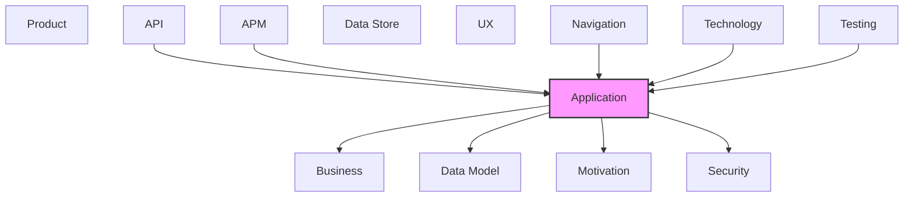

# Application

[← Back to README](../README.md)

Application components, services, and interactions.

## Report Index

- [Layer Introduction](#layer-introduction)
- [Intra-Layer Relationships](#intra-layer-relationships)
- [Inter-Layer Dependencies](#inter-layer-dependencies)
- [Inter-Layer Relationships Table](#inter-layer-relationships-table)
- [Element Reference](#element-reference)

## Layer Introduction

| Metric                    | Count |
| ------------------------- | ----- |
| Elements                  | 39    |
| Intra-Layer Relationships | 59    |
| Inter-Layer Relationships | 63    |
| Inbound Relationships     | 37    |
| Outbound Relationships    | 26    |

**Cross-Layer References**:

- **Upstream layers**: [API](./07-api-layer-report.md), [APM](./12-apm-layer-report.md), [Navigation](./11-navigation-layer-report.md), [Technology](./06-technology-layer-report.md), [Testing](./13-testing-layer-report.md)
- **Downstream layers**: [Business](./02-business-layer-report.md), [Data Model](./08-data-model-layer-report.md), [Motivation](./01-motivation-layer-report.md), [Security](./04-security-layer-report.md)

## Intra-Layer Relationships

*This layer has >30 elements. Summary table shown instead of diagram.*

| Element                                                        | Type                   | Relationships |
| -------------------------------------------------------------- | ---------------------- | ------------- |
| `application.applicationcomponent.annotations-section`         | `applicationcomponent` | 2             |
| `application.applicationcomponent.app-shell`                   | `applicationcomponent` | 7             |
| `application.applicationcomponent.changeset-canvas`            | `applicationcomponent` | 2             |
| `application.applicationcomponent.changeset-impact-view`       | `applicationcomponent` | 3             |
| `application.applicationcomponent.changeset-inspector`         | `applicationcomponent` | 3             |
| `application.applicationcomponent.chat-panel`                  | `applicationcomponent` | 4             |
| `application.applicationcomponent.graph-canvas`                | `applicationcomponent` | 7             |
| `application.applicationcomponent.inspector-drawer`            | `applicationcomponent` | 7             |
| `application.applicationcomponent.nav-tree`                    | `applicationcomponent` | 2             |
| `application.applicationcomponent.page-view`                   | `applicationcomponent` | 4             |
| `application.applicationfunction.annotation-store`             | `applicationfunction`  | 3             |
| `application.applicationfunction.auth-store`                   | `applicationfunction`  | 3             |
| `application.applicationfunction.changeset-store`              | `applicationfunction`  | 2             |
| `application.applicationfunction.chat-store`                   | `applicationfunction`  | 2             |
| `application.applicationfunction.connection-store`             | `applicationfunction`  | 3             |
| `application.applicationfunction.cross-layer-store`            | `applicationfunction`  | 1             |
| `application.applicationfunction.element-store`                | `applicationfunction`  | 1             |
| `application.applicationfunction.layer-store`                  | `applicationfunction`  | 1             |
| `application.applicationfunction.model-store`                  | `applicationfunction`  | 3             |
| `application.applicationfunction.ui-store`                     | `applicationfunction`  | 2             |
| `application.applicationinterface.dr-cli-rest-interface`       | `applicationinterface` | 1             |
| `application.applicationinterface.dr-cli-web-socket-interface` | `applicationinterface` | 2             |
| `application.applicationprocess.auth-route`                    | `applicationprocess`   | 1             |
| `application.applicationservice.changeset-impact-analysis`     | `applicationservice`   | 4             |
| `application.applicationservice.chat-context-builder`          | `applicationservice`   | 2             |
| `application.applicationservice.chat-service`                  | `applicationservice`   | 3             |
| `application.applicationservice.chat-validation`               | `applicationservice`   | 1             |
| `application.applicationservice.embedded-data-loader`          | `applicationservice`   | 3             |
| `application.applicationservice.error-tracker`                 | `applicationservice`   | 6             |
| `application.applicationservice.exception-classifier`          | `applicationservice`   | 2             |
| `application.applicationservice.generated-api-client`          | `applicationservice`   | 4             |
| `application.applicationservice.json-rpc-handler`              | `applicationservice`   | 4             |
| `application.applicationservice.layered-reach`                 | `applicationservice`   | 3             |
| `application.applicationservice.model-graph-transform`         | `applicationservice`   | 7             |
| `application.applicationservice.neighborhood-graph`            | `applicationservice`   | 1             |
| `application.applicationservice.page-data-builder`             | `applicationservice`   | 4             |
| `application.applicationservice.relationship-derivation`       | `applicationservice`   | 2             |
| `application.applicationservice.spec-graph-transform`          | `applicationservice`   | 2             |
| `application.applicationservice.web-socket-client`             | `applicationservice`   | 4             |

## Inter-Layer Dependencies

## Inter-Layer Relationships Table

| Relationship ID                                                                        | Source Node                                                            | Dest Node                                                   | Dest Layer    | Predicate    | Cardinality  | Strength |
| -------------------------------------------------------------------------------------- | ---------------------------------------------------------------------- | ----------------------------------------------------------- | ------------- | ------------ | ------------ | -------- |
| `13b1a5ff-1cea-4ca0-b557-81f4629f2736-satisfies-6ffaff00-8bf8-4580-98ff-8d2a612a9021`  | `13b1a5ff-1cea-4ca0-b557-81f4629f2736`                                 | `6ffaff00-8bf8-4580-98ff-8d2a612a9021`                      | `motivation`  | `satisfies`  | unknown      | unknown  |
| `3dee662b-7dc2-4fcc-8677-15a2ba06136e-references-a77489e0-4e1f-42b1-b3e1-b1b534e6e7f8` | `3dee662b-7dc2-4fcc-8677-15a2ba06136e`                                 | `a77489e0-4e1f-42b1-b3e1-b1b534e6e7f8`                      | `application` | `references` | unknown      | unknown  |
| `406200e9-ef8b-46c9-a1fe-1ff06d6d5602-references-a77489e0-4e1f-42b1-b3e1-b1b534e6e7f8` | `406200e9-ef8b-46c9-a1fe-1ff06d6d5602`                                 | `a77489e0-4e1f-42b1-b3e1-b1b534e6e7f8`                      | `application` | `references` | unknown      | unknown  |
| `6b2f9b1a-bd90-4b1e-9ee2-bed4cbb73a04-realizes-c20e00b6-ef86-415a-92a3-3e9fd9dc7cd6`   | `6b2f9b1a-bd90-4b1e-9ee2-bed4cbb73a04`                                 | `c20e00b6-ef86-415a-92a3-3e9fd9dc7cd6`                      | `business`    | `realizes`   | unknown      | unknown  |
| `8630981b-236c-47ed-b99b-e977c56bdc63-realizes-71f9eb72-20e1-4ae6-be30-425c11e59edb`   | `8630981b-236c-47ed-b99b-e977c56bdc63`                                 | `71f9eb72-20e1-4ae6-be30-425c11e59edb`                      | `application` | `realizes`   | unknown      | unknown  |
| `8630981b-236c-47ed-b99b-e977c56bdc63-references-a77489e0-4e1f-42b1-b3e1-b1b534e6e7f8` | `8630981b-236c-47ed-b99b-e977c56bdc63`                                 | `a77489e0-4e1f-42b1-b3e1-b1b534e6e7f8`                      | `application` | `references` | unknown      | unknown  |
| `a77489e0-4e1f-42b1-b3e1-b1b534e6e7f8-accesses-ea84399d-45dc-4fef-a5a1-759c9b5b5870`   | `a77489e0-4e1f-42b1-b3e1-b1b534e6e7f8`                                 | `ea84399d-45dc-4fef-a5a1-759c9b5b5870`                      | `business`    | `accesses`   | unknown      | unknown  |
| `a77489e0-4e1f-42b1-b3e1-b1b534e6e7f8-realizes-35295e18-08a8-4ca0-ada3-40a017cb4318`   | `a77489e0-4e1f-42b1-b3e1-b1b534e6e7f8`                                 | `35295e18-08a8-4ca0-ada3-40a017cb4318`                      | `business`    | `realizes`   | unknown      | unknown  |
| `a77489e0-4e1f-42b1-b3e1-b1b534e6e7f8-requires-a47870bf-898b-425f-9f73-92663193355a`   | `a77489e0-4e1f-42b1-b3e1-b1b534e6e7f8`                                 | `a47870bf-898b-425f-9f73-92663193355a`                      | `security`    | `requires`   | unknown      | unknown  |
| `a920ab1c-c481-46b6-bdb4-4050501adeac-realizes-e642ad79-62ea-47a4-ae04-d512d0ef7881`   | `a920ab1c-c481-46b6-bdb4-4050501adeac`                                 | `e642ad79-62ea-47a4-ae04-d512d0ef7881`                      | `business`    | `realizes`   | unknown      | unknown  |
| `a920ab1c-c481-46b6-bdb4-4050501adeac-serves-c20e00b6-ef86-415a-92a3-3e9fd9dc7cd6`     | `a920ab1c-c481-46b6-bdb4-4050501adeac`                                 | `c20e00b6-ef86-415a-92a3-3e9fd9dc7cd6`                      | `business`    | `serves`     | unknown      | unknown  |
| `api.operation.realizes.application.applicationfunction`                               | `api.operation.commit-changeset`                                       | `application.applicationfunction.changeset-store`           | `application` | `realizes`   | many-to-many | medium   |
| `api.operation.references.application.applicationservice`                              | `api.operation.commit-changeset`                                       | `application.applicationservice.generated-api-client`       | `application` | `references` | many-to-many | medium   |
| `api.operation.realizes.application.applicationfunction`                               | `api.operation.create-annotation-reply`                                | `application.applicationfunction.annotation-store`          | `application` | `realizes`   | many-to-many | medium   |
| `api.operation.references.application.applicationservice`                              | `api.operation.create-annotation-reply`                                | `application.applicationservice.generated-api-client`       | `application` | `references` | many-to-many | medium   |
| `api.operation.realizes.application.applicationfunction`                               | `api.operation.discard-changeset`                                      | `application.applicationfunction.changeset-store`           | `application` | `realizes`   | many-to-many | medium   |
| `api.operation.references.application.applicationservice`                              | `api.operation.discard-changeset`                                      | `application.applicationservice.generated-api-client`       | `application` | `references` | many-to-many | medium   |
| `api.operation.realizes.application.applicationfunction`                               | `api.operation.get-annotation`                                         | `application.applicationfunction.annotation-store`          | `application` | `realizes`   | many-to-many | medium   |
| `api.operation.references.application.applicationservice`                              | `api.operation.get-annotation`                                         | `application.applicationservice.generated-api-client`       | `application` | `references` | many-to-many | medium   |
| `api.operation.realizes.application.applicationfunction`                               | `api.operation.get-layer`                                              | `application.applicationfunction.layer-store`               | `application` | `realizes`   | many-to-many | medium   |
| `api.operation.references.application.applicationservice`                              | `api.operation.get-layer`                                              | `application.applicationservice.generated-api-client`       | `application` | `references` | many-to-many | medium   |
| `api.operation.realizes.application.applicationfunction`                               | `api.operation.list-annotation-replies`                                | `application.applicationfunction.annotation-store`          | `application` | `realizes`   | many-to-many | medium   |
| `api.operation.references.application.applicationservice`                              | `api.operation.list-annotation-replies`                                | `application.applicationservice.generated-api-client`       | `application` | `references` | many-to-many | medium   |
| `api.operation.realizes.application.applicationfunction`                               | `api.operation.replace-annotation`                                     | `application.applicationfunction.annotation-store`          | `application` | `realizes`   | many-to-many | medium   |
| `api.operation.references.application.applicationservice`                              | `api.operation.replace-annotation`                                     | `application.applicationservice.generated-api-client`       | `application` | `references` | many-to-many | medium   |
| `apm.metricinstrument.monitors.application.applicationservice`                         | `apm.metricinstrument.web-socket-reconnection-attempt-counter`         | `application.applicationservice.web-socket-client`          | `application` | `monitors`   | many-to-many | medium   |
| `application.applicationfunction.accesses.data-model.objectschema`                     | `application.applicationfunction.chat-store`                           | `data-model.objectschema.chat-message`                      | `data-model`  | `accesses`   | many-to-many | medium   |
| `application.applicationfunction.accesses.data-model.objectschema`                     | `application.applicationfunction.chat-store`                           | `data-model.objectschema.tool-invocation-content`           | `data-model`  | `accesses`   | many-to-many | medium   |
| `application.applicationfunction.accesses.data-model.objectschema`                     | `application.applicationfunction.element-store`                        | `data-model.objectschema.model-element`                     | `data-model`  | `accesses`   | many-to-many | medium   |
| `application.applicationfunction.accesses.data-model.objectschema`                     | `application.applicationfunction.model-store`                          | `data-model.objectschema.layer`                             | `data-model`  | `accesses`   | many-to-many | medium   |
| `application.applicationfunction.accesses.data-model.objectschema`                     | `application.applicationfunction.model-store`                          | `data-model.objectschema.model-element`                     | `data-model`  | `accesses`   | many-to-many | medium   |
| `application.applicationfunction.accesses.data-model.objectschema`                     | `application.applicationfunction.model-store`                          | `data-model.objectschema.predicate-definition`              | `data-model`  | `accesses`   | many-to-many | medium   |
| `application.applicationfunction.accesses.data-model.objectschema`                     | `application.applicationfunction.model-store`                          | `data-model.objectschema.spec-layer-data`                   | `data-model`  | `accesses`   | many-to-many | medium   |
| `application.applicationservice.accesses.business.businessobject`                      | `application.applicationservice.changeset-impact-analysis`             | `business.businessobject.changeset`                         | `business`    | `accesses`   | many-to-many | medium   |
| `application.applicationservice.realizes.business.businessservice`                     | `application.applicationservice.changeset-impact-analysis`             | `business.businessservice.changeset-review`                 | `business`    | `realizes`   | many-to-many | medium   |
| `application.applicationservice.realizes.business.businessservice`                     | `application.applicationservice.chat-validation`                       | `business.businessservice.ai-assisted-architecture-chat`    | `business`    | `realizes`   | many-to-many | medium   |
| `application.applicationservice.realizes.business.businessservice`                     | `application.applicationservice.embedded-data-loader`                  | `business.businessservice.architecture-model-visualization` | `business`    | `realizes`   | many-to-many | medium   |
| `application.applicationservice.serves.business.businessprocess`                       | `application.applicationservice.json-rpc-handler`                      | `business.businessprocess.real-time-model-synchronization`  | `business`    | `serves`     | many-to-many | medium   |
| `application.applicationservice.realizes.business.businessservice`                     | `application.applicationservice.model-graph-transform`                 | `business.businessservice.architecture-model-visualization` | `business`    | `realizes`   | many-to-many | medium   |
| `application.applicationservice.realizes.business.businessservice`                     | `application.applicationservice.spec-graph-transform`                  | `business.businessservice.schema-exploration`               | `business`    | `realizes`   | many-to-many | medium   |
| `application.applicationservice.serves.business.businessprocess`                       | `application.applicationservice.web-socket-client`                     | `business.businessprocess.real-time-model-synchronization`  | `business`    | `serves`     | many-to-many | medium   |
| `b66b613e-27b6-4d90-909f-3aa81570de15-references-b7775f1a-2418-4c7a-84aa-997efd658a97` | `b66b613e-27b6-4d90-909f-3aa81570de15`                                 | `b7775f1a-2418-4c7a-84aa-997efd658a97`                      | `application` | `references` | unknown      | unknown  |
| `b7775f1a-2418-4c7a-84aa-997efd658a97-realizes-35295e18-08a8-4ca0-ada3-40a017cb4318`   | `b7775f1a-2418-4c7a-84aa-997efd658a97`                                 | `35295e18-08a8-4ca0-ada3-40a017cb4318`                      | `business`    | `realizes`   | unknown      | unknown  |
| `b7775f1a-2418-4c7a-84aa-997efd658a97-requires-a47870bf-898b-425f-9f73-92663193355a`   | `b7775f1a-2418-4c7a-84aa-997efd658a97`                                 | `a47870bf-898b-425f-9f73-92663193355a`                      | `security`    | `requires`   | unknown      | unknown  |
| `b7775f1a-2418-4c7a-84aa-997efd658a97-serves-83c81f34-4376-4ff9-8fb4-98f3ecbc6d68`     | `b7775f1a-2418-4c7a-84aa-997efd658a97`                                 | `83c81f34-4376-4ff9-8fb4-98f3ecbc6d68`                      | `business`    | `serves`     | unknown      | unknown  |
| `dfc6509e-98f5-479a-bfe9-14bfddbb838a-realizes-3b08f432-72aa-4df6-978c-d76d3312f72b`   | `dfc6509e-98f5-479a-bfe9-14bfddbb838a`                                 | `3b08f432-72aa-4df6-978c-d76d3312f72b`                      | `application` | `realizes`   | unknown      | unknown  |
| `f952fcc0-7c42-4586-a306-a5f2f94a3068-realizes-f1edef84-1298-486c-b347-f47c3b0f9712`   | `f952fcc0-7c42-4586-a306-a5f2f94a3068`                                 | `f1edef84-1298-486c-b347-f47c3b0f9712`                      | `application` | `realizes`   | unknown      | unknown  |
| `fbd68c51-36fa-48ef-b381-5599d2678a90-serves-83c81f34-4376-4ff9-8fb4-98f3ecbc6d68`     | `fbd68c51-36fa-48ef-b381-5599d2678a90`                                 | `83c81f34-4376-4ff9-8fb4-98f3ecbc6d68`                      | `business`    | `serves`     | unknown      | unknown  |
| `ff16c609-618e-4dd9-b477-12e17c000df8-realizes-71f9eb72-20e1-4ae6-be30-425c11e59edb`   | `ff16c609-618e-4dd9-b477-12e17c000df8`                                 | `71f9eb72-20e1-4ae6-be30-425c11e59edb`                      | `application` | `realizes`   | unknown      | unknown  |
| `ff16c609-618e-4dd9-b477-12e17c000df8-references-a77489e0-4e1f-42b1-b3e1-b1b534e6e7f8` | `ff16c609-618e-4dd9-b477-12e17c000df8`                                 | `a77489e0-4e1f-42b1-b3e1-b1b534e6e7f8`                      | `application` | `references` | unknown      | unknown  |
| `navigation.navigationflow.realizes.application.applicationprocess`                    | `navigation.navigationflow.authentication-to-model-flow`               | `application.applicationprocess.auth-route`                 | `application` | `realizes`   | many-to-many | medium   |
| `navigation.route.depends-on.application.applicationcomponent`                         | `navigation.route.app-shell-sectionview-route`                         | `application.applicationcomponent.app-shell`                | `application` | `depends-on` | many-to-many | medium   |
| `technology.node.serves.application.applicationcomponent`                              | `technology.node.vite-dev-server`                                      | `application.applicationcomponent.app-shell`                | `application` | `serves`     | many-to-many | medium   |
| `technology.systemsoftware.serves.application.applicationcomponent`                    | `technology.systemsoftware.heimdall-ui`                                | `application.applicationcomponent.app-shell`                | `application` | `serves`     | many-to-many | medium   |
| `technology.systemsoftware.serves.application.applicationcomponent`                    | `technology.systemsoftware.heimdall-ui`                                | `application.applicationcomponent.changeset-impact-view`    | `application` | `serves`     | many-to-many | medium   |
| `technology.systemsoftware.serves.application.applicationcomponent`                    | `technology.systemsoftware.heimdall-ui`                                | `application.applicationcomponent.graph-canvas`             | `application` | `serves`     | many-to-many | medium   |
| `technology.systemsoftware.serves.application.applicationcomponent`                    | `technology.systemsoftware.tailwind-css-v4`                            | `application.applicationcomponent.app-shell`                | `application` | `serves`     | many-to-many | medium   |
| `technology.systemsoftware.serves.application.applicationcomponent`                    | `technology.systemsoftware.tan-stack-react-query`                      | `application.applicationcomponent.graph-canvas`             | `application` | `serves`     | many-to-many | medium   |
| `testing.testcoveragetarget.covers.application.applicationservice`                     | `testing.testcoveragetarget.cross-component-integration-test-coverage` | `application.applicationservice.chat-service`               | `application` | `covers`     | many-to-many | medium   |
| `testing.testcoveragetarget.covers.application.applicationservice`                     | `testing.testcoveragetarget.cross-component-integration-test-coverage` | `application.applicationservice.web-socket-client`          | `application` | `covers`     | many-to-many | medium   |
| `testing.testcoveragetarget.covers.application.applicationservice`                     | `testing.testcoveragetarget.service-and-store-unit-test-coverage`      | `application.applicationservice.changeset-impact-analysis`  | `application` | `covers`     | many-to-many | medium   |
| `testing.testcoveragetarget.covers.application.applicationservice`                     | `testing.testcoveragetarget.service-and-store-unit-test-coverage`      | `application.applicationservice.layered-reach`              | `application` | `covers`     | many-to-many | medium   |
| `testing.testcoveragetarget.covers.application.applicationservice`                     | `testing.testcoveragetarget.service-and-store-unit-test-coverage`      | `application.applicationservice.model-graph-transform`      | `application` | `covers`     | many-to-many | medium   |

## Element Reference

### Annotations Section {#annotations-section}

**ID**: `application.applicationcomponent.annotations-section`

**Type**: `applicationcomponent`

Annotation threads on the selected element in the inspector: create, edit, resolve, delete and reply, refreshed live from the server's annotation.\* broadcasts.

#### Attributes

| Name | Value    |
| ---- | -------- |
| type | internal |

#### Relationships

| Type        | Related Element                                     | Predicate  | Direction |
| ----------- | --------------------------------------------------- | ---------- | --------- |
| intra-layer | `application.applicationcomponent.inspector-drawer` | `composes` | inbound   |
| intra-layer | `application.applicationcomponent.inspector-drawer` | `uses`     | inbound   |

### App Shell {#app-shell}

**ID**: `application.applicationcomponent.app-shell`

**Type**: `applicationcomponent`

The viewer's four-pane frame: topbar, sidebar nav tree, the active view's canvas (with its inspector), the DrBot chat drawer and the status bar. Mounts the live model/changeset/annotation refetch hooks.

#### Attributes

| Name | Value    |
| ---- | -------- |
| type | internal |

#### Relationships

| Type        | Related Element                                        | Predicate     | Direction |
| ----------- | ------------------------------------------------------ | ------------- | --------- |
| inter-layer | `navigation.route.app-shell-sectionview-route`         | `depends-on`  | inbound   |
| inter-layer | `technology.node.vite-dev-server`                      | `serves`      | inbound   |
| inter-layer | `technology.systemsoftware.heimdall-ui`                | `serves`      | inbound   |
| inter-layer | `technology.systemsoftware.tailwind-css-v4`            | `serves`      | inbound   |
| intra-layer | `application.applicationfunction.ui-store`             | `assigned-to` | outbound  |
| intra-layer | `application.applicationcomponent.changeset-canvas`    | `composes`    | outbound  |
| intra-layer | `application.applicationcomponent.changeset-inspector` | `composes`    | outbound  |
| intra-layer | `application.applicationcomponent.chat-panel`          | `composes`    | outbound  |
| intra-layer | `application.applicationcomponent.graph-canvas`        | `composes`    | outbound  |
| intra-layer | `application.applicationcomponent.nav-tree`            | `composes`    | outbound  |
| intra-layer | `application.applicationservice.exception-classifier`  | `serves`      | inbound   |

### Changeset Canvas {#changeset-canvas}

**ID**: `application.applicationcomponent.changeset-canvas`

**Type**: `applicationcomponent`

The Changesets view's main pane: the op-coded change list with side-by-side diffs, and a Changes / Impact switch.

#### Attributes

| Name | Value    |
| ---- | -------- |
| type | internal |

#### Relationships

| Type        | Related Element                                          | Predicate  | Direction |
| ----------- | -------------------------------------------------------- | ---------- | --------- |
| intra-layer | `application.applicationcomponent.app-shell`             | `composes` | inbound   |
| intra-layer | `application.applicationcomponent.changeset-impact-view` | `composes` | outbound  |

### Changeset Impact View {#changeset-impact-view}

**ID**: `application.applicationcomponent.changeset-impact-view`

**Type**: `applicationcomponent`

The Impact tab: every changed element as a reach origin, drawn as heimdall-ui layer lanes (gutter-routed skip-layer links, bundled same-layer links); click an element to isolate its reach.

#### Attributes

| Name | Value    |
| ---- | -------- |
| type | internal |

#### Relationships

| Type        | Related Element                                            | Predicate  | Direction |
| ----------- | ---------------------------------------------------------- | ---------- | --------- |
| inter-layer | `technology.systemsoftware.heimdall-ui`                    | `serves`   | inbound   |
| intra-layer | `application.applicationcomponent.changeset-canvas`        | `composes` | inbound   |
| intra-layer | `application.applicationservice.changeset-impact-analysis` | `realizes` | outbound  |
| intra-layer | `application.applicationservice.changeset-impact-analysis` | `serves`   | inbound   |

### Changeset Inspector {#changeset-inspector}

**ID**: `application.applicationcomponent.changeset-inspector`

**Type**: `applicationcomponent`

The Changesets view's right pane: status, blast radius, added/modified/deleted counts, and Apply / Discard (behind confirmation) for a staged changeset.

#### Attributes

| Name | Value    |
| ---- | -------- |
| type | internal |

#### Relationships

| Type        | Related Element                                            | Predicate  | Direction |
| ----------- | ---------------------------------------------------------- | ---------- | --------- |
| intra-layer | `application.applicationcomponent.app-shell`               | `composes` | inbound   |
| intra-layer | `application.applicationservice.changeset-impact-analysis` | `serves`   | inbound   |
| intra-layer | `application.applicationservice.generated-api-client`      | `serves`   | inbound   |

### Chat Panel {#chat-panel}

**ID**: `application.applicationcomponent.chat-panel`

**Type**: `applicationcomponent`

The DrBot drawer: Heimdall ChatContainer with streamed text, tool and thinking blocks, suggestions, and a composer that sends the viewer context with each message.

#### Attributes

| Name | Value    |
| ---- | -------- |
| type | internal |

#### Relationships

| Type        | Related Element                                       | Predicate  | Direction |
| ----------- | ----------------------------------------------------- | ---------- | --------- |
| intra-layer | `application.applicationcomponent.app-shell`          | `composes` | inbound   |
| intra-layer | `application.applicationservice.chat-context-builder` | `realizes` | outbound  |
| intra-layer | `application.applicationservice.chat-context-builder` | `serves`   | inbound   |
| intra-layer | `application.applicationservice.chat-service`         | `serves`   | inbound   |

### Graph Canvas {#graph-canvas}

**ID**: `application.applicationcomponent.graph-canvas`

**Type**: `applicationcomponent`

The primary graph-view component for the Model and Schema views; mounts Heimdall's GraphCanvas (@tinkermonkey/heimdall-ui) with layout="force", keyed by view:layerId so it recenters on layer/view switch. Replaced the old React Flow-based GraphViewer + pluggable Dagre/ELK/D3-Force/Graphviz layout-engine registry in the June 2026 Heimdall UX rebuild — GraphCanvas's force layout is now the only layout mode the app renders, and is the exact integration point the sibling heimdall-layout-loop harness targets for layout improvements.

#### Attributes

| Name | Value    |
| ---- | -------- |
| type | internal |

#### Relationships

| Type        | Related Element                                          | Predicate  | Direction |
| ----------- | -------------------------------------------------------- | ---------- | --------- |
| inter-layer | `technology.systemsoftware.heimdall-ui`                  | `serves`   | inbound   |
| inter-layer | `technology.systemsoftware.tan-stack-react-query`        | `serves`   | inbound   |
| intra-layer | `application.applicationcomponent.app-shell`             | `composes` | inbound   |
| intra-layer | `application.applicationcomponent.inspector-drawer`      | `composes` | outbound  |
| intra-layer | `application.applicationcomponent.page-view`             | `composes` | outbound  |
| intra-layer | `application.applicationservice.model-graph-transform`   | `realizes` | outbound  |
| intra-layer | `application.applicationservice.relationship-derivation` | `realizes` | outbound  |
| intra-layer | `application.applicationservice.model-graph-transform`   | `serves`   | inbound   |
| intra-layer | `application.applicationservice.spec-graph-transform`    | `serves`   | inbound   |

### Inspector Drawer {#inspector-drawer}

**ID**: `application.applicationcomponent.inspector-drawer`

**Type**: `applicationcomponent`

Selection details over the graph (Heimdall DetailDrawer + GraphInspector): element identity by dotted path, curated properties, outgoing/incoming and cross-layer relationships, the followed-across-layers reach, and annotations.

#### Attributes

| Name | Value    |
| ---- | -------- |
| type | internal |

#### Relationships

| Type        | Related Element                                          | Predicate  | Direction |
| ----------- | -------------------------------------------------------- | ---------- | --------- |
| intra-layer | `application.applicationcomponent.graph-canvas`          | `composes` | inbound   |
| intra-layer | `application.applicationcomponent.annotations-section`   | `composes` | outbound  |
| intra-layer | `application.applicationservice.layered-reach`           | `realizes` | outbound  |
| intra-layer | `application.applicationcomponent.annotations-section`   | `uses`     | outbound  |
| intra-layer | `application.applicationservice.layered-reach`           | `serves`   | inbound   |
| intra-layer | `application.applicationservice.model-graph-transform`   | `serves`   | inbound   |
| intra-layer | `application.applicationservice.relationship-derivation` | `serves`   | inbound   |

### Nav Tree {#nav-tree}

**ID**: `application.applicationcomponent.nav-tree`

**Type**: `applicationcomponent`

Sidebar navigation: an accordion of Model / Schema / Changesets sections, each with its 12 layers and their elements or node types (or the changesets). Reveals the current selection.

#### Attributes

| Name | Value    |
| ---- | -------- |
| type | internal |

#### Relationships

| Type        | Related Element                              | Predicate     | Direction |
| ----------- | -------------------------------------------- | ------------- | --------- |
| intra-layer | `application.applicationcomponent.app-shell` | `composes`    | inbound   |
| intra-layer | `application.applicationfunction.ui-store`   | `assigned-to` | outbound  |

### Page View {#page-view}

**ID**: `application.applicationcomponent.page-view`

**Type**: `applicationcomponent`

The graph/page toggle's page mode: the full record of a layer, spec node type or model element as breadcrumb, stats, facts and navigable tables, with a neighborhood graph.

#### Attributes

| Name | Value    |
| ---- | -------- |
| type | internal |

#### Relationships

| Type        | Related Element                                     | Predicate  | Direction |
| ----------- | --------------------------------------------------- | ---------- | --------- |
| intra-layer | `application.applicationcomponent.graph-canvas`     | `composes` | inbound   |
| intra-layer | `application.applicationservice.page-data-builder`  | `realizes` | outbound  |
| intra-layer | `application.applicationservice.neighborhood-graph` | `serves`   | inbound   |
| intra-layer | `application.applicationservice.page-data-builder`  | `serves`   | inbound   |

### Annotation Store {#annotation-store}

**ID**: `application.applicationfunction.annotation-store`

**Type**: `applicationfunction`

Zustand store managing user annotations on model elements; syncs with DR CLI server via REST API

#### Relationships

| Type        | Related Element                                       | Predicate    | Direction |
| ----------- | ----------------------------------------------------- | ------------ | --------- |
| inter-layer | `api.operation.create-annotation-reply`               | `realizes`   | inbound   |
| inter-layer | `api.operation.get-annotation`                        | `realizes`   | inbound   |
| inter-layer | `api.operation.list-annotation-replies`               | `realizes`   | inbound   |
| inter-layer | `api.operation.replace-annotation`                    | `realizes`   | inbound   |
| intra-layer | `application.applicationfunction.auth-store`          | `depends-on` | outbound  |
| intra-layer | `application.applicationservice.embedded-data-loader` | `serves`     | inbound   |
| intra-layer | `application.applicationservice.error-tracker`        | `serves`     | inbound   |

### Auth Store {#auth-store}

**ID**: `application.applicationfunction.auth-store`

**Type**: `applicationfunction`

Zustand store managing the DR CLI auth token, authentication state, and magic-link token extraction

#### Relationships

| Type        | Related Element                                       | Predicate    | Direction |
| ----------- | ----------------------------------------------------- | ------------ | --------- |
| intra-layer | `application.applicationfunction.annotation-store`    | `depends-on` | inbound   |
| intra-layer | `application.applicationservice.generated-api-client` | `realizes`   | outbound  |
| intra-layer | `application.applicationprocess.auth-route`           | `depends-on` | inbound   |

### Changeset Store {#changeset-store}

**ID**: `application.applicationfunction.changeset-store`

**Type**: `applicationfunction`

Zustand store managing the active changeset list, selected changeset, and changeset diff state

#### Relationships

| Type        | Related Element                                       | Predicate    | Direction |
| ----------- | ----------------------------------------------------- | ------------ | --------- |
| inter-layer | `api.operation.commit-changeset`                      | `realizes`   | inbound   |
| inter-layer | `api.operation.discard-changeset`                     | `realizes`   | inbound   |
| intra-layer | `application.applicationfunction.connection-store`    | `depends-on` | outbound  |
| intra-layer | `application.applicationservice.embedded-data-loader` | `serves`     | inbound   |

### Chat Store {#chat-store}

**ID**: `application.applicationfunction.chat-store`

**Type**: `applicationfunction`

Zustand store managing chat conversation history, streaming state, and active tool invocations for the AI assistant

#### Relationships

| Type        | Related Element                                    | Predicate    | Direction |
| ----------- | -------------------------------------------------- | ------------ | --------- |
| inter-layer | `data-model.objectschema.chat-message`             | `accesses`   | outbound  |
| inter-layer | `data-model.objectschema.tool-invocation-content`  | `accesses`   | outbound  |
| intra-layer | `application.applicationfunction.connection-store` | `depends-on` | outbound  |
| intra-layer | `application.applicationservice.chat-validation`   | `serves`     | inbound   |

### Connection Store {#connection-store}

**ID**: `application.applicationfunction.connection-store`

**Type**: `applicationfunction`

Zustand store tracking WebSocket connection state (connected/disconnected/reconnecting) to the DR CLI server

#### Relationships

| Type        | Related Element                                    | Predicate    | Direction |
| ----------- | -------------------------------------------------- | ------------ | --------- |
| intra-layer | `application.applicationfunction.changeset-store`  | `depends-on` | inbound   |
| intra-layer | `application.applicationfunction.chat-store`       | `depends-on` | inbound   |
| intra-layer | `application.applicationservice.web-socket-client` | `realizes`   | outbound  |

### Cross-Layer Store {#cross-layer-store}

**ID**: `application.applicationfunction.cross-layer-store`

**Type**: `applicationfunction`

Zustand store holding resolved cross-layer references and edge data for the graph

#### Relationships

| Type        | Related Element                               | Predicate    | Direction |
| ----------- | --------------------------------------------- | ------------ | --------- |
| intra-layer | `application.applicationfunction.model-store` | `depends-on` | outbound  |

### Element Store {#element-store}

**ID**: `application.applicationfunction.element-store`

**Type**: `applicationfunction`

Zustand store tracking selected element, highlighted paths, and focus mode state

#### Relationships

| Type        | Related Element                               | Predicate    | Direction |
| ----------- | --------------------------------------------- | ------------ | --------- |
| inter-layer | `data-model.objectschema.model-element`       | `accesses`   | outbound  |
| intra-layer | `application.applicationfunction.model-store` | `depends-on` | outbound  |

### Layer Store {#layer-store}

**ID**: `application.applicationfunction.layer-store`

**Type**: `applicationfunction`

Zustand store managing active layer selection and layer visibility filters

#### Relationships

| Type        | Related Element                               | Predicate    | Direction |
| ----------- | --------------------------------------------- | ------------ | --------- |
| inter-layer | `api.operation.get-layer`                     | `realizes`   | inbound   |
| intra-layer | `application.applicationfunction.model-store` | `depends-on` | outbound  |

### Model Store {#model-store}

**ID**: `application.applicationfunction.model-store`

**Type**: `applicationfunction`

Global Zustand store holding the parsed architecture model, loading state, and error state

#### Relationships

| Type        | Related Element                                     | Predicate    | Direction |
| ----------- | --------------------------------------------------- | ------------ | --------- |
| inter-layer | `data-model.objectschema.layer`                     | `accesses`   | outbound  |
| inter-layer | `data-model.objectschema.model-element`             | `accesses`   | outbound  |
| inter-layer | `data-model.objectschema.predicate-definition`      | `accesses`   | outbound  |
| inter-layer | `data-model.objectschema.spec-layer-data`           | `accesses`   | outbound  |
| intra-layer | `application.applicationfunction.cross-layer-store` | `depends-on` | inbound   |
| intra-layer | `application.applicationfunction.element-store`     | `depends-on` | inbound   |
| intra-layer | `application.applicationfunction.layer-store`       | `depends-on` | inbound   |

### UI Store {#ui-store}

**ID**: `application.applicationfunction.ui-store`

**Type**: `applicationfunction`

Zustand store for UI state: view, layer, selection, changeset, graph/page mode, nav accordion, graph settings and canvas tone. Preferences persist to localStorage; navigation state is the router's.

#### Relationships

| Type        | Related Element                              | Predicate     | Direction |
| ----------- | -------------------------------------------- | ------------- | --------- |
| intra-layer | `application.applicationcomponent.app-shell` | `assigned-to` | inbound   |
| intra-layer | `application.applicationcomponent.nav-tree`  | `assigned-to` | inbound   |

### DR CLI REST Interface {#dr-cli-rest-interface}

**ID**: `application.applicationinterface.dr-cli-rest-interface`

**Type**: `applicationinterface`

The HTTP REST interface through which the embedded app communicates with the DR CLI visualization server

#### Attributes

| Name     | Value |
| -------- | ----- |
| protocol | REST  |

#### Relationships

| Type        | Related Element                                       | Predicate     | Direction |
| ----------- | ----------------------------------------------------- | ------------- | --------- |
| intra-layer | `application.applicationservice.generated-api-client` | `assigned-to` | outbound  |

### DR CLI WebSocket Interface {#dr-cli-websocket-interface}

**ID**: `application.applicationinterface.dr-cli-web-socket-interface`

**Type**: `applicationinterface`

The WebSocket interface for subscribing to real-time model/changeset/annotation update events

#### Attributes

| Name     | Value     |
| -------- | --------- |
| protocol | WebSocket |

#### Relationships

| Type        | Related Element                                    | Predicate     | Direction |
| ----------- | -------------------------------------------------- | ------------- | --------- |
| intra-layer | `application.applicationservice.json-rpc-handler`  | `assigned-to` | outbound  |
| intra-layer | `application.applicationservice.web-socket-client` | `assigned-to` | outbound  |

### Auth Route {#auth-route}

**ID**: `application.applicationprocess.auth-route`

**Type**: `applicationprocess`

TanStack Router route handling token-based authentication via magic link; extracts token from URL query params

#### Relationships

| Type        | Related Element                                          | Predicate    | Direction |
| ----------- | -------------------------------------------------------- | ------------ | --------- |
| inter-layer | `navigation.navigationflow.authentication-to-model-flow` | `realizes`   | inbound   |
| intra-layer | `application.applicationfunction.auth-store`             | `depends-on` | outbound  |

### Changeset Impact Analysis {#changeset-impact-analysis}

**ID**: `application.applicationservice.changeset-impact-analysis`

**Type**: `applicationservice`

Lays a changeset over the model (staged additions included), nets its ops in order, runs multi-origin computeReach from every changed element and returns the reached subgraph and per-layer blast radius.

#### Attributes

| Name        | Value       |
| ----------- | ----------- |
| serviceType | synchronous |

#### Relationships

| Type        | Related Element                                                   | Predicate    | Direction |
| ----------- | ----------------------------------------------------------------- | ------------ | --------- |
| inter-layer | `business.businessobject.changeset`                               | `accesses`   | outbound  |
| inter-layer | `business.businessservice.changeset-review`                       | `realizes`   | outbound  |
| inter-layer | `testing.testcoveragetarget.service-and-store-unit-test-coverage` | `covers`     | inbound   |
| intra-layer | `application.applicationcomponent.changeset-impact-view`          | `realizes`   | inbound   |
| intra-layer | `application.applicationservice.model-graph-transform`            | `depends-on` | outbound  |
| intra-layer | `application.applicationcomponent.changeset-impact-view`          | `serves`     | outbound  |
| intra-layer | `application.applicationcomponent.changeset-inspector`            | `serves`     | outbound  |

### Chat Context Builder {#chat-context-builder}

**ID**: `application.applicationservice.chat-context-builder`

**Type**: `applicationservice`

Builds the &lt;viewer-context&gt; block (view, layer, selected element or changeset) sent ahead of each DrBot message.

#### Attributes

| Name        | Value       |
| ----------- | ----------- |
| serviceType | synchronous |

#### Relationships

| Type        | Related Element                               | Predicate  | Direction |
| ----------- | --------------------------------------------- | ---------- | --------- |
| intra-layer | `application.applicationcomponent.chat-panel` | `realizes` | inbound   |
| intra-layer | `application.applicationcomponent.chat-panel` | `serves`   | outbound  |

### Chat Service {#chat-service}

**ID**: `application.applicationservice.chat-service`

**Type**: `applicationservice`

Interfaces with the Claude AI API to provide architectural assistant chat functionality; manages message streaming and tool invocations

#### Attributes

| Name        | Value        |
| ----------- | ------------ |
| serviceType | asynchronous |

#### Relationships

| Type        | Related Element                                                        | Predicate    | Direction |
| ----------- | ---------------------------------------------------------------------- | ------------ | --------- |
| inter-layer | `testing.testcoveragetarget.cross-component-integration-test-coverage` | `covers`     | inbound   |
| intra-layer | `application.applicationservice.error-tracker`                         | `depends-on` | outbound  |
| intra-layer | `application.applicationservice.json-rpc-handler`                      | `depends-on` | outbound  |
| intra-layer | `application.applicationcomponent.chat-panel`                          | `serves`     | outbound  |

### Chat Validation {#chat-validation}

**ID**: `application.applicationservice.chat-validation`

**Type**: `applicationservice`

Validates chat message content and enforces conversation constraints before submission

#### Attributes

| Name        | Value       |
| ----------- | ----------- |
| serviceType | synchronous |

#### Relationships

| Type        | Related Element                                          | Predicate  | Direction |
| ----------- | -------------------------------------------------------- | ---------- | --------- |
| inter-layer | `business.businessservice.ai-assisted-architecture-chat` | `realizes` | outbound  |
| intra-layer | `application.applicationfunction.chat-store`             | `serves`   | outbound  |

### Embedded Data Loader {#embedded-data-loader}

**ID**: `application.applicationservice.embedded-data-loader`

**Type**: `applicationservice`

Coordinates data loading for the embedded app; selects between DR CLI server, GitHub, or local file sources based on connection state

#### Attributes

| Name        | Value        |
| ----------- | ------------ |
| serviceType | asynchronous |

#### Relationships

| Type        | Related Element                                             | Predicate    | Direction |
| ----------- | ----------------------------------------------------------- | ------------ | --------- |
| inter-layer | `business.businessservice.architecture-model-visualization` | `realizes`   | outbound  |
| intra-layer | `application.applicationservice.error-tracker`              | `depends-on` | outbound  |
| intra-layer | `application.applicationfunction.annotation-store`          | `serves`     | outbound  |
| intra-layer | `application.applicationfunction.changeset-store`           | `serves`     | outbound  |

### Error Tracker {#error-tracker}

**ID**: `application.applicationservice.error-tracker`

**Type**: `applicationservice`

Captures and categorizes runtime errors with context for display in the UI and structured logging

#### Attributes

| Name        | Value       |
| ----------- | ----------- |
| serviceType | synchronous |

#### Relationships

| Type        | Related Element                                       | Predicate    | Direction |
| ----------- | ----------------------------------------------------- | ------------ | --------- |
| intra-layer | `application.applicationservice.chat-service`         | `depends-on` | inbound   |
| intra-layer | `application.applicationservice.embedded-data-loader` | `depends-on` | inbound   |
| intra-layer | `application.applicationservice.exception-classifier` | `depends-on` | outbound  |
| intra-layer | `application.applicationfunction.annotation-store`    | `serves`     | outbound  |
| intra-layer | `application.applicationservice.json-rpc-handler`     | `depends-on` | inbound   |
| intra-layer | `application.applicationservice.web-socket-client`    | `depends-on` | inbound   |

### Exception Classifier {#exception-classifier}

**ID**: `application.applicationservice.exception-classifier`

**Type**: `applicationservice`

Classifies runtime exceptions into categories for structured error reporting and Storybook story error filtering

#### Attributes

| Name        | Value       |
| ----------- | ----------- |
| serviceType | synchronous |

#### Relationships

| Type        | Related Element                                | Predicate    | Direction |
| ----------- | ---------------------------------------------- | ------------ | --------- |
| intra-layer | `application.applicationservice.error-tracker` | `depends-on` | inbound   |
| intra-layer | `application.applicationcomponent.app-shell`   | `serves`     | outbound  |

### Generated API Client {#generated-api-client}

**ID**: `application.applicationservice.generated-api-client`

**Type**: `applicationservice`

Auto-generated TypeScript HTTP client from the OpenAPI spec; provides typed methods for all DR CLI REST endpoints

#### Attributes

| Name        | Value       |
| ----------- | ----------- |
| serviceType | synchronous |

#### Relationships

| Type        | Related Element                                          | Predicate     | Direction |
| ----------- | -------------------------------------------------------- | ------------- | --------- |
| inter-layer | `api.operation.commit-changeset`                         | `references`  | inbound   |
| inter-layer | `api.operation.create-annotation-reply`                  | `references`  | inbound   |
| inter-layer | `api.operation.discard-changeset`                        | `references`  | inbound   |
| inter-layer | `api.operation.get-annotation`                           | `references`  | inbound   |
| inter-layer | `api.operation.get-layer`                                | `references`  | inbound   |
| inter-layer | `api.operation.list-annotation-replies`                  | `references`  | inbound   |
| inter-layer | `api.operation.replace-annotation`                       | `references`  | inbound   |
| intra-layer | `application.applicationfunction.auth-store`             | `realizes`    | inbound   |
| intra-layer | `application.applicationinterface.dr-cli-rest-interface` | `assigned-to` | inbound   |
| intra-layer | `application.applicationcomponent.changeset-inspector`   | `serves`      | outbound  |
| intra-layer | `application.applicationservice.model-graph-transform`   | `depends-on`  | inbound   |

### JSON-RPC Handler {#json-rpc-handler}

**ID**: `application.applicationservice.json-rpc-handler`

**Type**: `applicationservice`

Processes incoming JSON-RPC 2.0 messages from the WebSocket connection; routes model/changeset/annotation update events to the appropriate stores

#### Attributes

| Name        | Value        |
| ----------- | ------------ |
| serviceType | event-driven |

#### Relationships

| Type        | Related Element                                                | Predicate     | Direction |
| ----------- | -------------------------------------------------------------- | ------------- | --------- |
| inter-layer | `business.businessprocess.real-time-model-synchronization`     | `serves`      | outbound  |
| intra-layer | `application.applicationinterface.dr-cli-web-socket-interface` | `assigned-to` | inbound   |
| intra-layer | `application.applicationservice.chat-service`                  | `depends-on`  | inbound   |
| intra-layer | `application.applicationservice.error-tracker`                 | `depends-on`  | outbound  |
| intra-layer | `application.applicationservice.web-socket-client`             | `depends-on`  | outbound  |

### Layered Reach {#layered-reach}

**ID**: `application.applicationservice.layered-reach`

**Type**: `applicationservice`

Whole-model heimdall-ui layered index and the inspector's followed-across-layers reach (computeReach at the chosen follow depth).

#### Attributes

| Name        | Value       |
| ----------- | ----------- |
| serviceType | synchronous |

#### Relationships

| Type        | Related Element                                                   | Predicate    | Direction |
| ----------- | ----------------------------------------------------------------- | ------------ | --------- |
| inter-layer | `testing.testcoveragetarget.service-and-store-unit-test-coverage` | `covers`     | inbound   |
| intra-layer | `application.applicationcomponent.inspector-drawer`               | `realizes`   | inbound   |
| intra-layer | `application.applicationservice.model-graph-transform`            | `depends-on` | outbound  |
| intra-layer | `application.applicationcomponent.inspector-drawer`               | `serves`     | outbound  |

### Model Graph Transform {#model-graph-transform}

**ID**: `application.applicationservice.model-graph-transform`

**Type**: `applicationservice`

Pure transforms of the /api/model payload into per-layer Heimdall GraphCanvas view models (nodes + edges); builds the dual-index (UUID + derived dotted id) used to resolve every link endpoint, since links reference nodes by either form. Replaced the old dataLoader.ts/crossLayerReferenceExtractor.ts/nodeTransformer.ts/yamlParser.ts client-side YAML-parsing pipeline — the app now consumes pre-parsed JSON from the DR CLI REST API via React Query.

#### Attributes

| Name        | Value       |
| ----------- | ----------- |
| serviceType | synchronous |

#### Relationships

| Type        | Related Element                                                   | Predicate    | Direction |
| ----------- | ----------------------------------------------------------------- | ------------ | --------- |
| inter-layer | `business.businessservice.architecture-model-visualization`       | `realizes`   | outbound  |
| inter-layer | `testing.testcoveragetarget.service-and-store-unit-test-coverage` | `covers`     | inbound   |
| intra-layer | `application.applicationcomponent.graph-canvas`                   | `realizes`   | inbound   |
| intra-layer | `application.applicationservice.changeset-impact-analysis`        | `depends-on` | inbound   |
| intra-layer | `application.applicationservice.layered-reach`                    | `depends-on` | inbound   |
| intra-layer | `application.applicationservice.generated-api-client`             | `depends-on` | outbound  |
| intra-layer | `application.applicationcomponent.graph-canvas`                   | `serves`     | outbound  |
| intra-layer | `application.applicationcomponent.inspector-drawer`               | `serves`     | outbound  |
| intra-layer | `application.applicationservice.page-data-builder`                | `depends-on` | inbound   |

### Neighborhood Graph {#neighborhood-graph}

**ID**: `application.applicationservice.neighborhood-graph`

**Type**: `applicationservice`

The one-hop neighborhood graph of a model element or spec node type shown on its page.

#### Attributes

| Name        | Value       |
| ----------- | ----------- |
| serviceType | synchronous |

#### Relationships

| Type        | Related Element                              | Predicate | Direction |
| ----------- | -------------------------------------------- | --------- | --------- |
| intra-layer | `application.applicationcomponent.page-view` | `serves`  | outbound  |

### Page Data Builder {#page-data-builder}

**ID**: `application.applicationservice.page-data-builder`

**Type**: `applicationservice`

Builds the page view's records (header, breadcrumb, stats, facts, tables) for a layer, spec node type or model element.

#### Attributes

| Name        | Value       |
| ----------- | ----------- |
| serviceType | synchronous |

#### Relationships

| Type        | Related Element                                        | Predicate    | Direction |
| ----------- | ------------------------------------------------------ | ------------ | --------- |
| intra-layer | `application.applicationcomponent.page-view`           | `realizes`   | inbound   |
| intra-layer | `application.applicationservice.model-graph-transform` | `depends-on` | outbound  |
| intra-layer | `application.applicationservice.spec-graph-transform`  | `depends-on` | outbound  |
| intra-layer | `application.applicationcomponent.page-view`           | `serves`     | outbound  |

### Relationship Derivation {#relationship-derivation}

**ID**: `application.applicationservice.relationship-derivation`

**Type**: `applicationservice`

Derives a selected element's inbound/outbound relationship links (including cross-layer links, with targetDomain set to the other endpoint's layer for swatch coloring and cross-layer navigation) from the /api/model payload for the GraphInspector/Inspector click-to-navigate feature.

#### Attributes

| Name        | Value       |
| ----------- | ----------- |
| serviceType | synchronous |

#### Relationships

| Type        | Related Element                                     | Predicate  | Direction |
| ----------- | --------------------------------------------------- | ---------- | --------- |
| intra-layer | `application.applicationcomponent.graph-canvas`     | `realizes` | inbound   |
| intra-layer | `application.applicationcomponent.inspector-drawer` | `serves`   | outbound  |

### Spec Graph Transform {#spec-graph-transform}

**ID**: `application.applicationservice.spec-graph-transform`

**Type**: `applicationservice`

Turns /api/spec into per-layer node-type graphs, attribute rows and relationship-schema counts for the Schema view.

#### Attributes

| Name        | Value       |
| ----------- | ----------- |
| serviceType | synchronous |

#### Relationships

| Type        | Related Element                                    | Predicate    | Direction |
| ----------- | -------------------------------------------------- | ------------ | --------- |
| inter-layer | `business.businessservice.schema-exploration`      | `realizes`   | outbound  |
| intra-layer | `application.applicationservice.page-data-builder` | `depends-on` | inbound   |
| intra-layer | `application.applicationcomponent.graph-canvas`    | `serves`     | outbound  |

### WebSocket Client {#websocket-client}

**ID**: `application.applicationservice.web-socket-client`

**Type**: `applicationservice`

Manages the persistent WebSocket connection to the DR CLI server; handles reconnection, topic subscriptions, and JSON-RPC message dispatch

#### Attributes

| Name        | Value        |
| ----------- | ------------ |
| serviceType | event-driven |

#### Relationships

| Type        | Related Element                                                        | Predicate     | Direction |
| ----------- | ---------------------------------------------------------------------- | ------------- | --------- |
| inter-layer | `apm.metricinstrument.web-socket-reconnection-attempt-counter`         | `monitors`    | inbound   |
| inter-layer | `business.businessprocess.real-time-model-synchronization`             | `serves`      | outbound  |
| inter-layer | `testing.testcoveragetarget.cross-component-integration-test-coverage` | `covers`      | inbound   |
| intra-layer | `application.applicationfunction.connection-store`                     | `realizes`    | inbound   |
| intra-layer | `application.applicationinterface.dr-cli-web-socket-interface`         | `assigned-to` | inbound   |
| intra-layer | `application.applicationservice.json-rpc-handler`                      | `depends-on`  | inbound   |
| intra-layer | `application.applicationservice.error-tracker`                         | `depends-on`  | outbound  |

---

Generated: 2026-11-12T13:57:21.197Z | Model Version: 0.1.0
