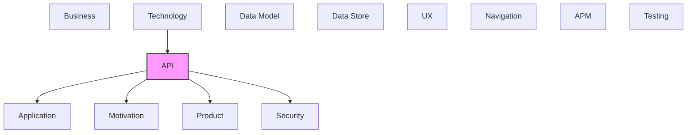

# API

[← Back to README](../README.md)

REST APIs, operations, endpoints, and API integrations.

## Report Index

- [Layer Introduction](#layer-introduction)
- [Intra-Layer Relationships](#intra-layer-relationships)
- [Inter-Layer Dependencies](#inter-layer-dependencies)
- [Inter-Layer Relationships Table](#inter-layer-relationships-table)
- [Element Reference](#element-reference)

## Layer Introduction

| Metric                    | Count |
| ------------------------- | ----- |
| Elements                  | 49    |
| Intra-Layer Relationships | 42    |
| Inter-Layer Relationships | 51    |
| Inbound Relationships     | 1     |
| Outbound Relationships    | 50    |

**Cross-Layer References**:

- **Upstream layers**: [Technology](./06-technology-layer-report.md)
- **Downstream layers**: [Application](./05-application-layer-report.md), [Motivation](./01-motivation-layer-report.md), [Product](./03-product-layer-report.md), [Security](./04-security-layer-report.md)

## Intra-Layer Relationships

*This layer has >30 elements. Summary table shown instead of diagram.*

| Element                                                                                          | Type              | Relationships |
| ------------------------------------------------------------------------------------------------ | ----------------- | ------------- |
| `api.info.dr-cli-visualization-server-api`                                                       | `info`            | 1             |
| `api.openapidocument.dr-cli-visualization-server-open-api-document`                              | `openapidocument` | 3             |
| `api.operation.delete-api-projects-project-checkouts-checkout-annotations-annotation-id`         | `operation`       | 1             |
| `api.operation.delete-mcp`                                                                       | `operation`       | 0             |
| `api.operation.get-api-docs`                                                                     | `operation`       | 0             |
| `api.operation.get-api-projects`                                                                 | `operation`       | 1             |
| `api.operation.get-api-projects-project`                                                         | `operation`       | 1             |
| `api.operation.get-api-projects-project-checkouts`                                               | `operation`       | 1             |
| `api.operation.get-api-projects-project-checkouts-checkout-annotations`                          | `operation`       | 2             |
| `api.operation.get-api-projects-project-checkouts-checkout-annotations-annotation-id`            | `operation`       | 2             |
| `api.operation.get-api-projects-project-checkouts-checkout-annotations-annotation-id-replies`    | `operation`       | 2             |
| `api.operation.get-api-projects-project-checkouts-checkout-changesets`                           | `operation`       | 2             |
| `api.operation.get-api-projects-project-checkouts-checkout-changesets-changeset-id`              | `operation`       | 1             |
| `api.operation.get-api-projects-project-checkouts-checkout-changesets-changeset-id-verification` | `operation`       | 1             |
| `api.operation.get-api-projects-project-checkouts-checkout-layers-layer-name`                    | `operation`       | 2             |
| `api.operation.get-api-projects-project-checkouts-checkout-model`                                | `operation`       | 2             |
| `api.operation.get-api-projects-project-checkouts-checkout-tier1`                                | `operation`       | 2             |
| `api.operation.get-api-spec-yaml`                                                                | `operation`       | 0             |
| `api.operation.get-changeset-verification`                                                       | `operation`       | 2             |
| `api.operation.get-mcp`                                                                          | `operation`       | 0             |
| `api.operation.get-schema-specifications`                                                        | `operation`       | 1             |
| `api.operation.get-ws`                                                                           | `operation`       | 1             |
| `api.operation.health-check`                                                                     | `operation`       | 1             |
| `api.operation.patch-api-projects-project-checkouts-checkout-annotations-annotation-id`          | `operation`       | 1             |
| `api.operation.post-api-projects-project-checkouts-checkout-annotations`                         | `operation`       | 1             |
| `api.operation.post-api-projects-project-checkouts-checkout-annotations-annotation-id-replies`   | `operation`       | 2             |
| `api.operation.post-api-projects-project-checkouts-checkout-changesets-changeset-id-commit`      | `operation`       | 2             |
| `api.operation.post-api-projects-project-checkouts-checkout-changesets-changeset-id-discard`     | `operation`       | 2             |
| `api.operation.post-mcp`                                                                         | `operation`       | 0             |
| `api.operation.put-api-projects-project-checkouts-checkout-annotations-annotation-id`            | `operation`       | 2             |
| `api.operation.put-api-projects-project-checkouts-checkout-changesets-changeset-id-review`       | `operation`       | 2             |
| `api.operation.web-socket-real-time-updates`                                                     | `operation`       | 2             |
| `api.pathitem.annotation-detail-path`                                                            | `pathitem`        | 3             |
| `api.pathitem.annotation-replies-path`                                                           | `pathitem`        | 2             |
| `api.pathitem.annotations-path`                                                                  | `pathitem`        | 1             |
| `api.pathitem.changeset-commit-path`                                                             | `pathitem`        | 1             |
| `api.pathitem.changeset-detail-path`                                                             | `pathitem`        | 1             |
| `api.pathitem.changeset-discard-path`                                                            | `pathitem`        | 1             |
| `api.pathitem.changeset-review-path`                                                             | `pathitem`        | 1             |
| `api.pathitem.changeset-verification-path`                                                       | `pathitem`        | 1             |
| `api.pathitem.changesets-path`                                                                   | `pathitem`        | 1             |
| `api.pathitem.health-path`                                                                       | `pathitem`        | 1             |
| `api.pathitem.layer-path`                                                                        | `pathitem`        | 1             |
| `api.pathitem.model-path`                                                                        | `pathitem`        | 1             |
| `api.pathitem.spec-path`                                                                         | `pathitem`        | 1             |
| `api.pathitem.tier1-path`                                                                        | `pathitem`        | 1             |
| `api.pathitem.web-socket-path`                                                                   | `pathitem`        | 1             |
| `api.securityscheme.bearer-auth-scheme`                                                          | `securityscheme`  | 21            |
| `api.securityscheme.query-auth-scheme`                                                           | `securityscheme`  | 2             |

## Inter-Layer Dependencies

## Inter-Layer Relationships Table

| Relationship ID                                                                        | Source Node                                                                                      | Dest Node                                                           | Dest Layer    | Predicate    | Cardinality  | Strength |
| -------------------------------------------------------------------------------------- | ------------------------------------------------------------------------------------------------ | ------------------------------------------------------------------- | ------------- | ------------ | ------------ | -------- |
| `api.operation.references.application.applicationservice`                              | `api.operation.get-api-projects-project-checkouts-checkout-annotations-annotation-id`            | `application.applicationservice.generated-api-client`               | `application` | `references` | many-to-many | medium   |
| `api.operation.references.application.applicationservice`                              | `api.operation.get-api-projects-project-checkouts-checkout-annotations-annotation-id-replies`    | `application.applicationservice.generated-api-client`               | `application` | `references` | many-to-many | medium   |
| `api.operation.references.application.applicationservice`                              | `api.operation.get-api-projects-project-checkouts-checkout-annotations-annotation-id-replies`    | `application.applicationservice.use-annotations`                    | `application` | `references` | many-to-many | medium   |
| `api.operation.requires.security.securitypolicy`                                       | `api.operation.get-api-projects-project-checkouts-checkout-annotations-annotation-id-replies`    | `security.securitypolicy.bearer-token-policy`                       | `security`    | `requires`   | many-to-many | medium   |
| `api.operation.requires.security.securitypolicy`                                       | `api.operation.get-api-projects-project-checkouts-checkout-annotations-annotation-id`            | `security.securitypolicy.bearer-token-policy`                       | `security`    | `requires`   | many-to-many | medium   |
| `api.operation.references.application.applicationservice`                              | `api.operation.get-api-projects-project-checkouts-checkout-annotations`                          | `application.applicationservice.use-annotations`                    | `application` | `references` | many-to-many | medium   |
| `api.operation.exposes.product.feature`                                                | `api.operation.get-api-projects-project-checkouts-checkout-changesets-changeset-id-verification` | `product.feature.c4-plan-vs-as-built`                               | `product`     | `exposes`    | many-to-many | medium   |
| `api.operation.references.application.applicationservice`                              | `api.operation.get-api-projects-project-checkouts-checkout-changesets-changeset-id-verification` | `application.applicationservice.plan-verification`                  | `application` | `references` | many-to-many | medium   |
| `api.operation.requires.security.securitypolicy`                                       | `api.operation.get-api-projects-project-checkouts-checkout-changesets-changeset-id-verification` | `security.securitypolicy.bearer-token-policy`                       | `security`    | `requires`   | many-to-many | medium   |
| `api.operation.references.application.applicationservice`                              | `api.operation.get-api-projects-project-checkouts-checkout-changesets`                           | `application.applicationservice.use-changesets`                     | `application` | `references` | many-to-many | medium   |
| `api.operation.references.application.applicationservice`                              | `api.operation.get-api-projects-project-checkouts-checkout-layers-layer-name`                    | `application.applicationservice.generated-api-client`               | `application` | `references` | many-to-many | medium   |
| `api.operation.requires.security.securitypolicy`                                       | `api.operation.get-api-projects-project-checkouts-checkout-layers-layer-name`                    | `security.securitypolicy.bearer-token-policy`                       | `security`    | `requires`   | many-to-many | medium   |
| `api.operation.references.application.applicationservice`                              | `api.operation.get-api-projects-project-checkouts-checkout-model`                                | `application.applicationservice.use-model`                          | `application` | `references` | many-to-many | medium   |
| `api.operation.exposes.product.feature`                                                | `api.operation.get-api-projects-project-checkouts-checkout-tier1`                                | `product.feature.tier1-mode-and-routing`                            | `product`     | `exposes`    | many-to-many | medium   |
| `api.operation.exposes.product.feature`                                                | `api.operation.get-api-projects-project-checkouts-checkout-tier1`                                | `product.feature.tier1-spend-panel`                                 | `product`     | `exposes`    | many-to-many | medium   |
| `api.operation.exposes.product.feature`                                                | `api.operation.get-api-projects-project-checkouts-checkout-tier1`                                | `product.feature.tier1-warming-progress`                            | `product`     | `exposes`    | many-to-many | medium   |
| `api.operation.references.application.applicationservice`                              | `api.operation.get-api-projects-project-checkouts-checkout-tier1`                                | `application.applicationservice.use-tier1`                          | `application` | `references` | many-to-many | medium   |
| `api.operation.requires.security.securitypolicy`                                       | `api.operation.get-api-projects-project-checkouts-checkout-tier1`                                | `security.securitypolicy.bearer-token-policy`                       | `security`    | `requires`   | many-to-many | medium   |
| `api.operation.references.application.applicationservice`                              | `api.operation.get-api-projects-project-checkouts`                                               | `application.applicationservice.use-projects`                       | `application` | `references` | many-to-many | medium   |
| `api.operation.requires.security.securitypolicy`                                       | `api.operation.get-api-projects-project-checkouts`                                               | `security.securitypolicy.bearer-token-policy`                       | `security`    | `requires`   | many-to-many | medium   |
| `api.operation.requires.security.securitypolicy`                                       | `api.operation.get-api-projects-project`                                                         | `security.securitypolicy.bearer-token-policy`                       | `security`    | `requires`   | many-to-many | medium   |
| `api.operation.references.application.applicationservice`                              | `api.operation.get-api-projects`                                                                 | `application.applicationservice.use-projects`                       | `application` | `references` | many-to-many | medium   |
| `api.operation.requires.security.securitypolicy`                                       | `api.operation.get-api-projects`                                                                 | `security.securitypolicy.bearer-token-policy`                       | `security`    | `requires`   | many-to-many | medium   |
| `api.operation.exposes.product.feature`                                                | `api.operation.get-changeset-verification`                                                       | `product.feature.c4-plan-vs-as-built`                               | `product`     | `exposes`    | many-to-many | medium   |
| `api.operation.references.application.applicationservice`                              | `api.operation.get-changeset-verification`                                                       | `application.applicationservice.plan-verification`                  | `application` | `references` | many-to-many | medium   |
| `api.operation.requires.security.securitypolicy`                                       | `api.operation.get-changeset-verification`                                                       | `security.securitypolicy.bearer-token-policy`                       | `security`    | `requires`   | many-to-many | medium   |
| `api.operation.satisfies.motivation.requirement`                                       | `api.operation.get-changeset-verification`                                                       | `motivation.requirement.plan-outcome-reads-as-architecture`         | `motivation`  | `satisfies`  | many-to-many | medium   |
| `api.operation.serves.application.applicationcomponent`                                | `api.operation.get-changeset-verification`                                                       | `application.applicationcomponent.architecture-canvas`              | `application` | `serves`     | many-to-many | medium   |
| `api.operation.references.application.applicationservice`                              | `api.operation.get-ws`                                                                           | `application.applicationservice.web-socket-client`                  | `application` | `references` | many-to-many | medium   |
| `api.operation.requires.security.securitypolicy`                                       | `api.operation.get-ws`                                                                           | `security.securitypolicy.bearer-token-policy`                       | `security`    | `requires`   | many-to-many | medium   |
| `api.operation.references.application.applicationservice`                              | `api.operation.post-api-projects-project-checkouts-checkout-annotations-annotation-id-replies`   | `application.applicationservice.generated-api-client`               | `application` | `references` | many-to-many | medium   |
| `api.operation.references.application.applicationservice`                              | `api.operation.post-api-projects-project-checkouts-checkout-annotations-annotation-id-replies`   | `application.applicationservice.use-annotations`                    | `application` | `references` | many-to-many | medium   |
| `api.operation.requires.security.securitypolicy`                                       | `api.operation.post-api-projects-project-checkouts-checkout-annotations-annotation-id-replies`   | `security.securitypolicy.bearer-token-policy`                       | `security`    | `requires`   | many-to-many | medium   |
| `api.operation.references.application.applicationservice`                              | `api.operation.post-api-projects-project-checkouts-checkout-annotations`                         | `application.applicationservice.use-annotations`                    | `application` | `references` | many-to-many | medium   |
| `api.operation.references.application.applicationservice`                              | `api.operation.post-api-projects-project-checkouts-checkout-changesets-changeset-id-commit`      | `application.applicationservice.generated-api-client`               | `application` | `references` | many-to-many | medium   |
| `api.operation.references.application.applicationservice`                              | `api.operation.post-api-projects-project-checkouts-checkout-changesets-changeset-id-commit`      | `application.applicationservice.use-changesets`                     | `application` | `references` | many-to-many | medium   |
| `api.operation.requires.security.securitypolicy`                                       | `api.operation.post-api-projects-project-checkouts-checkout-changesets-changeset-id-commit`      | `security.securitypolicy.bearer-token-policy`                       | `security`    | `requires`   | many-to-many | medium   |
| `api.operation.references.application.applicationservice`                              | `api.operation.post-api-projects-project-checkouts-checkout-changesets-changeset-id-discard`     | `application.applicationservice.generated-api-client`               | `application` | `references` | many-to-many | medium   |
| `api.operation.references.application.applicationservice`                              | `api.operation.post-api-projects-project-checkouts-checkout-changesets-changeset-id-discard`     | `application.applicationservice.use-changesets`                     | `application` | `references` | many-to-many | medium   |
| `api.operation.requires.security.securitypolicy`                                       | `api.operation.post-api-projects-project-checkouts-checkout-changesets-changeset-id-discard`     | `security.securitypolicy.bearer-token-policy`                       | `security`    | `requires`   | many-to-many | medium   |
| `api.operation.references.application.applicationservice`                              | `api.operation.put-api-projects-project-checkouts-checkout-annotations-annotation-id`            | `application.applicationservice.generated-api-client`               | `application` | `references` | many-to-many | medium   |
| `api.operation.requires.security.securitypolicy`                                       | `api.operation.put-api-projects-project-checkouts-checkout-annotations-annotation-id`            | `security.securitypolicy.bearer-token-policy`                       | `security`    | `requires`   | many-to-many | medium   |
| `api.operation.exposes.product.feature`                                                | `api.operation.put-api-projects-project-checkouts-checkout-changesets-changeset-id-review`       | `product.feature.per-change-review`                                 | `product`     | `exposes`    | many-to-many | medium   |
| `api.operation.references.application.applicationservice`                              | `api.operation.put-api-projects-project-checkouts-checkout-changesets-changeset-id-review`       | `application.applicationservice.use-changeset-review`               | `application` | `references` | many-to-many | medium   |
| `api.operation.requires.security.securitypolicy`                                       | `api.operation.put-api-projects-project-checkouts-checkout-changesets-changeset-id-review`       | `security.securitypolicy.bearer-token-policy`                       | `security`    | `requires`   | many-to-many | medium   |
| `api.securityscheme.realizes.security.securitypolicy`                                  | `api.securityscheme.bearer-auth-scheme`                                                          | `security.securitypolicy.bearer-token-policy`                       | `security`    | `realizes`   | many-to-many | medium   |
| `api.securityscheme.realizes.security.securitypolicy`                                  | `api.securityscheme.query-auth-scheme`                                                           | `security.securitypolicy.bearer-token-policy`                       | `security`    | `realizes`   | many-to-many | medium   |
| `b66b613e-27b6-4d90-909f-3aa81570de15-references-b7775f1a-2418-4c7a-84aa-997efd658a97` | `b66b613e-27b6-4d90-909f-3aa81570de15`                                                           | `b7775f1a-2418-4c7a-84aa-997efd658a97`                              | `application` | `references` | unknown      | unknown  |
| `b66b613e-27b6-4d90-909f-3aa81570de15-satisfies-fc86a033-81bd-4933-abb8-b24076577123`  | `b66b613e-27b6-4d90-909f-3aa81570de15`                                                           | `fc86a033-81bd-4933-abb8-b24076577123`                              | `motivation`  | `satisfies`  | unknown      | unknown  |
| `dc2da0b6-3de0-44d1-840f-5d49cc976cd9-satisfies-e748118c-b989-43fe-b0d2-9121e931fcd2`  | `dc2da0b6-3de0-44d1-840f-5d49cc976cd9`                                                           | `e748118c-b989-43fe-b0d2-9121e931fcd2`                              | `motivation`  | `satisfies`  | unknown      | unknown  |
| `technology.technologyservice.serves.api.openapidocument`                              | `technology.technologyservice.dr-cli-rest-server`                                                | `api.openapidocument.dr-cli-visualization-server-open-api-document` | `api`         | `serves`     | many-to-many | medium   |

## Element Reference

### DR CLI Visualization Server API {#dr-cli-visualization-server-api}

**ID**: `api.info.dr-cli-visualization-server-api`

**Type**: `info`

OpenAPI document info for the Documentation Robotics Visualization Server API

#### Attributes

| Name    | Value                                           |
| ------- | ----------------------------------------------- |
| title   | Documentation Robotics Visualization Server API |
| version | 0.2.3                                           |

#### Relationships

| Type        | Related Element                                                     | Predicate  | Direction |
| ----------- | ------------------------------------------------------------------- | ---------- | --------- |
| intra-layer | `api.openapidocument.dr-cli-visualization-server-open-api-document` | `composes` | inbound   |

### DR CLI Visualization Server OpenAPI Document {#dr-cli-visualization-server-openapi-document}

**ID**: `api.openapidocument.dr-cli-visualization-server-open-api-document`

**Type**: `openapidocument`

Root OpenAPI 3.0 document describing the Documentation Robotics Visualization Server REST and WebSocket API

#### Attributes

| Name    | Value      |
| ------- | ---------- |
| info    | DR CLI API |
| openapi | 3.0.0      |
| paths   | /          |

#### Relationships

| Type        | Related Element                                   | Predicate  | Direction |
| ----------- | ------------------------------------------------- | ---------- | --------- |
| inter-layer | `technology.technologyservice.dr-cli-rest-server` | `serves`   | inbound   |
| intra-layer | `api.info.dr-cli-visualization-server-api`        | `composes` | outbound  |
| intra-layer | `api.securityscheme.bearer-auth-scheme`           | `requires` | outbound  |
| intra-layer | `api.securityscheme.query-auth-scheme`            | `requires` | outbound  |

### DELETE /api/projects/\{project\}/checkouts/\{checkout\}/annotations/\{annotationId\} {#delete-api-projects-project-checkouts-checkout-annotations-annotationid}

**ID**: `api.operation.delete-api-projects-project-checkouts-checkout-annotations-annotation-id`

**Type**: `operation`

#### Attributes

| Name        | Value                                                                                |
| ----------- | ------------------------------------------------------------------------------------ |
| http_method | DELETE                                                                               |
| http_path   | /api/projects/\{project\}/checkouts/\{checkout\}/annotations/\{annotationId\}        |
| operationId | delete-api-projects-project-checkouts-checkout-annotations-annotation-id             |
| summary     | DELETE /api/projects/\{project\}/checkouts/\{checkout\}/annotations/\{annotationId\} |
| tags        | api                                                                                  |

#### Relationships

| Type        | Related Element                         | Predicate | Direction |
| ----------- | --------------------------------------- | --------- | --------- |
| intra-layer | `api.securityscheme.bearer-auth-scheme` | `uses`    | outbound  |

### DELETE /mcp {#delete-mcp}

**ID**: `api.operation.delete-mcp`

**Type**: `operation`

#### Attributes

| Name        | Value       |
| ----------- | ----------- |
| http_method | DELETE      |
| http_path   | /mcp        |
| operationId | delete-mcp  |
| summary     | DELETE /mcp |
| tags        | mcp         |

### GET /api-docs {#get-api-docs}

**ID**: `api.operation.get-api-docs`

**Type**: `operation`

#### Attributes

| Name        | Value         |
| ----------- | ------------- |
| http_method | GET           |
| http_path   | /api-docs     |
| operationId | get-api-docs  |
| summary     | GET /api-docs |
| tags        | api-docs      |

### GET /api/projects {#get-api-projects}

**ID**: `api.operation.get-api-projects`

**Type**: `operation`

#### Attributes

| Name        | Value             |
| ----------- | ----------------- |
| http_method | GET               |
| http_path   | /api/projects     |
| operationId | get-api-projects  |
| summary     | GET /api/projects |
| tags        | api               |

#### Relationships

| Type        | Related Element                               | Predicate    | Direction |
| ----------- | --------------------------------------------- | ------------ | --------- |
| inter-layer | `application.applicationservice.use-projects` | `references` | outbound  |
| inter-layer | `security.securitypolicy.bearer-token-policy` | `requires`   | outbound  |
| intra-layer | `api.securityscheme.bearer-auth-scheme`       | `uses`       | outbound  |

### GET /api/projects/\{project\} {#get-api-projects-project}

**ID**: `api.operation.get-api-projects-project`

**Type**: `operation`

#### Attributes

| Name        | Value                         |
| ----------- | ----------------------------- |
| http_method | GET                           |
| http_path   | /api/projects/\{project\}     |
| operationId | get-api-projects-project      |
| summary     | GET /api/projects/\{project\} |
| tags        | api                           |

#### Relationships

| Type        | Related Element                               | Predicate  | Direction |
| ----------- | --------------------------------------------- | ---------- | --------- |
| inter-layer | `security.securitypolicy.bearer-token-policy` | `requires` | outbound  |
| intra-layer | `api.securityscheme.bearer-auth-scheme`       | `uses`     | outbound  |

### GET /api/projects/\{project\}/checkouts {#get-api-projects-project-checkouts}

**ID**: `api.operation.get-api-projects-project-checkouts`

**Type**: `operation`

#### Attributes

| Name        | Value                                   |
| ----------- | --------------------------------------- |
| http_method | GET                                     |
| http_path   | /api/projects/\{project\}/checkouts     |
| operationId | get-api-projects-project-checkouts      |
| summary     | GET /api/projects/\{project\}/checkouts |
| tags        | api                                     |

#### Relationships

| Type        | Related Element                               | Predicate    | Direction |
| ----------- | --------------------------------------------- | ------------ | --------- |
| inter-layer | `application.applicationservice.use-projects` | `references` | outbound  |
| inter-layer | `security.securitypolicy.bearer-token-policy` | `requires`   | outbound  |
| intra-layer | `api.securityscheme.bearer-auth-scheme`       | `uses`       | outbound  |

### GET /api/projects/\{project\}/checkouts/\{checkout\}/annotations {#get-api-projects-project-checkouts-checkout-annotations}

**ID**: `api.operation.get-api-projects-project-checkouts-checkout-annotations`

**Type**: `operation`

#### Attributes

| Name        | Value                                                            |
| ----------- | ---------------------------------------------------------------- |
| http_method | GET                                                              |
| http_path   | /api/projects/\{project\}/checkouts/\{checkout\}/annotations     |
| operationId | get-api-projects-project-checkouts-checkout-annotations          |
| summary     | GET /api/projects/\{project\}/checkouts/\{checkout\}/annotations |
| tags        | api                                                              |

#### Relationships

| Type        | Related Element                                  | Predicate    | Direction |
| ----------- | ------------------------------------------------ | ------------ | --------- |
| inter-layer | `application.applicationservice.use-annotations` | `references` | outbound  |
| intra-layer | `api.securityscheme.bearer-auth-scheme`          | `uses`       | outbound  |
| intra-layer | `api.pathitem.annotations-path`                  | `composes`   | inbound   |

### GET /api/projects/\{project\}/checkouts/\{checkout\}/annotations/\{annotationId\} {#get-api-projects-project-checkouts-checkout-annotations-annotationid}

**ID**: `api.operation.get-api-projects-project-checkouts-checkout-annotations-annotation-id`

**Type**: `operation`

#### Attributes

| Name        | Value                                                                             |
| ----------- | --------------------------------------------------------------------------------- |
| http_method | GET                                                                               |
| http_path   | /api/projects/\{project\}/checkouts/\{checkout\}/annotations/\{annotationId\}     |
| operationId | get-api-projects-project-checkouts-checkout-annotations-annotation-id             |
| summary     | GET /api/projects/\{project\}/checkouts/\{checkout\}/annotations/\{annotationId\} |
| tags        | api                                                                               |

#### Relationships

| Type        | Related Element                                       | Predicate    | Direction |
| ----------- | ----------------------------------------------------- | ------------ | --------- |
| inter-layer | `application.applicationservice.generated-api-client` | `references` | outbound  |
| inter-layer | `security.securitypolicy.bearer-token-policy`         | `requires`   | outbound  |
| intra-layer | `api.securityscheme.bearer-auth-scheme`               | `uses`       | outbound  |
| intra-layer | `api.pathitem.annotation-detail-path`                 | `composes`   | inbound   |

### GET /api/projects/\{project\}/checkouts/\{checkout\}/annotations/\{annotationId\}/replies {#get-api-projects-project-checkouts-checkout-annotations-annotationid-replies}

**ID**: `api.operation.get-api-projects-project-checkouts-checkout-annotations-annotation-id-replies`

**Type**: `operation`

#### Attributes

| Name        | Value                                                                                     |
| ----------- | ----------------------------------------------------------------------------------------- |
| http_method | GET                                                                                       |
| http_path   | /api/projects/\{project\}/checkouts/\{checkout\}/annotations/\{annotationId\}/replies     |
| operationId | get-api-projects-project-checkouts-checkout-annotations-annotation-id-replies             |
| summary     | GET /api/projects/\{project\}/checkouts/\{checkout\}/annotations/\{annotationId\}/replies |
| tags        | api                                                                                       |

#### Relationships

| Type        | Related Element                                       | Predicate    | Direction |
| ----------- | ----------------------------------------------------- | ------------ | --------- |
| inter-layer | `application.applicationservice.generated-api-client` | `references` | outbound  |
| inter-layer | `application.applicationservice.use-annotations`      | `references` | outbound  |
| inter-layer | `security.securitypolicy.bearer-token-policy`         | `requires`   | outbound  |
| intra-layer | `api.securityscheme.bearer-auth-scheme`               | `uses`       | outbound  |
| intra-layer | `api.pathitem.annotation-replies-path`                | `composes`   | inbound   |

### GET /api/projects/\{project\}/checkouts/\{checkout\}/changesets {#get-api-projects-project-checkouts-checkout-changesets}

**ID**: `api.operation.get-api-projects-project-checkouts-checkout-changesets`

**Type**: `operation`

#### Attributes

| Name        | Value                                                           |
| ----------- | --------------------------------------------------------------- |
| http_method | GET                                                             |
| http_path   | /api/projects/\{project\}/checkouts/\{checkout\}/changesets     |
| operationId | get-api-projects-project-checkouts-checkout-changesets          |
| summary     | GET /api/projects/\{project\}/checkouts/\{checkout\}/changesets |
| tags        | api                                                             |

#### Relationships

| Type        | Related Element                                 | Predicate    | Direction |
| ----------- | ----------------------------------------------- | ------------ | --------- |
| inter-layer | `application.applicationservice.use-changesets` | `references` | outbound  |
| intra-layer | `api.securityscheme.bearer-auth-scheme`         | `uses`       | outbound  |
| intra-layer | `api.pathitem.changesets-path`                  | `composes`   | inbound   |

### GET /api/projects/\{project\}/checkouts/\{checkout\}/changesets/\{changesetId\} {#get-api-projects-project-checkouts-checkout-changesets-changesetid}

**ID**: `api.operation.get-api-projects-project-checkouts-checkout-changesets-changeset-id`

**Type**: `operation`

#### Attributes

| Name        | Value                                                                           |
| ----------- | ------------------------------------------------------------------------------- |
| http_method | GET                                                                             |
| http_path   | /api/projects/\{project\}/checkouts/\{checkout\}/changesets/\{changesetId\}     |
| operationId | get-api-projects-project-checkouts-checkout-changesets-changeset-id             |
| summary     | GET /api/projects/\{project\}/checkouts/\{checkout\}/changesets/\{changesetId\} |
| tags        | api                                                                             |

#### Relationships

| Type        | Related Element                      | Predicate  | Direction |
| ----------- | ------------------------------------ | ---------- | --------- |
| intra-layer | `api.pathitem.changeset-detail-path` | `composes` | inbound   |

### GET /api/projects/\{project\}/checkouts/\{checkout\}/changesets/\{changesetId\}/verification {#get-api-projects-project-checkouts-checkout-changesets-changesetid-verification}

**ID**: `api.operation.get-api-projects-project-checkouts-checkout-changesets-changeset-id-verification`

**Type**: `operation`

#### Attributes

| Name        | Value                                                                                        |
| ----------- | -------------------------------------------------------------------------------------------- |
| http_method | GET                                                                                          |
| http_path   | /api/projects/\{project\}/checkouts/\{checkout\}/changesets/\{changesetId\}/verification     |
| operationId | get-api-projects-project-checkouts-checkout-changesets-changeset-id-verification             |
| summary     | GET /api/projects/\{project\}/checkouts/\{checkout\}/changesets/\{changesetId\}/verification |
| tags        | api                                                                                          |

#### Relationships

| Type        | Related Element                                    | Predicate    | Direction |
| ----------- | -------------------------------------------------- | ------------ | --------- |
| inter-layer | `product.feature.c4-plan-vs-as-built`              | `exposes`    | outbound  |
| inter-layer | `application.applicationservice.plan-verification` | `references` | outbound  |
| inter-layer | `security.securitypolicy.bearer-token-policy`      | `requires`   | outbound  |
| intra-layer | `api.securityscheme.bearer-auth-scheme`            | `uses`       | outbound  |

### GET /api/projects/\{project\}/checkouts/\{checkout\}/layers/\{layerName\} {#get-api-projects-project-checkouts-checkout-layers-layername}

**ID**: `api.operation.get-api-projects-project-checkouts-checkout-layers-layer-name`

**Type**: `operation`

#### Attributes

| Name        | Value                                                                     |
| ----------- | ------------------------------------------------------------------------- |
| http_method | GET                                                                       |
| http_path   | /api/projects/\{project\}/checkouts/\{checkout\}/layers/\{layerName\}     |
| operationId | get-api-projects-project-checkouts-checkout-layers-layer-name             |
| summary     | GET /api/projects/\{project\}/checkouts/\{checkout\}/layers/\{layerName\} |
| tags        | api                                                                       |

#### Relationships

| Type        | Related Element                                       | Predicate    | Direction |
| ----------- | ----------------------------------------------------- | ------------ | --------- |
| inter-layer | `application.applicationservice.generated-api-client` | `references` | outbound  |
| inter-layer | `security.securitypolicy.bearer-token-policy`         | `requires`   | outbound  |
| intra-layer | `api.securityscheme.bearer-auth-scheme`               | `uses`       | outbound  |
| intra-layer | `api.pathitem.layer-path`                             | `composes`   | inbound   |

### GET /api/projects/\{project\}/checkouts/\{checkout\}/model {#get-api-projects-project-checkouts-checkout-model}

**ID**: `api.operation.get-api-projects-project-checkouts-checkout-model`

**Type**: `operation`

#### Attributes

| Name        | Value                                                      |
| ----------- | ---------------------------------------------------------- |
| http_method | GET                                                        |
| http_path   | /api/projects/\{project\}/checkouts/\{checkout\}/model     |
| operationId | get-api-projects-project-checkouts-checkout-model          |
| summary     | GET /api/projects/\{project\}/checkouts/\{checkout\}/model |
| tags        | api                                                        |

#### Relationships

| Type        | Related Element                            | Predicate    | Direction |
| ----------- | ------------------------------------------ | ------------ | --------- |
| inter-layer | `application.applicationservice.use-model` | `references` | outbound  |
| intra-layer | `api.securityscheme.bearer-auth-scheme`    | `uses`       | outbound  |
| intra-layer | `api.pathitem.model-path`                  | `composes`   | inbound   |

### GET /api/projects/\{project\}/checkouts/\{checkout\}/tier1 {#get-api-projects-project-checkouts-checkout-tier1}

**ID**: `api.operation.get-api-projects-project-checkouts-checkout-tier1`

**Type**: `operation`

#### Attributes

| Name        | Value                                                      |
| ----------- | ---------------------------------------------------------- |
| http_method | GET                                                        |
| http_path   | /api/projects/\{project\}/checkouts/\{checkout\}/tier1     |
| operationId | get-api-projects-project-checkouts-checkout-tier1          |
| summary     | GET /api/projects/\{project\}/checkouts/\{checkout\}/tier1 |
| tags        | api                                                        |

#### Relationships

| Type        | Related Element                               | Predicate    | Direction |
| ----------- | --------------------------------------------- | ------------ | --------- |
| inter-layer | `product.feature.tier1-mode-and-routing`      | `exposes`    | outbound  |
| inter-layer | `product.feature.tier1-spend-panel`           | `exposes`    | outbound  |
| inter-layer | `product.feature.tier1-warming-progress`      | `exposes`    | outbound  |
| inter-layer | `application.applicationservice.use-tier1`    | `references` | outbound  |
| inter-layer | `security.securitypolicy.bearer-token-policy` | `requires`   | outbound  |
| intra-layer | `api.securityscheme.bearer-auth-scheme`       | `uses`       | outbound  |
| intra-layer | `api.pathitem.tier1-path`                     | `composes`   | inbound   |

### GET /api-spec.yaml {#get-api-spec-yaml}

**ID**: `api.operation.get-api-spec-yaml`

**Type**: `operation`

#### Attributes

| Name        | Value              |
| ----------- | ------------------ |
| http_method | GET                |
| http_path   | /api-spec.yaml     |
| operationId | get-api-specyaml   |
| summary     | GET /api-spec.yaml |
| tags        | api-spec.yaml      |

### Get Changeset Verification {#get-changeset-verification}

**ID**: `api.operation.get-changeset-verification`

**Type**: `operation`

The per-element result of `changeset_verify` for a plan against an as-built changeset: matched, probable, divergent, missing, unverifiable and unplanned elements and relationships, with their ids, the extraction summary and the counts. Read-only; served by the dr CLI's `dr visualize` (documentation_robotics). An older CLI answers 404.

#### Attributes

| Name        | Value                                               |
| ----------- | --------------------------------------------------- |
| http_method | GET                                                 |
| http_path   | /api/changesets/\{changesetId\}/verification        |
| operationId | getChangesetVerification                            |
| summary     | Compare a plan changeset with an as-built changeset |
| tags        | Changesets                                          |

#### Relationships

| Type        | Related Element                                             | Predicate    | Direction |
| ----------- | ----------------------------------------------------------- | ------------ | --------- |
| inter-layer | `product.feature.c4-plan-vs-as-built`                       | `exposes`    | outbound  |
| inter-layer | `application.applicationservice.plan-verification`          | `references` | outbound  |
| inter-layer | `security.securitypolicy.bearer-token-policy`               | `requires`   | outbound  |
| inter-layer | `motivation.requirement.plan-outcome-reads-as-architecture` | `satisfies`  | outbound  |
| inter-layer | `application.applicationcomponent.architecture-canvas`      | `serves`     | outbound  |
| intra-layer | `api.securityscheme.bearer-auth-scheme`                     | `uses`       | outbound  |
| intra-layer | `api.pathitem.changeset-verification-path`                  | `composes`   | inbound   |

### GET /mcp {#get-mcp}

**ID**: `api.operation.get-mcp`

**Type**: `operation`

#### Attributes

| Name        | Value    |
| ----------- | -------- |
| http_method | GET      |
| http_path   | /mcp     |
| operationId | get-mcp  |
| summary     | GET /mcp |
| tags        | mcp      |

### Get Schema Specifications {#get-schema-specifications}

**ID**: `api.operation.get-schema-specifications`

**Type**: `operation`

Returns all JSON Schema files from .dr/schemas/ including layer schemas, relationship catalog, and link registry

#### Attributes

| Name        | Value                                   |
| ----------- | --------------------------------------- |
| http_method | GET                                     |
| http_path   | /api/spec                               |
| operationId | getSpec                                 |
| summary     | Get all JSON Schema specification files |
| tags        | Schema                                  |

#### Relationships

| Type        | Related Element          | Predicate  | Direction |
| ----------- | ------------------------ | ---------- | --------- |
| intra-layer | `api.pathitem.spec-path` | `composes` | inbound   |

### GET /ws {#get-ws}

**ID**: `api.operation.get-ws`

**Type**: `operation`

#### Attributes

| Name        | Value   |
| ----------- | ------- |
| http_method | GET     |
| http_path   | /ws     |
| operationId | get-ws  |
| summary     | GET /ws |
| tags        | ws      |

#### Relationships

| Type        | Related Element                                    | Predicate    | Direction |
| ----------- | -------------------------------------------------- | ------------ | --------- |
| inter-layer | `application.applicationservice.web-socket-client` | `references` | outbound  |
| inter-layer | `security.securitypolicy.bearer-token-policy`      | `requires`   | outbound  |
| intra-layer | `api.securityscheme.bearer-auth-scheme`            | `uses`       | outbound  |

### Health Check {#health-check}

**ID**: `api.operation.health-check`

**Type**: `operation`

No auth required; returns server status and version

#### Attributes

| Name        | Value                           |
| ----------- | ------------------------------- |
| http_method | GET                             |
| http_path   | /health                         |
| operationId | getHealth                       |
| summary     | Check server health and version |
| tags        | Health                          |

#### Relationships

| Type        | Related Element            | Predicate  | Direction |
| ----------- | -------------------------- | ---------- | --------- |
| intra-layer | `api.pathitem.health-path` | `composes` | inbound   |

### PATCH /api/projects/\{project\}/checkouts/\{checkout\}/annotations/\{annotationId\} {#patch-api-projects-project-checkouts-checkout-annotations-annotationid}

**ID**: `api.operation.patch-api-projects-project-checkouts-checkout-annotations-annotation-id`

**Type**: `operation`

#### Attributes

| Name        | Value                                                                               |
| ----------- | ----------------------------------------------------------------------------------- |
| http_method | PATCH                                                                               |
| http_path   | /api/projects/\{project\}/checkouts/\{checkout\}/annotations/\{annotationId\}       |
| operationId | patch-api-projects-project-checkouts-checkout-annotations-annotation-id             |
| summary     | PATCH /api/projects/\{project\}/checkouts/\{checkout\}/annotations/\{annotationId\} |
| tags        | api                                                                                 |

#### Relationships

| Type        | Related Element                       | Predicate  | Direction |
| ----------- | ------------------------------------- | ---------- | --------- |
| intra-layer | `api.pathitem.annotation-detail-path` | `composes` | inbound   |

### POST /api/projects/\{project\}/checkouts/\{checkout\}/annotations {#post-api-projects-project-checkouts-checkout-annotations}

**ID**: `api.operation.post-api-projects-project-checkouts-checkout-annotations`

**Type**: `operation`

#### Attributes

| Name        | Value                                                             |
| ----------- | ----------------------------------------------------------------- |
| http_method | POST                                                              |
| http_path   | /api/projects/\{project\}/checkouts/\{checkout\}/annotations      |
| operationId | post-api-projects-project-checkouts-checkout-annotations          |
| summary     | POST /api/projects/\{project\}/checkouts/\{checkout\}/annotations |
| tags        | api                                                               |

#### Relationships

| Type        | Related Element                                  | Predicate    | Direction |
| ----------- | ------------------------------------------------ | ------------ | --------- |
| inter-layer | `application.applicationservice.use-annotations` | `references` | outbound  |
| intra-layer | `api.securityscheme.bearer-auth-scheme`          | `uses`       | outbound  |

### POST /api/projects/\{project\}/checkouts/\{checkout\}/annotations/\{annotationId\}/replies {#post-api-projects-project-checkouts-checkout-annotations-annotationid-replies}

**ID**: `api.operation.post-api-projects-project-checkouts-checkout-annotations-annotation-id-replies`

**Type**: `operation`

#### Attributes

| Name        | Value                                                                                      |
| ----------- | ------------------------------------------------------------------------------------------ |
| http_method | POST                                                                                       |
| http_path   | /api/projects/\{project\}/checkouts/\{checkout\}/annotations/\{annotationId\}/replies      |
| operationId | post-api-projects-project-checkouts-checkout-annotations-annotation-id-replies             |
| summary     | POST /api/projects/\{project\}/checkouts/\{checkout\}/annotations/\{annotationId\}/replies |
| tags        | api                                                                                        |

#### Relationships

| Type        | Related Element                                       | Predicate    | Direction |
| ----------- | ----------------------------------------------------- | ------------ | --------- |
| inter-layer | `application.applicationservice.generated-api-client` | `references` | outbound  |
| inter-layer | `application.applicationservice.use-annotations`      | `references` | outbound  |
| inter-layer | `security.securitypolicy.bearer-token-policy`         | `requires`   | outbound  |
| intra-layer | `api.securityscheme.bearer-auth-scheme`               | `uses`       | outbound  |
| intra-layer | `api.pathitem.annotation-replies-path`                | `composes`   | inbound   |

### POST /api/projects/\{project\}/checkouts/\{checkout\}/changesets/\{changesetId\}/commit {#post-api-projects-project-checkouts-checkout-changesets-changesetid-commit}

**ID**: `api.operation.post-api-projects-project-checkouts-checkout-changesets-changeset-id-commit`

**Type**: `operation`

#### Attributes

| Name        | Value                                                                                   |
| ----------- | --------------------------------------------------------------------------------------- |
| http_method | POST                                                                                    |
| http_path   | /api/projects/\{project\}/checkouts/\{checkout\}/changesets/\{changesetId\}/commit      |
| operationId | post-api-projects-project-checkouts-checkout-changesets-changeset-id-commit             |
| summary     | POST /api/projects/\{project\}/checkouts/\{checkout\}/changesets/\{changesetId\}/commit |
| tags        | api                                                                                     |

#### Relationships

| Type        | Related Element                                       | Predicate    | Direction |
| ----------- | ----------------------------------------------------- | ------------ | --------- |
| inter-layer | `application.applicationservice.generated-api-client` | `references` | outbound  |
| inter-layer | `application.applicationservice.use-changesets`       | `references` | outbound  |
| inter-layer | `security.securitypolicy.bearer-token-policy`         | `requires`   | outbound  |
| intra-layer | `api.securityscheme.bearer-auth-scheme`               | `uses`       | outbound  |
| intra-layer | `api.pathitem.changeset-commit-path`                  | `composes`   | inbound   |

### POST /api/projects/\{project\}/checkouts/\{checkout\}/changesets/\{changesetId\}/discard {#post-api-projects-project-checkouts-checkout-changesets-changesetid-discard}

**ID**: `api.operation.post-api-projects-project-checkouts-checkout-changesets-changeset-id-discard`

**Type**: `operation`

#### Attributes

| Name        | Value                                                                                    |
| ----------- | ---------------------------------------------------------------------------------------- |
| http_method | POST                                                                                     |
| http_path   | /api/projects/\{project\}/checkouts/\{checkout\}/changesets/\{changesetId\}/discard      |
| operationId | post-api-projects-project-checkouts-checkout-changesets-changeset-id-discard             |
| summary     | POST /api/projects/\{project\}/checkouts/\{checkout\}/changesets/\{changesetId\}/discard |
| tags        | api                                                                                      |

#### Relationships

| Type        | Related Element                                       | Predicate    | Direction |
| ----------- | ----------------------------------------------------- | ------------ | --------- |
| inter-layer | `application.applicationservice.generated-api-client` | `references` | outbound  |
| inter-layer | `application.applicationservice.use-changesets`       | `references` | outbound  |
| inter-layer | `security.securitypolicy.bearer-token-policy`         | `requires`   | outbound  |
| intra-layer | `api.securityscheme.bearer-auth-scheme`               | `uses`       | outbound  |
| intra-layer | `api.pathitem.changeset-discard-path`                 | `composes`   | inbound   |

### POST /mcp {#post-mcp}

**ID**: `api.operation.post-mcp`

**Type**: `operation`

#### Attributes

| Name        | Value     |
| ----------- | --------- |
| http_method | POST      |
| http_path   | /mcp      |
| operationId | post-mcp  |
| summary     | POST /mcp |
| tags        | mcp       |

### PUT /api/projects/\{project\}/checkouts/\{checkout\}/annotations/\{annotationId\} {#put-api-projects-project-checkouts-checkout-annotations-annotationid}

**ID**: `api.operation.put-api-projects-project-checkouts-checkout-annotations-annotation-id`

**Type**: `operation`

#### Attributes

| Name        | Value                                                                             |
| ----------- | --------------------------------------------------------------------------------- |
| http_method | PUT                                                                               |
| http_path   | /api/projects/\{project\}/checkouts/\{checkout\}/annotations/\{annotationId\}     |
| operationId | put-api-projects-project-checkouts-checkout-annotations-annotation-id             |
| summary     | PUT /api/projects/\{project\}/checkouts/\{checkout\}/annotations/\{annotationId\} |
| tags        | api                                                                               |

#### Relationships

| Type        | Related Element                                       | Predicate    | Direction |
| ----------- | ----------------------------------------------------- | ------------ | --------- |
| inter-layer | `application.applicationservice.generated-api-client` | `references` | outbound  |
| inter-layer | `security.securitypolicy.bearer-token-policy`         | `requires`   | outbound  |
| intra-layer | `api.securityscheme.bearer-auth-scheme`               | `uses`       | outbound  |
| intra-layer | `api.pathitem.annotation-detail-path`                 | `composes`   | inbound   |

### PUT /api/projects/\{project\}/checkouts/\{checkout\}/changesets/\{changesetId\}/review {#put-api-projects-project-checkouts-checkout-changesets-changesetid-review}

**ID**: `api.operation.put-api-projects-project-checkouts-checkout-changesets-changeset-id-review`

**Type**: `operation`

#### Attributes

| Name        | Value                                                                                  |
| ----------- | -------------------------------------------------------------------------------------- |
| http_method | PUT                                                                                    |
| http_path   | /api/projects/\{project\}/checkouts/\{checkout\}/changesets/\{changesetId\}/review     |
| operationId | put-api-projects-project-checkouts-checkout-changesets-changeset-id-review             |
| summary     | PUT /api/projects/\{project\}/checkouts/\{checkout\}/changesets/\{changesetId\}/review |
| tags        | api                                                                                    |

#### Relationships

| Type        | Related Element                                       | Predicate    | Direction |
| ----------- | ----------------------------------------------------- | ------------ | --------- |
| inter-layer | `product.feature.per-change-review`                   | `exposes`    | outbound  |
| inter-layer | `application.applicationservice.use-changeset-review` | `references` | outbound  |
| inter-layer | `security.securitypolicy.bearer-token-policy`         | `requires`   | outbound  |
| intra-layer | `api.securityscheme.bearer-auth-scheme`               | `uses`       | outbound  |
| intra-layer | `api.pathitem.changeset-review-path`                  | `composes`   | inbound   |

### WebSocket Real-time Updates {#websocket-real-time-updates}

**ID**: `api.operation.web-socket-real-time-updates`

**Type**: `operation`

Persistent WebSocket connection for subscribing to model/changeset/annotation real-time events via JSON message protocol

#### Attributes

| Name        | Value                              |
| ----------- | ---------------------------------- |
| operationId | connectWebSocket                   |
| summary     | Connect to real-time update stream |
| tags        | WebSocket                          |

#### Relationships

| Type        | Related Element                        | Predicate  | Direction |
| ----------- | -------------------------------------- | ---------- | --------- |
| intra-layer | `api.securityscheme.query-auth-scheme` | `uses`     | outbound  |
| intra-layer | `api.pathitem.web-socket-path`         | `composes` | inbound   |

### Annotation Detail Path {#annotation-detail-path}

**ID**: `api.pathitem.annotation-detail-path`

**Type**: `pathitem`

Path /api/annotations/\{annotationId\} — update and delete a specific annotation

#### Attributes

| Name        | Value                                      |
| ----------- | ------------------------------------------ |
| description | Update or delete annotation by ID          |
| summary     | /api/annotations/\{annotationId\} endpoint |

#### Relationships

| Type        | Related Element                                                                         | Predicate  | Direction |
| ----------- | --------------------------------------------------------------------------------------- | ---------- | --------- |
| intra-layer | `api.operation.get-api-projects-project-checkouts-checkout-annotations-annotation-id`   | `composes` | outbound  |
| intra-layer | `api.operation.patch-api-projects-project-checkouts-checkout-annotations-annotation-id` | `composes` | outbound  |
| intra-layer | `api.operation.put-api-projects-project-checkouts-checkout-annotations-annotation-id`   | `composes` | outbound  |

### Annotation Replies Path {#annotation-replies-path}

**ID**: `api.pathitem.annotation-replies-path`

**Type**: `pathitem`

Path /api/annotations/\{annotationId\}/replies — list and add replies

#### Attributes

| Name        | Value                                              |
| ----------- | -------------------------------------------------- |
| description | List and add replies to an annotation              |
| summary     | /api/annotations/\{annotationId\}/replies endpoint |

#### Relationships

| Type        | Related Element                                                                                | Predicate  | Direction |
| ----------- | ---------------------------------------------------------------------------------------------- | ---------- | --------- |
| intra-layer | `api.operation.get-api-projects-project-checkouts-checkout-annotations-annotation-id-replies`  | `composes` | outbound  |
| intra-layer | `api.operation.post-api-projects-project-checkouts-checkout-annotations-annotation-id-replies` | `composes` | outbound  |

### Annotations Path {#annotations-path}

**ID**: `api.pathitem.annotations-path`

**Type**: `pathitem`

Path /api/annotations — list and create annotations

#### Attributes

| Name        | Value                       |
| ----------- | --------------------------- |
| description | List and create annotations |
| summary     | /api/annotations endpoint   |

#### Relationships

| Type        | Related Element                                                         | Predicate  | Direction |
| ----------- | ----------------------------------------------------------------------- | ---------- | --------- |
| intra-layer | `api.operation.get-api-projects-project-checkouts-checkout-annotations` | `composes` | outbound  |

### Changeset Commit Path {#changeset-commit-path}

**ID**: `api.pathitem.changeset-commit-path`

**Type**: `pathitem`

Path /api/changesets/\{changesetId\}/commit — apply a staged changeset

#### Attributes

| Name        | Value                                           |
| ----------- | ----------------------------------------------- |
| description | Apply a staged changeset                        |
| summary     | /api/changesets/\{changesetId\}/commit endpoint |

#### Relationships

| Type        | Related Element                                                                             | Predicate  | Direction |
| ----------- | ------------------------------------------------------------------------------------------- | ---------- | --------- |
| intra-layer | `api.operation.post-api-projects-project-checkouts-checkout-changesets-changeset-id-commit` | `composes` | outbound  |

### Changeset Detail Path {#changeset-detail-path}

**ID**: `api.pathitem.changeset-detail-path`

**Type**: `pathitem`

Path /api/changesets/\{changesetId\} — retrieves a specific changeset by ID

#### Attributes

| Name        | Value                                    |
| ----------- | ---------------------------------------- |
| description | Get changeset detail by ID               |
| summary     | /api/changesets/\{changesetId\} endpoint |

#### Relationships

| Type        | Related Element                                                                     | Predicate  | Direction |
| ----------- | ----------------------------------------------------------------------------------- | ---------- | --------- |
| intra-layer | `api.operation.get-api-projects-project-checkouts-checkout-changesets-changeset-id` | `composes` | outbound  |

### Changeset Discard Path {#changeset-discard-path}

**ID**: `api.pathitem.changeset-discard-path`

**Type**: `pathitem`

Path /api/changesets/\{changesetId\}/discard — discard a staged changeset

#### Attributes

| Name        | Value                                            |
| ----------- | ------------------------------------------------ |
| description | Discard a staged changeset                       |
| summary     | /api/changesets/\{changesetId\}/discard endpoint |

#### Relationships

| Type        | Related Element                                                                              | Predicate  | Direction |
| ----------- | -------------------------------------------------------------------------------------------- | ---------- | --------- |
| intra-layer | `api.operation.post-api-projects-project-checkouts-checkout-changesets-changeset-id-discard` | `composes` | outbound  |

### Changeset Review Path {#changeset-review-path}

**ID**: `api.pathitem.changeset-review-path`

**Type**: `pathitem`

A staged changeset's review verdicts.

#### Attributes

| Name    | Value                                        |
| ------- | -------------------------------------------- |
| summary | /api/changesets/:changesetId/review endpoint |

#### Relationships

| Type        | Related Element                                                                            | Predicate  | Direction |
| ----------- | ------------------------------------------------------------------------------------------ | ---------- | --------- |
| intra-layer | `api.operation.put-api-projects-project-checkouts-checkout-changesets-changeset-id-review` | `composes` | outbound  |

### Changeset Verification Path {#changeset-verification-path}

**ID**: `api.pathitem.changeset-verification-path`

**Type**: `pathitem`

Path /api/changesets/\{changesetId\}/verification: a plan compared with an as-built changeset (`?against=`); read-only.

#### Relationships

| Type        | Related Element                            | Predicate  | Direction |
| ----------- | ------------------------------------------ | ---------- | --------- |
| intra-layer | `api.operation.get-changeset-verification` | `composes` | outbound  |

### Changesets Path {#changesets-path}

**ID**: `api.pathitem.changesets-path`

**Type**: `pathitem`

Path /api/changesets — lists all available changesets

#### Attributes

| Name        | Value                    |
| ----------- | ------------------------ |
| description | List all changesets      |
| summary     | /api/changesets endpoint |

#### Relationships

| Type        | Related Element                                                        | Predicate  | Direction |
| ----------- | ---------------------------------------------------------------------- | ---------- | --------- |
| intra-layer | `api.operation.get-api-projects-project-checkouts-checkout-changesets` | `composes` | outbound  |

### Health Path {#health-path}

**ID**: `api.pathitem.health-path`

**Type**: `pathitem`

Path /health — no authentication required

#### Attributes

| Name        | Value                                 |
| ----------- | ------------------------------------- |
| description | Server health check; no auth required |
| summary     | /health endpoint                      |

#### Relationships

| Type        | Related Element              | Predicate  | Direction |
| ----------- | ---------------------------- | ---------- | --------- |
| intra-layer | `api.operation.health-check` | `composes` | outbound  |

### Layer Path {#layer-path}

**ID**: `api.pathitem.layer-path`

**Type**: `pathitem`

Path /api/layers/\{layerName\} — one model layer

#### Attributes

| Name        | Value                              |
| ----------- | ---------------------------------- |
| description | Get one model layer                |
| summary     | /api/layers/\{layerName\} endpoint |

#### Relationships

| Type        | Related Element                                                               | Predicate  | Direction |
| ----------- | ----------------------------------------------------------------------------- | ---------- | --------- |
| intra-layer | `api.operation.get-api-projects-project-checkouts-checkout-layers-layer-name` | `composes` | outbound  |

### Model Path {#model-path}

**ID**: `api.pathitem.model-path`

**Type**: `pathitem`

Path /api/model — returns the full architecture model

#### Attributes

| Name        | Value                            |
| ----------- | -------------------------------- |
| description | Retrieve full architecture model |
| summary     | /api/model endpoint              |

#### Relationships

| Type        | Related Element                                                   | Predicate  | Direction |
| ----------- | ----------------------------------------------------------------- | ---------- | --------- |
| intra-layer | `api.operation.get-api-projects-project-checkouts-checkout-model` | `composes` | outbound  |

### Spec Path {#spec-path}

**ID**: `api.pathitem.spec-path`

**Type**: `pathitem`

Path /api/spec — returns all JSON Schema specification files

#### Attributes

| Name        | Value                                  |
| ----------- | -------------------------------------- |
| description | Retrieve all DR spec JSON Schema files |
| summary     | /api/spec endpoint                     |

#### Relationships

| Type        | Related Element                           | Predicate  | Direction |
| ----------- | ----------------------------------------- | ---------- | --------- |
| intra-layer | `api.operation.get-schema-specifications` | `composes` | outbound  |

### Tier1 Path {#tier1-path}

**ID**: `api.pathitem.tier1-path`

**Type**: `pathitem`

Tier 1 state and spend; read-only.

#### Attributes

| Name    | Value               |
| ------- | ------------------- |
| summary | /api/tier1 endpoint |

#### Relationships

| Type        | Related Element                                                   | Predicate  | Direction |
| ----------- | ----------------------------------------------------------------- | ---------- | --------- |
| intra-layer | `api.operation.get-api-projects-project-checkouts-checkout-tier1` | `composes` | outbound  |

### WebSocket Path {#websocket-path}

**ID**: `api.pathitem.web-socket-path`

**Type**: `pathitem`

Path /ws — WebSocket upgrade endpoint for real-time event subscriptions

#### Attributes

| Name        | Value                                                             |
| ----------- | ----------------------------------------------------------------- |
| description | WebSocket upgrade for real-time model/changeset/annotation events |
| summary     | /ws endpoint                                                      |

#### Relationships

| Type        | Related Element                              | Predicate  | Direction |
| ----------- | -------------------------------------------- | ---------- | --------- |
| intra-layer | `api.operation.web-socket-real-time-updates` | `composes` | outbound  |

### Bearer Auth Scheme {#bearer-auth-scheme}

**ID**: `api.securityscheme.bearer-auth-scheme`

**Type**: `securityscheme`

Token in Authorization header; used for REST API endpoints requiring authentication

#### Attributes

| Name         | Value  |
| ------------ | ------ |
| bearerFormat | token  |
| scheme       | bearer |
| type         | http   |

#### Relationships

| Type        | Related Element                                                                                  | Predicate  | Direction |
| ----------- | ------------------------------------------------------------------------------------------------ | ---------- | --------- |
| inter-layer | `security.securitypolicy.bearer-token-policy`                                                    | `realizes` | outbound  |
| intra-layer | `api.openapidocument.dr-cli-visualization-server-open-api-document`                              | `requires` | inbound   |
| intra-layer | `api.operation.delete-api-projects-project-checkouts-checkout-annotations-annotation-id`         | `uses`     | inbound   |
| intra-layer | `api.operation.get-api-projects-project-checkouts-checkout-annotations-annotation-id-replies`    | `uses`     | inbound   |
| intra-layer | `api.operation.get-api-projects-project-checkouts-checkout-annotations-annotation-id`            | `uses`     | inbound   |
| intra-layer | `api.operation.get-api-projects-project-checkouts-checkout-annotations`                          | `uses`     | inbound   |
| intra-layer | `api.operation.get-api-projects-project-checkouts-checkout-changesets-changeset-id-verification` | `uses`     | inbound   |
| intra-layer | `api.operation.get-api-projects-project-checkouts-checkout-changesets`                           | `uses`     | inbound   |
| intra-layer | `api.operation.get-api-projects-project-checkouts-checkout-layers-layer-name`                    | `uses`     | inbound   |
| intra-layer | `api.operation.get-api-projects-project-checkouts-checkout-model`                                | `uses`     | inbound   |
| intra-layer | `api.operation.get-api-projects-project-checkouts-checkout-tier1`                                | `uses`     | inbound   |
| intra-layer | `api.operation.get-api-projects-project-checkouts`                                               | `uses`     | inbound   |
| intra-layer | `api.operation.get-api-projects-project`                                                         | `uses`     | inbound   |
| intra-layer | `api.operation.get-api-projects`                                                                 | `uses`     | inbound   |
| intra-layer | `api.operation.get-changeset-verification`                                                       | `uses`     | inbound   |
| intra-layer | `api.operation.get-ws`                                                                           | `uses`     | inbound   |
| intra-layer | `api.operation.post-api-projects-project-checkouts-checkout-annotations-annotation-id-replies`   | `uses`     | inbound   |
| intra-layer | `api.operation.post-api-projects-project-checkouts-checkout-annotations`                         | `uses`     | inbound   |
| intra-layer | `api.operation.post-api-projects-project-checkouts-checkout-changesets-changeset-id-commit`      | `uses`     | inbound   |
| intra-layer | `api.operation.post-api-projects-project-checkouts-checkout-changesets-changeset-id-discard`     | `uses`     | inbound   |
| intra-layer | `api.operation.put-api-projects-project-checkouts-checkout-annotations-annotation-id`            | `uses`     | inbound   |
| intra-layer | `api.operation.put-api-projects-project-checkouts-checkout-changesets-changeset-id-review`       | `uses`     | inbound   |

### Query Auth Scheme {#query-auth-scheme}

**ID**: `api.securityscheme.query-auth-scheme`

**Type**: `securityscheme`

Token as ?token= query param; used for WebSocket connection authentication where Authorization headers cannot be set

#### Attributes

| Name | Value  |
| ---- | ------ |
| in   | query  |
| type | apiKey |

#### Relationships

| Type        | Related Element                                                     | Predicate  | Direction |
| ----------- | ------------------------------------------------------------------- | ---------- | --------- |
| inter-layer | `security.securitypolicy.bearer-token-policy`                       | `realizes` | outbound  |
| intra-layer | `api.openapidocument.dr-cli-visualization-server-open-api-document` | `requires` | inbound   |
| intra-layer | `api.operation.web-socket-real-time-updates`                        | `uses`     | inbound   |

---

Generated: 2026-11-25T14:21:11.200Z | Model Version: 0.1.0
