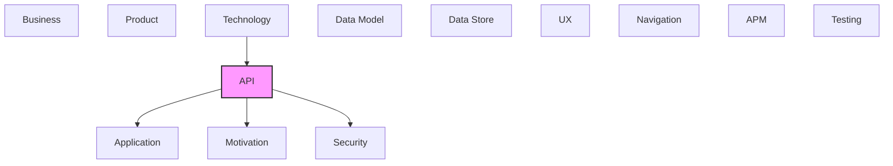

# API

[← Back to README](../README.md)

REST APIs, operations, endpoints, and API integrations.

## Report Index

- [Layer Introduction](#layer-introduction)
- [Intra-Layer Relationships](#intra-layer-relationships)
- [Inter-Layer Dependencies](#inter-layer-dependencies)
- [Inter-Layer Relationships Table](#inter-layer-relationships-table)
- [Element Reference](#element-reference)

## Layer Introduction

| Metric                    | Count |
| ------------------------- | ----- |
| Elements                  | 33    |
| Intra-Layer Relationships | 31    |
| Inter-Layer Relationships | 40    |
| Inbound Relationships     | 1     |
| Outbound Relationships    | 39    |

**Cross-Layer References**:

- **Upstream layers**: [Technology](./06-technology-layer-report.md)
- **Downstream layers**: [Application](./05-application-layer-report.md), [Motivation](./01-motivation-layer-report.md), [Security](./04-security-layer-report.md)

## Intra-Layer Relationships

*This layer has >30 elements. Summary table shown instead of diagram.*

| Element                                                             | Type              | Relationships |
| ------------------------------------------------------------------- | ----------------- | ------------- |
| `api.info.dr-cli-visualization-server-api`                          | `info`            | 1             |
| `api.openapidocument.dr-cli-visualization-server-open-api-document` | `openapidocument` | 3             |
| `api.operation.commit-changeset`                                    | `operation`       | 2             |
| `api.operation.create-annotation`                                   | `operation`       | 1             |
| `api.operation.create-annotation-reply`                             | `operation`       | 2             |
| `api.operation.delete-annotation`                                   | `operation`       | 1             |
| `api.operation.discard-changeset`                                   | `operation`       | 2             |
| `api.operation.get-annotation`                                      | `operation`       | 2             |
| `api.operation.get-annotations`                                     | `operation`       | 2             |
| `api.operation.get-architecture-model`                              | `operation`       | 2             |
| `api.operation.get-changeset-details`                               | `operation`       | 1             |
| `api.operation.get-layer`                                           | `operation`       | 2             |
| `api.operation.get-schema-specifications`                           | `operation`       | 1             |
| `api.operation.health-check`                                        | `operation`       | 1             |
| `api.operation.list-annotation-replies`                             | `operation`       | 2             |
| `api.operation.list-changesets`                                     | `operation`       | 2             |
| `api.operation.replace-annotation`                                  | `operation`       | 2             |
| `api.operation.update-annotation`                                   | `operation`       | 1             |
| `api.operation.web-socket-real-time-updates`                        | `operation`       | 2             |
| `api.pathitem.annotation-detail-path`                               | `pathitem`        | 3             |
| `api.pathitem.annotation-replies-path`                              | `pathitem`        | 2             |
| `api.pathitem.annotations-path`                                     | `pathitem`        | 1             |
| `api.pathitem.changeset-commit-path`                                | `pathitem`        | 1             |
| `api.pathitem.changeset-detail-path`                                | `pathitem`        | 1             |
| `api.pathitem.changeset-discard-path`                               | `pathitem`        | 1             |
| `api.pathitem.changesets-path`                                      | `pathitem`        | 1             |
| `api.pathitem.health-path`                                          | `pathitem`        | 1             |
| `api.pathitem.layer-path`                                           | `pathitem`        | 1             |
| `api.pathitem.model-path`                                           | `pathitem`        | 1             |
| `api.pathitem.spec-path`                                            | `pathitem`        | 1             |
| `api.pathitem.web-socket-path`                                      | `pathitem`        | 1             |
| `api.securityscheme.bearer-auth-scheme`                             | `securityscheme`  | 13            |
| `api.securityscheme.query-auth-scheme`                              | `securityscheme`  | 2             |

## Inter-Layer Dependencies

## Inter-Layer Relationships Table

| Relationship ID                                                                        | Source Node                                       | Dest Node                                                           | Dest Layer    | Predicate    | Cardinality  | Strength |
| -------------------------------------------------------------------------------------- | ------------------------------------------------- | ------------------------------------------------------------------- | ------------- | ------------ | ------------ | -------- |
| `3dee662b-7dc2-4fcc-8677-15a2ba06136e-references-a77489e0-4e1f-42b1-b3e1-b1b534e6e7f8` | `3dee662b-7dc2-4fcc-8677-15a2ba06136e`            | `a77489e0-4e1f-42b1-b3e1-b1b534e6e7f8`                              | `application` | `references` | unknown      | unknown  |
| `3dee662b-7dc2-4fcc-8677-15a2ba06136e-requires-f502d58f-1a96-44d5-8fb8-c7e5e67f3f0d`   | `3dee662b-7dc2-4fcc-8677-15a2ba06136e`            | `f502d58f-1a96-44d5-8fb8-c7e5e67f3f0d`                              | `security`    | `requires`   | unknown      | unknown  |
| `406200e9-ef8b-46c9-a1fe-1ff06d6d5602-references-a77489e0-4e1f-42b1-b3e1-b1b534e6e7f8` | `406200e9-ef8b-46c9-a1fe-1ff06d6d5602`            | `a77489e0-4e1f-42b1-b3e1-b1b534e6e7f8`                              | `application` | `references` | unknown      | unknown  |
| `406200e9-ef8b-46c9-a1fe-1ff06d6d5602-requires-f502d58f-1a96-44d5-8fb8-c7e5e67f3f0d`   | `406200e9-ef8b-46c9-a1fe-1ff06d6d5602`            | `f502d58f-1a96-44d5-8fb8-c7e5e67f3f0d`                              | `security`    | `requires`   | unknown      | unknown  |
| `8630981b-236c-47ed-b99b-e977c56bdc63-realizes-71f9eb72-20e1-4ae6-be30-425c11e59edb`   | `8630981b-236c-47ed-b99b-e977c56bdc63`            | `71f9eb72-20e1-4ae6-be30-425c11e59edb`                              | `application` | `realizes`   | unknown      | unknown  |
| `8630981b-236c-47ed-b99b-e977c56bdc63-references-a77489e0-4e1f-42b1-b3e1-b1b534e6e7f8` | `8630981b-236c-47ed-b99b-e977c56bdc63`            | `a77489e0-4e1f-42b1-b3e1-b1b534e6e7f8`                              | `application` | `references` | unknown      | unknown  |
| `8630981b-236c-47ed-b99b-e977c56bdc63-requires-f502d58f-1a96-44d5-8fb8-c7e5e67f3f0d`   | `8630981b-236c-47ed-b99b-e977c56bdc63`            | `f502d58f-1a96-44d5-8fb8-c7e5e67f3f0d`                              | `security`    | `requires`   | unknown      | unknown  |
| `api.operation.realizes.application.applicationfunction`                               | `api.operation.commit-changeset`                  | `application.applicationfunction.changeset-store`                   | `application` | `realizes`   | many-to-many | medium   |
| `api.operation.references.application.applicationservice`                              | `api.operation.commit-changeset`                  | `application.applicationservice.generated-api-client`               | `application` | `references` | many-to-many | medium   |
| `api.operation.requires.security.securitypolicy`                                       | `api.operation.commit-changeset`                  | `security.securitypolicy.bearer-token-policy`                       | `security`    | `requires`   | many-to-many | medium   |
| `api.operation.realizes.application.applicationfunction`                               | `api.operation.create-annotation-reply`           | `application.applicationfunction.annotation-store`                  | `application` | `realizes`   | many-to-many | medium   |
| `api.operation.references.application.applicationservice`                              | `api.operation.create-annotation-reply`           | `application.applicationservice.generated-api-client`               | `application` | `references` | many-to-many | medium   |
| `api.operation.requires.security.securitypolicy`                                       | `api.operation.create-annotation-reply`           | `security.securitypolicy.bearer-token-policy`                       | `security`    | `requires`   | many-to-many | medium   |
| `api.operation.realizes.application.applicationfunction`                               | `api.operation.discard-changeset`                 | `application.applicationfunction.changeset-store`                   | `application` | `realizes`   | many-to-many | medium   |
| `api.operation.references.application.applicationservice`                              | `api.operation.discard-changeset`                 | `application.applicationservice.generated-api-client`               | `application` | `references` | many-to-many | medium   |
| `api.operation.requires.security.securitypolicy`                                       | `api.operation.discard-changeset`                 | `security.securitypolicy.bearer-token-policy`                       | `security`    | `requires`   | many-to-many | medium   |
| `api.operation.realizes.application.applicationfunction`                               | `api.operation.get-annotation`                    | `application.applicationfunction.annotation-store`                  | `application` | `realizes`   | many-to-many | medium   |
| `api.operation.references.application.applicationservice`                              | `api.operation.get-annotation`                    | `application.applicationservice.generated-api-client`               | `application` | `references` | many-to-many | medium   |
| `api.operation.requires.security.securitypolicy`                                       | `api.operation.get-annotation`                    | `security.securitypolicy.bearer-token-policy`                       | `security`    | `requires`   | many-to-many | medium   |
| `api.operation.realizes.application.applicationfunction`                               | `api.operation.get-layer`                         | `application.applicationfunction.layer-store`                       | `application` | `realizes`   | many-to-many | medium   |
| `api.operation.references.application.applicationservice`                              | `api.operation.get-layer`                         | `application.applicationservice.generated-api-client`               | `application` | `references` | many-to-many | medium   |
| `api.operation.requires.security.securitypolicy`                                       | `api.operation.get-layer`                         | `security.securitypolicy.bearer-token-policy`                       | `security`    | `requires`   | many-to-many | medium   |
| `api.operation.realizes.application.applicationfunction`                               | `api.operation.list-annotation-replies`           | `application.applicationfunction.annotation-store`                  | `application` | `realizes`   | many-to-many | medium   |
| `api.operation.references.application.applicationservice`                              | `api.operation.list-annotation-replies`           | `application.applicationservice.generated-api-client`               | `application` | `references` | many-to-many | medium   |
| `api.operation.requires.security.securitypolicy`                                       | `api.operation.list-annotation-replies`           | `security.securitypolicy.bearer-token-policy`                       | `security`    | `requires`   | many-to-many | medium   |
| `api.operation.realizes.application.applicationfunction`                               | `api.operation.replace-annotation`                | `application.applicationfunction.annotation-store`                  | `application` | `realizes`   | many-to-many | medium   |
| `api.operation.references.application.applicationservice`                              | `api.operation.replace-annotation`                | `application.applicationservice.generated-api-client`               | `application` | `references` | many-to-many | medium   |
| `api.operation.requires.security.securitypolicy`                                       | `api.operation.replace-annotation`                | `security.securitypolicy.bearer-token-policy`                       | `security`    | `requires`   | many-to-many | medium   |
| `api.securityscheme.realizes.security.securitypolicy`                                  | `api.securityscheme.bearer-auth-scheme`           | `security.securitypolicy.bearer-token-policy`                       | `security`    | `realizes`   | many-to-many | medium   |
| `api.securityscheme.realizes.security.securitypolicy`                                  | `api.securityscheme.query-auth-scheme`            | `security.securitypolicy.bearer-token-policy`                       | `security`    | `realizes`   | many-to-many | medium   |
| `b66b613e-27b6-4d90-909f-3aa81570de15-references-b7775f1a-2418-4c7a-84aa-997efd658a97` | `b66b613e-27b6-4d90-909f-3aa81570de15`            | `b7775f1a-2418-4c7a-84aa-997efd658a97`                              | `application` | `references` | unknown      | unknown  |
| `b66b613e-27b6-4d90-909f-3aa81570de15-satisfies-fc86a033-81bd-4933-abb8-b24076577123`  | `b66b613e-27b6-4d90-909f-3aa81570de15`            | `fc86a033-81bd-4933-abb8-b24076577123`                              | `motivation`  | `satisfies`  | unknown      | unknown  |
| `dc2da0b6-3de0-44d1-840f-5d49cc976cd9-satisfies-e748118c-b989-43fe-b0d2-9121e931fcd2`  | `dc2da0b6-3de0-44d1-840f-5d49cc976cd9`            | `e748118c-b989-43fe-b0d2-9121e931fcd2`                              | `motivation`  | `satisfies`  | unknown      | unknown  |
| `dfc6509e-98f5-479a-bfe9-14bfddbb838a-realizes-3b08f432-72aa-4df6-978c-d76d3312f72b`   | `dfc6509e-98f5-479a-bfe9-14bfddbb838a`            | `3b08f432-72aa-4df6-978c-d76d3312f72b`                              | `application` | `realizes`   | unknown      | unknown  |
| `dfc6509e-98f5-479a-bfe9-14bfddbb838a-requires-f502d58f-1a96-44d5-8fb8-c7e5e67f3f0d`   | `dfc6509e-98f5-479a-bfe9-14bfddbb838a`            | `f502d58f-1a96-44d5-8fb8-c7e5e67f3f0d`                              | `security`    | `requires`   | unknown      | unknown  |
| `dfc6509e-98f5-479a-bfe9-14bfddbb838a-satisfies-fc86a033-81bd-4933-abb8-b24076577123`  | `dfc6509e-98f5-479a-bfe9-14bfddbb838a`            | `fc86a033-81bd-4933-abb8-b24076577123`                              | `motivation`  | `satisfies`  | unknown      | unknown  |
| `f952fcc0-7c42-4586-a306-a5f2f94a3068-realizes-f1edef84-1298-486c-b347-f47c3b0f9712`   | `f952fcc0-7c42-4586-a306-a5f2f94a3068`            | `f1edef84-1298-486c-b347-f47c3b0f9712`                              | `application` | `realizes`   | unknown      | unknown  |
| `ff16c609-618e-4dd9-b477-12e17c000df8-realizes-71f9eb72-20e1-4ae6-be30-425c11e59edb`   | `ff16c609-618e-4dd9-b477-12e17c000df8`            | `71f9eb72-20e1-4ae6-be30-425c11e59edb`                              | `application` | `realizes`   | unknown      | unknown  |
| `ff16c609-618e-4dd9-b477-12e17c000df8-references-a77489e0-4e1f-42b1-b3e1-b1b534e6e7f8` | `ff16c609-618e-4dd9-b477-12e17c000df8`            | `a77489e0-4e1f-42b1-b3e1-b1b534e6e7f8`                              | `application` | `references` | unknown      | unknown  |
| `technology.technologyservice.serves.api.openapidocument`                              | `technology.technologyservice.dr-cli-rest-server` | `api.openapidocument.dr-cli-visualization-server-open-api-document` | `api`         | `serves`     | many-to-many | medium   |

## Element Reference

### DR CLI Visualization Server API {#dr-cli-visualization-server-api}

**ID**: `api.info.dr-cli-visualization-server-api`

**Type**: `info`

OpenAPI document info for the Documentation Robotics Visualization Server API

#### Attributes

| Name    | Value                                           |
| ------- | ----------------------------------------------- |
| title   | Documentation Robotics Visualization Server API |
| version | 0.2.3                                           |

#### Relationships

| Type        | Related Element                                                     | Predicate  | Direction |
| ----------- | ------------------------------------------------------------------- | ---------- | --------- |
| intra-layer | `api.openapidocument.dr-cli-visualization-server-open-api-document` | `composes` | inbound   |

### DR CLI Visualization Server OpenAPI Document {#dr-cli-visualization-server-openapi-document}

**ID**: `api.openapidocument.dr-cli-visualization-server-open-api-document`

**Type**: `openapidocument`

Root OpenAPI 3.0 document describing the Documentation Robotics Visualization Server REST and WebSocket API

#### Attributes

| Name    | Value      |
| ------- | ---------- |
| info    | DR CLI API |
| openapi | 3.0.0      |
| paths   | /          |

#### Relationships

| Type        | Related Element                                   | Predicate  | Direction |
| ----------- | ------------------------------------------------- | ---------- | --------- |
| inter-layer | `technology.technologyservice.dr-cli-rest-server` | `serves`   | inbound   |
| intra-layer | `api.info.dr-cli-visualization-server-api`        | `composes` | outbound  |
| intra-layer | `api.securityscheme.bearer-auth-scheme`           | `requires` | outbound  |
| intra-layer | `api.securityscheme.query-auth-scheme`            | `requires` | outbound  |

### Commit Changeset {#commit-changeset}

**ID**: `api.operation.commit-changeset`

**Type**: `operation`

Applies a staged changeset to the base model (the viewer's Apply). 404 unknown, 409 not staged or model drifted, 422 failed validation, body \{ error \}.

#### Attributes

| Name        | Value                                  |
| ----------- | -------------------------------------- |
| http_method | POST                                   |
| http_path   | /api/changesets/\{changesetId\}/commit |
| operationId | commitChangeset                        |
| summary     | Apply a staged changeset to the model  |
| tags        | Changesets                             |

#### Relationships

| Type        | Related Element                                       | Predicate    | Direction |
| ----------- | ----------------------------------------------------- | ------------ | --------- |
| inter-layer | `application.applicationfunction.changeset-store`     | `realizes`   | outbound  |
| inter-layer | `application.applicationservice.generated-api-client` | `references` | outbound  |
| inter-layer | `security.securitypolicy.bearer-token-policy`         | `requires`   | outbound  |
| intra-layer | `api.securityscheme.bearer-auth-scheme`               | `uses`       | outbound  |
| intra-layer | `api.pathitem.changeset-commit-path`                  | `composes`   | inbound   |

### Create Annotation {#create-annotation}

**ID**: `api.operation.create-annotation`

**Type**: `operation`

Creates a new annotation on a model element

#### Attributes

| Name        | Value                   |
| ----------- | ----------------------- |
| http_method | POST                    |
| http_path   | /api/annotations        |
| operationId | createAnnotation        |
| summary     | Create a new annotation |
| tags        | Annotations             |

#### Relationships

| Type        | Related Element                         | Predicate | Direction |
| ----------- | --------------------------------------- | --------- | --------- |
| intra-layer | `api.securityscheme.bearer-auth-scheme` | `uses`    | outbound  |

### Create Annotation Reply {#create-annotation-reply}

**ID**: `api.operation.create-annotation-reply`

**Type**: `operation`

Adds a reply to an annotation thread.

#### Attributes

| Name        | Value                                     |
| ----------- | ----------------------------------------- |
| http_method | POST                                      |
| http_path   | /api/annotations/\{annotationId\}/replies |
| operationId | createAnnotationReply                     |
| summary     | Reply to an annotation                    |
| tags        | Annotations                               |

#### Relationships

| Type        | Related Element                                       | Predicate    | Direction |
| ----------- | ----------------------------------------------------- | ------------ | --------- |
| inter-layer | `application.applicationfunction.annotation-store`    | `realizes`   | outbound  |
| inter-layer | `application.applicationservice.generated-api-client` | `references` | outbound  |
| inter-layer | `security.securitypolicy.bearer-token-policy`         | `requires`   | outbound  |
| intra-layer | `api.securityscheme.bearer-auth-scheme`               | `uses`       | outbound  |
| intra-layer | `api.pathitem.annotation-replies-path`                | `composes`   | inbound   |

### Delete Annotation {#delete-annotation}

**ID**: `api.operation.delete-annotation`

**Type**: `operation`

Deletes an existing annotation

#### Attributes

| Name        | Value                             |
| ----------- | --------------------------------- |
| http_method | DELETE                            |
| http_path   | /api/annotations/\{annotationId\} |
| operationId | deleteAnnotation                  |
| summary     | Delete an annotation              |
| tags        | Annotations                       |

#### Relationships

| Type        | Related Element                         | Predicate | Direction |
| ----------- | --------------------------------------- | --------- | --------- |
| intra-layer | `api.securityscheme.bearer-auth-scheme` | `uses`    | outbound  |

### Discard Changeset {#discard-changeset}

**ID**: `api.operation.discard-changeset`

**Type**: `operation`

Discards a staged changeset without touching the model (the viewer's Discard).

#### Attributes

| Name        | Value                                   |
| ----------- | --------------------------------------- |
| http_method | POST                                    |
| http_path   | /api/changesets/\{changesetId\}/discard |
| operationId | discardChangeset                        |
| summary     | Discard a staged changeset              |
| tags        | Changesets                              |

#### Relationships

| Type        | Related Element                                       | Predicate    | Direction |
| ----------- | ----------------------------------------------------- | ------------ | --------- |
| inter-layer | `application.applicationfunction.changeset-store`     | `realizes`   | outbound  |
| inter-layer | `application.applicationservice.generated-api-client` | `references` | outbound  |
| inter-layer | `security.securitypolicy.bearer-token-policy`         | `requires`   | outbound  |
| intra-layer | `api.securityscheme.bearer-auth-scheme`               | `uses`       | outbound  |
| intra-layer | `api.pathitem.changeset-discard-path`                 | `composes`   | inbound   |

### Get Annotation {#get-annotation}

**ID**: `api.operation.get-annotation`

**Type**: `operation`

Returns one annotation by id.

#### Attributes

| Name        | Value                             |
| ----------- | --------------------------------- |
| http_method | GET                               |
| http_path   | /api/annotations/\{annotationId\} |
| operationId | getAnnotation                     |
| summary     | Get an annotation by ID           |
| tags        | Annotations                       |

#### Relationships

| Type        | Related Element                                       | Predicate    | Direction |
| ----------- | ----------------------------------------------------- | ------------ | --------- |
| inter-layer | `application.applicationfunction.annotation-store`    | `realizes`   | outbound  |
| inter-layer | `application.applicationservice.generated-api-client` | `references` | outbound  |
| inter-layer | `security.securitypolicy.bearer-token-policy`         | `requires`   | outbound  |
| intra-layer | `api.securityscheme.bearer-auth-scheme`               | `uses`       | outbound  |
| intra-layer | `api.pathitem.annotation-detail-path`                 | `composes`   | inbound   |

### Get Annotations {#get-annotations}

**ID**: `api.operation.get-annotations`

**Type**: `operation`

Returns annotations optionally filtered by elementId query param

#### Attributes

| Name        | Value                                          |
| ----------- | ---------------------------------------------- |
| http_method | GET                                            |
| http_path   | /api/annotations                               |
| operationId | getAnnotations                                 |
| summary     | Get annotations with optional elementId filter |
| tags        | Annotations                                    |

#### Relationships

| Type        | Related Element                         | Predicate  | Direction |
| ----------- | --------------------------------------- | ---------- | --------- |
| intra-layer | `api.securityscheme.bearer-auth-scheme` | `uses`     | outbound  |
| intra-layer | `api.pathitem.annotations-path`         | `composes` | inbound   |

### Get Architecture Model {#get-architecture-model}

**ID**: `api.operation.get-architecture-model`

**Type**: `operation`

Returns full architecture model from documentation-robotics/model/ including all layers, elements, relationships, and cross-layer references

#### Attributes

| Name        | Value                       |
| ----------- | --------------------------- |
| http_method | GET                         |
| http_path   | /api/model                  |
| operationId | getModel                    |
| summary     | Get full architecture model |
| tags        | Model                       |

#### Relationships

| Type        | Related Element                         | Predicate  | Direction |
| ----------- | --------------------------------------- | ---------- | --------- |
| intra-layer | `api.securityscheme.bearer-auth-scheme` | `uses`     | outbound  |
| intra-layer | `api.pathitem.model-path`               | `composes` | inbound   |

### Get Changeset Details {#get-changeset-details}

**ID**: `api.operation.get-changeset-details`

**Type**: `operation`

Returns detailed changeset including all element changes with before/after states

#### Attributes

| Name        | Value                           |
| ----------- | ------------------------------- |
| http_method | GET                             |
| http_path   | /api/changesets/\{changesetId\} |
| operationId | getChangeset                    |
| summary     | Get changeset by ID             |
| tags        | Changesets                      |

#### Relationships

| Type        | Related Element                      | Predicate  | Direction |
| ----------- | ------------------------------------ | ---------- | --------- |
| intra-layer | `api.pathitem.changeset-detail-path` | `composes` | inbound   |

### Get Layer {#get-layer}

**ID**: `api.operation.get-layer`

**Type**: `operation`

Returns one layer of the model with its elements.

#### Attributes

| Name        | Value                     |
| ----------- | ------------------------- |
| http_method | GET                       |
| http_path   | /api/layers/\{layerName\} |
| operationId | getLayer                  |
| summary     | Get a model layer by name |
| tags        | Model                     |

#### Relationships

| Type        | Related Element                                       | Predicate    | Direction |
| ----------- | ----------------------------------------------------- | ------------ | --------- |
| inter-layer | `application.applicationfunction.layer-store`         | `realizes`   | outbound  |
| inter-layer | `application.applicationservice.generated-api-client` | `references` | outbound  |
| inter-layer | `security.securitypolicy.bearer-token-policy`         | `requires`   | outbound  |
| intra-layer | `api.securityscheme.bearer-auth-scheme`               | `uses`       | outbound  |
| intra-layer | `api.pathitem.layer-path`                             | `composes`   | inbound   |

### Get Schema Specifications {#get-schema-specifications}

**ID**: `api.operation.get-schema-specifications`

**Type**: `operation`

Returns all JSON Schema files from .dr/schemas/ including layer schemas, relationship catalog, and link registry

#### Attributes

| Name        | Value                                   |
| ----------- | --------------------------------------- |
| http_method | GET                                     |
| http_path   | /api/spec                               |
| operationId | getSpec                                 |
| summary     | Get all JSON Schema specification files |
| tags        | Schema                                  |

#### Relationships

| Type        | Related Element          | Predicate  | Direction |
| ----------- | ------------------------ | ---------- | --------- |
| intra-layer | `api.pathitem.spec-path` | `composes` | inbound   |

### Health Check {#health-check}

**ID**: `api.operation.health-check`

**Type**: `operation`

No auth required; returns server status and version

#### Attributes

| Name        | Value                           |
| ----------- | ------------------------------- |
| http_method | GET                             |
| http_path   | /health                         |
| operationId | getHealth                       |
| summary     | Check server health and version |
| tags        | Health                          |

#### Relationships

| Type        | Related Element            | Predicate  | Direction |
| ----------- | -------------------------- | ---------- | --------- |
| intra-layer | `api.pathitem.health-path` | `composes` | inbound   |

### List Annotation Replies {#list-annotation-replies}

**ID**: `api.operation.list-annotation-replies`

**Type**: `operation`

Returns the reply thread of an annotation; the Inspector's annotation thread reads it.

#### Attributes

| Name        | Value                                     |
| ----------- | ----------------------------------------- |
| http_method | GET                                       |
| http_path   | /api/annotations/\{annotationId\}/replies |
| operationId | getAnnotationReplies                      |
| summary     | List replies to an annotation             |
| tags        | Annotations                               |

#### Relationships

| Type        | Related Element                                       | Predicate    | Direction |
| ----------- | ----------------------------------------------------- | ------------ | --------- |
| inter-layer | `application.applicationfunction.annotation-store`    | `realizes`   | outbound  |
| inter-layer | `application.applicationservice.generated-api-client` | `references` | outbound  |
| inter-layer | `security.securitypolicy.bearer-token-policy`         | `requires`   | outbound  |
| intra-layer | `api.securityscheme.bearer-auth-scheme`               | `uses`       | outbound  |
| intra-layer | `api.pathitem.annotation-replies-path`                | `composes`   | inbound   |

### List Changesets {#list-changesets}

**ID**: `api.operation.list-changesets`

**Type**: `operation`

Returns registry of all available changesets with summaries

#### Attributes

| Name        | Value               |
| ----------- | ------------------- |
| http_method | GET                 |
| http_path   | /api/changesets     |
| operationId | listChangesets      |
| summary     | List all changesets |
| tags        | Changesets          |

#### Relationships

| Type        | Related Element                         | Predicate  | Direction |
| ----------- | --------------------------------------- | ---------- | --------- |
| intra-layer | `api.securityscheme.bearer-auth-scheme` | `uses`     | outbound  |
| intra-layer | `api.pathitem.changesets-path`          | `composes` | inbound   |

### Replace Annotation {#replace-annotation}

**ID**: `api.operation.replace-annotation`

**Type**: `operation`

Replaces an annotation's content and tags (PUT form of Update Annotation).

#### Attributes

| Name        | Value                             |
| ----------- | --------------------------------- |
| http_method | PUT                               |
| http_path   | /api/annotations/\{annotationId\} |
| operationId | replaceAnnotation                 |
| summary     | Replace an annotation             |
| tags        | Annotations                       |

#### Relationships

| Type        | Related Element                                       | Predicate    | Direction |
| ----------- | ----------------------------------------------------- | ------------ | --------- |
| inter-layer | `application.applicationfunction.annotation-store`    | `realizes`   | outbound  |
| inter-layer | `application.applicationservice.generated-api-client` | `references` | outbound  |
| inter-layer | `security.securitypolicy.bearer-token-policy`         | `requires`   | outbound  |
| intra-layer | `api.securityscheme.bearer-auth-scheme`               | `uses`       | outbound  |
| intra-layer | `api.pathitem.annotation-detail-path`                 | `composes`   | inbound   |

### Update Annotation {#update-annotation}

**ID**: `api.operation.update-annotation`

**Type**: `operation`

Updates content or tags of an existing annotation

#### Attributes

| Name        | Value                             |
| ----------- | --------------------------------- |
| http_method | PATCH                             |
| http_path   | /api/annotations/\{annotationId\} |
| operationId | updateAnnotation                  |
| summary     | Update an existing annotation     |
| tags        | Annotations                       |

#### Relationships

| Type        | Related Element                       | Predicate  | Direction |
| ----------- | ------------------------------------- | ---------- | --------- |
| intra-layer | `api.pathitem.annotation-detail-path` | `composes` | inbound   |

### WebSocket Real-time Updates {#websocket-real-time-updates}

**ID**: `api.operation.web-socket-real-time-updates`

**Type**: `operation`

Persistent WebSocket connection for subscribing to model/changeset/annotation real-time events via JSON message protocol

#### Attributes

| Name        | Value                              |
| ----------- | ---------------------------------- |
| operationId | connectWebSocket                   |
| summary     | Connect to real-time update stream |
| tags        | WebSocket                          |

#### Relationships

| Type        | Related Element                        | Predicate  | Direction |
| ----------- | -------------------------------------- | ---------- | --------- |
| intra-layer | `api.securityscheme.query-auth-scheme` | `uses`     | outbound  |
| intra-layer | `api.pathitem.web-socket-path`         | `composes` | inbound   |

### Annotation Detail Path {#annotation-detail-path}

**ID**: `api.pathitem.annotation-detail-path`

**Type**: `pathitem`

Path /api/annotations/\{annotationId\} — update and delete a specific annotation

#### Attributes

| Name        | Value                                      |
| ----------- | ------------------------------------------ |
| description | Update or delete annotation by ID          |
| summary     | /api/annotations/\{annotationId\} endpoint |

#### Relationships

| Type        | Related Element                    | Predicate  | Direction |
| ----------- | ---------------------------------- | ---------- | --------- |
| intra-layer | `api.operation.get-annotation`     | `composes` | outbound  |
| intra-layer | `api.operation.replace-annotation` | `composes` | outbound  |
| intra-layer | `api.operation.update-annotation`  | `composes` | outbound  |

### Annotation Replies Path {#annotation-replies-path}

**ID**: `api.pathitem.annotation-replies-path`

**Type**: `pathitem`

Path /api/annotations/\{annotationId\}/replies — list and add replies

#### Attributes

| Name        | Value                                              |
| ----------- | -------------------------------------------------- |
| description | List and add replies to an annotation              |
| summary     | /api/annotations/\{annotationId\}/replies endpoint |

#### Relationships

| Type        | Related Element                         | Predicate  | Direction |
| ----------- | --------------------------------------- | ---------- | --------- |
| intra-layer | `api.operation.create-annotation-reply` | `composes` | outbound  |
| intra-layer | `api.operation.list-annotation-replies` | `composes` | outbound  |

### Annotations Path {#annotations-path}

**ID**: `api.pathitem.annotations-path`

**Type**: `pathitem`

Path /api/annotations — list and create annotations

#### Attributes

| Name        | Value                       |
| ----------- | --------------------------- |
| description | List and create annotations |
| summary     | /api/annotations endpoint   |

#### Relationships

| Type        | Related Element                 | Predicate  | Direction |
| ----------- | ------------------------------- | ---------- | --------- |
| intra-layer | `api.operation.get-annotations` | `composes` | outbound  |

### Changeset Commit Path {#changeset-commit-path}

**ID**: `api.pathitem.changeset-commit-path`

**Type**: `pathitem`

Path /api/changesets/\{changesetId\}/commit — apply a staged changeset

#### Attributes

| Name        | Value                                           |
| ----------- | ----------------------------------------------- |
| description | Apply a staged changeset                        |
| summary     | /api/changesets/\{changesetId\}/commit endpoint |

#### Relationships

| Type        | Related Element                  | Predicate  | Direction |
| ----------- | -------------------------------- | ---------- | --------- |
| intra-layer | `api.operation.commit-changeset` | `composes` | outbound  |

### Changeset Detail Path {#changeset-detail-path}

**ID**: `api.pathitem.changeset-detail-path`

**Type**: `pathitem`

Path /api/changesets/\{changesetId\} — retrieves a specific changeset by ID

#### Attributes

| Name        | Value                                    |
| ----------- | ---------------------------------------- |
| description | Get changeset detail by ID               |
| summary     | /api/changesets/\{changesetId\} endpoint |

#### Relationships

| Type        | Related Element                       | Predicate  | Direction |
| ----------- | ------------------------------------- | ---------- | --------- |
| intra-layer | `api.operation.get-changeset-details` | `composes` | outbound  |

### Changeset Discard Path {#changeset-discard-path}

**ID**: `api.pathitem.changeset-discard-path`

**Type**: `pathitem`

Path /api/changesets/\{changesetId\}/discard — discard a staged changeset

#### Attributes

| Name        | Value                                            |
| ----------- | ------------------------------------------------ |
| description | Discard a staged changeset                       |
| summary     | /api/changesets/\{changesetId\}/discard endpoint |

#### Relationships

| Type        | Related Element                   | Predicate  | Direction |
| ----------- | --------------------------------- | ---------- | --------- |
| intra-layer | `api.operation.discard-changeset` | `composes` | outbound  |

### Changesets Path {#changesets-path}

**ID**: `api.pathitem.changesets-path`

**Type**: `pathitem`

Path /api/changesets — lists all available changesets

#### Attributes

| Name        | Value                    |
| ----------- | ------------------------ |
| description | List all changesets      |
| summary     | /api/changesets endpoint |

#### Relationships

| Type        | Related Element                 | Predicate  | Direction |
| ----------- | ------------------------------- | ---------- | --------- |
| intra-layer | `api.operation.list-changesets` | `composes` | outbound  |

### Health Path {#health-path}

**ID**: `api.pathitem.health-path`

**Type**: `pathitem`

Path /health — no authentication required

#### Attributes

| Name        | Value                                 |
| ----------- | ------------------------------------- |
| description | Server health check; no auth required |
| summary     | /health endpoint                      |

#### Relationships

| Type        | Related Element              | Predicate  | Direction |
| ----------- | ---------------------------- | ---------- | --------- |
| intra-layer | `api.operation.health-check` | `composes` | outbound  |

### Layer Path {#layer-path}

**ID**: `api.pathitem.layer-path`

**Type**: `pathitem`

Path /api/layers/\{layerName\} — one model layer

#### Attributes

| Name        | Value                              |
| ----------- | ---------------------------------- |
| description | Get one model layer                |
| summary     | /api/layers/\{layerName\} endpoint |

#### Relationships

| Type        | Related Element           | Predicate  | Direction |
| ----------- | ------------------------- | ---------- | --------- |
| intra-layer | `api.operation.get-layer` | `composes` | outbound  |

### Model Path {#model-path}

**ID**: `api.pathitem.model-path`

**Type**: `pathitem`

Path /api/model — returns the full architecture model

#### Attributes

| Name        | Value                            |
| ----------- | -------------------------------- |
| description | Retrieve full architecture model |
| summary     | /api/model endpoint              |

#### Relationships

| Type        | Related Element                        | Predicate  | Direction |
| ----------- | -------------------------------------- | ---------- | --------- |
| intra-layer | `api.operation.get-architecture-model` | `composes` | outbound  |

### Spec Path {#spec-path}

**ID**: `api.pathitem.spec-path`

**Type**: `pathitem`

Path /api/spec — returns all JSON Schema specification files

#### Attributes

| Name        | Value                                  |
| ----------- | -------------------------------------- |
| description | Retrieve all DR spec JSON Schema files |
| summary     | /api/spec endpoint                     |

#### Relationships

| Type        | Related Element                           | Predicate  | Direction |
| ----------- | ----------------------------------------- | ---------- | --------- |
| intra-layer | `api.operation.get-schema-specifications` | `composes` | outbound  |

### WebSocket Path {#websocket-path}

**ID**: `api.pathitem.web-socket-path`

**Type**: `pathitem`

Path /ws — WebSocket upgrade endpoint for real-time event subscriptions

#### Attributes

| Name        | Value                                                             |
| ----------- | ----------------------------------------------------------------- |
| description | WebSocket upgrade for real-time model/changeset/annotation events |
| summary     | /ws endpoint                                                      |

#### Relationships

| Type        | Related Element                              | Predicate  | Direction |
| ----------- | -------------------------------------------- | ---------- | --------- |
| intra-layer | `api.operation.web-socket-real-time-updates` | `composes` | outbound  |

### Bearer Auth Scheme {#bearer-auth-scheme}

**ID**: `api.securityscheme.bearer-auth-scheme`

**Type**: `securityscheme`

Token in Authorization header; used for REST API endpoints requiring authentication

#### Attributes

| Name         | Value  |
| ------------ | ------ |
| bearerFormat | token  |
| scheme       | bearer |
| type         | http   |

#### Relationships

| Type        | Related Element                                                     | Predicate  | Direction |
| ----------- | ------------------------------------------------------------------- | ---------- | --------- |
| inter-layer | `security.securitypolicy.bearer-token-policy`                       | `realizes` | outbound  |
| intra-layer | `api.openapidocument.dr-cli-visualization-server-open-api-document` | `requires` | inbound   |
| intra-layer | `api.operation.commit-changeset`                                    | `uses`     | inbound   |
| intra-layer | `api.operation.create-annotation-reply`                             | `uses`     | inbound   |
| intra-layer | `api.operation.create-annotation`                                   | `uses`     | inbound   |
| intra-layer | `api.operation.delete-annotation`                                   | `uses`     | inbound   |
| intra-layer | `api.operation.discard-changeset`                                   | `uses`     | inbound   |
| intra-layer | `api.operation.get-annotation`                                      | `uses`     | inbound   |
| intra-layer | `api.operation.get-annotations`                                     | `uses`     | inbound   |
| intra-layer | `api.operation.get-architecture-model`                              | `uses`     | inbound   |
| intra-layer | `api.operation.get-layer`                                           | `uses`     | inbound   |
| intra-layer | `api.operation.list-annotation-replies`                             | `uses`     | inbound   |
| intra-layer | `api.operation.list-changesets`                                     | `uses`     | inbound   |
| intra-layer | `api.operation.replace-annotation`                                  | `uses`     | inbound   |

### Query Auth Scheme {#query-auth-scheme}

**ID**: `api.securityscheme.query-auth-scheme`

**Type**: `securityscheme`

Token as ?token= query param; used for WebSocket connection authentication where Authorization headers cannot be set

#### Attributes

| Name | Value  |
| ---- | ------ |
| in   | query  |
| type | apiKey |

#### Relationships

| Type        | Related Element                                                     | Predicate  | Direction |
| ----------- | ------------------------------------------------------------------- | ---------- | --------- |
| inter-layer | `security.securitypolicy.bearer-token-policy`                       | `realizes` | outbound  |
| intra-layer | `api.openapidocument.dr-cli-visualization-server-open-api-document` | `requires` | inbound   |
| intra-layer | `api.operation.web-socket-real-time-updates`                        | `uses`     | inbound   |

---

Generated: 2026-11-12T13:57:21.197Z | Model Version: 0.1.0
