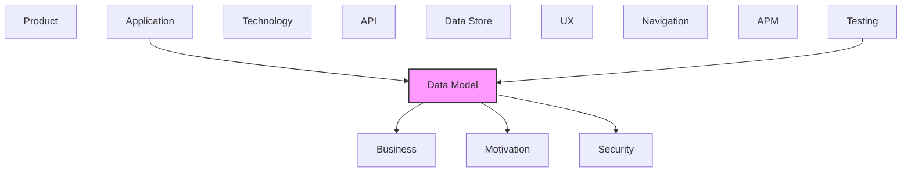

# Data Model

[← Back to README](../README.md)

Data entities, relationships, and data structure definitions.

## Report Index

- [Layer Introduction](#layer-introduction)
- [Intra-Layer Relationships](#intra-layer-relationships)
- [Inter-Layer Dependencies](#inter-layer-dependencies)
- [Inter-Layer Relationships Table](#inter-layer-relationships-table)
- [Element Reference](#element-reference)

## Layer Introduction

| Metric                    | Count |
| ------------------------- | ----- |
| Elements                  | 34    |
| Intra-Layer Relationships | 14    |
| Inter-Layer Relationships | 49    |
| Inbound Relationships     | 36    |
| Outbound Relationships    | 13    |

**Cross-Layer References**:

- **Upstream layers**: [Application](./05-application-layer-report.md), [Testing](./13-testing-layer-report.md)
- **Downstream layers**: [Business](./02-business-layer-report.md), [Motivation](./01-motivation-layer-report.md), [Security](./04-security-layer-report.md)

## Intra-Layer Relationships

*This layer has >30 elements. Summary table shown instead of diagram.*

| Element                                           | Type               | Relationships |
| ------------------------------------------------- | ------------------ | ------------- |
| `data-model.objectschema.annotation`              | `objectschema`     | 1             |
| `data-model.objectschema.annotation-create`       | `objectschema`     | 1             |
| `data-model.objectschema.c4-diff`                 | `objectschema`     | 0             |
| `data-model.objectschema.c4-model`                | `objectschema`     | 0             |
| `data-model.objectschema.c4-view`                 | `objectschema`     | 0             |
| `data-model.objectschema.change-origin`           | `objectschema`     | 0             |
| `data-model.objectschema.changeset-action-result` | `objectschema`     | 0             |
| `data-model.objectschema.changeset-detail`        | `objectschema`     | 0             |
| `data-model.objectschema.changeset-summary`       | `objectschema`     | 0             |
| `data-model.objectschema.chat-conversation`       | `objectschema`     | 1             |
| `data-model.objectschema.chat-message`            | `objectschema`     | 2             |
| `data-model.objectschema.commit-body`             | `objectschema`     | 0             |
| `data-model.objectschema.delete-blocker`          | `objectschema`     | 0             |
| `data-model.objectschema.extracted-reference`     | `objectschema`     | 0             |
| `data-model.objectschema.json-rpc-request`        | `objectschema`     | 1             |
| `data-model.objectschema.layer`                   | `objectschema`     | 1             |
| `data-model.objectschema.meta-model`              | `objectschema`     | 1             |
| `data-model.objectschema.model-element`           | `objectschema`     | 2             |
| `data-model.objectschema.model-metadata`          | `objectschema`     | 0             |
| `data-model.objectschema.predicate-definition`    | `objectschema`     | 1             |
| `data-model.objectschema.reference`               | `objectschema`     | 0             |
| `data-model.objectschema.relationship`            | `objectschema`     | 3             |
| `data-model.objectschema.relationship-type`       | `objectschema`     | 1             |
| `data-model.objectschema.review-decision`         | `objectschema`     | 0             |
| `data-model.objectschema.source-reference`        | `objectschema`     | 1             |
| `data-model.objectschema.spec-layer-data`         | `objectschema`     | 1             |
| `data-model.objectschema.spec-node-relationship`  | `objectschema`     | 1             |
| `data-model.objectschema.tier1status`             | `objectschema`     | 0             |
| `data-model.objectschema.tool-invocation-content` | `objectschema`     | 1             |
| `data-model.objectschema.web-socket-event-map`    | `objectschema`     | 1             |
| `data-model.objectschema.web-socket-message`      | `objectschema`     | 2             |
| `data-model.schemadefinition.annotation-id`       | `schemadefinition` | 3             |
| `data-model.schemadefinition.changeset-id`        | `schemadefinition` | 1             |
| `data-model.schemadefinition.element-id`          | `schemadefinition` | 2             |

## Inter-Layer Dependencies

## Inter-Layer Relationships Table

| Relationship ID                                                                        | Source Node                                                                                               | Dest Node                                         | Dest Layer   | Predicate    | Cardinality  | Strength |
| -------------------------------------------------------------------------------------- | --------------------------------------------------------------------------------------------------------- | ------------------------------------------------- | ------------ | ------------ | ------------ | -------- |
| `582fd707-9e0d-4a98-9b47-b3cda7b26c3d-realizes-ea84399d-45dc-4fef-a5a1-759c9b5b5870`   | `582fd707-9e0d-4a98-9b47-b3cda7b26c3d`                                                                    | `ea84399d-45dc-4fef-a5a1-759c9b5b5870`            | `business`   | `realizes`   | unknown      | unknown  |
| `801c2caa-ec19-4175-bec8-970067823754-references-0fa2ddb9-02df-426f-9c9c-89b857b9dc78` | `801c2caa-ec19-4175-bec8-970067823754`                                                                    | `0fa2ddb9-02df-426f-9c9c-89b857b9dc78`            | `security`   | `references` | unknown      | unknown  |
| `a0080aee-7e84-4c2c-8d76-0cd604bfd7f5-realizes-ea84399d-45dc-4fef-a5a1-759c9b5b5870`   | `a0080aee-7e84-4c2c-8d76-0cd604bfd7f5`                                                                    | `ea84399d-45dc-4fef-a5a1-759c9b5b5870`            | `business`   | `realizes`   | unknown      | unknown  |
| `application.applicationcomponent.accesses.data-model.objectschema`                    | `application.applicationcomponent.app-shell`                                                              | `data-model.objectschema.chat-message`            | `data-model` | `accesses`   | many-to-many | medium   |
| `application.applicationcomponent.accesses.data-model.objectschema`                    | `application.applicationcomponent.architecture-canvas`                                                    | `data-model.objectschema.c4-model`                | `data-model` | `accesses`   | many-to-many | medium   |
| `application.applicationcomponent.accesses.data-model.objectschema`                    | `application.applicationcomponent.architecture-canvas`                                                    | `data-model.objectschema.c4-view`                 | `data-model` | `accesses`   | many-to-many | medium   |
| `application.applicationcomponent.accesses.data-model.objectschema`                    | `application.applicationcomponent.architecture-canvas`                                                    | `data-model.objectschema.changeset-detail`        | `data-model` | `accesses`   | many-to-many | medium   |
| `application.applicationcomponent.accesses.data-model.objectschema`                    | `application.applicationcomponent.c4-diagram`                                                             | `data-model.objectschema.c4-view`                 | `data-model` | `accesses`   | many-to-many | medium   |
| `application.applicationcomponent.accesses.data-model.objectschema`                    | `application.applicationcomponent.change-inspector`                                                       | `data-model.objectschema.delete-blocker`          | `data-model` | `accesses`   | many-to-many | medium   |
| `application.applicationcomponent.accesses.data-model.objectschema`                    | `application.applicationcomponent.changeset-canvas`                                                       | `data-model.objectschema.changeset-detail`        | `data-model` | `accesses`   | many-to-many | medium   |
| `application.applicationcomponent.accesses.data-model.objectschema`                    | `application.applicationcomponent.changeset-canvas`                                                       | `data-model.objectschema.changeset-summary`       | `data-model` | `accesses`   | many-to-many | medium   |
| `application.applicationcomponent.accesses.data-model.objectschema`                    | `application.applicationcomponent.changeset-inbox`                                                        | `data-model.objectschema.changeset-summary`       | `data-model` | `accesses`   | many-to-many | medium   |
| `application.applicationcomponent.accesses.data-model.objectschema`                    | `application.applicationcomponent.changeset-inspector`                                                    | `data-model.objectschema.changeset-detail`        | `data-model` | `accesses`   | many-to-many | medium   |
| `application.applicationcomponent.accesses.data-model.objectschema`                    | `application.applicationcomponent.changeset-review-panel`                                                 | `data-model.objectschema.changeset-action-result` | `data-model` | `accesses`   | many-to-many | medium   |
| `application.applicationcomponent.accesses.data-model.objectschema`                    | `application.applicationcomponent.changeset-review-panel`                                                 | `data-model.objectschema.changeset-detail`        | `data-model` | `accesses`   | many-to-many | medium   |
| `application.applicationcomponent.accesses.data-model.objectschema`                    | `application.applicationcomponent.changeset-review-panel`                                                 | `data-model.objectschema.commit-body`             | `data-model` | `accesses`   | many-to-many | medium   |
| `application.applicationcomponent.accesses.data-model.objectschema`                    | `application.applicationcomponent.changeset-review-panel`                                                 | `data-model.objectschema.review-decision`         | `data-model` | `accesses`   | many-to-many | medium   |
| `application.applicationcomponent.accesses.data-model.objectschema`                    | `application.applicationcomponent.drift-notice`                                                           | `data-model.objectschema.changeset-detail`        | `data-model` | `accesses`   | many-to-many | medium   |
| `application.applicationcomponent.accesses.data-model.objectschema`                    | `application.applicationcomponent.review-parts`                                                           | `data-model.objectschema.change-origin`           | `data-model` | `accesses`   | many-to-many | medium   |
| `application.applicationcomponent.accesses.data-model.objectschema`                    | `application.applicationcomponent.tier1-panel`                                                            | `data-model.objectschema.tier1status`             | `data-model` | `accesses`   | many-to-many | medium   |
| `application.applicationfunction.accesses.data-model.objectschema`                     | `application.applicationfunction.chat-store`                                                              | `data-model.objectschema.chat-message`            | `data-model` | `accesses`   | many-to-many | medium   |
| `application.applicationfunction.accesses.data-model.objectschema`                     | `application.applicationfunction.chat-store`                                                              | `data-model.objectschema.tool-invocation-content` | `data-model` | `accesses`   | many-to-many | medium   |
| `application.applicationfunction.accesses.data-model.objectschema`                     | `application.applicationfunction.local-review-store`                                                      | `data-model.objectschema.review-decision`         | `data-model` | `accesses`   | many-to-many | medium   |
| `application.applicationservice.accesses.data-model.objectschema`                      | `application.applicationservice.c4-changeset-diff`                                                        | `data-model.objectschema.c4-diff`                 | `data-model` | `accesses`   | many-to-many | medium   |
| `application.applicationservice.accesses.data-model.objectschema`                      | `application.applicationservice.c4-diagram-layout`                                                        | `data-model.objectschema.c4-view`                 | `data-model` | `accesses`   | many-to-many | medium   |
| `application.applicationservice.accesses.data-model.objectschema`                      | `application.applicationservice.c4-model-transform`                                                       | `data-model.objectschema.c4-model`                | `data-model` | `accesses`   | many-to-many | medium   |
| `application.applicationservice.accesses.data-model.objectschema`                      | `application.applicationservice.c4-view-scoping`                                                          | `data-model.objectschema.c4-model`                | `data-model` | `accesses`   | many-to-many | medium   |
| `application.applicationservice.accesses.data-model.objectschema`                      | `application.applicationservice.c4-view-scoping`                                                          | `data-model.objectschema.c4-view`                 | `data-model` | `accesses`   | many-to-many | medium   |
| `application.applicationservice.accesses.data-model.objectschema`                      | `application.applicationservice.change-origin-helpers`                                                    | `data-model.objectschema.change-origin`           | `data-model` | `accesses`   | many-to-many | medium   |
| `application.applicationservice.accesses.data-model.objectschema`                      | `application.applicationservice.changeset-impact-analysis`                                                | `data-model.objectschema.changeset-detail`        | `data-model` | `accesses`   | many-to-many | medium   |
| `application.applicationservice.accesses.data-model.objectschema`                      | `application.applicationservice.changeset-review-model`                                                   | `data-model.objectschema.commit-body`             | `data-model` | `accesses`   | many-to-many | medium   |
| `application.applicationservice.accesses.data-model.objectschema`                      | `application.applicationservice.changeset-review-model`                                                   | `data-model.objectschema.review-decision`         | `data-model` | `accesses`   | many-to-many | medium   |
| `application.applicationservice.accesses.data-model.objectschema`                      | `application.applicationservice.use-c4model`                                                              | `data-model.objectschema.c4-model`                | `data-model` | `accesses`   | many-to-many | medium   |
| `application.applicationservice.accesses.data-model.objectschema`                      | `application.applicationservice.use-c4model`                                                              | `data-model.objectschema.c4-view`                 | `data-model` | `accesses`   | many-to-many | medium   |
| `application.applicationservice.accesses.data-model.objectschema`                      | `application.applicationservice.use-c4model`                                                              | `data-model.objectschema.changeset-detail`        | `data-model` | `accesses`   | many-to-many | medium   |
| `application.applicationservice.accesses.data-model.objectschema`                      | `application.applicationservice.use-changesets`                                                           | `data-model.objectschema.changeset-action-result` | `data-model` | `accesses`   | many-to-many | medium   |
| `application.applicationservice.accesses.data-model.objectschema`                      | `application.applicationservice.use-changesets`                                                           | `data-model.objectschema.changeset-summary`       | `data-model` | `accesses`   | many-to-many | medium   |
| `cfe8d725-4f64-4eae-b2fa-825e4a774a3a-realizes-ffa6bf4a-5281-402f-90d8-a895173fc4ba`   | `cfe8d725-4f64-4eae-b2fa-825e4a774a3a`                                                                    | `ffa6bf4a-5281-402f-90d8-a895173fc4ba`            | `business`   | `realizes`   | unknown      | unknown  |
| `data-model.objectschema.realizes.business.businessobject`                             | `data-model.objectschema.c4-model`                                                                        | `business.businessobject.architecture-model`      | `business`   | `realizes`   | many-to-many | medium   |
| `data-model.objectschema.realizes.business.businessobject`                             | `data-model.objectschema.changeset-detail`                                                                | `business.businessobject.changeset`               | `business`   | `realizes`   | many-to-many | medium   |
| `data-model.objectschema.realizes.business.businessobject`                             | `data-model.objectschema.changeset-summary`                                                               | `business.businessobject.changeset`               | `business`   | `realizes`   | many-to-many | medium   |
| `data-model.objectschema.realizes.business.businessobject`                             | `data-model.objectschema.extracted-reference`                                                             | `business.businessobject.architecture-model`      | `business`   | `realizes`   | many-to-many | medium   |
| `data-model.objectschema.realizes.business.businessobject`                             | `data-model.objectschema.model-metadata`                                                                  | `business.businessobject.architecture-model`      | `business`   | `realizes`   | many-to-many | medium   |
| `data-model.objectschema.realizes.business.businessobject`                             | `data-model.objectschema.reference`                                                                       | `business.businessobject.architecture-model`      | `business`   | `realizes`   | many-to-many | medium   |
| `data-model.schemadefinition.satisfies.motivation.constraint`                          | `data-model.schemadefinition.annotation-id`                                                               | `motivation.constraint.type-script-strict-mode`   | `motivation` | `satisfies`  | many-to-many | medium   |
| `data-model.schemadefinition.satisfies.motivation.constraint`                          | `data-model.schemadefinition.changeset-id`                                                                | `motivation.constraint.type-script-strict-mode`   | `motivation` | `satisfies`  | many-to-many | medium   |
| `data-model.schemadefinition.satisfies.motivation.constraint`                          | `data-model.schemadefinition.element-id`                                                                  | `motivation.constraint.type-script-strict-mode`   | `motivation` | `satisfies`  | many-to-many | medium   |
| `testing.testcasesketch.tests.data-model.objectschema`                                 | `testing.testcasesketch.to-tier1status-keeps-a-well-formed-warming-object-and-drops-a-malformed-one`      | `data-model.objectschema.tier1status`             | `data-model` | `tests`      | many-to-many | medium   |
| `testing.testcasesketch.tests.data-model.objectschema`                                 | `testing.testcasesketch.to-tier1status-keeps-mode-only-as-suggest-or-stage-and-routings-string-upstreams` | `data-model.objectschema.tier1status`             | `data-model` | `tests`      | many-to-many | medium   |

## Element Reference

### Annotation {#annotation}

**ID**: `data-model.objectschema.annotation`

**Type**: `objectschema`

User annotation attached to a specific architecture model element; includes author, markdown content, resolution state, and an optional thread of replies.

#### Attributes

| Name | Value  |
| ---- | ------ |
| type | object |

#### Relationships

| Type        | Related Element                             | Predicate     | Direction |
| ----------- | ------------------------------------------- | ------------- | --------- |
| intra-layer | `data-model.objectschema.annotation-create` | `specializes` | inbound   |

### AnnotationCreate {#annotationcreate}

**ID**: `data-model.objectschema.annotation-create`

**Type**: `objectschema`

Request payload for creating a new annotation; requires target elementId and content text.

#### Attributes

| Name | Value  |
| ---- | ------ |
| type | object |

#### Relationships

| Type        | Related Element                      | Predicate     | Direction |
| ----------- | ------------------------------------ | ------------- | --------- |
| intra-layer | `data-model.objectschema.annotation` | `specializes` | outbound  |

### C4 Diff {#c4-diff}

**ID**: `data-model.objectschema.c4-diff`

**Type**: `objectschema`

The result of `diffC4`: per C4 element a status and the change sequence numbers behind it, per relationship a status, roll-up counts per ancestor, and the changes no diagram shows.

#### Attributes

| Name | Value  |
| ---- | ------ |
| type | object |

#### Relationships

| Type        | Related Element                                    | Predicate  | Direction |
| ----------- | -------------------------------------------------- | ---------- | --------- |
| inter-layer | `application.applicationservice.c4-changeset-diff` | `accesses` | inbound   |

### C4 Model {#c4-model}

**ID**: `data-model.objectschema.c4-model`

**Type**: `objectschema`

The C4 reading of a DR model: elements (id, kind, name, technology, description, parent, the dotted ids of their sources, what was folded onto them) and relationships (source, target, predicates with counts, source link ids), plus the model elements no rule placed.

#### Attributes

| Name | Value  |
| ---- | ------ |
| type | object |

#### Relationships

| Type        | Related Element                                        | Predicate  | Direction |
| ----------- | ------------------------------------------------------ | ---------- | --------- |
| inter-layer | `application.applicationcomponent.architecture-canvas` | `accesses` | inbound   |
| inter-layer | `application.applicationservice.c4-model-transform`    | `accesses` | inbound   |
| inter-layer | `application.applicationservice.c4-view-scoping`       | `accesses` | inbound   |
| inter-layer | `application.applicationservice.use-c4model`           | `accesses` | inbound   |
| inter-layer | `business.businessobject.architecture-model`           | `realizes` | outbound  |

### C4 View {#c4-view}

**ID**: `data-model.objectschema.c4-view`

**Type**: `objectschema`

One C4 diagram: level, scope element, the elements in scope, the outside elements linked to them, the aggregated relationships, and the scope's ancestor chain.

#### Attributes

| Name | Value  |
| ---- | ------ |
| type | object |

#### Relationships

| Type        | Related Element                                        | Predicate  | Direction |
| ----------- | ------------------------------------------------------ | ---------- | --------- |
| inter-layer | `application.applicationcomponent.architecture-canvas` | `accesses` | inbound   |
| inter-layer | `application.applicationcomponent.c4-diagram`          | `accesses` | inbound   |
| inter-layer | `application.applicationservice.c4-diagram-layout`     | `accesses` | inbound   |
| inter-layer | `application.applicationservice.c4-view-scoping`       | `accesses` | inbound   |
| inter-layer | `application.applicationservice.use-c4model`           | `accesses` | inbound   |

### ChangeOrigin {#changeorigin}

**ID**: `data-model.objectschema.change-origin`

**Type**: `objectschema`

Who decided a staged change: by (tier0, tier1, agent) with rule, provider, model, upstream, probabilities and confirmation.

#### Attributes

| Name | Value  |
| ---- | ------ |
| type | object |

#### Relationships

| Type        | Related Element                                        | Predicate  | Direction |
| ----------- | ------------------------------------------------------ | ---------- | --------- |
| inter-layer | `application.applicationcomponent.review-parts`        | `accesses` | inbound   |
| inter-layer | `application.applicationservice.change-origin-helpers` | `accesses` | inbound   |

### ChangesetActionResult {#changesetactionresult}

**ID**: `data-model.objectschema.changeset-action-result`

**Type**: `objectschema`

The response of POST /api/changesets/:id/commit and /discard: id, name, status, and for a commit the changes applied, skipped and failed, every sequence left out (dropped, cascades included) and the blocking links deleted with their elements (linksDeleted).

#### Attributes

| Name | Value  |
| ---- | ------ |
| type | object |

#### Relationships

| Type        | Related Element                                           | Predicate  | Direction |
| ----------- | --------------------------------------------------------- | ---------- | --------- |
| inter-layer | `application.applicationcomponent.changeset-review-panel` | `accesses` | inbound   |
| inter-layer | `application.applicationservice.use-changesets`           | `accesses` | inbound   |

### ChangesetDetail {#changesetdetail}

**ID**: `data-model.objectschema.changeset-detail`

**Type**: `objectschema`

GET /api/changesets/:id's body: the changeset with its changes, revision, unstaged tombstones, review and delete blockers, its purpose (plan, chat, bootstrap, reconcile, verification), its allowed actions (commit, discard), for a verification record the plan it verifies and its scope (since, codeCommit), and its base drift (state, blocksCommit, message; when the base's hash changed, warnings, baseIndex, the staged changes the base now overlaps and baseChanges).

#### Attributes

| Name | Value  |
| ---- | ------ |
| type | object |

#### Relationships

| Type        | Related Element                                            | Predicate  | Direction |
| ----------- | ---------------------------------------------------------- | ---------- | --------- |
| inter-layer | `application.applicationcomponent.architecture-canvas`     | `accesses` | inbound   |
| inter-layer | `application.applicationcomponent.changeset-canvas`        | `accesses` | inbound   |
| inter-layer | `application.applicationcomponent.changeset-inspector`     | `accesses` | inbound   |
| inter-layer | `application.applicationcomponent.changeset-review-panel`  | `accesses` | inbound   |
| inter-layer | `application.applicationcomponent.drift-notice`            | `accesses` | inbound   |
| inter-layer | `application.applicationservice.changeset-impact-analysis` | `accesses` | inbound   |
| inter-layer | `application.applicationservice.use-c4model`               | `accesses` | inbound   |
| inter-layer | `business.businessobject.changeset`                        | `realizes` | outbound  |

### ChangesetSummary {#changesetsummary}

**ID**: `data-model.objectschema.changeset-summary`

**Type**: `objectschema`

One entry of GET /api/changesets's list, as the viewer reads it: id, name, status, created, change count, description, origin, revision, review progress (decided, total, asked), purpose, the actions the server allows, for a verification record the plan it verifies, and the base drift summary (state, blocksCommit, message). Fields a dr CLI doesn't send stay absent.

#### Attributes

| Name | Value  |
| ---- | ------ |
| type | object |

#### Relationships

| Type        | Related Element                                     | Predicate  | Direction |
| ----------- | --------------------------------------------------- | ---------- | --------- |
| inter-layer | `application.applicationcomponent.changeset-canvas` | `accesses` | inbound   |
| inter-layer | `application.applicationcomponent.changeset-inbox`  | `accesses` | inbound   |
| inter-layer | `application.applicationservice.use-changesets`     | `accesses` | inbound   |
| inter-layer | `business.businessobject.changeset`                 | `realizes` | outbound  |

### ChatConversation {#chatconversation}

**ID**: `data-model.objectschema.chat-conversation`

**Type**: `objectschema`

Chat conversation grouping metadata; holds conversation ID, title, creation/update timestamps, and message count.

#### Attributes

| Name | Value  |
| ---- | ------ |
| type | object |

#### Relationships

| Type        | Related Element                        | Predicate     | Direction |
| ----------- | -------------------------------------- | ------------- | --------- |
| intra-layer | `data-model.objectschema.chat-message` | `specializes` | outbound  |

### ChatMessage {#chatmessage}

**ID**: `data-model.objectschema.chat-message`

**Type**: `objectschema`

Multi-part chat conversation message; contains a role (user/assistant/system), ordered content parts (text, tool invocations, thinking, usage, errors), and streaming state.

#### Attributes

| Name | Value  |
| ---- | ------ |
| type | object |

#### Relationships

| Type        | Related Element                                   | Predicate     | Direction |
| ----------- | ------------------------------------------------- | ------------- | --------- |
| inter-layer | `application.applicationcomponent.app-shell`      | `accesses`    | inbound   |
| inter-layer | `application.applicationfunction.chat-store`      | `accesses`    | inbound   |
| intra-layer | `data-model.objectschema.chat-conversation`       | `specializes` | inbound   |
| intra-layer | `data-model.objectschema.tool-invocation-content` | `specializes` | inbound   |

### CommitBody {#commitbody}

**ID**: `data-model.objectschema.commit-body`

**Type**: `objectschema`

POST /api/changesets/:id/commit's optional body, the reviewed Apply: drop (the sequences left out) and deleteBlockedLinks (the deletes whose blocking links go with their elements). The viewer always sends both lists when the server supports review, so the reviewed-commit rules apply; an older dr CLI gets no body.

#### Attributes

| Name | Value  |
| ---- | ------ |
| type | object |

#### Relationships

| Type        | Related Element                                           | Predicate  | Direction |
| ----------- | --------------------------------------------------------- | ---------- | --------- |
| inter-layer | `application.applicationcomponent.changeset-review-panel` | `accesses` | inbound   |
| inter-layer | `application.applicationservice.changeset-review-model`   | `accesses` | inbound   |

### DeleteBlocker {#deleteblocker}

**ID**: `data-model.objectschema.delete-blocker`

**Type**: `objectschema`

A relationship that still uses an element a staged delete removes; the server refuses Apply unless the links are deleted too.

#### Attributes

| Name | Value  |
| ---- | ------ |
| type | object |

#### Relationships

| Type        | Related Element                                     | Predicate  | Direction |
| ----------- | --------------------------------------------------- | ---------- | --------- |
| inter-layer | `application.applicationcomponent.change-inspector` | `accesses` | inbound   |

### ExtractedReference {#extractedreference}

**ID**: `data-model.objectschema.extracted-reference`

**Type**: `objectschema`

Raw reference metadata captured during YAML parsing before cross-layer resolution; stores property name, reference type, and target identifier or UUID.

#### Attributes

| Name | Value  |
| ---- | ------ |
| type | object |

#### Relationships

| Type        | Related Element                              | Predicate  | Direction |
| ----------- | -------------------------------------------- | ---------- | --------- |
| inter-layer | `business.businessobject.architecture-model` | `realizes` | outbound  |

### JsonRpcRequest {#jsonrpcrequest}

**ID**: `data-model.objectschema.json-rpc-request`

**Type**: `objectschema`

JSON-RPC 2.0 request envelope used for all chat WebSocket messages; carries jsonrpc version string, method name, typed params, and request ID for correlation.

#### Attributes

| Name | Value  |
| ---- | ------ |
| type | object |

#### Relationships

| Type        | Related Element                              | Predicate     | Direction |
| ----------- | -------------------------------------------- | ------------- | --------- |
| intra-layer | `data-model.objectschema.web-socket-message` | `specializes` | inbound   |

### Layer {#layer}

**ID**: `data-model.objectschema.layer`

**Type**: `objectschema`

Individual architecture layer within the MetaModel; contains a flat list of elements, intra-layer relationships, and visual configuration.

#### Attributes

| Name | Value  |
| ---- | ------ |
| type | object |

#### Relationships

| Type        | Related Element                      | Predicate     | Direction |
| ----------- | ------------------------------------ | ------------- | --------- |
| intra-layer | `data-model.objectschema.meta-model` | `specializes` | inbound   |

### MetaModel {#metamodel}

**ID**: `data-model.objectschema.meta-model`

**Type**: `objectschema`

Root container for the loaded architecture model; holds all layers, cross-layer references, and metadata. Loaded from DR CLI REST API response and stored in modelStore.

#### Attributes

| Name | Value  |
| ---- | ------ |
| type | object |

#### Relationships

| Type        | Related Element                 | Predicate     | Direction |
| ----------- | ------------------------------- | ------------- | --------- |
| intra-layer | `data-model.objectschema.layer` | `specializes` | outbound  |

### ModelElement {#modelelement}

**ID**: `data-model.objectschema.model-element`

**Type**: `objectschema`

Base element interface for all architecture layer elements; holds the element ID (dot-notation), type, name, properties, visual positioning, and intra-layer relationship references.

#### Attributes

| Name | Value  |
| ---- | ------ |
| type | object |

#### Relationships

| Type        | Related Element                            | Predicate     | Direction |
| ----------- | ------------------------------------------ | ------------- | --------- |
| intra-layer | `data-model.objectschema.relationship`     | `specializes` | outbound  |
| intra-layer | `data-model.objectschema.source-reference` | `specializes` | inbound   |

### ModelMetadata {#modelmetadata}

**ID**: `data-model.objectschema.model-metadata`

**Type**: `objectschema`

Metadata bag attached to the MetaModel root; includes author, timestamps, parse errors, element/layer counts, and cross-layer reference statistics.

#### Attributes

| Name | Value  |
| ---- | ------ |
| type | object |

#### Relationships

| Type        | Related Element                              | Predicate  | Direction |
| ----------- | -------------------------------------------- | ---------- | --------- |
| inter-layer | `business.businessobject.architecture-model` | `realizes` | outbound  |

### PredicateDefinition {#predicatedefinition}

**ID**: `data-model.objectschema.predicate-definition`

**Type**: `objectschema`

Full predicate metadata from the v0.8.3 predicate catalog; carries predicate name, inverse name, category, description, optional ArchiMate alignment, semantic properties (directionality/transitivity/symmetry/reflexivity), default strength, and fieldPaths for dynamic reference discovery

#### Attributes

| Name | Value  |
| ---- | ------ |
| type | object |

#### Relationships

| Type        | Related Element                        | Predicate     | Direction |
| ----------- | -------------------------------------- | ------------- | --------- |
| intra-layer | `data-model.objectschema.relationship` | `specializes` | outbound  |

### Reference {#reference}

**ID**: `data-model.objectschema.reference`

**Type**: `objectschema`

Cross-layer reference connecting an element in one architecture layer to an element in another; carries source/target layer IDs, element IDs, and validation status.

#### Attributes

| Name | Value  |
| ---- | ------ |
| type | object |

#### Relationships

| Type        | Related Element                              | Predicate  | Direction |
| ----------- | -------------------------------------------- | ---------- | --------- |
| inter-layer | `business.businessobject.architecture-model` | `realizes` | outbound  |

### Relationship {#relationship}

**ID**: `data-model.objectschema.relationship`

**Type**: `objectschema`

Typed relationship between two elements within the same layer; supports 15 ArchiMate and custom relationship types (composition, aggregation, realization, serving, access, data-flow, etc.).

#### Attributes

| Name | Value  |
| ---- | ------ |
| type | object |

#### Relationships

| Type        | Related Element                                | Predicate     | Direction |
| ----------- | ---------------------------------------------- | ------------- | --------- |
| intra-layer | `data-model.objectschema.model-element`        | `specializes` | inbound   |
| intra-layer | `data-model.objectschema.predicate-definition` | `specializes` | inbound   |
| intra-layer | `data-model.objectschema.relationship-type`    | `specializes` | inbound   |

### RelationshipType {#relationshiptype}

**ID**: `data-model.objectschema.relationship-type`

**Type**: `objectschema`

TypeScript enum providing dot-notation access to the full v0.8.3 predicate catalog; covers motivation, business, structural, process, data, API, testing, security, and UI/navigation predicates; kept for backwards compatibility alongside the RelationshipTypeValue union type

#### Attributes

| Name | Value  |
| ---- | ------ |
| type | object |

#### Relationships

| Type        | Related Element                        | Predicate     | Direction |
| ----------- | -------------------------------------- | ------------- | --------- |
| intra-layer | `data-model.objectschema.relationship` | `specializes` | outbound  |

### ReviewDecision {#reviewdecision}

**ID**: `data-model.objectschema.review-decision`

**Type**: `objectschema`

A reviewer's verdict on one change (keep, drop, ask) by sequence, with note, the revision it was given at and when.

#### Attributes

| Name | Value  |
| ---- | ------ |
| type | object |

#### Relationships

| Type        | Related Element                                           | Predicate  | Direction |
| ----------- | --------------------------------------------------------- | ---------- | --------- |
| inter-layer | `application.applicationcomponent.changeset-review-panel` | `accesses` | inbound   |
| inter-layer | `application.applicationfunction.local-review-store`      | `accesses` | inbound   |
| inter-layer | `application.applicationservice.changeset-review-model`   | `accesses` | inbound   |

### SourceReference {#sourcereference}

**ID**: `data-model.objectschema.source-reference`

**Type**: `objectschema`

Tracks where a model element was extracted from; holds provenance type (extracted/manual/inferred/generated), a list of SourceLocation entries (file + optional symbol), and optional repository context (URL + commit SHA)

#### Attributes

| Name | Value  |
| ---- | ------ |
| type | object |

#### Relationships

| Type        | Related Element                         | Predicate     | Direction |
| ----------- | --------------------------------------- | ------------- | --------- |
| intra-layer | `data-model.objectschema.model-element` | `specializes` | outbound  |

### SpecLayerData {#speclayerdata}

**ID**: `data-model.objectschema.spec-layer-data`

**Type**: `objectschema`

Structured spec data for a single architecture layer loaded from .dr/spec/\*.json; contains layer metadata (id, number, name, description), a map of node type name to JSON schema, and an array of SpecNodeRelationship entries

#### Attributes

| Name | Value  |
| ---- | ------ |
| type | object |

#### Relationships

| Type        | Related Element                                  | Predicate     | Direction |
| ----------- | ------------------------------------------------ | ------------- | --------- |
| intra-layer | `data-model.objectschema.spec-node-relationship` | `specializes` | outbound  |

### SpecNodeRelationship {#specnoderelationship}

**ID**: `data-model.objectschema.spec-node-relationship`

**Type**: `objectschema`

Valid relationship definition between two spec node types; specifies source and destination spec node IDs and their layers, predicate, cardinality, strength, and whether the relationship is required

#### Attributes

| Name | Value  |
| ---- | ------ |
| type | object |

#### Relationships

| Type        | Related Element                           | Predicate     | Direction |
| ----------- | ----------------------------------------- | ------------- | --------- |
| intra-layer | `data-model.objectschema.spec-layer-data` | `specializes` | inbound   |

### Tier1Status {#tier1status}

**ID**: `data-model.objectschema.tier1status`

**Type**: `objectschema`

GET /api/tier1's body: Tier 1 state, provider and model, credential sources (never values), this month's spend against the cap, per-source spend, cache, warnings and reason; the warming fill's progress (state warming), mode and modeReason (stage or suggest), and OpenRouter's routing. toTier1Status keeps each field only in its documented type.

#### Attributes

| Name | Value  |
| ---- | ------ |
| type | object |

#### Relationships

| Type        | Related Element                                                                                           | Predicate  | Direction |
| ----------- | --------------------------------------------------------------------------------------------------------- | ---------- | --------- |
| inter-layer | `application.applicationcomponent.tier1-panel`                                                            | `accesses` | inbound   |
| inter-layer | `testing.testcasesketch.to-tier1status-keeps-a-well-formed-warming-object-and-drops-a-malformed-one`      | `tests`    | inbound   |
| inter-layer | `testing.testcasesketch.to-tier1status-keeps-mode-only-as-suggest-or-stage-and-routings-string-upstreams` | `tests`    | inbound   |

### ToolInvocationContent {#toolinvocationcontent}

**ID**: `data-model.objectschema.tool-invocation-content`

**Type**: `objectschema`

Chat content part representing an AI tool invocation; tracks tool name, typed input parameters, and execution status (executing/completed/failed) with result or error.

#### Attributes

| Name | Value  |
| ---- | ------ |
| type | object |

#### Relationships

| Type        | Related Element                              | Predicate     | Direction |
| ----------- | -------------------------------------------- | ------------- | --------- |
| inter-layer | `application.applicationfunction.chat-store` | `accesses`    | inbound   |
| intra-layer | `data-model.objectschema.chat-message`       | `specializes` | outbound  |

### WebSocketEventMap {#websocketeventmap}

**ID**: `data-model.objectschema.web-socket-event-map`

**Type**: `objectschema`

Typed event map for all WebSocket client events: connect, disconnect, message, error, close, reconnecting, rest-mode, max-reconnect-attempts.

#### Attributes

| Name | Value  |
| ---- | ------ |
| type | object |

#### Relationships

| Type        | Related Element                              | Predicate     | Direction |
| ----------- | -------------------------------------------- | ------------- | --------- |
| intra-layer | `data-model.objectschema.web-socket-message` | `specializes` | outbound  |

### WebSocketMessage {#websocketmessage}

**ID**: `data-model.objectschema.web-socket-message`

**Type**: `objectschema`

Base WebSocket protocol message with discriminating type string; all real-time server messages extend this interface.

#### Attributes

| Name | Value  |
| ---- | ------ |
| type | object |

#### Relationships

| Type        | Related Element                                | Predicate     | Direction |
| ----------- | ---------------------------------------------- | ------------- | --------- |
| intra-layer | `data-model.objectschema.web-socket-event-map` | `specializes` | inbound   |
| intra-layer | `data-model.objectschema.json-rpc-request`     | `specializes` | outbound  |

### AnnotationId {#annotationid}

**ID**: `data-model.schemadefinition.annotation-id`

**Type**: `schemadefinition`

Branded string type for annotation IDs; cannot be assigned from ElementId or ChangesetId at compile time.

#### Attributes

| Name  | Value        |
| ----- | ------------ |
| title | AnnotationId |
| type  | string       |

#### Relationships

| Type        | Related Element                                 | Predicate     | Direction |
| ----------- | ----------------------------------------------- | ------------- | --------- |
| inter-layer | `motivation.constraint.type-script-strict-mode` | `satisfies`   | outbound  |
| intra-layer | `data-model.schemadefinition.changeset-id`      | `specializes` | outbound  |
| intra-layer | `data-model.schemadefinition.element-id`        | `composes`    | inbound   |
| intra-layer | `data-model.schemadefinition.element-id`        | `specializes` | inbound   |

### ChangesetId {#changesetid}

**ID**: `data-model.schemadefinition.changeset-id`

**Type**: `schemadefinition`

Branded string type for changeset IDs; cannot be assigned from ElementId or AnnotationId at compile time.

#### Attributes

| Name  | Value       |
| ----- | ----------- |
| title | ChangesetId |
| type  | string      |

#### Relationships

| Type        | Related Element                                 | Predicate     | Direction |
| ----------- | ----------------------------------------------- | ------------- | --------- |
| inter-layer | `motivation.constraint.type-script-strict-mode` | `satisfies`   | outbound  |
| intra-layer | `data-model.schemadefinition.annotation-id`     | `specializes` | inbound   |

### ElementId {#elementid}

**ID**: `data-model.schemadefinition.element-id`

**Type**: `schemadefinition`

Branded string type for architecture element IDs (dot-notation format: layer.type.name); prevents accidental mixing with AnnotationId or ChangesetId at compile time.

#### Attributes

| Name  | Value     |
| ----- | --------- |
| title | ElementId |
| type  | string    |

#### Relationships

| Type        | Related Element                                 | Predicate     | Direction |
| ----------- | ----------------------------------------------- | ------------- | --------- |
| inter-layer | `motivation.constraint.type-script-strict-mode` | `satisfies`   | outbound  |
| intra-layer | `data-model.schemadefinition.annotation-id`     | `composes`    | outbound  |
| intra-layer | `data-model.schemadefinition.annotation-id`     | `specializes` | outbound  |

---

Generated: 2026-11-21T16:42:09.853Z | Model Version: 0.1.0
