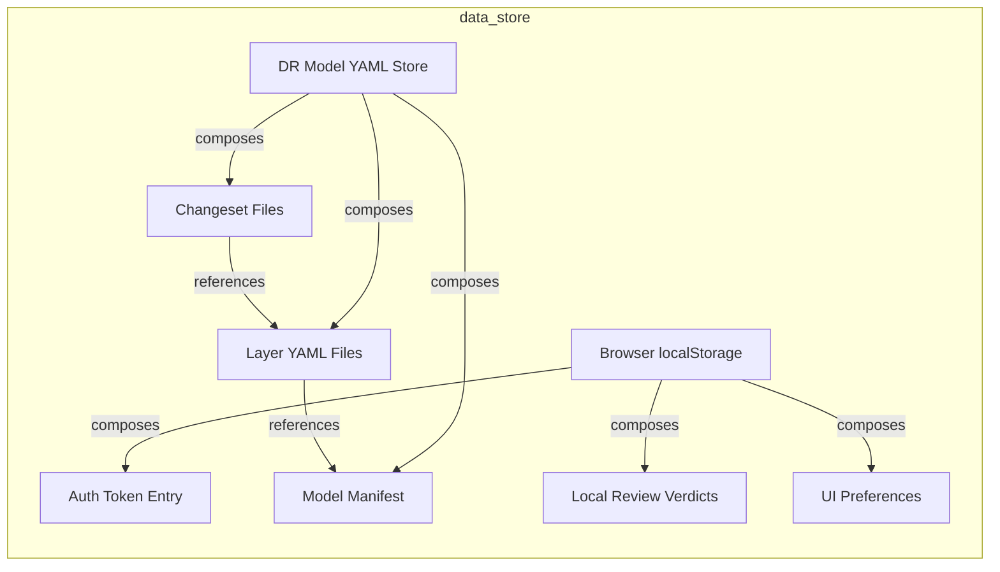
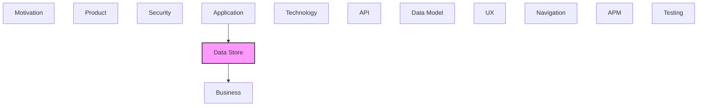

# Data Store

[← Back to README](../README.md)

Databases, data stores, and persistence mechanisms.

## Report Index

- [Layer Introduction](#layer-introduction)
- [Intra-Layer Relationships](#intra-layer-relationships)
- [Inter-Layer Dependencies](#inter-layer-dependencies)
- [Inter-Layer Relationships Table](#inter-layer-relationships-table)
- [Element Reference](#element-reference)

## Layer Introduction

| Metric                    | Count |
| ------------------------- | ----- |
| Elements                  | 8     |
| Intra-Layer Relationships | 8     |
| Inter-Layer Relationships | 4     |
| Inbound Relationships     | 2     |
| Outbound Relationships    | 2     |

**Cross-Layer References**:

- **Upstream layers**: [Application](./05-application-layer-report.md)
- **Downstream layers**: [Business](./02-business-layer-report.md)

## Intra-Layer Relationships

## Inter-Layer Dependencies

## Inter-Layer Relationships Table

| Relationship ID                                                  | Source Node                                          | Dest Node                                     | Dest Layer   | Predicate  | Cardinality  | Strength |
| ---------------------------------------------------------------- | ---------------------------------------------------- | --------------------------------------------- | ------------ | ---------- | ------------ | -------- |
| `application.applicationfunction.accesses.data-store.collection` | `application.applicationfunction.local-review-store` | `data-store.collection.local-review-verdicts` | `data-store` | `accesses` | many-to-many | medium   |
| `application.applicationfunction.accesses.data-store.collection` | `application.applicationfunction.ui-store`           | `data-store.collection.ui-preferences`        | `data-store` | `accesses` | many-to-many | medium   |
| `data-store.collection.realizes.business.businessobject`         | `data-store.collection.changeset-files`              | `business.businessobject.changeset`           | `business`   | `realizes` | many-to-many | medium   |
| `data-store.collection.realizes.business.businessobject`         | `data-store.collection.model-manifest`               | `business.businessobject.architecture-model`  | `business`   | `realizes` | many-to-many | medium   |

## Element Reference

### Auth Token Entry {#auth-token-entry}

**ID**: `data-store.collection.auth-token-entry`

**Type**: `collection`

localStorage key storing the DR CLI bearer auth token extracted from the magic link URL; read on startup, cleared on logout or invalid token response.

#### Attributes

| Name           | Value |
| -------------- | ----- |
| collectionType | HASH  |

#### Relationships

| Type        | Related Element                             | Predicate  | Direction |
| ----------- | ------------------------------------------- | ---------- | --------- |
| intra-layer | `data-store.database.browser-local-storage` | `composes` | inbound   |

### Changeset Files {#changeset-files}

**ID**: `data-store.collection.changeset-files`

**Type**: `collection`

YAML files in documentation-robotics/changesets/; each file represents a named changeset with metadata, status (active/applied/abandoned), and list of element changes with before/after states.

#### Attributes

| Name           | Value      |
| -------------- | ---------- |
| collectionType | COLLECTION |

#### Relationships

| Type        | Related Element                           | Predicate    | Direction |
| ----------- | ----------------------------------------- | ------------ | --------- |
| inter-layer | `business.businessobject.changeset`       | `realizes`   | outbound  |
| intra-layer | `data-store.collection.layer-yaml-files`  | `references` | outbound  |
| intra-layer | `data-store.database.dr-model-yaml-store` | `composes`   | inbound   |

### Layer YAML Files {#layer-yaml-files}

**ID**: `data-store.collection.layer-yaml-files`

**Type**: `collection`

Per-layer YAML files (e.g., 05_technology/systemsoftware.yaml) containing element definitions keyed by element name; multiple files may contribute elements to a single layer.

#### Attributes

| Name           | Value      |
| -------------- | ---------- |
| collectionType | COLLECTION |

#### Relationships

| Type        | Related Element                           | Predicate    | Direction |
| ----------- | ----------------------------------------- | ------------ | --------- |
| intra-layer | `data-store.collection.changeset-files`   | `references` | inbound   |
| intra-layer | `data-store.collection.model-manifest`    | `references` | outbound  |
| intra-layer | `data-store.database.dr-model-yaml-store` | `composes`   | inbound   |

### Local Review Verdicts {#local-review-verdicts}

**ID**: `data-store.collection.local-review-verdicts`

**Type**: `collection`

localStorage entry dr-viewer-local-review: review verdicts by changeset id and sequence, kept in the browser when the dr CLI can't store them.

#### Attributes

| Name           | Value      |
| -------------- | ---------- |
| collectionType | COLLECTION |

#### Relationships

| Type        | Related Element                                      | Predicate  | Direction |
| ----------- | ---------------------------------------------------- | ---------- | --------- |
| inter-layer | `application.applicationfunction.local-review-store` | `accesses` | inbound   |
| intra-layer | `data-store.database.browser-local-storage`          | `composes` | inbound   |

### Model Manifest {#model-manifest}

**ID**: `data-store.collection.model-manifest`

**Type**: `collection`

Single manifest.yaml file at the model root; contains model version, project info, layer registry with file paths and element counts, cross-reference totals, and validation statistics.

#### Attributes

| Name           | Value      |
| -------------- | ---------- |
| collectionType | COLLECTION |

#### Relationships

| Type        | Related Element                              | Predicate    | Direction |
| ----------- | -------------------------------------------- | ------------ | --------- |
| inter-layer | `business.businessobject.architecture-model` | `realizes`   | outbound  |
| intra-layer | `data-store.collection.layer-yaml-files`     | `references` | inbound   |
| intra-layer | `data-store.database.dr-model-yaml-store`    | `composes`   | inbound   |

### UI Preferences {#ui-preferences}

**ID**: `data-store.collection.ui-preferences`

**Type**: `collection`

localStorage entry dr-viewer-ui-preferences: the persisted part of the UI store (canvas theme, DrBot open, graph layout and display settings, inspector follow depth). Navigation state is left to the URL.

#### Attributes

| Name           | Value      |
| -------------- | ---------- |
| collectionType | COLLECTION |

#### Relationships

| Type        | Related Element                             | Predicate  | Direction |
| ----------- | ------------------------------------------- | ---------- | --------- |
| inter-layer | `application.applicationfunction.ui-store`  | `accesses` | inbound   |
| intra-layer | `data-store.database.browser-local-storage` | `composes` | inbound   |

### Browser localStorage {#browser-localstorage}

**ID**: `data-store.database.browser-local-storage`

**Type**: `database`

Browser Web Storage API used for client-side persistence of auth tokens, layout preferences, view state, and floating chat position; survives page reloads but not browser profile deletion.

#### Attributes

| Name            | Value                |
| --------------- | -------------------- |
| deploymentModel | EMBEDDED             |
| engine          | browser-localstorage |
| paradigm        | KEY_VALUE            |

#### Relationships

| Type        | Related Element                               | Predicate  | Direction |
| ----------- | --------------------------------------------- | ---------- | --------- |
| intra-layer | `data-store.collection.auth-token-entry`      | `composes` | outbound  |
| intra-layer | `data-store.collection.local-review-verdicts` | `composes` | outbound  |
| intra-layer | `data-store.collection.ui-preferences`        | `composes` | outbound  |

### DR Model YAML Store {#dr-model-yaml-store}

**ID**: `data-store.database.dr-model-yaml-store`

**Type**: `database`

File-based document store holding the architecture model as YAML files under documentation-robotics/model/; organized into per-layer subdirectories with a root manifest.yaml. Read by dataLoader via DR CLI REST API (GET /api/model).

#### Attributes

| Name            | Value      |
| --------------- | ---------- |
| deploymentModel | EMBEDDED   |
| engine          | yaml-files |
| paradigm        | DOCUMENT   |

#### Relationships

| Type        | Related Element                          | Predicate  | Direction |
| ----------- | ---------------------------------------- | ---------- | --------- |
| intra-layer | `data-store.collection.changeset-files`  | `composes` | outbound  |
| intra-layer | `data-store.collection.layer-yaml-files` | `composes` | outbound  |
| intra-layer | `data-store.collection.model-manifest`   | `composes` | outbound  |

---

Generated: 2026-11-18T16:40:53.416Z | Model Version: 0.1.0
