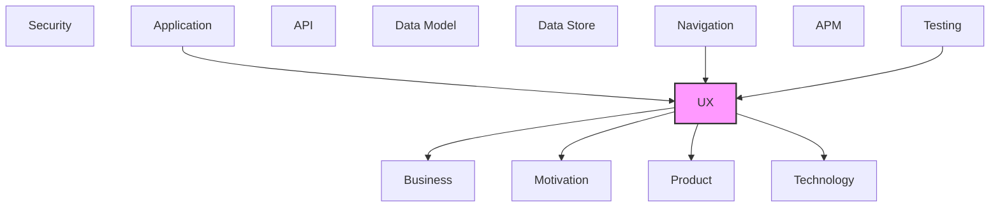

# UX

[← Back to README](../README.md)

User interface components, screens, and user experience elements.

## Report Index

- [Layer Introduction](#layer-introduction)
- [Intra-Layer Relationships](#intra-layer-relationships)
- [Inter-Layer Dependencies](#inter-layer-dependencies)
- [Inter-Layer Relationships Table](#inter-layer-relationships-table)
- [Element Reference](#element-reference)

## Layer Introduction

| Metric                    | Count |
| ------------------------- | ----- |
| Elements                  | 25    |
| Intra-Layer Relationships | 26    |
| Inter-Layer Relationships | 73    |
| Inbound Relationships     | 25    |
| Outbound Relationships    | 48    |

**Cross-Layer References**:

- **Upstream layers**: [Application](./05-application-layer-report.md), [Navigation](./11-navigation-layer-report.md), [Testing](./13-testing-layer-report.md)
- **Downstream layers**: [Business](./02-business-layer-report.md), [Motivation](./01-motivation-layer-report.md), [Product](./03-product-layer-report.md), [Technology](./06-technology-layer-report.md)

## Intra-Layer Relationships

```mermaid
flowchart LR
  subgraph ux
    ux_errorconfig_checkout_unavailable_error["Checkout Unavailable Error"]
    ux_statepattern_data_loading_pattern["Data Loading Pattern"]
    ux_subview_c4_changeset_bar["C4 Changeset Bar"]
    ux_subview_c4_diagram["C4 Diagram"]
    ux_subview_c4_export_menu["C4 Export Menu"]
    ux_subview_c4_plan_comparison_bar["C4 Plan Comparison Bar"]
    ux_subview_change_inspector_panel["Change Inspector Panel"]
    ux_subview_changeset_impact_tab["Changeset Impact Tab"]
    ux_subview_changeset_inbox["Changeset Inbox"]
    ux_subview_changeset_review_list["Changeset Review List"]
    ux_subview_checkout_switcher["Checkout Switcher"]
    ux_subview_hive_by_type["Hive by Type"]
    ux_subview_lanes_by_type["Lanes by Type"]
    ux_subview_page_view["Page View"]
    ux_subview_tier1_panel["Tier1 Panel"]
    ux_uxapplication_embedded_architecture_viewer["Embedded Architecture Viewer"]
    ux_uxspec_architecture_exploration_spec["Architecture Exploration Spec"]
    ux_view_architecture_view["Architecture View"]
    ux_view_changesets_view["Changesets View"]
    ux_view_checkout_picker_view["Checkout Picker View"]
    ux_view_dr_bot_chat_drawer["DrBot Chat Drawer"]
    ux_view_inspector_drawer["Inspector Drawer"]
    ux_view_model_view["Model View"]
    ux_view_schema_view["Schema View"]
    ux_view_topbar_search["Topbar Search"]
    ux_uxapplication_embedded_architecture_viewer -->|aggregates| ux_uxspec_architecture_exploration_spec
    ux_uxspec_architecture_exploration_spec -->|aggregates| ux_view_architecture_view
    ux_uxspec_architecture_exploration_spec -->|aggregates| ux_view_changesets_view
    ux_uxspec_architecture_exploration_spec -->|aggregates| ux_view_checkout_picker_view
    ux_uxspec_architecture_exploration_spec -->|aggregates| ux_view_dr_bot_chat_drawer
    ux_uxspec_architecture_exploration_spec -->|aggregates| ux_view_inspector_drawer
    ux_uxspec_architecture_exploration_spec -->|aggregates| ux_view_model_view
    ux_uxspec_architecture_exploration_spec -->|aggregates| ux_view_schema_view
    ux_uxspec_architecture_exploration_spec -->|aggregates| ux_view_topbar_search
    ux_view_architecture_view -->|composes| ux_subview_c4_changeset_bar
    ux_view_architecture_view -->|composes| ux_subview_c4_diagram
    ux_view_architecture_view -->|composes| ux_subview_c4_export_menu
    ux_view_architecture_view -->|composes| ux_subview_c4_plan_comparison_bar
    ux_view_architecture_view -->|composes| ux_subview_checkout_switcher
    ux_view_changesets_view -->|composes| ux_subview_change_inspector_panel
    ux_view_changesets_view -->|composes| ux_subview_changeset_impact_tab
    ux_view_changesets_view -->|composes| ux_subview_changeset_inbox
    ux_view_changesets_view -->|composes| ux_subview_changeset_review_list
    ux_view_changesets_view -->|composes| ux_subview_checkout_switcher
    ux_view_changesets_view -->|composes| ux_subview_tier1_panel
    ux_view_model_view -->|composes| ux_subview_checkout_switcher
    ux_view_model_view -->|composes| ux_subview_hive_by_type
    ux_view_model_view -->|composes| ux_subview_lanes_by_type
    ux_view_model_view -->|composes| ux_subview_page_view
    ux_view_schema_view -->|composes| ux_subview_checkout_switcher
    ux_view_schema_view -->|composes| ux_subview_page_view
  end
```

## Inter-Layer Dependencies

## Inter-Layer Relationships Table

| Relationship ID                                 | Source Node                                                                                                                         | Dest Node                                                       | Dest Layer   | Predicate    | Cardinality  | Strength |
| ----------------------------------------------- | ----------------------------------------------------------------------------------------------------------------------------------- | --------------------------------------------------------------- | ------------ | ------------ | ------------ | -------- |
| `application.applicationservice.serves.ux.view` | `application.applicationservice.c4-view-scoping`                                                                                    | `ux.view.architecture-view`                                     | `ux`         | `serves`     | many-to-many | medium   |
| `application.applicationservice.serves.ux.view` | `application.applicationservice.use-projects`                                                                                       | `ux.view.checkout-picker-view`                                  | `ux`         | `serves`     | many-to-many | medium   |
| `navigation.route.maps-to.ux.view`              | `navigation.route.app-shell-sectionview-route`                                                                                      | `ux.view.checkout-picker-view`                                  | `ux`         | `maps-to`    | many-to-many | medium   |
| `navigation.route.maps-to.ux.view`              | `navigation.route.checkout-shell-route`                                                                                             | `ux.view.architecture-view`                                     | `ux`         | `maps-to`    | many-to-many | medium   |
| `navigation.route.maps-to.ux.view`              | `navigation.route.checkout-shell-route`                                                                                             | `ux.view.changesets-view`                                       | `ux`         | `maps-to`    | many-to-many | medium   |
| `navigation.route.maps-to.ux.view`              | `navigation.route.checkout-shell-route`                                                                                             | `ux.view.model-view`                                            | `ux`         | `maps-to`    | many-to-many | medium   |
| `navigation.route.maps-to.ux.view`              | `navigation.route.checkout-shell-route`                                                                                             | `ux.view.schema-view`                                           | `ux`         | `maps-to`    | many-to-many | medium   |
| `navigation.route.uses.ux.errorconfig`          | `navigation.route.checkout-shell-route`                                                                                             | `ux.errorconfig.checkout-unavailable-error`                     | `ux`         | `uses`       | many-to-many | medium   |
| `navigation.route.maps-to.ux.view`              | `navigation.route.index-route`                                                                                                      | `ux.view.checkout-picker-view`                                  | `ux`         | `maps-to`    | many-to-many | medium   |
| `testing.testcasesketch.tests.ux.view`          | `testing.testcasesketch.accessibility-axe-wcag-2-1-aa-topbar-search-open-topbar-search-with-results-open-tone-canvas-zero-e9283739` | `ux.view.topbar-search`                                         | `ux`         | `tests`      | many-to-many | medium   |
| `testing.testcasesketch.tests.ux.view`          | `testing.testcasesketch.accessibility-axe-wcag-2-1-aa-view-name-view-tone-canvas-no-serious-critical-violations-except-f5cdbb26`    | `ux.view.architecture-view`                                     | `ux`         | `tests`      | many-to-many | medium   |
| `testing.testcasesketch.tests.ux.view`          | `testing.testcasesketch.architecture-canvas-drills-from-a-container-into-its-components-and-back`                                   | `ux.view.architecture-view`                                     | `ux`         | `tests`      | many-to-many | medium   |
| `testing.testcasesketch.tests.ux.view`          | `testing.testcasesketch.architecture-view-c4-diagrams-restores-level-and-scope-from-the-url-and-the-selected-box`                   | `ux.view.architecture-view`                                     | `ux`         | `tests`      | many-to-many | medium   |
| `testing.testcasesketch.tests.ux.view`          | `testing.testcasesketch.architecture-view-c4-diagrams-the-architecture-section-of-the-nav-tree-opens-the-diagrams`                  | `ux.view.architecture-view`                                     | `ux`         | `tests`      | many-to-many | medium   |
| `testing.testcasesketch.tests.ux.view`          | `testing.testcasesketch.architecture-view-exports-each-format-and-the-menu-passes-axe`                                              | `ux.view.architecture-view`                                     | `ux`         | `tests`      | many-to-many | medium   |
| `testing.testcasesketch.tests.ux.view`          | `testing.testcasesketch.architecture-view-plan-vs-as-built-passes-axe-in-light-and-dark`                                            | `ux.view.architecture-view`                                     | `ux`         | `tests`      | many-to-many | medium   |
| `testing.testcasesketch.tests.ux.subview`       | `testing.testcasesketch.c4-export-menu-downloads-each-format-named-after-the-diagram`                                               | `ux.subview.c4-export-menu`                                     | `ux`         | `tests`      | many-to-many | medium   |
| `testing.testcasesketch.tests.ux.subview`       | `testing.testcasesketch.c4-plan-comparison-bar-tallies-verdicts-and-cards-carry-glyphs`                                             | `ux.subview.c4-plan-comparison-bar`                             | `ux`         | `tests`      | many-to-many | medium   |
| `testing.testcasesketch.tests.ux.view`          | `testing.testcasesketch.c4diagram-keyboard-moves-between-cards-with-the-arrow-keys-and-drills-in-with-enter`                        | `ux.view.architecture-view`                                     | `ux`         | `tests`      | many-to-many | medium   |
| `testing.testcasesketch.tests.ux.view`          | `testing.testcasesketch.escape-inside-the-drbot-panel-closes-it-and-returns-focus-to-the-launcher`                                  | `ux.view.dr-bot-chat-drawer`                                    | `ux`         | `tests`      | many-to-many | medium   |
| `testing.testcasesketch.tests.ux.subview`       | `testing.testcasesketch.model-view-control-switches-between-graph-lanes-and-hive-and-persists`                                      | `ux.subview.hive-by-type`                                       | `ux`         | `tests`      | many-to-many | medium   |
| `testing.testcasesketch.tests.ux.subview`       | `testing.testcasesketch.model-view-control-switches-between-graph-lanes-and-hive-and-persists`                                      | `ux.subview.lanes-by-type`                                      | `ux`         | `tests`      | many-to-many | medium   |
| `testing.testcasesketch.tests.ux.view`          | `testing.testcasesketch.model-view-control-switches-between-graph-lanes-and-hive-and-persists`                                      | `ux.view.model-view`                                            | `ux`         | `tests`      | many-to-many | medium   |
| `testing.testcasesketch.tests.ux.subview`       | `testing.testcasesketch.page-view-shows-the-description-above-the-facts-as-markdown-and-leaves-it-out-of-the-facts-grid`            | `ux.subview.page-view`                                          | `ux`         | `tests`      | many-to-many | medium   |
| `testing.testcasesketch.tests.ux.view`          | `testing.testcasesketch.topbar-search-keyboard-slash-and-cmd-k-focus-it-arrows-move-aria-activedescendant-escape-closes`            | `ux.view.topbar-search`                                         | `ux`         | `tests`      | many-to-many | medium   |
| `ux.uxspec.satisfies.motivation.requirement`    | `ux.uxspec.architecture-exploration-spec`                                                                                           | `motivation.requirement.viewer-covers-every-spec-layer`         | `motivation` | `satisfies`  | many-to-many | medium   |
| `ux.view.depends-on.technology.systemsoftware`  | `ux.view.architecture-view`                                                                                                         | `technology.systemsoftware.elk`                                 | `technology` | `depends-on` | many-to-many | medium   |
| `ux.view.realizes.product.feature`              | `ux.view.architecture-view`                                                                                                         | `product.feature.c4-architecture-diagrams`                      | `product`    | `realizes`   | many-to-many | medium   |
| `ux.view.realizes.product.feature`              | `ux.view.architecture-view`                                                                                                         | `product.feature.c4-changeset-overlay`                          | `product`    | `realizes`   | many-to-many | medium   |
| `ux.view.realizes.product.feature`              | `ux.view.architecture-view`                                                                                                         | `product.feature.c4-diagram-export`                             | `product`    | `realizes`   | many-to-many | medium   |
| `ux.view.realizes.product.feature`              | `ux.view.architecture-view`                                                                                                         | `product.feature.c4-overlay-change-counts`                      | `product`    | `realizes`   | many-to-many | medium   |
| `ux.view.realizes.product.feature`              | `ux.view.architecture-view`                                                                                                         | `product.feature.c4-plan-vs-as-built`                           | `product`    | `realizes`   | many-to-many | medium   |
| `ux.view.references.business.businessobject`    | `ux.view.architecture-view`                                                                                                         | `business.businessobject.architecture-model`                    | `business`   | `references` | many-to-many | medium   |
| `ux.view.satisfies.motivation.requirement`      | `ux.view.architecture-view`                                                                                                         | `motivation.requirement.architecture-reads-as-c4-diagrams`      | `motivation` | `satisfies`  | many-to-many | medium   |
| `ux.view.satisfies.motivation.requirement`      | `ux.view.architecture-view`                                                                                                         | `motivation.requirement.changesets-read-as-architecture-change` | `motivation` | `satisfies`  | many-to-many | medium   |
| `ux.view.satisfies.motivation.requirement`      | `ux.view.architecture-view`                                                                                                         | `motivation.requirement.diagrams-travel-outside-the-viewer`     | `motivation` | `satisfies`  | many-to-many | medium   |
| `ux.view.satisfies.motivation.requirement`      | `ux.view.architecture-view`                                                                                                         | `motivation.requirement.plan-outcome-reads-as-architecture`     | `motivation` | `satisfies`  | many-to-many | medium   |
| `ux.view.satisfies.motivation.requirement`      | `ux.view.architecture-view`                                                                                                         | `motivation.requirement.wcag-21-aa-compliance`                  | `motivation` | `satisfies`  | many-to-many | medium   |
| `ux.view.serves.business.businessrole`          | `ux.view.architecture-view`                                                                                                         | `business.businessrole.architecture-reviewer`                   | `business`   | `serves`     | many-to-many | medium   |
| `ux.view.serves.business.businessrole`          | `ux.view.architecture-view`                                                                                                         | `business.businessrole.model-author`                            | `business`   | `serves`     | many-to-many | medium   |
| `ux.view.supports.motivation.goal`              | `ux.view.architecture-view`                                                                                                         | `motivation.goal.visualize-multi-layer-architecture-models`     | `motivation` | `supports`   | many-to-many | medium   |
| `ux.view.depends-on.technology.systemsoftware`  | `ux.view.changesets-view`                                                                                                           | `technology.systemsoftware.heimdall-ui`                         | `technology` | `depends-on` | many-to-many | medium   |
| `ux.view.realizes.product.feature`              | `ux.view.changesets-view`                                                                                                           | `product.feature.changeset-inbox`                               | `product`    | `realizes`   | many-to-many | medium   |
| `ux.view.realizes.product.feature`              | `ux.view.changesets-view`                                                                                                           | `product.feature.per-change-review`                             | `product`    | `realizes`   | many-to-many | medium   |
| `ux.view.realizes.product.feature`              | `ux.view.changesets-view`                                                                                                           | `product.feature.tier1-mode-and-routing`                        | `product`    | `realizes`   | many-to-many | medium   |
| `ux.view.realizes.product.feature`              | `ux.view.changesets-view`                                                                                                           | `product.feature.tier1-warming-progress`                        | `product`    | `realizes`   | many-to-many | medium   |
| `ux.view.references.business.businessobject`    | `ux.view.changesets-view`                                                                                                           | `business.businessobject.changeset`                             | `business`   | `references` | many-to-many | medium   |
| `ux.view.satisfies.motivation.requirement`      | `ux.view.changesets-view`                                                                                                           | `motivation.requirement.each-review-change-reads-on-its-own`    | `motivation` | `satisfies`  | many-to-many | medium   |
| `ux.view.satisfies.motivation.requirement`      | `ux.view.changesets-view`                                                                                                           | `motivation.requirement.wcag-21-aa-compliance`                  | `motivation` | `satisfies`  | many-to-many | medium   |
| `ux.view.serves.business.businessrole`          | `ux.view.changesets-view`                                                                                                           | `business.businessrole.architecture-reviewer`                   | `business`   | `serves`     | many-to-many | medium   |
| `ux.view.supports.motivation.goal`              | `ux.view.changesets-view`                                                                                                           | `motivation.goal.enable-real-time-collaboration`                | `motivation` | `supports`   | many-to-many | medium   |
| `ux.view.satisfies.motivation.requirement`      | `ux.view.checkout-picker-view`                                                                                                      | `motivation.requirement.open-the-checkout-a-link-names`         | `motivation` | `satisfies`  | many-to-many | medium   |
| `ux.view.realizes.product.feature`              | `ux.view.dr-bot-chat-drawer`                                                                                                        | `product.feature.dr-bot-chat-drawer`                            | `product`    | `realizes`   | many-to-many | medium   |
| `ux.view.serves.business.businessrole`          | `ux.view.dr-bot-chat-drawer`                                                                                                        | `business.businessrole.model-author`                            | `business`   | `serves`     | many-to-many | medium   |
| `ux.view.realizes.product.feature`              | `ux.view.inspector-drawer`                                                                                                          | `product.feature.cross-layer-follow`                            | `product`    | `realizes`   | many-to-many | medium   |
| `ux.view.realizes.product.feature`              | `ux.view.inspector-drawer`                                                                                                          | `product.feature.element-annotations`                           | `product`    | `realizes`   | many-to-many | medium   |
| `ux.view.references.business.businessobject`    | `ux.view.inspector-drawer`                                                                                                          | `business.businessobject.annotation`                            | `business`   | `references` | many-to-many | medium   |
| `ux.view.depends-on.technology.systemsoftware`  | `ux.view.model-view`                                                                                                                | `technology.systemsoftware.heimdall-ui`                         | `technology` | `depends-on` | many-to-many | medium   |
| `ux.view.realizes.product.feature`              | `ux.view.model-view`                                                                                                                | `product.feature.model-graph-view`                              | `product`    | `realizes`   | many-to-many | medium   |
| `ux.view.realizes.product.feature`              | `ux.view.model-view`                                                                                                                | `product.feature.model-view-by-type`                            | `product`    | `realizes`   | many-to-many | medium   |
| `ux.view.references.business.businessobject`    | `ux.view.model-view`                                                                                                                | `business.businessobject.architecture-model`                    | `business`   | `references` | many-to-many | medium   |
| `ux.view.satisfies.motivation.requirement`      | `ux.view.model-view`                                                                                                                | `motivation.requirement.wcag-21-aa-compliance`                  | `motivation` | `satisfies`  | many-to-many | medium   |
| `ux.view.serves.business.businessrole`          | `ux.view.model-view`                                                                                                                | `business.businessrole.architecture-reviewer`                   | `business`   | `serves`     | many-to-many | medium   |
| `ux.view.supports.motivation.goal`              | `ux.view.model-view`                                                                                                                | `motivation.goal.visualize-multi-layer-architecture-models`     | `motivation` | `supports`   | many-to-many | medium   |
| `ux.view.realizes.product.feature`              | `ux.view.schema-view`                                                                                                               | `product.feature.schema-graph-view`                             | `product`    | `realizes`   | many-to-many | medium   |
| `ux.view.references.business.businessobject`    | `ux.view.schema-view`                                                                                                               | `business.businessobject.architecture-model`                    | `business`   | `references` | many-to-many | medium   |
| `ux.view.satisfies.motivation.requirement`      | `ux.view.schema-view`                                                                                                               | `motivation.requirement.wcag-21-aa-compliance`                  | `motivation` | `satisfies`  | many-to-many | medium   |
| `ux.view.realizes.product.feature`              | `ux.view.topbar-search`                                                                                                             | `product.feature.topbar-search`                                 | `product`    | `realizes`   | many-to-many | medium   |
| `ux.view.references.business.businessobject`    | `ux.view.topbar-search`                                                                                                             | `business.businessobject.architecture-model`                    | `business`   | `references` | many-to-many | medium   |
| `ux.view.satisfies.motivation.requirement`      | `ux.view.topbar-search`                                                                                                             | `motivation.requirement.wcag-21-aa-compliance`                  | `motivation` | `satisfies`  | many-to-many | medium   |
| `ux.view.serves.business.businessrole`          | `ux.view.topbar-search`                                                                                                             | `business.businessrole.architecture-reviewer`                   | `business`   | `serves`     | many-to-many | medium   |
| `ux.view.serves.business.businessrole`          | `ux.view.topbar-search`                                                                                                             | `business.businessrole.model-author`                            | `business`   | `serves`     | many-to-many | medium   |
| `ux.view.supports.motivation.goal`              | `ux.view.topbar-search`                                                                                                             | `motivation.goal.ensure-accessible-architecture-views`          | `motivation` | `supports`   | many-to-many | medium   |

## Element Reference

### Checkout Unavailable Error {#checkout-unavailable-error}

**ID**: `ux.errorconfig.checkout-unavailable-error`

**Type**: `errorconfig`

What the shell shows instead of the views when the route's checkout can't be served: 404 (an unknown project or checkout, or one whose folder is gone), a checkout.removed event, or server.stopping. Names the project and checkout, says why, and offers the checkout picker.

#### Relationships

| Type        | Related Element                         | Predicate | Direction |
| ----------- | --------------------------------------- | --------- | --------- |
| inter-layer | `navigation.route.checkout-shell-route` | `uses`    | inbound   |

### Data Loading Pattern {#data-loading-pattern}

**ID**: `ux.statepattern.data-loading-pattern`

**Type**: `statepattern`

Standard data-loading state pattern used across all views; states: idle → loading → loaded/error; with optional retry action on error state. Only the FIRST load counts as loading (#636): while a read has no data and hasn't failed, a region says "Loading…" (role="status") and shows no counts; data with zero items shows the empty hint; a failed first read shows the error, never "empty". A background refetch keeps the data shown (no flash back to Loading). Implemented by `data/loadState.ts` and `ui/LoadStatus.tsx`.

#### Attributes

| Name     | Value        |
| -------- | ------------ |
| category | data-loading |

### C4 Changeset Bar {#c4-changeset-bar}

**ID**: `ux.subview.c4-changeset-bar`

**Type**: `subview`

The Architecture view's changeset overlay bar under the breadcrumb: a changeset picker (staged first, then applied), its name and purpose, a drift badge when commit is blocked, a tally, the number of changes in the drawn scope ("37 changes in Web App, each counted once", matching the "N changes inside" chip that led there), the legend and Clear.

#### Relationships

| Type        | Related Element             | Predicate  | Direction |
| ----------- | --------------------------- | ---------- | --------- |
| intra-layer | `ux.view.architecture-view` | `composes` | inbound   |

### C4 Diagram {#c4-diagram}

**ID**: `ux.subview.c4-diagram`

**Type**: `subview`

Architecture view, the diagram area: the scope's boundary, a card per person, system, container or component, and labelled arrows between them, with pan, zoom and fit. With an overlaid changeset, op marks on cards and arrows; with a plan + as-built pair, verdict marks instead (glyph and line style, never colour alone).

#### Attributes

| Name  | Value      |
| ----- | ---------- |
| title | C4 Diagram |

#### Relationships

| Type        | Related Element             | Predicate  | Direction |
| ----------- | --------------------------- | ---------- | --------- |
| intra-layer | `ux.view.architecture-view` | `composes` | inbound   |

### C4 Export Menu {#c4-export-menu}

**ID**: `ux.subview.c4-export-menu`

**Type**: `subview`

The Architecture view's Export control in the page header: a menu of SVG, PNG, Structurizr DSL and PlantUML, keyboard operable, each item a download named `&lt;level&gt;-&lt;scope&gt;.&lt;ext&gt;`; disabled until the diagram is laid out, with a status message after a download.

#### Relationships

| Type        | Related Element                                                                       | Predicate  | Direction |
| ----------- | ------------------------------------------------------------------------------------- | ---------- | --------- |
| inter-layer | `testing.testcasesketch.c4-export-menu-downloads-each-format-named-after-the-diagram` | `tests`    | inbound   |
| intra-layer | `ux.view.architecture-view`                                                           | `composes` | inbound   |

### C4 Plan Comparison Bar {#c4-plan-comparison-bar}

**ID**: `ux.subview.c4-plan-comparison-bar`

**Type**: `subview`

The Architecture view's bar for a plan + as-built pair (`?changeset=` + `?built=`): the plan and as-built names with a picker for the as-built (the plan's verification records first, then any as-built or reconcile changeset), the overall verdict, a tally per verdict, the legend, what the diagrams leave out, Review in Changesets and Clear. With an older dr CLI it says the server can't compare and how to upgrade.

#### Relationships

| Type        | Related Element                                                                         | Predicate  | Direction |
| ----------- | --------------------------------------------------------------------------------------- | ---------- | --------- |
| inter-layer | `testing.testcasesketch.c4-plan-comparison-bar-tallies-verdicts-and-cards-carry-glyphs` | `tests`    | inbound   |
| intra-layer | `ux.view.architecture-view`                                                             | `composes` | inbound   |

### Change Inspector Panel {#change-inspector-panel}

**ID**: `ux.subview.change-inspector-panel`

**Type**: `subview`

The Changesets view's inspector with one change selected: layer band, labelled change and decision, link card, neighbourhood, links with direction, source reference.

#### Attributes

| Name  | Value  |
| ----- | ------ |
| title | Change |

#### Relationships

| Type        | Related Element           | Predicate  | Direction |
| ----------- | ------------------------- | ---------- | --------- |
| intra-layer | `ux.view.changesets-view` | `composes` | inbound   |

### Changeset Impact Tab {#changeset-impact-tab}

**ID**: `ux.subview.changeset-impact-tab`

**Type**: `subview`

The Changesets view's Impact tab: layer lanes of what the changed elements reach, with Find, Show, Follow, filter facets, grouped large lanes and a focus breadcrumb.

#### Relationships

| Type        | Related Element           | Predicate  | Direction |
| ----------- | ------------------------- | ---------- | --------- |
| intra-layer | `ux.view.changesets-view` | `composes` | inbound   |

### Changeset Inbox {#changeset-inbox}

**ID**: `ux.subview.changeset-inbox`

**Type**: `subview`

The Changesets view with no changeset open: changesets sorted by purpose and what they need (waiting on you or on DrBot, ready to land as built, verification records paired with their plan), then the history with each one's purpose.

#### Attributes

| Name  | Value |
| ----- | ----- |
| title | Inbox |

#### Relationships

| Type        | Related Element           | Predicate  | Direction |
| ----------- | ------------------------- | ---------- | --------- |
| intra-layer | `ux.view.changesets-view` | `composes` | inbound   |

### Changeset Review List {#changeset-review-list}

**ID**: `ux.subview.changeset-review-list`

**Type**: `subview`

The Changesets view's Review tab: labelled columns, change chips, decision pills and link chains.

#### Attributes

| Name  | Value  |
| ----- | ------ |
| title | Review |

#### Relationships

| Type        | Related Element           | Predicate  | Direction |
| ----------- | ------------------------- | ---------- | --------- |
| intra-layer | `ux.view.changesets-view` | `composes` | inbound   |

### Checkout Switcher {#checkout-switcher}

**ID**: `ux.subview.checkout-switcher`

**Type**: `subview`

In the topbar: the current project and checkout as two Heimdall Selects, listing the farm's projects and the chosen project's checkouts; switching opens the same view in the other checkout without a new link.

#### Relationships

| Type        | Related Element             | Predicate  | Direction |
| ----------- | --------------------------- | ---------- | --------- |
| intra-layer | `ux.view.architecture-view` | `composes` | inbound   |
| intra-layer | `ux.view.changesets-view`   | `composes` | inbound   |
| intra-layer | `ux.view.model-view`        | `composes` | inbound   |
| intra-layer | `ux.view.schema-view`       | `composes` | inbound   |

### Hive by Type {#hive-by-type}

**ID**: `ux.subview.hive-by-type`

**Type**: `subview`

Model view, View = Hive by type: one axis per node type, busiest elements farthest out, links as curves; offered only for layers with 3 or more types.

#### Relationships

| Type        | Related Element                                                                                | Predicate  | Direction |
| ----------- | ---------------------------------------------------------------------------------------------- | ---------- | --------- |
| inter-layer | `testing.testcasesketch.model-view-control-switches-between-graph-lanes-and-hive-and-persists` | `tests`    | inbound   |
| intra-layer | `ux.view.model-view`                                                                           | `composes` | inbound   |

### Lanes by Type {#lanes-by-type}

**ID**: `ux.subview.lanes-by-type`

**Type**: `subview`

Model view, View = Lanes by type: one lane per node type in the selected DR layer, titled with the plural type name and count; selection shared with the Inspector drawer.

#### Relationships

| Type        | Related Element                                                                                | Predicate  | Direction |
| ----------- | ---------------------------------------------------------------------------------------------- | ---------- | --------- |
| inter-layer | `testing.testcasesketch.model-view-control-switches-between-graph-lanes-and-hive-and-persists` | `tests`    | inbound   |
| intra-layer | `ux.view.model-view`                                                                           | `composes` | inbound   |

### Page View {#page-view}

**ID**: `ux.subview.page-view`

**Type**: `subview`

The page mode of the Model and Schema views (#/model/page): a layer, node type or element as a detail page with tables and a neighbourhood graph.

#### Attributes

| Name  | Value |
| ----- | ----- |
| title | Page  |

#### Relationships

| Type        | Related Element                                                                                                          | Predicate  | Direction |
| ----------- | ------------------------------------------------------------------------------------------------------------------------ | ---------- | --------- |
| inter-layer | `testing.testcasesketch.page-view-shows-the-description-above-the-facts-as-markdown-and-leaves-it-out-of-the-facts-grid` | `tests`    | inbound   |
| intra-layer | `ux.view.model-view`                                                                                                     | `composes` | inbound   |
| intra-layer | `ux.view.schema-view`                                                                                                    | `composes` | inbound   |

### Tier1 Panel {#tier1-panel}

**ID**: `ux.subview.tier1-panel`

**Type**: `subview`

Tier 1 state and this month's spend, above the inbox history; while warming, the fill's progress; the mode (stages without the agent / suggests only) and, for OpenRouter, where card text may go.

#### Attributes

| Name  | Value  |
| ----- | ------ |
| title | Tier 1 |

#### Relationships

| Type        | Related Element           | Predicate  | Direction |
| ----------- | ------------------------- | ---------- | --------- |
| intra-layer | `ux.view.changesets-view` | `composes` | inbound   |

### Embedded Architecture Viewer {#embedded-architecture-viewer}

**ID**: `ux.uxapplication.embedded-architecture-viewer`

**Type**: `uxapplication`

The Documentation Robotics Viewer: a React app built on the Heimdall design system and served by `dr visualize`. Dark shell around a light/dark canvas with a sidebar nav tree, Architecture (C4 diagrams) / Model / Schema / Changesets views (Model and Schema in graph or page mode), an inspector drawer, and the DrBot chat drawer.

#### Attributes

| Name    | Value |
| ------- | ----- |
| channel | web   |

#### Relationships

| Type        | Related Element                           | Predicate    | Direction |
| ----------- | ----------------------------------------- | ------------ | --------- |
| intra-layer | `ux.uxspec.architecture-exploration-spec` | `aggregates` | outbound  |

### Architecture Exploration Spec {#architecture-exploration-spec}

**ID**: `ux.uxspec.architecture-exploration-spec`

**Type**: `uxspec`

The viewer's main experience: browse the model and the spec layer by layer as graphs or pages, inspect elements, review changesets and their impact, and ask DrBot.

#### Relationships

| Type        | Related Element                                         | Predicate    | Direction |
| ----------- | ------------------------------------------------------- | ------------ | --------- |
| inter-layer | `motivation.requirement.viewer-covers-every-spec-layer` | `satisfies`  | outbound  |
| intra-layer | `ux.uxapplication.embedded-architecture-viewer`         | `aggregates` | inbound   |
| intra-layer | `ux.view.architecture-view`                             | `aggregates` | outbound  |
| intra-layer | `ux.view.changesets-view`                               | `aggregates` | outbound  |
| intra-layer | `ux.view.checkout-picker-view`                          | `aggregates` | outbound  |
| intra-layer | `ux.view.dr-bot-chat-drawer`                            | `aggregates` | outbound  |
| intra-layer | `ux.view.inspector-drawer`                              | `aggregates` | outbound  |
| intra-layer | `ux.view.model-view`                                    | `aggregates` | outbound  |
| intra-layer | `ux.view.schema-view`                                   | `aggregates` | outbound  |
| intra-layer | `ux.view.topbar-search`                                 | `aggregates` | outbound  |

### Architecture View {#architecture-view}

**ID**: `ux.view.architecture-view`

**Type**: `view`

The model as C4 diagrams (#/architecture): a level control (Context · Containers · Components), a breadcrumb of the scope, and the diagram. Clicking a box selects it and opens its details; a box with parts drills into them. A changeset can be laid over the diagrams (`?changeset=`, from the C4 Changeset Bar's picker or the Changesets view): what it adds, removes or changes is marked on the boxes and arrows. A plan can be compared with what was built (`?changeset=` + `?built=`, from the C4 Plan Comparison Bar or a verification record in the Changesets view): each box and arrow carries the plan verification's verdict.

#### Attributes

| Name     | Value        |
| -------- | ------------ |
| routable | true         |
| title    | Architecture |
| type     | page         |

#### Relationships

| Type        | Related Element                                                                                                                  | Predicate    | Direction |
| ----------- | -------------------------------------------------------------------------------------------------------------------------------- | ------------ | --------- |
| inter-layer | `application.applicationservice.c4-view-scoping`                                                                                 | `serves`     | inbound   |
| inter-layer | `navigation.route.checkout-shell-route`                                                                                          | `maps-to`    | inbound   |
| inter-layer | `testing.testcasesketch.accessibility-axe-wcag-2-1-aa-view-name-view-tone-canvas-no-serious-critical-violations-except-f5cdbb26` | `tests`      | inbound   |
| inter-layer | `testing.testcasesketch.architecture-canvas-drills-from-a-container-into-its-components-and-back`                                | `tests`      | inbound   |
| inter-layer | `testing.testcasesketch.architecture-view-c4-diagrams-restores-level-and-scope-from-the-url-and-the-selected-box`                | `tests`      | inbound   |
| inter-layer | `testing.testcasesketch.architecture-view-c4-diagrams-the-architecture-section-of-the-nav-tree-opens-the-diagrams`               | `tests`      | inbound   |
| inter-layer | `testing.testcasesketch.architecture-view-exports-each-format-and-the-menu-passes-axe`                                           | `tests`      | inbound   |
| inter-layer | `testing.testcasesketch.architecture-view-plan-vs-as-built-passes-axe-in-light-and-dark`                                         | `tests`      | inbound   |
| inter-layer | `testing.testcasesketch.c4diagram-keyboard-moves-between-cards-with-the-arrow-keys-and-drills-in-with-enter`                     | `tests`      | inbound   |
| inter-layer | `technology.systemsoftware.elk`                                                                                                  | `depends-on` | outbound  |
| inter-layer | `product.feature.c4-architecture-diagrams`                                                                                       | `realizes`   | outbound  |
| inter-layer | `product.feature.c4-changeset-overlay`                                                                                           | `realizes`   | outbound  |
| inter-layer | `product.feature.c4-diagram-export`                                                                                              | `realizes`   | outbound  |
| inter-layer | `product.feature.c4-overlay-change-counts`                                                                                       | `realizes`   | outbound  |
| inter-layer | `product.feature.c4-plan-vs-as-built`                                                                                            | `realizes`   | outbound  |
| inter-layer | `business.businessobject.architecture-model`                                                                                     | `references` | outbound  |
| inter-layer | `motivation.requirement.architecture-reads-as-c4-diagrams`                                                                       | `satisfies`  | outbound  |
| inter-layer | `motivation.requirement.changesets-read-as-architecture-change`                                                                  | `satisfies`  | outbound  |
| inter-layer | `motivation.requirement.diagrams-travel-outside-the-viewer`                                                                      | `satisfies`  | outbound  |
| inter-layer | `motivation.requirement.plan-outcome-reads-as-architecture`                                                                      | `satisfies`  | outbound  |
| inter-layer | `motivation.requirement.wcag-21-aa-compliance`                                                                                   | `satisfies`  | outbound  |
| inter-layer | `business.businessrole.architecture-reviewer`                                                                                    | `serves`     | outbound  |
| inter-layer | `business.businessrole.model-author`                                                                                             | `serves`     | outbound  |
| inter-layer | `motivation.goal.visualize-multi-layer-architecture-models`                                                                      | `supports`   | outbound  |
| intra-layer | `ux.uxspec.architecture-exploration-spec`                                                                                        | `aggregates` | inbound   |
| intra-layer | `ux.subview.c4-changeset-bar`                                                                                                    | `composes`   | outbound  |
| intra-layer | `ux.subview.c4-diagram`                                                                                                          | `composes`   | outbound  |
| intra-layer | `ux.subview.c4-export-menu`                                                                                                      | `composes`   | outbound  |
| intra-layer | `ux.subview.c4-plan-comparison-bar`                                                                                              | `composes`   | outbound  |
| intra-layer | `ux.subview.checkout-switcher`                                                                                                   | `composes`   | outbound  |

### Changesets View {#changesets-view}

**ID**: `ux.view.changesets-view`

**Type**: `view`

One changeset: its change list (Changes) or its reach outside itself (Impact), with the changeset inspector and Apply / Discard for a staged changeset.

#### Attributes

| Name     | Value      |
| -------- | ---------- |
| routable | true       |
| title    | Changesets |
| type     | page       |

#### Relationships

| Type        | Related Element                                              | Predicate    | Direction |
| ----------- | ------------------------------------------------------------ | ------------ | --------- |
| inter-layer | `navigation.route.checkout-shell-route`                      | `maps-to`    | inbound   |
| inter-layer | `technology.systemsoftware.heimdall-ui`                      | `depends-on` | outbound  |
| inter-layer | `product.feature.changeset-inbox`                            | `realizes`   | outbound  |
| inter-layer | `product.feature.per-change-review`                          | `realizes`   | outbound  |
| inter-layer | `product.feature.tier1-mode-and-routing`                     | `realizes`   | outbound  |
| inter-layer | `product.feature.tier1-warming-progress`                     | `realizes`   | outbound  |
| inter-layer | `business.businessobject.changeset`                          | `references` | outbound  |
| inter-layer | `motivation.requirement.each-review-change-reads-on-its-own` | `satisfies`  | outbound  |
| inter-layer | `motivation.requirement.wcag-21-aa-compliance`               | `satisfies`  | outbound  |
| inter-layer | `business.businessrole.architecture-reviewer`                | `serves`     | outbound  |
| inter-layer | `motivation.goal.enable-real-time-collaboration`             | `supports`   | outbound  |
| intra-layer | `ux.uxspec.architecture-exploration-spec`                    | `aggregates` | inbound   |
| intra-layer | `ux.subview.change-inspector-panel`                          | `composes`   | outbound  |
| intra-layer | `ux.subview.changeset-impact-tab`                            | `composes`   | outbound  |
| intra-layer | `ux.subview.changeset-inbox`                                 | `composes`   | outbound  |
| intra-layer | `ux.subview.changeset-review-list`                           | `composes`   | outbound  |
| intra-layer | `ux.subview.checkout-switcher`                               | `composes`   | outbound  |
| intra-layer | `ux.subview.tier1-panel`                                     | `composes`   | outbound  |

### Checkout Picker View {#checkout-picker-view}

**ID**: `ux.view.checkout-picker-view`

**Type**: `view`

The page a bare /#/ (and any old unscoped /#/:section/:view link) opens: every project the central process serves, each with its checkouts (main checkout first, then worktrees, with branch), from GET /api/projects and GET /api/projects/\{project\}/checkouts. Choosing one opens it (an old link's section, view and search carried over). A farm with exactly one checkout opens it directly. An older dr CLI without /api/projects gets a message saying the viewer needs dr serve.

#### Attributes

| Name | Value |
| ---- | ----- |
| type | page  |

#### Relationships

| Type        | Related Element                                         | Predicate    | Direction |
| ----------- | ------------------------------------------------------- | ------------ | --------- |
| inter-layer | `application.applicationservice.use-projects`           | `serves`     | inbound   |
| inter-layer | `navigation.route.app-shell-sectionview-route`          | `maps-to`    | inbound   |
| inter-layer | `navigation.route.index-route`                          | `maps-to`    | inbound   |
| inter-layer | `motivation.requirement.open-the-checkout-a-link-names` | `satisfies`  | outbound  |
| intra-layer | `ux.uxspec.architecture-exploration-spec`               | `aggregates` | inbound   |

### DrBot Chat Drawer {#drbot-chat-drawer}

**ID**: `ux.view.dr-bot-chat-drawer`

**Type**: `view`

The DrBot assistant, scoped to the current selection: a floating non-modal panel under the topbar launcher that never reflows the canvas, with an opt-in docked column. Closed on a first visit; a persisted choice wins after that.

#### Attributes

| Name     | Value |
| -------- | ----- |
| routable | false |
| type     | panel |

#### Relationships

| Type        | Related Element                                                                                    | Predicate    | Direction |
| ----------- | -------------------------------------------------------------------------------------------------- | ------------ | --------- |
| inter-layer | `testing.testcasesketch.escape-inside-the-drbot-panel-closes-it-and-returns-focus-to-the-launcher` | `tests`      | inbound   |
| inter-layer | `product.feature.dr-bot-chat-drawer`                                                               | `realizes`   | outbound  |
| inter-layer | `business.businessrole.model-author`                                                               | `serves`     | outbound  |
| intra-layer | `ux.uxspec.architecture-exploration-spec`                                                          | `aggregates` | inbound   |

### Inspector Drawer {#inspector-drawer}

**ID**: `ux.view.inspector-drawer`

**Type**: `view`

Selection details floating over the graph; auto-hides when nothing is selected.

#### Attributes

| Name     | Value  |
| -------- | ------ |
| routable | false  |
| type     | drawer |

#### Relationships

| Type        | Related Element                           | Predicate    | Direction |
| ----------- | ----------------------------------------- | ------------ | --------- |
| inter-layer | `product.feature.cross-layer-follow`      | `realizes`   | outbound  |
| inter-layer | `product.feature.element-annotations`     | `realizes`   | outbound  |
| inter-layer | `business.businessobject.annotation`      | `references` | outbound  |
| intra-layer | `ux.uxspec.architecture-exploration-spec` | `aggregates` | inbound   |

### Model View {#model-view}

**ID**: `ux.view.model-view`

**Type**: `view`

A layer of the model as a graph of its elements (with inter-layer neighbours), or in page mode as the layer / element record. In graph mode a View control in the page header picks Graph (the mixed graph, with Layout), Lanes by type or Hive by type; the selection opens in the Inspector drawer in every view.

#### Attributes

| Name     | Value |
| -------- | ----- |
| routable | true  |
| title    | Model |
| type     | page  |

#### Relationships

| Type        | Related Element                                                                                | Predicate    | Direction |
| ----------- | ---------------------------------------------------------------------------------------------- | ------------ | --------- |
| inter-layer | `navigation.route.checkout-shell-route`                                                        | `maps-to`    | inbound   |
| inter-layer | `testing.testcasesketch.model-view-control-switches-between-graph-lanes-and-hive-and-persists` | `tests`      | inbound   |
| inter-layer | `technology.systemsoftware.heimdall-ui`                                                        | `depends-on` | outbound  |
| inter-layer | `product.feature.model-graph-view`                                                             | `realizes`   | outbound  |
| inter-layer | `product.feature.model-view-by-type`                                                           | `realizes`   | outbound  |
| inter-layer | `business.businessobject.architecture-model`                                                   | `references` | outbound  |
| inter-layer | `motivation.requirement.wcag-21-aa-compliance`                                                 | `satisfies`  | outbound  |
| inter-layer | `business.businessrole.architecture-reviewer`                                                  | `serves`     | outbound  |
| inter-layer | `motivation.goal.visualize-multi-layer-architecture-models`                                    | `supports`   | outbound  |
| intra-layer | `ux.uxspec.architecture-exploration-spec`                                                      | `aggregates` | inbound   |
| intra-layer | `ux.subview.checkout-switcher`                                                                 | `composes`   | outbound  |
| intra-layer | `ux.subview.hive-by-type`                                                                      | `composes`   | outbound  |
| intra-layer | `ux.subview.lanes-by-type`                                                                     | `composes`   | outbound  |
| intra-layer | `ux.subview.page-view`                                                                         | `composes`   | outbound  |

### Schema View {#schema-view}

**ID**: `ux.view.schema-view`

**Type**: `view`

A layer of the spec as a graph of its node types and relationship schemas, or in page mode as the layer / spec node record.

#### Attributes

| Name     | Value  |
| -------- | ------ |
| routable | true   |
| title    | Schema |
| type     | page   |

#### Relationships

| Type        | Related Element                                | Predicate    | Direction |
| ----------- | ---------------------------------------------- | ------------ | --------- |
| inter-layer | `navigation.route.checkout-shell-route`        | `maps-to`    | inbound   |
| inter-layer | `product.feature.schema-graph-view`            | `realizes`   | outbound  |
| inter-layer | `business.businessobject.architecture-model`   | `references` | outbound  |
| inter-layer | `motivation.requirement.wcag-21-aa-compliance` | `satisfies`  | outbound  |
| intra-layer | `ux.uxspec.architecture-exploration-spec`      | `aggregates` | inbound   |
| intra-layer | `ux.subview.checkout-switcher`                 | `composes`   | outbound  |
| intra-layer | `ux.subview.page-view`                         | `composes`   | outbound  |

### Topbar Search {#topbar-search}

**ID**: `ux.view.topbar-search`

**Type**: `view`

The search box in the topbar and its results popup, an overlay below it listing matches grouped by layer.

#### Attributes

| Name     | Value   |
| -------- | ------- |
| routable | false   |
| type     | overlay |

#### Relationships

| Type        | Related Element                                                                                                                     | Predicate    | Direction |
| ----------- | ----------------------------------------------------------------------------------------------------------------------------------- | ------------ | --------- |
| inter-layer | `testing.testcasesketch.accessibility-axe-wcag-2-1-aa-topbar-search-open-topbar-search-with-results-open-tone-canvas-zero-e9283739` | `tests`      | inbound   |
| inter-layer | `testing.testcasesketch.topbar-search-keyboard-slash-and-cmd-k-focus-it-arrows-move-aria-activedescendant-escape-closes`            | `tests`      | inbound   |
| inter-layer | `product.feature.topbar-search`                                                                                                     | `realizes`   | outbound  |
| inter-layer | `business.businessobject.architecture-model`                                                                                        | `references` | outbound  |
| inter-layer | `motivation.requirement.wcag-21-aa-compliance`                                                                                      | `satisfies`  | outbound  |
| inter-layer | `business.businessrole.architecture-reviewer`                                                                                       | `serves`     | outbound  |
| inter-layer | `business.businessrole.model-author`                                                                                                | `serves`     | outbound  |
| inter-layer | `motivation.goal.ensure-accessible-architecture-views`                                                                              | `supports`   | outbound  |
| intra-layer | `ux.uxspec.architecture-exploration-spec`                                                                                           | `aggregates` | inbound   |

---

Generated: 2026-11-25T14:21:11.200Z | Model Version: 0.1.0
