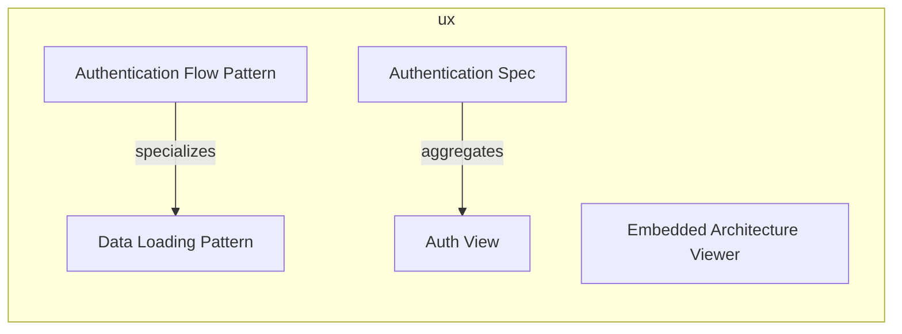
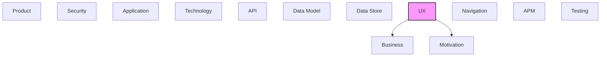

# UX

[← Back to README](../README.md)

User interface components, screens, and user experience elements.

## Report Index

- [Layer Introduction](#layer-introduction)
- [Intra-Layer Relationships](#intra-layer-relationships)
- [Inter-Layer Dependencies](#inter-layer-dependencies)
- [Inter-Layer Relationships Table](#inter-layer-relationships-table)
- [Element Reference](#element-reference)

## Layer Introduction

| Metric                    | Count |
| ------------------------- | ----- |
| Elements                  | 5     |
| Intra-Layer Relationships | 2     |
| Inter-Layer Relationships | 2     |
| Inbound Relationships     | 0     |
| Outbound Relationships    | 2     |

**Cross-Layer References**:

- **Downstream layers**: [Business](./02-business-layer-report.md), [Motivation](./01-motivation-layer-report.md)

## Intra-Layer Relationships

## Inter-Layer Dependencies

## Inter-Layer Relationships Table

| Relationship ID                              | Source Node                     | Dest Node                                          | Dest Layer   | Predicate   | Cardinality  | Strength |
| -------------------------------------------- | ------------------------------- | -------------------------------------------------- | ------------ | ----------- | ------------ | -------- |
| `ux.uxspec.satisfies.motivation.requirement` | `ux.uxspec.authentication-spec` | `motivation.requirement.dr-cli-server-integration` | `motivation` | `satisfies` | many-to-many | medium   |
| `ux.view.realizes.business.businessprocess`  | `ux.view.auth-view`             | `business.businessprocess.authentication-flow`     | `business`   | `realizes`  | many-to-many | medium   |

## Element Reference

### Authentication Flow Pattern {#authentication-flow-pattern}

**ID**: `ux.statepattern.authentication-flow-pattern`

**Type**: `statepattern`

Multi-step UX state machine for the token-based authentication flow; states: unauthenticated → extracting-token → validating → authenticated; handles invalid token rejection.

#### Attributes

| Name     | Value          |
| -------- | -------------- |
| category | authentication |

#### Relationships

| Type        | Related Element                        | Predicate     | Direction |
| ----------- | -------------------------------------- | ------------- | --------- |
| intra-layer | `ux.statepattern.data-loading-pattern` | `specializes` | outbound  |

### Data Loading Pattern {#data-loading-pattern}

**ID**: `ux.statepattern.data-loading-pattern`

**Type**: `statepattern`

Standard data-loading state pattern used across all views; states: idle → loading → loaded/error; with optional retry action on error state.

#### Attributes

| Name     | Value        |
| -------- | ------------ |
| category | data-loading |

#### Relationships

| Type        | Related Element                               | Predicate     | Direction |
| ----------- | --------------------------------------------- | ------------- | --------- |
| intra-layer | `ux.statepattern.authentication-flow-pattern` | `specializes` | inbound   |

### Embedded Architecture Viewer {#embedded-architecture-viewer}

**ID**: `ux.uxapplication.embedded-architecture-viewer`

**Type**: `uxapplication`

Single-page web application (hash-based SPA) for visualizing multi-layer architecture documentation models; embeds in an iframe and connects to the DR CLI visualization server.

#### Attributes

| Name    | Value |
| ------- | ----- |
| channel | web   |

### Authentication Spec {#authentication-spec}

**ID**: `ux.uxspec.authentication-spec`

**Type**: `uxspec`

UX specification for token-based authentication flow; extracts bearer token from magic link URL query parameter and redirects to the model view on success.

#### Attributes

| Name       | Value  |
| ---------- | ------ |
| experience | visual |

#### Relationships

| Type        | Related Element                                    | Predicate    | Direction |
| ----------- | -------------------------------------------------- | ------------ | --------- |
| inter-layer | `motivation.requirement.dr-cli-server-integration` | `satisfies`  | outbound  |
| intra-layer | `ux.view.auth-view`                                | `aggregates` | outbound  |

### Auth View {#auth-view}

**ID**: `ux.view.auth-view`

**Type**: `view`

Landing view at route /#/; extracts the DR CLI bearer token from the ?token= URL query parameter, persists it to localStorage, and redirects to the model view.

#### Attributes

| Name | Value    |
| ---- | -------- |
| type | embedded |

#### Relationships

| Type        | Related Element                                | Predicate    | Direction |
| ----------- | ---------------------------------------------- | ------------ | --------- |
| inter-layer | `business.businessprocess.authentication-flow` | `realizes`   | outbound  |
| intra-layer | `ux.uxspec.authentication-spec`                | `aggregates` | inbound   |

---

Generated: 2026-09-19T15:37:38.405Z | Model Version: 0.1.0
