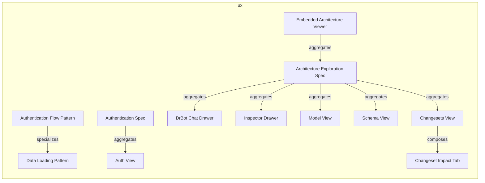
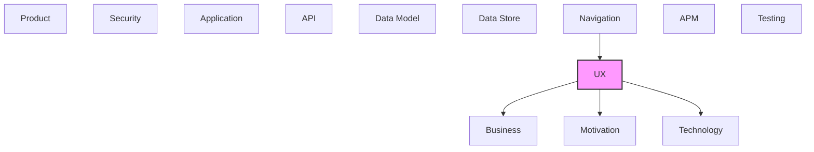

# UX

[← Back to README](../README.md)

User interface components, screens, and user experience elements.

## Report Index

- [Layer Introduction](#layer-introduction)
- [Intra-Layer Relationships](#intra-layer-relationships)
- [Inter-Layer Dependencies](#inter-layer-dependencies)
- [Inter-Layer Relationships Table](#inter-layer-relationships-table)
- [Element Reference](#element-reference)

## Layer Introduction

| Metric                    | Count |
| ------------------------- | ----- |
| Elements                  | 12    |
| Intra-Layer Relationships | 9     |
| Inter-Layer Relationships | 18    |
| Inbound Relationships     | 3     |
| Outbound Relationships    | 15    |

**Cross-Layer References**:

- **Upstream layers**: [Navigation](./11-navigation-layer-report.md)
- **Downstream layers**: [Business](./02-business-layer-report.md), [Motivation](./01-motivation-layer-report.md), [Technology](./06-technology-layer-report.md)

## Intra-Layer Relationships

## Inter-Layer Dependencies

## Inter-Layer Relationships Table

| Relationship ID                                | Source Node                                    | Dest Node                                                   | Dest Layer   | Predicate    | Cardinality  | Strength |
| ---------------------------------------------- | ---------------------------------------------- | ----------------------------------------------------------- | ------------ | ------------ | ------------ | -------- |
| `navigation.route.maps-to.ux.view`             | `navigation.route.app-shell-sectionview-route` | `ux.view.changesets-view`                                   | `ux`         | `maps-to`    | many-to-many | medium   |
| `navigation.route.maps-to.ux.view`             | `navigation.route.app-shell-sectionview-route` | `ux.view.model-view`                                        | `ux`         | `maps-to`    | many-to-many | medium   |
| `navigation.route.maps-to.ux.view`             | `navigation.route.app-shell-sectionview-route` | `ux.view.schema-view`                                       | `ux`         | `maps-to`    | many-to-many | medium   |
| `ux.uxspec.satisfies.motivation.requirement`   | `ux.uxspec.authentication-spec`                | `motivation.requirement.dr-cli-server-integration`          | `motivation` | `satisfies`  | many-to-many | medium   |
| `ux.view.depends-on.technology.systemsoftware` | `ux.view.changesets-view`                      | `technology.systemsoftware.heimdall-ui`                     | `technology` | `depends-on` | many-to-many | medium   |
| `ux.view.references.business.businessobject`   | `ux.view.changesets-view`                      | `business.businessobject.changeset`                         | `business`   | `references` | many-to-many | medium   |
| `ux.view.satisfies.motivation.requirement`     | `ux.view.changesets-view`                      | `motivation.requirement.wcag-21-aa-compliance`              | `motivation` | `satisfies`  | many-to-many | medium   |
| `ux.view.serves.business.businessrole`         | `ux.view.changesets-view`                      | `business.businessrole.architecture-reviewer`               | `business`   | `serves`     | many-to-many | medium   |
| `ux.view.supports.motivation.goal`             | `ux.view.changesets-view`                      | `motivation.goal.enable-real-time-collaboration`            | `motivation` | `supports`   | many-to-many | medium   |
| `ux.view.serves.business.businessrole`         | `ux.view.dr-bot-chat-drawer`                   | `business.businessrole.model-author`                        | `business`   | `serves`     | many-to-many | medium   |
| `ux.view.references.business.businessobject`   | `ux.view.inspector-drawer`                     | `business.businessobject.annotation`                        | `business`   | `references` | many-to-many | medium   |
| `ux.view.depends-on.technology.systemsoftware` | `ux.view.model-view`                           | `technology.systemsoftware.heimdall-ui`                     | `technology` | `depends-on` | many-to-many | medium   |
| `ux.view.references.business.businessobject`   | `ux.view.model-view`                           | `business.businessobject.architecture-model`                | `business`   | `references` | many-to-many | medium   |
| `ux.view.satisfies.motivation.requirement`     | `ux.view.model-view`                           | `motivation.requirement.wcag-21-aa-compliance`              | `motivation` | `satisfies`  | many-to-many | medium   |
| `ux.view.serves.business.businessrole`         | `ux.view.model-view`                           | `business.businessrole.architecture-reviewer`               | `business`   | `serves`     | many-to-many | medium   |
| `ux.view.supports.motivation.goal`             | `ux.view.model-view`                           | `motivation.goal.visualize-multi-layer-architecture-models` | `motivation` | `supports`   | many-to-many | medium   |
| `ux.view.references.business.businessobject`   | `ux.view.schema-view`                          | `business.businessobject.architecture-model`                | `business`   | `references` | many-to-many | medium   |
| `ux.view.satisfies.motivation.requirement`     | `ux.view.schema-view`                          | `motivation.requirement.wcag-21-aa-compliance`              | `motivation` | `satisfies`  | many-to-many | medium   |

## Element Reference

### Authentication Flow Pattern {#authentication-flow-pattern}

**ID**: `ux.statepattern.authentication-flow-pattern`

**Type**: `statepattern`

Multi-step UX state machine for the token-based authentication flow; states: unauthenticated → extracting-token → validating → authenticated; handles invalid token rejection.

#### Attributes

| Name     | Value          |
| -------- | -------------- |
| category | authentication |

#### Relationships

| Type        | Related Element                        | Predicate     | Direction |
| ----------- | -------------------------------------- | ------------- | --------- |
| intra-layer | `ux.statepattern.data-loading-pattern` | `specializes` | outbound  |

### Data Loading Pattern {#data-loading-pattern}

**ID**: `ux.statepattern.data-loading-pattern`

**Type**: `statepattern`

Standard data-loading state pattern used across all views; states: idle → loading → loaded/error; with optional retry action on error state.

#### Attributes

| Name     | Value        |
| -------- | ------------ |
| category | data-loading |

#### Relationships

| Type        | Related Element                               | Predicate     | Direction |
| ----------- | --------------------------------------------- | ------------- | --------- |
| intra-layer | `ux.statepattern.authentication-flow-pattern` | `specializes` | inbound   |

### Changeset Impact Tab {#changeset-impact-tab}

**ID**: `ux.subview.changeset-impact-tab`

**Type**: `subview`

The Changesets view's Impact tab: layer lanes of what the changed elements reach, with Follow and Labels controls.

#### Relationships

| Type        | Related Element           | Predicate  | Direction |
| ----------- | ------------------------- | ---------- | --------- |
| intra-layer | `ux.view.changesets-view` | `composes` | inbound   |

### Embedded Architecture Viewer {#embedded-architecture-viewer}

**ID**: `ux.uxapplication.embedded-architecture-viewer`

**Type**: `uxapplication`

The Documentation Robotics Viewer: a React app built on the Heimdall design system and served by `dr visualize`. Dark shell around a light/dark canvas with a sidebar nav tree, Model / Schema / Changesets views (graph or page mode), an inspector drawer, and the DrBot chat drawer.

#### Attributes

| Name    | Value |
| ------- | ----- |
| channel | web   |

#### Relationships

| Type        | Related Element                           | Predicate    | Direction |
| ----------- | ----------------------------------------- | ------------ | --------- |
| intra-layer | `ux.uxspec.architecture-exploration-spec` | `aggregates` | outbound  |

### Architecture Exploration Spec {#architecture-exploration-spec}

**ID**: `ux.uxspec.architecture-exploration-spec`

**Type**: `uxspec`

The viewer's main experience: browse the model and the spec layer by layer as graphs or pages, inspect elements, review changesets and their impact, and ask DrBot.

#### Relationships

| Type        | Related Element                                 | Predicate    | Direction |
| ----------- | ----------------------------------------------- | ------------ | --------- |
| intra-layer | `ux.uxapplication.embedded-architecture-viewer` | `aggregates` | inbound   |
| intra-layer | `ux.view.changesets-view`                       | `aggregates` | outbound  |
| intra-layer | `ux.view.dr-bot-chat-drawer`                    | `aggregates` | outbound  |
| intra-layer | `ux.view.inspector-drawer`                      | `aggregates` | outbound  |
| intra-layer | `ux.view.model-view`                            | `aggregates` | outbound  |
| intra-layer | `ux.view.schema-view`                           | `aggregates` | outbound  |

### Authentication Spec {#authentication-spec}

**ID**: `ux.uxspec.authentication-spec`

**Type**: `uxspec`

UX specification for token-based authentication flow; extracts bearer token from magic link URL query parameter and redirects to the model view on success.

#### Attributes

| Name       | Value  |
| ---------- | ------ |
| experience | visual |

#### Relationships

| Type        | Related Element                                    | Predicate    | Direction |
| ----------- | -------------------------------------------------- | ------------ | --------- |
| inter-layer | `motivation.requirement.dr-cli-server-integration` | `satisfies`  | outbound  |
| intra-layer | `ux.view.auth-view`                                | `aggregates` | outbound  |

### Auth View {#auth-view}

**ID**: `ux.view.auth-view`

**Type**: `view`

Landing view at route /#/; extracts the DR CLI bearer token from the ?token= URL query parameter, persists it to localStorage, and redirects to the model view.

#### Attributes

| Name | Value    |
| ---- | -------- |
| type | embedded |

#### Relationships

| Type        | Related Element                 | Predicate    | Direction |
| ----------- | ------------------------------- | ------------ | --------- |
| intra-layer | `ux.uxspec.authentication-spec` | `aggregates` | inbound   |

### Changesets View {#changesets-view}

**ID**: `ux.view.changesets-view`

**Type**: `view`

One changeset: its change list (Changes) or its reach outside itself (Impact), with the changeset inspector and Apply / Discard for a staged changeset.

#### Attributes

| Name     | Value      |
| -------- | ---------- |
| routable | true       |
| title    | Changesets |
| type     | page       |

#### Relationships

| Type        | Related Element                                  | Predicate    | Direction |
| ----------- | ------------------------------------------------ | ------------ | --------- |
| inter-layer | `navigation.route.app-shell-sectionview-route`   | `maps-to`    | inbound   |
| inter-layer | `technology.systemsoftware.heimdall-ui`          | `depends-on` | outbound  |
| inter-layer | `business.businessobject.changeset`              | `references` | outbound  |
| inter-layer | `motivation.requirement.wcag-21-aa-compliance`   | `satisfies`  | outbound  |
| inter-layer | `business.businessrole.architecture-reviewer`    | `serves`     | outbound  |
| inter-layer | `motivation.goal.enable-real-time-collaboration` | `supports`   | outbound  |
| intra-layer | `ux.uxspec.architecture-exploration-spec`        | `aggregates` | inbound   |
| intra-layer | `ux.subview.changeset-impact-tab`                | `composes`   | outbound  |

### DrBot Chat Drawer {#drbot-chat-drawer}

**ID**: `ux.view.dr-bot-chat-drawer`

**Type**: `view`

The DrBot assistant, scoped to the current selection: persistent at 1300px and wider, an overlay below.

#### Attributes

| Name     | Value  |
| -------- | ------ |
| routable | false  |
| type     | drawer |

#### Relationships

| Type        | Related Element                           | Predicate    | Direction |
| ----------- | ----------------------------------------- | ------------ | --------- |
| inter-layer | `business.businessrole.model-author`      | `serves`     | outbound  |
| intra-layer | `ux.uxspec.architecture-exploration-spec` | `aggregates` | inbound   |

### Inspector Drawer {#inspector-drawer}

**ID**: `ux.view.inspector-drawer`

**Type**: `view`

Selection details floating over the graph; auto-hides when nothing is selected.

#### Attributes

| Name     | Value  |
| -------- | ------ |
| routable | false  |
| type     | drawer |

#### Relationships

| Type        | Related Element                           | Predicate    | Direction |
| ----------- | ----------------------------------------- | ------------ | --------- |
| inter-layer | `business.businessobject.annotation`      | `references` | outbound  |
| intra-layer | `ux.uxspec.architecture-exploration-spec` | `aggregates` | inbound   |

### Model View {#model-view}

**ID**: `ux.view.model-view`

**Type**: `view`

A layer of the model as a graph of its elements (with inter-layer neighbours), or in page mode as the layer / element record.

#### Attributes

| Name     | Value |
| -------- | ----- |
| routable | true  |
| title    | Model |
| type     | page  |

#### Relationships

| Type        | Related Element                                             | Predicate    | Direction |
| ----------- | ----------------------------------------------------------- | ------------ | --------- |
| inter-layer | `navigation.route.app-shell-sectionview-route`              | `maps-to`    | inbound   |
| inter-layer | `technology.systemsoftware.heimdall-ui`                     | `depends-on` | outbound  |
| inter-layer | `business.businessobject.architecture-model`                | `references` | outbound  |
| inter-layer | `motivation.requirement.wcag-21-aa-compliance`              | `satisfies`  | outbound  |
| inter-layer | `business.businessrole.architecture-reviewer`               | `serves`     | outbound  |
| inter-layer | `motivation.goal.visualize-multi-layer-architecture-models` | `supports`   | outbound  |
| intra-layer | `ux.uxspec.architecture-exploration-spec`                   | `aggregates` | inbound   |

### Schema View {#schema-view}

**ID**: `ux.view.schema-view`

**Type**: `view`

A layer of the spec as a graph of its node types and relationship schemas, or in page mode as the layer / spec node record.

#### Attributes

| Name     | Value  |
| -------- | ------ |
| routable | true   |
| title    | Schema |
| type     | page   |

#### Relationships

| Type        | Related Element                                | Predicate    | Direction |
| ----------- | ---------------------------------------------- | ------------ | --------- |
| inter-layer | `navigation.route.app-shell-sectionview-route` | `maps-to`    | inbound   |
| inter-layer | `business.businessobject.architecture-model`   | `references` | outbound  |
| inter-layer | `motivation.requirement.wcag-21-aa-compliance` | `satisfies`  | outbound  |
| intra-layer | `ux.uxspec.architecture-exploration-spec`      | `aggregates` | inbound   |

---

Generated: 2026-11-12T13:57:21.197Z | Model Version: 0.1.0
