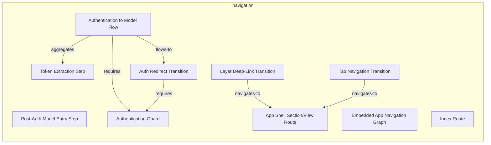
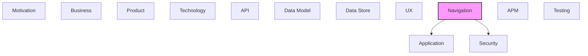

# Navigation

[← Back to README](../README.md)

Application routing, navigation flows, and page structures.

## Report Index

- [Layer Introduction](#layer-introduction)
- [Intra-Layer Relationships](#intra-layer-relationships)
- [Inter-Layer Dependencies](#inter-layer-dependencies)
- [Inter-Layer Relationships Table](#inter-layer-relationships-table)
- [Element Reference](#element-reference)

## Layer Introduction

| Metric                    | Count |
| ------------------------- | ----- |
| Elements                  | 10    |
| Intra-Layer Relationships | 6     |
| Inter-Layer Relationships | 3     |
| Inbound Relationships     | 0     |
| Outbound Relationships    | 3     |

**Cross-Layer References**:

- **Downstream layers**: [Application](./05-application-layer-report.md), [Security](./04-security-layer-report.md)

## Intra-Layer Relationships

## Inter-Layer Dependencies

## Inter-Layer Relationships Table

| Relationship ID                                                     | Source Node                                              | Dest Node                                     | Dest Layer    | Predicate    | Cardinality  | Strength |
| ------------------------------------------------------------------- | -------------------------------------------------------- | --------------------------------------------- | ------------- | ------------ | ------------ | -------- |
| `navigation.navigationflow.realizes.application.applicationprocess` | `navigation.navigationflow.authentication-to-model-flow` | `application.applicationprocess.auth-route`   | `application` | `realizes`   | many-to-many | medium   |
| `navigation.navigationguard.implements.security.securitypolicy`     | `navigation.navigationguard.authentication-guard`        | `security.securitypolicy.bearer-token-policy` | `security`    | `implements` | many-to-many | medium   |
| `navigation.navigationguard.requires.security.role`                 | `navigation.navigationguard.authentication-guard`        | `security.role.authenticated-viewer`          | `security`    | `requires`   | many-to-many | medium   |

## Element Reference

### Post-Auth Model Entry Step {#post-auth-model-entry-step}

**ID**: `navigation.flowstep.post-auth-model-entry-step`

**Type**: `flowstep`

Second step in the auth flow; the destination after successful token extraction; navigates to /model/graph with optional layer query param.

#### Attributes

| Name     | Value            |
| -------- | ---------------- |
| route    | model-view-route |
| sequence | 2                |

### Token Extraction Step {#token-extraction-step}

**ID**: `navigation.flowstep.token-extraction-step`

**Type**: `flowstep`

First step in the auth flow; renders on the index route, reads ?token= from URL, stores token, then triggers programmatic redirect.

#### Attributes

| Name     | Value       |
| -------- | ----------- |
| route    | index-route |
| sequence | 1           |

#### Relationships

| Type        | Related Element                                          | Predicate    | Direction |
| ----------- | -------------------------------------------------------- | ------------ | --------- |
| intra-layer | `navigation.navigationflow.authentication-to-model-flow` | `aggregates` | inbound   |

### Authentication to Model Flow {#authentication-to-model-flow}

**ID**: `navigation.navigationflow.authentication-to-model-flow`

**Type**: `navigationflow`

Two-step navigation flow for first-time access: step 1 lands on the index route to extract the magic link token; step 2 navigates programmatically to the model graph view after token validation.

#### Relationships

| Type        | Related Element                                            | Predicate    | Direction |
| ----------- | ---------------------------------------------------------- | ------------ | --------- |
| inter-layer | `application.applicationprocess.auth-route`                | `realizes`   | outbound  |
| intra-layer | `navigation.flowstep.token-extraction-step`                | `aggregates` | outbound  |
| intra-layer | `navigation.navigationtransition.auth-redirect-transition` | `flows-to`   | outbound  |
| intra-layer | `navigation.navigationguard.authentication-guard`          | `requires`   | outbound  |

### Embedded App Navigation Graph {#embedded-app-navigation-graph}

**ID**: `navigation.navigationgraph.embedded-app-navigation-graph`

**Type**: `navigationgraph`

Root routing container for the hash-based SPA; uses TanStack Router with createHashHistory(); defines the complete route tree with parent-child relationships.

#### Attributes

| Name        | Value                         |
| ----------- | ----------------------------- |
| application | documentation-robotics-viewer |
| version     | 1.0                           |

### Authentication Guard {#authentication-guard}

**ID**: `navigation.navigationguard.authentication-guard`

**Type**: `navigationguard`

Auth guard that intercepts navigation to protected routes (model, spec, changesets); checks authStore for a valid bearer token; redirects to /#/ index route if token is absent.

#### Attributes

| Name  | Value |
| ----- | ----- |
| order | 1     |
| type  | auth  |

#### Relationships

| Type        | Related Element                                            | Predicate    | Direction |
| ----------- | ---------------------------------------------------------- | ------------ | --------- |
| inter-layer | `security.securitypolicy.bearer-token-policy`              | `implements` | outbound  |
| inter-layer | `security.role.authenticated-viewer`                       | `requires`   | outbound  |
| intra-layer | `navigation.navigationflow.authentication-to-model-flow`   | `requires`   | inbound   |
| intra-layer | `navigation.navigationtransition.auth-redirect-transition` | `requires`   | inbound   |

### Auth Redirect Transition {#auth-redirect-transition}

**ID**: `navigation.navigationtransition.auth-redirect-transition`

**Type**: `navigationtransition`

Programmatic redirect from the index route to the model graph view after successful token extraction; triggered by the AuthRoute on token validation success.

#### Attributes

| Name    | Value            |
| ------- | ---------------- |
| from    | index-route      |
| to      | model-view-route |
| trigger | redirect         |

#### Relationships

| Type        | Related Element                                          | Predicate  | Direction |
| ----------- | -------------------------------------------------------- | ---------- | --------- |
| intra-layer | `navigation.navigationflow.authentication-to-model-flow` | `flows-to` | inbound   |
| intra-layer | `navigation.navigationguard.authentication-guard`        | `requires` | outbound  |

### Layer Deep-Link Transition {#layer-deep-link-transition}

**ID**: `navigation.navigationtransition.layer-deep-link-transition`

**Type**: `navigationtransition`

Programmatic cross-layer navigation to a specific element or spec node, triggered by click-to-navigate relationship links in GraphInspector/Inspector; implemented via uiStore.navigateToElement/navigateToSpecNode (Zustand state), no longer a ?layer= URL search parameter

#### Attributes

| Name    | Value            |
| ------- | ---------------- |
| from    | model-graph-view |
| to      | model-graph-view |
| trigger | programmatic     |

#### Relationships

| Type        | Related Element                                | Predicate      | Direction |
| ----------- | ---------------------------------------------- | -------------- | --------- |
| intra-layer | `navigation.route.app-shell-sectionview-route` | `navigates-to` | outbound  |

### Tab Navigation Transition {#tab-navigation-transition}

**ID**: `navigation.navigationtransition.tab-navigation-transition`

**Type**: `navigationtransition`

User-triggered switch between main sections (Model, Spec, Changesets); fires when the user clicks a section header in the 3-level NavTree, updating uiStore.view which router.tsx syncs to the /:section/:view URL hash

#### Attributes

| Name    | Value        |
| ------- | ------------ |
| from    | any-route    |
| to      | section-root |
| trigger | user-click   |

#### Relationships

| Type        | Related Element                                | Predicate      | Direction |
| ----------- | ---------------------------------------------- | -------------- | --------- |
| intra-layer | `navigation.route.app-shell-sectionview-route` | `navigates-to` | outbound  |

### App Shell Section/View Route {#app-shell-section-view-route}

**ID**: `navigation.route.app-shell-sectionview-route`

**Type**: `route`

Parameterized route at /#/:section/:view (section = model \| spec \| changesets; view is a per-section default, e.g. graph or list) that renders AppShell; a two-way effect keeps uiStore.view and the URL hash in sync. Replaced the previous six separate per-section redirect + view routes (model/spec/changesets redirect-route and view-route pairs) with a single generic TanStack route plus in-app SECTION_TO_VIEW/VIEW_TO_SECTION maps in the June 2026 Heimdall UX rebuild; protected — requires a valid auth token via authStore.

#### Attributes

| Name | Value     |
| ---- | --------- |
| type | protected |

#### Relationships

| Type        | Related Element                                              | Predicate      | Direction |
| ----------- | ------------------------------------------------------------ | -------------- | --------- |
| intra-layer | `navigation.navigationtransition.layer-deep-link-transition` | `navigates-to` | inbound   |
| intra-layer | `navigation.navigationtransition.tab-navigation-transition`  | `navigates-to` | inbound   |

### Index Route {#index-route}

**ID**: `navigation.route.index-route`

**Type**: `route`

Landing route at path /#/; accepts optional ?token= search parameter; renders AuthRoute component that extracts the magic link token and redirects to the model view.

#### Attributes

| Name | Value  |
| ---- | ------ |
| type | public |

---

Generated: 2026-09-19T15:37:38.405Z | Model Version: 0.1.0
