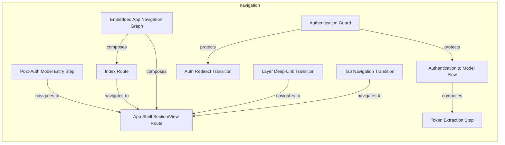
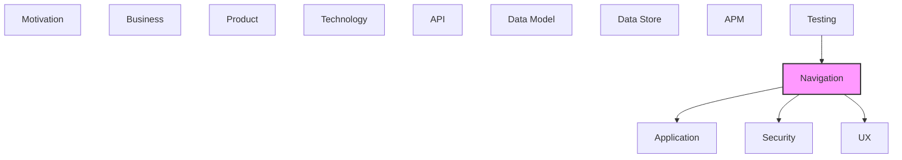

# Navigation

[← Back to README](../README.md)

Application routing, navigation flows, and page structures.

## Report Index

- [Layer Introduction](#layer-introduction)
- [Intra-Layer Relationships](#intra-layer-relationships)
- [Inter-Layer Dependencies](#inter-layer-dependencies)
- [Inter-Layer Relationships Table](#inter-layer-relationships-table)
- [Element Reference](#element-reference)

## Layer Introduction

| Metric                    | Count |
| ------------------------- | ----- |
| Elements                  | 10    |
| Intra-Layer Relationships | 9     |
| Inter-Layer Relationships | 29    |
| Inbound Relationships     | 21    |
| Outbound Relationships    | 8     |

**Cross-Layer References**:

- **Upstream layers**: [Testing](./13-testing-layer-report.md)
- **Downstream layers**: [Application](./05-application-layer-report.md), [Security](./04-security-layer-report.md), [UX](./10-ux-layer-report.md)

## Intra-Layer Relationships

## Inter-Layer Dependencies

## Inter-Layer Relationships Table

| Relationship ID                                                     | Source Node                                                                                                                           | Dest Node                                                    | Dest Layer    | Predicate    | Cardinality  | Strength |
| ------------------------------------------------------------------- | ------------------------------------------------------------------------------------------------------------------------------------- | ------------------------------------------------------------ | ------------- | ------------ | ------------ | -------- |
| `navigation.navigationflow.realizes.application.applicationprocess` | `navigation.navigationflow.authentication-to-model-flow`                                                                              | `application.applicationprocess.auth-route`                  | `application` | `realizes`   | many-to-many | medium   |
| `navigation.navigationguard.realizes.security.securitypolicy`       | `navigation.navigationguard.authentication-guard`                                                                                     | `security.securitypolicy.bearer-token-policy`                | `security`    | `realizes`   | many-to-many | medium   |
| `navigation.navigationguard.requires.security.role`                 | `navigation.navigationguard.authentication-guard`                                                                                     | `security.role.authenticated-viewer`                         | `security`    | `requires`   | many-to-many | medium   |
| `navigation.route.depends-on.application.applicationcomponent`      | `navigation.route.app-shell-sectionview-route`                                                                                        | `application.applicationcomponent.app-shell`                 | `application` | `depends-on` | many-to-many | medium   |
| `navigation.route.maps-to.ux.view`                                  | `navigation.route.app-shell-sectionview-route`                                                                                        | `ux.view.architecture-view`                                  | `ux`          | `maps-to`    | many-to-many | medium   |
| `navigation.route.maps-to.ux.view`                                  | `navigation.route.app-shell-sectionview-route`                                                                                        | `ux.view.changesets-view`                                    | `ux`          | `maps-to`    | many-to-many | medium   |
| `navigation.route.maps-to.ux.view`                                  | `navigation.route.app-shell-sectionview-route`                                                                                        | `ux.view.model-view`                                         | `ux`          | `maps-to`    | many-to-many | medium   |
| `navigation.route.maps-to.ux.view`                                  | `navigation.route.app-shell-sectionview-route`                                                                                        | `ux.view.schema-view`                                        | `ux`          | `maps-to`    | many-to-many | medium   |
| `testing.testcasesketch.tests.navigation.route`                     | `testing.testcasesketch.architecture-view-c4-diagrams-restores-level-and-scope-from-the-url-and-the-selected-box`                     | `navigation.route.app-shell-sectionview-route`               | `navigation`  | `tests`      | many-to-many | medium   |
| `testing.testcasesketch.tests.navigation.route`                     | `testing.testcasesketch.architecture-view-c4-diagrams-selecting-a-box-replaces-the-history-entry-a-source-link-opens-the-1f685976`    | `navigation.route.app-shell-sectionview-route`               | `navigation`  | `tests`      | many-to-many | medium   |
| `testing.testcasesketch.tests.navigation.navigationtransition`      | `testing.testcasesketch.url-routing-browser-history-for-navigation-a-plain-graph-node-click-replaces-the-entry-instead-of-09bb9a19`   | `navigation.navigationtransition.layer-deep-link-transition` | `navigation`  | `tests`      | many-to-many | medium   |
| `testing.testcasesketch.tests.navigation.navigationtransition`      | `testing.testcasesketch.url-routing-browser-history-for-navigation-back-to-a-layer-entry-with-no-selection-clears-the-a28b7f79`       | `navigation.navigationtransition.layer-deep-link-transition` | `navigation`  | `tests`      | many-to-many | medium   |
| `testing.testcasesketch.tests.navigation.navigationtransition`      | `testing.testcasesketch.url-routing-browser-history-for-navigation-clicking-a-neighbor-on-a-node-page-pushes-history-back-e3e75f11`   | `navigation.navigationtransition.layer-deep-link-transition` | `navigation`  | `tests`      | many-to-many | medium   |
| `testing.testcasesketch.tests.navigation.navigationtransition`      | `testing.testcasesketch.url-routing-browser-history-for-navigation-graph-page-mode-is-in-the-url-and-in-history`                      | `navigation.navigationtransition.layer-deep-link-transition` | `navigation`  | `tests`      | many-to-many | medium   |
| `testing.testcasesketch.tests.navigation.navigationtransition`      | `testing.testcasesketch.url-routing-browser-history-for-navigation-switching-layers-pushes-history-back-returns-to-the-80219442`      | `navigation.navigationtransition.layer-deep-link-transition` | `navigation`  | `tests`      | many-to-many | medium   |
| `testing.testcasesketch.tests.navigation.navigationtransition`      | `testing.testcasesketch.url-routing-graph-viewport-history-a-settled-zoom-writes-vp-without-pushing-and-a-reload-restores-aff5cf38`   | `navigation.navigationtransition.layer-deep-link-transition` | `navigation`  | `tests`      | many-to-many | medium   |
| `testing.testcasesketch.tests.navigation.navigationtransition`      | `testing.testcasesketch.url-routing-graph-viewport-history-back-after-a-same-layer-navigation-restores-the-earlier-viewport-b6941f6f` | `navigation.navigationtransition.layer-deep-link-transition` | `navigation`  | `tests`      | many-to-many | medium   |
| `testing.testcasesketch.tests.navigation.navigationtransition`      | `testing.testcasesketch.url-routing-graph-viewport-history-back-to-a-previous-layer-restores-the-viewport-it-was-left-at`             | `navigation.navigationtransition.layer-deep-link-transition` | `navigation`  | `tests`      | many-to-many | medium   |
| `testing.testcasesketch.tests.navigation.navigationtransition`      | `testing.testcasesketch.url-routing-graph-viewport-history-back-to-an-entry-recorded-under-another-layout-drops-its-vp-d41cbb9f`      | `navigation.navigationtransition.layer-deep-link-transition` | `navigation`  | `tests`      | many-to-many | medium   |
| `testing.testcasesketch.tests.navigation.navigationtransition`      | `testing.testcasesketch.url-routing-graph-viewport-history-changing-the-layout-drops-vp-the-coordinates-belong-to-the-old-68d1d4ed`   | `navigation.navigationtransition.layer-deep-link-transition` | `navigation`  | `tests`      | many-to-many | medium   |
| `testing.testcasesketch.tests.navigation.navigationtransition`      | `testing.testcasesketch.url-routing-graph-viewport-history-clicking-a-node-in-the-graph-selects-it-without-re-centering-the-197e4f4e` | `navigation.navigationtransition.layer-deep-link-transition` | `navigation`  | `tests`      | many-to-many | medium   |
| `testing.testcasesketch.tests.navigation.navigationtransition`      | `testing.testcasesketch.url-routing-left-panel-selections-reloading-a-deep-linked-layeredge-url-restores-that-edge-selection`         | `navigation.navigationtransition.layer-deep-link-transition` | `navigation`  | `tests`      | many-to-many | medium   |
| `testing.testcasesketch.tests.navigation.navigationtransition`      | `testing.testcasesketch.url-routing-left-panel-selections-reloading-a-deep-linked-layernode-url-restores-that-selection`              | `navigation.navigationtransition.layer-deep-link-transition` | `navigation`  | `tests`      | many-to-many | medium   |
| `testing.testcasesketch.tests.navigation.navigationtransition`      | `testing.testcasesketch.url-routing-left-panel-selections-selecting-a-changeset-updates-the-url-with-changeset`                       | `navigation.navigationtransition.layer-deep-link-transition` | `navigation`  | `tests`      | many-to-many | medium   |
| `testing.testcasesketch.tests.navigation.navigationtransition`      | `testing.testcasesketch.url-routing-left-panel-selections-selecting-a-layer-in-the-nav-tree-updates-the-url-with-layer`               | `navigation.navigationtransition.layer-deep-link-transition` | `navigation`  | `tests`      | many-to-many | medium   |
| `testing.testcasesketch.tests.navigation.navigationtransition`      | `testing.testcasesketch.url-routing-left-panel-selections-selecting-a-node-after-an-edge-clears-edge-from-the-url-mutually-ff344372`  | `navigation.navigationtransition.layer-deep-link-transition` | `navigation`  | `tests`      | many-to-many | medium   |
| `testing.testcasesketch.tests.navigation.navigationtransition`      | `testing.testcasesketch.url-routing-left-panel-selections-selecting-a-node-in-the-nav-tree-updates-the-url-with-layernode-a360c923`   | `navigation.navigationtransition.layer-deep-link-transition` | `navigation`  | `tests`      | many-to-many | medium   |
| `testing.testcasesketch.tests.navigation.navigationtransition`      | `testing.testcasesketch.url-routing-left-panel-selections-selecting-an-edge-on-the-model-graph-updates-the-url-with-edge-16ac9848`    | `navigation.navigationtransition.layer-deep-link-transition` | `navigation`  | `tests`      | many-to-many | medium   |
| `testing.testcasesketch.tests.navigation.navigationtransition`      | `testing.testcasesketch.url-routing-left-panel-selections-switching-views-pushes-history-selecting-within-a-view-replaces-it`         | `navigation.navigationtransition.layer-deep-link-transition` | `navigation`  | `tests`      | many-to-many | medium   |

## Element Reference

### Post-Auth Model Entry Step {#post-auth-model-entry-step}

**ID**: `navigation.flowstep.post-auth-model-entry-step`

**Type**: `flowstep`

Second step in the auth flow; the destination after successful token extraction; navigates to /model/graph with optional layer query param.

#### Attributes

| Name     | Value            |
| -------- | ---------------- |
| route    | model-view-route |
| sequence | 2                |

#### Relationships

| Type        | Related Element                                | Predicate      | Direction |
| ----------- | ---------------------------------------------- | -------------- | --------- |
| intra-layer | `navigation.route.app-shell-sectionview-route` | `navigates-to` | outbound  |

### Token Extraction Step {#token-extraction-step}

**ID**: `navigation.flowstep.token-extraction-step`

**Type**: `flowstep`

First step in the auth flow; renders on the index route, reads ?token= from URL, stores token, then triggers programmatic redirect.

#### Attributes

| Name     | Value       |
| -------- | ----------- |
| route    | index-route |
| sequence | 1           |

#### Relationships

| Type        | Related Element                                          | Predicate  | Direction |
| ----------- | -------------------------------------------------------- | ---------- | --------- |
| intra-layer | `navigation.navigationflow.authentication-to-model-flow` | `composes` | inbound   |

### Authentication to Model Flow {#authentication-to-model-flow}

**ID**: `navigation.navigationflow.authentication-to-model-flow`

**Type**: `navigationflow`

Two-step navigation flow for first-time access: step 1 lands on the index route to extract the magic link token; step 2 navigates programmatically to the model graph view after token validation.

#### Relationships

| Type        | Related Element                                   | Predicate  | Direction |
| ----------- | ------------------------------------------------- | ---------- | --------- |
| inter-layer | `application.applicationprocess.auth-route`       | `realizes` | outbound  |
| intra-layer | `navigation.flowstep.token-extraction-step`       | `composes` | outbound  |
| intra-layer | `navigation.navigationguard.authentication-guard` | `protects` | inbound   |

### Embedded App Navigation Graph {#embedded-app-navigation-graph}

**ID**: `navigation.navigationgraph.embedded-app-navigation-graph`

**Type**: `navigationgraph`

Root routing container for the hash-based SPA; uses TanStack Router with createHashHistory(); defines the complete route tree with parent-child relationships.

#### Attributes

| Name        | Value                         |
| ----------- | ----------------------------- |
| application | documentation-robotics-viewer |
| version     | 1.0                           |

#### Relationships

| Type        | Related Element                                | Predicate  | Direction |
| ----------- | ---------------------------------------------- | ---------- | --------- |
| intra-layer | `navigation.route.app-shell-sectionview-route` | `composes` | outbound  |
| intra-layer | `navigation.route.index-route`                 | `composes` | outbound  |

### Authentication Guard {#authentication-guard}

**ID**: `navigation.navigationguard.authentication-guard`

**Type**: `navigationguard`

Auth guard that intercepts navigation to protected routes (model, spec, changesets); checks authStore for a valid bearer token; redirects to /#/ index route if token is absent.

#### Attributes

| Name  | Value |
| ----- | ----- |
| order | 1     |
| type  | auth  |

#### Relationships

| Type        | Related Element                                            | Predicate  | Direction |
| ----------- | ---------------------------------------------------------- | ---------- | --------- |
| inter-layer | `security.securitypolicy.bearer-token-policy`              | `realizes` | outbound  |
| inter-layer | `security.role.authenticated-viewer`                       | `requires` | outbound  |
| intra-layer | `navigation.navigationflow.authentication-to-model-flow`   | `protects` | outbound  |
| intra-layer | `navigation.navigationtransition.auth-redirect-transition` | `protects` | outbound  |

### Auth Redirect Transition {#auth-redirect-transition}

**ID**: `navigation.navigationtransition.auth-redirect-transition`

**Type**: `navigationtransition`

Programmatic redirect from the index route to the model graph view after successful token extraction; triggered by the AuthRoute on token validation success.

#### Attributes

| Name    | Value            |
| ------- | ---------------- |
| from    | index-route      |
| to      | model-view-route |
| trigger | redirect         |

#### Relationships

| Type        | Related Element                                   | Predicate  | Direction |
| ----------- | ------------------------------------------------- | ---------- | --------- |
| intra-layer | `navigation.navigationguard.authentication-guard` | `protects` | inbound   |

### Layer Deep-Link Transition {#layer-deep-link-transition}

**ID**: `navigation.navigationtransition.layer-deep-link-transition`

**Type**: `navigationtransition`

Deep links into a layer, element, changeset or C4 diagram: the router two-way syncs ?layer= / ?node= / ?edge= / ?changeset= (and ?vp= for the graph viewport), and ?level= / ?scope= in the Architecture view, with the UI store, so a shared link, reload or back/forward restores the selection. A drill-down in the Architecture view pushes a history entry; selecting a box replaces it.

#### Attributes

| Name    | Value            |
| ------- | ---------------- |
| from    | model-graph-view |
| to      | model-graph-view |
| trigger | programmatic     |

#### Relationships

| Type        | Related Element                                                                                                                       | Predicate      | Direction |
| ----------- | ------------------------------------------------------------------------------------------------------------------------------------- | -------------- | --------- |
| inter-layer | `testing.testcasesketch.url-routing-browser-history-for-navigation-a-plain-graph-node-click-replaces-the-entry-instead-of-09bb9a19`   | `tests`        | inbound   |
| inter-layer | `testing.testcasesketch.url-routing-browser-history-for-navigation-back-to-a-layer-entry-with-no-selection-clears-the-a28b7f79`       | `tests`        | inbound   |
| inter-layer | `testing.testcasesketch.url-routing-browser-history-for-navigation-clicking-a-neighbor-on-a-node-page-pushes-history-back-e3e75f11`   | `tests`        | inbound   |
| inter-layer | `testing.testcasesketch.url-routing-browser-history-for-navigation-graph-page-mode-is-in-the-url-and-in-history`                      | `tests`        | inbound   |
| inter-layer | `testing.testcasesketch.url-routing-browser-history-for-navigation-switching-layers-pushes-history-back-returns-to-the-80219442`      | `tests`        | inbound   |
| inter-layer | `testing.testcasesketch.url-routing-graph-viewport-history-a-settled-zoom-writes-vp-without-pushing-and-a-reload-restores-aff5cf38`   | `tests`        | inbound   |
| inter-layer | `testing.testcasesketch.url-routing-graph-viewport-history-back-after-a-same-layer-navigation-restores-the-earlier-viewport-b6941f6f` | `tests`        | inbound   |
| inter-layer | `testing.testcasesketch.url-routing-graph-viewport-history-back-to-a-previous-layer-restores-the-viewport-it-was-left-at`             | `tests`        | inbound   |
| inter-layer | `testing.testcasesketch.url-routing-graph-viewport-history-back-to-an-entry-recorded-under-another-layout-drops-its-vp-d41cbb9f`      | `tests`        | inbound   |
| inter-layer | `testing.testcasesketch.url-routing-graph-viewport-history-changing-the-layout-drops-vp-the-coordinates-belong-to-the-old-68d1d4ed`   | `tests`        | inbound   |
| inter-layer | `testing.testcasesketch.url-routing-graph-viewport-history-clicking-a-node-in-the-graph-selects-it-without-re-centering-the-197e4f4e` | `tests`        | inbound   |
| inter-layer | `testing.testcasesketch.url-routing-left-panel-selections-reloading-a-deep-linked-layeredge-url-restores-that-edge-selection`         | `tests`        | inbound   |
| inter-layer | `testing.testcasesketch.url-routing-left-panel-selections-reloading-a-deep-linked-layernode-url-restores-that-selection`              | `tests`        | inbound   |
| inter-layer | `testing.testcasesketch.url-routing-left-panel-selections-selecting-a-changeset-updates-the-url-with-changeset`                       | `tests`        | inbound   |
| inter-layer | `testing.testcasesketch.url-routing-left-panel-selections-selecting-a-layer-in-the-nav-tree-updates-the-url-with-layer`               | `tests`        | inbound   |
| inter-layer | `testing.testcasesketch.url-routing-left-panel-selections-selecting-a-node-after-an-edge-clears-edge-from-the-url-mutually-ff344372`  | `tests`        | inbound   |
| inter-layer | `testing.testcasesketch.url-routing-left-panel-selections-selecting-a-node-in-the-nav-tree-updates-the-url-with-layernode-a360c923`   | `tests`        | inbound   |
| inter-layer | `testing.testcasesketch.url-routing-left-panel-selections-selecting-an-edge-on-the-model-graph-updates-the-url-with-edge-16ac9848`    | `tests`        | inbound   |
| inter-layer | `testing.testcasesketch.url-routing-left-panel-selections-switching-views-pushes-history-selecting-within-a-view-replaces-it`         | `tests`        | inbound   |
| intra-layer | `navigation.route.app-shell-sectionview-route`                                                                                        | `navigates-to` | outbound  |

### Tab Navigation Transition {#tab-navigation-transition}

**ID**: `navigation.navigationtransition.tab-navigation-transition`

**Type**: `navigationtransition`

Switching between the Architecture, Model, Schema and Changesets sections in the sidebar nav tree (an accordion: opening a section collapses the others). The section is the route's :section segment.

#### Attributes

| Name    | Value        |
| ------- | ------------ |
| from    | any-route    |
| to      | section-root |
| trigger | user-click   |

#### Relationships

| Type        | Related Element                                | Predicate      | Direction |
| ----------- | ---------------------------------------------- | -------------- | --------- |
| intra-layer | `navigation.route.app-shell-sectionview-route` | `navigates-to` | outbound  |

### App Shell Section/View Route {#app-shell-section-view-route}

**ID**: `navigation.route.app-shell-sectionview-route`

**Type**: `route`

Parameterized route at /#/:section/:view (section = model \| spec \| changesets \| architecture; view is a per-section default, e.g. graph, list, or diagram for architecture) that renders AppShell; a two-way effect keeps uiStore.view and the URL hash in sync. The architecture section carries ?level= (context \| container \| component), ?scope= (the dotted id of the element whose parts are shown) and ?node= (the selected box). Replaced the previous six separate per-section redirect + view routes (model/spec/changesets redirect-route and view-route pairs) with a single generic TanStack route plus in-app SECTION_TO_VIEW/VIEW_TO_SECTION maps in the June 2026 Heimdall UX rebuild; protected — requires a valid auth token via authStore.

#### Attributes

| Name | Value     |
| ---- | --------- |
| type | protected |

#### Relationships

| Type        | Related Element                                                                                                                    | Predicate      | Direction |
| ----------- | ---------------------------------------------------------------------------------------------------------------------------------- | -------------- | --------- |
| inter-layer | `application.applicationcomponent.app-shell`                                                                                       | `depends-on`   | outbound  |
| inter-layer | `ux.view.architecture-view`                                                                                                        | `maps-to`      | outbound  |
| inter-layer | `ux.view.changesets-view`                                                                                                          | `maps-to`      | outbound  |
| inter-layer | `ux.view.model-view`                                                                                                               | `maps-to`      | outbound  |
| inter-layer | `ux.view.schema-view`                                                                                                              | `maps-to`      | outbound  |
| inter-layer | `testing.testcasesketch.architecture-view-c4-diagrams-restores-level-and-scope-from-the-url-and-the-selected-box`                  | `tests`        | inbound   |
| inter-layer | `testing.testcasesketch.architecture-view-c4-diagrams-selecting-a-box-replaces-the-history-entry-a-source-link-opens-the-1f685976` | `tests`        | inbound   |
| intra-layer | `navigation.flowstep.post-auth-model-entry-step`                                                                                   | `navigates-to` | inbound   |
| intra-layer | `navigation.navigationgraph.embedded-app-navigation-graph`                                                                         | `composes`     | inbound   |
| intra-layer | `navigation.navigationtransition.layer-deep-link-transition`                                                                       | `navigates-to` | inbound   |
| intra-layer | `navigation.navigationtransition.tab-navigation-transition`                                                                        | `navigates-to` | inbound   |
| intra-layer | `navigation.route.index-route`                                                                                                     | `navigates-to` | inbound   |

### Index Route {#index-route}

**ID**: `navigation.route.index-route`

**Type**: `route`

Landing route at path /#/; accepts optional ?token= search parameter; renders AuthRoute component that extracts the magic link token and redirects to the model view.

#### Attributes

| Name | Value  |
| ---- | ------ |
| type | public |

#### Relationships

| Type        | Related Element                                            | Predicate      | Direction |
| ----------- | ---------------------------------------------------------- | -------------- | --------- |
| intra-layer | `navigation.navigationgraph.embedded-app-navigation-graph` | `composes`     | inbound   |
| intra-layer | `navigation.route.app-shell-sectionview-route`             | `navigates-to` | outbound  |

---

Generated: 2026-11-20T19:04:38.310Z | Model Version: 0.1.0
