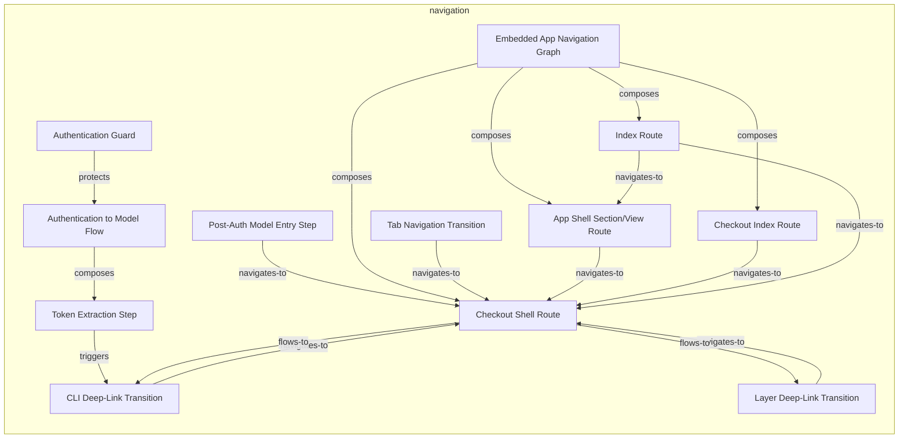
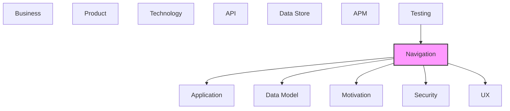

# Navigation

[← Back to README](../README.md)

Application routing, navigation flows, and page structures.

## Report Index

- [Layer Introduction](#layer-introduction)
- [Intra-Layer Relationships](#intra-layer-relationships)
- [Inter-Layer Dependencies](#inter-layer-dependencies)
- [Inter-Layer Relationships Table](#inter-layer-relationships-table)
- [Element Reference](#element-reference)

## Layer Introduction

| Metric                    | Count |
| ------------------------- | ----- |
| Elements                  | 12    |
| Intra-Layer Relationships | 17    |
| Inter-Layer Relationships | 39    |
| Inbound Relationships     | 23    |
| Outbound Relationships    | 16    |

**Cross-Layer References**:

- **Upstream layers**: [Testing](./13-testing-layer-report.md)
- **Downstream layers**: [Application](./05-application-layer-report.md), [Data Model](./08-data-model-layer-report.md), [Motivation](./01-motivation-layer-report.md), [Security](./04-security-layer-report.md), [UX](./10-ux-layer-report.md)

## Intra-Layer Relationships

## Inter-Layer Dependencies

## Inter-Layer Relationships Table

| Relationship ID                                                | Source Node                                                                                                                           | Dest Node                                                    | Dest Layer    | Predicate    | Cardinality  | Strength |
| -------------------------------------------------------------- | ------------------------------------------------------------------------------------------------------------------------------------- | ------------------------------------------------------------ | ------------- | ------------ | ------------ | -------- |
| `navigation.navigationguard.realizes.security.securitypolicy`  | `navigation.navigationguard.authentication-guard`                                                                                     | `security.securitypolicy.bearer-token-policy`                | `security`    | `realizes`   | many-to-many | medium   |
| `navigation.navigationguard.requires.security.role`            | `navigation.navigationguard.authentication-guard`                                                                                     | `security.role.authenticated-viewer`                         | `security`    | `requires`   | many-to-many | medium   |
| `navigation.route.maps-to.ux.view`                             | `navigation.route.app-shell-sectionview-route`                                                                                        | `ux.view.checkout-picker-view`                               | `ux`          | `maps-to`    | many-to-many | medium   |
| `navigation.route.satisfies.motivation.requirement`            | `navigation.route.checkout-index-route`                                                                                               | `motivation.requirement.open-the-checkout-a-link-names`      | `motivation`  | `satisfies`  | many-to-many | medium   |
| `navigation.route.accesses.data-model.objectschema`            | `navigation.route.checkout-shell-route`                                                                                               | `data-model.objectschema.checkout-ref`                       | `data-model`  | `accesses`   | many-to-many | medium   |
| `navigation.route.depends-on.application.applicationcomponent` | `navigation.route.checkout-shell-route`                                                                                               | `application.applicationcomponent.app-shell`                 | `application` | `depends-on` | many-to-many | medium   |
| `navigation.route.maps-to.ux.view`                             | `navigation.route.checkout-shell-route`                                                                                               | `ux.view.architecture-view`                                  | `ux`          | `maps-to`    | many-to-many | medium   |
| `navigation.route.maps-to.ux.view`                             | `navigation.route.checkout-shell-route`                                                                                               | `ux.view.changesets-view`                                    | `ux`          | `maps-to`    | many-to-many | medium   |
| `navigation.route.maps-to.ux.view`                             | `navigation.route.checkout-shell-route`                                                                                               | `ux.view.model-view`                                         | `ux`          | `maps-to`    | many-to-many | medium   |
| `navigation.route.maps-to.ux.view`                             | `navigation.route.checkout-shell-route`                                                                                               | `ux.view.schema-view`                                        | `ux`          | `maps-to`    | many-to-many | medium   |
| `navigation.route.satisfies.motivation.requirement`            | `navigation.route.checkout-shell-route`                                                                                               | `motivation.requirement.keep-checkouts-apart-in-one-browser` | `motivation`  | `satisfies`  | many-to-many | medium   |
| `navigation.route.satisfies.motivation.requirement`            | `navigation.route.checkout-shell-route`                                                                                               | `motivation.requirement.open-the-checkout-a-link-names`      | `motivation`  | `satisfies`  | many-to-many | medium   |
| `navigation.route.uses.application.applicationservice`         | `navigation.route.checkout-shell-route`                                                                                               | `application.applicationservice.checkout-scope`              | `application` | `uses`       | many-to-many | medium   |
| `navigation.route.uses.application.applicationservice`         | `navigation.route.checkout-shell-route`                                                                                               | `application.applicationservice.history-policy`              | `application` | `uses`       | many-to-many | medium   |
| `navigation.route.uses.ux.errorconfig`                         | `navigation.route.checkout-shell-route`                                                                                               | `ux.errorconfig.checkout-unavailable-error`                  | `ux`          | `uses`       | many-to-many | medium   |
| `navigation.route.maps-to.ux.view`                             | `navigation.route.index-route`                                                                                                        | `ux.view.checkout-picker-view`                               | `ux`          | `maps-to`    | many-to-many | medium   |
| `testing.testcasesketch.tests.navigation.route`                | `testing.testcasesketch.architecture-view-c4-diagrams-restores-level-and-scope-from-the-url-and-the-selected-box`                     | `navigation.route.app-shell-sectionview-route`               | `navigation`  | `tests`      | many-to-many | medium   |
| `testing.testcasesketch.tests.navigation.route`                | `testing.testcasesketch.back-steps-through-graph-moves-in-each-view`                                                                  | `navigation.route.checkout-shell-route`                      | `navigation`  | `tests`      | many-to-many | medium   |
| `testing.testcasesketch.tests.navigation.navigationtransition` | `testing.testcasesketch.checkout-links-carries-an-old-unscoped-link-through-the-picker-without-its-token`                             | `navigation.navigationtransition.cli-deep-link-transition`   | `navigation`  | `tests`      | many-to-many | medium   |
| `testing.testcasesketch.tests.navigation.navigationtransition` | `testing.testcasesketch.checkout-links-encodes-each-name-of-the-checkout-route`                                                       | `navigation.navigationtransition.cli-deep-link-transition`   | `navigation`  | `tests`      | many-to-many | medium   |
| `testing.testcasesketch.tests.navigation.navigationtransition` | `testing.testcasesketch.checkout-links-reads-the-changeset-and-element-link-forms-and-nothing-else`                                   | `navigation.navigationtransition.cli-deep-link-transition`   | `navigation`  | `tests`      | many-to-many | medium   |
| `testing.testcasesketch.tests.navigation.navigationtransition` | `testing.testcasesketch.checkout-links-takes-the-token-out-of-the-fragment-and-keeps-the-other-parameters`                            | `navigation.navigationtransition.cli-deep-link-transition`   | `navigation`  | `tests`      | many-to-many | medium   |
| `testing.testcasesketch.tests.navigation.navigationtransition` | `testing.testcasesketch.url-routing-browser-history-for-navigation-back-to-a-layer-entry-with-no-selection-clears-the-a28b7f79`       | `navigation.navigationtransition.layer-deep-link-transition` | `navigation`  | `tests`      | many-to-many | medium   |
| `testing.testcasesketch.tests.navigation.navigationtransition` | `testing.testcasesketch.url-routing-browser-history-for-navigation-clicking-a-neighbor-on-a-node-page-pushes-history-back-e3e75f11`   | `navigation.navigationtransition.layer-deep-link-transition` | `navigation`  | `tests`      | many-to-many | medium   |
| `testing.testcasesketch.tests.navigation.navigationtransition` | `testing.testcasesketch.url-routing-browser-history-for-navigation-graph-page-mode-is-in-the-url-and-in-history`                      | `navigation.navigationtransition.layer-deep-link-transition` | `navigation`  | `tests`      | many-to-many | medium   |
| `testing.testcasesketch.tests.navigation.navigationtransition` | `testing.testcasesketch.url-routing-browser-history-for-navigation-switching-layers-pushes-history-back-returns-to-the-80219442`      | `navigation.navigationtransition.layer-deep-link-transition` | `navigation`  | `tests`      | many-to-many | medium   |
| `testing.testcasesketch.tests.navigation.navigationtransition` | `testing.testcasesketch.url-routing-graph-viewport-history-a-settled-zoom-writes-vp-without-pushing-and-a-reload-restores-aff5cf38`   | `navigation.navigationtransition.layer-deep-link-transition` | `navigation`  | `tests`      | many-to-many | medium   |
| `testing.testcasesketch.tests.navigation.navigationtransition` | `testing.testcasesketch.url-routing-graph-viewport-history-back-after-a-same-layer-navigation-restores-the-earlier-viewport-b6941f6f` | `navigation.navigationtransition.layer-deep-link-transition` | `navigation`  | `tests`      | many-to-many | medium   |
| `testing.testcasesketch.tests.navigation.navigationtransition` | `testing.testcasesketch.url-routing-graph-viewport-history-back-to-a-previous-layer-restores-the-viewport-it-was-left-at`             | `navigation.navigationtransition.layer-deep-link-transition` | `navigation`  | `tests`      | many-to-many | medium   |
| `testing.testcasesketch.tests.navigation.navigationtransition` | `testing.testcasesketch.url-routing-graph-viewport-history-back-to-an-entry-recorded-under-another-layout-drops-its-vp-d41cbb9f`      | `navigation.navigationtransition.layer-deep-link-transition` | `navigation`  | `tests`      | many-to-many | medium   |
| `testing.testcasesketch.tests.navigation.navigationtransition` | `testing.testcasesketch.url-routing-graph-viewport-history-clicking-a-node-in-the-graph-selects-it-without-re-centering-the-197e4f4e` | `navigation.navigationtransition.layer-deep-link-transition` | `navigation`  | `tests`      | many-to-many | medium   |
| `testing.testcasesketch.tests.navigation.navigationtransition` | `testing.testcasesketch.url-routing-left-panel-selections-reloading-a-deep-linked-layeredge-url-restores-that-edge-selection`         | `navigation.navigationtransition.layer-deep-link-transition` | `navigation`  | `tests`      | many-to-many | medium   |
| `testing.testcasesketch.tests.navigation.navigationtransition` | `testing.testcasesketch.url-routing-left-panel-selections-reloading-a-deep-linked-layernode-url-restores-that-selection`              | `navigation.navigationtransition.layer-deep-link-transition` | `navigation`  | `tests`      | many-to-many | medium   |
| `testing.testcasesketch.tests.navigation.navigationtransition` | `testing.testcasesketch.url-routing-left-panel-selections-selecting-a-changeset-updates-the-url-with-changeset`                       | `navigation.navigationtransition.layer-deep-link-transition` | `navigation`  | `tests`      | many-to-many | medium   |
| `testing.testcasesketch.tests.navigation.navigationtransition` | `testing.testcasesketch.url-routing-left-panel-selections-selecting-a-layer-in-the-nav-tree-updates-the-url-with-layer`               | `navigation.navigationtransition.layer-deep-link-transition` | `navigation`  | `tests`      | many-to-many | medium   |
| `testing.testcasesketch.tests.navigation.navigationtransition` | `testing.testcasesketch.url-routing-left-panel-selections-selecting-a-node-after-an-edge-clears-edge-from-the-url-mutually-ff344372`  | `navigation.navigationtransition.layer-deep-link-transition` | `navigation`  | `tests`      | many-to-many | medium   |
| `testing.testcasesketch.tests.navigation.navigationtransition` | `testing.testcasesketch.url-routing-left-panel-selections-selecting-a-node-in-the-nav-tree-updates-the-url-with-layernode-a360c923`   | `navigation.navigationtransition.layer-deep-link-transition` | `navigation`  | `tests`      | many-to-many | medium   |
| `testing.testcasesketch.tests.navigation.navigationtransition` | `testing.testcasesketch.url-routing-left-panel-selections-selecting-an-edge-on-the-model-graph-updates-the-url-with-edge-16ac9848`    | `navigation.navigationtransition.layer-deep-link-transition` | `navigation`  | `tests`      | many-to-many | medium   |
| `testing.testcasesketch.tests.navigation.navigationtransition` | `testing.testcasesketch.url-routing-left-panel-selections-switching-views-pushes-history-selecting-within-a-view-replaces-it`         | `navigation.navigationtransition.layer-deep-link-transition` | `navigation`  | `tests`      | many-to-many | medium   |

## Element Reference

### Post-Auth Model Entry Step {#post-auth-model-entry-step}

**ID**: `navigation.flowstep.post-auth-model-entry-step`

**Type**: `flowstep`

Second step in the auth flow; the destination after successful token extraction; navigates to /model/graph with optional layer query param.

#### Attributes

| Name     | Value            |
| -------- | ---------------- |
| route    | model-view-route |
| sequence | 2                |

#### Relationships

| Type        | Related Element                         | Predicate      | Direction |
| ----------- | --------------------------------------- | -------------- | --------- |
| intra-layer | `navigation.route.checkout-shell-route` | `navigates-to` | outbound  |

### Token Extraction Step {#token-extraction-step}

**ID**: `navigation.flowstep.token-extraction-step`

**Type**: `flowstep`

First step of the auth flow: before the router starts (and on popstate / hashchange, for a link opened in a tab that already shows the viewer), main.tsx takes the magic link's token from the fragment (the dr CLI's /#/p/&lt;project&gt;/c/&lt;checkout&gt;/...?token=) or the query string, stores it for API and websocket calls and removes it from the address bar.

#### Attributes

| Name     | Value       |
| -------- | ----------- |
| route    | index-route |
| sequence | 1           |

#### Relationships

| Type        | Related Element                                            | Predicate  | Direction |
| ----------- | ---------------------------------------------------------- | ---------- | --------- |
| intra-layer | `navigation.navigationtransition.cli-deep-link-transition` | `triggers` | outbound  |
| intra-layer | `navigation.navigationflow.authentication-to-model-flow`   | `composes` | inbound   |

### Authentication to Model Flow {#authentication-to-model-flow}

**ID**: `navigation.navigationflow.authentication-to-model-flow`

**Type**: `navigationflow`

From a dr CLI link to the checkout it names: the token is taken from the fragment (main.tsx), then the checkout route opens the Model view, the changeset or the element the link names; a bare /#/ opens the checkout picker.

#### Relationships

| Type        | Related Element                                   | Predicate  | Direction |
| ----------- | ------------------------------------------------- | ---------- | --------- |
| intra-layer | `navigation.flowstep.token-extraction-step`       | `composes` | outbound  |
| intra-layer | `navigation.navigationguard.authentication-guard` | `protects` | inbound   |

### Embedded App Navigation Graph {#embedded-app-navigation-graph}

**ID**: `navigation.navigationgraph.embedded-app-navigation-graph`

**Type**: `navigationgraph`

Root routing container for the hash-based SPA; uses TanStack Router with createHashHistory(); defines the complete route tree with parent-child relationships.

#### Attributes

| Name        | Value                         |
| ----------- | ----------------------------- |
| application | documentation-robotics-viewer |
| version     | 1.0                           |

#### Relationships

| Type        | Related Element                                | Predicate  | Direction |
| ----------- | ---------------------------------------------- | ---------- | --------- |
| intra-layer | `navigation.route.app-shell-sectionview-route` | `composes` | outbound  |
| intra-layer | `navigation.route.checkout-index-route`        | `composes` | outbound  |
| intra-layer | `navigation.route.checkout-shell-route`        | `composes` | outbound  |
| intra-layer | `navigation.route.index-route`                 | `composes` | outbound  |

### Authentication Guard {#authentication-guard}

**ID**: `navigation.navigationguard.authentication-guard`

**Type**: `navigationguard`

Auth guard that intercepts navigation to protected routes (model, spec, changesets); checks authStore for a valid bearer token; redirects to /#/ index route if token is absent.

#### Attributes

| Name  | Value |
| ----- | ----- |
| order | 1     |
| type  | auth  |

#### Relationships

| Type        | Related Element                                          | Predicate  | Direction |
| ----------- | -------------------------------------------------------- | ---------- | --------- |
| inter-layer | `security.securitypolicy.bearer-token-policy`            | `realizes` | outbound  |
| inter-layer | `security.role.authenticated-viewer`                     | `requires` | outbound  |
| intra-layer | `navigation.navigationflow.authentication-to-model-flow` | `protects` | outbound  |

### CLI Deep-Link Transition {#cli-deep-link-transition}

**ID**: `navigation.navigationtransition.cli-deep-link-transition`

**Type**: `navigationtransition`

Reads a dr CLI viewer link: changesets/&lt;id&gt; opens the Changesets view on that changeset (and with ?element=&lt;id&gt; selects its change to that element); elements/&lt;id&gt; waits for the model, resolves the dotted id (or UUID) and opens the Model view on that element's layer with it selected; an id the model lacks shows the layer with a notice. Replaces the history entry, so Back never returns to the raw link.

#### Attributes

| Name    | Value                                                                          |
| ------- | ------------------------------------------------------------------------------ |
| from    | /p/:project/c/:checkout/changesets/:id \| /p/:project/c/:checkout/elements/:id |
| to      | /p/:project/c/:checkout/:section/:view                                         |
| trigger | redirect                                                                       |

#### Relationships

| Type        | Related Element                                                                                            | Predicate      | Direction |
| ----------- | ---------------------------------------------------------------------------------------------------------- | -------------- | --------- |
| inter-layer | `testing.testcasesketch.checkout-links-carries-an-old-unscoped-link-through-the-picker-without-its-token`  | `tests`        | inbound   |
| inter-layer | `testing.testcasesketch.checkout-links-encodes-each-name-of-the-checkout-route`                            | `tests`        | inbound   |
| inter-layer | `testing.testcasesketch.checkout-links-reads-the-changeset-and-element-link-forms-and-nothing-else`        | `tests`        | inbound   |
| inter-layer | `testing.testcasesketch.checkout-links-takes-the-token-out-of-the-fragment-and-keeps-the-other-parameters` | `tests`        | inbound   |
| intra-layer | `navigation.flowstep.token-extraction-step`                                                                | `triggers`     | inbound   |
| intra-layer | `navigation.route.checkout-shell-route`                                                                    | `navigates-to` | outbound  |
| intra-layer | `navigation.route.checkout-shell-route`                                                                    | `flows-to`     | inbound   |

### Layer Deep-Link Transition {#layer-deep-link-transition}

**ID**: `navigation.navigationtransition.layer-deep-link-transition`

**Type**: `navigationtransition`

Deep links into a layer, element, changeset or C4 diagram: the router two-way syncs ?layer= / ?node= / ?edge= / ?changeset= (and ?vp= for the graph viewport), and ?level= / ?scope= in the Architecture view, with the UI store, so a shared link, reload or back/forward restores the selection. A drill-down in the Architecture view pushes a history entry; selecting a box replaces it.

#### Attributes

| Name    | Value            |
| ------- | ---------------- |
| from    | model-graph-view |
| to      | model-graph-view |
| trigger | programmatic     |

#### Relationships

| Type        | Related Element                                                                                                                       | Predicate      | Direction |
| ----------- | ------------------------------------------------------------------------------------------------------------------------------------- | -------------- | --------- |
| inter-layer | `testing.testcasesketch.url-routing-browser-history-for-navigation-back-to-a-layer-entry-with-no-selection-clears-the-a28b7f79`       | `tests`        | inbound   |
| inter-layer | `testing.testcasesketch.url-routing-browser-history-for-navigation-clicking-a-neighbor-on-a-node-page-pushes-history-back-e3e75f11`   | `tests`        | inbound   |
| inter-layer | `testing.testcasesketch.url-routing-browser-history-for-navigation-graph-page-mode-is-in-the-url-and-in-history`                      | `tests`        | inbound   |
| inter-layer | `testing.testcasesketch.url-routing-browser-history-for-navigation-switching-layers-pushes-history-back-returns-to-the-80219442`      | `tests`        | inbound   |
| inter-layer | `testing.testcasesketch.url-routing-graph-viewport-history-a-settled-zoom-writes-vp-without-pushing-and-a-reload-restores-aff5cf38`   | `tests`        | inbound   |
| inter-layer | `testing.testcasesketch.url-routing-graph-viewport-history-back-after-a-same-layer-navigation-restores-the-earlier-viewport-b6941f6f` | `tests`        | inbound   |
| inter-layer | `testing.testcasesketch.url-routing-graph-viewport-history-back-to-a-previous-layer-restores-the-viewport-it-was-left-at`             | `tests`        | inbound   |
| inter-layer | `testing.testcasesketch.url-routing-graph-viewport-history-back-to-an-entry-recorded-under-another-layout-drops-its-vp-d41cbb9f`      | `tests`        | inbound   |
| inter-layer | `testing.testcasesketch.url-routing-graph-viewport-history-clicking-a-node-in-the-graph-selects-it-without-re-centering-the-197e4f4e` | `tests`        | inbound   |
| inter-layer | `testing.testcasesketch.url-routing-left-panel-selections-reloading-a-deep-linked-layeredge-url-restores-that-edge-selection`         | `tests`        | inbound   |
| inter-layer | `testing.testcasesketch.url-routing-left-panel-selections-reloading-a-deep-linked-layernode-url-restores-that-selection`              | `tests`        | inbound   |
| inter-layer | `testing.testcasesketch.url-routing-left-panel-selections-selecting-a-changeset-updates-the-url-with-changeset`                       | `tests`        | inbound   |
| inter-layer | `testing.testcasesketch.url-routing-left-panel-selections-selecting-a-layer-in-the-nav-tree-updates-the-url-with-layer`               | `tests`        | inbound   |
| inter-layer | `testing.testcasesketch.url-routing-left-panel-selections-selecting-a-node-after-an-edge-clears-edge-from-the-url-mutually-ff344372`  | `tests`        | inbound   |
| inter-layer | `testing.testcasesketch.url-routing-left-panel-selections-selecting-a-node-in-the-nav-tree-updates-the-url-with-layernode-a360c923`   | `tests`        | inbound   |
| inter-layer | `testing.testcasesketch.url-routing-left-panel-selections-selecting-an-edge-on-the-model-graph-updates-the-url-with-edge-16ac9848`    | `tests`        | inbound   |
| inter-layer | `testing.testcasesketch.url-routing-left-panel-selections-switching-views-pushes-history-selecting-within-a-view-replaces-it`         | `tests`        | inbound   |
| intra-layer | `navigation.route.checkout-shell-route`                                                                                               | `navigates-to` | outbound  |
| intra-layer | `navigation.route.checkout-shell-route`                                                                                               | `flows-to`     | inbound   |

### Tab Navigation Transition {#tab-navigation-transition}

**ID**: `navigation.navigationtransition.tab-navigation-transition`

**Type**: `navigationtransition`

Switching between the Architecture, Model, Schema and Changesets sections in the sidebar nav tree (an accordion: opening a section collapses the others). The section is the route's :section segment.

#### Attributes

| Name    | Value        |
| ------- | ------------ |
| from    | any-route    |
| to      | section-root |
| trigger | user-click   |

#### Relationships

| Type        | Related Element                         | Predicate      | Direction |
| ----------- | --------------------------------------- | -------------- | --------- |
| intra-layer | `navigation.route.checkout-shell-route` | `navigates-to` | outbound  |

### App Shell Section/View Route {#app-shell-section-view-route}

**ID**: `navigation.route.app-shell-sectionview-route`

**Type**: `route`

The old unscoped route /#/:section/:view (section = model \| spec \| changesets \| architecture). Since the viewer runs on the dr CLI's central process (dr serve), whose project data is served only per checkout, it no longer renders the shell: it opens the Checkout Picker View, which carries the section, view and search over to the checkout chosen (or opens the farm's only checkout directly).

#### Attributes

| Name | Value    |
| ---- | -------- |
| type | redirect |

#### Relationships

| Type        | Related Element                                                                                                   | Predicate      | Direction |
| ----------- | ----------------------------------------------------------------------------------------------------------------- | -------------- | --------- |
| inter-layer | `ux.view.checkout-picker-view`                                                                                    | `maps-to`      | outbound  |
| inter-layer | `testing.testcasesketch.architecture-view-c4-diagrams-restores-level-and-scope-from-the-url-and-the-selected-box` | `tests`        | inbound   |
| intra-layer | `navigation.navigationgraph.embedded-app-navigation-graph`                                                        | `composes`     | inbound   |
| intra-layer | `navigation.route.checkout-shell-route`                                                                           | `navigates-to` | outbound  |
| intra-layer | `navigation.route.index-route`                                                                                    | `navigates-to` | inbound   |

### Checkout Index Route {#checkout-index-route}

**ID**: `navigation.route.checkout-index-route`

**Type**: `route`

/#/p/:project/c/:checkout (with or without a trailing slash): the CLI's checkout link; replaced with the checkout's Model view.

#### Attributes

| Name | Value    |
| ---- | -------- |
| type | redirect |

#### Relationships

| Type        | Related Element                                            | Predicate      | Direction |
| ----------- | ---------------------------------------------------------- | -------------- | --------- |
| inter-layer | `motivation.requirement.open-the-checkout-a-link-names`    | `satisfies`    | outbound  |
| intra-layer | `navigation.navigationgraph.embedded-app-navigation-graph` | `composes`     | inbound   |
| intra-layer | `navigation.route.checkout-shell-route`                    | `navigates-to` | outbound  |

### Checkout Shell Route {#checkout-shell-route}

**ID**: `navigation.route.checkout-shell-route`

**Type**: `route`

/#/p/:project/c/:checkout/:section/:view: the app shell for one checkout of the central process, with the same search params as the unscoped shell route had (?layer, ?node, ?edge, ?changeset, ?level, ?scope, ?built, ?vp). Its params set the current checkout (checkoutStore) that every API call, query key, websocket subscription and DrBot send is scoped to. It also takes the CLI's link forms: changesets/&lt;id&gt; (with ?element=) and elements/&lt;id&gt; are read as links and replaced with the shell URL they open.

#### Attributes

| Name | Value     |
| ---- | --------- |
| type | protected |

#### Relationships

| Type        | Related Element                                                      | Predicate      | Direction |
| ----------- | -------------------------------------------------------------------- | -------------- | --------- |
| inter-layer | `data-model.objectschema.checkout-ref`                               | `accesses`     | outbound  |
| inter-layer | `application.applicationcomponent.app-shell`                         | `depends-on`   | outbound  |
| inter-layer | `ux.view.architecture-view`                                          | `maps-to`      | outbound  |
| inter-layer | `ux.view.changesets-view`                                            | `maps-to`      | outbound  |
| inter-layer | `ux.view.model-view`                                                 | `maps-to`      | outbound  |
| inter-layer | `ux.view.schema-view`                                                | `maps-to`      | outbound  |
| inter-layer | `motivation.requirement.keep-checkouts-apart-in-one-browser`         | `satisfies`    | outbound  |
| inter-layer | `motivation.requirement.open-the-checkout-a-link-names`              | `satisfies`    | outbound  |
| inter-layer | `application.applicationservice.checkout-scope`                      | `uses`         | outbound  |
| inter-layer | `application.applicationservice.history-policy`                      | `uses`         | outbound  |
| inter-layer | `ux.errorconfig.checkout-unavailable-error`                          | `uses`         | outbound  |
| inter-layer | `testing.testcasesketch.back-steps-through-graph-moves-in-each-view` | `tests`        | inbound   |
| intra-layer | `navigation.flowstep.post-auth-model-entry-step`                     | `navigates-to` | inbound   |
| intra-layer | `navigation.navigationgraph.embedded-app-navigation-graph`           | `composes`     | inbound   |
| intra-layer | `navigation.navigationtransition.cli-deep-link-transition`           | `navigates-to` | inbound   |
| intra-layer | `navigation.navigationtransition.layer-deep-link-transition`         | `navigates-to` | inbound   |
| intra-layer | `navigation.navigationtransition.tab-navigation-transition`          | `navigates-to` | inbound   |
| intra-layer | `navigation.route.app-shell-sectionview-route`                       | `navigates-to` | inbound   |
| intra-layer | `navigation.route.checkout-index-route`                              | `navigates-to` | inbound   |
| intra-layer | `navigation.navigationtransition.cli-deep-link-transition`           | `flows-to`     | outbound  |
| intra-layer | `navigation.navigationtransition.layer-deep-link-transition`         | `flows-to`     | outbound  |
| intra-layer | `navigation.route.index-route`                                       | `navigates-to` | inbound   |

### Index Route {#index-route}

**ID**: `navigation.route.index-route`

**Type**: `route`

Landing route at /#/ (bare, no project): the dr CLI's central process serves many projects and checkouts, so it renders the Checkout Picker View. A token in the fragment (?token=) is stored and removed from the address bar first. When the farm has exactly one checkout it opens that checkout's Model view directly.

#### Attributes

| Name | Value  |
| ---- | ------ |
| type | public |

#### Relationships

| Type        | Related Element                                            | Predicate      | Direction |
| ----------- | ---------------------------------------------------------- | -------------- | --------- |
| inter-layer | `ux.view.checkout-picker-view`                             | `maps-to`      | outbound  |
| intra-layer | `navigation.navigationgraph.embedded-app-navigation-graph` | `composes`     | inbound   |
| intra-layer | `navigation.route.app-shell-sectionview-route`             | `navigates-to` | outbound  |
| intra-layer | `navigation.route.checkout-shell-route`                    | `navigates-to` | outbound  |

---

Generated: 2026-11-25T14:21:11.200Z | Model Version: 0.1.0
