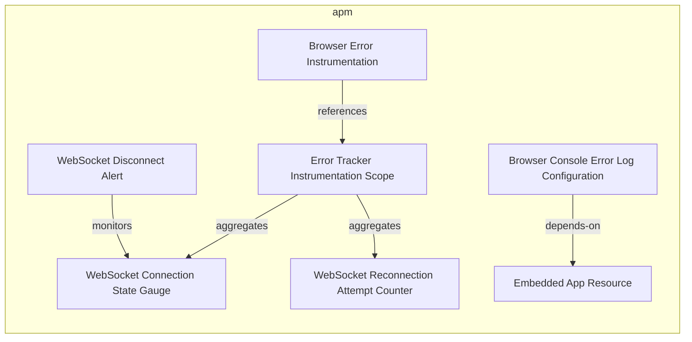
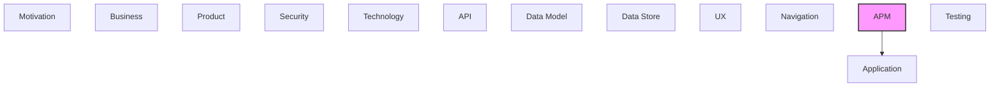

# APM

[← Back to README](../README.md)

Observability, monitoring, metrics, logging, and tracing.

## Report Index

- [Layer Introduction](#layer-introduction)
- [Intra-Layer Relationships](#intra-layer-relationships)
- [Inter-Layer Dependencies](#inter-layer-dependencies)
- [Inter-Layer Relationships Table](#inter-layer-relationships-table)
- [Element Reference](#element-reference)

## Layer Introduction

| Metric                    | Count |
| ------------------------- | ----- |
| Elements                  | 7     |
| Intra-Layer Relationships | 5     |
| Inter-Layer Relationships | 1     |
| Inbound Relationships     | 0     |
| Outbound Relationships    | 1     |

**Cross-Layer References**:

- **Downstream layers**: [Application](./05-application-layer-report.md)

## Intra-Layer Relationships

## Inter-Layer Dependencies

## Inter-Layer Relationships Table

| Relationship ID                                                | Source Node                                                    | Dest Node                                          | Dest Layer    | Predicate  | Cardinality  | Strength |
| -------------------------------------------------------------- | -------------------------------------------------------------- | -------------------------------------------------- | ------------- | ---------- | ------------ | -------- |
| `apm.metricinstrument.monitors.application.applicationservice` | `apm.metricinstrument.web-socket-reconnection-attempt-counter` | `application.applicationservice.web-socket-client` | `application` | `monitors` | many-to-many | medium   |

## Element Reference

### WebSocket Disconnect Alert {#websocket-disconnect-alert}

**ID**: `apm.alert.web-socket-disconnect-alert`

**Type**: `alert`

Aspirational: an alert when the DR CLI WebSocket drops and live updates stop. Today the drop only shows in the UI (the topbar's connection indicator, from useConnectionStore); no alerting pipeline exists.

#### Attributes

| Name      | Value                                  |
| --------- | -------------------------------------- |
| condition | connectionStore.status === 'rest-mode' |
| severity  | warning                                |

#### Relationships

| Type        | Related Element                                          | Predicate  | Direction |
| ----------- | -------------------------------------------------------- | ---------- | --------- |
| intra-layer | `apm.metricinstrument.web-socket-connection-state-gauge` | `monitors` | outbound  |

### Browser Error Instrumentation {#browser-error-instrumentation}

**ID**: `apm.instrumentationconfig.browser-error-instrumentation`

**Type**: `instrumentationconfig`

Manual browser error instrumentation configuration for the embedded viewer; the errorTracker service captures runtime exceptions, classifies them by category (network, rendering, data, auth), and logs structured error records.

#### Attributes

| Name                | Value                  |
| ------------------- | ---------------------- |
| instrumentationType | manual                 |
| type                | browser-error-tracking |

#### Relationships

| Type        | Related Element                                                | Predicate    | Direction |
| ----------- | -------------------------------------------------------------- | ------------ | --------- |
| intra-layer | `apm.instrumentationscope.error-tracker-instrumentation-scope` | `references` | outbound  |

### Error Tracker Instrumentation Scope {#error-tracker-instrumentation-scope}

**ID**: `apm.instrumentationscope.error-tracker-instrumentation-scope`

**Type**: `instrumentationscope`

Named instrumentation scope for the errorTracker and exceptionClassifier services; groups all error/exception signals produced by the frontend error handling subsystem.

#### Attributes

| Name                   | Value |
| ---------------------- | ----- |
| droppedAttributesCount | 0     |

#### Relationships

| Type        | Related Element                                                | Predicate    | Direction |
| ----------- | -------------------------------------------------------------- | ------------ | --------- |
| intra-layer | `apm.instrumentationconfig.browser-error-instrumentation`      | `references` | inbound   |
| intra-layer | `apm.metricinstrument.web-socket-connection-state-gauge`       | `aggregates` | outbound  |
| intra-layer | `apm.metricinstrument.web-socket-reconnection-attempt-counter` | `aggregates` | outbound  |

### Browser Console Error Log Configuration {#browser-console-error-log-configuration}

**ID**: `apm.logconfiguration.browser-console-error-log-configuration`

**Type**: `logconfiguration`

Log configuration for browser console error capture; the errorTracker service writes structured error records with classification category, stack trace, and context; minimum severity ERROR.

#### Attributes

| Name            | Value                         |
| --------------- | ----------------------------- |
| minimumSeverity | ERROR                         |
| serviceName     | documentation-robotics-viewer |

#### Relationships

| Type        | Related Element                      | Predicate    | Direction |
| ----------- | ------------------------------------ | ------------ | --------- |
| intra-layer | `apm.resource.embedded-app-resource` | `depends-on` | outbound  |

### WebSocket Connection State Gauge {#websocket-connection-state-gauge}

**ID**: `apm.metricinstrument.web-socket-connection-state-gauge`

**Type**: `metricinstrument`

Aspirational: the DR CLI WebSocket connection state (connected / disconnected) as a gauge. Today it is app state in useConnectionStore, shown as the topbar's connected indicator; no OpenTelemetry SDK is installed and nothing exports it as a metric.

#### Attributes

| Name | Value |
| ---- | ----- |
| type | Gauge |
| unit | state |

#### Relationships

| Type        | Related Element                                                | Predicate    | Direction |
| ----------- | -------------------------------------------------------------- | ------------ | --------- |
| intra-layer | `apm.alert.web-socket-disconnect-alert`                        | `monitors`   | inbound   |
| intra-layer | `apm.instrumentationscope.error-tracker-instrumentation-scope` | `aggregates` | inbound   |

### WebSocket Reconnection Attempt Counter {#websocket-reconnection-attempt-counter}

**ID**: `apm.metricinstrument.web-socket-reconnection-attempt-counter`

**Type**: `metricinstrument`

Aspirational: cumulative WebSocket reconnection attempts as a counter. Today the count lives in WebSocketClient's reconnect loop; no OpenTelemetry SDK is installed and nothing exports it as a metric.

#### Attributes

| Name | Value    |
| ---- | -------- |
| type | Counter  |
| unit | attempts |

#### Relationships

| Type        | Related Element                                                | Predicate    | Direction |
| ----------- | -------------------------------------------------------------- | ------------ | --------- |
| inter-layer | `application.applicationservice.web-socket-client`             | `monitors`   | outbound  |
| intra-layer | `apm.instrumentationscope.error-tracker-instrumentation-scope` | `aggregates` | inbound   |

### Embedded App Resource {#embedded-app-resource}

**ID**: `apm.resource.embedded-app-resource`

**Type**: `resource`

Aspirational: an OpenTelemetry-style resource identity for the browser viewer (the App Shell). No OpenTelemetry SDK is installed, so no telemetry carries it today.

#### Attributes

| Name                   | Value |
| ---------------------- | ----- |
| droppedAttributesCount | 0     |

#### Relationships

| Type        | Related Element                                                | Predicate    | Direction |
| ----------- | -------------------------------------------------------------- | ------------ | --------- |
| intra-layer | `apm.logconfiguration.browser-console-error-log-configuration` | `depends-on` | inbound   |

---

Generated: 2026-11-12T13:57:21.197Z | Model Version: 0.1.0
