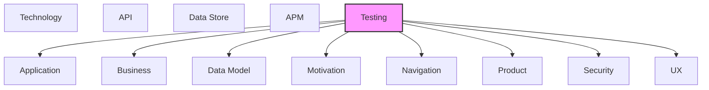

# Testing

[← Back to README](../README.md)

Test strategies, test cases, test data, and test coverage.

## Report Index

- [Layer Introduction](#layer-introduction)
- [Intra-Layer Relationships](#intra-layer-relationships)
- [Inter-Layer Dependencies](#inter-layer-dependencies)
- [Inter-Layer Relationships Table](#inter-layer-relationships-table)
- [Element Reference](#element-reference)

## Layer Introduction

| Metric                    | Count |
| ------------------------- | ----- |
| Elements                  | 812   |
| Intra-Layer Relationships | 5     |
| Inter-Layer Relationships | 932   |
| Inbound Relationships     | 0     |
| Outbound Relationships    | 932   |

**Cross-Layer References**:

- **Downstream layers**: [Application](./05-application-layer-report.md), [Business](./02-business-layer-report.md), [Data Model](./08-data-model-layer-report.md), [Motivation](./01-motivation-layer-report.md), [Navigation](./11-navigation-layer-report.md), [Product](./03-product-layer-report.md), [Security](./04-security-layer-report.md), [UX](./10-ux-layer-report.md)

## Intra-Layer Relationships

*This layer has >30 elements. Summary table shown instead of diagram.*

| Element                                                                                                                                                  | Type                  | Relationships |
| -------------------------------------------------------------------------------------------------------------------------------------------------------- | --------------------- | ------------- |
| `testing.contextvariation.functional-unit-test-context`                                                                                                  | `contextvariation`    | 1             |
| `testing.coveragerequirement.all-partitions-unit-test-requirement`                                                                                       | `coveragerequirement` | 1             |
| `testing.coveragesummary.overall-test-coverage-summary`                                                                                                  | `coveragesummary`     | 1             |
| `testing.testcasesketch.accessibility-axe-wcag-2-1-aa-page-view-mode-view-name-view-page-mode-tone-canvas-zero-serious-80c4c060`                         | `testcasesketch`      | 0             |
| `testing.testcasesketch.accessibility-axe-wcag-2-1-aa-view-name-view-tone-canvas-no-serious-critical-violations-except-f5cdbb26`                         | `testcasesketch`      | 0             |
| `testing.testcasesketch.annotations-create-edit-reply-resolve-delete-an-annotation`                                                                      | `testcasesketch`      | 0             |
| `testing.testcasesketch.annotations-mutations-invalidate-refetch-create-adds-an-annotation-and-the-element-list-refetches-2bad9889`                      | `testcasesketch`      | 0             |
| `testing.testcasesketch.annotations-mutations-invalidate-refetch-delete-removes-an-annotation-and-the-list-refetches-cdc2828e`                           | `testcasesketch`      | 0             |
| `testing.testcasesketch.annotations-mutations-invalidate-refetch-patch-updates-content-resolved-and-the-list-reflects-it-accf90b4`                       | `testcasesketch`      | 0             |
| `testing.testcasesketch.annotations-section-add-adds-an-annotation-via-post-and-it-appears-in-the-list`                                                  | `testcasesketch`      | 0             |
| `testing.testcasesketch.annotations-section-delete-deletes-via-a-confirm-dialog-delete-and-removes-the-annotation`                                       | `testcasesketch`      | 0             |
| `testing.testcasesketch.annotations-section-edit-edits-an-annotation-via-patch-and-the-new-content-renders`                                              | `testcasesketch`      | 0             |
| `testing.testcasesketch.annotations-section-list-empty-state-lists-the-seeded-annotations-for-the-element-with-a-count`                                  | `testcasesketch`      | 0             |
| `testing.testcasesketch.annotations-section-list-empty-state-shows-the-empty-state-for-an-element-with-no-annotations`                                   | `testcasesketch`      | 0             |
| `testing.testcasesketch.annotations-section-replies-lazily-loads-posts-a-reply-via-the-disclosure`                                                       | `testcasesketch`      | 0             |
| `testing.testcasesketch.annotations-section-resolve-resolves-an-open-annotation-via-patch-and-shows-the-resolved-chip`                                   | `testcasesketch`      | 0             |
| `testing.testcasesketch.build-chat-context-describes-a-schema-node-type-and-a-relationship`                                                              | `testcasesketch`      | 0             |
| `testing.testcasesketch.build-chat-context-describes-the-selected-changeset-in-the-changesets-view`                                                      | `testcasesketch`      | 0             |
| `testing.testcasesketch.build-chat-context-names-the-selected-element-by-display-name-dotted-id-type-and-uuid`                                           | `testcasesketch`      | 0             |
| `testing.testcasesketch.build-chat-context-returns-null-when-nothing-is-open-beyond-the-view`                                                            | `testcasesketch`      | 0             |
| `testing.testcasesketch.build-chat-context-says-when-only-a-layer-is-open`                                                                               | `testcasesketch`      | 0             |
| `testing.testcasesketch.build-diff-lines-add-null-before-all-lines-are-added`                                                                            | `testcasesketch`      | 0             |
| `testing.testcasesketch.build-diff-lines-both-sides-null-empty-diff`                                                                                     | `testcasesketch`      | 0             |
| `testing.testcasesketch.build-diff-lines-delete-null-after-all-lines-are-removed`                                                                        | `testcasesketch`      | 0             |
| `testing.testcasesketch.build-diff-lines-update-unchanged-lines-drop-out-only-diffed-lines-appear`                                                       | `testcasesketch`      | 0             |
| `testing.testcasesketch.build-model-index-445-link-resolution-regression-exercises-both-endpoint-forms-links-reference-a4b0d394`                         | `testcasesketch`      | 0             |
| `testing.testcasesketch.build-model-index-445-link-resolution-regression-has-zero-dotted-id-collisions-across-the-model`                                 | `testcasesketch`      | 0             |
| `testing.testcasesketch.build-model-index-445-link-resolution-regression-indexes-every-node-under-both-its-uuid-and-its-cb640c5b`                        | `testcasesketch`      | 0             |
| `testing.testcasesketch.build-model-index-445-link-resolution-regression-resolve-endpoint-returns-undefined-for-an-unknown-ab483634`                     | `testcasesketch`      | 0             |
| `testing.testcasesketch.build-model-index-445-link-resolution-regression-resolves-all-445-link-endpoints-zero-unresolved`                                | `testcasesketch`      | 0             |
| `testing.testcasesketch.build-model-index-445-link-resolution-regression-the-fixture-really-has-285-nodes-and-445-links`                                 | `testcasesketch`      | 0             |
| `testing.testcasesketch.build-model-layered-index-indexes-every-element-in-the-dr-layers-in-spec-order`                                                  | `testcasesketch`      | 0             |
| `testing.testcasesketch.build-model-layered-index-resolves-every-link-endpoint-uuid-or-dotted-id-no-dangling-edges`                                      | `testcasesketch`      | 0             |
| `testing.testcasesketch.build-review-model-a-cascaded-change-needs-no-decision-of-its-own`                                                               | `testcasesketch`      | 0             |
| `testing.testcasesketch.build-review-model-cascades-a-dropped-add-to-its-links-and-updates-and-drops-only-the-explicit-seq-e16da9a7`                     | `testcasesketch`      | 0             |
| `testing.testcasesketch.build-review-model-counts-a-link-between-two-kept-deletes-once`                                                                  | `testcasesketch`      | 0             |
| `testing.testcasesketch.build-review-model-flags-a-dropped-link-delete-whose-element-a-kept-delete-removes-and-holds-apply`                              | `testcasesketch`      | 0             |
| `testing.testcasesketch.build-review-model-holds-apply-while-a-blocked-delete-is-undecided`                                                              | `testcasesketch`      | 0             |
| `testing.testcasesketch.build-review-model-ignores-a-decision-on-a-change-revised-after-it`                                                              | `testcasesketch`      | 0             |
| `testing.testcasesketch.build-review-model-is-ready-once-every-change-is-kept-or-dropped-the-body-still-names-both-lists`                                | `testcasesketch`      | 0             |
| `testing.testcasesketch.build-review-model-lets-apply-land-undecided-changes-as-kept-the-body-drops-and-deletes-only-what-was-decided`                   | `testcasesketch`      | 0             |
| `testing.testcasesketch.build-review-model-names-link-ends-from-the-changesets-own-adds-when-the-model-lacks-them`                                       | `testcasesketch`      | 0             |
| `testing.testcasesketch.build-review-model-previews-the-cascade-into-a-cancel-out-pair-member-as-the-server-drops-it`                                    | `testcasesketch`      | 0             |
| `testing.testcasesketch.build-review-model-re-opens-a-kept-delete-that-gained-a-blocker-since-it-was-kept-here`                                          | `testcasesketch`      | 0             |
| `testing.testcasesketch.build-review-model-sends-kept-blocked-deletes-as-delete-blocked-links-and-counts-their-links`                                    | `testcasesketch`      | 0             |
| `testing.testcasesketch.build-review-model-tallies-decisions-and-is-not-ready-while-changes-are-undecided`                                               | `testcasesketch`      | 0             |
| `testing.testcasesketch.cancel-pairs-folds-an-element-add-and-its-delete-an-update-between-stays-a-change-to-decide`                                     | `testcasesketch`      | 0             |
| `testing.testcasesketch.cancel-pairs-leaves-a-delete-of-a-model-element-no-earlier-add-alone`                                                            | `testcasesketch`      | 0             |
| `testing.testcasesketch.cancel-pairs-never-folds-a-delete-that-has-blockers-it-stays-a-blocked-delete-to-resolve`                                        | `testcasesketch`      | 0             |
| `testing.testcasesketch.cancel-pairs-pairs-the-fixtures-four-link-adds-that-a-later-link-delete-removes`                                                 | `testcasesketch`      | 0             |
| `testing.testcasesketch.canvas-background-click-deselects-inspector-auto-hide-reachable-clicking-the-graph-background-cd2f7c86`                          | `testcasesketch`      | 0             |
| `testing.testcasesketch.canvas-card-node-presentation-default-vs-pill-display-control-clicking-a-card-node-selects-it-and-af7cd081`                      | `testcasesketch`      | 0             |
| `testing.testcasesketch.canvas-card-node-presentation-default-vs-pill-display-control-model-view-pill-mode-nodes-show-the-a652750f`                      | `testcasesketch`      | 0             |
| `testing.testcasesketch.canvas-card-node-presentation-default-vs-pill-display-control-renders-model-view-nodes-as-cards-by-4b53099b`                     | `testcasesketch`      | 0             |
| `testing.testcasesketch.canvas-card-node-presentation-default-vs-pill-display-control-schema-view-always-renders-the-567be1ea`                           | `testcasesketch`      | 0             |
| `testing.testcasesketch.canvas-card-node-presentation-default-vs-pill-display-control-schema-view-pill-nodes-show-the-node-8f1d1e84`                     | `testcasesketch`      | 0             |
| `testing.testcasesketch.canvas-card-node-presentation-default-vs-pill-display-control-switching-display-to-pill-re-renders-c2879f33`                     | `testcasesketch`      | 0             |
| `testing.testcasesketch.canvas-card-node-presentation-default-vs-pill-display-control-the-display-control-is-shown-in-model-18cdba76`                    | `testcasesketch`      | 0             |
| `testing.testcasesketch.canvas-edge-selection-highlighting-and-the-edge-inspector-clicking-a-cross-layer-relationship-1fd1c5bd`                          | `testcasesketch`      | 0             |
| `testing.testcasesketch.canvas-edge-selection-highlighting-and-the-edge-inspector-clicking-an-edge-predicate-selects-it-05f6330f`                        | `testcasesketch`      | 0             |
| `testing.testcasesketch.canvas-edge-selection-highlighting-and-the-edge-inspector-clicking-the-graph-background-clears-an-b1fc08a0`                      | `testcasesketch`      | 0             |
| `testing.testcasesketch.canvas-edge-selection-highlighting-and-the-edge-inspector-selecting-a-node-clears-an-edge-selection-b4f82fc6`                    | `testcasesketch`      | 0             |
| `testing.testcasesketch.canvas-empty-state-shows-the-model-empty-hint-when-no-layer-is-selected`                                                         | `testcasesketch`      | 0             |
| `testing.testcasesketch.canvas-graph-controls-flyout-keyboard-click-activation-escape-closes-the-panel-and-returns-focus-to-14b9637b`                    | `testcasesketch`      | 0             |
| `testing.testcasesketch.canvas-graph-controls-flyout-keyboard-click-activation-the-toggle-button-itself-opens-the-panel-on-cd02a9a6`                     | `testcasesketch`      | 0             |
| `testing.testcasesketch.canvas-graph-layout-display-control-strip-clicking-each-segmented-control-option-updates-the-975ca64c`                           | `testcasesketch`      | 0             |
| `testing.testcasesketch.canvas-graph-layout-display-control-strip-collapses-to-a-transparent-icon-by-default-and-expands-a002a4fb`                       | `testcasesketch`      | 0             |
| `testing.testcasesketch.canvas-graph-layout-display-control-strip-floats-graph-controls-over-the-graph-absolutely-28eee1a4`                              | `testcasesketch`      | 0             |
| `testing.testcasesketch.canvas-graph-layout-display-control-strip-is-hidden-with-no-layer-selected-and-in-page-mode`                                     | `testcasesketch`      | 0             |
| `testing.testcasesketch.canvas-graph-layout-display-control-strip-keeps-display-and-node-margin-in-the-settings-flyout-with-baab0b26`                    | `testcasesketch`      | 0             |
| `testing.testcasesketch.canvas-graph-layout-display-control-strip-pins-the-built-in-graph-toolbar-bottom-left-not-bottom-71aea5e1`                       | `testcasesketch`      | 0             |
| `testing.testcasesketch.canvas-graph-layout-display-control-strip-puts-layout-relations-and-inter-layer-in-the-page-header-ae017541`                     | `testcasesketch`      | 0             |
| `testing.testcasesketch.canvas-graph-layout-display-control-strip-stays-expanded-while-focus-moves-onto-a-control-inside-87092302`                       | `testcasesketch`      | 0             |
| `testing.testcasesketch.canvas-graph-page-mode-toggle-clicking-the-page-segment-swaps-graph-canvas-for-the-page-view-04041e08`                           | `testcasesketch`      | 0             |
| `testing.testcasesketch.canvas-graph-page-mode-toggle-layer-focus-page-mode-overrides-the-header-with-the-layer-page-data-105ec488`                      | `testcasesketch`      | 0             |
| `testing.testcasesketch.canvas-graph-page-mode-toggle-mode-persists-across-a-layer-switch-design-mode-toggle-persists-dd0eefb2`                          | `testcasesketch`      | 0             |
| `testing.testcasesketch.canvas-graph-page-mode-toggle-node-focus-page-mode-a-selected-model-element-renders-the-element-3b254150`                        | `testcasesketch`      | 0             |
| `testing.testcasesketch.canvas-graph-page-mode-toggle-page-mode-with-a-layer-selected-but-no-node-focused-shows-the-select-363158ec`                     | `testcasesketch`      | 0             |
| `testing.testcasesketch.canvas-heimdall-ui-0-7-0-prop-wiring-passes-center-on-select-and-a-fullscreen-container-ref-ce9665bc`                            | `testcasesketch`      | 0             |
| `testing.testcasesketch.canvas-heimdall-ui-0-7-0-prop-wiring-shows-the-edge-predicate-card-only-after-3s-of-hover-in-our-b31527f8`                       | `testcasesketch`      | 0             |
| `testing.testcasesketch.canvas-heimdall-ui-0-7-0-prop-wiring-turns-center-on-select-off-for-a-click-on-a-graph-node-and-7c973b0d`                        | `testcasesketch`      | 0             |
| `testing.testcasesketch.canvas-inter-layer-nodes-control-dark-and-light-canvas-modes-both-render-foreign-nodes-correctly`                                | `testcasesketch`      | 0             |
| `testing.testcasesketch.canvas-inter-layer-nodes-control-foreign-nodes-render-with-distinct-styling-without-fading-their-66cf3649`                       | `testcasesketch`      | 0             |
| `testing.testcasesketch.canvas-inter-layer-nodes-control-foreign-nodes-respect-show-all-relations-filter-exclude-orphans-b20714d2`                       | `testcasesketch`      | 0             |
| `testing.testcasesketch.canvas-inter-layer-nodes-control-shows-the-inter-layer-toggle-only-in-model-view`                                                | `testcasesketch`      | 0             |
| `testing.testcasesketch.canvas-inter-layer-nodes-control-switching-layouts-preserves-inter-layer-nodes-c8d03f6e`                                         | `testcasesketch`      | 0             |
| `testing.testcasesketch.canvas-inter-layer-nodes-control-toggles-inter-layer-nodes-on-and-off`                                                           | `testcasesketch`      | 0             |
| `testing.testcasesketch.canvas-inter-layer-nodes-control-toggling-inter-layer-nodes-on-and-off-updates-the-graph-composition`                            | `testcasesketch`      | 0             |
| `testing.testcasesketch.canvas-keyed-remount-on-view-layer-switch-switching-modelschema-for-one-layer-swaps-instances-for-b6ea5719`                      | `testcasesketch`      | 0             |
| `testing.testcasesketch.canvas-keyed-remount-on-view-layer-switch-switching-the-layer-swaps-the-rendered-node-set`                                       | `testcasesketch`      | 0             |
| `testing.testcasesketch.canvas-model-view-page-header-renders-instance-model-eyebrow-layer-title-id-chip-and-element-meta`                               | `testcasesketch`      | 0             |
| `testing.testcasesketch.canvas-model-view-page-header-renders-the-selected-layer-graph-nodes`                                                            | `testcasesketch`      | 0             |
| `testing.testcasesketch.canvas-relations-toggle-actually-filters-rendered-edges-structural-hides-non-structural-edges-all-5d627845`                      | `testcasesketch`      | 0             |
| `testing.testcasesketch.canvas-schema-view-page-header-renders-meta-model-eyebrow-layer-schema-title-and-node-type-meta`                                 | `testcasesketch`      | 0             |
| `testing.testcasesketch.canvas-settings-flyout-hover-path-regression-it-closed-before-the-pointer-reached-it-keeps-working-509d4bba`                     | `testcasesketch`      | 0             |
| `testing.testcasesketch.canvas-settings-flyout-hover-path-regression-it-closed-before-the-pointer-reached-it-stays-open-1df0bf29`                        | `testcasesketch`      | 0             |
| `testing.testcasesketch.card-short-card-shortj-j`                                                                                                        | `testcasesketch`      | 0             |
| `testing.testcasesketch.change-detail-add-of-an-element-added-type`                                                                                      | `testcasesketch`      | 0             |
| `testing.testcasesketch.change-detail-delete-of-an-element-removed-type`                                                                                 | `testcasesketch`      | 0             |
| `testing.testcasesketch.change-detail-relationship-add-added-relationship`                                                                               | `testcasesketch`      | 0             |
| `testing.testcasesketch.change-detail-relationship-delete-removed-relationship`                                                                          | `testcasesketch`      | 0             |
| `testing.testcasesketch.change-detail-update-lists-the-changed-top-level-fields`                                                                         | `testcasesketch`      | 0             |
| `testing.testcasesketch.change-detail-update-with-3-changed-fields-shows-n-more`                                                                         | `testcasesketch`      | 0             |
| `testing.testcasesketch.change-detail-update-with-no-field-differences-updated-type`                                                                     | `testcasesketch`      | 0             |
| `testing.testcasesketch.changed-paths-ignores-metadata-id-and-path`                                                                                      | `testcasesketch`      | 0             |
| `testing.testcasesketch.changeset-action-error-message-falls-back-to-the-raw-body-then-the-error-message`                                                | `testcasesketch`      | 0             |
| `testing.testcasesketch.changeset-action-error-message-returns-the-servers-error-message`                                                                | `testcasesketch`      | 0             |
| `testing.testcasesketch.changeset-canvas-a-changeset-that-fails-to-load-says-why-instead-of-loading-changeset-forever-845ed2cf`                          | `testcasesketch`      | 0             |
| `testing.testcasesketch.changeset-canvas-header-op-rows-lists-the-committed-changeset-read-only-30-changes-to-review-4-3a85b24b`                         | `testcasesketch`      | 0             |
| `testing.testcasesketch.changeset-canvas-header-op-rows-marks-the-changed-field-of-an-update-and-its-op`                                                 | `testcasesketch`      | 0             |
| `testing.testcasesketch.changeset-canvas-header-op-rows-shows-the-changeset-name-status-chip-and-change-count-in-the-header`                             | `testcasesketch`      | 0             |
| `testing.testcasesketch.changeset-canvas-impact-tab-shares-its-follow-depth-with-the-model-inspector`                                                    | `testcasesketch`      | 0             |
| `testing.testcasesketch.changeset-canvas-impact-tab-switches-from-the-change-list-to-the-impact-lanes-and-back`                                          | `testcasesketch`      | 0             |
| `testing.testcasesketch.changeset-canvas-purpose-leads-a-verification-record-with-the-plan-it-verifies-and-what-extraction-read`                         | `testcasesketch`      | 0             |
| `testing.testcasesketch.changeset-canvas-purpose-says-a-changeset-is-gone-when-the-server-no-longer-has-it`                                              | `testcasesketch`      | 0             |
| `testing.testcasesketch.changeset-drift-keeps-the-details-overlaps-and-base-changes-dropping-malformed-entries`                                          | `testcasesketch`      | 0             |
| `testing.testcasesketch.changeset-drift-reads-no-drift-from-an-older-dr-cli`                                                                             | `testcasesketch`      | 0             |
| `testing.testcasesketch.changeset-drift-reads-the-summary-and-drops-a-malformed-drift`                                                                   | `testcasesketch`      | 0             |
| `testing.testcasesketch.changeset-drift-tells-a-blocking-drift-from-a-quiet-note-and-an-unchecked-one`                                                   | `testcasesketch`      | 0             |
| `testing.testcasesketch.changeset-impact-focus-finds-no-origin-for-an-element-the-model-and-the-changeset-lack`                                          | `testcasesketch`      | 0             |
| `testing.testcasesketch.changeset-impact-focus-reaches-from-the-focused-element-only-and-still-marks-every-change`                                       | `testcasesketch`      | 0             |
| `testing.testcasesketch.changeset-impact-focus-records-which-changes-touch-each-element`                                                                 | `testcasesketch`      | 0             |
| `testing.testcasesketch.changeset-impact-net-ops-over-a-sequence-of-changes-cancels-a-relationship-added-and-then-deleted-9c1a5476`                      | `testcasesketch`      | 0             |
| `testing.testcasesketch.changeset-impact-net-ops-over-a-sequence-of-changes-drops-an-element-the-changeset-adds-and-then-5d507275`                       | `testcasesketch`      | 0             |
| `testing.testcasesketch.changeset-impact-net-ops-over-a-sequence-of-changes-keeps-an-element-the-changeset-adds-and-then-bdf8a330`                       | `testcasesketch`      | 0             |
| `testing.testcasesketch.changeset-impact-net-ops-over-a-sequence-of-changes-nets-two-changes-to-one-element`                                             | `testcasesketch`      | 0             |
| `testing.testcasesketch.changeset-impact-origins-adds-a-staged-element-and-relationship-that-the-model-does-not-have-yet`                                | `testcasesketch`      | 0             |
| `testing.testcasesketch.changeset-impact-origins-counts-changes-it-cannot-place-instead-of-dropping-them-silently`                                       | `testcasesketch`      | 0             |
| `testing.testcasesketch.changeset-impact-origins-is-empty-without-changes-or-without-a-model`                                                            | `testcasesketch`      | 0             |
| `testing.testcasesketch.changeset-impact-origins-marks-every-changed-element-with-its-op-and-relationship-ends-as-relink`                                | `testcasesketch`      | 0             |
| `testing.testcasesketch.changeset-impact-reach-and-blast-radius-reaches-further-as-follow-grows-and-direct-still-reaches-aa2d8c08`                       | `testcasesketch`      | 0             |
| `testing.testcasesketch.changeset-impact-reach-and-blast-radius-returns-only-the-reached-subgraph-every-node-reached-every-0780aa71`                     | `testcasesketch`      | 0             |
| `testing.testcasesketch.changeset-impact-reach-and-blast-radius-summarizes-reached-elements-outside-the-changeset-per-layer-40c51d6e`                    | `testcasesketch`      | 0             |
| `testing.testcasesketch.changeset-inbox-badges-a-drifted-plan-on-its-card-and-not-a-record-or-content-free-drift`                                        | `testcasesketch`      | 0             |
| `testing.testcasesketch.changeset-inbox-counts-verdicts-kept-in-this-browser-for-an-older-dr-cli-by-the-shared-definition`                               | `testcasesketch`      | 0             |
| `testing.testcasesketch.changeset-inbox-keeps-a-verification-record-out-of-waiting-on-you-and-pairs-it-with-its-plan`                                    | `testcasesketch`      | 0             |
| `testing.testcasesketch.changeset-inbox-opens-a-changeset-from-its-card`                                                                                 | `testcasesketch`      | 0             |
| `testing.testcasesketch.changeset-inbox-shows-each-changesets-purpose-in-the-history`                                                                    | `testcasesketch`      | 0             |
| `testing.testcasesketch.changeset-inbox-sorts-staged-changesets-into-waiting-on-you-and-on-dr-bot-with-the-history-below`                                | `testcasesketch`      | 0             |
| `testing.testcasesketch.changeset-inspector-blast-radius-keeps-its-scrolling-body-reachable-by-keyboard`                                                 | `testcasesketch`      | 0             |
| `testing.testcasesketch.changeset-inspector-blast-radius-summarizes-what-the-changeset-reaches-outside-itself-per-layer`                                 | `testcasesketch`      | 0             |
| `testing.testcasesketch.changeset-inspector-stat-tiles-status-pill-shows-additions-modifications-deletions-stat-tiles-from-fb524050`                     | `testcasesketch`      | 0             |
| `testing.testcasesketch.changeset-inspector-stat-tiles-status-pill-shows-the-committed-status-label`                                                     | `testcasesketch`      | 0             |
| `testing.testcasesketch.changeset-inspector-stat-tiles-status-pill-shows-the-empty-state-when-no-changeset-is-selected`                                  | `testcasesketch`      | 0             |
| `testing.testcasesketch.changeset-purpose-keeps-known-actions-drops-unknown-ones-and-reads-no-array-as-an-older-dr-cli`                                  | `testcasesketch`      | 0             |
| `testing.testcasesketch.changeset-purpose-offers-apply-and-discard-from-the-servers-actions-or-from-a-staged-status-on-an-older-dr-cli`                  | `testcasesketch`      | 0             |
| `testing.testcasesketch.changeset-purpose-reads-a-known-purpose-and-ignores-an-unknown-one`                                                              | `testcasesketch`      | 0             |
| `testing.testcasesketch.changeset-purpose-sorts-the-inbox-by-purpose-and-pairs-each-verification-record-with-its-plan`                                   | `testcasesketch`      | 0             |
| `testing.testcasesketch.changeset-summary-falls-back-to-the-name-when-stats-are-missing`                                                                 | `testcasesketch`      | 0             |
| `testing.testcasesketch.changeset-summary-renders-the-additions-modifications-deletions-sentence`                                                        | `testcasesketch`      | 0             |
| `testing.testcasesketch.changesets-opens-on-the-inbox-a-changeset-shows-review-rows-and-stat-tiles-matching-the-api-stats`                               | `testcasesketch`      | 0             |
| `testing.testcasesketch.changesets-switching-changesets-updates-the-content`                                                                             | `testcasesketch`      | 0             |
| `testing.testcasesketch.chat-panel-composer-scope-label-falls-back-to-layer-layer-when-only-a-layer-is-selected`                                         | `testcasesketch`      | 0             |
| `testing.testcasesketch.chat-panel-composer-scope-label-reflects-the-selected-element-name-from-the-ui-store`                                            | `testcasesketch`      | 0             |
| `testing.testcasesketch.chat-panel-composer-submit-clicking-a-suggestion-sends-it`                                                                       | `testcasesketch`      | 0             |
| `testing.testcasesketch.chat-panel-composer-submit-sends-what-the-user-has-open-layer-selected-element-with-the-question`                                | `testcasesketch`      | 0             |
| `testing.testcasesketch.chat-panel-composer-submit-submitting-the-composer-calls-chat-service-send-message-with-the-text`                                | `testcasesketch`      | 0             |
| `testing.testcasesketch.chat-panel-composer-submit-surfaces-the-sdk-unavailable-error-from-the-store`                                                    | `testcasesketch`      | 0             |
| `testing.testcasesketch.chat-panel-message-rendering-via-the-adapter-renders-a-user-bubble-and-a-bot-markdown-body`                                      | `testcasesketch`      | 0             |
| `testing.testcasesketch.chat-panel-message-rendering-via-the-adapter-renders-tool-and-thinking-blocks-from-interleaved-bot-60c713b7`                     | `testcasesketch`      | 0             |
| `testing.testcasesketch.chat-panel-suggestions-gating-hides-suggestions-once-the-thread-has-more-than-one-message`                                       | `testcasesketch`      | 0             |
| `testing.testcasesketch.chat-panel-suggestions-gating-shows-suggestions-when-the-thread-is-empty-1-message`                                              | `testcasesketch`      | 0             |
| `testing.testcasesketch.chat-service-chat-error-sets-the-store-error-stops-streaming-and-appends-an-error-part`                                          | `testcasesketch`      | 0             |
| `testing.testcasesketch.chat-service-chat-response-chunk-appends-streamed-text-to-the-current-streaming-assistant-message`                               | `testcasesketch`      | 0             |
| `testing.testcasesketch.chat-service-chat-response-chunk-does-not-throw-when-no-streaming-message-exists-logs-a-warning-f9e38281`                        | `testcasesketch`      | 0             |
| `testing.testcasesketch.chat-service-chat-response-chunk-targets-the-streaming-assistant-message-not-an-earlier-non-c683d47f`                            | `testcasesketch`      | 0             |
| `testing.testcasesketch.chat-service-chat-send-timeout-allows-long-tool-heavy-answers-well-over-the-old-60s-cap`                                         | `testcasesketch`      | 0             |
| `testing.testcasesketch.chat-service-chat-thinking-chat-usage-appends-a-thinking-part-with-the-provided-content`                                         | `testcasesketch`      | 0             |
| `testing.testcasesketch.chat-service-chat-thinking-chat-usage-appends-a-usage-part-mapping-snake-case-token-counts-to-camel-45865e0b`                    | `testcasesketch`      | 0             |
| `testing.testcasesketch.chat-service-chat-tool-invoke-adds-a-tool-invocation-keyed-by-tool-use-id-mapping-executingexecuting`                            | `testcasesketch`      | 0             |
| `testing.testcasesketch.chat-service-chat-tool-invoke-completes-a-tool-sent-with-a-tool-use-id-but-no-status-once-the-reply-51e37d9b`                    | `testcasesketch`      | 0             |
| `testing.testcasesketch.chat-service-chat-tool-invoke-in-the-dr-visualize-wire-shape-adds-each-call-as-its-own-tool-part-8142d265`                       | `testcasesketch`      | 0             |
| `testing.testcasesketch.chat-service-chat-tool-invoke-in-the-dr-visualize-wire-shape-marks-a-call-completed-once-the-reply-c09c276a`                     | `testcasesketch`      | 0             |
| `testing.testcasesketch.chat-service-chat-tool-invoke-maps-failed-state-failed-error`                                                                    | `testcasesketch`      | 0             |
| `testing.testcasesketch.chat-service-chat-tool-invoke-updates-an-existing-tool-by-tool-use-id-in-place-completedresult`                                  | `testcasesketch`      | 0             |
| `testing.testcasesketch.chat-service-conversation-id-cancels-the-current-conversation-by-id`                                                             | `testcasesketch`      | 0             |
| `testing.testcasesketch.chat-service-conversation-id-sends-the-same-conversation-id-with-every-message-so-dr-bot-resumes-cf426d4d`                       | `testcasesketch`      | 0             |
| `testing.testcasesketch.chat-service-conversation-id-starts-a-new-conversation-with-a-new-id-after-reset`                                                | `testcasesketch`      | 0             |
| `testing.testcasesketch.chat-service-notification-handler-registration-registers-exactly-5-notification-handlers-one-per-fe7c07bc`                       | `testcasesketch`      | 0             |
| `testing.testcasesketch.chat-service-send-message-32001-sdk-unavailable-path-surfaces-gracefully-sets-store-error-stops-6aada0d7`                        | `testcasesketch`      | 0             |
| `testing.testcasesketch.chat-service-send-message-success-path-clears-the-assistant-is-streaming-flag-and-store-is-dd0f6815`                             | `testcasesketch`      | 0             |
| `testing.testcasesketch.chat-service-viewer-context-sends-the-context-with-the-question-but-shows-only-the-question-in-the-ae72b4ff`                     | `testcasesketch`      | 0             |
| `testing.testcasesketch.chat-streamed-answer-renders-exactly-once-double-emit-regression`                                                                | `testcasesketch`      | 0             |
| `testing.testcasesketch.compute-tooltip-position-clamps-left-within-the-viewport-margin-near-the-left-edge`                                              | `testcasesketch`      | 0             |
| `testing.testcasesketch.compute-tooltip-position-clamps-left-within-the-viewport-margin-near-the-right-edge`                                             | `testcasesketch`      | 0             |
| `testing.testcasesketch.compute-tooltip-position-does-not-flag-overlaps-anchor-for-a-normal-placement`                                                   | `testcasesketch`      | 0             |
| `testing.testcasesketch.compute-tooltip-position-falls-back-to-a-perpendicular-side-when-neither-top-nor-bottom-fits`                                    | `testcasesketch`      | 0             |
| `testing.testcasesketch.compute-tooltip-position-flags-overlaps-anchor-when-no-side-fits-and-clamping-covers-the-trigger`                                | `testcasesketch`      | 0             |
| `testing.testcasesketch.compute-tooltip-position-flips-to-bottom-when-top-has-no-room`                                                                   | `testcasesketch`      | 0             |
| `testing.testcasesketch.compute-tooltip-position-flips-to-top-when-bottom-has-no-room`                                                                   | `testcasesketch`      | 0             |
| `testing.testcasesketch.compute-tooltip-position-places-the-card-above-the-anchor-for-the-preferred-top-placement-when-it-c2af8640`                      | `testcasesketch`      | 0             |
| `testing.testcasesketch.dotted-id-composes-layer-id-type-slugname`                                                                                       | `testcasesketch`      | 0             |
| `testing.testcasesketch.dotted-id-drops-dots-in-the-name-segment-2-1-21`                                                                                 | `testcasesketch`      | 0             |
| `testing.testcasesketch.dotted-id-matches-slugify-name-for-the-name-segment-on-every-fixture-node`                                                       | `testcasesketch`      | 0             |
| `testing.testcasesketch.edge-inspector-cross-view-navigation-clicking-the-destination-kind-badge-navigates-to-that-types-de9439b0`                       | `testcasesketch`      | 0             |
| `testing.testcasesketch.edge-inspector-cross-view-navigation-clicking-the-predicate-badge-navigates-to-the-edges-source-acb06194`                        | `testcasesketch`      | 0             |
| `testing.testcasesketch.edge-inspector-cross-view-navigation-clicking-the-source-kind-badge-navigates-to-that-types-schema-c007cb73`                     | `testcasesketch`      | 0             |
| `testing.testcasesketch.edge-inspector-node-type-tooltips-on-source-destination-kind-badges-shows-the-destination-element-f7a73fef`                      | `testcasesketch`      | 0             |
| `testing.testcasesketch.edge-inspector-node-type-tooltips-on-source-destination-kind-badges-shows-the-source-element-type-473a48f0`                      | `testcasesketch`      | 0             |
| `testing.testcasesketch.edge-inspector-predicate-tooltip-on-the-edge-badge-shows-the-predicate-tooltip-with-the-known-b4883951`                          | `testcasesketch`      | 0             |
| `testing.testcasesketch.edge-metadata-leaves-spec-relationship-undefined-when-no-spec-relationship-schema-matches`                                       | `testcasesketch`      | 0             |
| `testing.testcasesketch.edge-metadata-resolves-a-cross-layer-edge-whose-spec-relationship-is-declared-in-the-source-layer-847b57ae`                      | `testcasesketch`      | 0             |
| `testing.testcasesketch.edge-metadata-resolves-a-real-edge-to-source-target-identity-type-predicate`                                                     | `testcasesketch`      | 0             |
| `testing.testcasesketch.edge-metadata-resolves-the-matching-spec-relationship-schema-when-one-is-declared`                                               | `testcasesketch`      | 0             |
| `testing.testcasesketch.edge-metadata-returns-undefined-for-an-unknown-edge-id`                                                                          | `testcasesketch`      | 0             |
| `testing.testcasesketch.edge-metadata-returns-undefined-when-an-endpoint-fails-to-resolve`                                                               | `testcasesketch`      | 0             |
| `testing.testcasesketch.edge-metadata-works-with-an-undefined-spec-payload-spec-relationship-stays-undefined`                                            | `testcasesketch`      | 0             |
| `testing.testcasesketch.edge-tooltip-anchor-rect-anchors-to-the-edges-own-predicate-label-found-by-exact-id`                                             | `testcasesketch`      | 0             |
| `testing.testcasesketch.edge-tooltip-anchor-rect-falls-back-to-the-middle-of-the-edge-line-when-there-is-no-label`                                       | `testcasesketch`      | 0             |
| `testing.testcasesketch.edge-tooltip-anchor-rect-returns-null-for-an-edge-that-is-not-rendered`                                                          | `testcasesketch`      | 0             |
| `testing.testcasesketch.edges-for-layer-edge-count-intra-rel-count-minus-self-loops`                                                                     | `testcasesketch`      | 0             |
| `testing.testcasesketch.edges-for-layer-excludes-cross-layer-links-from-the-layer-graph`                                                                 | `testcasesketch`      | 0             |
| `testing.testcasesketch.edges-for-layer-includes-an-edge-only-when-both-endpoints-resolve-into-the-layer`                                                | `testcasesketch`      | 0             |
| `testing.testcasesketch.edges-for-layer-includes-only-intra-layer-relationships-source-layer-dest-layer-slug`                                            | `testcasesketch`      | 0             |
| `testing.testcasesketch.edges-for-layer-label-is-the-predicate`                                                                                          | `testcasesketch`      | 0             |
| `testing.testcasesketch.edges-for-layer-maps-endpoints-to-node-uuids-and-label-to-link-type`                                                             | `testcasesketch`      | 0             |
| `testing.testcasesketch.edges-for-layer-produces-zero-edges-for-a-layer-with-no-nodes`                                                                   | `testcasesketch`      | 0             |
| `testing.testcasesketch.element-reach-by-layer-counts-every-reached-element-once-per-layer-in-layer-order`                                               | `testcasesketch`      | 0             |
| `testing.testcasesketch.element-reach-every-single-predicate-followed-row-names-a-real-link-in-its-direction-with-the-type-06a4ec8c`                     | `testcasesketch`      | 0             |
| `testing.testcasesketch.element-reach-follow-0-lists-no-followed-rows-the-reach-is-exactly-the-direct-neighbours`                                        | `testcasesketch`      | 0             |
| `testing.testcasesketch.element-reach-follow-1-rows-are-hop-2-outside-the-origin-layer-reached-over-a-real-cross-layer-link-2b4032cc`                    | `testcasesketch`      | 0             |
| `testing.testcasesketch.element-reach-follow-2-extends-follow-1-with-hop-3-rows-reached-from-hop-2-elements`                                             | `testcasesketch`      | 0             |
| `testing.testcasesketch.element-reach-link-direction-and-bundling-synthetic-models-joins-a-bundled-links-predicates-and-a57cc350`                        | `testcasesketch`      | 0             |
| `testing.testcasesketch.element-reach-link-direction-and-bundling-synthetic-models-reads-an-incoming-link-from-the-via-ff8cabf9`                         | `testcasesketch`      | 0             |
| `testing.testcasesketch.element-reach-returns-nothing-for-an-unknown-element-id`                                                                         | `testcasesketch`      | 0             |
| `testing.testcasesketch.element-reach-sorts-rows-nearest-hop-first-then-by-layer-order`                                                                  | `testcasesketch`      | 0             |
| `testing.testcasesketch.error-boundary-gets-a-fresh-try-when-its-key-changes`                                                                            | `testcasesketch`      | 0             |
| `testing.testcasesketch.error-boundary-renders-its-children-when-nothing-throws`                                                                         | `testcasesketch`      | 0             |
| `testing.testcasesketch.error-boundary-shows-what-failed-in-place-and-keeps-the-rest-of-the-view`                                                        | `testcasesketch`      | 0             |
| `testing.testcasesketch.filter-structural-inter-layer-filters-out-edges-whose-nodes-were-removed`                                                        | `testcasesketch`      | 0             |
| `testing.testcasesketch.filter-structural-inter-layer-filters-out-foreign-nodes-without-structural-predicates`                                           | `testcasesketch`      | 0             |
| `testing.testcasesketch.filter-structural-inter-layer-handles-reverse-direction-foreign-native-with-structural-predicate`                                | `testcasesketch`      | 0             |
| `testing.testcasesketch.filter-structural-inter-layer-keeps-all-nodes-when-all-have-structural-predicates`                                               | `testcasesketch`      | 0             |
| `testing.testcasesketch.filter-structural-inter-layer-maintains-invariant-foreign-node-ids-matches-filtered-foreign-nodes`                               | `testcasesketch`      | 0             |
| `testing.testcasesketch.filter-structural-inter-layer-returns-early-when-foreign-nodes-is-empty`                                                         | `testcasesketch`      | 0             |
| `testing.testcasesketch.first-node-type-id-returns-the-first-slug-shortname-for-a-populated-layer`                                                       | `testcasesketch`      | 0             |
| `testing.testcasesketch.first-node-type-id-returns-undefined-for-a-layer-with-no-schema`                                                                 | `testcasesketch`      | 0             |
| `testing.testcasesketch.focus-page-view-target-layer-overview-vs-node-detail-select-layer-sets-focus-to-layer`                                           | `testcasesketch`      | 0             |
| `testing.testcasesketch.focus-page-view-target-layer-overview-vs-node-detail-select-node-select-graph-node-navigate-to-6a261bdc`                         | `testcasesketch`      | 0             |
| `testing.testcasesketch.focus-page-view-target-layer-overview-vs-node-detail-starts-as-layer`                                                            | `testcasesketch`      | 0             |
| `testing.testcasesketch.focus-page-view-target-layer-overview-vs-node-detail-toggle-layer-sets-focus-to-layer-when-ba1fdca1`                             | `testcasesketch`      | 0             |
| `testing.testcasesketch.generated-api-client-auth-token-still-prefers-a-token-set-explicitly-with-set-token`                                             | `testcasesketch`      | 0             |
| `testing.testcasesketch.generated-api-client-auth-token-uses-a-token-stored-after-the-module-was-imported`                                               | `testcasesketch`      | 0             |
| `testing.testcasesketch.graph-canvas-key-changes-with-every-input-that-remounts-the-canvas`                                                              | `testcasesketch`      | 0             |
| `testing.testcasesketch.graph-layout-display-preferences-default-to-organic-layout-boundaries-on-every-relation-visible-c5a4dba8`                        | `testcasesketch`      | 0             |
| `testing.testcasesketch.graph-layout-display-preferences-set-graph-layout-switches-the-layout-engine`                                                    | `testcasesketch`      | 0             |
| `testing.testcasesketch.graph-layout-display-preferences-set-node-display-switches-between-card-and-pill`                                                | `testcasesketch`      | 0             |
| `testing.testcasesketch.graph-layout-display-preferences-set-node-margin-preset-switches-the-preset`                                                     | `testcasesketch`      | 0             |
| `testing.testcasesketch.graph-layout-display-preferences-toggle-cluster-boundaries-flips-show-cluster-boundaries`                                        | `testcasesketch`      | 0             |
| `testing.testcasesketch.graph-layout-display-preferences-toggle-show-all-relations-flips-show-all-relations`                                             | `testcasesketch`      | 0             |
| `testing.testcasesketch.graph-layout-display-preferences-toggle-show-inter-layer-nodes-flips-show-inter-layer-nodes`                                     | `testcasesketch`      | 0             |
| `testing.testcasesketch.grid-layout-clamps-columns-to-24`                                                                                                | `testcasesketch`      | 0             |
| `testing.testcasesketch.grid-layout-is-deterministic-same-ids-produce-identical-positions`                                                               | `testcasesketch`      | 0             |
| `testing.testcasesketch.grid-layout-positions-every-id-and-is-recentered-on-the-origin-mean-ish-0`                                                       | `testcasesketch`      | 0             |
| `testing.testcasesketch.group-review-items-filters-to-needs-decision-and-decided`                                                                        | `testcasesketch`      | 0             |
| `testing.testcasesketch.group-review-items-groups-by-layer-in-layer-order`                                                                               | `testcasesketch`      | 0             |
| `testing.testcasesketch.group-review-items-groups-by-review-weight-with-a-bulk-keep-over-the-undecided-routine-updates`                                  | `testcasesketch`      | 0             |
| `testing.testcasesketch.highlighted-edge-id-transient-cross-view-highlight-clears-on-the-next-explicit-selection-a-fresh-2a3d8b66`                       | `testcasesketch`      | 0             |
| `testing.testcasesketch.highlighted-edge-id-transient-cross-view-highlight-clears-on-the-next-explicit-selection-select-9ffca8bf`                        | `testcasesketch`      | 0             |
| `testing.testcasesketch.highlighted-edge-id-transient-cross-view-highlight-clears-on-the-next-explicit-selection-toggle-1a7a2152`                        | `testcasesketch`      | 0             |
| `testing.testcasesketch.highlighted-edge-id-transient-cross-view-highlight-clears-on-the-next-explicit-selection-toggle-e5ecd4a2`                        | `testcasesketch`      | 0             |
| `testing.testcasesketch.impact-filters-search-and-grouped-lanes-counts-each-facet-over-the-whole-impact`                                                 | `testcasesketch`      | 0             |
| `testing.testcasesketch.impact-filters-search-and-grouped-lanes-drops-a-hidden-op-layer-or-type-with-its-links`                                          | `testcasesketch`      | 0             |
| `testing.testcasesketch.impact-filters-search-and-grouped-lanes-finds-elements-by-name-changed-ones-first`                                               | `testcasesketch`      | 0             |
| `testing.testcasesketch.impact-filters-search-and-grouped-lanes-folds-a-large-lane-by-type-keeping-what-it-is-told-to-and-e41db012`                      | `testcasesketch`      | 0             |
| `testing.testcasesketch.impact-filters-search-and-grouped-lanes-leaves-small-lanes-and-opened-groups-alone`                                              | `testcasesketch`      | 0             |
| `testing.testcasesketch.impact-filters-search-and-grouped-lanes-shows-everything-with-no-filter-and-only-changes-with-1a772d3d`                          | `testcasesketch`      | 0             |
| `testing.testcasesketch.inspector-annotations-section-mounting-does-not-mount-the-annotations-section-for-a-schema-node`                                 | `testcasesketch`      | 0             |
| `testing.testcasesketch.inspector-annotations-section-mounting-does-not-mount-the-annotations-section-when-nothing-is-724ec8a2`                          | `testcasesketch`      | 0             |
| `testing.testcasesketch.inspector-annotations-section-mounting-mounts-the-annotations-section-for-a-selected-model-element`                              | `testcasesketch`      | 0             |
| `testing.testcasesketch.inspector-followed-across-layers-heimdall-ui-0-10-reach-2-layers-adds-rows-carrying-a-2-hop-badge`                               | `testcasesketch`      | 0             |
| `testing.testcasesketch.inspector-followed-across-layers-heimdall-ui-0-10-reach-clicking-a-followed-row-navigates-to-that-65384139`                      | `testcasesketch`      | 0             |
| `testing.testcasesketch.inspector-followed-across-layers-heimdall-ui-0-10-reach-draws-a-reach-strip-with-one-segment-per-4502fbdc`                       | `testcasesketch`      | 0             |
| `testing.testcasesketch.inspector-followed-across-layers-heimdall-ui-0-10-reach-gives-followed-rows-an-accessible-name-with-eb6c5f4a`                    | `testcasesketch`      | 0             |
| `testing.testcasesketch.inspector-followed-across-layers-heimdall-ui-0-10-reach-is-not-shown-for-a-schema-node`                                          | `testcasesketch`      | 0             |
| `testing.testcasesketch.inspector-followed-across-layers-heimdall-ui-0-10-reach-lists-a-hop-2-element-with-its-1-badge-a-f56cff95`                       | `testcasesketch`      | 0             |
| `testing.testcasesketch.inspector-followed-across-layers-heimdall-ui-0-10-reach-names-the-other-layer-on-direct-cross-layer-e7907a84`                    | `testcasesketch`      | 0             |
| `testing.testcasesketch.inspector-followed-across-layers-heimdall-ui-0-10-reach-shows-nothing-further-across-layers-outside-97d7340f`                    | `testcasesketch`      | 0             |
| `testing.testcasesketch.inspector-followed-across-layers-heimdall-ui-0-10-reach-switching-follow-to-direct-empties-the-305d2dd2`                         | `testcasesketch`      | 0             |
| `testing.testcasesketch.inspector-kind-badge-cross-view-navigation-clicking-the-kind-badge-navigates-to-the-node-types-b00e3fe9`                         | `testcasesketch`      | 0             |
| `testing.testcasesketch.inspector-model-element-detail-renders-outgoing-incoming-relationship-rows`                                                      | `testcasesketch`      | 0             |
| `testing.testcasesketch.inspector-model-element-detail-renders-the-element-title-id-and-a-curated-properties-grid`                                       | `testcasesketch`      | 0             |
| `testing.testcasesketch.inspector-model-kind-badge-node-type-tooltip-does-not-duplicate-the-plain-kind-badge-graph-cc447a60`                             | `testcasesketch`      | 0             |
| `testing.testcasesketch.inspector-model-kind-badge-node-type-tooltip-shows-the-rich-node-type-tooltip-on-hover-focus-of-the-49a8d91b`                    | `testcasesketch`      | 0             |
| `testing.testcasesketch.inspector-relationship-navigation-clicking-a-cross-layer-relationship-target-navigates-switches-5cd2039e`                        | `testcasesketch`      | 0             |
| `testing.testcasesketch.inspector-relationship-navigation-shows-the-rich-predicate-tooltip-on-hover-focus-of-relationship-40d419e9`                      | `testcasesketch`      | 0             |
| `testing.testcasesketch.inspector-stale-edge-selection-guard-clears-selected-edge-id-once-the-model-has-loaded-and-the-id-d9d8262c`                      | `testcasesketch`      | 0             |
| `testing.testcasesketch.inspector-stale-edge-selection-guard-leaves-a-resolvable-selected-edge-id-untouched`                                             | `testcasesketch`      | 0             |
| `testing.testcasesketch.inter-layer-nodes-and-edges-assigns-each-foreign-node-its-own-layers-domain-color-not-the-active-ee72e1e3`                       | `testcasesketch`      | 0             |
| `testing.testcasesketch.inter-layer-nodes-and-edges-covers-both-incoming-and-outgoing-cross-layer-links`                                                 | `testcasesketch`      | 0             |
| `testing.testcasesketch.inter-layer-nodes-and-edges-cross-layer-edges-carry-opacity-0-4-and-stroke-dash-6-4`                                             | `testcasesketch`      | 0             |
| `testing.testcasesketch.inter-layer-nodes-and-edges-cross-layer-edges-carry-the-link-predicate-as-label`                                                 | `testcasesketch`      | 0             |
| `testing.testcasesketch.inter-layer-nodes-and-edges-cross-layer-edges-map-source-id-target-id-to-node-uuids`                                             | `testcasesketch`      | 0             |
| `testing.testcasesketch.inter-layer-nodes-and-edges-deduplicates-foreign-nodes-by-uuid-a-node-linked-via-multiple-00f445bc`                              | `testcasesketch`      | 0             |
| `testing.testcasesketch.inter-layer-nodes-and-edges-includes-foreign-nodes-for-every-cross-layer-link-where-the-layer-has-5a137101`                      | `testcasesketch`      | 0             |
| `testing.testcasesketch.inter-layer-nodes-and-edges-leaves-foreign-nodes-unpositioned-for-the-layout-engine-grouped-by-layer`                            | `testcasesketch`      | 0             |
| `testing.testcasesketch.inter-layer-nodes-and-edges-manually-counts-cross-layer-links-for-a-layer-and-matches-the-result`                                | `testcasesketch`      | 0             |
| `testing.testcasesketch.inter-layer-nodes-and-edges-maps-foreign-node-properties-id-uuid-label-name-kind-type`                                           | `testcasesketch`      | 0             |
| `testing.testcasesketch.inter-layer-nodes-and-edges-returns-empty-arrays-for-a-layer-with-no-cross-layer-links`                                          | `testcasesketch`      | 0             |
| `testing.testcasesketch.inter-layer-nodes-and-edges-returns-the-expected-data-structure-with-foreign-nodes-cross-edges-and-d2b1801f`                     | `testcasesketch`      | 0             |
| `testing.testcasesketch.is-layer-slug-narrows-valid-slugs-and-rejects-unknown-ones`                                                                      | `testcasesketch`      | 0             |
| `testing.testcasesketch.is-structural-edge-reads-the-edge-label-as-the-predicate`                                                                        | `testcasesketch`      | 0             |
| `testing.testcasesketch.is-structural-predicate-classifies-behavioral-dependency-other-category-predicates-as-non-structural`                            | `testcasesketch`      | 0             |
| `testing.testcasesketch.is-structural-predicate-classifies-dr-structural-category-predicates-as-structural`                                              | `testcasesketch`      | 0             |
| `testing.testcasesketch.is-structural-predicate-exports-exactly-the-12-predicate-structural-category`                                                    | `testcasesketch`      | 0             |
| `testing.testcasesketch.is-structural-predicate-treats-undefined-unknown-predicates-as-non-structural`                                                   | `testcasesketch`      | 0             |
| `testing.testcasesketch.is-tier1unavailable-treats-a-missing-route-or-a-non-json-body-as-an-older-server`                                                | `testcasesketch`      | 0             |
| `testing.testcasesketch.is-tier1unavailable-treats-anything-else-as-an-error-worth-showing`                                                              | `testcasesketch`      | 0             |
| `testing.testcasesketch.json-rpc-handler-connection-close-rejects-pending-requests-as-soon-as-the-socket-closes-not-at-6e371d2b`                         | `testcasesketch`      | 0             |
| `testing.testcasesketch.json-rpc-handler-on-notification-dispatch-dispatches-a-notification-to-handlers-registered-for-its-797b1838`                     | `testcasesketch`      | 0             |
| `testing.testcasesketch.json-rpc-handler-on-notification-dispatch-does-not-invoke-handlers-for-a-different-method-and-47d6ebb5`                          | `testcasesketch`      | 0             |
| `testing.testcasesketch.json-rpc-handler-send-request-correlation-ignores-a-late-duplicate-response-after-the-request-7cb4f53b`                          | `testcasesketch`      | 0             |
| `testing.testcasesketch.json-rpc-handler-send-request-correlation-ignores-a-response-whose-id-matches-no-pending-request`                                | `testcasesketch`      | 0             |
| `testing.testcasesketch.json-rpc-handler-send-request-correlation-rejects-with-a-json-rpc-error-result-when-an-error-fe592f8d`                           | `testcasesketch`      | 0             |
| `testing.testcasesketch.json-rpc-handler-send-request-correlation-resolves-when-a-response-with-the-matching-id-arrives`                                 | `testcasesketch`      | 0             |
| `testing.testcasesketch.json-rpc-handler-timeout-rejects-after-the-request-timeout-elapses-with-no-response`                                             | `testcasesketch`      | 0             |
| `testing.testcasesketch.labels-cascade-of-drops-is-empty-without-dropped-adds`                                                                           | `testcasesketch`      | 0             |
| `testing.testcasesketch.labels-cascade-of-drops-matches-a-link-that-names-the-dropped-add-by-uuid`                                                       | `testcasesketch`      | 0             |
| `testing.testcasesketch.labels-kind-counts-label-leaves-zeros-out`                                                                                       | `testcasesketch`      | 0             |
| `testing.testcasesketch.labels-landed-by-layer-counts-per-layer`                                                                                         | `testcasesketch`      | 0             |
| `testing.testcasesketch.labels-origin-label`                                                                                                             | `testcasesketch`      | 0             |
| `testing.testcasesketch.layer-color-falls-back-to-gray-for-unknown-empty-null-slugs`                                                                     | `testcasesketch`      | 0             |
| `testing.testcasesketch.layer-color-layer-colors-domain-colorss`                                                                                         | `testcasesketch`      | 0             |
| `testing.testcasesketch.layer-color-returns-a-distinct-hex-color-for-every-one-of-the-13-slugs`                                                          | `testcasesketch`      | 0             |
| `testing.testcasesketch.layer-label-layer-labels-domain-labelss`                                                                                         | `testcasesketch`      | 0             |
| `testing.testcasesketch.layer-label-renders-the-known-special-case-labels`                                                                               | `testcasesketch`      | 0             |
| `testing.testcasesketch.layer-label-returns-empty-string-for-null-undefined`                                                                             | `testcasesketch`      | 0             |
| `testing.testcasesketch.layer-label-title-cases-an-unknown-hyphenated-slug-as-a-fallback`                                                                | `testcasesketch`      | 0             |
| `testing.testcasesketch.layer-order-has-no-duplicates`                                                                                                   | `testcasesketch`      | 0             |
| `testing.testcasesketch.layer-order-has-the-13-spec-layers-product-third`                                                                                | `testcasesketch`      | 0             |
| `testing.testcasesketch.layer-order-matches-the-spec-manifest-order-derived-from-the-api-spec-fixture`                                                   | `testcasesketch`      | 0             |
| `testing.testcasesketch.layer-page-data-builds-the-header-crumbs-description-from-real-spec-model-data`                                                  | `testcasesketch`      | 0             |
| `testing.testcasesketch.layer-page-data-carries-the-4-stats-in-node-types-relationships-elements-layer-order`                                            | `testcasesketch`      | 0             |
| `testing.testcasesketch.layer-page-data-cross-layer-references-predicate-cells-carry-no-edge-info-every-row-here-is-cross-2930a453`                      | `testcasesketch`      | 0             |
| `testing.testcasesketch.layer-page-data-cross-layer-references-row-carries-predicate-node-type-tooltips`                                                 | `testcasesketch`      | 0             |
| `testing.testcasesketch.layer-page-data-cross-layer-references-table-lists-meta-model-business-twice-navigating-to-the-e5a7a199`                         | `testcasesketch`      | 0             |
| `testing.testcasesketch.layer-page-data-elements-in-model-row-carries-a-node-type-tooltip-on-the-type-cell`                                              | `testcasesketch`      | 0             |
| `testing.testcasesketch.layer-page-data-elements-in-model-table-has-one-row-per-element-in-the-layer-navigating-to-it`                                   | `testcasesketch`      | 0             |
| `testing.testcasesketch.layer-page-data-layer-spec-facts-read-the-real-inspired-by-description-fields`                                                   | `testcasesketch`      | 0             |
| `testing.testcasesketch.layer-page-data-returns-null-for-a-layer-slug-that-is-not-one-of-the-12-domains`                                                 | `testcasesketch`      | 0             |
| `testing.testcasesketch.layer-page-data-spec-node-types-row-carries-a-node-type-tooltip-on-the-type-cell`                                                | `testcasesketch`      | 0             |
| `testing.testcasesketch.layer-page-data-spec-node-types-table-has-one-row-per-node-schemas-entry-navigating-to-the-spec-node`                            | `testcasesketch`      | 0             |
| `testing.testcasesketch.layer-standard-resolves-the-inspiring-standard-for-a-known-slug`                                                                 | `testcasesketch`      | 0             |
| `testing.testcasesketch.layer-standard-returns-empty-string-for-unknown-slugs`                                                                           | `testcasesketch`      | 0             |
| `testing.testcasesketch.local-storage-persistence-canvas-theme-dark-by-default-persists-across-a-reload`                                                 | `testcasesketch`      | 0             |
| `testing.testcasesketch.local-storage-persistence-dr-bot-open-closed-state-persists-across-a-reload`                                                     | `testcasesketch`      | 0             |
| `testing.testcasesketch.local-storage-persistence-graph-layout-setting-persists-across-a-reload`                                                         | `testcasesketch`      | 0             |
| `testing.testcasesketch.markdown-text-renders-headings-lists-code-and-links-shows-raw-html-as-text-and-plain-text-as-one-paragraph`                      | `testcasesketch`      | 0             |
| `testing.testcasesketch.metadata-for-element-curates-a-fixed-properties-set-layer-type-provenance-source-no-attribute-spread`                            | `testcasesketch`      | 0             |
| `testing.testcasesketch.metadata-for-element-defaults-provenance-to-authored-and-omits-source-when-no-reference`                                         | `testcasesketch`      | 0             |
| `testing.testcasesketch.metadata-for-element-falls-back-to-the-file-path-when-a-location-has-only-a-file`                                                | `testcasesketch`      | 0             |
| `testing.testcasesketch.metadata-for-element-works-on-a-real-fixture-node-provenance-source-resolve`                                                     | `testcasesketch`      | 0             |
| `testing.testcasesketch.mode-graph-page-toggle-persists-across-a-layer-node-selection-design-mode-toggle-persists-across-3ccf9f32`                       | `testcasesketch`      | 0             |
| `testing.testcasesketch.mode-graph-page-toggle-set-mode-switches-the-mode`                                                                               | `testcasesketch`      | 0             |
| `testing.testcasesketch.model-card-node-connection-counts-caps-enumeration-at-5-and-shows-a-overflow-indicator-beyond-that`                              | `testcasesketch`      | 0             |
| `testing.testcasesketch.model-card-node-connection-counts-enumerates-some-5-inter-layer-connections-with-no-overflow-78c270b8`                           | `testcasesketch`      | 0             |
| `testing.testcasesketch.model-card-node-connection-counts-renders-0-inter-layer-connections-with-no-cross-links-section`                                 | `testcasesketch`      | 0             |
| `testing.testcasesketch.model-card-node-connection-counts-renders-with-no-card-data-at-all-defaults-to-zero-counts-no-cross-ec32c80f`                    | `testcasesketch`      | 0             |
| `testing.testcasesketch.model-card-node-kind-badge-node-type-tooltip-phase-5-renders-the-plain-kind-badge-no-tooltip-when-3c8225f1`                      | `testcasesketch`      | 0             |
| `testing.testcasesketch.model-card-node-kind-badge-node-type-tooltip-phase-5-shows-the-node-type-tooltip-on-hover-of-the-08af4dba`                       | `testcasesketch`      | 0             |
| `testing.testcasesketch.model-card-node-selection-accessibility-parity-with-the-pill-graph-node-clicking-the-card-calls-on-3d529f5a`                     | `testcasesketch`      | 0             |
| `testing.testcasesketch.model-card-node-selection-accessibility-parity-with-the-pill-graph-node-has-no-role-tab-index-when-e65d7473`                     | `testcasesketch`      | 0             |
| `testing.testcasesketch.model-card-node-selection-accessibility-parity-with-the-pill-graph-node-is-a-keyboard-focusable-e717918e`                        | `testcasesketch`      | 0             |
| `testing.testcasesketch.model-card-node-selection-accessibility-parity-with-the-pill-graph-node-reflects-selected-state-via-191c1f99`                    | `testcasesketch`      | 0             |
| `testing.testcasesketch.model-element-neighborhood-graph-center-element-appears-exactly-once-even-with-self-referential-8e12388b`                        | `testcasesketch`      | 0             |
| `testing.testcasesketch.model-element-neighborhood-graph-creates-edges-for-each-incoming-relationship`                                                   | `testcasesketch`      | 0             |
| `testing.testcasesketch.model-element-neighborhood-graph-creates-edges-for-each-outgoing-relationship`                                                   | `testcasesketch`      | 0             |
| `testing.testcasesketch.model-element-neighborhood-graph-deduplicates-neighbors-reachable-via-multiple-edges`                                            | `testcasesketch`      | 0             |
| `testing.testcasesketch.model-element-neighborhood-graph-edge-count-matches-the-number-of-relationships`                                                 | `testcasesketch`      | 0             |
| `testing.testcasesketch.model-element-neighborhood-graph-excludes-self-referential-relationships-from-neighbors`                                         | `testcasesketch`      | 0             |
| `testing.testcasesketch.model-element-neighborhood-graph-includes-all-directly-connected-neighbors-with-is-centerfalse`                                  | `testcasesketch`      | 0             |
| `testing.testcasesketch.model-element-neighborhood-graph-includes-cross-layer-neighbors-from-different-layers`                                           | `testcasesketch`      | 0             |
| `testing.testcasesketch.model-element-neighborhood-graph-includes-the-center-element-with-is-centertrue`                                                 | `testcasesketch`      | 0             |
| `testing.testcasesketch.model-element-neighborhood-graph-marks-element-with-no-connections-as-empty`                                                     | `testcasesketch`      | 0             |
| `testing.testcasesketch.model-element-neighborhood-graph-preserves-node-type-and-layer-information-per-neighbor`                                         | `testcasesketch`      | 0             |
| `testing.testcasesketch.model-element-neighborhood-graph-returns-empty-result-for-unknown-element-id`                                                    | `testcasesketch`      | 0             |
| `testing.testcasesketch.model-node-page-data-an-intra-layer-outgoing-predicate-cell-carries-edge-info-pointing-at-the-real-a6465e0b`                     | `testcasesketch`      | 0             |
| `testing.testcasesketch.model-node-page-data-builds-header-stats-facts-for-meta-model-from-real-links-metadata`                                          | `testcasesketch`      | 0             |
| `testing.testcasesketch.model-node-page-data-conforms-to-outgoing-incoming-rows-carry-node-type-predicate-tooltips`                                      | `testcasesketch`      | 0             |
| `testing.testcasesketch.model-node-page-data-conforms-to-table-points-at-the-owning-spec-node-type`                                                      | `testcasesketch`      | 0             |
| `testing.testcasesketch.model-node-page-data-outgoing-relationships-table-lists-all-3-real-links-intra-cross-layer-by-name`                              | `testcasesketch`      | 0             |
| `testing.testcasesketch.model-node-page-data-returns-null-when-the-element-does-not-exist-or-lives-in-another-layer`                                     | `testcasesketch`      | 0             |
| `testing.testcasesketch.model-node-page-data-the-intra-layer-incoming-predicate-cell-carries-edge-info-pointing-at-the-real-b753a6c1`                    | `testcasesketch`      | 0             |
| `testing.testcasesketch.model-view-clicking-a-cross-layer-relationship-target-switches-layer-and-selects-the-target`                                     | `testcasesketch`      | 0             |
| `testing.testcasesketch.model-view-clicking-a-node-populates-the-inspector-and-highlights-it`                                                            | `testcasesketch`      | 0             |
| `testing.testcasesketch.model-view-graph-nodes-render-with-the-layer-domain-color-data-model-swatch-2dd4bf`                                              | `testcasesketch`      | 0             |
| `testing.testcasesketch.model-view-hovering-an-edge-predicate-for-3s-explains-it-beside-the-label-not-on-top-of-it`                                      | `testcasesketch`      | 0             |
| `testing.testcasesketch.model-view-settings-flyout-stays-open-on-a-slow-move-from-the-gear-to-the-panel-before-and-after-91e8f948`                       | `testcasesketch`      | 0             |
| `testing.testcasesketch.nav-tree-clicks-drive-the-ui-store-clicking-a-changeset-leaf-selects-it-and-switches-to-the-6d6cf0ee`                            | `testcasesketch`      | 0             |
| `testing.testcasesketch.nav-tree-clicks-drive-the-ui-store-clicking-a-layer-row-sets-layer-id-selects-no-node`                                           | `testcasesketch`      | 0             |
| `testing.testcasesketch.nav-tree-clicks-drive-the-ui-store-clicking-a-leaf-under-a-different-layer-switches-to-that-layer`                               | `testcasesketch`      | 0             |
| `testing.testcasesketch.nav-tree-clicks-drive-the-ui-store-clicking-a-model-leaf-navigates-to-that-element-with-full-c1acae56`                           | `testcasesketch`      | 0             |
| `testing.testcasesketch.nav-tree-clicks-drive-the-ui-store-clicking-a-schema-leaf-navigates-to-that-node-type-with-full-5867a3be`                        | `testcasesketch`      | 0             |
| `testing.testcasesketch.nav-tree-clicks-drive-the-ui-store-clicking-the-schema-section-switches-the-view-to-spec`                                        | `testcasesketch`      | 0             |
| `testing.testcasesketch.nav-tree-model-layers-each-model-layer-row-shows-its-live-element-count`                                                         | `testcasesketch`      | 0             |
| `testing.testcasesketch.nav-tree-model-layers-expands-a-layer-to-reveal-its-element-leaves`                                                              | `testcasesketch`      | 0             |
| `testing.testcasesketch.nav-tree-model-layers-expands-the-model-section-into-12-layer-rows`                                                              | `testcasesketch`      | 0             |
| `testing.testcasesketch.nav-tree-reveals-the-selection-scrolls-to-a-deep-linked-leaf-once-the-model-loads-not-just-its-layer`                            | `testcasesketch`      | 0             |
| `testing.testcasesketch.nav-tree-schema-counts-differ-from-model-collapses-sibling-sections-on-a-url-driven-view-change-and-6c119aef`                    | `testcasesketch`      | 0             |
| `testing.testcasesketch.nav-tree-schema-counts-differ-from-model-opens-one-section-at-a-time-and-reports-it-with-aria-89a421e8`                          | `testcasesketch`      | 0             |
| `testing.testcasesketch.nav-tree-schema-counts-differ-from-model-schema-layer-counts-come-from-spec-node-types-data-model-9b436e7e`                      | `testcasesketch`      | 0             |
| `testing.testcasesketch.nav-tree-sections-renders-all-three-sections-model-schema-changesets`                                                            | `testcasesketch`      | 0             |
| `testing.testcasesketch.nav-tree-sections-shows-12-on-the-model-section-and-the-live-changeset-count-on-changesets`                                      | `testcasesketch`      | 0             |
| `testing.testcasesketch.navigate-to-element-cross-layer-navigation-same-layer-navigation-keeps-the-expanded-layers-set-c59270be`                         | `testcasesketch`      | 0             |
| `testing.testcasesketch.navigate-to-element-cross-layer-navigation-switches-layer-id-keeps-the-model-view-and-expands-the-58e03b42`                      | `testcasesketch`      | 0             |
| `testing.testcasesketch.navigate-to-element-with-edge-cross-view-navigation-from-a-predicate-click-behaves-like-navigate-to-0232fbdd`                    | `testcasesketch`      | 0             |
| `testing.testcasesketch.navigate-to-element-with-edge-cross-view-navigation-from-a-predicate-click-does-not-persist-953ed5f4`                            | `testcasesketch`      | 0             |
| `testing.testcasesketch.navigate-to-spec-node-cross-layer-navigation-in-schema-view-stays-in-the-schema-view-and-switches-99f64adb`                      | `testcasesketch`      | 0             |
| `testing.testcasesketch.neighborhood-graph-integration-with-page-data-model-element-page-data-includes-neighborhood-graph`                               | `testcasesketch`      | 0             |
| `testing.testcasesketch.neighborhood-graph-integration-with-page-data-spec-node-page-data-includes-neighborhood-graph`                                   | `testcasesketch`      | 0             |
| `testing.testcasesketch.neighborhood-graph-view-incoming-and-outgoing-edges-renders-edges-in-both-directions-correctly`                                  | `testcasesketch`      | 0             |
| `testing.testcasesketch.neighborhood-graph-view-navigation-on-neighbor-click-does-not-navigate-when-clicking-the-center-node`                            | `testcasesketch`      | 0             |
| `testing.testcasesketch.neighborhood-graph-view-navigation-on-neighbor-click-does-not-navigate-when-node-id-not-found`                                   | `testcasesketch`      | 0             |
| `testing.testcasesketch.neighborhood-graph-view-navigation-on-neighbor-click-navigates-to-a-neighbor-element-in-model-view`                              | `testcasesketch`      | 0             |
| `testing.testcasesketch.neighborhood-graph-view-navigation-on-neighbor-click-navigates-to-a-neighbor-spec-node-in-spec-view`                             | `testcasesketch`      | 0             |
| `testing.testcasesketch.neighborhood-graph-view-rendering-behavior-renders-an-empty-state-when-neighborhood-is-empty`                                    | `testcasesketch`      | 0             |
| `testing.testcasesketch.neighborhood-graph-view-rendering-behavior-renders-the-graph-container-when-neighborhood-has-nodes`                              | `testcasesketch`      | 0             |
| `testing.testcasesketch.neighborhood-graph-view-styling-and-accessibility-keeps-the-graph-in-normal-flow-inside-a-box-no-d897e125`                       | `testcasesketch`      | 0             |
| `testing.testcasesketch.net-stats-leaves-the-stats-alone-when-nothing-cancels-out`                                                                       | `testcasesketch`      | 0             |
| `testing.testcasesketch.net-stats-takes-each-cancel-out-pair-off-additions-and-deletions-as-the-review-counts-do`                                        | `testcasesketch`      | 0             |
| `testing.testcasesketch.node-page-accessibility-axe-wcag-2-1-aa-view-name-node-page-tone-canvas-no-serious-critical-123b5d26`                            | `testcasesketch`      | 0             |
| `testing.testcasesketch.node-page-e2e-navigation-graph-clicking-a-neighbor-in-the-connections-graph-navigates-to-that-78810ff7`                          | `testcasesketch`      | 0             |
| `testing.testcasesketch.node-page-e2e-navigation-graph-model-node-page-graph-and-table-rows-are-navigable-and-styled`                                    | `testcasesketch`      | 0             |
| `testing.testcasesketch.node-page-e2e-navigation-graph-navigating-from-layer-page-link-into-node-page-continues-to-work`                                 | `testcasesketch`      | 0             |
| `testing.testcasesketch.node-page-e2e-navigation-graph-node-page-without-connections-graph-empty-neighborhood-doesnt-crash`                              | `testcasesketch`      | 0             |
| `testing.testcasesketch.node-page-e2e-navigation-graph-schema-node-page-graph-and-table-rows-are-navigable-and-styled`                                   | `testcasesketch`      | 0             |
| `testing.testcasesketch.node-page-e2e-navigation-graph-sidebar-click-model-element-node-page-renders-with-neighborhood-graph`                            | `testcasesketch`      | 0             |
| `testing.testcasesketch.node-page-e2e-navigation-graph-sidebar-click-schema-node-type-node-page-renders-with-neighborhood-288eddb3`                      | `testcasesketch`      | 0             |
| `testing.testcasesketch.node-page-graph-table-row-click-flow-from-sidebar-node-page-neighborhood-click-neighbor-page-back-5a8a652e`                      | `testcasesketch`      | 0             |
| `testing.testcasesketch.node-page-graph-table-row-click-flow-table-row-navigation-from-node-page-opens-target-node-page`                                 | `testcasesketch`      | 0             |
| `testing.testcasesketch.node-type-badge-renders-the-trigger-unwrapped-no-tooltip-when-the-type-is-unknown-to-the-spec`                                   | `testcasesketch`      | 0             |
| `testing.testcasesketch.node-type-badge-renders-the-trigger-unwrapped-when-spec-is-undefined`                                                            | `testcasesketch`      | 0             |
| `testing.testcasesketch.node-type-badge-wraps-the-trigger-in-a-node-type-tooltip-resolved-from-the-spec`                                                 | `testcasesketch`      | 0             |
| `testing.testcasesketch.node-type-connections-inbound-entries-carry-the-source-type`                                                                     | `testcasesketch`      | 0             |
| `testing.testcasesketch.node-type-connections-outbound-entries-carry-the-raw-predicate-no-cardinality-suffix-the-7e4da5c7`                               | `testcasesketch`      | 0             |
| `testing.testcasesketch.node-type-connections-returns-empty-lists-for-a-node-type-with-no-relationship-schemas`                                          | `testcasesketch`      | 0             |
| `testing.testcasesketch.node-type-tooltip-caps-the-connection-list-and-folds-the-remainder-into-a-n-more-row`                                            | `testcasesketch`      | 0             |
| `testing.testcasesketch.node-type-tooltip-data-resolves-specifier-title-description-connections-for-a-known-node-type`                                   | `testcasesketch`      | 0             |
| `testing.testcasesketch.node-type-tooltip-data-returns-null-for-an-undefined-spec`                                                                       | `testcasesketch`      | 0             |
| `testing.testcasesketch.node-type-tooltip-data-returns-null-for-an-unpublished-node-type`                                                                | `testcasesketch`      | 0             |
| `testing.testcasesketch.node-type-tooltip-enumerates-connections-up-to-the-cap-with-no-overflow-indicator-when-within-it`                                | `testcasesketch`      | 0             |
| `testing.testcasesketch.node-type-tooltip-renders-the-specifier-title-and-description`                                                                   | `testcasesketch`      | 0             |
| `testing.testcasesketch.node-type-tooltip-shows-an-empty-state-message-when-a-direction-has-no-connection-types`                                         | `testcasesketch`      | 0             |
| `testing.testcasesketch.node-types-for-layer-uses-node-schemas-even-when-layer-node-types-is-data-model-has-an-empty-layer-f8e2471c`                     | `testcasesketch`      | 0             |
| `testing.testcasesketch.node-types-for-layer-uses-node-schemas-even-when-layer-node-types-is-id-is-slug-shortname-label-is-b935f9f8`                     | `testcasesketch`      | 0             |
| `testing.testcasesketch.node-types-for-layer-uses-node-schemas-even-when-layer-node-types-is-returns-for-a-layer-with-no-b6df00e5`                       | `testcasesketch`      | 0             |
| `testing.testcasesketch.node-types-for-layer-uses-node-schemas-even-when-layer-node-types-is-returns-one-node-type-per-node-2011b8a5`                    | `testcasesketch`      | 0             |
| `testing.testcasesketch.nodes-for-layer-ids-are-the-node-uuids-selectable-by-graph-canvas`                                                               | `testcasesketch`      | 0             |
| `testing.testcasesketch.nodes-for-layer-returns-an-empty-array-for-a-layer-with-no-elements`                                                             | `testcasesketch`      | 0             |
| `testing.testcasesketch.nodes-for-layer-returns-exactly-the-layer-resident-nodes-mapped-to-graph-node-data`                                              | `testcasesketch`      | 0             |
| `testing.testcasesketch.nodes-with-card-data-a-node-with-no-cross-layer-links-gets-an-empty-cross-links-array-and-zero-28cb7eb0`                         | `testcasesketch`      | 0             |
| `testing.testcasesketch.nodes-with-card-data-counts-intra-layer-connections-per-node-developer-4-security-model-5`                                       | `testcasesketch`      | 0             |
| `testing.testcasesketch.nodes-with-card-data-enumerates-inter-layer-connections-with-predicate-target-name-and-target-layer`                             | `testcasesketch`      | 0             |
| `testing.testcasesketch.nodes-with-card-data-has-intra-count-matching-edges-for-layer-degree-for-every-node-cross-check-be4095a1`                        | `testcasesketch`      | 0             |
| `testing.testcasesketch.nodes-with-card-data-returns-empty-nodes-card-data-for-a-layer-with-no-elements`                                                 | `testcasesketch`      | 0             |
| `testing.testcasesketch.nodes-with-card-data-returns-the-same-nodes-as-nodes-for-layer-plus-one-card-data-entry-per-node`                                | `testcasesketch`      | 0             |
| `testing.testcasesketch.nodes-with-card-data-sums-to-the-manually-counted-intra-cross-link-totals-for-a-layer-api-19-intra-811b6b34`                     | `testcasesketch`      | 0             |
| `testing.testcasesketch.normalize-op-normalize-opj-j`                                                                                                    | `testcasesketch`      | 0             |
| `testing.testcasesketch.op-meta-add-emerald-add`                                                                                                         | `testcasesketch`      | 0             |
| `testing.testcasesketch.op-meta-background-is-a-translucent-tint-of-the-color`                                                                           | `testcasesketch`      | 0             |
| `testing.testcasesketch.op-meta-color-light-is-the-darker-light-canvas-shade-for-every-op`                                                               | `testcasesketch`      | 0             |
| `testing.testcasesketch.op-meta-delete-rose-del`                                                                                                         | `testcasesketch`      | 0             |
| `testing.testcasesketch.op-meta-update-cyan-mod`                                                                                                         | `testcasesketch`      | 0             |
| `testing.testcasesketch.op-row-counts-reconcile-with-stats-relationship-folded-every-row-has-a-stable-unique-key-and-d619e523`                           | `testcasesketch`      | 0             |
| `testing.testcasesketch.op-row-counts-reconcile-with-stats-relationship-folded-folded-add-update-delete-counts-equal-stats-858c257f`                     | `testcasesketch`      | 0             |
| `testing.testcasesketch.op-row-counts-reconcile-with-stats-relationship-folded-the-fixture-has-the-pr-497-style-mix-12-add-7c541989`                     | `testcasesketch`      | 0             |
| `testing.testcasesketch.op-row-counts-reconcile-with-stats-relationship-folded-to-change-rowsundefined-is`                                               | `testcasesketch`      | 0             |
| `testing.testcasesketch.origin-badges-gives-the-same-details-in-the-change-inspector`                                                                    | `testcasesketch`      | 0             |
| `testing.testcasesketch.origin-badges-leaves-the-inspector-section-out-for-a-change-without-an-origin`                                                   | `testcasesketch`      | 0             |
| `testing.testcasesketch.origin-badges-marks-who-decided-each-change-and-nothing-on-a-change-without-an-origin`                                           | `testcasesketch`      | 0             |
| `testing.testcasesketch.origin-badges-shows-a-tier-0-rule-on-hover`                                                                                      | `testcasesketch`      | 0             |
| `testing.testcasesketch.origin-badges-shows-the-model-probabilities-rule-upstream-and-confirmation-on-hover`                                             | `testcasesketch`      | 0             |
| `testing.testcasesketch.origin-details-formats-probabilities-as-whole-percentages-clamped-to-0100`                                                       | `testcasesketch`      | 0             |
| `testing.testcasesketch.origin-details-lists-rule-provider-model-upstream-probabilities-and-confirmation-in-order`                                       | `testcasesketch`      | 0             |
| `testing.testcasesketch.origin-details-says-the-type-was-not-asked-when-its-probability-is-null`                                                         | `testcasesketch`      | 0             |
| `testing.testcasesketch.origin-details-shows-only-what-a-tier-0-origin-carries`                                                                          | `testcasesketch`      | 0             |
| `testing.testcasesketch.origin-filter-and-the-since-your-review-section-counts-only-the-changes-the-filter-shows-and-says-6ce4e8a2`                      | `testcasesketch`      | 0             |
| `testing.testcasesketch.origin-filter-cuts-a-long-decider-name-short-in-the-filter`                                                                      | `testcasesketch`      | 0             |
| `testing.testcasesketch.origin-filter-is-not-offered-and-no-badge-shows-when-no-change-carries-an-origin`                                                | `testcasesketch`      | 0             |
| `testing.testcasesketch.origin-filter-keeps-deciders-named-all-or-none-apart-from-the-fixed-keys`                                                        | `testcasesketch`      | 0             |
| `testing.testcasesketch.origin-filter-keeps-in-bulk-only-the-routine-changes-the-filter-shows`                                                           | `testcasesketch`      | 0             |
| `testing.testcasesketch.origin-filter-matches-by-decider-or-the-changes-without-one`                                                                     | `testcasesketch`      | 0             |
| `testing.testcasesketch.origin-filter-narrows-the-list-to-one-decider-and-back`                                                                          | `testcasesketch`      | 0             |
| `testing.testcasesketch.origin-filter-offers-all-the-deciders-in-a-fixed-order-then-no-origin-with-counts`                                               | `testcasesketch`      | 0             |
| `testing.testcasesketch.origin-filter-offers-each-decider-with-its-count-and-no-origin`                                                                  | `testcasesketch`      | 0             |
| `testing.testcasesketch.origin-filter-offers-nothing-when-no-change-carries-an-origin`                                                                   | `testcasesketch`      | 0             |
| `testing.testcasesketch.origin-of-drops-every-field-that-is-not-of-its-documented-type`                                                                  | `testcasesketch`      | 0             |
| `testing.testcasesketch.origin-of-keeps-a-numeric-layer-probability-with-a-null-or-bad-type-probability-as-not-asked`                                    | `testcasesketch`      | 0             |
| `testing.testcasesketch.origin-of-keeps-an-origin-from-a-newer-cli-under-its-own-name`                                                                   | `testcasesketch`      | 0             |
| `testing.testcasesketch.origin-of-reads-a-well-formed-origin-and-ignores-a-missing-or-malformed-one`                                                     | `testcasesketch`      | 0             |
| `testing.testcasesketch.origin-robustness-a-click-in-the-tooltip-card-does-not-select-or-deselect-the-row`                                               | `testcasesketch`      | 0             |
| `testing.testcasesketch.origin-robustness-cuts-a-long-unknown-decider-name-short-in-the-badge`                                                           | `testcasesketch`      | 0             |
| `testing.testcasesketch.origin-robustness-renders-a-hand-edited-origin-with-fields-of-the-wrong-type-keeping-only-what-is-dec2784c`                      | `testcasesketch`      | 0             |
| `testing.testcasesketch.page-view-accessible-structure-tables-expose-aria-table-row-columnheader-cell-roles-for-header-to-2286fcf9`                      | `testcasesketch`      | 0             |
| `testing.testcasesketch.page-view-accessible-structure-wraps-the-breadcrumb-in-a-labeled-nav-landmark`                                                   | `testcasesketch`      | 0             |
| `testing.testcasesketch.page-view-breadcrumb-navigation-clicking-a-layer-crumb-calls-set-view-select-layer`                                              | `testcasesketch`      | 0             |
| `testing.testcasesketch.page-view-breadcrumb-navigation-clicking-a-section-crumb-calls-set-view`                                                         | `testcasesketch`      | 0             |
| `testing.testcasesketch.page-view-breadcrumb-navigation-the-current-terminal-crumb-has-no-target-and-renders-as-plain-text-e07a5fed`                     | `testcasesketch`      | 0             |
| `testing.testcasesketch.page-view-cross-view-navigation-from-node-types-edge-predicates-a-rows-remaining-plain-cell-still-5272f0b7`                      | `testcasesketch`      | 0             |
| `testing.testcasesketch.page-view-cross-view-navigation-from-node-types-edge-predicates-clicking-a-node-type-cell-navigates-46d00779`                    | `testcasesketch`      | 0             |
| `testing.testcasesketch.page-view-cross-view-navigation-from-node-types-edge-predicates-clicking-a-predicate-cell-backed-by-09004ddc`                    | `testcasesketch`      | 0             |
| `testing.testcasesketch.page-view-cross-view-navigation-from-node-types-edge-predicates-the-highlight-from-a-predicate-95568654`                         | `testcasesketch`      | 0             |
| `testing.testcasesketch.page-view-node-type-predicate-cell-tooltips-a-cell-without-tooltip-metadata-renders-as-plain-non-aa6c2af9`                       | `testcasesketch`      | 0             |
| `testing.testcasesketch.page-view-node-type-predicate-cell-tooltips-a-node-type-cell-triggers-the-rich-node-type-tooltip-on-af1188a9`                    | `testcasesketch`      | 0             |
| `testing.testcasesketch.page-view-node-type-predicate-cell-tooltips-a-predicate-cell-triggers-the-rich-predicate-tooltip-on-88492b13`                    | `testcasesketch`      | 0             |
| `testing.testcasesketch.page-view-shows-the-description-above-the-facts-as-markdown-and-leaves-it-out-of-the-facts-grid`                                 | `testcasesketch`      | 0             |
| `testing.testcasesketch.page-view-table-row-navigation-a-row-without-a-target-renders-as-plain-text-not-an-interactive-row`                              | `testcasesketch`      | 0             |
| `testing.testcasesketch.page-view-table-row-navigation-clicking-a-node-type-cell-calls-navigate-to-spec-node-using-its-own-5450ce17`                     | `testcasesketch`      | 0             |
| `testing.testcasesketch.page-view-table-row-navigation-clicking-a-rows-fallback-cell-calls-navigate-to-element-using-the-7ea3282d`                       | `testcasesketch`      | 0             |
| `testing.testcasesketch.persist-hydration-validates-graph-layout-node-margin-preset-show-inter-layer-nodes-falls-back-to-98f0a96f`                       | `testcasesketch`      | 0             |
| `testing.testcasesketch.persist-hydration-validates-graph-layout-node-margin-preset-show-inter-layer-nodes-falls-back-to-a76359d4`                       | `testcasesketch`      | 0             |
| `testing.testcasesketch.persist-hydration-validates-graph-layout-node-margin-preset-show-inter-layer-nodes-keeps-a-09783d4e`                             | `testcasesketch`      | 0             |
| `testing.testcasesketch.persist-hydration-validates-graph-layout-node-margin-preset-show-inter-layer-nodes-keeps-the-7dacf17c`                           | `testcasesketch`      | 0             |
| `testing.testcasesketch.persist-hydration-validates-inspector-follow-falls-back-to-1-layer-for-an-invalid-stored-value-s`                                | `testcasesketch`      | 0             |
| `testing.testcasesketch.persist-hydration-validates-inspector-follow-keeps-a-valid-stored-depth-s`                                                       | `testcasesketch`      | 0             |
| `testing.testcasesketch.pill-node-kind-label-node-type-tooltip-renders-no-kind-label-at-all-when-kind-is-omitted`                                        | `testcasesketch`      | 0             |
| `testing.testcasesketch.pill-node-kind-label-node-type-tooltip-renders-the-plain-kind-label-no-tooltip-when-spec-is-not-444f17d5`                        | `testcasesketch`      | 0             |
| `testing.testcasesketch.pill-node-kind-label-node-type-tooltip-shows-the-node-type-tooltip-on-hover-using-kind-as-the-type-03cdd7bb`                     | `testcasesketch`      | 0             |
| `testing.testcasesketch.pill-node-kind-label-node-type-tooltip-shows-the-node-type-tooltip-using-an-explicit-type-id-7954ff92`                           | `testcasesketch`      | 0             |
| `testing.testcasesketch.pill-node-selection-accessibility-parity-with-the-default-graph-node-clicking-the-node-calls-on-0ee0ccc9`                        | `testcasesketch`      | 0             |
| `testing.testcasesketch.pill-node-selection-accessibility-parity-with-the-default-graph-node-has-no-role-tab-index-when-on-48439e30`                     | `testcasesketch`      | 0             |
| `testing.testcasesketch.pill-node-selection-accessibility-parity-with-the-default-graph-node-is-a-keyboard-focusable-button-19db9652`                    | `testcasesketch`      | 0             |
| `testing.testcasesketch.pill-node-selection-accessibility-parity-with-the-default-graph-node-reflects-selected-state-via-14e2c308`                       | `testcasesketch`      | 0             |
| `testing.testcasesketch.predicate-definitions-predicate-definition-defines-every-predicate-used-in-the-live-fixture-model`                               | `testcasesketch`      | 0             |
| `testing.testcasesketch.predicate-definitions-predicate-definition-every-catalog-entry-has-a-non-empty-description-and-a-af566223`                       | `testcasesketch`      | 0             |
| `testing.testcasesketch.predicate-definitions-predicate-definition-every-predicates-ts-structural-predicates-entry-resolves-5732ed6f`                    | `testcasesketch`      | 0             |
| `testing.testcasesketch.predicate-definitions-predicate-definition-predicate-definition-returns-the-same-entry-as-the-raw-a817d5b6`                      | `testcasesketch`      | 0             |
| `testing.testcasesketch.predicate-definitions-predicate-definition-predicate-definition-returns-undefined-for-an-unknown-aa3a7492`                       | `testcasesketch`      | 0             |
| `testing.testcasesketch.predicate-definitions-predicate-definition-predicate-definition-returns-undefined-for-undefined-32705097`                        | `testcasesketch`      | 0             |
| `testing.testcasesketch.predicate-definitions-predicate-definition-spot-checks-a-few-well-known-predicates`                                              | `testcasesketch`      | 0             |
| `testing.testcasesketch.predicate-definitions-predicate-definition-the-fixture-model-really-uses-66-distinct-predicates`                                 | `testcasesketch`      | 0             |
| `testing.testcasesketch.predicate-tooltip-falls-back-to-a-generic-message-for-an-unrecognized-predicate`                                                 | `testcasesketch`      | 0             |
| `testing.testcasesketch.predicate-tooltip-hover-delay-never-opens-if-the-pointer-leaves-before-the-delay`                                                | `testcasesketch`      | 0             |
| `testing.testcasesketch.predicate-tooltip-hover-delay-waits-3s-of-hover-before-opening-so-it-does-not-compete-with-clicking-f19f6762`                    | `testcasesketch`      | 0             |
| `testing.testcasesketch.predicate-tooltip-renders-the-predicate-name-its-known-definition-and-the-type-diagram`                                          | `testcasesketch`      | 0             |
| `testing.testcasesketch.relationships-for-element-counts-reconcile-with-the-raw-links-touching-the-element`                                              | `testcasesketch`      | 0             |
| `testing.testcasesketch.relationships-for-element-derives-out-in-links-with-correct-target-title-domain-predicate-direction`                             | `testcasesketch`      | 0             |
| `testing.testcasesketch.relationships-for-element-every-relationship-link-has-a-unique-id-no-react-key-clashes`                                          | `testcasesketch`      | 0             |
| `testing.testcasesketch.relationships-for-element-includes-tooltip-metadata-source-type-label-destination-type-label`                                    | `testcasesketch`      | 0             |
| `testing.testcasesketch.relationships-for-element-returns-for-an-unknown-element-id`                                                                     | `testcasesketch`      | 0             |
| `testing.testcasesketch.relationships-for-element-target-domain-is-the-other-endpoint-layer-cross-layer-rels-carry-it`                                   | `testcasesketch`      | 0             |
| `testing.testcasesketch.revert-decisions-undoes-only-the-given-verdicts-restoring-what-was-there-before`                                                 | `testcasesketch`      | 0             |
| `testing.testcasesketch.review-a-blocked-delete-clearing-and-a-blocker-that-appears-later-clears-a-verdict-with-clear-bfa5296a`                          | `testcasesketch`      | 0             |
| `testing.testcasesketch.review-a-blocked-delete-clearing-and-a-blocker-that-appears-later-puts-a-kept-delete-back-to-needs-f38a0f1b`                     | `testcasesketch`      | 0             |
| `testing.testcasesketch.review-a-delete-still-in-use-groups-it-under-blocked-deletes-and-resolves-it-by-deleting-the-links-f143583c`                     | `testcasesketch`      | 0             |
| `testing.testcasesketch.review-a-delete-still-in-use-holds-apply-while-the-blocked-delete-is-undecided`                                                  | `testcasesketch`      | 0             |
| `testing.testcasesketch.review-a-settled-changeset-shows-each-change-of-a-discarded-changeset-as-not-applied`                                            | `testcasesketch`      | 0             |
| `testing.testcasesketch.review-a-settled-changeset-shows-each-change-of-an-applied-changeset-as-landed-not-as-needing-a-1501a795`                        | `testcasesketch`      | 0             |
| `testing.testcasesketch.review-an-older-dr-cli-no-review-api-falls-back-to-this-browser-when-put-review-is-missing-404-no-1b316742`                      | `testcasesketch`      | 0             |
| `testing.testcasesketch.review-an-older-dr-cli-no-review-api-keeps-verdicts-in-this-browser-hides-drop-and-applies-without-3e32c29d`                     | `testcasesketch`      | 0             |
| `testing.testcasesketch.review-apply-applies-with-changes-undecided-says-how-many-land-as-kept-and-drops-nothing-it-wasnt-told-to`                       | `testcasesketch`      | 0             |
| `testing.testcasesketch.review-apply-discards-after-confirmation`                                                                                        | `testcasesketch`      | 0             |
| `testing.testcasesketch.review-apply-keeps-apply-shut-after-it-succeeds-until-the-changeset-reads-as-committed`                                          | `testcasesketch`      | 0             |
| `testing.testcasesketch.review-apply-lists-what-lands-and-what-is-left-out-then-commits-with-the-drop-list`                                              | `testcasesketch`      | 0             |
| `testing.testcasesketch.review-apply-names-the-links-a-refused-delete-still-has-422-blockers`                                                            | `testcasesketch`      | 0             |
| `testing.testcasesketch.review-apply-says-nothing-was-written-when-the-model-drifted-409`                                                                | `testcasesketch`      | 0             |
| `testing.testcasesketch.review-apply-shows-the-servers-reason-for-any-other-refusal`                                                                     | `testcasesketch`      | 0             |
| `testing.testcasesketch.review-apply-waits-on-dr-bot-while-a-change-is-asked-about`                                                                      | `testcasesketch`      | 0             |
| `testing.testcasesketch.review-ask-dr-bot-doesnt-post-a-comment-on-an-element-this-changeset-adds-and-says-so`                                           | `testcasesketch`      | 0             |
| `testing.testcasesketch.review-ask-dr-bot-posts-the-note-as-a-comment-on-a-model-element-and-reports-a-failed-post`                                      | `testcasesketch`      | 0             |
| `testing.testcasesketch.review-counts-the-definition-shared-with-the-dr-cli-list-counts-a-delete-with-blockers-not-a-pair-efde28cd`                      | `testcasesketch`      | 0             |
| `testing.testcasesketch.review-counts-the-definition-shared-with-the-dr-cli-list-total-excludes-cancel-pair-members-decided-4d377468`                    | `testcasesketch`      | 0             |
| `testing.testcasesketch.review-deciding-changes-dr-cli-with-review-finds-an-element-in-impact-and-focuses-it-with-enter`                                 | `testcasesketch`      | 0             |
| `testing.testcasesketch.review-deciding-changes-dr-cli-with-review-heads-an-added-elements-inspector-with-its-layer-acc002c5`                            | `testcasesketch`      | 0             |
| `testing.testcasesketch.review-deciding-changes-dr-cli-with-review-keeps-the-routine-updates-in-bulk`                                                    | `testcasesketch`      | 0             |
| `testing.testcasesketch.review-deciding-changes-dr-cli-with-review-labels-the-columns-and-the-two-chip-shapes-and-draws-a-aab3c51b`                      | `testcasesketch`      | 0             |
| `testing.testcasesketch.review-deciding-changes-dr-cli-with-review-opens-a-change-from-the-list-in-the-inspector`                                        | `testcasesketch`      | 0             |
| `testing.testcasesketch.review-deciding-changes-dr-cli-with-review-opens-the-element-in-impact-from-its-neighbourhood`                                   | `testcasesketch`      | 0             |
| `testing.testcasesketch.review-deciding-changes-dr-cli-with-review-records-keep-from-the-inspector-and-flips-the-row`                                    | `testcasesketch`      | 0             |
| `testing.testcasesketch.review-deciding-changes-dr-cli-with-review-rolls-the-verdict-back-and-says-why-when-the-server-6b8c52a0`                         | `testcasesketch`      | 0             |
| `testing.testcasesketch.review-deciding-changes-dr-cli-with-review-says-when-an-element-has-no-source-reference-instead-of-20ca3a62`                     | `testcasesketch`      | 0             |
| `testing.testcasesketch.review-deciding-changes-dr-cli-with-review-sends-the-note-with-a-drop-and-warns-what-a-dropped-add-cab1e232`                     | `testcasesketch`      | 0             |
| `testing.testcasesketch.review-deciding-changes-dr-cli-with-review-shows-a-link-change-as-a-card-source-predicate-target`                                | `testcasesketch`      | 0             |
| `testing.testcasesketch.review-deciding-changes-dr-cli-with-review-summarises-what-needs-a-decision-and-offers-apply-with-the-undecided-landing-as-kept` | `testcasesketch`      | 0             |
| `testing.testcasesketch.review-drift-before-apply-badges-a-drifted-plan-in-the-canvas-header-and-the-inspector`                                          | `testcasesketch`      | 0             |
| `testing.testcasesketch.review-drift-before-apply-explains-the-drift-on-the-summary-card-and-in-the-confirm-dialog-leaving-apply-to-the-person`          | `testcasesketch`      | 0             |
| `testing.testcasesketch.review-drift-before-apply-keeps-apply-and-the-409-backstop-on-an-older-dr-cli-without-drift`                                     | `testcasesketch`      | 0             |
| `testing.testcasesketch.review-drift-before-apply-lists-what-the-base-changed-under-the-changeset-in-the-inspector-overview`                             | `testcasesketch`      | 0             |
| `testing.testcasesketch.review-drift-before-apply-says-plainly-when-drift-could-not-be-checked-without-holding-apply`                                    | `testcasesketch`      | 0             |
| `testing.testcasesketch.review-drift-before-apply-shows-no-drift-badge-on-a-verification-record-or-on-content-free-drift`                                | `testcasesketch`      | 0             |
| `testing.testcasesketch.review-purpose-and-actions-explains-a-refused-commit-of-a-verification-record-inline-not-as-drift`                               | `testcasesketch`      | 0             |
| `testing.testcasesketch.review-purpose-and-actions-keeps-apply-and-discard-on-an-older-dr-cli-that-sends-no-actions`                                     | `testcasesketch`      | 0             |
| `testing.testcasesketch.review-purpose-and-actions-offers-a-verification-record-discard-but-no-apply`                                                    | `testcasesketch`      | 0             |
| `testing.testcasesketch.review-put-ordering-and-rollback-on-a-refused-put-restores-only-the-verdict-keeping-a-refetch-that-f02fdd5f`                     | `testcasesketch`      | 0             |
| `testing.testcasesketch.review-put-ordering-and-rollback-serialises-back-to-back-puts-in-order-and-keeps-both-verdicts`                                  | `testcasesketch`      | 0             |
| `testing.testcasesketch.review-since-your-last-review-opens-on-what-dr-bot-changed-revised-new-and-withdrawn`                                            | `testcasesketch`      | 0             |
| `testing.testcasesketch.revision-diff-via-build-review-model-is-null-before-any-review`                                                                  | `testcasesketch`      | 0             |
| `testing.testcasesketch.revision-diff-via-build-review-model-splits-revised-new-withdrawn-and-carried-over`                                              | `testcasesketch`      | 0             |
| `testing.testcasesketch.revision-diff-via-build-review-model-the-since-filter-shows-only-revised-and-new-changes`                                        | `testcasesketch`      | 0             |
| `testing.testcasesketch.rich-tooltip-show-hide-accessibility-closes-on-escape-without-stealing-focus-from-the-trigger`                                   | `testcasesketch`      | 0             |
| `testing.testcasesketch.rich-tooltip-show-hide-accessibility-is-not-rendered-until-triggered`                                                            | `testcasesketch`      | 0             |
| `testing.testcasesketch.rich-tooltip-show-hide-accessibility-keeps-the-triggers-own-aria-describedby-and-restores-it-on-1142ca9b`                        | `testcasesketch`      | 0             |
| `testing.testcasesketch.rich-tooltip-show-hide-accessibility-opens-immediately-on-focus-and-closes-immediately-on-blur`                                  | `testcasesketch`      | 0             |
| `testing.testcasesketch.rich-tooltip-show-hide-accessibility-opens-on-hover-after-the-open-delay-and-closes-after-the-close-2b314c59`                    | `testcasesketch`      | 0             |
| `testing.testcasesketch.rich-tooltip-show-hide-accessibility-puts-aria-describedby-on-the-wrapper-when-the-trigger-has-8abe8ea6`                         | `testcasesketch`      | 0             |
| `testing.testcasesketch.rich-tooltip-show-hide-accessibility-stays-open-while-the-pointer-moves-into-the-card-itself`                                    | `testcasesketch`      | 0             |
| `testing.testcasesketch.rich-tooltip-show-hide-accessibility-wires-aria-describedby-on-the-focusable-trigger-not-the-371d848e`                           | `testcasesketch`      | 0             |
| `testing.testcasesketch.same-viewport-compares-values-and-treats-two-nulls-as-equal`                                                                     | `testcasesketch`      | 0             |
| `testing.testcasesketch.schema-for-layer-resolves-the-slug-json-schema-entry`                                                                            | `testcasesketch`      | 0             |
| `testing.testcasesketch.schema-for-layer-returns-undefined-for-an-undefined-spec`                                                                        | `testcasesketch`      | 0             |
| `testing.testcasesketch.schema-for-layer-returns-undefined-for-an-unknown-layer`                                                                         | `testcasesketch`      | 0             |
| `testing.testcasesketch.schema-view-renders-node-type-nodes-and-predicate-edges-for-a-layer`                                                             | `testcasesketch`      | 0             |
| `testing.testcasesketch.schema-view-toggling-the-same-layer-between-model-and-schema-shows-different-content`                                            | `testcasesketch`      | 0             |
| `testing.testcasesketch.search-index-groups-results-by-layer-in-spec-order-and-caps-them`                                                                | `testcasesketch`      | 0             |
| `testing.testcasesketch.search-index-ranks-exact-prefix-word-prefix-substring-then-fuzzy-matches-and-returns-highlight-ranges`                           | `testcasesketch`      | 0             |
| `testing.testcasesketch.select-edge-set-highlighted-edge-id-edge-selection-mutually-exclusive-with-node-a-node-selection-d5ef826a`                       | `testcasesketch`      | 0             |
| `testing.testcasesketch.select-edge-set-highlighted-edge-id-edge-selection-mutually-exclusive-with-node-clear-edge-5c674d20`                             | `testcasesketch`      | 0             |
| `testing.testcasesketch.select-edge-set-highlighted-edge-id-edge-selection-mutually-exclusive-with-node-does-not-persist-b09a8cde`                       | `testcasesketch`      | 0             |
| `testing.testcasesketch.select-edge-set-highlighted-edge-id-edge-selection-mutually-exclusive-with-node-select-edge-sets-bc239ee3`                       | `testcasesketch`      | 0             |
| `testing.testcasesketch.select-edge-set-highlighted-edge-id-edge-selection-mutually-exclusive-with-node-select-layer-and-76820b98`                       | `testcasesketch`      | 0             |
| `testing.testcasesketch.select-edge-set-highlighted-edge-id-edge-selection-mutually-exclusive-with-node-select-node-select-5e30da1e`                     | `testcasesketch`      | 0             |
| `testing.testcasesketch.select-edge-set-highlighted-edge-id-edge-selection-mutually-exclusive-with-node-set-highlighted-bda650c6`                        | `testcasesketch`      | 0             |
| `testing.testcasesketch.select-edge-set-highlighted-edge-id-edge-selection-mutually-exclusive-with-node-toggle-layer-cbdf5693`                           | `testcasesketch`      | 0             |
| `testing.testcasesketch.select-edge-set-highlighted-edge-id-edge-selection-mutually-exclusive-with-node-toggle-section-dadd2e34`                         | `testcasesketch`      | 0             |
| `testing.testcasesketch.select-layer-select-changeset-toggle-chat-set-wide-select-changeset-switches-to-the-changesets-view`                             | `testcasesketch`      | 0             |
| `testing.testcasesketch.select-layer-select-changeset-toggle-chat-set-wide-select-layer-clears-selection-and-expands-the-c6b80944`                       | `testcasesketch`      | 0             |
| `testing.testcasesketch.select-layer-select-changeset-toggle-chat-set-wide-toggle-chat-flips-chat-open-set-wide-sets-the-d407ed7f`                       | `testcasesketch`      | 0             |
| `testing.testcasesketch.select-node-select-graph-node-select-graph-node-expands-the-active-section-and-layer-when-set`                                   | `testcasesketch`      | 0             |
| `testing.testcasesketch.select-node-select-graph-node-select-node-sets-selected-id-without-touching-the-view`                                            | `testcasesketch`      | 0             |
| `testing.testcasesketch.server-versions-never-takes-healths-api-version-for-the-clis`                                                                    | `testcasesketch`      | 0             |
| `testing.testcasesketch.server-versions-reads-the-spec-version-from-the-spec-manifest-not-the-responses-version`                                         | `testcasesketch`      | 0             |
| `testing.testcasesketch.shell-connection-dot-reports-connected`                                                                                          | `testcasesketch`      | 0             |
| `testing.testcasesketch.shell-favicon-is-linked-and-served-no-favicon-ico-404`                                                                           | `testcasesketch`      | 0             |
| `testing.testcasesketch.shell-footer-shows-the-spec-manifests-version-and-the-cli-version-health-reports`                                                | `testcasesketch`      | 0             |
| `testing.testcasesketch.shell-footer-shows-when-the-server-sends-no-spec-or-cli-version`                                                                 | `testcasesketch`      | 0             |
| `testing.testcasesketch.shell-nav-rail-shows-the-3-sections-and-when-model-is-expanded-12-layers-with-api-counts`                                        | `testcasesketch`      | 0             |
| `testing.testcasesketch.shell-statusbar-shows-the-rel-count-and-the-cli-version-the-rail-the-spec-version`                                               | `testcasesketch`      | 0             |
| `testing.testcasesketch.shell-the-light-dark-segmented-control-toggles-body-dark-canvas-and-flips-a-canvas-color`                                        | `testcasesketch`      | 0             |
| `testing.testcasesketch.shell-topbar-nav-rail-and-statusbar-are-present-and-sized-54-244-28`                                                             | `testcasesketch`      | 0             |
| `testing.testcasesketch.short-name-falls-back-to-the-segment-after-the-last-dot-when-prefix-differs`                                                     | `testcasesketch`      | 0             |
| `testing.testcasesketch.short-name-returns-the-id-unchanged-when-there-is-no-dot`                                                                        | `testcasesketch`      | 0             |
| `testing.testcasesketch.short-name-strips-the-owning-layer-prefix`                                                                                       | `testcasesketch`      | 0             |
| `testing.testcasesketch.slugify-name-is-idempotent-slug-of-a-slug-is-itself-for-clean-inputs`                                                            | `testcasesketch`      | 0             |
| `testing.testcasesketch.slugify-name-only-hyphenates-at-lowerupper-boundaries-never-digitupper`                                                          | `testcasesketch`      | 0             |
| `testing.testcasesketch.slugify-name-slugify-namej-j-s`                                                                                                  | `testcasesketch`      | 0             |
| `testing.testcasesketch.slugify-name-trims-both-leading-and-trailing-hyphen-runs`                                                                        | `testcasesketch`      | 0             |
| `testing.testcasesketch.spec-metadata-for-node-returns-null-when-the-node-type-has-no-schema`                                                            | `testcasesketch`      | 0             |
| `testing.testcasesketch.spec-metadata-for-node-surfaces-the-node-type-attributes-as-the-metadata-grid`                                                   | `testcasesketch`      | 0             |
| `testing.testcasesketch.spec-node-neighborhood-graph-center-spec-node-appears-exactly-once-even-with-self-referential-278126ce`                          | `testcasesketch`      | 0             |
| `testing.testcasesketch.spec-node-neighborhood-graph-creates-edges-for-incoming-relationships`                                                           | `testcasesketch`      | 0             |
| `testing.testcasesketch.spec-node-neighborhood-graph-creates-edges-for-outgoing-relationships`                                                           | `testcasesketch`      | 0             |
| `testing.testcasesketch.spec-node-neighborhood-graph-deduplicates-node-types-reachable-via-multiple-predicates`                                          | `testcasesketch`      | 0             |
| `testing.testcasesketch.spec-node-neighborhood-graph-edge-predicates-are-actual-relationship-predicates`                                                 | `testcasesketch`      | 0             |
| `testing.testcasesketch.spec-node-neighborhood-graph-excludes-self-referential-relationships-from-neighbors`                                             | `testcasesketch`      | 0             |
| `testing.testcasesketch.spec-node-neighborhood-graph-includes-all-related-node-types-with-is-centerfalse`                                                | `testcasesketch`      | 0             |
| `testing.testcasesketch.spec-node-neighborhood-graph-includes-cross-layer-related-node-types`                                                            | `testcasesketch`      | 0             |
| `testing.testcasesketch.spec-node-neighborhood-graph-includes-the-center-spec-node-with-is-centertrue`                                                   | `testcasesketch`      | 0             |
| `testing.testcasesketch.spec-node-neighborhood-graph-marks-node-type-with-no-relationships-as-empty`                                                     | `testcasesketch`      | 0             |
| `testing.testcasesketch.spec-node-neighborhood-graph-preserves-node-title-and-layer-information-per-neighbor`                                            | `testcasesketch`      | 0             |
| `testing.testcasesketch.spec-node-neighborhood-graph-returns-empty-result-for-unknown-spec-node-id`                                                      | `testcasesketch`      | 0             |
| `testing.testcasesketch.spec-node-neighborhood-graph-self-referential-relationships-do-not-create-edges-in-the-result`                                   | `testcasesketch`      | 0             |
| `testing.testcasesketch.spec-node-page-data-attributes-table-flags-only-the-schema-required-attribute`                                                   | `testcasesketch`      | 0             |
| `testing.testcasesketch.spec-node-page-data-builds-header-stats-from-the-real-object-schema-node-schema`                                                 | `testcasesketch`      | 0             |
| `testing.testcasesketch.spec-node-page-data-returns-null-when-the-node-type-is-not-published-for-the-layer`                                              | `testcasesketch`      | 0             |
| `testing.testcasesketch.spec-node-page-data-spec-node-facts-read-all-of-id-from-the-real-payload-and-required-is-honest-2b967e94`                        | `testcasesketch`      | 0             |
| `testing.testcasesketch.spec-node-page-data-valid-incoming-relationships-scans-every-layer-schema-not-just-the-owning-layer`                             | `testcasesketch`      | 0             |
| `testing.testcasesketch.spec-node-page-data-valid-outgoing-incoming-predicate-cells-carry-no-edge-info-these-are-2ff6b195`                               | `testcasesketch`      | 0             |
| `testing.testcasesketch.spec-node-page-data-valid-outgoing-incoming-rows-carry-predicate-node-type-tooltips`                                             | `testcasesketch`      | 0             |
| `testing.testcasesketch.spec-relationships-for-node-a-cross-layer-outgoing-rel-carries-the-other-layer-slug-as-target-domain`                            | `testcasesketch`      | 0             |
| `testing.testcasesketch.spec-relationships-for-node-every-relationship-link-has-a-unique-id`                                                             | `testcasesketch`      | 0             |
| `testing.testcasesketch.spec-relationships-for-node-incoming-rels-are-surfaced-with-direction-in-and-the-source-as-target`                               | `testcasesketch`      | 0             |
| `testing.testcasesketch.spec-relationships-for-node-outgoing-rels-point-at-the-destination-predicate-carries-cardinality`                                | `testcasesketch`      | 0             |
| `testing.testcasesketch.spend-colours-the-bar-by-state-and-never-red-for-a-cap-of-0`                                                                     | `testcasesketch`      | 0             |
| `testing.testcasesketch.spend-finds-the-80-warning-in-the-summary`                                                                                       | `testcasesketch`      | 0             |
| `testing.testcasesketch.spend-formats-dollars-thousands-sub-cent-counts-the-reset-date-utc-and-bytes`                                                    | `testcasesketch`      | 0             |
| `testing.testcasesketch.spend-orders-the-sources-extract-index-classify-probe`                                                                           | `testcasesketch`      | 0             |
| `testing.testcasesketch.spend-uses-the-servers-percent-used-else-rounds-down-as-the-cli-does`                                                            | `testcasesketch`      | 0             |
| `testing.testcasesketch.split-code-leaves-an-unpaired-backtick-as-text-and-yields-nothing-for-a-non-string`                                              | `testcasesketch`      | 0             |
| `testing.testcasesketch.split-code-splits-backtick-spans-into-code`                                                                                      | `testcasesketch`      | 0             |
| `testing.testcasesketch.tier1panel-cap-edge-cases-rounds-down-like-the-cli-without-percent-used`                                                         | `testcasesketch`      | 0             |
| `testing.testcasesketch.tier1panel-cap-edge-cases-says-the-cap-is-reached-in-its-own-words-for-a-cli-that-sends-no-reason-3f8b6dcd`                      | `testcasesketch`      | 0             |
| `testing.testcasesketch.tier1panel-cap-edge-cases-says-tier-1-asks-nothing-at-a-0-cap-no-bar-no-reset-date-no-red`                                       | `testcasesketch`      | 0             |
| `testing.testcasesketch.tier1panel-cap-edge-cases-shows-the-servers-reason-when-capped-not-its-own-words`                                                | `testcasesketch`      | 0             |
| `testing.testcasesketch.tier1panel-cap-edge-cases-uses-the-servers-percent-used-for-the-bar-and-the-fallback-warning`                                    | `testcasesketch`      | 0             |
| `testing.testcasesketch.tier1panel-folds-to-one-line-when-off-with-the-reason-and-the-enable-command-inside`                                             | `testcasesketch`      | 0             |
| `testing.testcasesketch.tier1panel-gives-the-reason-and-the-missing-key-without-credentials`                                                             | `testcasesketch`      | 0             |
| `testing.testcasesketch.tier1panel-gives-the-reason-and-the-warnings-when-misconfigured-without-a-spend-bar`                                             | `testcasesketch`      | 0             |
| `testing.testcasesketch.tier1panel-gives-the-servers-reason-when-capped`                                                                                 | `testcasesketch`      | 0             |
| `testing.testcasesketch.tier1panel-malformed-bodies-render-never-crash-s`                                                                                | `testcasesketch`      | 0             |
| `testing.testcasesketch.tier1panel-malformed-bodies-render-never-crash-shows-the-count-and-what-is-left-when-the-body-c7614575`                          | `testcasesketch`      | 0             |
| `testing.testcasesketch.tier1panel-mode-and-routing-lists-open-routers-allowed-upstreams-no-fallbacks-and-no-data-collection`                            | `testcasesketch`      | 0             |
| `testing.testcasesketch.tier1panel-mode-and-routing-says-whether-tier-1-stages-without-the-agent-and-why`                                                | `testcasesketch`      | 0             |
| `testing.testcasesketch.tier1panel-mode-and-routing-shows-no-routing-row-for-other-providers`                                                            | `testcasesketch`      | 0             |
| `testing.testcasesketch.tier1panel-only-reads-a-get-with-no-body`                                                                                        | `testcasesketch`      | 0             |
| `testing.testcasesketch.tier1panel-renders-nothing-for-a-json-body-that-is-not-a-tier-1-status`                                                          | `testcasesketch`      | 0             |
| `testing.testcasesketch.tier1panel-renders-nothing-on-s-from-a-dr-cli-without-api-tier1-after-one-fetch-and-no-retry`                                    | `testcasesketch`      | 0             |
| `testing.testcasesketch.tier1panel-retries-a-server-error-once-before-saying-so`                                                                         | `testcasesketch`      | 0             |
| `testing.testcasesketch.tier1panel-says-the-status-couldnt-be-read-on-a-server-error`                                                                    | `testcasesketch`      | 0             |
| `testing.testcasesketch.tier1panel-says-where-each-credential-comes-from-never-more`                                                                     | `testcasesketch`      | 0             |
| `testing.testcasesketch.tier1panel-shows-no-warning-below-80-of-the-cap`                                                                                 | `testcasesketch`      | 0             |
| `testing.testcasesketch.tier1panel-shows-state-provider-and-model-and-the-spend-against-the-cap-with-the-80-warning`                                     | `testcasesketch`      | 0             |
| `testing.testcasesketch.tier1panel-sits-in-the-changesets-inbox`                                                                                         | `testcasesketch`      | 0             |
| `testing.testcasesketch.tier1panel-warming-gives-the-servers-reason-when-the-warming-object-is-malformed`                                                | `testcasesketch`      | 0             |
| `testing.testcasesketch.tier1panel-warming-refetches-while-warming-and-stops-once-tier-1-is-on`                                                          | `testcasesketch`      | 0             |
| `testing.testcasesketch.tier1panel-warming-says-the-cards-are-still-being-built-while-cards-is-null`                                                     | `testcasesketch`      | 0             |
| `testing.testcasesketch.tier1panel-warming-shows-the-fills-progress-time-left-and-cost-so-far`                                                           | `testcasesketch`      | 0             |
| `testing.testcasesketch.to-change-row-derives-op-meta-element-id-layer-detail-and-has-diff`                                                              | `testcasesketch`      | 0             |
| `testing.testcasesketch.to-change-row-falls-back-to-index-for-the-key-when-sequence-number-is-absent`                                                    | `testcasesketch`      | 0             |
| `testing.testcasesketch.to-change-row-uses-unknown-when-element-id-is-missing`                                                                           | `testcasesketch`      | 0             |
| `testing.testcasesketch.to-heimdall-messages-consecutive-text-parts-coalesce-merges-adjacent-text-parts-into-one-markdown-2f926961`                      | `testcasesketch`      | 0             |
| `testing.testcasesketch.to-heimdall-messages-error-and-usage-parts-error-part-inline-error-row-body-kind-error-not-streaming`                            | `testcasesketch`      | 0             |
| `testing.testcasesketch.to-heimdall-messages-error-and-usage-parts-usage-part-meta-row-with-tokens-cost`                                                 | `testcasesketch`      | 0             |
| `testing.testcasesketch.to-heimdall-messages-error-and-usage-parts-usage-with-zero-cost-omits-the-cost-suffix`                                           | `testcasesketch`      | 0             |
| `testing.testcasesketch.to-heimdall-messages-interleaved-text-thinking-tool-ordering-a-standalone-thinking-part-no-284ca8c8`                             | `testcasesketch`      | 0             |
| `testing.testcasesketch.to-heimdall-messages-interleaved-text-thinking-tool-ordering-splits-into-correctly-ordered-bot-rows-b24e5a60`                    | `testcasesketch`      | 0             |
| `testing.testcasesketch.to-heimdall-messages-interleaved-text-thinking-tool-ordering-two-consecutive-tool-parts-each-get-b44c1cd0`                       | `testcasesketch`      | 0             |
| `testing.testcasesketch.to-heimdall-messages-robustness-an-empty-streaming-message-yields-one-empty-bot-row-does-not-throw`                              | `testcasesketch`      | 0             |
| `testing.testcasesketch.to-heimdall-messages-robustness-an-invalid-timestamp-falls-back-to-the-raw-string-no-throw`                                      | `testcasesketch`      | 0             |
| `testing.testcasesketch.to-heimdall-messages-robustness-maps-many-messages-preserving-message-order`                                                     | `testcasesketch`      | 0             |
| `testing.testcasesketch.to-heimdall-messages-role-mapping-assistant-bot-sender-dr-bot`                                                                   | `testcasesketch`      | 0             |
| `testing.testcasesketch.to-heimdall-messages-role-mapping-system-bot`                                                                                    | `testcasesketch`      | 0             |
| `testing.testcasesketch.to-heimdall-messages-role-mapping-user-user-sender-you`                                                                          | `testcasesketch`      | 0             |
| `testing.testcasesketch.to-heimdall-messages-tool-status-mapping-completed-success-and-surfaces-the-result-row`                                          | `testcasesketch`      | 0             |
| `testing.testcasesketch.to-heimdall-messages-tool-status-mapping-executing-running`                                                                      | `testcasesketch`      | 0             |
| `testing.testcasesketch.to-heimdall-messages-tool-status-mapping-failed-error-and-surfaces-the-error-row`                                                | `testcasesketch`      | 0             |
| `testing.testcasesketch.to-review-items-counts-the-links-each-new-element-gets-out-and-in-cancelled-ones-excluded`                                       | `testcasesketch`      | 0             |
| `testing.testcasesketch.to-review-items-gives-each-link-end-its-name-layer-and-type-from-the-dotted-id`                                                  | `testcasesketch`      | 0             |
| `testing.testcasesketch.to-review-items-keeps-an-identity-changing-update-out-of-the-bulk-keep`                                                          | `testcasesketch`      | 0             |
| `testing.testcasesketch.to-review-items-leaves-the-cancelled-pairs-out`                                                                                  | `testcasesketch`      | 0             |
| `testing.testcasesketch.to-review-items-marks-link-ends-new-to-the-changeset-on-the-ends-not-as-chips`                                                   | `testcasesketch`      | 0             |
| `testing.testcasesketch.to-review-items-names-the-changed-field-and-flags-a-type-only-change`                                                            | `testcasesketch`      | 0             |
| `testing.testcasesketch.to-review-items-puts-a-delete-with-blockers-in-blocked-deletes-one-without-in-removals`                                          | `testcasesketch`      | 0             |
| `testing.testcasesketch.to-review-items-weighs-updates-routine-adds-new-elements-link-adds-new-links`                                                    | `testcasesketch`      | 0             |
| `testing.testcasesketch.to-tier1status-accepts-every-documented-state`                                                                                   | `testcasesketch`      | 0             |
| `testing.testcasesketch.to-tier1status-drops-malformed-credentials-per-source-rows-warnings-and-strings`                                                 | `testcasesketch`      | 0             |
| `testing.testcasesketch.to-tier1status-fills-a-partial-body-with-renderable-defaults`                                                                    | `testcasesketch`      | 0             |
| `testing.testcasesketch.to-tier1status-keeps-a-well-formed-warming-object-and-drops-a-malformed-one`                                                     | `testcasesketch`      | 0             |
| `testing.testcasesketch.to-tier1status-keeps-mode-only-as-suggest-or-stage-and-routings-string-upstreams`                                                | `testcasesketch`      | 0             |
| `testing.testcasesketch.to-tier1status-keeps-percent-used-when-sent-clamped-null-for-a-cap-of-0-and-leaves-it-out-otherwise`                             | `testcasesketch`      | 0             |
| `testing.testcasesketch.to-tier1status-rejects-a-body-that-is-not-a-tier-1-status`                                                                       | `testcasesketch`      | 0             |
| `testing.testcasesketch.toggle-canvas-dark-toggles-body-dark-canvas-and-the-canvas-dark-flag`                                                            | `testcasesketch`      | 0             |
| `testing.testcasesketch.toggle-layer-collapsing-a-layer-keeps-the-current-selection`                                                                     | `testcasesketch`      | 0             |
| `testing.testcasesketch.toggle-layer-expands-a-layer-sets-it-active-clears-selection-activates-the-section`                                              | `testcasesketch`      | 0             |
| `testing.testcasesketch.toggle-section-clears-selected-id-on-a-genuine-view-switch-selection-ids-are-not-portable-across-03048b0d`                       | `testcasesketch`      | 0             |
| `testing.testcasesketch.toggle-section-collapses-an-expanded-section-and-activates-its-view`                                                             | `testcasesketch`      | 0             |
| `testing.testcasesketch.toggle-section-expands-a-collapsed-section-and-switches-the-view-to-it`                                                          | `testcasesketch`      | 0             |
| `testing.testcasesketch.toggle-section-toggling-the-already-active-section-pure-expand-collapse-leaves-selection-untouched`                              | `testcasesketch`      | 0             |
| `testing.testcasesketch.tooltip-card-anchor-tracking-hides-when-its-anchor-disappears-and-shows-again-when-it-comes-back`                                | `testcasesketch`      | 0             |
| `testing.testcasesketch.topbar-search-a-node-type-result-opens-it-in-the-schema-view`                                                                    | `testcasesketch`      | 0             |
| `testing.testcasesketch.topbar-search-keyboard-slash-and-cmd-k-focus-it-arrows-move-aria-activedescendant-escape-closes`                                 | `testcasesketch`      | 0             |
| `testing.testcasesketch.topbar-search-typing-lists-grouped-results-and-enter-on-an-element-navigates-as-a-nav-tree-leaf-does`                            | `testcasesketch`      | 0             |
| `testing.testcasesketch.ui-store-default-state-defaults-canvas-dark-to-true-dark-mode-on-first-visit`                                                    | `testcasesketch`      | 0             |
| `testing.testcasesketch.ui-store-default-state-exposes-the-expected-action-surface-and-seeds-the-model-section`                                          | `testcasesketch`      | 0             |
| `testing.testcasesketch.ui-store-local-storage-persistence-does-not-persist-navigation-state-view-layer-id-selected-id-8f2fc725`                         | `testcasesketch`      | 0             |
| `testing.testcasesketch.ui-store-local-storage-persistence-persists-canvas-dark-chat-open-and-the-graph-settings-under-6586daaf`                         | `testcasesketch`      | 0             |
| `testing.testcasesketch.url-routing-browser-history-for-navigation-a-plain-graph-node-click-replaces-the-entry-instead-of-09bb9a19`                      | `testcasesketch`      | 0             |
| `testing.testcasesketch.url-routing-browser-history-for-navigation-back-to-a-layer-entry-with-no-selection-clears-the-a28b7f79`                          | `testcasesketch`      | 0             |
| `testing.testcasesketch.url-routing-browser-history-for-navigation-clicking-a-neighbor-on-a-node-page-pushes-history-back-e3e75f11`                      | `testcasesketch`      | 0             |
| `testing.testcasesketch.url-routing-browser-history-for-navigation-graph-page-mode-is-in-the-url-and-in-history`                                         | `testcasesketch`      | 0             |
| `testing.testcasesketch.url-routing-browser-history-for-navigation-switching-layers-pushes-history-back-returns-to-the-80219442`                         | `testcasesketch`      | 0             |
| `testing.testcasesketch.url-routing-graph-viewport-history-a-settled-zoom-writes-vp-without-pushing-and-a-reload-restores-aff5cf38`                      | `testcasesketch`      | 0             |
| `testing.testcasesketch.url-routing-graph-viewport-history-back-after-a-same-layer-navigation-restores-the-earlier-viewport-b6941f6f`                    | `testcasesketch`      | 0             |
| `testing.testcasesketch.url-routing-graph-viewport-history-back-to-a-previous-layer-restores-the-viewport-it-was-left-at`                                | `testcasesketch`      | 0             |
| `testing.testcasesketch.url-routing-graph-viewport-history-back-to-an-entry-recorded-under-another-layout-drops-its-vp-d41cbb9f`                         | `testcasesketch`      | 0             |
| `testing.testcasesketch.url-routing-graph-viewport-history-changing-the-layout-drops-vp-the-coordinates-belong-to-the-old-68d1d4ed`                      | `testcasesketch`      | 0             |
| `testing.testcasesketch.url-routing-graph-viewport-history-clicking-a-node-in-the-graph-selects-it-without-re-centering-the-197e4f4e`                    | `testcasesketch`      | 0             |
| `testing.testcasesketch.url-routing-left-panel-selections-reloading-a-deep-linked-layeredge-url-restores-that-edge-selection`                            | `testcasesketch`      | 0             |
| `testing.testcasesketch.url-routing-left-panel-selections-reloading-a-deep-linked-layernode-url-restores-that-selection`                                 | `testcasesketch`      | 0             |
| `testing.testcasesketch.url-routing-left-panel-selections-selecting-a-changeset-updates-the-url-with-changeset`                                          | `testcasesketch`      | 0             |
| `testing.testcasesketch.url-routing-left-panel-selections-selecting-a-layer-in-the-nav-tree-updates-the-url-with-layer`                                  | `testcasesketch`      | 0             |
| `testing.testcasesketch.url-routing-left-panel-selections-selecting-a-node-after-an-edge-clears-edge-from-the-url-mutually-ff344372`                     | `testcasesketch`      | 0             |
| `testing.testcasesketch.url-routing-left-panel-selections-selecting-a-node-in-the-nav-tree-updates-the-url-with-layernode-a360c923`                      | `testcasesketch`      | 0             |
| `testing.testcasesketch.url-routing-left-panel-selections-selecting-an-edge-on-the-model-graph-updates-the-url-with-edge-16ac9848`                       | `testcasesketch`      | 0             |
| `testing.testcasesketch.url-routing-left-panel-selections-switching-views-pushes-history-selecting-within-a-view-replaces-it`                            | `testcasesketch`      | 0             |
| `testing.testcasesketch.use-annotations-get-filtered-by-element-id-is-disabled-no-request-when-element-id-is-null`                                       | `testcasesketch`      | 0             |
| `testing.testcasesketch.use-annotations-get-filtered-by-element-id-returns-only-annotations-for-the-requested-element`                                   | `testcasesketch`      | 0             |
| `testing.testcasesketch.use-changeset-detail-hook-is-disabled-no-fetch-until-an-id-is-provided`                                                          | `testcasesketch`      | 0             |
| `testing.testcasesketch.use-changeset-detail-hook-maps-stats-change-rows-when-an-id-is-provided`                                                         | `testcasesketch`      | 0             |
| `testing.testcasesketch.use-changesets-maps-the-api-changesets-fixture-lists-changeset-summaries-newest-first`                                           | `testcasesketch`      | 0             |
| `testing.testcasesketch.use-edge-interaction-edge-selection-props-mirrors-ui-store-selected-edge-id-and-wraps-select-edge`                               | `testcasesketch`      | 0             |
| `testing.testcasesketch.use-hover-dwell-clears-on-leave-and-moving-to-another-id-restarts-the-wait`                                                      | `testcasesketch`      | 0             |
| `testing.testcasesketch.use-hover-dwell-reports-an-id-only-after-it-has-been-hovered-for-the-full-delay`                                                 | `testcasesketch`      | 0             |
| `testing.testcasesketch.use-live-annotation-updates-ignores-unrelated-messages-and-stops-listening-on-unmount`                                           | `testcasesketch`      | 0             |
| `testing.testcasesketch.use-live-annotation-updates-keeps-a-deleted-comments-replies-while-a-thread-still-observes-them-no-870becd7`                     | `testcasesketch`      | 0             |
| `testing.testcasesketch.use-live-annotation-updates-refetches-every-element-list-when-a-comment-is-updated-no-element-id`                                | `testcasesketch`      | 0             |
| `testing.testcasesketch.use-live-annotation-updates-refetches-every-list-then-drops-the-unobserved-replies-when-a-comment-28fe9e50`                      | `testcasesketch`      | 0             |
| `testing.testcasesketch.use-live-annotation-updates-refetches-the-element-list-when-a-comment-is-added`                                                  | `testcasesketch`      | 0             |
| `testing.testcasesketch.use-live-annotation-updates-refetches-the-replies-when-a-reply-is-added`                                                         | `testcasesketch`      | 0             |
| `testing.testcasesketch.use-live-annotation-updates-the-annotations-prefix-matches-element-lists-but-not-replies`                                        | `testcasesketch`      | 0             |
| `testing.testcasesketch.use-live-changeset-updates-refetches-the-changesets-when-the-server-announces-a-changeset-change`                                | `testcasesketch`      | 0             |
| `testing.testcasesketch.use-live-model-updates-refetches-the-model-and-changesets-when-the-server-announces-a-model-change`                              | `testcasesketch`      | 0             |
| `testing.testcasesketch.use-model-maps-the-api-model-fixture-exposes-raw-nodes-links-and-derives-per-layer-counts-rel-count`                             | `testcasesketch`      | 0             |
| `testing.testcasesketch.use-replies-lazy-does-not-fetch-on-initial-render-when-disabled`                                                                 | `testcasesketch`      | 0             |
| `testing.testcasesketch.use-replies-lazy-fetches-replies-when-enabled`                                                                                   | `testcasesketch`      | 0             |
| `testing.testcasesketch.use-spec-maps-the-api-spec-fixture-derives-per-layer-node-type-info-from-node-schemas-keys-plus-the-f2c5a9ff`                    | `testcasesketch`      | 0             |
| `testing.testcasesketch.use-viewport-history-applies-a-viewport-set-from-outside-silently-once`                                                          | `testcasesketch`      | 0             |
| `testing.testcasesketch.use-viewport-history-ignores-a-viewport-scoped-to-another-canvas-and-offers-a-matching-one-as-e3fb6443`                          | `testcasesketch`      | 0             |
| `testing.testcasesketch.use-viewport-history-records-a-dwell-rounded-and-scoped-to-the-canvas-without-applying-it-back`                                  | `testcasesketch`      | 0             |
| `testing.testcasesketch.use-viewport-history-records-canvas-moves-except-the-mount-fit`                                                                  | `testcasesketch`      | 0             |
| `testing.testcasesketch.viewport-vp-param-formats-center-to-0-1-zoom-to-4-significant-digits-then-the-scope-tag`                                         | `testcasesketch`      | 0             |
| `testing.testcasesketch.viewport-vp-param-gives-different-layouts-of-the-same-layer-different-tags`                                                      | `testcasesketch`      | 0             |
| `testing.testcasesketch.viewport-vp-param-only-fits-the-canvas-it-was-recorded-on-a-tagless-older-link-fits-any`                                         | `testcasesketch`      | 0             |
| `testing.testcasesketch.viewport-vp-param-rejects-j`                                                                                                     | `testcasesketch`      | 0             |
| `testing.testcasesketch.viewport-vp-param-round-trips-a-parsed-param-equals-the-rounded-viewport-it-came-from`                                           | `testcasesketch`      | 0             |
| `testing.testcasesketch.warming-polls-only-while-warming`                                                                                                | `testcasesketch`      | 0             |
| `testing.testcasesketch.warming-words-a-duration-and-the-share-of-cards-done`                                                                            | `testcasesketch`      | 0             |
| `testing.testcasesketch.websocket-client-auth-via-sec-web-socket-protocol-passes-no-subprotocol-when-no-token-is-set`                                    | `testcasesketch`      | 0             |
| `testing.testcasesketch.websocket-client-auth-via-sec-web-socket-protocol-passes-token-actual-token-as-the-web-socket-08da44fa`                          | `testcasesketch`      | 0             |
| `testing.testcasesketch.websocket-client-disconnect-clears-a-pending-reconnect-timer-so-no-socket-is-created-later`                                      | `testcasesketch`      | 0             |
| `testing.testcasesketch.websocket-client-disconnect-detaches-all-handlers-and-closes-the-socket`                                                         | `testcasesketch`      | 0             |
| `testing.testcasesketch.websocket-client-json-rpc-double-emit-guard-the-regression-dispatches-a-json-rpc-frame-no-type-to-d0e7c24f`                      | `testcasesketch`      | 0             |
| `testing.testcasesketch.websocket-client-json-rpc-double-emit-guard-the-regression-dispatches-a-json-rpc-notification-no-2d3d6032`                       | `testcasesketch`      | 0             |
| `testing.testcasesketch.websocket-client-orphan-guard-strict-mode-double-invoke-returns-early-without-a-new-socket-when-fea4196d`                        | `testcasesketch`      | 0             |
| `testing.testcasesketch.websocket-client-orphan-guard-strict-mode-double-invoke-tears-down-a-prior-non-open-socket-when-f01e6a58`                        | `testcasesketch`      | 0             |
| `testing.testcasesketch.websocket-client-reconnect-backoff-does-not-reconnect-after-an-intentional-disconnect`                                           | `testcasesketch`      | 0             |
| `testing.testcasesketch.websocket-client-reconnect-backoff-schedules-a-reconnect-with-exponential-backoff-on-an-unexpected-f3243b34`                     | `testcasesketch`      | 0             |
| `testing.testcasesketch.websocket-client-typed-app-frames-does-not-fire-a-model-listener-for-a-json-rpc-frame`                                           | `testcasesketch`      | 0             |
| `testing.testcasesketch.websocket-client-typed-app-frames-fires-both-the-typed-listener-and-the-generic-message-listener-39526ac2`                       | `testcasesketch`      | 0             |
| `testing.testcasesketch.with-chat-context-puts-the-context-block-before-the-question-or-leaves-the-question-alone`                                       | `testcasesketch`      | 0             |
| `testing.testcoveragemodel.viewer-test-coverage-model`                                                                                                   | `testcoveragemodel`   | 4             |
| `testing.testcoveragetarget.cross-component-integration-test-coverage`                                                                                   | `testcoveragetarget`  | 1             |
| `testing.testcoveragetarget.service-and-store-unit-test-coverage`                                                                                        | `testcoveragetarget`  | 2             |

## Inter-Layer Dependencies

## Inter-Layer Relationships Table

| Relationship ID                                                                       | Source Node                                                                                                                                              | Dest Node                                                        | Dest Layer    | Predicate   | Cardinality  | Strength |
| ------------------------------------------------------------------------------------- | -------------------------------------------------------------------------------------------------------------------------------------------------------- | ---------------------------------------------------------------- | ------------- | ----------- | ------------ | -------- |
| `de956804-eabb-4548-8389-73cb6c63ef2f-satisfies-53fad2bb-e97d-44a2-83cf-61201e992163` | `de956804-eabb-4548-8389-73cb6c63ef2f`                                                                                                                   | `53fad2bb-e97d-44a2-83cf-61201e992163`                           | `motivation`  | `satisfies` | unknown      | unknown  |
| `de956804-eabb-4548-8389-73cb6c63ef2f-satisfies-6ffaff00-8bf8-4580-98ff-8d2a612a9021` | `de956804-eabb-4548-8389-73cb6c63ef2f`                                                                                                                   | `6ffaff00-8bf8-4580-98ff-8d2a612a9021`                           | `motivation`  | `satisfies` | unknown      | unknown  |
| `de956804-eabb-4548-8389-73cb6c63ef2f-satisfies-9df37bbd-8ffd-4d80-899f-9437aa03282a` | `de956804-eabb-4548-8389-73cb6c63ef2f`                                                                                                                   | `9df37bbd-8ffd-4d80-899f-9437aa03282a`                           | `motivation`  | `satisfies` | unknown      | unknown  |
| `de956804-eabb-4548-8389-73cb6c63ef2f-satisfies-9fe1281a-2547-416f-872f-38e1b066db15` | `de956804-eabb-4548-8389-73cb6c63ef2f`                                                                                                                   | `9fe1281a-2547-416f-872f-38e1b066db15`                           | `motivation`  | `satisfies` | unknown      | unknown  |
| `de956804-eabb-4548-8389-73cb6c63ef2f-satisfies-b3d7f834-dc3f-49fd-8044-8b6aca045dbe` | `de956804-eabb-4548-8389-73cb6c63ef2f`                                                                                                                   | `b3d7f834-dc3f-49fd-8044-8b6aca045dbe`                           | `motivation`  | `satisfies` | unknown      | unknown  |
| `de956804-eabb-4548-8389-73cb6c63ef2f-satisfies-e748118c-b989-43fe-b0d2-9121e931fcd2` | `de956804-eabb-4548-8389-73cb6c63ef2f`                                                                                                                   | `e748118c-b989-43fe-b0d2-9121e931fcd2`                           | `motivation`  | `satisfies` | unknown      | unknown  |
| `de956804-eabb-4548-8389-73cb6c63ef2f-supports-462e2931-4c7c-4051-a9ac-8817c270d650`  | `de956804-eabb-4548-8389-73cb6c63ef2f`                                                                                                                   | `462e2931-4c7c-4051-a9ac-8817c270d650`                           | `motivation`  | `supports`  | unknown      | unknown  |
| `de956804-eabb-4548-8389-73cb6c63ef2f-supports-ef84b64d-883c-4471-9b56-a58574bac2b9`  | `de956804-eabb-4548-8389-73cb6c63ef2f`                                                                                                                   | `ef84b64d-883c-4471-9b56-a58574bac2b9`                           | `motivation`  | `supports`  | unknown      | unknown  |
| `testing.testcasesketch.tests.application.applicationcomponent`                       | `testing.testcasesketch.accessibility-axe-wcag-2-1-aa-page-view-mode-view-name-view-page-mode-tone-canvas-zero-serious-80c4c060`                         | `application.applicationcomponent.app-shell`                     | `application` | `tests`     | many-to-many | medium   |
| `testing.testcasesketch.tests.application.applicationcomponent`                       | `testing.testcasesketch.accessibility-axe-wcag-2-1-aa-view-name-view-tone-canvas-no-serious-critical-violations-except-f5cdbb26`                         | `application.applicationcomponent.app-shell`                     | `application` | `tests`     | many-to-many | medium   |
| `testing.testcasesketch.tests.application.applicationcomponent`                       | `testing.testcasesketch.annotations-create-edit-reply-resolve-delete-an-annotation`                                                                      | `application.applicationcomponent.annotations-section`           | `application` | `tests`     | many-to-many | medium   |
| `testing.testcasesketch.tests.application.applicationservice`                         | `testing.testcasesketch.annotations-mutations-invalidate-refetch-create-adds-an-annotation-and-the-element-list-refetches-2bad9889`                      | `application.applicationservice.use-annotations`                 | `application` | `tests`     | many-to-many | medium   |
| `testing.testcasesketch.tests.application.applicationservice`                         | `testing.testcasesketch.annotations-mutations-invalidate-refetch-delete-removes-an-annotation-and-the-list-refetches-cdc2828e`                           | `application.applicationservice.use-annotations`                 | `application` | `tests`     | many-to-many | medium   |
| `testing.testcasesketch.tests.application.applicationservice`                         | `testing.testcasesketch.annotations-mutations-invalidate-refetch-patch-updates-content-resolved-and-the-list-reflects-it-accf90b4`                       | `application.applicationservice.use-annotations`                 | `application` | `tests`     | many-to-many | medium   |
| `testing.testcasesketch.tests.application.applicationcomponent`                       | `testing.testcasesketch.annotations-section-add-adds-an-annotation-via-post-and-it-appears-in-the-list`                                                  | `application.applicationcomponent.annotations-section`           | `application` | `tests`     | many-to-many | medium   |
| `testing.testcasesketch.tests.application.applicationcomponent`                       | `testing.testcasesketch.annotations-section-delete-deletes-via-a-confirm-dialog-delete-and-removes-the-annotation`                                       | `application.applicationcomponent.annotations-section`           | `application` | `tests`     | many-to-many | medium   |
| `testing.testcasesketch.tests.application.applicationcomponent`                       | `testing.testcasesketch.annotations-section-edit-edits-an-annotation-via-patch-and-the-new-content-renders`                                              | `application.applicationcomponent.annotations-section`           | `application` | `tests`     | many-to-many | medium   |
| `testing.testcasesketch.tests.application.applicationcomponent`                       | `testing.testcasesketch.annotations-section-list-empty-state-lists-the-seeded-annotations-for-the-element-with-a-count`                                  | `application.applicationcomponent.annotations-section`           | `application` | `tests`     | many-to-many | medium   |
| `testing.testcasesketch.tests.application.applicationcomponent`                       | `testing.testcasesketch.annotations-section-list-empty-state-shows-the-empty-state-for-an-element-with-no-annotations`                                   | `application.applicationcomponent.annotations-section`           | `application` | `tests`     | many-to-many | medium   |
| `testing.testcasesketch.tests.application.applicationcomponent`                       | `testing.testcasesketch.annotations-section-replies-lazily-loads-posts-a-reply-via-the-disclosure`                                                       | `application.applicationcomponent.annotations-section`           | `application` | `tests`     | many-to-many | medium   |
| `testing.testcasesketch.tests.application.applicationcomponent`                       | `testing.testcasesketch.annotations-section-resolve-resolves-an-open-annotation-via-patch-and-shows-the-resolved-chip`                                   | `application.applicationcomponent.annotations-section`           | `application` | `tests`     | many-to-many | medium   |
| `testing.testcasesketch.tests.application.applicationservice`                         | `testing.testcasesketch.build-chat-context-describes-a-schema-node-type-and-a-relationship`                                                              | `application.applicationservice.chat-context-builder`            | `application` | `tests`     | many-to-many | medium   |
| `testing.testcasesketch.tests.application.applicationservice`                         | `testing.testcasesketch.build-chat-context-describes-the-selected-changeset-in-the-changesets-view`                                                      | `application.applicationservice.chat-context-builder`            | `application` | `tests`     | many-to-many | medium   |
| `testing.testcasesketch.tests.application.applicationservice`                         | `testing.testcasesketch.build-chat-context-names-the-selected-element-by-display-name-dotted-id-type-and-uuid`                                           | `application.applicationservice.chat-context-builder`            | `application` | `tests`     | many-to-many | medium   |
| `testing.testcasesketch.tests.application.applicationservice`                         | `testing.testcasesketch.build-chat-context-returns-null-when-nothing-is-open-beyond-the-view`                                                            | `application.applicationservice.chat-context-builder`            | `application` | `tests`     | many-to-many | medium   |
| `testing.testcasesketch.tests.application.applicationservice`                         | `testing.testcasesketch.build-chat-context-says-when-only-a-layer-is-open`                                                                               | `application.applicationservice.chat-context-builder`            | `application` | `tests`     | many-to-many | medium   |
| `testing.testcasesketch.tests.application.applicationservice`                         | `testing.testcasesketch.build-diff-lines-add-null-before-all-lines-are-added`                                                                            | `application.applicationservice.changeset-op-rows`               | `application` | `tests`     | many-to-many | medium   |
| `testing.testcasesketch.tests.application.applicationservice`                         | `testing.testcasesketch.build-diff-lines-both-sides-null-empty-diff`                                                                                     | `application.applicationservice.changeset-op-rows`               | `application` | `tests`     | many-to-many | medium   |
| `testing.testcasesketch.tests.application.applicationservice`                         | `testing.testcasesketch.build-diff-lines-delete-null-after-all-lines-are-removed`                                                                        | `application.applicationservice.changeset-op-rows`               | `application` | `tests`     | many-to-many | medium   |
| `testing.testcasesketch.tests.application.applicationservice`                         | `testing.testcasesketch.build-diff-lines-update-unchanged-lines-drop-out-only-diffed-lines-appear`                                                       | `application.applicationservice.changeset-op-rows`               | `application` | `tests`     | many-to-many | medium   |
| `testing.testcasesketch.tests.application.applicationservice`                         | `testing.testcasesketch.build-model-index-445-link-resolution-regression-exercises-both-endpoint-forms-links-reference-a4b0d394`                         | `application.applicationservice.model-graph-transform`           | `application` | `tests`     | many-to-many | medium   |
| `testing.testcasesketch.tests.application.applicationservice`                         | `testing.testcasesketch.build-model-index-445-link-resolution-regression-has-zero-dotted-id-collisions-across-the-model`                                 | `application.applicationservice.model-graph-transform`           | `application` | `tests`     | many-to-many | medium   |
| `testing.testcasesketch.tests.application.applicationservice`                         | `testing.testcasesketch.build-model-index-445-link-resolution-regression-indexes-every-node-under-both-its-uuid-and-its-cb640c5b`                        | `application.applicationservice.model-graph-transform`           | `application` | `tests`     | many-to-many | medium   |
| `testing.testcasesketch.tests.application.applicationservice`                         | `testing.testcasesketch.build-model-index-445-link-resolution-regression-resolve-endpoint-returns-undefined-for-an-unknown-ab483634`                     | `application.applicationservice.model-graph-transform`           | `application` | `tests`     | many-to-many | medium   |
| `testing.testcasesketch.tests.application.applicationservice`                         | `testing.testcasesketch.build-model-index-445-link-resolution-regression-resolves-all-445-link-endpoints-zero-unresolved`                                | `application.applicationservice.model-graph-transform`           | `application` | `tests`     | many-to-many | medium   |
| `testing.testcasesketch.tests.application.applicationservice`                         | `testing.testcasesketch.build-model-index-445-link-resolution-regression-the-fixture-really-has-285-nodes-and-445-links`                                 | `application.applicationservice.model-graph-transform`           | `application` | `tests`     | many-to-many | medium   |
| `testing.testcasesketch.tests.application.applicationservice`                         | `testing.testcasesketch.build-model-layered-index-indexes-every-element-in-the-dr-layers-in-spec-order`                                                  | `application.applicationservice.layered-reach`                   | `application` | `tests`     | many-to-many | medium   |
| `testing.testcasesketch.tests.application.applicationservice`                         | `testing.testcasesketch.build-model-layered-index-resolves-every-link-endpoint-uuid-or-dotted-id-no-dangling-edges`                                      | `application.applicationservice.layered-reach`                   | `application` | `tests`     | many-to-many | medium   |
| `testing.testcasesketch.tests.application.applicationservice`                         | `testing.testcasesketch.build-review-model-a-cascaded-change-needs-no-decision-of-its-own`                                                               | `application.applicationservice.changeset-review-model`          | `application` | `tests`     | many-to-many | medium   |
| `testing.testcasesketch.tests.application.applicationservice`                         | `testing.testcasesketch.build-review-model-cascades-a-dropped-add-to-its-links-and-updates-and-drops-only-the-explicit-seq-e16da9a7`                     | `application.applicationservice.changeset-review-model`          | `application` | `tests`     | many-to-many | medium   |
| `testing.testcasesketch.tests.application.applicationservice`                         | `testing.testcasesketch.build-review-model-counts-a-link-between-two-kept-deletes-once`                                                                  | `application.applicationservice.changeset-review-model`          | `application` | `tests`     | many-to-many | medium   |
| `testing.testcasesketch.tests.application.applicationservice`                         | `testing.testcasesketch.build-review-model-flags-a-dropped-link-delete-whose-element-a-kept-delete-removes-and-holds-apply`                              | `application.applicationservice.changeset-review-model`          | `application` | `tests`     | many-to-many | medium   |
| `testing.testcasesketch.tests.application.applicationservice`                         | `testing.testcasesketch.build-review-model-holds-apply-while-a-blocked-delete-is-undecided`                                                              | `application.applicationservice.changeset-review-model`          | `application` | `tests`     | many-to-many | medium   |
| `testing.testcasesketch.tests.application.applicationservice`                         | `testing.testcasesketch.build-review-model-ignores-a-decision-on-a-change-revised-after-it`                                                              | `application.applicationservice.changeset-review-model`          | `application` | `tests`     | many-to-many | medium   |
| `testing.testcasesketch.tests.application.applicationservice`                         | `testing.testcasesketch.build-review-model-is-ready-once-every-change-is-kept-or-dropped-the-body-still-names-both-lists`                                | `application.applicationservice.changeset-review-model`          | `application` | `tests`     | many-to-many | medium   |
| `testing.testcasesketch.tests.application.applicationservice`                         | `testing.testcasesketch.build-review-model-lets-apply-land-undecided-changes-as-kept-the-body-drops-and-deletes-only-what-was-decided`                   | `application.applicationservice.changeset-review-model`          | `application` | `tests`     | many-to-many | medium   |
| `testing.testcasesketch.tests.application.applicationservice`                         | `testing.testcasesketch.build-review-model-names-link-ends-from-the-changesets-own-adds-when-the-model-lacks-them`                                       | `application.applicationservice.changeset-review-model`          | `application` | `tests`     | many-to-many | medium   |
| `testing.testcasesketch.tests.application.applicationservice`                         | `testing.testcasesketch.build-review-model-previews-the-cascade-into-a-cancel-out-pair-member-as-the-server-drops-it`                                    | `application.applicationservice.changeset-review-model`          | `application` | `tests`     | many-to-many | medium   |
| `testing.testcasesketch.tests.application.applicationservice`                         | `testing.testcasesketch.build-review-model-re-opens-a-kept-delete-that-gained-a-blocker-since-it-was-kept-here`                                          | `application.applicationservice.changeset-review-model`          | `application` | `tests`     | many-to-many | medium   |
| `testing.testcasesketch.tests.application.applicationservice`                         | `testing.testcasesketch.build-review-model-sends-kept-blocked-deletes-as-delete-blocked-links-and-counts-their-links`                                    | `application.applicationservice.changeset-review-model`          | `application` | `tests`     | many-to-many | medium   |
| `testing.testcasesketch.tests.application.applicationservice`                         | `testing.testcasesketch.build-review-model-tallies-decisions-and-is-not-ready-while-changes-are-undecided`                                               | `application.applicationservice.changeset-review-model`          | `application` | `tests`     | many-to-many | medium   |
| `testing.testcasesketch.tests.application.applicationservice`                         | `testing.testcasesketch.cancel-pairs-folds-an-element-add-and-its-delete-an-update-between-stays-a-change-to-decide`                                     | `application.applicationservice.changeset-review-model`          | `application` | `tests`     | many-to-many | medium   |
| `testing.testcasesketch.tests.application.applicationservice`                         | `testing.testcasesketch.cancel-pairs-leaves-a-delete-of-a-model-element-no-earlier-add-alone`                                                            | `application.applicationservice.changeset-review-model`          | `application` | `tests`     | many-to-many | medium   |
| `testing.testcasesketch.tests.application.applicationservice`                         | `testing.testcasesketch.cancel-pairs-never-folds-a-delete-that-has-blockers-it-stays-a-blocked-delete-to-resolve`                                        | `application.applicationservice.changeset-review-model`          | `application` | `tests`     | many-to-many | medium   |
| `testing.testcasesketch.tests.application.applicationservice`                         | `testing.testcasesketch.cancel-pairs-pairs-the-fixtures-four-link-adds-that-a-later-link-delete-removes`                                                 | `application.applicationservice.changeset-review-model`          | `application` | `tests`     | many-to-many | medium   |
| `testing.testcasesketch.tests.application.applicationcomponent`                       | `testing.testcasesketch.canvas-background-click-deselects-inspector-auto-hide-reachable-clicking-the-graph-background-cd2f7c86`                          | `application.applicationcomponent.graph-canvas`                  | `application` | `tests`     | many-to-many | medium   |
| `testing.testcasesketch.tests.application.applicationcomponent`                       | `testing.testcasesketch.canvas-card-node-presentation-default-vs-pill-display-control-clicking-a-card-node-selects-it-and-af7cd081`                      | `application.applicationcomponent.graph-canvas`                  | `application` | `tests`     | many-to-many | medium   |
| `testing.testcasesketch.tests.application.applicationcomponent`                       | `testing.testcasesketch.canvas-card-node-presentation-default-vs-pill-display-control-model-view-pill-mode-nodes-show-the-a652750f`                      | `application.applicationcomponent.graph-canvas`                  | `application` | `tests`     | many-to-many | medium   |
| `testing.testcasesketch.tests.application.applicationcomponent`                       | `testing.testcasesketch.canvas-card-node-presentation-default-vs-pill-display-control-renders-model-view-nodes-as-cards-by-4b53099b`                     | `application.applicationcomponent.graph-canvas`                  | `application` | `tests`     | many-to-many | medium   |
| `testing.testcasesketch.tests.application.applicationcomponent`                       | `testing.testcasesketch.canvas-card-node-presentation-default-vs-pill-display-control-schema-view-always-renders-the-567be1ea`                           | `application.applicationcomponent.graph-canvas`                  | `application` | `tests`     | many-to-many | medium   |
| `testing.testcasesketch.tests.application.applicationcomponent`                       | `testing.testcasesketch.canvas-card-node-presentation-default-vs-pill-display-control-schema-view-pill-nodes-show-the-node-8f1d1e84`                     | `application.applicationcomponent.graph-canvas`                  | `application` | `tests`     | many-to-many | medium   |
| `testing.testcasesketch.tests.application.applicationcomponent`                       | `testing.testcasesketch.canvas-card-node-presentation-default-vs-pill-display-control-switching-display-to-pill-re-renders-c2879f33`                     | `application.applicationcomponent.graph-canvas`                  | `application` | `tests`     | many-to-many | medium   |
| `testing.testcasesketch.tests.application.applicationcomponent`                       | `testing.testcasesketch.canvas-card-node-presentation-default-vs-pill-display-control-the-display-control-is-shown-in-model-18cdba76`                    | `application.applicationcomponent.graph-canvas`                  | `application` | `tests`     | many-to-many | medium   |
| `testing.testcasesketch.tests.application.applicationcomponent`                       | `testing.testcasesketch.canvas-edge-selection-highlighting-and-the-edge-inspector-clicking-a-cross-layer-relationship-1fd1c5bd`                          | `application.applicationcomponent.graph-canvas`                  | `application` | `tests`     | many-to-many | medium   |
| `testing.testcasesketch.tests.application.applicationcomponent`                       | `testing.testcasesketch.canvas-edge-selection-highlighting-and-the-edge-inspector-clicking-an-edge-predicate-selects-it-05f6330f`                        | `application.applicationcomponent.graph-canvas`                  | `application` | `tests`     | many-to-many | medium   |
| `testing.testcasesketch.tests.application.applicationcomponent`                       | `testing.testcasesketch.canvas-edge-selection-highlighting-and-the-edge-inspector-clicking-the-graph-background-clears-an-b1fc08a0`                      | `application.applicationcomponent.graph-canvas`                  | `application` | `tests`     | many-to-many | medium   |
| `testing.testcasesketch.tests.application.applicationcomponent`                       | `testing.testcasesketch.canvas-edge-selection-highlighting-and-the-edge-inspector-selecting-a-node-clears-an-edge-selection-b4f82fc6`                    | `application.applicationcomponent.graph-canvas`                  | `application` | `tests`     | many-to-many | medium   |
| `testing.testcasesketch.tests.application.applicationcomponent`                       | `testing.testcasesketch.canvas-empty-state-shows-the-model-empty-hint-when-no-layer-is-selected`                                                         | `application.applicationcomponent.graph-canvas`                  | `application` | `tests`     | many-to-many | medium   |
| `testing.testcasesketch.tests.application.applicationcomponent`                       | `testing.testcasesketch.canvas-graph-controls-flyout-keyboard-click-activation-escape-closes-the-panel-and-returns-focus-to-14b9637b`                    | `application.applicationcomponent.graph-canvas`                  | `application` | `tests`     | many-to-many | medium   |
| `testing.testcasesketch.tests.application.applicationcomponent`                       | `testing.testcasesketch.canvas-graph-controls-flyout-keyboard-click-activation-the-toggle-button-itself-opens-the-panel-on-cd02a9a6`                     | `application.applicationcomponent.graph-canvas`                  | `application` | `tests`     | many-to-many | medium   |
| `testing.testcasesketch.tests.application.applicationcomponent`                       | `testing.testcasesketch.canvas-graph-layout-display-control-strip-clicking-each-segmented-control-option-updates-the-975ca64c`                           | `application.applicationcomponent.graph-canvas`                  | `application` | `tests`     | many-to-many | medium   |
| `testing.testcasesketch.tests.application.applicationcomponent`                       | `testing.testcasesketch.canvas-graph-layout-display-control-strip-collapses-to-a-transparent-icon-by-default-and-expands-a002a4fb`                       | `application.applicationcomponent.graph-canvas`                  | `application` | `tests`     | many-to-many | medium   |
| `testing.testcasesketch.tests.application.applicationcomponent`                       | `testing.testcasesketch.canvas-graph-layout-display-control-strip-floats-graph-controls-over-the-graph-absolutely-28eee1a4`                              | `application.applicationcomponent.graph-canvas`                  | `application` | `tests`     | many-to-many | medium   |
| `testing.testcasesketch.tests.application.applicationcomponent`                       | `testing.testcasesketch.canvas-graph-layout-display-control-strip-is-hidden-with-no-layer-selected-and-in-page-mode`                                     | `application.applicationcomponent.graph-canvas`                  | `application` | `tests`     | many-to-many | medium   |
| `testing.testcasesketch.tests.application.applicationcomponent`                       | `testing.testcasesketch.canvas-graph-layout-display-control-strip-keeps-display-and-node-margin-in-the-settings-flyout-with-baab0b26`                    | `application.applicationcomponent.graph-canvas`                  | `application` | `tests`     | many-to-many | medium   |
| `testing.testcasesketch.tests.application.applicationcomponent`                       | `testing.testcasesketch.canvas-graph-layout-display-control-strip-pins-the-built-in-graph-toolbar-bottom-left-not-bottom-71aea5e1`                       | `application.applicationcomponent.graph-canvas`                  | `application` | `tests`     | many-to-many | medium   |
| `testing.testcasesketch.tests.application.applicationcomponent`                       | `testing.testcasesketch.canvas-graph-layout-display-control-strip-puts-layout-relations-and-inter-layer-in-the-page-header-ae017541`                     | `application.applicationcomponent.graph-canvas`                  | `application` | `tests`     | many-to-many | medium   |
| `testing.testcasesketch.tests.application.applicationcomponent`                       | `testing.testcasesketch.canvas-graph-layout-display-control-strip-stays-expanded-while-focus-moves-onto-a-control-inside-87092302`                       | `application.applicationcomponent.graph-canvas`                  | `application` | `tests`     | many-to-many | medium   |
| `testing.testcasesketch.tests.application.applicationcomponent`                       | `testing.testcasesketch.canvas-graph-page-mode-toggle-clicking-the-page-segment-swaps-graph-canvas-for-the-page-view-04041e08`                           | `application.applicationcomponent.graph-canvas`                  | `application` | `tests`     | many-to-many | medium   |
| `testing.testcasesketch.tests.application.applicationcomponent`                       | `testing.testcasesketch.canvas-graph-page-mode-toggle-layer-focus-page-mode-overrides-the-header-with-the-layer-page-data-105ec488`                      | `application.applicationcomponent.graph-canvas`                  | `application` | `tests`     | many-to-many | medium   |
| `testing.testcasesketch.tests.application.applicationcomponent`                       | `testing.testcasesketch.canvas-graph-page-mode-toggle-mode-persists-across-a-layer-switch-design-mode-toggle-persists-dd0eefb2`                          | `application.applicationcomponent.graph-canvas`                  | `application` | `tests`     | many-to-many | medium   |
| `testing.testcasesketch.tests.application.applicationcomponent`                       | `testing.testcasesketch.canvas-graph-page-mode-toggle-node-focus-page-mode-a-selected-model-element-renders-the-element-3b254150`                        | `application.applicationcomponent.graph-canvas`                  | `application` | `tests`     | many-to-many | medium   |
| `testing.testcasesketch.tests.application.applicationcomponent`                       | `testing.testcasesketch.canvas-graph-page-mode-toggle-page-mode-with-a-layer-selected-but-no-node-focused-shows-the-select-363158ec`                     | `application.applicationcomponent.graph-canvas`                  | `application` | `tests`     | many-to-many | medium   |
| `testing.testcasesketch.tests.application.applicationcomponent`                       | `testing.testcasesketch.canvas-heimdall-ui-0-7-0-prop-wiring-passes-center-on-select-and-a-fullscreen-container-ref-ce9665bc`                            | `application.applicationcomponent.graph-canvas`                  | `application` | `tests`     | many-to-many | medium   |
| `testing.testcasesketch.tests.application.applicationcomponent`                       | `testing.testcasesketch.canvas-heimdall-ui-0-7-0-prop-wiring-shows-the-edge-predicate-card-only-after-3s-of-hover-in-our-b31527f8`                       | `application.applicationcomponent.graph-canvas`                  | `application` | `tests`     | many-to-many | medium   |
| `testing.testcasesketch.tests.application.applicationcomponent`                       | `testing.testcasesketch.canvas-heimdall-ui-0-7-0-prop-wiring-turns-center-on-select-off-for-a-click-on-a-graph-node-and-7c973b0d`                        | `application.applicationcomponent.graph-canvas`                  | `application` | `tests`     | many-to-many | medium   |
| `testing.testcasesketch.tests.application.applicationcomponent`                       | `testing.testcasesketch.canvas-inter-layer-nodes-control-dark-and-light-canvas-modes-both-render-foreign-nodes-correctly`                                | `application.applicationcomponent.graph-canvas`                  | `application` | `tests`     | many-to-many | medium   |
| `testing.testcasesketch.tests.application.applicationcomponent`                       | `testing.testcasesketch.canvas-inter-layer-nodes-control-foreign-nodes-render-with-distinct-styling-without-fading-their-66cf3649`                       | `application.applicationcomponent.graph-canvas`                  | `application` | `tests`     | many-to-many | medium   |
| `testing.testcasesketch.tests.application.applicationcomponent`                       | `testing.testcasesketch.canvas-inter-layer-nodes-control-foreign-nodes-respect-show-all-relations-filter-exclude-orphans-b20714d2`                       | `application.applicationcomponent.graph-canvas`                  | `application` | `tests`     | many-to-many | medium   |
| `testing.testcasesketch.tests.application.applicationcomponent`                       | `testing.testcasesketch.canvas-inter-layer-nodes-control-shows-the-inter-layer-toggle-only-in-model-view`                                                | `application.applicationcomponent.graph-canvas`                  | `application` | `tests`     | many-to-many | medium   |
| `testing.testcasesketch.tests.application.applicationcomponent`                       | `testing.testcasesketch.canvas-inter-layer-nodes-control-switching-layouts-preserves-inter-layer-nodes-c8d03f6e`                                         | `application.applicationcomponent.graph-canvas`                  | `application` | `tests`     | many-to-many | medium   |
| `testing.testcasesketch.tests.application.applicationcomponent`                       | `testing.testcasesketch.canvas-inter-layer-nodes-control-toggles-inter-layer-nodes-on-and-off`                                                           | `application.applicationcomponent.graph-canvas`                  | `application` | `tests`     | many-to-many | medium   |
| `testing.testcasesketch.tests.application.applicationcomponent`                       | `testing.testcasesketch.canvas-inter-layer-nodes-control-toggling-inter-layer-nodes-on-and-off-updates-the-graph-composition`                            | `application.applicationcomponent.graph-canvas`                  | `application` | `tests`     | many-to-many | medium   |
| `testing.testcasesketch.tests.application.applicationcomponent`                       | `testing.testcasesketch.canvas-keyed-remount-on-view-layer-switch-switching-modelschema-for-one-layer-swaps-instances-for-b6ea5719`                      | `application.applicationcomponent.graph-canvas`                  | `application` | `tests`     | many-to-many | medium   |
| `testing.testcasesketch.tests.application.applicationcomponent`                       | `testing.testcasesketch.canvas-keyed-remount-on-view-layer-switch-switching-the-layer-swaps-the-rendered-node-set`                                       | `application.applicationcomponent.graph-canvas`                  | `application` | `tests`     | many-to-many | medium   |
| `testing.testcasesketch.tests.application.applicationcomponent`                       | `testing.testcasesketch.canvas-model-view-page-header-renders-instance-model-eyebrow-layer-title-id-chip-and-element-meta`                               | `application.applicationcomponent.graph-canvas`                  | `application` | `tests`     | many-to-many | medium   |
| `testing.testcasesketch.tests.application.applicationcomponent`                       | `testing.testcasesketch.canvas-model-view-page-header-renders-the-selected-layer-graph-nodes`                                                            | `application.applicationcomponent.graph-canvas`                  | `application` | `tests`     | many-to-many | medium   |
| `testing.testcasesketch.tests.application.applicationcomponent`                       | `testing.testcasesketch.canvas-relations-toggle-actually-filters-rendered-edges-structural-hides-non-structural-edges-all-5d627845`                      | `application.applicationcomponent.graph-canvas`                  | `application` | `tests`     | many-to-many | medium   |
| `testing.testcasesketch.tests.application.applicationcomponent`                       | `testing.testcasesketch.canvas-schema-view-page-header-renders-meta-model-eyebrow-layer-schema-title-and-node-type-meta`                                 | `application.applicationcomponent.graph-canvas`                  | `application` | `tests`     | many-to-many | medium   |
| `testing.testcasesketch.tests.application.applicationcomponent`                       | `testing.testcasesketch.canvas-settings-flyout-hover-path-regression-it-closed-before-the-pointer-reached-it-keeps-working-509d4bba`                     | `application.applicationcomponent.graph-canvas`                  | `application` | `tests`     | many-to-many | medium   |
| `testing.testcasesketch.tests.application.applicationcomponent`                       | `testing.testcasesketch.canvas-settings-flyout-hover-path-regression-it-closed-before-the-pointer-reached-it-stays-open-1df0bf29`                        | `application.applicationcomponent.graph-canvas`                  | `application` | `tests`     | many-to-many | medium   |
| `testing.testcasesketch.tests.application.applicationservice`                         | `testing.testcasesketch.card-short-card-shortj-j`                                                                                                        | `application.applicationservice.spec-graph-transform`            | `application` | `tests`     | many-to-many | medium   |
| `testing.testcasesketch.tests.application.applicationservice`                         | `testing.testcasesketch.change-detail-add-of-an-element-added-type`                                                                                      | `application.applicationservice.changeset-op-rows`               | `application` | `tests`     | many-to-many | medium   |
| `testing.testcasesketch.tests.application.applicationservice`                         | `testing.testcasesketch.change-detail-delete-of-an-element-removed-type`                                                                                 | `application.applicationservice.changeset-op-rows`               | `application` | `tests`     | many-to-many | medium   |
| `testing.testcasesketch.tests.application.applicationservice`                         | `testing.testcasesketch.change-detail-relationship-add-added-relationship`                                                                               | `application.applicationservice.changeset-op-rows`               | `application` | `tests`     | many-to-many | medium   |
| `testing.testcasesketch.tests.application.applicationservice`                         | `testing.testcasesketch.change-detail-relationship-delete-removed-relationship`                                                                          | `application.applicationservice.changeset-op-rows`               | `application` | `tests`     | many-to-many | medium   |
| `testing.testcasesketch.tests.application.applicationservice`                         | `testing.testcasesketch.change-detail-update-lists-the-changed-top-level-fields`                                                                         | `application.applicationservice.changeset-op-rows`               | `application` | `tests`     | many-to-many | medium   |
| `testing.testcasesketch.tests.application.applicationservice`                         | `testing.testcasesketch.change-detail-update-with-3-changed-fields-shows-n-more`                                                                         | `application.applicationservice.changeset-op-rows`               | `application` | `tests`     | many-to-many | medium   |
| `testing.testcasesketch.tests.application.applicationservice`                         | `testing.testcasesketch.change-detail-update-with-no-field-differences-updated-type`                                                                     | `application.applicationservice.changeset-op-rows`               | `application` | `tests`     | many-to-many | medium   |
| `testing.testcasesketch.tests.application.applicationservice`                         | `testing.testcasesketch.changed-paths-ignores-metadata-id-and-path`                                                                                      | `application.applicationservice.changeset-review-model`          | `application` | `tests`     | many-to-many | medium   |
| `testing.testcasesketch.tests.application.applicationservice`                         | `testing.testcasesketch.changeset-action-error-message-falls-back-to-the-raw-body-then-the-error-message`                                                | `application.applicationservice.generated-api-client`            | `application` | `tests`     | many-to-many | medium   |
| `testing.testcasesketch.tests.application.applicationservice`                         | `testing.testcasesketch.changeset-action-error-message-returns-the-servers-error-message`                                                                | `application.applicationservice.generated-api-client`            | `application` | `tests`     | many-to-many | medium   |
| `testing.testcasesketch.tests.application.applicationcomponent`                       | `testing.testcasesketch.changeset-canvas-a-changeset-that-fails-to-load-says-why-instead-of-loading-changeset-forever-845ed2cf`                          | `application.applicationcomponent.changeset-canvas`              | `application` | `tests`     | many-to-many | medium   |
| `testing.testcasesketch.tests.business.businessservice`                               | `testing.testcasesketch.changeset-canvas-header-op-rows-lists-the-committed-changeset-read-only-30-changes-to-review-4-3a85b24b`                         | `business.businessservice.changeset-review`                      | `business`    | `tests`     | many-to-many | medium   |
| `testing.testcasesketch.tests.business.businessservice`                               | `testing.testcasesketch.changeset-canvas-header-op-rows-marks-the-changed-field-of-an-update-and-its-op`                                                 | `business.businessservice.changeset-review`                      | `business`    | `tests`     | many-to-many | medium   |
| `testing.testcasesketch.tests.business.businessservice`                               | `testing.testcasesketch.changeset-canvas-header-op-rows-shows-the-changeset-name-status-chip-and-change-count-in-the-header`                             | `business.businessservice.changeset-review`                      | `business`    | `tests`     | many-to-many | medium   |
| `testing.testcasesketch.tests.business.businessservice`                               | `testing.testcasesketch.changeset-canvas-impact-tab-shares-its-follow-depth-with-the-model-inspector`                                                    | `business.businessservice.changeset-review`                      | `business`    | `tests`     | many-to-many | medium   |
| `testing.testcasesketch.tests.business.businessservice`                               | `testing.testcasesketch.changeset-canvas-impact-tab-switches-from-the-change-list-to-the-impact-lanes-and-back`                                          | `business.businessservice.changeset-review`                      | `business`    | `tests`     | many-to-many | medium   |
| `testing.testcasesketch.tests.application.applicationcomponent`                       | `testing.testcasesketch.changeset-canvas-purpose-leads-a-verification-record-with-the-plan-it-verifies-and-what-extraction-read`                         | `application.applicationcomponent.changeset-canvas`              | `application` | `tests`     | many-to-many | medium   |
| `testing.testcasesketch.tests.application.applicationcomponent`                       | `testing.testcasesketch.changeset-canvas-purpose-leads-a-verification-record-with-the-plan-it-verifies-and-what-extraction-read`                         | `application.applicationcomponent.changeset-inspector`           | `application` | `tests`     | many-to-many | medium   |
| `testing.testcasesketch.tests.business.businessservice`                               | `testing.testcasesketch.changeset-canvas-purpose-leads-a-verification-record-with-the-plan-it-verifies-and-what-extraction-read`                         | `business.businessservice.changeset-review`                      | `business`    | `tests`     | many-to-many | medium   |
| `testing.testcasesketch.tests.application.applicationcomponent`                       | `testing.testcasesketch.changeset-canvas-purpose-says-a-changeset-is-gone-when-the-server-no-longer-has-it`                                              | `application.applicationcomponent.changeset-canvas`              | `application` | `tests`     | many-to-many | medium   |
| `testing.testcasesketch.tests.application.applicationcomponent`                       | `testing.testcasesketch.changeset-canvas-purpose-says-a-changeset-is-gone-when-the-server-no-longer-has-it`                                              | `application.applicationcomponent.changeset-inspector`           | `application` | `tests`     | many-to-many | medium   |
| `testing.testcasesketch.tests.business.businessservice`                               | `testing.testcasesketch.changeset-canvas-purpose-says-a-changeset-is-gone-when-the-server-no-longer-has-it`                                              | `business.businessservice.changeset-review`                      | `business`    | `tests`     | many-to-many | medium   |
| `testing.testcasesketch.tests.application.applicationservice`                         | `testing.testcasesketch.changeset-drift-keeps-the-details-overlaps-and-base-changes-dropping-malformed-entries`                                          | `application.applicationservice.changeset-drift`                 | `application` | `tests`     | many-to-many | medium   |
| `testing.testcasesketch.tests.application.applicationservice`                         | `testing.testcasesketch.changeset-drift-reads-no-drift-from-an-older-dr-cli`                                                                             | `application.applicationservice.changeset-drift`                 | `application` | `tests`     | many-to-many | medium   |
| `testing.testcasesketch.tests.application.applicationservice`                         | `testing.testcasesketch.changeset-drift-reads-the-summary-and-drops-a-malformed-drift`                                                                   | `application.applicationservice.changeset-drift`                 | `application` | `tests`     | many-to-many | medium   |
| `testing.testcasesketch.tests.application.applicationservice`                         | `testing.testcasesketch.changeset-drift-tells-a-blocking-drift-from-a-quiet-note-and-an-unchecked-one`                                                   | `application.applicationservice.changeset-drift`                 | `application` | `tests`     | many-to-many | medium   |
| `testing.testcasesketch.tests.application.applicationservice`                         | `testing.testcasesketch.changeset-impact-focus-finds-no-origin-for-an-element-the-model-and-the-changeset-lack`                                          | `application.applicationservice.changeset-impact-analysis`       | `application` | `tests`     | many-to-many | medium   |
| `testing.testcasesketch.tests.application.applicationservice`                         | `testing.testcasesketch.changeset-impact-focus-reaches-from-the-focused-element-only-and-still-marks-every-change`                                       | `application.applicationservice.changeset-impact-analysis`       | `application` | `tests`     | many-to-many | medium   |
| `testing.testcasesketch.tests.application.applicationservice`                         | `testing.testcasesketch.changeset-impact-focus-records-which-changes-touch-each-element`                                                                 | `application.applicationservice.changeset-impact-analysis`       | `application` | `tests`     | many-to-many | medium   |
| `testing.testcasesketch.tests.application.applicationservice`                         | `testing.testcasesketch.changeset-impact-net-ops-over-a-sequence-of-changes-cancels-a-relationship-added-and-then-deleted-9c1a5476`                      | `application.applicationservice.changeset-impact-analysis`       | `application` | `tests`     | many-to-many | medium   |
| `testing.testcasesketch.tests.application.applicationservice`                         | `testing.testcasesketch.changeset-impact-net-ops-over-a-sequence-of-changes-drops-an-element-the-changeset-adds-and-then-5d507275`                       | `application.applicationservice.changeset-impact-analysis`       | `application` | `tests`     | many-to-many | medium   |
| `testing.testcasesketch.tests.application.applicationservice`                         | `testing.testcasesketch.changeset-impact-net-ops-over-a-sequence-of-changes-keeps-an-element-the-changeset-adds-and-then-bdf8a330`                       | `application.applicationservice.changeset-impact-analysis`       | `application` | `tests`     | many-to-many | medium   |
| `testing.testcasesketch.tests.application.applicationservice`                         | `testing.testcasesketch.changeset-impact-net-ops-over-a-sequence-of-changes-nets-two-changes-to-one-element`                                             | `application.applicationservice.changeset-impact-analysis`       | `application` | `tests`     | many-to-many | medium   |
| `testing.testcasesketch.tests.application.applicationservice`                         | `testing.testcasesketch.changeset-impact-origins-adds-a-staged-element-and-relationship-that-the-model-does-not-have-yet`                                | `application.applicationservice.changeset-impact-analysis`       | `application` | `tests`     | many-to-many | medium   |
| `testing.testcasesketch.tests.application.applicationservice`                         | `testing.testcasesketch.changeset-impact-origins-counts-changes-it-cannot-place-instead-of-dropping-them-silently`                                       | `application.applicationservice.changeset-impact-analysis`       | `application` | `tests`     | many-to-many | medium   |
| `testing.testcasesketch.tests.application.applicationservice`                         | `testing.testcasesketch.changeset-impact-origins-is-empty-without-changes-or-without-a-model`                                                            | `application.applicationservice.changeset-impact-analysis`       | `application` | `tests`     | many-to-many | medium   |
| `testing.testcasesketch.tests.application.applicationservice`                         | `testing.testcasesketch.changeset-impact-origins-marks-every-changed-element-with-its-op-and-relationship-ends-as-relink`                                | `application.applicationservice.changeset-impact-analysis`       | `application` | `tests`     | many-to-many | medium   |
| `testing.testcasesketch.tests.application.applicationservice`                         | `testing.testcasesketch.changeset-impact-reach-and-blast-radius-reaches-further-as-follow-grows-and-direct-still-reaches-aa2d8c08`                       | `application.applicationservice.changeset-impact-analysis`       | `application` | `tests`     | many-to-many | medium   |
| `testing.testcasesketch.tests.application.applicationservice`                         | `testing.testcasesketch.changeset-impact-reach-and-blast-radius-returns-only-the-reached-subgraph-every-node-reached-every-0780aa71`                     | `application.applicationservice.changeset-impact-analysis`       | `application` | `tests`     | many-to-many | medium   |
| `testing.testcasesketch.tests.application.applicationservice`                         | `testing.testcasesketch.changeset-impact-reach-and-blast-radius-summarizes-reached-elements-outside-the-changeset-per-layer-40c51d6e`                    | `application.applicationservice.changeset-impact-analysis`       | `application` | `tests`     | many-to-many | medium   |
| `testing.testcasesketch.tests.application.applicationcomponent`                       | `testing.testcasesketch.changeset-inbox-badges-a-drifted-plan-on-its-card-and-not-a-record-or-content-free-drift`                                        | `application.applicationcomponent.changeset-inbox`               | `application` | `tests`     | many-to-many | medium   |
| `testing.testcasesketch.tests.business.businessservice`                               | `testing.testcasesketch.changeset-inbox-badges-a-drifted-plan-on-its-card-and-not-a-record-or-content-free-drift`                                        | `business.businessservice.changeset-review`                      | `business`    | `tests`     | many-to-many | medium   |
| `testing.testcasesketch.tests.business.businessservice`                               | `testing.testcasesketch.changeset-inbox-counts-verdicts-kept-in-this-browser-for-an-older-dr-cli-by-the-shared-definition`                               | `business.businessservice.changeset-review`                      | `business`    | `tests`     | many-to-many | medium   |
| `testing.testcasesketch.tests.application.applicationcomponent`                       | `testing.testcasesketch.changeset-inbox-keeps-a-verification-record-out-of-waiting-on-you-and-pairs-it-with-its-plan`                                    | `application.applicationcomponent.changeset-inbox`               | `application` | `tests`     | many-to-many | medium   |
| `testing.testcasesketch.tests.business.businessservice`                               | `testing.testcasesketch.changeset-inbox-keeps-a-verification-record-out-of-waiting-on-you-and-pairs-it-with-its-plan`                                    | `business.businessservice.changeset-review`                      | `business`    | `tests`     | many-to-many | medium   |
| `testing.testcasesketch.tests.business.businessservice`                               | `testing.testcasesketch.changeset-inbox-opens-a-changeset-from-its-card`                                                                                 | `business.businessservice.changeset-review`                      | `business`    | `tests`     | many-to-many | medium   |
| `testing.testcasesketch.tests.application.applicationcomponent`                       | `testing.testcasesketch.changeset-inbox-shows-each-changesets-purpose-in-the-history`                                                                    | `application.applicationcomponent.changeset-inbox`               | `application` | `tests`     | many-to-many | medium   |
| `testing.testcasesketch.tests.business.businessservice`                               | `testing.testcasesketch.changeset-inbox-shows-each-changesets-purpose-in-the-history`                                                                    | `business.businessservice.changeset-review`                      | `business`    | `tests`     | many-to-many | medium   |
| `testing.testcasesketch.tests.business.businessservice`                               | `testing.testcasesketch.changeset-inbox-sorts-staged-changesets-into-waiting-on-you-and-on-dr-bot-with-the-history-below`                                | `business.businessservice.changeset-review`                      | `business`    | `tests`     | many-to-many | medium   |
| `testing.testcasesketch.tests.application.applicationcomponent`                       | `testing.testcasesketch.changeset-inspector-blast-radius-keeps-its-scrolling-body-reachable-by-keyboard`                                                 | `application.applicationcomponent.changeset-inspector`           | `application` | `tests`     | many-to-many | medium   |
| `testing.testcasesketch.tests.application.applicationcomponent`                       | `testing.testcasesketch.changeset-inspector-blast-radius-summarizes-what-the-changeset-reaches-outside-itself-per-layer`                                 | `application.applicationcomponent.changeset-inspector`           | `application` | `tests`     | many-to-many | medium   |
| `testing.testcasesketch.tests.application.applicationcomponent`                       | `testing.testcasesketch.changeset-inspector-stat-tiles-status-pill-shows-additions-modifications-deletions-stat-tiles-from-fb524050`                     | `application.applicationcomponent.changeset-inspector`           | `application` | `tests`     | many-to-many | medium   |
| `testing.testcasesketch.tests.application.applicationcomponent`                       | `testing.testcasesketch.changeset-inspector-stat-tiles-status-pill-shows-the-committed-status-label`                                                     | `application.applicationcomponent.changeset-inspector`           | `application` | `tests`     | many-to-many | medium   |
| `testing.testcasesketch.tests.application.applicationcomponent`                       | `testing.testcasesketch.changeset-inspector-stat-tiles-status-pill-shows-the-empty-state-when-no-changeset-is-selected`                                  | `application.applicationcomponent.changeset-canvas`              | `application` | `tests`     | many-to-many | medium   |
| `testing.testcasesketch.tests.application.applicationservice`                         | `testing.testcasesketch.changeset-purpose-keeps-known-actions-drops-unknown-ones-and-reads-no-array-as-an-older-dr-cli`                                  | `application.applicationservice.changeset-purpose`               | `application` | `tests`     | many-to-many | medium   |
| `testing.testcasesketch.tests.application.applicationservice`                         | `testing.testcasesketch.changeset-purpose-offers-apply-and-discard-from-the-servers-actions-or-from-a-staged-status-on-an-older-dr-cli`                  | `application.applicationservice.changeset-purpose`               | `application` | `tests`     | many-to-many | medium   |
| `testing.testcasesketch.tests.application.applicationservice`                         | `testing.testcasesketch.changeset-purpose-reads-a-known-purpose-and-ignores-an-unknown-one`                                                              | `application.applicationservice.changeset-purpose`               | `application` | `tests`     | many-to-many | medium   |
| `testing.testcasesketch.tests.application.applicationservice`                         | `testing.testcasesketch.changeset-purpose-sorts-the-inbox-by-purpose-and-pairs-each-verification-record-with-its-plan`                                   | `application.applicationservice.changeset-purpose`               | `application` | `tests`     | many-to-many | medium   |
| `testing.testcasesketch.tests.application.applicationservice`                         | `testing.testcasesketch.changeset-summary-falls-back-to-the-name-when-stats-are-missing`                                                                 | `application.applicationservice.changeset-op-rows`               | `application` | `tests`     | many-to-many | medium   |
| `testing.testcasesketch.tests.application.applicationservice`                         | `testing.testcasesketch.changeset-summary-renders-the-additions-modifications-deletions-sentence`                                                        | `application.applicationservice.changeset-op-rows`               | `application` | `tests`     | many-to-many | medium   |
| `testing.testcasesketch.tests.application.applicationcomponent`                       | `testing.testcasesketch.changesets-opens-on-the-inbox-a-changeset-shows-review-rows-and-stat-tiles-matching-the-api-stats`                               | `application.applicationcomponent.changeset-canvas`              | `application` | `tests`     | many-to-many | medium   |
| `testing.testcasesketch.tests.application.applicationcomponent`                       | `testing.testcasesketch.changesets-switching-changesets-updates-the-content`                                                                             | `application.applicationcomponent.changeset-canvas`              | `application` | `tests`     | many-to-many | medium   |
| `testing.testcasesketch.tests.application.applicationcomponent`                       | `testing.testcasesketch.chat-panel-composer-scope-label-falls-back-to-layer-layer-when-only-a-layer-is-selected`                                         | `application.applicationcomponent.chat-panel`                    | `application` | `tests`     | many-to-many | medium   |
| `testing.testcasesketch.tests.application.applicationcomponent`                       | `testing.testcasesketch.chat-panel-composer-scope-label-reflects-the-selected-element-name-from-the-ui-store`                                            | `application.applicationcomponent.chat-panel`                    | `application` | `tests`     | many-to-many | medium   |
| `testing.testcasesketch.tests.application.applicationcomponent`                       | `testing.testcasesketch.chat-panel-composer-submit-clicking-a-suggestion-sends-it`                                                                       | `application.applicationcomponent.chat-panel`                    | `application` | `tests`     | many-to-many | medium   |
| `testing.testcasesketch.tests.application.applicationcomponent`                       | `testing.testcasesketch.chat-panel-composer-submit-sends-what-the-user-has-open-layer-selected-element-with-the-question`                                | `application.applicationcomponent.chat-panel`                    | `application` | `tests`     | many-to-many | medium   |
| `testing.testcasesketch.tests.application.applicationcomponent`                       | `testing.testcasesketch.chat-panel-composer-submit-submitting-the-composer-calls-chat-service-send-message-with-the-text`                                | `application.applicationcomponent.chat-panel`                    | `application` | `tests`     | many-to-many | medium   |
| `testing.testcasesketch.tests.application.applicationcomponent`                       | `testing.testcasesketch.chat-panel-composer-submit-surfaces-the-sdk-unavailable-error-from-the-store`                                                    | `application.applicationcomponent.chat-panel`                    | `application` | `tests`     | many-to-many | medium   |
| `testing.testcasesketch.tests.application.applicationcomponent`                       | `testing.testcasesketch.chat-panel-message-rendering-via-the-adapter-renders-a-user-bubble-and-a-bot-markdown-body`                                      | `application.applicationcomponent.chat-panel`                    | `application` | `tests`     | many-to-many | medium   |
| `testing.testcasesketch.tests.application.applicationcomponent`                       | `testing.testcasesketch.chat-panel-message-rendering-via-the-adapter-renders-tool-and-thinking-blocks-from-interleaved-bot-60c713b7`                     | `application.applicationcomponent.chat-panel`                    | `application` | `tests`     | many-to-many | medium   |
| `testing.testcasesketch.tests.application.applicationcomponent`                       | `testing.testcasesketch.chat-panel-suggestions-gating-hides-suggestions-once-the-thread-has-more-than-one-message`                                       | `application.applicationcomponent.chat-panel`                    | `application` | `tests`     | many-to-many | medium   |
| `testing.testcasesketch.tests.application.applicationcomponent`                       | `testing.testcasesketch.chat-panel-suggestions-gating-shows-suggestions-when-the-thread-is-empty-1-message`                                              | `application.applicationcomponent.chat-panel`                    | `application` | `tests`     | many-to-many | medium   |
| `testing.testcasesketch.tests.application.applicationservice`                         | `testing.testcasesketch.chat-service-chat-error-sets-the-store-error-stops-streaming-and-appends-an-error-part`                                          | `application.applicationservice.chat-service`                    | `application` | `tests`     | many-to-many | medium   |
| `testing.testcasesketch.tests.application.applicationservice`                         | `testing.testcasesketch.chat-service-chat-response-chunk-appends-streamed-text-to-the-current-streaming-assistant-message`                               | `application.applicationservice.chat-service`                    | `application` | `tests`     | many-to-many | medium   |
| `testing.testcasesketch.tests.application.applicationservice`                         | `testing.testcasesketch.chat-service-chat-response-chunk-does-not-throw-when-no-streaming-message-exists-logs-a-warning-f9e38281`                        | `application.applicationservice.chat-service`                    | `application` | `tests`     | many-to-many | medium   |
| `testing.testcasesketch.tests.application.applicationservice`                         | `testing.testcasesketch.chat-service-chat-response-chunk-targets-the-streaming-assistant-message-not-an-earlier-non-c683d47f`                            | `application.applicationservice.chat-service`                    | `application` | `tests`     | many-to-many | medium   |
| `testing.testcasesketch.tests.application.applicationservice`                         | `testing.testcasesketch.chat-service-chat-send-timeout-allows-long-tool-heavy-answers-well-over-the-old-60s-cap`                                         | `application.applicationservice.chat-service`                    | `application` | `tests`     | many-to-many | medium   |
| `testing.testcasesketch.tests.application.applicationservice`                         | `testing.testcasesketch.chat-service-chat-thinking-chat-usage-appends-a-thinking-part-with-the-provided-content`                                         | `application.applicationservice.chat-service`                    | `application` | `tests`     | many-to-many | medium   |
| `testing.testcasesketch.tests.application.applicationservice`                         | `testing.testcasesketch.chat-service-chat-thinking-chat-usage-appends-a-usage-part-mapping-snake-case-token-counts-to-camel-45865e0b`                    | `application.applicationservice.chat-service`                    | `application` | `tests`     | many-to-many | medium   |
| `testing.testcasesketch.tests.application.applicationservice`                         | `testing.testcasesketch.chat-service-chat-tool-invoke-adds-a-tool-invocation-keyed-by-tool-use-id-mapping-executingexecuting`                            | `application.applicationservice.chat-service`                    | `application` | `tests`     | many-to-many | medium   |
| `testing.testcasesketch.tests.application.applicationservice`                         | `testing.testcasesketch.chat-service-chat-tool-invoke-completes-a-tool-sent-with-a-tool-use-id-but-no-status-once-the-reply-51e37d9b`                    | `application.applicationservice.chat-service`                    | `application` | `tests`     | many-to-many | medium   |
| `testing.testcasesketch.tests.application.applicationservice`                         | `testing.testcasesketch.chat-service-chat-tool-invoke-in-the-dr-visualize-wire-shape-adds-each-call-as-its-own-tool-part-8142d265`                       | `application.applicationservice.chat-service`                    | `application` | `tests`     | many-to-many | medium   |
| `testing.testcasesketch.tests.application.applicationservice`                         | `testing.testcasesketch.chat-service-chat-tool-invoke-in-the-dr-visualize-wire-shape-marks-a-call-completed-once-the-reply-c09c276a`                     | `application.applicationservice.chat-service`                    | `application` | `tests`     | many-to-many | medium   |
| `testing.testcasesketch.tests.application.applicationservice`                         | `testing.testcasesketch.chat-service-chat-tool-invoke-maps-failed-state-failed-error`                                                                    | `application.applicationservice.chat-service`                    | `application` | `tests`     | many-to-many | medium   |
| `testing.testcasesketch.tests.application.applicationservice`                         | `testing.testcasesketch.chat-service-chat-tool-invoke-updates-an-existing-tool-by-tool-use-id-in-place-completedresult`                                  | `application.applicationservice.chat-service`                    | `application` | `tests`     | many-to-many | medium   |
| `testing.testcasesketch.tests.application.applicationservice`                         | `testing.testcasesketch.chat-service-conversation-id-cancels-the-current-conversation-by-id`                                                             | `application.applicationservice.chat-service`                    | `application` | `tests`     | many-to-many | medium   |
| `testing.testcasesketch.tests.application.applicationservice`                         | `testing.testcasesketch.chat-service-conversation-id-sends-the-same-conversation-id-with-every-message-so-dr-bot-resumes-cf426d4d`                       | `application.applicationservice.chat-service`                    | `application` | `tests`     | many-to-many | medium   |
| `testing.testcasesketch.tests.application.applicationservice`                         | `testing.testcasesketch.chat-service-conversation-id-starts-a-new-conversation-with-a-new-id-after-reset`                                                | `application.applicationservice.chat-service`                    | `application` | `tests`     | many-to-many | medium   |
| `testing.testcasesketch.tests.application.applicationservice`                         | `testing.testcasesketch.chat-service-notification-handler-registration-registers-exactly-5-notification-handlers-one-per-fe7c07bc`                       | `application.applicationservice.chat-service`                    | `application` | `tests`     | many-to-many | medium   |
| `testing.testcasesketch.tests.application.applicationservice`                         | `testing.testcasesketch.chat-service-send-message-32001-sdk-unavailable-path-surfaces-gracefully-sets-store-error-stops-6aada0d7`                        | `application.applicationservice.chat-service`                    | `application` | `tests`     | many-to-many | medium   |
| `testing.testcasesketch.tests.application.applicationservice`                         | `testing.testcasesketch.chat-service-send-message-success-path-clears-the-assistant-is-streaming-flag-and-store-is-dd0f6815`                             | `application.applicationservice.chat-service`                    | `application` | `tests`     | many-to-many | medium   |
| `testing.testcasesketch.tests.application.applicationservice`                         | `testing.testcasesketch.chat-service-viewer-context-sends-the-context-with-the-question-but-shows-only-the-question-in-the-ae72b4ff`                     | `application.applicationservice.chat-service`                    | `application` | `tests`     | many-to-many | medium   |
| `testing.testcasesketch.tests.application.applicationcomponent`                       | `testing.testcasesketch.chat-streamed-answer-renders-exactly-once-double-emit-regression`                                                                | `application.applicationcomponent.chat-panel`                    | `application` | `tests`     | many-to-many | medium   |
| `testing.testcasesketch.tests.application.applicationcomponent`                       | `testing.testcasesketch.compute-tooltip-position-clamps-left-within-the-viewport-margin-near-the-left-edge`                                              | `application.applicationcomponent.rich-tooltip`                  | `application` | `tests`     | many-to-many | medium   |
| `testing.testcasesketch.tests.application.applicationcomponent`                       | `testing.testcasesketch.compute-tooltip-position-clamps-left-within-the-viewport-margin-near-the-right-edge`                                             | `application.applicationcomponent.rich-tooltip`                  | `application` | `tests`     | many-to-many | medium   |
| `testing.testcasesketch.tests.application.applicationcomponent`                       | `testing.testcasesketch.compute-tooltip-position-does-not-flag-overlaps-anchor-for-a-normal-placement`                                                   | `application.applicationcomponent.rich-tooltip`                  | `application` | `tests`     | many-to-many | medium   |
| `testing.testcasesketch.tests.application.applicationcomponent`                       | `testing.testcasesketch.compute-tooltip-position-falls-back-to-a-perpendicular-side-when-neither-top-nor-bottom-fits`                                    | `application.applicationcomponent.rich-tooltip`                  | `application` | `tests`     | many-to-many | medium   |
| `testing.testcasesketch.tests.application.applicationcomponent`                       | `testing.testcasesketch.compute-tooltip-position-flags-overlaps-anchor-when-no-side-fits-and-clamping-covers-the-trigger`                                | `application.applicationcomponent.rich-tooltip`                  | `application` | `tests`     | many-to-many | medium   |
| `testing.testcasesketch.tests.application.applicationcomponent`                       | `testing.testcasesketch.compute-tooltip-position-flips-to-bottom-when-top-has-no-room`                                                                   | `application.applicationcomponent.rich-tooltip`                  | `application` | `tests`     | many-to-many | medium   |
| `testing.testcasesketch.tests.application.applicationcomponent`                       | `testing.testcasesketch.compute-tooltip-position-flips-to-top-when-bottom-has-no-room`                                                                   | `application.applicationcomponent.rich-tooltip`                  | `application` | `tests`     | many-to-many | medium   |
| `testing.testcasesketch.tests.application.applicationcomponent`                       | `testing.testcasesketch.compute-tooltip-position-places-the-card-above-the-anchor-for-the-preferred-top-placement-when-it-c2af8640`                      | `application.applicationcomponent.rich-tooltip`                  | `application` | `tests`     | many-to-many | medium   |
| `testing.testcasesketch.tests.application.applicationservice`                         | `testing.testcasesketch.dotted-id-composes-layer-id-type-slugname`                                                                                       | `application.applicationservice.model-graph-transform`           | `application` | `tests`     | many-to-many | medium   |
| `testing.testcasesketch.tests.application.applicationservice`                         | `testing.testcasesketch.dotted-id-drops-dots-in-the-name-segment-2-1-21`                                                                                 | `application.applicationservice.model-graph-transform`           | `application` | `tests`     | many-to-many | medium   |
| `testing.testcasesketch.tests.application.applicationservice`                         | `testing.testcasesketch.dotted-id-matches-slugify-name-for-the-name-segment-on-every-fixture-node`                                                       | `application.applicationservice.model-graph-transform`           | `application` | `tests`     | many-to-many | medium   |
| `testing.testcasesketch.tests.application.applicationcomponent`                       | `testing.testcasesketch.edge-inspector-cross-view-navigation-clicking-the-destination-kind-badge-navigates-to-that-types-de9439b0`                       | `application.applicationcomponent.inspector-drawer`              | `application` | `tests`     | many-to-many | medium   |
| `testing.testcasesketch.tests.application.applicationcomponent`                       | `testing.testcasesketch.edge-inspector-cross-view-navigation-clicking-the-predicate-badge-navigates-to-the-edges-source-acb06194`                        | `application.applicationcomponent.inspector-drawer`              | `application` | `tests`     | many-to-many | medium   |
| `testing.testcasesketch.tests.application.applicationcomponent`                       | `testing.testcasesketch.edge-inspector-cross-view-navigation-clicking-the-source-kind-badge-navigates-to-that-types-schema-c007cb73`                     | `application.applicationcomponent.inspector-drawer`              | `application` | `tests`     | many-to-many | medium   |
| `testing.testcasesketch.tests.application.applicationcomponent`                       | `testing.testcasesketch.edge-inspector-node-type-tooltips-on-source-destination-kind-badges-shows-the-destination-element-f7a73fef`                      | `application.applicationcomponent.inspector-drawer`              | `application` | `tests`     | many-to-many | medium   |
| `testing.testcasesketch.tests.application.applicationcomponent`                       | `testing.testcasesketch.edge-inspector-node-type-tooltips-on-source-destination-kind-badges-shows-the-source-element-type-473a48f0`                      | `application.applicationcomponent.inspector-drawer`              | `application` | `tests`     | many-to-many | medium   |
| `testing.testcasesketch.tests.application.applicationcomponent`                       | `testing.testcasesketch.edge-inspector-predicate-tooltip-on-the-edge-badge-shows-the-predicate-tooltip-with-the-known-b4883951`                          | `application.applicationcomponent.inspector-drawer`              | `application` | `tests`     | many-to-many | medium   |
| `testing.testcasesketch.tests.application.applicationservice`                         | `testing.testcasesketch.edge-metadata-leaves-spec-relationship-undefined-when-no-spec-relationship-schema-matches`                                       | `application.applicationservice.model-graph-transform`           | `application` | `tests`     | many-to-many | medium   |
| `testing.testcasesketch.tests.application.applicationservice`                         | `testing.testcasesketch.edge-metadata-resolves-a-cross-layer-edge-whose-spec-relationship-is-declared-in-the-source-layer-847b57ae`                      | `application.applicationservice.model-graph-transform`           | `application` | `tests`     | many-to-many | medium   |
| `testing.testcasesketch.tests.application.applicationservice`                         | `testing.testcasesketch.edge-metadata-resolves-a-real-edge-to-source-target-identity-type-predicate`                                                     | `application.applicationservice.model-graph-transform`           | `application` | `tests`     | many-to-many | medium   |
| `testing.testcasesketch.tests.application.applicationservice`                         | `testing.testcasesketch.edge-metadata-resolves-the-matching-spec-relationship-schema-when-one-is-declared`                                               | `application.applicationservice.model-graph-transform`           | `application` | `tests`     | many-to-many | medium   |
| `testing.testcasesketch.tests.application.applicationservice`                         | `testing.testcasesketch.edge-metadata-returns-undefined-for-an-unknown-edge-id`                                                                          | `application.applicationservice.model-graph-transform`           | `application` | `tests`     | many-to-many | medium   |
| `testing.testcasesketch.tests.application.applicationservice`                         | `testing.testcasesketch.edge-metadata-returns-undefined-when-an-endpoint-fails-to-resolve`                                                               | `application.applicationservice.model-graph-transform`           | `application` | `tests`     | many-to-many | medium   |
| `testing.testcasesketch.tests.application.applicationservice`                         | `testing.testcasesketch.edge-metadata-works-with-an-undefined-spec-payload-spec-relationship-stays-undefined`                                            | `application.applicationservice.model-graph-transform`           | `application` | `tests`     | many-to-many | medium   |
| `testing.testcasesketch.tests.application.applicationcomponent`                       | `testing.testcasesketch.edge-tooltip-anchor-rect-anchors-to-the-edges-own-predicate-label-found-by-exact-id`                                             | `application.applicationcomponent.graph-canvas`                  | `application` | `tests`     | many-to-many | medium   |
| `testing.testcasesketch.tests.application.applicationcomponent`                       | `testing.testcasesketch.edge-tooltip-anchor-rect-falls-back-to-the-middle-of-the-edge-line-when-there-is-no-label`                                       | `application.applicationcomponent.graph-canvas`                  | `application` | `tests`     | many-to-many | medium   |
| `testing.testcasesketch.tests.application.applicationcomponent`                       | `testing.testcasesketch.edge-tooltip-anchor-rect-returns-null-for-an-edge-that-is-not-rendered`                                                          | `application.applicationcomponent.graph-canvas`                  | `application` | `tests`     | many-to-many | medium   |
| `testing.testcasesketch.tests.application.applicationservice`                         | `testing.testcasesketch.edges-for-layer-edge-count-intra-rel-count-minus-self-loops`                                                                     | `application.applicationservice.spec-graph-transform`            | `application` | `tests`     | many-to-many | medium   |
| `testing.testcasesketch.tests.application.applicationservice`                         | `testing.testcasesketch.edges-for-layer-excludes-cross-layer-links-from-the-layer-graph`                                                                 | `application.applicationservice.model-graph-transform`           | `application` | `tests`     | many-to-many | medium   |
| `testing.testcasesketch.tests.application.applicationservice`                         | `testing.testcasesketch.edges-for-layer-includes-an-edge-only-when-both-endpoints-resolve-into-the-layer`                                                | `application.applicationservice.model-graph-transform`           | `application` | `tests`     | many-to-many | medium   |
| `testing.testcasesketch.tests.application.applicationservice`                         | `testing.testcasesketch.edges-for-layer-includes-only-intra-layer-relationships-source-layer-dest-layer-slug`                                            | `application.applicationservice.spec-graph-transform`            | `application` | `tests`     | many-to-many | medium   |
| `testing.testcasesketch.tests.application.applicationservice`                         | `testing.testcasesketch.edges-for-layer-label-is-the-predicate`                                                                                          | `application.applicationservice.spec-graph-transform`            | `application` | `tests`     | many-to-many | medium   |
| `testing.testcasesketch.tests.application.applicationservice`                         | `testing.testcasesketch.edges-for-layer-maps-endpoints-to-node-uuids-and-label-to-link-type`                                                             | `application.applicationservice.model-graph-transform`           | `application` | `tests`     | many-to-many | medium   |
| `testing.testcasesketch.tests.application.applicationservice`                         | `testing.testcasesketch.edges-for-layer-produces-zero-edges-for-a-layer-with-no-nodes`                                                                   | `application.applicationservice.model-graph-transform`           | `application` | `tests`     | many-to-many | medium   |
| `testing.testcasesketch.tests.application.applicationservice`                         | `testing.testcasesketch.element-reach-by-layer-counts-every-reached-element-once-per-layer-in-layer-order`                                               | `application.applicationservice.layered-reach`                   | `application` | `tests`     | many-to-many | medium   |
| `testing.testcasesketch.tests.application.applicationservice`                         | `testing.testcasesketch.element-reach-every-single-predicate-followed-row-names-a-real-link-in-its-direction-with-the-type-06a4ec8c`                     | `application.applicationservice.layered-reach`                   | `application` | `tests`     | many-to-many | medium   |
| `testing.testcasesketch.tests.application.applicationservice`                         | `testing.testcasesketch.element-reach-follow-0-lists-no-followed-rows-the-reach-is-exactly-the-direct-neighbours`                                        | `application.applicationservice.layered-reach`                   | `application` | `tests`     | many-to-many | medium   |
| `testing.testcasesketch.tests.application.applicationservice`                         | `testing.testcasesketch.element-reach-follow-1-rows-are-hop-2-outside-the-origin-layer-reached-over-a-real-cross-layer-link-2b4032cc`                    | `application.applicationservice.layered-reach`                   | `application` | `tests`     | many-to-many | medium   |
| `testing.testcasesketch.tests.application.applicationservice`                         | `testing.testcasesketch.element-reach-follow-2-extends-follow-1-with-hop-3-rows-reached-from-hop-2-elements`                                             | `application.applicationservice.layered-reach`                   | `application` | `tests`     | many-to-many | medium   |
| `testing.testcasesketch.tests.application.applicationservice`                         | `testing.testcasesketch.element-reach-link-direction-and-bundling-synthetic-models-joins-a-bundled-links-predicates-and-a57cc350`                        | `application.applicationservice.layered-reach`                   | `application` | `tests`     | many-to-many | medium   |
| `testing.testcasesketch.tests.application.applicationservice`                         | `testing.testcasesketch.element-reach-link-direction-and-bundling-synthetic-models-joins-a-bundled-links-predicates-and-a57cc350`                        | `application.applicationservice.model-graph-transform`           | `application` | `tests`     | many-to-many | medium   |
| `testing.testcasesketch.tests.application.applicationservice`                         | `testing.testcasesketch.element-reach-link-direction-and-bundling-synthetic-models-reads-an-incoming-link-from-the-via-ff8cabf9`                         | `application.applicationservice.layered-reach`                   | `application` | `tests`     | many-to-many | medium   |
| `testing.testcasesketch.tests.application.applicationservice`                         | `testing.testcasesketch.element-reach-link-direction-and-bundling-synthetic-models-reads-an-incoming-link-from-the-via-ff8cabf9`                         | `application.applicationservice.model-graph-transform`           | `application` | `tests`     | many-to-many | medium   |
| `testing.testcasesketch.tests.application.applicationservice`                         | `testing.testcasesketch.element-reach-returns-nothing-for-an-unknown-element-id`                                                                         | `application.applicationservice.layered-reach`                   | `application` | `tests`     | many-to-many | medium   |
| `testing.testcasesketch.tests.application.applicationservice`                         | `testing.testcasesketch.element-reach-sorts-rows-nearest-hop-first-then-by-layer-order`                                                                  | `application.applicationservice.layered-reach`                   | `application` | `tests`     | many-to-many | medium   |
| `testing.testcasesketch.tests.application.applicationcomponent`                       | `testing.testcasesketch.error-boundary-gets-a-fresh-try-when-its-key-changes`                                                                            | `application.applicationcomponent.error-boundary`                | `application` | `tests`     | many-to-many | medium   |
| `testing.testcasesketch.tests.application.applicationcomponent`                       | `testing.testcasesketch.error-boundary-renders-its-children-when-nothing-throws`                                                                         | `application.applicationcomponent.error-boundary`                | `application` | `tests`     | many-to-many | medium   |
| `testing.testcasesketch.tests.application.applicationcomponent`                       | `testing.testcasesketch.error-boundary-shows-what-failed-in-place-and-keeps-the-rest-of-the-view`                                                        | `application.applicationcomponent.error-boundary`                | `application` | `tests`     | many-to-many | medium   |
| `testing.testcasesketch.tests.application.applicationservice`                         | `testing.testcasesketch.filter-structural-inter-layer-filters-out-edges-whose-nodes-were-removed`                                                        | `application.applicationservice.model-graph-transform`           | `application` | `tests`     | many-to-many | medium   |
| `testing.testcasesketch.tests.application.applicationservice`                         | `testing.testcasesketch.filter-structural-inter-layer-filters-out-foreign-nodes-without-structural-predicates`                                           | `application.applicationservice.model-graph-transform`           | `application` | `tests`     | many-to-many | medium   |
| `testing.testcasesketch.tests.application.applicationservice`                         | `testing.testcasesketch.filter-structural-inter-layer-handles-reverse-direction-foreign-native-with-structural-predicate`                                | `application.applicationservice.model-graph-transform`           | `application` | `tests`     | many-to-many | medium   |
| `testing.testcasesketch.tests.application.applicationservice`                         | `testing.testcasesketch.filter-structural-inter-layer-keeps-all-nodes-when-all-have-structural-predicates`                                               | `application.applicationservice.model-graph-transform`           | `application` | `tests`     | many-to-many | medium   |
| `testing.testcasesketch.tests.application.applicationservice`                         | `testing.testcasesketch.filter-structural-inter-layer-maintains-invariant-foreign-node-ids-matches-filtered-foreign-nodes`                               | `application.applicationservice.model-graph-transform`           | `application` | `tests`     | many-to-many | medium   |
| `testing.testcasesketch.tests.application.applicationservice`                         | `testing.testcasesketch.filter-structural-inter-layer-returns-early-when-foreign-nodes-is-empty`                                                         | `application.applicationservice.model-graph-transform`           | `application` | `tests`     | many-to-many | medium   |
| `testing.testcasesketch.tests.application.applicationservice`                         | `testing.testcasesketch.first-node-type-id-returns-the-first-slug-shortname-for-a-populated-layer`                                                       | `application.applicationservice.spec-graph-transform`            | `application` | `tests`     | many-to-many | medium   |
| `testing.testcasesketch.tests.application.applicationservice`                         | `testing.testcasesketch.first-node-type-id-returns-undefined-for-a-layer-with-no-schema`                                                                 | `application.applicationservice.spec-graph-transform`            | `application` | `tests`     | many-to-many | medium   |
| `testing.testcasesketch.tests.application.applicationfunction`                        | `testing.testcasesketch.focus-page-view-target-layer-overview-vs-node-detail-select-layer-sets-focus-to-layer`                                           | `application.applicationfunction.ui-store`                       | `application` | `tests`     | many-to-many | medium   |
| `testing.testcasesketch.tests.application.applicationfunction`                        | `testing.testcasesketch.focus-page-view-target-layer-overview-vs-node-detail-select-node-select-graph-node-navigate-to-6a261bdc`                         | `application.applicationfunction.ui-store`                       | `application` | `tests`     | many-to-many | medium   |
| `testing.testcasesketch.tests.application.applicationfunction`                        | `testing.testcasesketch.focus-page-view-target-layer-overview-vs-node-detail-starts-as-layer`                                                            | `application.applicationfunction.ui-store`                       | `application` | `tests`     | many-to-many | medium   |
| `testing.testcasesketch.tests.application.applicationfunction`                        | `testing.testcasesketch.focus-page-view-target-layer-overview-vs-node-detail-toggle-layer-sets-focus-to-layer-when-ba1fdca1`                             | `application.applicationfunction.ui-store`                       | `application` | `tests`     | many-to-many | medium   |
| `testing.testcasesketch.tests.application.applicationservice`                         | `testing.testcasesketch.generated-api-client-auth-token-still-prefers-a-token-set-explicitly-with-set-token`                                             | `application.applicationservice.generated-api-client`            | `application` | `tests`     | many-to-many | medium   |
| `testing.testcasesketch.tests.application.applicationservice`                         | `testing.testcasesketch.generated-api-client-auth-token-uses-a-token-stored-after-the-module-was-imported`                                               | `application.applicationservice.generated-api-client`            | `application` | `tests`     | many-to-many | medium   |
| `testing.testcasesketch.tests.application.applicationservice`                         | `testing.testcasesketch.graph-canvas-key-changes-with-every-input-that-remounts-the-canvas`                                                              | `application.applicationservice.graph-viewport-key`              | `application` | `tests`     | many-to-many | medium   |
| `testing.testcasesketch.tests.application.applicationfunction`                        | `testing.testcasesketch.graph-layout-display-preferences-default-to-organic-layout-boundaries-on-every-relation-visible-c5a4dba8`                        | `application.applicationfunction.ui-store`                       | `application` | `tests`     | many-to-many | medium   |
| `testing.testcasesketch.tests.application.applicationfunction`                        | `testing.testcasesketch.graph-layout-display-preferences-set-graph-layout-switches-the-layout-engine`                                                    | `application.applicationfunction.ui-store`                       | `application` | `tests`     | many-to-many | medium   |
| `testing.testcasesketch.tests.application.applicationfunction`                        | `testing.testcasesketch.graph-layout-display-preferences-set-node-display-switches-between-card-and-pill`                                                | `application.applicationfunction.ui-store`                       | `application` | `tests`     | many-to-many | medium   |
| `testing.testcasesketch.tests.application.applicationfunction`                        | `testing.testcasesketch.graph-layout-display-preferences-set-node-margin-preset-switches-the-preset`                                                     | `application.applicationfunction.ui-store`                       | `application` | `tests`     | many-to-many | medium   |
| `testing.testcasesketch.tests.application.applicationfunction`                        | `testing.testcasesketch.graph-layout-display-preferences-toggle-cluster-boundaries-flips-show-cluster-boundaries`                                        | `application.applicationfunction.ui-store`                       | `application` | `tests`     | many-to-many | medium   |
| `testing.testcasesketch.tests.application.applicationfunction`                        | `testing.testcasesketch.graph-layout-display-preferences-toggle-show-all-relations-flips-show-all-relations`                                             | `application.applicationfunction.ui-store`                       | `application` | `tests`     | many-to-many | medium   |
| `testing.testcasesketch.tests.application.applicationfunction`                        | `testing.testcasesketch.graph-layout-display-preferences-toggle-show-inter-layer-nodes-flips-show-inter-layer-nodes`                                     | `application.applicationfunction.ui-store`                       | `application` | `tests`     | many-to-many | medium   |
| `testing.testcasesketch.tests.application.applicationservice`                         | `testing.testcasesketch.grid-layout-clamps-columns-to-24`                                                                                                | `application.applicationservice.model-graph-transform`           | `application` | `tests`     | many-to-many | medium   |
| `testing.testcasesketch.tests.application.applicationservice`                         | `testing.testcasesketch.grid-layout-is-deterministic-same-ids-produce-identical-positions`                                                               | `application.applicationservice.model-graph-transform`           | `application` | `tests`     | many-to-many | medium   |
| `testing.testcasesketch.tests.application.applicationservice`                         | `testing.testcasesketch.grid-layout-positions-every-id-and-is-recentered-on-the-origin-mean-ish-0`                                                       | `application.applicationservice.model-graph-transform`           | `application` | `tests`     | many-to-many | medium   |
| `testing.testcasesketch.tests.application.applicationservice`                         | `testing.testcasesketch.group-review-items-filters-to-needs-decision-and-decided`                                                                        | `application.applicationservice.changeset-review-model`          | `application` | `tests`     | many-to-many | medium   |
| `testing.testcasesketch.tests.application.applicationservice`                         | `testing.testcasesketch.group-review-items-groups-by-layer-in-layer-order`                                                                               | `application.applicationservice.changeset-review-model`          | `application` | `tests`     | many-to-many | medium   |
| `testing.testcasesketch.tests.application.applicationservice`                         | `testing.testcasesketch.group-review-items-groups-by-review-weight-with-a-bulk-keep-over-the-undecided-routine-updates`                                  | `application.applicationservice.changeset-review-model`          | `application` | `tests`     | many-to-many | medium   |
| `testing.testcasesketch.tests.application.applicationfunction`                        | `testing.testcasesketch.highlighted-edge-id-transient-cross-view-highlight-clears-on-the-next-explicit-selection-a-fresh-2a3d8b66`                       | `application.applicationfunction.ui-store`                       | `application` | `tests`     | many-to-many | medium   |
| `testing.testcasesketch.tests.application.applicationfunction`                        | `testing.testcasesketch.highlighted-edge-id-transient-cross-view-highlight-clears-on-the-next-explicit-selection-select-9ffca8bf`                        | `application.applicationfunction.ui-store`                       | `application` | `tests`     | many-to-many | medium   |
| `testing.testcasesketch.tests.application.applicationfunction`                        | `testing.testcasesketch.highlighted-edge-id-transient-cross-view-highlight-clears-on-the-next-explicit-selection-toggle-1a7a2152`                        | `application.applicationfunction.ui-store`                       | `application` | `tests`     | many-to-many | medium   |
| `testing.testcasesketch.tests.application.applicationfunction`                        | `testing.testcasesketch.highlighted-edge-id-transient-cross-view-highlight-clears-on-the-next-explicit-selection-toggle-e5ecd4a2`                        | `application.applicationfunction.ui-store`                       | `application` | `tests`     | many-to-many | medium   |
| `testing.testcasesketch.tests.application.applicationservice`                         | `testing.testcasesketch.impact-filters-search-and-grouped-lanes-counts-each-facet-over-the-whole-impact`                                                 | `application.applicationservice.changeset-impact-analysis`       | `application` | `tests`     | many-to-many | medium   |
| `testing.testcasesketch.tests.application.applicationservice`                         | `testing.testcasesketch.impact-filters-search-and-grouped-lanes-drops-a-hidden-op-layer-or-type-with-its-links`                                          | `application.applicationservice.changeset-impact-analysis`       | `application` | `tests`     | many-to-many | medium   |
| `testing.testcasesketch.tests.application.applicationservice`                         | `testing.testcasesketch.impact-filters-search-and-grouped-lanes-finds-elements-by-name-changed-ones-first`                                               | `application.applicationservice.changeset-impact-analysis`       | `application` | `tests`     | many-to-many | medium   |
| `testing.testcasesketch.tests.application.applicationservice`                         | `testing.testcasesketch.impact-filters-search-and-grouped-lanes-folds-a-large-lane-by-type-keeping-what-it-is-told-to-and-e41db012`                      | `application.applicationservice.changeset-impact-analysis`       | `application` | `tests`     | many-to-many | medium   |
| `testing.testcasesketch.tests.application.applicationservice`                         | `testing.testcasesketch.impact-filters-search-and-grouped-lanes-leaves-small-lanes-and-opened-groups-alone`                                              | `application.applicationservice.changeset-impact-analysis`       | `application` | `tests`     | many-to-many | medium   |
| `testing.testcasesketch.tests.application.applicationservice`                         | `testing.testcasesketch.impact-filters-search-and-grouped-lanes-shows-everything-with-no-filter-and-only-changes-with-1a772d3d`                          | `application.applicationservice.changeset-impact-analysis`       | `application` | `tests`     | many-to-many | medium   |
| `testing.testcasesketch.tests.application.applicationcomponent`                       | `testing.testcasesketch.inspector-annotations-section-mounting-does-not-mount-the-annotations-section-for-a-schema-node`                                 | `application.applicationcomponent.inspector-drawer`              | `application` | `tests`     | many-to-many | medium   |
| `testing.testcasesketch.tests.application.applicationcomponent`                       | `testing.testcasesketch.inspector-annotations-section-mounting-does-not-mount-the-annotations-section-when-nothing-is-724ec8a2`                          | `application.applicationcomponent.inspector-drawer`              | `application` | `tests`     | many-to-many | medium   |
| `testing.testcasesketch.tests.application.applicationcomponent`                       | `testing.testcasesketch.inspector-annotations-section-mounting-mounts-the-annotations-section-for-a-selected-model-element`                              | `application.applicationcomponent.inspector-drawer`              | `application` | `tests`     | many-to-many | medium   |
| `testing.testcasesketch.tests.application.applicationcomponent`                       | `testing.testcasesketch.inspector-followed-across-layers-heimdall-ui-0-10-reach-2-layers-adds-rows-carrying-a-2-hop-badge`                               | `application.applicationcomponent.inspector-drawer`              | `application` | `tests`     | many-to-many | medium   |
| `testing.testcasesketch.tests.application.applicationcomponent`                       | `testing.testcasesketch.inspector-followed-across-layers-heimdall-ui-0-10-reach-clicking-a-followed-row-navigates-to-that-65384139`                      | `application.applicationcomponent.inspector-drawer`              | `application` | `tests`     | many-to-many | medium   |
| `testing.testcasesketch.tests.application.applicationcomponent`                       | `testing.testcasesketch.inspector-followed-across-layers-heimdall-ui-0-10-reach-draws-a-reach-strip-with-one-segment-per-4502fbdc`                       | `application.applicationcomponent.inspector-drawer`              | `application` | `tests`     | many-to-many | medium   |
| `testing.testcasesketch.tests.application.applicationcomponent`                       | `testing.testcasesketch.inspector-followed-across-layers-heimdall-ui-0-10-reach-gives-followed-rows-an-accessible-name-with-eb6c5f4a`                    | `application.applicationcomponent.inspector-drawer`              | `application` | `tests`     | many-to-many | medium   |
| `testing.testcasesketch.tests.application.applicationcomponent`                       | `testing.testcasesketch.inspector-followed-across-layers-heimdall-ui-0-10-reach-is-not-shown-for-a-schema-node`                                          | `application.applicationcomponent.inspector-drawer`              | `application` | `tests`     | many-to-many | medium   |
| `testing.testcasesketch.tests.application.applicationcomponent`                       | `testing.testcasesketch.inspector-followed-across-layers-heimdall-ui-0-10-reach-lists-a-hop-2-element-with-its-1-badge-a-f56cff95`                       | `application.applicationcomponent.inspector-drawer`              | `application` | `tests`     | many-to-many | medium   |
| `testing.testcasesketch.tests.application.applicationcomponent`                       | `testing.testcasesketch.inspector-followed-across-layers-heimdall-ui-0-10-reach-names-the-other-layer-on-direct-cross-layer-e7907a84`                    | `application.applicationcomponent.inspector-drawer`              | `application` | `tests`     | many-to-many | medium   |
| `testing.testcasesketch.tests.application.applicationcomponent`                       | `testing.testcasesketch.inspector-followed-across-layers-heimdall-ui-0-10-reach-shows-nothing-further-across-layers-outside-97d7340f`                    | `application.applicationcomponent.inspector-drawer`              | `application` | `tests`     | many-to-many | medium   |
| `testing.testcasesketch.tests.application.applicationcomponent`                       | `testing.testcasesketch.inspector-followed-across-layers-heimdall-ui-0-10-reach-switching-follow-to-direct-empties-the-305d2dd2`                         | `application.applicationcomponent.inspector-drawer`              | `application` | `tests`     | many-to-many | medium   |
| `testing.testcasesketch.tests.application.applicationcomponent`                       | `testing.testcasesketch.inspector-kind-badge-cross-view-navigation-clicking-the-kind-badge-navigates-to-the-node-types-b00e3fe9`                         | `application.applicationcomponent.inspector-drawer`              | `application` | `tests`     | many-to-many | medium   |
| `testing.testcasesketch.tests.application.applicationcomponent`                       | `testing.testcasesketch.inspector-model-element-detail-renders-outgoing-incoming-relationship-rows`                                                      | `application.applicationcomponent.inspector-drawer`              | `application` | `tests`     | many-to-many | medium   |
| `testing.testcasesketch.tests.application.applicationcomponent`                       | `testing.testcasesketch.inspector-model-element-detail-renders-the-element-title-id-and-a-curated-properties-grid`                                       | `application.applicationcomponent.inspector-drawer`              | `application` | `tests`     | many-to-many | medium   |
| `testing.testcasesketch.tests.application.applicationcomponent`                       | `testing.testcasesketch.inspector-model-kind-badge-node-type-tooltip-does-not-duplicate-the-plain-kind-badge-graph-cc447a60`                             | `application.applicationcomponent.inspector-drawer`              | `application` | `tests`     | many-to-many | medium   |
| `testing.testcasesketch.tests.application.applicationcomponent`                       | `testing.testcasesketch.inspector-model-kind-badge-node-type-tooltip-shows-the-rich-node-type-tooltip-on-hover-focus-of-the-49a8d91b`                    | `application.applicationcomponent.inspector-drawer`              | `application` | `tests`     | many-to-many | medium   |
| `testing.testcasesketch.tests.application.applicationcomponent`                       | `testing.testcasesketch.inspector-relationship-navigation-clicking-a-cross-layer-relationship-target-navigates-switches-5cd2039e`                        | `application.applicationcomponent.inspector-drawer`              | `application` | `tests`     | many-to-many | medium   |
| `testing.testcasesketch.tests.application.applicationcomponent`                       | `testing.testcasesketch.inspector-relationship-navigation-shows-the-rich-predicate-tooltip-on-hover-focus-of-relationship-40d419e9`                      | `application.applicationcomponent.inspector-drawer`              | `application` | `tests`     | many-to-many | medium   |
| `testing.testcasesketch.tests.application.applicationcomponent`                       | `testing.testcasesketch.inspector-stale-edge-selection-guard-clears-selected-edge-id-once-the-model-has-loaded-and-the-id-d9d8262c`                      | `application.applicationcomponent.inspector-drawer`              | `application` | `tests`     | many-to-many | medium   |
| `testing.testcasesketch.tests.application.applicationcomponent`                       | `testing.testcasesketch.inspector-stale-edge-selection-guard-leaves-a-resolvable-selected-edge-id-untouched`                                             | `application.applicationcomponent.inspector-drawer`              | `application` | `tests`     | many-to-many | medium   |
| `testing.testcasesketch.tests.application.applicationservice`                         | `testing.testcasesketch.inter-layer-nodes-and-edges-assigns-each-foreign-node-its-own-layers-domain-color-not-the-active-ee72e1e3`                       | `application.applicationservice.model-graph-transform`           | `application` | `tests`     | many-to-many | medium   |
| `testing.testcasesketch.tests.application.applicationservice`                         | `testing.testcasesketch.inter-layer-nodes-and-edges-covers-both-incoming-and-outgoing-cross-layer-links`                                                 | `application.applicationservice.model-graph-transform`           | `application` | `tests`     | many-to-many | medium   |
| `testing.testcasesketch.tests.application.applicationservice`                         | `testing.testcasesketch.inter-layer-nodes-and-edges-cross-layer-edges-carry-opacity-0-4-and-stroke-dash-6-4`                                             | `application.applicationservice.model-graph-transform`           | `application` | `tests`     | many-to-many | medium   |
| `testing.testcasesketch.tests.application.applicationservice`                         | `testing.testcasesketch.inter-layer-nodes-and-edges-cross-layer-edges-carry-the-link-predicate-as-label`                                                 | `application.applicationservice.model-graph-transform`           | `application` | `tests`     | many-to-many | medium   |
| `testing.testcasesketch.tests.application.applicationservice`                         | `testing.testcasesketch.inter-layer-nodes-and-edges-cross-layer-edges-map-source-id-target-id-to-node-uuids`                                             | `application.applicationservice.model-graph-transform`           | `application` | `tests`     | many-to-many | medium   |
| `testing.testcasesketch.tests.application.applicationservice`                         | `testing.testcasesketch.inter-layer-nodes-and-edges-deduplicates-foreign-nodes-by-uuid-a-node-linked-via-multiple-00f445bc`                              | `application.applicationservice.model-graph-transform`           | `application` | `tests`     | many-to-many | medium   |
| `testing.testcasesketch.tests.application.applicationservice`                         | `testing.testcasesketch.inter-layer-nodes-and-edges-includes-foreign-nodes-for-every-cross-layer-link-where-the-layer-has-5a137101`                      | `application.applicationservice.model-graph-transform`           | `application` | `tests`     | many-to-many | medium   |
| `testing.testcasesketch.tests.application.applicationservice`                         | `testing.testcasesketch.inter-layer-nodes-and-edges-leaves-foreign-nodes-unpositioned-for-the-layout-engine-grouped-by-layer`                            | `application.applicationservice.model-graph-transform`           | `application` | `tests`     | many-to-many | medium   |
| `testing.testcasesketch.tests.application.applicationservice`                         | `testing.testcasesketch.inter-layer-nodes-and-edges-manually-counts-cross-layer-links-for-a-layer-and-matches-the-result`                                | `application.applicationservice.model-graph-transform`           | `application` | `tests`     | many-to-many | medium   |
| `testing.testcasesketch.tests.application.applicationservice`                         | `testing.testcasesketch.inter-layer-nodes-and-edges-maps-foreign-node-properties-id-uuid-label-name-kind-type`                                           | `application.applicationservice.model-graph-transform`           | `application` | `tests`     | many-to-many | medium   |
| `testing.testcasesketch.tests.application.applicationservice`                         | `testing.testcasesketch.inter-layer-nodes-and-edges-returns-empty-arrays-for-a-layer-with-no-cross-layer-links`                                          | `application.applicationservice.model-graph-transform`           | `application` | `tests`     | many-to-many | medium   |
| `testing.testcasesketch.tests.application.applicationservice`                         | `testing.testcasesketch.inter-layer-nodes-and-edges-returns-the-expected-data-structure-with-foreign-nodes-cross-edges-and-d2b1801f`                     | `application.applicationservice.model-graph-transform`           | `application` | `tests`     | many-to-many | medium   |
| `testing.testcasesketch.tests.application.applicationservice`                         | `testing.testcasesketch.is-layer-slug-narrows-valid-slugs-and-rejects-unknown-ones`                                                                      | `application.applicationservice.layer-domain-palette`            | `application` | `tests`     | many-to-many | medium   |
| `testing.testcasesketch.tests.application.applicationservice`                         | `testing.testcasesketch.is-structural-edge-reads-the-edge-label-as-the-predicate`                                                                        | `application.applicationservice.structural-predicate-classifier` | `application` | `tests`     | many-to-many | medium   |
| `testing.testcasesketch.tests.application.applicationservice`                         | `testing.testcasesketch.is-structural-predicate-classifies-behavioral-dependency-other-category-predicates-as-non-structural`                            | `application.applicationservice.structural-predicate-classifier` | `application` | `tests`     | many-to-many | medium   |
| `testing.testcasesketch.tests.application.applicationservice`                         | `testing.testcasesketch.is-structural-predicate-classifies-dr-structural-category-predicates-as-structural`                                              | `application.applicationservice.structural-predicate-classifier` | `application` | `tests`     | many-to-many | medium   |
| `testing.testcasesketch.tests.application.applicationservice`                         | `testing.testcasesketch.is-structural-predicate-exports-exactly-the-12-predicate-structural-category`                                                    | `application.applicationservice.structural-predicate-classifier` | `application` | `tests`     | many-to-many | medium   |
| `testing.testcasesketch.tests.application.applicationservice`                         | `testing.testcasesketch.is-structural-predicate-treats-undefined-unknown-predicates-as-non-structural`                                                   | `application.applicationservice.structural-predicate-classifier` | `application` | `tests`     | many-to-many | medium   |
| `testing.testcasesketch.tests.application.applicationservice`                         | `testing.testcasesketch.is-tier1unavailable-treats-a-missing-route-or-a-non-json-body-as-an-older-server`                                                | `application.applicationservice.generated-api-client`            | `application` | `tests`     | many-to-many | medium   |
| `testing.testcasesketch.tests.application.applicationservice`                         | `testing.testcasesketch.is-tier1unavailable-treats-anything-else-as-an-error-worth-showing`                                                              | `application.applicationservice.generated-api-client`            | `application` | `tests`     | many-to-many | medium   |
| `testing.testcasesketch.tests.application.applicationservice`                         | `testing.testcasesketch.json-rpc-handler-connection-close-rejects-pending-requests-as-soon-as-the-socket-closes-not-at-6e371d2b`                         | `application.applicationservice.json-rpc-handler`                | `application` | `tests`     | many-to-many | medium   |
| `testing.testcasesketch.tests.application.applicationservice`                         | `testing.testcasesketch.json-rpc-handler-on-notification-dispatch-dispatches-a-notification-to-handlers-registered-for-its-797b1838`                     | `application.applicationservice.json-rpc-handler`                | `application` | `tests`     | many-to-many | medium   |
| `testing.testcasesketch.tests.application.applicationservice`                         | `testing.testcasesketch.json-rpc-handler-on-notification-dispatch-does-not-invoke-handlers-for-a-different-method-and-47d6ebb5`                          | `application.applicationservice.json-rpc-handler`                | `application` | `tests`     | many-to-many | medium   |
| `testing.testcasesketch.tests.application.applicationservice`                         | `testing.testcasesketch.json-rpc-handler-send-request-correlation-ignores-a-late-duplicate-response-after-the-request-7cb4f53b`                          | `application.applicationservice.json-rpc-handler`                | `application` | `tests`     | many-to-many | medium   |
| `testing.testcasesketch.tests.application.applicationservice`                         | `testing.testcasesketch.json-rpc-handler-send-request-correlation-ignores-a-response-whose-id-matches-no-pending-request`                                | `application.applicationservice.json-rpc-handler`                | `application` | `tests`     | many-to-many | medium   |
| `testing.testcasesketch.tests.application.applicationservice`                         | `testing.testcasesketch.json-rpc-handler-send-request-correlation-rejects-with-a-json-rpc-error-result-when-an-error-fe592f8d`                           | `application.applicationservice.json-rpc-handler`                | `application` | `tests`     | many-to-many | medium   |
| `testing.testcasesketch.tests.application.applicationservice`                         | `testing.testcasesketch.json-rpc-handler-send-request-correlation-resolves-when-a-response-with-the-matching-id-arrives`                                 | `application.applicationservice.json-rpc-handler`                | `application` | `tests`     | many-to-many | medium   |
| `testing.testcasesketch.tests.application.applicationservice`                         | `testing.testcasesketch.json-rpc-handler-timeout-rejects-after-the-request-timeout-elapses-with-no-response`                                             | `application.applicationservice.json-rpc-handler`                | `application` | `tests`     | many-to-many | medium   |
| `testing.testcasesketch.tests.application.applicationservice`                         | `testing.testcasesketch.labels-cascade-of-drops-is-empty-without-dropped-adds`                                                                           | `application.applicationservice.changeset-review-model`          | `application` | `tests`     | many-to-many | medium   |
| `testing.testcasesketch.tests.application.applicationservice`                         | `testing.testcasesketch.labels-cascade-of-drops-matches-a-link-that-names-the-dropped-add-by-uuid`                                                       | `application.applicationservice.changeset-review-model`          | `application` | `tests`     | many-to-many | medium   |
| `testing.testcasesketch.tests.application.applicationservice`                         | `testing.testcasesketch.labels-kind-counts-label-leaves-zeros-out`                                                                                       | `application.applicationservice.changeset-review-model`          | `application` | `tests`     | many-to-many | medium   |
| `testing.testcasesketch.tests.application.applicationservice`                         | `testing.testcasesketch.labels-landed-by-layer-counts-per-layer`                                                                                         | `application.applicationservice.changeset-review-model`          | `application` | `tests`     | many-to-many | medium   |
| `testing.testcasesketch.tests.application.applicationservice`                         | `testing.testcasesketch.labels-origin-label`                                                                                                             | `application.applicationservice.changeset-review-model`          | `application` | `tests`     | many-to-many | medium   |
| `testing.testcasesketch.tests.application.applicationservice`                         | `testing.testcasesketch.layer-color-falls-back-to-gray-for-unknown-empty-null-slugs`                                                                     | `application.applicationservice.layer-domain-palette`            | `application` | `tests`     | many-to-many | medium   |
| `testing.testcasesketch.tests.application.applicationservice`                         | `testing.testcasesketch.layer-color-layer-colors-domain-colorss`                                                                                         | `application.applicationservice.layer-domain-palette`            | `application` | `tests`     | many-to-many | medium   |
| `testing.testcasesketch.tests.application.applicationservice`                         | `testing.testcasesketch.layer-color-returns-a-distinct-hex-color-for-every-one-of-the-13-slugs`                                                          | `application.applicationservice.layer-domain-palette`            | `application` | `tests`     | many-to-many | medium   |
| `testing.testcasesketch.tests.application.applicationservice`                         | `testing.testcasesketch.layer-label-layer-labels-domain-labelss`                                                                                         | `application.applicationservice.layer-domain-palette`            | `application` | `tests`     | many-to-many | medium   |
| `testing.testcasesketch.tests.application.applicationservice`                         | `testing.testcasesketch.layer-label-renders-the-known-special-case-labels`                                                                               | `application.applicationservice.layer-domain-palette`            | `application` | `tests`     | many-to-many | medium   |
| `testing.testcasesketch.tests.application.applicationservice`                         | `testing.testcasesketch.layer-label-returns-empty-string-for-null-undefined`                                                                             | `application.applicationservice.layer-domain-palette`            | `application` | `tests`     | many-to-many | medium   |
| `testing.testcasesketch.tests.application.applicationservice`                         | `testing.testcasesketch.layer-label-title-cases-an-unknown-hyphenated-slug-as-a-fallback`                                                                | `application.applicationservice.layer-domain-palette`            | `application` | `tests`     | many-to-many | medium   |
| `testing.testcasesketch.tests.application.applicationservice`                         | `testing.testcasesketch.layer-order-has-no-duplicates`                                                                                                   | `application.applicationservice.layer-domain-palette`            | `application` | `tests`     | many-to-many | medium   |
| `testing.testcasesketch.tests.application.applicationservice`                         | `testing.testcasesketch.layer-order-has-the-13-spec-layers-product-third`                                                                                | `application.applicationservice.layer-domain-palette`            | `application` | `tests`     | many-to-many | medium   |
| `testing.testcasesketch.tests.application.applicationservice`                         | `testing.testcasesketch.layer-order-matches-the-spec-manifest-order-derived-from-the-api-spec-fixture`                                                   | `application.applicationservice.layer-domain-palette`            | `application` | `tests`     | many-to-many | medium   |
| `testing.testcasesketch.tests.application.applicationservice`                         | `testing.testcasesketch.layer-page-data-builds-the-header-crumbs-description-from-real-spec-model-data`                                                  | `application.applicationservice.page-data-builder`               | `application` | `tests`     | many-to-many | medium   |
| `testing.testcasesketch.tests.application.applicationservice`                         | `testing.testcasesketch.layer-page-data-carries-the-4-stats-in-node-types-relationships-elements-layer-order`                                            | `application.applicationservice.page-data-builder`               | `application` | `tests`     | many-to-many | medium   |
| `testing.testcasesketch.tests.application.applicationservice`                         | `testing.testcasesketch.layer-page-data-cross-layer-references-predicate-cells-carry-no-edge-info-every-row-here-is-cross-2930a453`                      | `application.applicationservice.page-data-builder`               | `application` | `tests`     | many-to-many | medium   |
| `testing.testcasesketch.tests.application.applicationservice`                         | `testing.testcasesketch.layer-page-data-cross-layer-references-row-carries-predicate-node-type-tooltips`                                                 | `application.applicationservice.page-data-builder`               | `application` | `tests`     | many-to-many | medium   |
| `testing.testcasesketch.tests.application.applicationservice`                         | `testing.testcasesketch.layer-page-data-cross-layer-references-table-lists-meta-model-business-twice-navigating-to-the-e5a7a199`                         | `application.applicationservice.page-data-builder`               | `application` | `tests`     | many-to-many | medium   |
| `testing.testcasesketch.tests.application.applicationservice`                         | `testing.testcasesketch.layer-page-data-elements-in-model-row-carries-a-node-type-tooltip-on-the-type-cell`                                              | `application.applicationservice.page-data-builder`               | `application` | `tests`     | many-to-many | medium   |
| `testing.testcasesketch.tests.application.applicationservice`                         | `testing.testcasesketch.layer-page-data-elements-in-model-table-has-one-row-per-element-in-the-layer-navigating-to-it`                                   | `application.applicationservice.page-data-builder`               | `application` | `tests`     | many-to-many | medium   |
| `testing.testcasesketch.tests.application.applicationservice`                         | `testing.testcasesketch.layer-page-data-layer-spec-facts-read-the-real-inspired-by-description-fields`                                                   | `application.applicationservice.page-data-builder`               | `application` | `tests`     | many-to-many | medium   |
| `testing.testcasesketch.tests.application.applicationservice`                         | `testing.testcasesketch.layer-page-data-returns-null-for-a-layer-slug-that-is-not-one-of-the-12-domains`                                                 | `application.applicationservice.page-data-builder`               | `application` | `tests`     | many-to-many | medium   |
| `testing.testcasesketch.tests.application.applicationservice`                         | `testing.testcasesketch.layer-page-data-spec-node-types-row-carries-a-node-type-tooltip-on-the-type-cell`                                                | `application.applicationservice.page-data-builder`               | `application` | `tests`     | many-to-many | medium   |
| `testing.testcasesketch.tests.application.applicationservice`                         | `testing.testcasesketch.layer-page-data-spec-node-types-table-has-one-row-per-node-schemas-entry-navigating-to-the-spec-node`                            | `application.applicationservice.page-data-builder`               | `application` | `tests`     | many-to-many | medium   |
| `testing.testcasesketch.tests.application.applicationservice`                         | `testing.testcasesketch.layer-standard-resolves-the-inspiring-standard-for-a-known-slug`                                                                 | `application.applicationservice.layer-domain-palette`            | `application` | `tests`     | many-to-many | medium   |
| `testing.testcasesketch.tests.application.applicationservice`                         | `testing.testcasesketch.layer-standard-returns-empty-string-for-unknown-slugs`                                                                           | `application.applicationservice.layer-domain-palette`            | `application` | `tests`     | many-to-many | medium   |
| `testing.testcasesketch.tests.application.applicationfunction`                        | `testing.testcasesketch.local-storage-persistence-canvas-theme-dark-by-default-persists-across-a-reload`                                                 | `application.applicationfunction.ui-store`                       | `application` | `tests`     | many-to-many | medium   |
| `testing.testcasesketch.tests.application.applicationfunction`                        | `testing.testcasesketch.local-storage-persistence-dr-bot-open-closed-state-persists-across-a-reload`                                                     | `application.applicationfunction.ui-store`                       | `application` | `tests`     | many-to-many | medium   |
| `testing.testcasesketch.tests.application.applicationfunction`                        | `testing.testcasesketch.local-storage-persistence-graph-layout-setting-persists-across-a-reload`                                                         | `application.applicationfunction.ui-store`                       | `application` | `tests`     | many-to-many | medium   |
| `testing.testcasesketch.tests.application.applicationcomponent`                       | `testing.testcasesketch.markdown-text-renders-headings-lists-code-and-links-shows-raw-html-as-text-and-plain-text-as-one-paragraph`                      | `application.applicationcomponent.markdown-text`                 | `application` | `tests`     | many-to-many | medium   |
| `testing.testcasesketch.tests.application.applicationservice`                         | `testing.testcasesketch.metadata-for-element-curates-a-fixed-properties-set-layer-type-provenance-source-no-attribute-spread`                            | `application.applicationservice.relationship-derivation`         | `application` | `tests`     | many-to-many | medium   |
| `testing.testcasesketch.tests.application.applicationservice`                         | `testing.testcasesketch.metadata-for-element-defaults-provenance-to-authored-and-omits-source-when-no-reference`                                         | `application.applicationservice.relationship-derivation`         | `application` | `tests`     | many-to-many | medium   |
| `testing.testcasesketch.tests.application.applicationservice`                         | `testing.testcasesketch.metadata-for-element-falls-back-to-the-file-path-when-a-location-has-only-a-file`                                                | `application.applicationservice.relationship-derivation`         | `application` | `tests`     | many-to-many | medium   |
| `testing.testcasesketch.tests.application.applicationservice`                         | `testing.testcasesketch.metadata-for-element-works-on-a-real-fixture-node-provenance-source-resolve`                                                     | `application.applicationservice.relationship-derivation`         | `application` | `tests`     | many-to-many | medium   |
| `testing.testcasesketch.tests.application.applicationfunction`                        | `testing.testcasesketch.mode-graph-page-toggle-persists-across-a-layer-node-selection-design-mode-toggle-persists-across-3ccf9f32`                       | `application.applicationfunction.ui-store`                       | `application` | `tests`     | many-to-many | medium   |
| `testing.testcasesketch.tests.application.applicationfunction`                        | `testing.testcasesketch.mode-graph-page-toggle-set-mode-switches-the-mode`                                                                               | `application.applicationfunction.ui-store`                       | `application` | `tests`     | many-to-many | medium   |
| `testing.testcasesketch.tests.application.applicationcomponent`                       | `testing.testcasesketch.model-card-node-connection-counts-caps-enumeration-at-5-and-shows-a-overflow-indicator-beyond-that`                              | `application.applicationcomponent.model-card-node`               | `application` | `tests`     | many-to-many | medium   |
| `testing.testcasesketch.tests.application.applicationcomponent`                       | `testing.testcasesketch.model-card-node-connection-counts-enumerates-some-5-inter-layer-connections-with-no-overflow-78c270b8`                           | `application.applicationcomponent.model-card-node`               | `application` | `tests`     | many-to-many | medium   |
| `testing.testcasesketch.tests.application.applicationcomponent`                       | `testing.testcasesketch.model-card-node-connection-counts-renders-0-inter-layer-connections-with-no-cross-links-section`                                 | `application.applicationcomponent.model-card-node`               | `application` | `tests`     | many-to-many | medium   |
| `testing.testcasesketch.tests.application.applicationcomponent`                       | `testing.testcasesketch.model-card-node-connection-counts-renders-with-no-card-data-at-all-defaults-to-zero-counts-no-cross-ec32c80f`                    | `application.applicationcomponent.model-card-node`               | `application` | `tests`     | many-to-many | medium   |
| `testing.testcasesketch.tests.application.applicationcomponent`                       | `testing.testcasesketch.model-card-node-kind-badge-node-type-tooltip-phase-5-renders-the-plain-kind-badge-no-tooltip-when-3c8225f1`                      | `application.applicationcomponent.model-card-node`               | `application` | `tests`     | many-to-many | medium   |
| `testing.testcasesketch.tests.application.applicationcomponent`                       | `testing.testcasesketch.model-card-node-kind-badge-node-type-tooltip-phase-5-shows-the-node-type-tooltip-on-hover-of-the-08af4dba`                       | `application.applicationcomponent.model-card-node`               | `application` | `tests`     | many-to-many | medium   |
| `testing.testcasesketch.tests.application.applicationcomponent`                       | `testing.testcasesketch.model-card-node-selection-accessibility-parity-with-the-pill-graph-node-clicking-the-card-calls-on-3d529f5a`                     | `application.applicationcomponent.model-card-node`               | `application` | `tests`     | many-to-many | medium   |
| `testing.testcasesketch.tests.application.applicationcomponent`                       | `testing.testcasesketch.model-card-node-selection-accessibility-parity-with-the-pill-graph-node-has-no-role-tab-index-when-e65d7473`                     | `application.applicationcomponent.model-card-node`               | `application` | `tests`     | many-to-many | medium   |
| `testing.testcasesketch.tests.application.applicationcomponent`                       | `testing.testcasesketch.model-card-node-selection-accessibility-parity-with-the-pill-graph-node-is-a-keyboard-focusable-e717918e`                        | `application.applicationcomponent.model-card-node`               | `application` | `tests`     | many-to-many | medium   |
| `testing.testcasesketch.tests.application.applicationcomponent`                       | `testing.testcasesketch.model-card-node-selection-accessibility-parity-with-the-pill-graph-node-reflects-selected-state-via-191c1f99`                    | `application.applicationcomponent.model-card-node`               | `application` | `tests`     | many-to-many | medium   |
| `testing.testcasesketch.tests.application.applicationservice`                         | `testing.testcasesketch.model-element-neighborhood-graph-center-element-appears-exactly-once-even-with-self-referential-8e12388b`                        | `application.applicationservice.model-graph-transform`           | `application` | `tests`     | many-to-many | medium   |
| `testing.testcasesketch.tests.application.applicationservice`                         | `testing.testcasesketch.model-element-neighborhood-graph-center-element-appears-exactly-once-even-with-self-referential-8e12388b`                        | `application.applicationservice.neighborhood-graph`              | `application` | `tests`     | many-to-many | medium   |
| `testing.testcasesketch.tests.application.applicationservice`                         | `testing.testcasesketch.model-element-neighborhood-graph-creates-edges-for-each-incoming-relationship`                                                   | `application.applicationservice.neighborhood-graph`              | `application` | `tests`     | many-to-many | medium   |
| `testing.testcasesketch.tests.application.applicationservice`                         | `testing.testcasesketch.model-element-neighborhood-graph-creates-edges-for-each-outgoing-relationship`                                                   | `application.applicationservice.neighborhood-graph`              | `application` | `tests`     | many-to-many | medium   |
| `testing.testcasesketch.tests.application.applicationservice`                         | `testing.testcasesketch.model-element-neighborhood-graph-deduplicates-neighbors-reachable-via-multiple-edges`                                            | `application.applicationservice.neighborhood-graph`              | `application` | `tests`     | many-to-many | medium   |
| `testing.testcasesketch.tests.application.applicationservice`                         | `testing.testcasesketch.model-element-neighborhood-graph-edge-count-matches-the-number-of-relationships`                                                 | `application.applicationservice.neighborhood-graph`              | `application` | `tests`     | many-to-many | medium   |
| `testing.testcasesketch.tests.application.applicationservice`                         | `testing.testcasesketch.model-element-neighborhood-graph-excludes-self-referential-relationships-from-neighbors`                                         | `application.applicationservice.model-graph-transform`           | `application` | `tests`     | many-to-many | medium   |
| `testing.testcasesketch.tests.application.applicationservice`                         | `testing.testcasesketch.model-element-neighborhood-graph-excludes-self-referential-relationships-from-neighbors`                                         | `application.applicationservice.neighborhood-graph`              | `application` | `tests`     | many-to-many | medium   |
| `testing.testcasesketch.tests.application.applicationservice`                         | `testing.testcasesketch.model-element-neighborhood-graph-includes-all-directly-connected-neighbors-with-is-centerfalse`                                  | `application.applicationservice.neighborhood-graph`              | `application` | `tests`     | many-to-many | medium   |
| `testing.testcasesketch.tests.application.applicationservice`                         | `testing.testcasesketch.model-element-neighborhood-graph-includes-cross-layer-neighbors-from-different-layers`                                           | `application.applicationservice.neighborhood-graph`              | `application` | `tests`     | many-to-many | medium   |
| `testing.testcasesketch.tests.application.applicationservice`                         | `testing.testcasesketch.model-element-neighborhood-graph-includes-the-center-element-with-is-centertrue`                                                 | `application.applicationservice.neighborhood-graph`              | `application` | `tests`     | many-to-many | medium   |
| `testing.testcasesketch.tests.application.applicationservice`                         | `testing.testcasesketch.model-element-neighborhood-graph-marks-element-with-no-connections-as-empty`                                                     | `application.applicationservice.model-graph-transform`           | `application` | `tests`     | many-to-many | medium   |
| `testing.testcasesketch.tests.application.applicationservice`                         | `testing.testcasesketch.model-element-neighborhood-graph-marks-element-with-no-connections-as-empty`                                                     | `application.applicationservice.neighborhood-graph`              | `application` | `tests`     | many-to-many | medium   |
| `testing.testcasesketch.tests.application.applicationservice`                         | `testing.testcasesketch.model-element-neighborhood-graph-preserves-node-type-and-layer-information-per-neighbor`                                         | `application.applicationservice.neighborhood-graph`              | `application` | `tests`     | many-to-many | medium   |
| `testing.testcasesketch.tests.application.applicationservice`                         | `testing.testcasesketch.model-element-neighborhood-graph-returns-empty-result-for-unknown-element-id`                                                    | `application.applicationservice.neighborhood-graph`              | `application` | `tests`     | many-to-many | medium   |
| `testing.testcasesketch.tests.application.applicationservice`                         | `testing.testcasesketch.model-node-page-data-an-intra-layer-outgoing-predicate-cell-carries-edge-info-pointing-at-the-real-a6465e0b`                     | `application.applicationservice.page-data-builder`               | `application` | `tests`     | many-to-many | medium   |
| `testing.testcasesketch.tests.application.applicationservice`                         | `testing.testcasesketch.model-node-page-data-builds-header-stats-facts-for-meta-model-from-real-links-metadata`                                          | `application.applicationservice.page-data-builder`               | `application` | `tests`     | many-to-many | medium   |
| `testing.testcasesketch.tests.application.applicationservice`                         | `testing.testcasesketch.model-node-page-data-conforms-to-outgoing-incoming-rows-carry-node-type-predicate-tooltips`                                      | `application.applicationservice.page-data-builder`               | `application` | `tests`     | many-to-many | medium   |
| `testing.testcasesketch.tests.application.applicationservice`                         | `testing.testcasesketch.model-node-page-data-conforms-to-table-points-at-the-owning-spec-node-type`                                                      | `application.applicationservice.page-data-builder`               | `application` | `tests`     | many-to-many | medium   |
| `testing.testcasesketch.tests.application.applicationservice`                         | `testing.testcasesketch.model-node-page-data-outgoing-relationships-table-lists-all-3-real-links-intra-cross-layer-by-name`                              | `application.applicationservice.page-data-builder`               | `application` | `tests`     | many-to-many | medium   |
| `testing.testcasesketch.tests.application.applicationservice`                         | `testing.testcasesketch.model-node-page-data-returns-null-when-the-element-does-not-exist-or-lives-in-another-layer`                                     | `application.applicationservice.page-data-builder`               | `application` | `tests`     | many-to-many | medium   |
| `testing.testcasesketch.tests.application.applicationservice`                         | `testing.testcasesketch.model-node-page-data-the-intra-layer-incoming-predicate-cell-carries-edge-info-pointing-at-the-real-b753a6c1`                    | `application.applicationservice.page-data-builder`               | `application` | `tests`     | many-to-many | medium   |
| `testing.testcasesketch.tests.application.applicationcomponent`                       | `testing.testcasesketch.model-view-clicking-a-cross-layer-relationship-target-switches-layer-and-selects-the-target`                                     | `application.applicationcomponent.graph-canvas`                  | `application` | `tests`     | many-to-many | medium   |
| `testing.testcasesketch.tests.application.applicationcomponent`                       | `testing.testcasesketch.model-view-clicking-a-node-populates-the-inspector-and-highlights-it`                                                            | `application.applicationcomponent.graph-canvas`                  | `application` | `tests`     | many-to-many | medium   |
| `testing.testcasesketch.tests.application.applicationcomponent`                       | `testing.testcasesketch.model-view-graph-nodes-render-with-the-layer-domain-color-data-model-swatch-2dd4bf`                                              | `application.applicationcomponent.graph-canvas`                  | `application` | `tests`     | many-to-many | medium   |
| `testing.testcasesketch.tests.application.applicationcomponent`                       | `testing.testcasesketch.model-view-hovering-an-edge-predicate-for-3s-explains-it-beside-the-label-not-on-top-of-it`                                      | `application.applicationcomponent.graph-canvas`                  | `application` | `tests`     | many-to-many | medium   |
| `testing.testcasesketch.tests.application.applicationcomponent`                       | `testing.testcasesketch.model-view-settings-flyout-stays-open-on-a-slow-move-from-the-gear-to-the-panel-before-and-after-91e8f948`                       | `application.applicationcomponent.graph-canvas`                  | `application` | `tests`     | many-to-many | medium   |
| `testing.testcasesketch.tests.application.applicationcomponent`                       | `testing.testcasesketch.nav-tree-clicks-drive-the-ui-store-clicking-a-changeset-leaf-selects-it-and-switches-to-the-6d6cf0ee`                            | `application.applicationcomponent.nav-tree`                      | `application` | `tests`     | many-to-many | medium   |
| `testing.testcasesketch.tests.application.applicationcomponent`                       | `testing.testcasesketch.nav-tree-clicks-drive-the-ui-store-clicking-a-layer-row-sets-layer-id-selects-no-node`                                           | `application.applicationcomponent.nav-tree`                      | `application` | `tests`     | many-to-many | medium   |
| `testing.testcasesketch.tests.application.applicationcomponent`                       | `testing.testcasesketch.nav-tree-clicks-drive-the-ui-store-clicking-a-leaf-under-a-different-layer-switches-to-that-layer`                               | `application.applicationcomponent.nav-tree`                      | `application` | `tests`     | many-to-many | medium   |
| `testing.testcasesketch.tests.application.applicationcomponent`                       | `testing.testcasesketch.nav-tree-clicks-drive-the-ui-store-clicking-a-model-leaf-navigates-to-that-element-with-full-c1acae56`                           | `application.applicationcomponent.nav-tree`                      | `application` | `tests`     | many-to-many | medium   |
| `testing.testcasesketch.tests.application.applicationcomponent`                       | `testing.testcasesketch.nav-tree-clicks-drive-the-ui-store-clicking-a-schema-leaf-navigates-to-that-node-type-with-full-5867a3be`                        | `application.applicationcomponent.nav-tree`                      | `application` | `tests`     | many-to-many | medium   |
| `testing.testcasesketch.tests.application.applicationcomponent`                       | `testing.testcasesketch.nav-tree-clicks-drive-the-ui-store-clicking-the-schema-section-switches-the-view-to-spec`                                        | `application.applicationcomponent.nav-tree`                      | `application` | `tests`     | many-to-many | medium   |
| `testing.testcasesketch.tests.application.applicationcomponent`                       | `testing.testcasesketch.nav-tree-model-layers-each-model-layer-row-shows-its-live-element-count`                                                         | `application.applicationcomponent.nav-tree`                      | `application` | `tests`     | many-to-many | medium   |
| `testing.testcasesketch.tests.application.applicationcomponent`                       | `testing.testcasesketch.nav-tree-model-layers-expands-a-layer-to-reveal-its-element-leaves`                                                              | `application.applicationcomponent.nav-tree`                      | `application` | `tests`     | many-to-many | medium   |
| `testing.testcasesketch.tests.application.applicationcomponent`                       | `testing.testcasesketch.nav-tree-model-layers-expands-the-model-section-into-12-layer-rows`                                                              | `application.applicationcomponent.nav-tree`                      | `application` | `tests`     | many-to-many | medium   |
| `testing.testcasesketch.tests.application.applicationcomponent`                       | `testing.testcasesketch.nav-tree-reveals-the-selection-scrolls-to-a-deep-linked-leaf-once-the-model-loads-not-just-its-layer`                            | `application.applicationcomponent.nav-tree`                      | `application` | `tests`     | many-to-many | medium   |
| `testing.testcasesketch.tests.application.applicationcomponent`                       | `testing.testcasesketch.nav-tree-schema-counts-differ-from-model-collapses-sibling-sections-on-a-url-driven-view-change-and-6c119aef`                    | `application.applicationcomponent.nav-tree`                      | `application` | `tests`     | many-to-many | medium   |
| `testing.testcasesketch.tests.application.applicationcomponent`                       | `testing.testcasesketch.nav-tree-schema-counts-differ-from-model-opens-one-section-at-a-time-and-reports-it-with-aria-89a421e8`                          | `application.applicationcomponent.nav-tree`                      | `application` | `tests`     | many-to-many | medium   |
| `testing.testcasesketch.tests.application.applicationcomponent`                       | `testing.testcasesketch.nav-tree-schema-counts-differ-from-model-schema-layer-counts-come-from-spec-node-types-data-model-9b436e7e`                      | `application.applicationcomponent.nav-tree`                      | `application` | `tests`     | many-to-many | medium   |
| `testing.testcasesketch.tests.application.applicationcomponent`                       | `testing.testcasesketch.nav-tree-sections-renders-all-three-sections-model-schema-changesets`                                                            | `application.applicationcomponent.nav-tree`                      | `application` | `tests`     | many-to-many | medium   |
| `testing.testcasesketch.tests.application.applicationcomponent`                       | `testing.testcasesketch.nav-tree-sections-shows-12-on-the-model-section-and-the-live-changeset-count-on-changesets`                                      | `application.applicationcomponent.nav-tree`                      | `application` | `tests`     | many-to-many | medium   |
| `testing.testcasesketch.tests.application.applicationfunction`                        | `testing.testcasesketch.navigate-to-element-cross-layer-navigation-same-layer-navigation-keeps-the-expanded-layers-set-c59270be`                         | `application.applicationfunction.ui-store`                       | `application` | `tests`     | many-to-many | medium   |
| `testing.testcasesketch.tests.application.applicationfunction`                        | `testing.testcasesketch.navigate-to-element-cross-layer-navigation-switches-layer-id-keeps-the-model-view-and-expands-the-58e03b42`                      | `application.applicationfunction.ui-store`                       | `application` | `tests`     | many-to-many | medium   |
| `testing.testcasesketch.tests.application.applicationfunction`                        | `testing.testcasesketch.navigate-to-element-with-edge-cross-view-navigation-from-a-predicate-click-behaves-like-navigate-to-0232fbdd`                    | `application.applicationfunction.ui-store`                       | `application` | `tests`     | many-to-many | medium   |
| `testing.testcasesketch.tests.application.applicationfunction`                        | `testing.testcasesketch.navigate-to-element-with-edge-cross-view-navigation-from-a-predicate-click-does-not-persist-953ed5f4`                            | `application.applicationfunction.ui-store`                       | `application` | `tests`     | many-to-many | medium   |
| `testing.testcasesketch.tests.application.applicationfunction`                        | `testing.testcasesketch.navigate-to-spec-node-cross-layer-navigation-in-schema-view-stays-in-the-schema-view-and-switches-99f64adb`                      | `application.applicationfunction.ui-store`                       | `application` | `tests`     | many-to-many | medium   |
| `testing.testcasesketch.tests.application.applicationservice`                         | `testing.testcasesketch.neighborhood-graph-integration-with-page-data-model-element-page-data-includes-neighborhood-graph`                               | `application.applicationservice.neighborhood-graph`              | `application` | `tests`     | many-to-many | medium   |
| `testing.testcasesketch.tests.application.applicationservice`                         | `testing.testcasesketch.neighborhood-graph-integration-with-page-data-spec-node-page-data-includes-neighborhood-graph`                                   | `application.applicationservice.neighborhood-graph`              | `application` | `tests`     | many-to-many | medium   |
| `testing.testcasesketch.tests.application.applicationcomponent`                       | `testing.testcasesketch.neighborhood-graph-view-incoming-and-outgoing-edges-renders-edges-in-both-directions-correctly`                                  | `application.applicationcomponent.neighborhood-graph-view`       | `application` | `tests`     | many-to-many | medium   |
| `testing.testcasesketch.tests.application.applicationcomponent`                       | `testing.testcasesketch.neighborhood-graph-view-navigation-on-neighbor-click-does-not-navigate-when-clicking-the-center-node`                            | `application.applicationcomponent.neighborhood-graph-view`       | `application` | `tests`     | many-to-many | medium   |
| `testing.testcasesketch.tests.application.applicationcomponent`                       | `testing.testcasesketch.neighborhood-graph-view-navigation-on-neighbor-click-does-not-navigate-when-node-id-not-found`                                   | `application.applicationcomponent.neighborhood-graph-view`       | `application` | `tests`     | many-to-many | medium   |
| `testing.testcasesketch.tests.application.applicationcomponent`                       | `testing.testcasesketch.neighborhood-graph-view-navigation-on-neighbor-click-navigates-to-a-neighbor-element-in-model-view`                              | `application.applicationcomponent.neighborhood-graph-view`       | `application` | `tests`     | many-to-many | medium   |
| `testing.testcasesketch.tests.application.applicationcomponent`                       | `testing.testcasesketch.neighborhood-graph-view-navigation-on-neighbor-click-navigates-to-a-neighbor-spec-node-in-spec-view`                             | `application.applicationcomponent.neighborhood-graph-view`       | `application` | `tests`     | many-to-many | medium   |
| `testing.testcasesketch.tests.application.applicationcomponent`                       | `testing.testcasesketch.neighborhood-graph-view-rendering-behavior-renders-an-empty-state-when-neighborhood-is-empty`                                    | `application.applicationcomponent.neighborhood-graph-view`       | `application` | `tests`     | many-to-many | medium   |
| `testing.testcasesketch.tests.application.applicationcomponent`                       | `testing.testcasesketch.neighborhood-graph-view-rendering-behavior-renders-the-graph-container-when-neighborhood-has-nodes`                              | `application.applicationcomponent.neighborhood-graph-view`       | `application` | `tests`     | many-to-many | medium   |
| `testing.testcasesketch.tests.application.applicationcomponent`                       | `testing.testcasesketch.neighborhood-graph-view-styling-and-accessibility-keeps-the-graph-in-normal-flow-inside-a-box-no-d897e125`                       | `application.applicationcomponent.neighborhood-graph-view`       | `application` | `tests`     | many-to-many | medium   |
| `testing.testcasesketch.tests.application.applicationservice`                         | `testing.testcasesketch.net-stats-leaves-the-stats-alone-when-nothing-cancels-out`                                                                       | `application.applicationservice.changeset-review-model`          | `application` | `tests`     | many-to-many | medium   |
| `testing.testcasesketch.tests.application.applicationservice`                         | `testing.testcasesketch.net-stats-takes-each-cancel-out-pair-off-additions-and-deletions-as-the-review-counts-do`                                        | `application.applicationservice.changeset-review-model`          | `application` | `tests`     | many-to-many | medium   |
| `testing.testcasesketch.tests.application.applicationcomponent`                       | `testing.testcasesketch.node-page-accessibility-axe-wcag-2-1-aa-view-name-node-page-tone-canvas-no-serious-critical-123b5d26`                            | `application.applicationcomponent.page-view`                     | `application` | `tests`     | many-to-many | medium   |
| `testing.testcasesketch.tests.application.applicationcomponent`                       | `testing.testcasesketch.node-page-e2e-navigation-graph-clicking-a-neighbor-in-the-connections-graph-navigates-to-that-78810ff7`                          | `application.applicationcomponent.page-view`                     | `application` | `tests`     | many-to-many | medium   |
| `testing.testcasesketch.tests.application.applicationcomponent`                       | `testing.testcasesketch.node-page-e2e-navigation-graph-model-node-page-graph-and-table-rows-are-navigable-and-styled`                                    | `application.applicationcomponent.page-view`                     | `application` | `tests`     | many-to-many | medium   |
| `testing.testcasesketch.tests.application.applicationcomponent`                       | `testing.testcasesketch.node-page-e2e-navigation-graph-navigating-from-layer-page-link-into-node-page-continues-to-work`                                 | `application.applicationcomponent.page-view`                     | `application` | `tests`     | many-to-many | medium   |
| `testing.testcasesketch.tests.application.applicationcomponent`                       | `testing.testcasesketch.node-page-e2e-navigation-graph-node-page-without-connections-graph-empty-neighborhood-doesnt-crash`                              | `application.applicationcomponent.page-view`                     | `application` | `tests`     | many-to-many | medium   |
| `testing.testcasesketch.tests.application.applicationcomponent`                       | `testing.testcasesketch.node-page-e2e-navigation-graph-schema-node-page-graph-and-table-rows-are-navigable-and-styled`                                   | `application.applicationcomponent.page-view`                     | `application` | `tests`     | many-to-many | medium   |
| `testing.testcasesketch.tests.application.applicationcomponent`                       | `testing.testcasesketch.node-page-e2e-navigation-graph-sidebar-click-model-element-node-page-renders-with-neighborhood-graph`                            | `application.applicationcomponent.page-view`                     | `application` | `tests`     | many-to-many | medium   |
| `testing.testcasesketch.tests.application.applicationcomponent`                       | `testing.testcasesketch.node-page-e2e-navigation-graph-sidebar-click-schema-node-type-node-page-renders-with-neighborhood-288eddb3`                      | `application.applicationcomponent.page-view`                     | `application` | `tests`     | many-to-many | medium   |
| `testing.testcasesketch.tests.application.applicationcomponent`                       | `testing.testcasesketch.node-page-graph-table-row-click-flow-from-sidebar-node-page-neighborhood-click-neighbor-page-back-5a8a652e`                      | `application.applicationcomponent.page-view`                     | `application` | `tests`     | many-to-many | medium   |
| `testing.testcasesketch.tests.application.applicationcomponent`                       | `testing.testcasesketch.node-page-graph-table-row-click-flow-table-row-navigation-from-node-page-opens-target-node-page`                                 | `application.applicationcomponent.page-view`                     | `application` | `tests`     | many-to-many | medium   |
| `testing.testcasesketch.tests.application.applicationcomponent`                       | `testing.testcasesketch.node-type-badge-renders-the-trigger-unwrapped-no-tooltip-when-the-type-is-unknown-to-the-spec`                                   | `application.applicationcomponent.node-type-badge`               | `application` | `tests`     | many-to-many | medium   |
| `testing.testcasesketch.tests.application.applicationcomponent`                       | `testing.testcasesketch.node-type-badge-renders-the-trigger-unwrapped-when-spec-is-undefined`                                                            | `application.applicationcomponent.node-type-badge`               | `application` | `tests`     | many-to-many | medium   |
| `testing.testcasesketch.tests.application.applicationcomponent`                       | `testing.testcasesketch.node-type-badge-wraps-the-trigger-in-a-node-type-tooltip-resolved-from-the-spec`                                                 | `application.applicationcomponent.node-type-badge`               | `application` | `tests`     | many-to-many | medium   |
| `testing.testcasesketch.tests.application.applicationservice`                         | `testing.testcasesketch.node-type-connections-inbound-entries-carry-the-source-type`                                                                     | `application.applicationservice.spec-graph-transform`            | `application` | `tests`     | many-to-many | medium   |
| `testing.testcasesketch.tests.application.applicationservice`                         | `testing.testcasesketch.node-type-connections-outbound-entries-carry-the-raw-predicate-no-cardinality-suffix-the-7e4da5c7`                               | `application.applicationservice.spec-graph-transform`            | `application` | `tests`     | many-to-many | medium   |
| `testing.testcasesketch.tests.application.applicationservice`                         | `testing.testcasesketch.node-type-connections-returns-empty-lists-for-a-node-type-with-no-relationship-schemas`                                          | `application.applicationservice.spec-graph-transform`            | `application` | `tests`     | many-to-many | medium   |
| `testing.testcasesketch.tests.application.applicationcomponent`                       | `testing.testcasesketch.node-type-tooltip-caps-the-connection-list-and-folds-the-remainder-into-a-n-more-row`                                            | `application.applicationcomponent.node-type-tooltip`             | `application` | `tests`     | many-to-many | medium   |
| `testing.testcasesketch.tests.application.applicationservice`                         | `testing.testcasesketch.node-type-tooltip-data-resolves-specifier-title-description-connections-for-a-known-node-type`                                   | `application.applicationservice.spec-graph-transform`            | `application` | `tests`     | many-to-many | medium   |
| `testing.testcasesketch.tests.application.applicationservice`                         | `testing.testcasesketch.node-type-tooltip-data-returns-null-for-an-undefined-spec`                                                                       | `application.applicationservice.spec-graph-transform`            | `application` | `tests`     | many-to-many | medium   |
| `testing.testcasesketch.tests.application.applicationservice`                         | `testing.testcasesketch.node-type-tooltip-data-returns-null-for-an-unpublished-node-type`                                                                | `application.applicationservice.spec-graph-transform`            | `application` | `tests`     | many-to-many | medium   |
| `testing.testcasesketch.tests.application.applicationcomponent`                       | `testing.testcasesketch.node-type-tooltip-enumerates-connections-up-to-the-cap-with-no-overflow-indicator-when-within-it`                                | `application.applicationcomponent.node-type-tooltip`             | `application` | `tests`     | many-to-many | medium   |
| `testing.testcasesketch.tests.application.applicationcomponent`                       | `testing.testcasesketch.node-type-tooltip-renders-the-specifier-title-and-description`                                                                   | `application.applicationcomponent.node-type-tooltip`             | `application` | `tests`     | many-to-many | medium   |
| `testing.testcasesketch.tests.application.applicationcomponent`                       | `testing.testcasesketch.node-type-tooltip-shows-an-empty-state-message-when-a-direction-has-no-connection-types`                                         | `application.applicationcomponent.node-type-tooltip`             | `application` | `tests`     | many-to-many | medium   |
| `testing.testcasesketch.tests.application.applicationservice`                         | `testing.testcasesketch.node-types-for-layer-uses-node-schemas-even-when-layer-node-types-is-data-model-has-an-empty-layer-f8e2471c`                     | `application.applicationservice.spec-graph-transform`            | `application` | `tests`     | many-to-many | medium   |
| `testing.testcasesketch.tests.application.applicationservice`                         | `testing.testcasesketch.node-types-for-layer-uses-node-schemas-even-when-layer-node-types-is-id-is-slug-shortname-label-is-b935f9f8`                     | `application.applicationservice.spec-graph-transform`            | `application` | `tests`     | many-to-many | medium   |
| `testing.testcasesketch.tests.application.applicationservice`                         | `testing.testcasesketch.node-types-for-layer-uses-node-schemas-even-when-layer-node-types-is-returns-for-a-layer-with-no-b6df00e5`                       | `application.applicationservice.spec-graph-transform`            | `application` | `tests`     | many-to-many | medium   |
| `testing.testcasesketch.tests.application.applicationservice`                         | `testing.testcasesketch.node-types-for-layer-uses-node-schemas-even-when-layer-node-types-is-returns-one-node-type-per-node-2011b8a5`                    | `application.applicationservice.spec-graph-transform`            | `application` | `tests`     | many-to-many | medium   |
| `testing.testcasesketch.tests.application.applicationservice`                         | `testing.testcasesketch.nodes-for-layer-ids-are-the-node-uuids-selectable-by-graph-canvas`                                                               | `application.applicationservice.model-graph-transform`           | `application` | `tests`     | many-to-many | medium   |
| `testing.testcasesketch.tests.application.applicationservice`                         | `testing.testcasesketch.nodes-for-layer-returns-an-empty-array-for-a-layer-with-no-elements`                                                             | `application.applicationservice.model-graph-transform`           | `application` | `tests`     | many-to-many | medium   |
| `testing.testcasesketch.tests.application.applicationservice`                         | `testing.testcasesketch.nodes-for-layer-returns-exactly-the-layer-resident-nodes-mapped-to-graph-node-data`                                              | `application.applicationservice.model-graph-transform`           | `application` | `tests`     | many-to-many | medium   |
| `testing.testcasesketch.tests.application.applicationservice`                         | `testing.testcasesketch.nodes-with-card-data-a-node-with-no-cross-layer-links-gets-an-empty-cross-links-array-and-zero-28cb7eb0`                         | `application.applicationservice.model-graph-transform`           | `application` | `tests`     | many-to-many | medium   |
| `testing.testcasesketch.tests.application.applicationservice`                         | `testing.testcasesketch.nodes-with-card-data-counts-intra-layer-connections-per-node-developer-4-security-model-5`                                       | `application.applicationservice.model-graph-transform`           | `application` | `tests`     | many-to-many | medium   |
| `testing.testcasesketch.tests.application.applicationservice`                         | `testing.testcasesketch.nodes-with-card-data-enumerates-inter-layer-connections-with-predicate-target-name-and-target-layer`                             | `application.applicationservice.model-graph-transform`           | `application` | `tests`     | many-to-many | medium   |
| `testing.testcasesketch.tests.application.applicationservice`                         | `testing.testcasesketch.nodes-with-card-data-has-intra-count-matching-edges-for-layer-degree-for-every-node-cross-check-be4095a1`                        | `application.applicationservice.model-graph-transform`           | `application` | `tests`     | many-to-many | medium   |
| `testing.testcasesketch.tests.application.applicationservice`                         | `testing.testcasesketch.nodes-with-card-data-returns-empty-nodes-card-data-for-a-layer-with-no-elements`                                                 | `application.applicationservice.model-graph-transform`           | `application` | `tests`     | many-to-many | medium   |
| `testing.testcasesketch.tests.application.applicationservice`                         | `testing.testcasesketch.nodes-with-card-data-returns-the-same-nodes-as-nodes-for-layer-plus-one-card-data-entry-per-node`                                | `application.applicationservice.model-graph-transform`           | `application` | `tests`     | many-to-many | medium   |
| `testing.testcasesketch.tests.application.applicationservice`                         | `testing.testcasesketch.nodes-with-card-data-sums-to-the-manually-counted-intra-cross-link-totals-for-a-layer-api-19-intra-811b6b34`                     | `application.applicationservice.model-graph-transform`           | `application` | `tests`     | many-to-many | medium   |
| `testing.testcasesketch.tests.application.applicationservice`                         | `testing.testcasesketch.normalize-op-normalize-opj-j`                                                                                                    | `application.applicationservice.changeset-op-rows`               | `application` | `tests`     | many-to-many | medium   |
| `testing.testcasesketch.tests.application.applicationservice`                         | `testing.testcasesketch.op-meta-add-emerald-add`                                                                                                         | `application.applicationservice.changeset-op-rows`               | `application` | `tests`     | many-to-many | medium   |
| `testing.testcasesketch.tests.application.applicationservice`                         | `testing.testcasesketch.op-meta-background-is-a-translucent-tint-of-the-color`                                                                           | `application.applicationservice.changeset-op-rows`               | `application` | `tests`     | many-to-many | medium   |
| `testing.testcasesketch.tests.application.applicationservice`                         | `testing.testcasesketch.op-meta-color-light-is-the-darker-light-canvas-shade-for-every-op`                                                               | `application.applicationservice.changeset-op-rows`               | `application` | `tests`     | many-to-many | medium   |
| `testing.testcasesketch.tests.application.applicationservice`                         | `testing.testcasesketch.op-meta-delete-rose-del`                                                                                                         | `application.applicationservice.changeset-op-rows`               | `application` | `tests`     | many-to-many | medium   |
| `testing.testcasesketch.tests.application.applicationservice`                         | `testing.testcasesketch.op-meta-update-cyan-mod`                                                                                                         | `application.applicationservice.changeset-op-rows`               | `application` | `tests`     | many-to-many | medium   |
| `testing.testcasesketch.tests.application.applicationservice`                         | `testing.testcasesketch.op-row-counts-reconcile-with-stats-relationship-folded-every-row-has-a-stable-unique-key-and-d619e523`                           | `application.applicationservice.changeset-op-rows`               | `application` | `tests`     | many-to-many | medium   |
| `testing.testcasesketch.tests.application.applicationservice`                         | `testing.testcasesketch.op-row-counts-reconcile-with-stats-relationship-folded-folded-add-update-delete-counts-equal-stats-858c257f`                     | `application.applicationservice.changeset-op-rows`               | `application` | `tests`     | many-to-many | medium   |
| `testing.testcasesketch.tests.application.applicationservice`                         | `testing.testcasesketch.op-row-counts-reconcile-with-stats-relationship-folded-the-fixture-has-the-pr-497-style-mix-12-add-7c541989`                     | `application.applicationservice.changeset-op-rows`               | `application` | `tests`     | many-to-many | medium   |
| `testing.testcasesketch.tests.application.applicationservice`                         | `testing.testcasesketch.op-row-counts-reconcile-with-stats-relationship-folded-to-change-rowsundefined-is`                                               | `application.applicationservice.changeset-op-rows`               | `application` | `tests`     | many-to-many | medium   |
| `testing.testcasesketch.tests.application.applicationcomponent`                       | `testing.testcasesketch.origin-badges-gives-the-same-details-in-the-change-inspector`                                                                    | `application.applicationcomponent.changeset-inspector`           | `application` | `tests`     | many-to-many | medium   |
| `testing.testcasesketch.tests.business.businessservice`                               | `testing.testcasesketch.origin-badges-gives-the-same-details-in-the-change-inspector`                                                                    | `business.businessservice.changeset-review`                      | `business`    | `tests`     | many-to-many | medium   |
| `testing.testcasesketch.tests.application.applicationcomponent`                       | `testing.testcasesketch.origin-badges-leaves-the-inspector-section-out-for-a-change-without-an-origin`                                                   | `application.applicationcomponent.changeset-inspector`           | `application` | `tests`     | many-to-many | medium   |
| `testing.testcasesketch.tests.business.businessservice`                               | `testing.testcasesketch.origin-badges-leaves-the-inspector-section-out-for-a-change-without-an-origin`                                                   | `business.businessservice.changeset-review`                      | `business`    | `tests`     | many-to-many | medium   |
| `testing.testcasesketch.tests.application.applicationcomponent`                       | `testing.testcasesketch.origin-badges-marks-who-decided-each-change-and-nothing-on-a-change-without-an-origin`                                           | `application.applicationcomponent.changeset-inspector`           | `application` | `tests`     | many-to-many | medium   |
| `testing.testcasesketch.tests.business.businessservice`                               | `testing.testcasesketch.origin-badges-marks-who-decided-each-change-and-nothing-on-a-change-without-an-origin`                                           | `business.businessservice.changeset-review`                      | `business`    | `tests`     | many-to-many | medium   |
| `testing.testcasesketch.tests.application.applicationcomponent`                       | `testing.testcasesketch.origin-badges-shows-a-tier-0-rule-on-hover`                                                                                      | `application.applicationcomponent.changeset-inspector`           | `application` | `tests`     | many-to-many | medium   |
| `testing.testcasesketch.tests.business.businessservice`                               | `testing.testcasesketch.origin-badges-shows-a-tier-0-rule-on-hover`                                                                                      | `business.businessservice.changeset-review`                      | `business`    | `tests`     | many-to-many | medium   |
| `testing.testcasesketch.tests.application.applicationcomponent`                       | `testing.testcasesketch.origin-badges-shows-the-model-probabilities-rule-upstream-and-confirmation-on-hover`                                             | `application.applicationcomponent.changeset-inspector`           | `application` | `tests`     | many-to-many | medium   |
| `testing.testcasesketch.tests.business.businessservice`                               | `testing.testcasesketch.origin-badges-shows-the-model-probabilities-rule-upstream-and-confirmation-on-hover`                                             | `business.businessservice.changeset-review`                      | `business`    | `tests`     | many-to-many | medium   |
| `testing.testcasesketch.tests.application.applicationservice`                         | `testing.testcasesketch.origin-details-formats-probabilities-as-whole-percentages-clamped-to-0100`                                                       | `application.applicationservice.change-origin-helpers`           | `application` | `tests`     | many-to-many | medium   |
| `testing.testcasesketch.tests.application.applicationservice`                         | `testing.testcasesketch.origin-details-lists-rule-provider-model-upstream-probabilities-and-confirmation-in-order`                                       | `application.applicationservice.change-origin-helpers`           | `application` | `tests`     | many-to-many | medium   |
| `testing.testcasesketch.tests.application.applicationservice`                         | `testing.testcasesketch.origin-details-says-the-type-was-not-asked-when-its-probability-is-null`                                                         | `application.applicationservice.change-origin-helpers`           | `application` | `tests`     | many-to-many | medium   |
| `testing.testcasesketch.tests.application.applicationservice`                         | `testing.testcasesketch.origin-details-shows-only-what-a-tier-0-origin-carries`                                                                          | `application.applicationservice.change-origin-helpers`           | `application` | `tests`     | many-to-many | medium   |
| `testing.testcasesketch.tests.application.applicationcomponent`                       | `testing.testcasesketch.origin-filter-and-the-since-your-review-section-counts-only-the-changes-the-filter-shows-and-says-6ce4e8a2`                      | `application.applicationcomponent.changeset-inspector`           | `application` | `tests`     | many-to-many | medium   |
| `testing.testcasesketch.tests.business.businessservice`                               | `testing.testcasesketch.origin-filter-and-the-since-your-review-section-counts-only-the-changes-the-filter-shows-and-says-6ce4e8a2`                      | `business.businessservice.changeset-review`                      | `business`    | `tests`     | many-to-many | medium   |
| `testing.testcasesketch.tests.application.applicationservice`                         | `testing.testcasesketch.origin-filter-cuts-a-long-decider-name-short-in-the-filter`                                                                      | `application.applicationservice.change-origin-helpers`           | `application` | `tests`     | many-to-many | medium   |
| `testing.testcasesketch.tests.application.applicationcomponent`                       | `testing.testcasesketch.origin-filter-is-not-offered-and-no-badge-shows-when-no-change-carries-an-origin`                                                | `application.applicationcomponent.changeset-inspector`           | `application` | `tests`     | many-to-many | medium   |
| `testing.testcasesketch.tests.business.businessservice`                               | `testing.testcasesketch.origin-filter-is-not-offered-and-no-badge-shows-when-no-change-carries-an-origin`                                                | `business.businessservice.changeset-review`                      | `business`    | `tests`     | many-to-many | medium   |
| `testing.testcasesketch.tests.application.applicationservice`                         | `testing.testcasesketch.origin-filter-keeps-deciders-named-all-or-none-apart-from-the-fixed-keys`                                                        | `application.applicationservice.change-origin-helpers`           | `application` | `tests`     | many-to-many | medium   |
| `testing.testcasesketch.tests.application.applicationcomponent`                       | `testing.testcasesketch.origin-filter-keeps-in-bulk-only-the-routine-changes-the-filter-shows`                                                           | `application.applicationcomponent.changeset-inspector`           | `application` | `tests`     | many-to-many | medium   |
| `testing.testcasesketch.tests.business.businessservice`                               | `testing.testcasesketch.origin-filter-keeps-in-bulk-only-the-routine-changes-the-filter-shows`                                                           | `business.businessservice.changeset-review`                      | `business`    | `tests`     | many-to-many | medium   |
| `testing.testcasesketch.tests.application.applicationservice`                         | `testing.testcasesketch.origin-filter-matches-by-decider-or-the-changes-without-one`                                                                     | `application.applicationservice.change-origin-helpers`           | `application` | `tests`     | many-to-many | medium   |
| `testing.testcasesketch.tests.application.applicationcomponent`                       | `testing.testcasesketch.origin-filter-narrows-the-list-to-one-decider-and-back`                                                                          | `application.applicationcomponent.changeset-inspector`           | `application` | `tests`     | many-to-many | medium   |
| `testing.testcasesketch.tests.business.businessservice`                               | `testing.testcasesketch.origin-filter-narrows-the-list-to-one-decider-and-back`                                                                          | `business.businessservice.changeset-review`                      | `business`    | `tests`     | many-to-many | medium   |
| `testing.testcasesketch.tests.application.applicationservice`                         | `testing.testcasesketch.origin-filter-offers-all-the-deciders-in-a-fixed-order-then-no-origin-with-counts`                                               | `application.applicationservice.change-origin-helpers`           | `application` | `tests`     | many-to-many | medium   |
| `testing.testcasesketch.tests.application.applicationcomponent`                       | `testing.testcasesketch.origin-filter-offers-each-decider-with-its-count-and-no-origin`                                                                  | `application.applicationcomponent.changeset-inspector`           | `application` | `tests`     | many-to-many | medium   |
| `testing.testcasesketch.tests.business.businessservice`                               | `testing.testcasesketch.origin-filter-offers-each-decider-with-its-count-and-no-origin`                                                                  | `business.businessservice.changeset-review`                      | `business`    | `tests`     | many-to-many | medium   |
| `testing.testcasesketch.tests.application.applicationservice`                         | `testing.testcasesketch.origin-filter-offers-nothing-when-no-change-carries-an-origin`                                                                   | `application.applicationservice.change-origin-helpers`           | `application` | `tests`     | many-to-many | medium   |
| `testing.testcasesketch.tests.application.applicationservice`                         | `testing.testcasesketch.origin-of-drops-every-field-that-is-not-of-its-documented-type`                                                                  | `application.applicationservice.change-origin-helpers`           | `application` | `tests`     | many-to-many | medium   |
| `testing.testcasesketch.tests.application.applicationservice`                         | `testing.testcasesketch.origin-of-keeps-a-numeric-layer-probability-with-a-null-or-bad-type-probability-as-not-asked`                                    | `application.applicationservice.change-origin-helpers`           | `application` | `tests`     | many-to-many | medium   |
| `testing.testcasesketch.tests.application.applicationservice`                         | `testing.testcasesketch.origin-of-keeps-an-origin-from-a-newer-cli-under-its-own-name`                                                                   | `application.applicationservice.change-origin-helpers`           | `application` | `tests`     | many-to-many | medium   |
| `testing.testcasesketch.tests.application.applicationservice`                         | `testing.testcasesketch.origin-of-reads-a-well-formed-origin-and-ignores-a-missing-or-malformed-one`                                                     | `application.applicationservice.change-origin-helpers`           | `application` | `tests`     | many-to-many | medium   |
| `testing.testcasesketch.tests.application.applicationcomponent`                       | `testing.testcasesketch.origin-robustness-a-click-in-the-tooltip-card-does-not-select-or-deselect-the-row`                                               | `application.applicationcomponent.changeset-inspector`           | `application` | `tests`     | many-to-many | medium   |
| `testing.testcasesketch.tests.business.businessservice`                               | `testing.testcasesketch.origin-robustness-a-click-in-the-tooltip-card-does-not-select-or-deselect-the-row`                                               | `business.businessservice.changeset-review`                      | `business`    | `tests`     | many-to-many | medium   |
| `testing.testcasesketch.tests.application.applicationcomponent`                       | `testing.testcasesketch.origin-robustness-cuts-a-long-unknown-decider-name-short-in-the-badge`                                                           | `application.applicationcomponent.changeset-inspector`           | `application` | `tests`     | many-to-many | medium   |
| `testing.testcasesketch.tests.business.businessservice`                               | `testing.testcasesketch.origin-robustness-cuts-a-long-unknown-decider-name-short-in-the-badge`                                                           | `business.businessservice.changeset-review`                      | `business`    | `tests`     | many-to-many | medium   |
| `testing.testcasesketch.tests.application.applicationcomponent`                       | `testing.testcasesketch.origin-robustness-renders-a-hand-edited-origin-with-fields-of-the-wrong-type-keeping-only-what-is-dec2784c`                      | `application.applicationcomponent.changeset-inspector`           | `application` | `tests`     | many-to-many | medium   |
| `testing.testcasesketch.tests.business.businessservice`                               | `testing.testcasesketch.origin-robustness-renders-a-hand-edited-origin-with-fields-of-the-wrong-type-keeping-only-what-is-dec2784c`                      | `business.businessservice.changeset-review`                      | `business`    | `tests`     | many-to-many | medium   |
| `testing.testcasesketch.tests.application.applicationcomponent`                       | `testing.testcasesketch.page-view-accessible-structure-tables-expose-aria-table-row-columnheader-cell-roles-for-header-to-2286fcf9`                      | `application.applicationcomponent.page-view`                     | `application` | `tests`     | many-to-many | medium   |
| `testing.testcasesketch.tests.application.applicationcomponent`                       | `testing.testcasesketch.page-view-accessible-structure-wraps-the-breadcrumb-in-a-labeled-nav-landmark`                                                   | `application.applicationcomponent.page-view`                     | `application` | `tests`     | many-to-many | medium   |
| `testing.testcasesketch.tests.application.applicationcomponent`                       | `testing.testcasesketch.page-view-breadcrumb-navigation-clicking-a-layer-crumb-calls-set-view-select-layer`                                              | `application.applicationcomponent.page-view`                     | `application` | `tests`     | many-to-many | medium   |
| `testing.testcasesketch.tests.application.applicationcomponent`                       | `testing.testcasesketch.page-view-breadcrumb-navigation-clicking-a-section-crumb-calls-set-view`                                                         | `application.applicationcomponent.page-view`                     | `application` | `tests`     | many-to-many | medium   |
| `testing.testcasesketch.tests.application.applicationcomponent`                       | `testing.testcasesketch.page-view-breadcrumb-navigation-the-current-terminal-crumb-has-no-target-and-renders-as-plain-text-e07a5fed`                     | `application.applicationcomponent.page-view`                     | `application` | `tests`     | many-to-many | medium   |
| `testing.testcasesketch.tests.application.applicationcomponent`                       | `testing.testcasesketch.page-view-cross-view-navigation-from-node-types-edge-predicates-a-rows-remaining-plain-cell-still-5272f0b7`                      | `application.applicationcomponent.page-view`                     | `application` | `tests`     | many-to-many | medium   |
| `testing.testcasesketch.tests.application.applicationcomponent`                       | `testing.testcasesketch.page-view-cross-view-navigation-from-node-types-edge-predicates-clicking-a-node-type-cell-navigates-46d00779`                    | `application.applicationcomponent.page-view`                     | `application` | `tests`     | many-to-many | medium   |
| `testing.testcasesketch.tests.application.applicationcomponent`                       | `testing.testcasesketch.page-view-cross-view-navigation-from-node-types-edge-predicates-clicking-a-predicate-cell-backed-by-09004ddc`                    | `application.applicationcomponent.page-view`                     | `application` | `tests`     | many-to-many | medium   |
| `testing.testcasesketch.tests.application.applicationcomponent`                       | `testing.testcasesketch.page-view-cross-view-navigation-from-node-types-edge-predicates-the-highlight-from-a-predicate-95568654`                         | `application.applicationcomponent.page-view`                     | `application` | `tests`     | many-to-many | medium   |
| `testing.testcasesketch.tests.application.applicationcomponent`                       | `testing.testcasesketch.page-view-node-type-predicate-cell-tooltips-a-cell-without-tooltip-metadata-renders-as-plain-non-aa6c2af9`                       | `application.applicationcomponent.page-view`                     | `application` | `tests`     | many-to-many | medium   |
| `testing.testcasesketch.tests.application.applicationcomponent`                       | `testing.testcasesketch.page-view-node-type-predicate-cell-tooltips-a-node-type-cell-triggers-the-rich-node-type-tooltip-on-af1188a9`                    | `application.applicationcomponent.page-view`                     | `application` | `tests`     | many-to-many | medium   |
| `testing.testcasesketch.tests.application.applicationcomponent`                       | `testing.testcasesketch.page-view-node-type-predicate-cell-tooltips-a-predicate-cell-triggers-the-rich-predicate-tooltip-on-88492b13`                    | `application.applicationcomponent.page-view`                     | `application` | `tests`     | many-to-many | medium   |
| `testing.testcasesketch.tests.application.applicationcomponent`                       | `testing.testcasesketch.page-view-shows-the-description-above-the-facts-as-markdown-and-leaves-it-out-of-the-facts-grid`                                 | `application.applicationcomponent.page-view`                     | `application` | `tests`     | many-to-many | medium   |
| `testing.testcasesketch.tests.ux.subview`                                             | `testing.testcasesketch.page-view-shows-the-description-above-the-facts-as-markdown-and-leaves-it-out-of-the-facts-grid`                                 | `ux.subview.page-view`                                           | `ux`          | `tests`     | many-to-many | medium   |
| `testing.testcasesketch.tests.application.applicationcomponent`                       | `testing.testcasesketch.page-view-table-row-navigation-a-row-without-a-target-renders-as-plain-text-not-an-interactive-row`                              | `application.applicationcomponent.page-view`                     | `application` | `tests`     | many-to-many | medium   |
| `testing.testcasesketch.tests.application.applicationcomponent`                       | `testing.testcasesketch.page-view-table-row-navigation-clicking-a-node-type-cell-calls-navigate-to-spec-node-using-its-own-5450ce17`                     | `application.applicationcomponent.page-view`                     | `application` | `tests`     | many-to-many | medium   |
| `testing.testcasesketch.tests.application.applicationcomponent`                       | `testing.testcasesketch.page-view-table-row-navigation-clicking-a-rows-fallback-cell-calls-navigate-to-element-using-the-7ea3282d`                       | `application.applicationcomponent.page-view`                     | `application` | `tests`     | many-to-many | medium   |
| `testing.testcasesketch.tests.application.applicationfunction`                        | `testing.testcasesketch.persist-hydration-validates-graph-layout-node-margin-preset-show-inter-layer-nodes-falls-back-to-98f0a96f`                       | `application.applicationfunction.ui-store`                       | `application` | `tests`     | many-to-many | medium   |
| `testing.testcasesketch.tests.application.applicationfunction`                        | `testing.testcasesketch.persist-hydration-validates-graph-layout-node-margin-preset-show-inter-layer-nodes-falls-back-to-a76359d4`                       | `application.applicationfunction.ui-store`                       | `application` | `tests`     | many-to-many | medium   |
| `testing.testcasesketch.tests.application.applicationfunction`                        | `testing.testcasesketch.persist-hydration-validates-graph-layout-node-margin-preset-show-inter-layer-nodes-keeps-a-09783d4e`                             | `application.applicationfunction.ui-store`                       | `application` | `tests`     | many-to-many | medium   |
| `testing.testcasesketch.tests.application.applicationfunction`                        | `testing.testcasesketch.persist-hydration-validates-graph-layout-node-margin-preset-show-inter-layer-nodes-keeps-the-7dacf17c`                           | `application.applicationfunction.ui-store`                       | `application` | `tests`     | many-to-many | medium   |
| `testing.testcasesketch.tests.application.applicationfunction`                        | `testing.testcasesketch.persist-hydration-validates-inspector-follow-falls-back-to-1-layer-for-an-invalid-stored-value-s`                                | `application.applicationfunction.ui-store`                       | `application` | `tests`     | many-to-many | medium   |
| `testing.testcasesketch.tests.application.applicationfunction`                        | `testing.testcasesketch.persist-hydration-validates-inspector-follow-keeps-a-valid-stored-depth-s`                                                       | `application.applicationfunction.ui-store`                       | `application` | `tests`     | many-to-many | medium   |
| `testing.testcasesketch.tests.application.applicationcomponent`                       | `testing.testcasesketch.pill-node-kind-label-node-type-tooltip-renders-no-kind-label-at-all-when-kind-is-omitted`                                        | `application.applicationcomponent.pill-node`                     | `application` | `tests`     | many-to-many | medium   |
| `testing.testcasesketch.tests.application.applicationcomponent`                       | `testing.testcasesketch.pill-node-kind-label-node-type-tooltip-renders-the-plain-kind-label-no-tooltip-when-spec-is-not-444f17d5`                        | `application.applicationcomponent.pill-node`                     | `application` | `tests`     | many-to-many | medium   |
| `testing.testcasesketch.tests.application.applicationcomponent`                       | `testing.testcasesketch.pill-node-kind-label-node-type-tooltip-shows-the-node-type-tooltip-on-hover-using-kind-as-the-type-03cdd7bb`                     | `application.applicationcomponent.pill-node`                     | `application` | `tests`     | many-to-many | medium   |
| `testing.testcasesketch.tests.application.applicationcomponent`                       | `testing.testcasesketch.pill-node-kind-label-node-type-tooltip-shows-the-node-type-tooltip-using-an-explicit-type-id-7954ff92`                           | `application.applicationcomponent.pill-node`                     | `application` | `tests`     | many-to-many | medium   |
| `testing.testcasesketch.tests.application.applicationcomponent`                       | `testing.testcasesketch.pill-node-selection-accessibility-parity-with-the-default-graph-node-clicking-the-node-calls-on-0ee0ccc9`                        | `application.applicationcomponent.pill-node`                     | `application` | `tests`     | many-to-many | medium   |
| `testing.testcasesketch.tests.application.applicationcomponent`                       | `testing.testcasesketch.pill-node-selection-accessibility-parity-with-the-default-graph-node-has-no-role-tab-index-when-on-48439e30`                     | `application.applicationcomponent.pill-node`                     | `application` | `tests`     | many-to-many | medium   |
| `testing.testcasesketch.tests.application.applicationcomponent`                       | `testing.testcasesketch.pill-node-selection-accessibility-parity-with-the-default-graph-node-is-a-keyboard-focusable-button-19db9652`                    | `application.applicationcomponent.pill-node`                     | `application` | `tests`     | many-to-many | medium   |
| `testing.testcasesketch.tests.application.applicationcomponent`                       | `testing.testcasesketch.pill-node-selection-accessibility-parity-with-the-default-graph-node-reflects-selected-state-via-14e2c308`                       | `application.applicationcomponent.pill-node`                     | `application` | `tests`     | many-to-many | medium   |
| `testing.testcasesketch.tests.application.applicationservice`                         | `testing.testcasesketch.predicate-definitions-predicate-definition-defines-every-predicate-used-in-the-live-fixture-model`                               | `application.applicationservice.predicate-definitions`           | `application` | `tests`     | many-to-many | medium   |
| `testing.testcasesketch.tests.application.applicationservice`                         | `testing.testcasesketch.predicate-definitions-predicate-definition-every-catalog-entry-has-a-non-empty-description-and-a-af566223`                       | `application.applicationservice.predicate-definitions`           | `application` | `tests`     | many-to-many | medium   |
| `testing.testcasesketch.tests.application.applicationservice`                         | `testing.testcasesketch.predicate-definitions-predicate-definition-every-predicates-ts-structural-predicates-entry-resolves-5732ed6f`                    | `application.applicationservice.predicate-definitions`           | `application` | `tests`     | many-to-many | medium   |
| `testing.testcasesketch.tests.application.applicationservice`                         | `testing.testcasesketch.predicate-definitions-predicate-definition-predicate-definition-returns-the-same-entry-as-the-raw-a817d5b6`                      | `application.applicationservice.predicate-definitions`           | `application` | `tests`     | many-to-many | medium   |
| `testing.testcasesketch.tests.application.applicationservice`                         | `testing.testcasesketch.predicate-definitions-predicate-definition-predicate-definition-returns-undefined-for-an-unknown-aa3a7492`                       | `application.applicationservice.predicate-definitions`           | `application` | `tests`     | many-to-many | medium   |
| `testing.testcasesketch.tests.application.applicationservice`                         | `testing.testcasesketch.predicate-definitions-predicate-definition-predicate-definition-returns-undefined-for-undefined-32705097`                        | `application.applicationservice.predicate-definitions`           | `application` | `tests`     | many-to-many | medium   |
| `testing.testcasesketch.tests.application.applicationservice`                         | `testing.testcasesketch.predicate-definitions-predicate-definition-spot-checks-a-few-well-known-predicates`                                              | `application.applicationservice.predicate-definitions`           | `application` | `tests`     | many-to-many | medium   |
| `testing.testcasesketch.tests.application.applicationservice`                         | `testing.testcasesketch.predicate-definitions-predicate-definition-the-fixture-model-really-uses-66-distinct-predicates`                                 | `application.applicationservice.predicate-definitions`           | `application` | `tests`     | many-to-many | medium   |
| `testing.testcasesketch.tests.application.applicationcomponent`                       | `testing.testcasesketch.predicate-tooltip-falls-back-to-a-generic-message-for-an-unrecognized-predicate`                                                 | `application.applicationcomponent.predicate-tooltip`             | `application` | `tests`     | many-to-many | medium   |
| `testing.testcasesketch.tests.application.applicationcomponent`                       | `testing.testcasesketch.predicate-tooltip-hover-delay-never-opens-if-the-pointer-leaves-before-the-delay`                                                | `application.applicationcomponent.predicate-tooltip`             | `application` | `tests`     | many-to-many | medium   |
| `testing.testcasesketch.tests.application.applicationcomponent`                       | `testing.testcasesketch.predicate-tooltip-hover-delay-waits-3s-of-hover-before-opening-so-it-does-not-compete-with-clicking-f19f6762`                    | `application.applicationcomponent.predicate-tooltip`             | `application` | `tests`     | many-to-many | medium   |
| `testing.testcasesketch.tests.application.applicationcomponent`                       | `testing.testcasesketch.predicate-tooltip-renders-the-predicate-name-its-known-definition-and-the-type-diagram`                                          | `application.applicationcomponent.predicate-tooltip`             | `application` | `tests`     | many-to-many | medium   |
| `testing.testcasesketch.tests.application.applicationservice`                         | `testing.testcasesketch.relationships-for-element-counts-reconcile-with-the-raw-links-touching-the-element`                                              | `application.applicationservice.relationship-derivation`         | `application` | `tests`     | many-to-many | medium   |
| `testing.testcasesketch.tests.application.applicationservice`                         | `testing.testcasesketch.relationships-for-element-derives-out-in-links-with-correct-target-title-domain-predicate-direction`                             | `application.applicationservice.relationship-derivation`         | `application` | `tests`     | many-to-many | medium   |
| `testing.testcasesketch.tests.application.applicationservice`                         | `testing.testcasesketch.relationships-for-element-every-relationship-link-has-a-unique-id-no-react-key-clashes`                                          | `application.applicationservice.relationship-derivation`         | `application` | `tests`     | many-to-many | medium   |
| `testing.testcasesketch.tests.application.applicationservice`                         | `testing.testcasesketch.relationships-for-element-includes-tooltip-metadata-source-type-label-destination-type-label`                                    | `application.applicationservice.relationship-derivation`         | `application` | `tests`     | many-to-many | medium   |
| `testing.testcasesketch.tests.application.applicationservice`                         | `testing.testcasesketch.relationships-for-element-returns-for-an-unknown-element-id`                                                                     | `application.applicationservice.relationship-derivation`         | `application` | `tests`     | many-to-many | medium   |
| `testing.testcasesketch.tests.application.applicationservice`                         | `testing.testcasesketch.relationships-for-element-target-domain-is-the-other-endpoint-layer-cross-layer-rels-carry-it`                                   | `application.applicationservice.relationship-derivation`         | `application` | `tests`     | many-to-many | medium   |
| `testing.testcasesketch.tests.application.applicationservice`                         | `testing.testcasesketch.revert-decisions-undoes-only-the-given-verdicts-restoring-what-was-there-before`                                                 | `application.applicationservice.changeset-review-model`          | `application` | `tests`     | many-to-many | medium   |
| `testing.testcasesketch.tests.application.applicationcomponent`                       | `testing.testcasesketch.review-a-blocked-delete-clearing-and-a-blocker-that-appears-later-clears-a-verdict-with-clear-bfa5296a`                          | `application.applicationcomponent.changeset-inspector`           | `application` | `tests`     | many-to-many | medium   |
| `testing.testcasesketch.tests.business.businessservice`                               | `testing.testcasesketch.review-a-blocked-delete-clearing-and-a-blocker-that-appears-later-clears-a-verdict-with-clear-bfa5296a`                          | `business.businessservice.changeset-review`                      | `business`    | `tests`     | many-to-many | medium   |
| `testing.testcasesketch.tests.application.applicationcomponent`                       | `testing.testcasesketch.review-a-blocked-delete-clearing-and-a-blocker-that-appears-later-puts-a-kept-delete-back-to-needs-f38a0f1b`                     | `application.applicationcomponent.changeset-inspector`           | `application` | `tests`     | many-to-many | medium   |
| `testing.testcasesketch.tests.business.businessservice`                               | `testing.testcasesketch.review-a-blocked-delete-clearing-and-a-blocker-that-appears-later-puts-a-kept-delete-back-to-needs-f38a0f1b`                     | `business.businessservice.changeset-review`                      | `business`    | `tests`     | many-to-many | medium   |
| `testing.testcasesketch.tests.application.applicationcomponent`                       | `testing.testcasesketch.review-a-delete-still-in-use-groups-it-under-blocked-deletes-and-resolves-it-by-deleting-the-links-f143583c`                     | `application.applicationcomponent.changeset-inspector`           | `application` | `tests`     | many-to-many | medium   |
| `testing.testcasesketch.tests.business.businessservice`                               | `testing.testcasesketch.review-a-delete-still-in-use-groups-it-under-blocked-deletes-and-resolves-it-by-deleting-the-links-f143583c`                     | `business.businessservice.changeset-review`                      | `business`    | `tests`     | many-to-many | medium   |
| `testing.testcasesketch.tests.application.applicationcomponent`                       | `testing.testcasesketch.review-a-delete-still-in-use-holds-apply-while-the-blocked-delete-is-undecided`                                                  | `application.applicationcomponent.changeset-inspector`           | `application` | `tests`     | many-to-many | medium   |
| `testing.testcasesketch.tests.application.applicationcomponent`                       | `testing.testcasesketch.review-a-delete-still-in-use-holds-apply-while-the-blocked-delete-is-undecided`                                                  | `application.applicationcomponent.changeset-review-panel`        | `application` | `tests`     | many-to-many | medium   |
| `testing.testcasesketch.tests.business.businessservice`                               | `testing.testcasesketch.review-a-delete-still-in-use-holds-apply-while-the-blocked-delete-is-undecided`                                                  | `business.businessservice.changeset-review`                      | `business`    | `tests`     | many-to-many | medium   |
| `testing.testcasesketch.tests.application.applicationcomponent`                       | `testing.testcasesketch.review-a-settled-changeset-shows-each-change-of-a-discarded-changeset-as-not-applied`                                            | `application.applicationcomponent.changeset-inspector`           | `application` | `tests`     | many-to-many | medium   |
| `testing.testcasesketch.tests.business.businessservice`                               | `testing.testcasesketch.review-a-settled-changeset-shows-each-change-of-a-discarded-changeset-as-not-applied`                                            | `business.businessservice.changeset-review`                      | `business`    | `tests`     | many-to-many | medium   |
| `testing.testcasesketch.tests.application.applicationcomponent`                       | `testing.testcasesketch.review-a-settled-changeset-shows-each-change-of-an-applied-changeset-as-landed-not-as-needing-a-1501a795`                        | `application.applicationcomponent.changeset-inspector`           | `application` | `tests`     | many-to-many | medium   |
| `testing.testcasesketch.tests.business.businessservice`                               | `testing.testcasesketch.review-a-settled-changeset-shows-each-change-of-an-applied-changeset-as-landed-not-as-needing-a-1501a795`                        | `business.businessservice.changeset-review`                      | `business`    | `tests`     | many-to-many | medium   |
| `testing.testcasesketch.tests.application.applicationcomponent`                       | `testing.testcasesketch.review-an-older-dr-cli-no-review-api-falls-back-to-this-browser-when-put-review-is-missing-404-no-1b316742`                      | `application.applicationcomponent.changeset-inspector`           | `application` | `tests`     | many-to-many | medium   |
| `testing.testcasesketch.tests.business.businessservice`                               | `testing.testcasesketch.review-an-older-dr-cli-no-review-api-falls-back-to-this-browser-when-put-review-is-missing-404-no-1b316742`                      | `business.businessservice.changeset-review`                      | `business`    | `tests`     | many-to-many | medium   |
| `testing.testcasesketch.tests.application.applicationcomponent`                       | `testing.testcasesketch.review-an-older-dr-cli-no-review-api-keeps-verdicts-in-this-browser-hides-drop-and-applies-without-3e32c29d`                     | `application.applicationcomponent.changeset-inspector`           | `application` | `tests`     | many-to-many | medium   |
| `testing.testcasesketch.tests.business.businessservice`                               | `testing.testcasesketch.review-an-older-dr-cli-no-review-api-keeps-verdicts-in-this-browser-hides-drop-and-applies-without-3e32c29d`                     | `business.businessservice.changeset-review`                      | `business`    | `tests`     | many-to-many | medium   |
| `testing.testcasesketch.tests.application.applicationcomponent`                       | `testing.testcasesketch.review-apply-applies-with-changes-undecided-says-how-many-land-as-kept-and-drops-nothing-it-wasnt-told-to`                       | `application.applicationcomponent.apply-review`                  | `application` | `tests`     | many-to-many | medium   |
| `testing.testcasesketch.tests.application.applicationcomponent`                       | `testing.testcasesketch.review-apply-applies-with-changes-undecided-says-how-many-land-as-kept-and-drops-nothing-it-wasnt-told-to`                       | `application.applicationcomponent.changeset-inspector`           | `application` | `tests`     | many-to-many | medium   |
| `testing.testcasesketch.tests.application.applicationcomponent`                       | `testing.testcasesketch.review-apply-applies-with-changes-undecided-says-how-many-land-as-kept-and-drops-nothing-it-wasnt-told-to`                       | `application.applicationcomponent.changeset-review-panel`        | `application` | `tests`     | many-to-many | medium   |
| `testing.testcasesketch.tests.business.businessservice`                               | `testing.testcasesketch.review-apply-applies-with-changes-undecided-says-how-many-land-as-kept-and-drops-nothing-it-wasnt-told-to`                       | `business.businessservice.changeset-review`                      | `business`    | `tests`     | many-to-many | medium   |
| `testing.testcasesketch.tests.application.applicationcomponent`                       | `testing.testcasesketch.review-apply-discards-after-confirmation`                                                                                        | `application.applicationcomponent.changeset-inspector`           | `application` | `tests`     | many-to-many | medium   |
| `testing.testcasesketch.tests.business.businessservice`                               | `testing.testcasesketch.review-apply-discards-after-confirmation`                                                                                        | `business.businessservice.changeset-review`                      | `business`    | `tests`     | many-to-many | medium   |
| `testing.testcasesketch.tests.application.applicationcomponent`                       | `testing.testcasesketch.review-apply-keeps-apply-shut-after-it-succeeds-until-the-changeset-reads-as-committed`                                          | `application.applicationcomponent.changeset-inspector`           | `application` | `tests`     | many-to-many | medium   |
| `testing.testcasesketch.tests.business.businessservice`                               | `testing.testcasesketch.review-apply-keeps-apply-shut-after-it-succeeds-until-the-changeset-reads-as-committed`                                          | `business.businessservice.changeset-review`                      | `business`    | `tests`     | many-to-many | medium   |
| `testing.testcasesketch.tests.application.applicationcomponent`                       | `testing.testcasesketch.review-apply-lists-what-lands-and-what-is-left-out-then-commits-with-the-drop-list`                                              | `application.applicationcomponent.changeset-inspector`           | `application` | `tests`     | many-to-many | medium   |
| `testing.testcasesketch.tests.business.businessservice`                               | `testing.testcasesketch.review-apply-lists-what-lands-and-what-is-left-out-then-commits-with-the-drop-list`                                              | `business.businessservice.changeset-review`                      | `business`    | `tests`     | many-to-many | medium   |
| `testing.testcasesketch.tests.application.applicationcomponent`                       | `testing.testcasesketch.review-apply-names-the-links-a-refused-delete-still-has-422-blockers`                                                            | `application.applicationcomponent.changeset-inspector`           | `application` | `tests`     | many-to-many | medium   |
| `testing.testcasesketch.tests.business.businessservice`                               | `testing.testcasesketch.review-apply-names-the-links-a-refused-delete-still-has-422-blockers`                                                            | `business.businessservice.changeset-review`                      | `business`    | `tests`     | many-to-many | medium   |
| `testing.testcasesketch.tests.application.applicationcomponent`                       | `testing.testcasesketch.review-apply-says-nothing-was-written-when-the-model-drifted-409`                                                                | `application.applicationcomponent.changeset-inspector`           | `application` | `tests`     | many-to-many | medium   |
| `testing.testcasesketch.tests.business.businessservice`                               | `testing.testcasesketch.review-apply-says-nothing-was-written-when-the-model-drifted-409`                                                                | `business.businessservice.changeset-review`                      | `business`    | `tests`     | many-to-many | medium   |
| `testing.testcasesketch.tests.application.applicationcomponent`                       | `testing.testcasesketch.review-apply-shows-the-servers-reason-for-any-other-refusal`                                                                     | `application.applicationcomponent.changeset-inspector`           | `application` | `tests`     | many-to-many | medium   |
| `testing.testcasesketch.tests.business.businessservice`                               | `testing.testcasesketch.review-apply-shows-the-servers-reason-for-any-other-refusal`                                                                     | `business.businessservice.changeset-review`                      | `business`    | `tests`     | many-to-many | medium   |
| `testing.testcasesketch.tests.application.applicationcomponent`                       | `testing.testcasesketch.review-apply-waits-on-dr-bot-while-a-change-is-asked-about`                                                                      | `application.applicationcomponent.changeset-inspector`           | `application` | `tests`     | many-to-many | medium   |
| `testing.testcasesketch.tests.business.businessservice`                               | `testing.testcasesketch.review-apply-waits-on-dr-bot-while-a-change-is-asked-about`                                                                      | `business.businessservice.changeset-review`                      | `business`    | `tests`     | many-to-many | medium   |
| `testing.testcasesketch.tests.application.applicationcomponent`                       | `testing.testcasesketch.review-ask-dr-bot-doesnt-post-a-comment-on-an-element-this-changeset-adds-and-says-so`                                           | `application.applicationcomponent.changeset-inspector`           | `application` | `tests`     | many-to-many | medium   |
| `testing.testcasesketch.tests.business.businessservice`                               | `testing.testcasesketch.review-ask-dr-bot-doesnt-post-a-comment-on-an-element-this-changeset-adds-and-says-so`                                           | `business.businessservice.changeset-review`                      | `business`    | `tests`     | many-to-many | medium   |
| `testing.testcasesketch.tests.application.applicationcomponent`                       | `testing.testcasesketch.review-ask-dr-bot-posts-the-note-as-a-comment-on-a-model-element-and-reports-a-failed-post`                                      | `application.applicationcomponent.changeset-inspector`           | `application` | `tests`     | many-to-many | medium   |
| `testing.testcasesketch.tests.business.businessservice`                               | `testing.testcasesketch.review-ask-dr-bot-posts-the-note-as-a-comment-on-a-model-element-and-reports-a-failed-post`                                      | `business.businessservice.changeset-review`                      | `business`    | `tests`     | many-to-many | medium   |
| `testing.testcasesketch.tests.application.applicationservice`                         | `testing.testcasesketch.review-counts-the-definition-shared-with-the-dr-cli-list-counts-a-delete-with-blockers-not-a-pair-efde28cd`                      | `application.applicationservice.changeset-review-model`          | `application` | `tests`     | many-to-many | medium   |
| `testing.testcasesketch.tests.application.applicationservice`                         | `testing.testcasesketch.review-counts-the-definition-shared-with-the-dr-cli-list-total-excludes-cancel-pair-members-decided-4d377468`                    | `application.applicationservice.changeset-review-model`          | `application` | `tests`     | many-to-many | medium   |
| `testing.testcasesketch.tests.application.applicationcomponent`                       | `testing.testcasesketch.review-deciding-changes-dr-cli-with-review-finds-an-element-in-impact-and-focuses-it-with-enter`                                 | `application.applicationcomponent.changeset-inspector`           | `application` | `tests`     | many-to-many | medium   |
| `testing.testcasesketch.tests.business.businessservice`                               | `testing.testcasesketch.review-deciding-changes-dr-cli-with-review-finds-an-element-in-impact-and-focuses-it-with-enter`                                 | `business.businessservice.changeset-review`                      | `business`    | `tests`     | many-to-many | medium   |
| `testing.testcasesketch.tests.application.applicationcomponent`                       | `testing.testcasesketch.review-deciding-changes-dr-cli-with-review-heads-an-added-elements-inspector-with-its-layer-acc002c5`                            | `application.applicationcomponent.changeset-inspector`           | `application` | `tests`     | many-to-many | medium   |
| `testing.testcasesketch.tests.business.businessservice`                               | `testing.testcasesketch.review-deciding-changes-dr-cli-with-review-heads-an-added-elements-inspector-with-its-layer-acc002c5`                            | `business.businessservice.changeset-review`                      | `business`    | `tests`     | many-to-many | medium   |
| `testing.testcasesketch.tests.application.applicationcomponent`                       | `testing.testcasesketch.review-deciding-changes-dr-cli-with-review-keeps-the-routine-updates-in-bulk`                                                    | `application.applicationcomponent.changeset-inspector`           | `application` | `tests`     | many-to-many | medium   |
| `testing.testcasesketch.tests.business.businessservice`                               | `testing.testcasesketch.review-deciding-changes-dr-cli-with-review-keeps-the-routine-updates-in-bulk`                                                    | `business.businessservice.changeset-review`                      | `business`    | `tests`     | many-to-many | medium   |
| `testing.testcasesketch.tests.application.applicationcomponent`                       | `testing.testcasesketch.review-deciding-changes-dr-cli-with-review-labels-the-columns-and-the-two-chip-shapes-and-draws-a-aab3c51b`                      | `application.applicationcomponent.changeset-inspector`           | `application` | `tests`     | many-to-many | medium   |
| `testing.testcasesketch.tests.business.businessservice`                               | `testing.testcasesketch.review-deciding-changes-dr-cli-with-review-labels-the-columns-and-the-two-chip-shapes-and-draws-a-aab3c51b`                      | `business.businessservice.changeset-review`                      | `business`    | `tests`     | many-to-many | medium   |
| `testing.testcasesketch.tests.application.applicationcomponent`                       | `testing.testcasesketch.review-deciding-changes-dr-cli-with-review-opens-a-change-from-the-list-in-the-inspector`                                        | `application.applicationcomponent.changeset-inspector`           | `application` | `tests`     | many-to-many | medium   |
| `testing.testcasesketch.tests.business.businessservice`                               | `testing.testcasesketch.review-deciding-changes-dr-cli-with-review-opens-a-change-from-the-list-in-the-inspector`                                        | `business.businessservice.changeset-review`                      | `business`    | `tests`     | many-to-many | medium   |
| `testing.testcasesketch.tests.application.applicationcomponent`                       | `testing.testcasesketch.review-deciding-changes-dr-cli-with-review-opens-the-element-in-impact-from-its-neighbourhood`                                   | `application.applicationcomponent.changeset-inspector`           | `application` | `tests`     | many-to-many | medium   |
| `testing.testcasesketch.tests.business.businessservice`                               | `testing.testcasesketch.review-deciding-changes-dr-cli-with-review-opens-the-element-in-impact-from-its-neighbourhood`                                   | `business.businessservice.changeset-review`                      | `business`    | `tests`     | many-to-many | medium   |
| `testing.testcasesketch.tests.application.applicationcomponent`                       | `testing.testcasesketch.review-deciding-changes-dr-cli-with-review-records-keep-from-the-inspector-and-flips-the-row`                                    | `application.applicationcomponent.changeset-inspector`           | `application` | `tests`     | many-to-many | medium   |
| `testing.testcasesketch.tests.business.businessservice`                               | `testing.testcasesketch.review-deciding-changes-dr-cli-with-review-records-keep-from-the-inspector-and-flips-the-row`                                    | `business.businessservice.changeset-review`                      | `business`    | `tests`     | many-to-many | medium   |
| `testing.testcasesketch.tests.application.applicationcomponent`                       | `testing.testcasesketch.review-deciding-changes-dr-cli-with-review-rolls-the-verdict-back-and-says-why-when-the-server-6b8c52a0`                         | `application.applicationcomponent.changeset-inspector`           | `application` | `tests`     | many-to-many | medium   |
| `testing.testcasesketch.tests.business.businessservice`                               | `testing.testcasesketch.review-deciding-changes-dr-cli-with-review-rolls-the-verdict-back-and-says-why-when-the-server-6b8c52a0`                         | `business.businessservice.changeset-review`                      | `business`    | `tests`     | many-to-many | medium   |
| `testing.testcasesketch.tests.application.applicationcomponent`                       | `testing.testcasesketch.review-deciding-changes-dr-cli-with-review-says-when-an-element-has-no-source-reference-instead-of-20ca3a62`                     | `application.applicationcomponent.changeset-inspector`           | `application` | `tests`     | many-to-many | medium   |
| `testing.testcasesketch.tests.business.businessservice`                               | `testing.testcasesketch.review-deciding-changes-dr-cli-with-review-says-when-an-element-has-no-source-reference-instead-of-20ca3a62`                     | `business.businessservice.changeset-review`                      | `business`    | `tests`     | many-to-many | medium   |
| `testing.testcasesketch.tests.application.applicationcomponent`                       | `testing.testcasesketch.review-deciding-changes-dr-cli-with-review-sends-the-note-with-a-drop-and-warns-what-a-dropped-add-cab1e232`                     | `application.applicationcomponent.changeset-inspector`           | `application` | `tests`     | many-to-many | medium   |
| `testing.testcasesketch.tests.business.businessservice`                               | `testing.testcasesketch.review-deciding-changes-dr-cli-with-review-sends-the-note-with-a-drop-and-warns-what-a-dropped-add-cab1e232`                     | `business.businessservice.changeset-review`                      | `business`    | `tests`     | many-to-many | medium   |
| `testing.testcasesketch.tests.application.applicationcomponent`                       | `testing.testcasesketch.review-deciding-changes-dr-cli-with-review-shows-a-link-change-as-a-card-source-predicate-target`                                | `application.applicationcomponent.changeset-inspector`           | `application` | `tests`     | many-to-many | medium   |
| `testing.testcasesketch.tests.business.businessservice`                               | `testing.testcasesketch.review-deciding-changes-dr-cli-with-review-shows-a-link-change-as-a-card-source-predicate-target`                                | `business.businessservice.changeset-review`                      | `business`    | `tests`     | many-to-many | medium   |
| `testing.testcasesketch.tests.application.applicationcomponent`                       | `testing.testcasesketch.review-deciding-changes-dr-cli-with-review-summarises-what-needs-a-decision-and-offers-apply-with-the-undecided-landing-as-kept` | `application.applicationcomponent.changeset-inspector`           | `application` | `tests`     | many-to-many | medium   |
| `testing.testcasesketch.tests.application.applicationcomponent`                       | `testing.testcasesketch.review-deciding-changes-dr-cli-with-review-summarises-what-needs-a-decision-and-offers-apply-with-the-undecided-landing-as-kept` | `application.applicationcomponent.changeset-review-panel`        | `application` | `tests`     | many-to-many | medium   |
| `testing.testcasesketch.tests.business.businessservice`                               | `testing.testcasesketch.review-deciding-changes-dr-cli-with-review-summarises-what-needs-a-decision-and-offers-apply-with-the-undecided-landing-as-kept` | `business.businessservice.changeset-review`                      | `business`    | `tests`     | many-to-many | medium   |
| `testing.testcasesketch.tests.application.applicationcomponent`                       | `testing.testcasesketch.review-drift-before-apply-badges-a-drifted-plan-in-the-canvas-header-and-the-inspector`                                          | `application.applicationcomponent.changeset-canvas`              | `application` | `tests`     | many-to-many | medium   |
| `testing.testcasesketch.tests.application.applicationcomponent`                       | `testing.testcasesketch.review-drift-before-apply-badges-a-drifted-plan-in-the-canvas-header-and-the-inspector`                                          | `application.applicationcomponent.changeset-inspector`           | `application` | `tests`     | many-to-many | medium   |
| `testing.testcasesketch.tests.application.applicationcomponent`                       | `testing.testcasesketch.review-drift-before-apply-badges-a-drifted-plan-in-the-canvas-header-and-the-inspector`                                          | `application.applicationcomponent.drift-notice`                  | `application` | `tests`     | many-to-many | medium   |
| `testing.testcasesketch.tests.business.businessservice`                               | `testing.testcasesketch.review-drift-before-apply-badges-a-drifted-plan-in-the-canvas-header-and-the-inspector`                                          | `business.businessservice.changeset-review`                      | `business`    | `tests`     | many-to-many | medium   |
| `testing.testcasesketch.tests.application.applicationcomponent`                       | `testing.testcasesketch.review-drift-before-apply-explains-the-drift-on-the-summary-card-and-in-the-confirm-dialog-leaving-apply-to-the-person`          | `application.applicationcomponent.changeset-inspector`           | `application` | `tests`     | many-to-many | medium   |
| `testing.testcasesketch.tests.application.applicationcomponent`                       | `testing.testcasesketch.review-drift-before-apply-explains-the-drift-on-the-summary-card-and-in-the-confirm-dialog-leaving-apply-to-the-person`          | `application.applicationcomponent.changeset-review-panel`        | `application` | `tests`     | many-to-many | medium   |
| `testing.testcasesketch.tests.application.applicationcomponent`                       | `testing.testcasesketch.review-drift-before-apply-explains-the-drift-on-the-summary-card-and-in-the-confirm-dialog-leaving-apply-to-the-person`          | `application.applicationcomponent.drift-notice`                  | `application` | `tests`     | many-to-many | medium   |
| `testing.testcasesketch.tests.business.businessservice`                               | `testing.testcasesketch.review-drift-before-apply-explains-the-drift-on-the-summary-card-and-in-the-confirm-dialog-leaving-apply-to-the-person`          | `business.businessservice.changeset-review`                      | `business`    | `tests`     | many-to-many | medium   |
| `testing.testcasesketch.tests.application.applicationcomponent`                       | `testing.testcasesketch.review-drift-before-apply-keeps-apply-and-the-409-backstop-on-an-older-dr-cli-without-drift`                                     | `application.applicationcomponent.changeset-inspector`           | `application` | `tests`     | many-to-many | medium   |
| `testing.testcasesketch.tests.application.applicationcomponent`                       | `testing.testcasesketch.review-drift-before-apply-keeps-apply-and-the-409-backstop-on-an-older-dr-cli-without-drift`                                     | `application.applicationcomponent.changeset-review-panel`        | `application` | `tests`     | many-to-many | medium   |
| `testing.testcasesketch.tests.business.businessservice`                               | `testing.testcasesketch.review-drift-before-apply-keeps-apply-and-the-409-backstop-on-an-older-dr-cli-without-drift`                                     | `business.businessservice.changeset-review`                      | `business`    | `tests`     | many-to-many | medium   |
| `testing.testcasesketch.tests.application.applicationcomponent`                       | `testing.testcasesketch.review-drift-before-apply-lists-what-the-base-changed-under-the-changeset-in-the-inspector-overview`                             | `application.applicationcomponent.changeset-inspector`           | `application` | `tests`     | many-to-many | medium   |
| `testing.testcasesketch.tests.business.businessservice`                               | `testing.testcasesketch.review-drift-before-apply-lists-what-the-base-changed-under-the-changeset-in-the-inspector-overview`                             | `business.businessservice.changeset-review`                      | `business`    | `tests`     | many-to-many | medium   |
| `testing.testcasesketch.tests.application.applicationcomponent`                       | `testing.testcasesketch.review-drift-before-apply-says-plainly-when-drift-could-not-be-checked-without-holding-apply`                                    | `application.applicationcomponent.changeset-inspector`           | `application` | `tests`     | many-to-many | medium   |
| `testing.testcasesketch.tests.application.applicationcomponent`                       | `testing.testcasesketch.review-drift-before-apply-says-plainly-when-drift-could-not-be-checked-without-holding-apply`                                    | `application.applicationcomponent.changeset-review-panel`        | `application` | `tests`     | many-to-many | medium   |
| `testing.testcasesketch.tests.business.businessservice`                               | `testing.testcasesketch.review-drift-before-apply-says-plainly-when-drift-could-not-be-checked-without-holding-apply`                                    | `business.businessservice.changeset-review`                      | `business`    | `tests`     | many-to-many | medium   |
| `testing.testcasesketch.tests.application.applicationcomponent`                       | `testing.testcasesketch.review-drift-before-apply-shows-no-drift-badge-on-a-verification-record-or-on-content-free-drift`                                | `application.applicationcomponent.changeset-inspector`           | `application` | `tests`     | many-to-many | medium   |
| `testing.testcasesketch.tests.application.applicationcomponent`                       | `testing.testcasesketch.review-drift-before-apply-shows-no-drift-badge-on-a-verification-record-or-on-content-free-drift`                                | `application.applicationcomponent.drift-notice`                  | `application` | `tests`     | many-to-many | medium   |
| `testing.testcasesketch.tests.business.businessservice`                               | `testing.testcasesketch.review-drift-before-apply-shows-no-drift-badge-on-a-verification-record-or-on-content-free-drift`                                | `business.businessservice.changeset-review`                      | `business`    | `tests`     | many-to-many | medium   |
| `testing.testcasesketch.tests.application.applicationcomponent`                       | `testing.testcasesketch.review-purpose-and-actions-explains-a-refused-commit-of-a-verification-record-inline-not-as-drift`                               | `application.applicationcomponent.changeset-inspector`           | `application` | `tests`     | many-to-many | medium   |
| `testing.testcasesketch.tests.application.applicationcomponent`                       | `testing.testcasesketch.review-purpose-and-actions-explains-a-refused-commit-of-a-verification-record-inline-not-as-drift`                               | `application.applicationcomponent.changeset-review-panel`        | `application` | `tests`     | many-to-many | medium   |
| `testing.testcasesketch.tests.business.businessservice`                               | `testing.testcasesketch.review-purpose-and-actions-explains-a-refused-commit-of-a-verification-record-inline-not-as-drift`                               | `business.businessservice.changeset-review`                      | `business`    | `tests`     | many-to-many | medium   |
| `testing.testcasesketch.tests.application.applicationcomponent`                       | `testing.testcasesketch.review-purpose-and-actions-keeps-apply-and-discard-on-an-older-dr-cli-that-sends-no-actions`                                     | `application.applicationcomponent.changeset-inspector`           | `application` | `tests`     | many-to-many | medium   |
| `testing.testcasesketch.tests.application.applicationcomponent`                       | `testing.testcasesketch.review-purpose-and-actions-keeps-apply-and-discard-on-an-older-dr-cli-that-sends-no-actions`                                     | `application.applicationcomponent.changeset-review-panel`        | `application` | `tests`     | many-to-many | medium   |
| `testing.testcasesketch.tests.business.businessservice`                               | `testing.testcasesketch.review-purpose-and-actions-keeps-apply-and-discard-on-an-older-dr-cli-that-sends-no-actions`                                     | `business.businessservice.changeset-review`                      | `business`    | `tests`     | many-to-many | medium   |
| `testing.testcasesketch.tests.application.applicationcomponent`                       | `testing.testcasesketch.review-purpose-and-actions-offers-a-verification-record-discard-but-no-apply`                                                    | `application.applicationcomponent.changeset-inspector`           | `application` | `tests`     | many-to-many | medium   |
| `testing.testcasesketch.tests.application.applicationcomponent`                       | `testing.testcasesketch.review-purpose-and-actions-offers-a-verification-record-discard-but-no-apply`                                                    | `application.applicationcomponent.changeset-review-panel`        | `application` | `tests`     | many-to-many | medium   |
| `testing.testcasesketch.tests.business.businessservice`                               | `testing.testcasesketch.review-purpose-and-actions-offers-a-verification-record-discard-but-no-apply`                                                    | `business.businessservice.changeset-review`                      | `business`    | `tests`     | many-to-many | medium   |
| `testing.testcasesketch.tests.application.applicationcomponent`                       | `testing.testcasesketch.review-put-ordering-and-rollback-on-a-refused-put-restores-only-the-verdict-keeping-a-refetch-that-f02fdd5f`                     | `application.applicationcomponent.changeset-inspector`           | `application` | `tests`     | many-to-many | medium   |
| `testing.testcasesketch.tests.business.businessservice`                               | `testing.testcasesketch.review-put-ordering-and-rollback-on-a-refused-put-restores-only-the-verdict-keeping-a-refetch-that-f02fdd5f`                     | `business.businessservice.changeset-review`                      | `business`    | `tests`     | many-to-many | medium   |
| `testing.testcasesketch.tests.application.applicationcomponent`                       | `testing.testcasesketch.review-put-ordering-and-rollback-serialises-back-to-back-puts-in-order-and-keeps-both-verdicts`                                  | `application.applicationcomponent.changeset-inspector`           | `application` | `tests`     | many-to-many | medium   |
| `testing.testcasesketch.tests.business.businessservice`                               | `testing.testcasesketch.review-put-ordering-and-rollback-serialises-back-to-back-puts-in-order-and-keeps-both-verdicts`                                  | `business.businessservice.changeset-review`                      | `business`    | `tests`     | many-to-many | medium   |
| `testing.testcasesketch.tests.application.applicationcomponent`                       | `testing.testcasesketch.review-since-your-last-review-opens-on-what-dr-bot-changed-revised-new-and-withdrawn`                                            | `application.applicationcomponent.changeset-inspector`           | `application` | `tests`     | many-to-many | medium   |
| `testing.testcasesketch.tests.business.businessservice`                               | `testing.testcasesketch.review-since-your-last-review-opens-on-what-dr-bot-changed-revised-new-and-withdrawn`                                            | `business.businessservice.changeset-review`                      | `business`    | `tests`     | many-to-many | medium   |
| `testing.testcasesketch.tests.application.applicationservice`                         | `testing.testcasesketch.revision-diff-via-build-review-model-is-null-before-any-review`                                                                  | `application.applicationservice.changeset-review-model`          | `application` | `tests`     | many-to-many | medium   |
| `testing.testcasesketch.tests.application.applicationservice`                         | `testing.testcasesketch.revision-diff-via-build-review-model-splits-revised-new-withdrawn-and-carried-over`                                              | `application.applicationservice.changeset-review-model`          | `application` | `tests`     | many-to-many | medium   |
| `testing.testcasesketch.tests.application.applicationservice`                         | `testing.testcasesketch.revision-diff-via-build-review-model-the-since-filter-shows-only-revised-and-new-changes`                                        | `application.applicationservice.changeset-review-model`          | `application` | `tests`     | many-to-many | medium   |
| `testing.testcasesketch.tests.application.applicationcomponent`                       | `testing.testcasesketch.rich-tooltip-show-hide-accessibility-closes-on-escape-without-stealing-focus-from-the-trigger`                                   | `application.applicationcomponent.rich-tooltip`                  | `application` | `tests`     | many-to-many | medium   |
| `testing.testcasesketch.tests.application.applicationcomponent`                       | `testing.testcasesketch.rich-tooltip-show-hide-accessibility-is-not-rendered-until-triggered`                                                            | `application.applicationcomponent.rich-tooltip`                  | `application` | `tests`     | many-to-many | medium   |
| `testing.testcasesketch.tests.application.applicationcomponent`                       | `testing.testcasesketch.rich-tooltip-show-hide-accessibility-keeps-the-triggers-own-aria-describedby-and-restores-it-on-1142ca9b`                        | `application.applicationcomponent.rich-tooltip`                  | `application` | `tests`     | many-to-many | medium   |
| `testing.testcasesketch.tests.application.applicationcomponent`                       | `testing.testcasesketch.rich-tooltip-show-hide-accessibility-opens-immediately-on-focus-and-closes-immediately-on-blur`                                  | `application.applicationcomponent.rich-tooltip`                  | `application` | `tests`     | many-to-many | medium   |
| `testing.testcasesketch.tests.application.applicationcomponent`                       | `testing.testcasesketch.rich-tooltip-show-hide-accessibility-opens-on-hover-after-the-open-delay-and-closes-after-the-close-2b314c59`                    | `application.applicationcomponent.rich-tooltip`                  | `application` | `tests`     | many-to-many | medium   |
| `testing.testcasesketch.tests.application.applicationcomponent`                       | `testing.testcasesketch.rich-tooltip-show-hide-accessibility-puts-aria-describedby-on-the-wrapper-when-the-trigger-has-8abe8ea6`                         | `application.applicationcomponent.rich-tooltip`                  | `application` | `tests`     | many-to-many | medium   |
| `testing.testcasesketch.tests.application.applicationcomponent`                       | `testing.testcasesketch.rich-tooltip-show-hide-accessibility-stays-open-while-the-pointer-moves-into-the-card-itself`                                    | `application.applicationcomponent.rich-tooltip`                  | `application` | `tests`     | many-to-many | medium   |
| `testing.testcasesketch.tests.application.applicationcomponent`                       | `testing.testcasesketch.rich-tooltip-show-hide-accessibility-wires-aria-describedby-on-the-focusable-trigger-not-the-371d848e`                           | `application.applicationcomponent.rich-tooltip`                  | `application` | `tests`     | many-to-many | medium   |
| `testing.testcasesketch.tests.application.applicationservice`                         | `testing.testcasesketch.same-viewport-compares-values-and-treats-two-nulls-as-equal`                                                                     | `application.applicationservice.graph-viewport-key`              | `application` | `tests`     | many-to-many | medium   |
| `testing.testcasesketch.tests.application.applicationservice`                         | `testing.testcasesketch.schema-for-layer-resolves-the-slug-json-schema-entry`                                                                            | `application.applicationservice.spec-graph-transform`            | `application` | `tests`     | many-to-many | medium   |
| `testing.testcasesketch.tests.application.applicationservice`                         | `testing.testcasesketch.schema-for-layer-returns-undefined-for-an-undefined-spec`                                                                        | `application.applicationservice.spec-graph-transform`            | `application` | `tests`     | many-to-many | medium   |
| `testing.testcasesketch.tests.application.applicationservice`                         | `testing.testcasesketch.schema-for-layer-returns-undefined-for-an-unknown-layer`                                                                         | `application.applicationservice.spec-graph-transform`            | `application` | `tests`     | many-to-many | medium   |
| `testing.testcasesketch.tests.application.applicationcomponent`                       | `testing.testcasesketch.schema-view-renders-node-type-nodes-and-predicate-edges-for-a-layer`                                                             | `application.applicationcomponent.graph-canvas`                  | `application` | `tests`     | many-to-many | medium   |
| `testing.testcasesketch.tests.application.applicationcomponent`                       | `testing.testcasesketch.schema-view-toggling-the-same-layer-between-model-and-schema-shows-different-content`                                            | `application.applicationcomponent.graph-canvas`                  | `application` | `tests`     | many-to-many | medium   |
| `testing.testcasesketch.tests.application.applicationservice`                         | `testing.testcasesketch.search-index-groups-results-by-layer-in-spec-order-and-caps-them`                                                                | `application.applicationservice.search-index`                    | `application` | `tests`     | many-to-many | medium   |
| `testing.testcasesketch.tests.application.applicationservice`                         | `testing.testcasesketch.search-index-ignores-case-and-extra-spaces-and-returns-nothing-for-a-blank-query`                                                | `application.applicationservice.search-index`                    | `application` | `tests`     | many-to-many | medium   |
| `testing.testcasesketch.tests.application.applicationservice`                         | `testing.testcasesketch.search-index-offers-fuzzy-matches-only-when-few-names-match-better`                                                              | `application.applicationservice.search-index`                    | `application` | `tests`     | many-to-many | medium   |
| `testing.testcasesketch.tests.application.applicationservice`                         | `testing.testcasesketch.search-index-ranks-exact-prefix-word-prefix-substring-then-fuzzy-matches-and-returns-highlight-ranges`                           | `application.applicationservice.search-index`                    | `application` | `tests`     | many-to-many | medium   |
| `testing.testcasesketch.tests.application.applicationservice`                         | `testing.testcasesketch.search-index-stays-fast-on-a-large-model`                                                                                        | `application.applicationservice.search-index`                    | `application` | `tests`     | many-to-many | medium   |
| `testing.testcasesketch.tests.application.applicationfunction`                        | `testing.testcasesketch.select-edge-set-highlighted-edge-id-edge-selection-mutually-exclusive-with-node-a-node-selection-d5ef826a`                       | `application.applicationfunction.ui-store`                       | `application` | `tests`     | many-to-many | medium   |
| `testing.testcasesketch.tests.application.applicationfunction`                        | `testing.testcasesketch.select-edge-set-highlighted-edge-id-edge-selection-mutually-exclusive-with-node-clear-edge-5c674d20`                             | `application.applicationfunction.ui-store`                       | `application` | `tests`     | many-to-many | medium   |
| `testing.testcasesketch.tests.application.applicationfunction`                        | `testing.testcasesketch.select-edge-set-highlighted-edge-id-edge-selection-mutually-exclusive-with-node-does-not-persist-b09a8cde`                       | `application.applicationfunction.ui-store`                       | `application` | `tests`     | many-to-many | medium   |
| `testing.testcasesketch.tests.application.applicationfunction`                        | `testing.testcasesketch.select-edge-set-highlighted-edge-id-edge-selection-mutually-exclusive-with-node-select-edge-sets-bc239ee3`                       | `application.applicationfunction.ui-store`                       | `application` | `tests`     | many-to-many | medium   |
| `testing.testcasesketch.tests.application.applicationfunction`                        | `testing.testcasesketch.select-edge-set-highlighted-edge-id-edge-selection-mutually-exclusive-with-node-select-layer-and-76820b98`                       | `application.applicationfunction.ui-store`                       | `application` | `tests`     | many-to-many | medium   |
| `testing.testcasesketch.tests.application.applicationfunction`                        | `testing.testcasesketch.select-edge-set-highlighted-edge-id-edge-selection-mutually-exclusive-with-node-select-node-select-5e30da1e`                     | `application.applicationfunction.ui-store`                       | `application` | `tests`     | many-to-many | medium   |
| `testing.testcasesketch.tests.application.applicationfunction`                        | `testing.testcasesketch.select-edge-set-highlighted-edge-id-edge-selection-mutually-exclusive-with-node-set-highlighted-bda650c6`                        | `application.applicationfunction.ui-store`                       | `application` | `tests`     | many-to-many | medium   |
| `testing.testcasesketch.tests.application.applicationfunction`                        | `testing.testcasesketch.select-edge-set-highlighted-edge-id-edge-selection-mutually-exclusive-with-node-toggle-layer-cbdf5693`                           | `application.applicationfunction.ui-store`                       | `application` | `tests`     | many-to-many | medium   |
| `testing.testcasesketch.tests.application.applicationfunction`                        | `testing.testcasesketch.select-edge-set-highlighted-edge-id-edge-selection-mutually-exclusive-with-node-toggle-section-dadd2e34`                         | `application.applicationfunction.ui-store`                       | `application` | `tests`     | many-to-many | medium   |
| `testing.testcasesketch.tests.application.applicationfunction`                        | `testing.testcasesketch.select-layer-select-changeset-toggle-chat-set-wide-select-changeset-switches-to-the-changesets-view`                             | `application.applicationfunction.ui-store`                       | `application` | `tests`     | many-to-many | medium   |
| `testing.testcasesketch.tests.application.applicationfunction`                        | `testing.testcasesketch.select-layer-select-changeset-toggle-chat-set-wide-select-layer-clears-selection-and-expands-the-c6b80944`                       | `application.applicationfunction.ui-store`                       | `application` | `tests`     | many-to-many | medium   |
| `testing.testcasesketch.tests.application.applicationfunction`                        | `testing.testcasesketch.select-layer-select-changeset-toggle-chat-set-wide-toggle-chat-flips-chat-open-set-wide-sets-the-d407ed7f`                       | `application.applicationfunction.ui-store`                       | `application` | `tests`     | many-to-many | medium   |
| `testing.testcasesketch.tests.application.applicationfunction`                        | `testing.testcasesketch.select-node-select-graph-node-select-graph-node-expands-the-active-section-and-layer-when-set`                                   | `application.applicationfunction.ui-store`                       | `application` | `tests`     | many-to-many | medium   |
| `testing.testcasesketch.tests.application.applicationfunction`                        | `testing.testcasesketch.select-node-select-graph-node-select-node-sets-selected-id-without-touching-the-view`                                            | `application.applicationfunction.ui-store`                       | `application` | `tests`     | many-to-many | medium   |
| `testing.testcasesketch.tests.application.applicationservice`                         | `testing.testcasesketch.server-versions-never-takes-healths-api-version-for-the-clis`                                                                    | `application.applicationservice.use-cli-version`                 | `application` | `tests`     | many-to-many | medium   |
| `testing.testcasesketch.tests.application.applicationservice`                         | `testing.testcasesketch.server-versions-reads-the-spec-version-from-the-spec-manifest-not-the-responses-version`                                         | `application.applicationservice.use-spec`                        | `application` | `tests`     | many-to-many | medium   |
| `testing.testcasesketch.tests.application.applicationcomponent`                       | `testing.testcasesketch.shell-connection-dot-reports-connected`                                                                                          | `application.applicationcomponent.app-shell`                     | `application` | `tests`     | many-to-many | medium   |
| `testing.testcasesketch.tests.application.applicationcomponent`                       | `testing.testcasesketch.shell-favicon-is-linked-and-served-no-favicon-ico-404`                                                                           | `application.applicationcomponent.app-shell`                     | `application` | `tests`     | many-to-many | medium   |
| `testing.testcasesketch.tests.application.applicationcomponent`                       | `testing.testcasesketch.shell-footer-shows-the-spec-manifests-version-and-the-cli-version-health-reports`                                                | `application.applicationcomponent.left-rail`                     | `application` | `tests`     | many-to-many | medium   |
| `testing.testcasesketch.tests.application.applicationcomponent`                       | `testing.testcasesketch.shell-footer-shows-the-spec-manifests-version-and-the-cli-version-health-reports`                                                | `application.applicationcomponent.status-bar`                    | `application` | `tests`     | many-to-many | medium   |
| `testing.testcasesketch.tests.application.applicationcomponent`                       | `testing.testcasesketch.shell-footer-shows-when-the-server-sends-no-spec-or-cli-version`                                                                 | `application.applicationcomponent.left-rail`                     | `application` | `tests`     | many-to-many | medium   |
| `testing.testcasesketch.tests.application.applicationcomponent`                       | `testing.testcasesketch.shell-footer-shows-when-the-server-sends-no-spec-or-cli-version`                                                                 | `application.applicationcomponent.status-bar`                    | `application` | `tests`     | many-to-many | medium   |
| `testing.testcasesketch.tests.application.applicationcomponent`                       | `testing.testcasesketch.shell-nav-rail-shows-the-3-sections-and-when-model-is-expanded-12-layers-with-api-counts`                                        | `application.applicationcomponent.app-shell`                     | `application` | `tests`     | many-to-many | medium   |
| `testing.testcasesketch.tests.application.applicationcomponent`                       | `testing.testcasesketch.shell-statusbar-shows-the-rel-count-and-the-cli-version-the-rail-the-spec-version`                                               | `application.applicationcomponent.app-shell`                     | `application` | `tests`     | many-to-many | medium   |
| `testing.testcasesketch.tests.application.applicationcomponent`                       | `testing.testcasesketch.shell-statusbar-shows-the-rel-count-and-the-cli-version-the-rail-the-spec-version`                                               | `application.applicationcomponent.status-bar`                    | `application` | `tests`     | many-to-many | medium   |
| `testing.testcasesketch.tests.application.applicationcomponent`                       | `testing.testcasesketch.shell-the-light-dark-segmented-control-toggles-body-dark-canvas-and-flips-a-canvas-color`                                        | `application.applicationcomponent.app-shell`                     | `application` | `tests`     | many-to-many | medium   |
| `testing.testcasesketch.tests.application.applicationcomponent`                       | `testing.testcasesketch.shell-topbar-nav-rail-and-statusbar-are-present-and-sized-54-244-28`                                                             | `application.applicationcomponent.app-shell`                     | `application` | `tests`     | many-to-many | medium   |
| `testing.testcasesketch.tests.application.applicationservice`                         | `testing.testcasesketch.short-name-falls-back-to-the-segment-after-the-last-dot-when-prefix-differs`                                                     | `application.applicationservice.spec-graph-transform`            | `application` | `tests`     | many-to-many | medium   |
| `testing.testcasesketch.tests.application.applicationservice`                         | `testing.testcasesketch.short-name-returns-the-id-unchanged-when-there-is-no-dot`                                                                        | `application.applicationservice.spec-graph-transform`            | `application` | `tests`     | many-to-many | medium   |
| `testing.testcasesketch.tests.application.applicationservice`                         | `testing.testcasesketch.short-name-strips-the-owning-layer-prefix`                                                                                       | `application.applicationservice.spec-graph-transform`            | `application` | `tests`     | many-to-many | medium   |
| `testing.testcasesketch.tests.application.applicationservice`                         | `testing.testcasesketch.slugify-name-is-idempotent-slug-of-a-slug-is-itself-for-clean-inputs`                                                            | `application.applicationservice.model-graph-transform`           | `application` | `tests`     | many-to-many | medium   |
| `testing.testcasesketch.tests.application.applicationservice`                         | `testing.testcasesketch.slugify-name-only-hyphenates-at-lowerupper-boundaries-never-digitupper`                                                          | `application.applicationservice.model-graph-transform`           | `application` | `tests`     | many-to-many | medium   |
| `testing.testcasesketch.tests.application.applicationservice`                         | `testing.testcasesketch.slugify-name-slugify-namej-j-s`                                                                                                  | `application.applicationservice.model-graph-transform`           | `application` | `tests`     | many-to-many | medium   |
| `testing.testcasesketch.tests.application.applicationservice`                         | `testing.testcasesketch.slugify-name-trims-both-leading-and-trailing-hyphen-runs`                                                                        | `application.applicationservice.model-graph-transform`           | `application` | `tests`     | many-to-many | medium   |
| `testing.testcasesketch.tests.application.applicationservice`                         | `testing.testcasesketch.spec-metadata-for-node-returns-null-when-the-node-type-has-no-schema`                                                            | `application.applicationservice.spec-graph-transform`            | `application` | `tests`     | many-to-many | medium   |
| `testing.testcasesketch.tests.application.applicationservice`                         | `testing.testcasesketch.spec-metadata-for-node-surfaces-the-node-type-attributes-as-the-metadata-grid`                                                   | `application.applicationservice.spec-graph-transform`            | `application` | `tests`     | many-to-many | medium   |
| `testing.testcasesketch.tests.application.applicationservice`                         | `testing.testcasesketch.spec-node-neighborhood-graph-center-spec-node-appears-exactly-once-even-with-self-referential-278126ce`                          | `application.applicationservice.neighborhood-graph`              | `application` | `tests`     | many-to-many | medium   |
| `testing.testcasesketch.tests.application.applicationservice`                         | `testing.testcasesketch.spec-node-neighborhood-graph-creates-edges-for-incoming-relationships`                                                           | `application.applicationservice.neighborhood-graph`              | `application` | `tests`     | many-to-many | medium   |
| `testing.testcasesketch.tests.application.applicationservice`                         | `testing.testcasesketch.spec-node-neighborhood-graph-creates-edges-for-outgoing-relationships`                                                           | `application.applicationservice.neighborhood-graph`              | `application` | `tests`     | many-to-many | medium   |
| `testing.testcasesketch.tests.application.applicationservice`                         | `testing.testcasesketch.spec-node-neighborhood-graph-deduplicates-node-types-reachable-via-multiple-predicates`                                          | `application.applicationservice.neighborhood-graph`              | `application` | `tests`     | many-to-many | medium   |
| `testing.testcasesketch.tests.application.applicationservice`                         | `testing.testcasesketch.spec-node-neighborhood-graph-edge-predicates-are-actual-relationship-predicates`                                                 | `application.applicationservice.neighborhood-graph`              | `application` | `tests`     | many-to-many | medium   |
| `testing.testcasesketch.tests.application.applicationservice`                         | `testing.testcasesketch.spec-node-neighborhood-graph-excludes-self-referential-relationships-from-neighbors`                                             | `application.applicationservice.neighborhood-graph`              | `application` | `tests`     | many-to-many | medium   |
| `testing.testcasesketch.tests.application.applicationservice`                         | `testing.testcasesketch.spec-node-neighborhood-graph-includes-all-related-node-types-with-is-centerfalse`                                                | `application.applicationservice.neighborhood-graph`              | `application` | `tests`     | many-to-many | medium   |
| `testing.testcasesketch.tests.application.applicationservice`                         | `testing.testcasesketch.spec-node-neighborhood-graph-includes-cross-layer-related-node-types`                                                            | `application.applicationservice.neighborhood-graph`              | `application` | `tests`     | many-to-many | medium   |
| `testing.testcasesketch.tests.application.applicationservice`                         | `testing.testcasesketch.spec-node-neighborhood-graph-includes-the-center-spec-node-with-is-centertrue`                                                   | `application.applicationservice.neighborhood-graph`              | `application` | `tests`     | many-to-many | medium   |
| `testing.testcasesketch.tests.application.applicationservice`                         | `testing.testcasesketch.spec-node-neighborhood-graph-marks-node-type-with-no-relationships-as-empty`                                                     | `application.applicationservice.neighborhood-graph`              | `application` | `tests`     | many-to-many | medium   |
| `testing.testcasesketch.tests.application.applicationservice`                         | `testing.testcasesketch.spec-node-neighborhood-graph-preserves-node-title-and-layer-information-per-neighbor`                                            | `application.applicationservice.neighborhood-graph`              | `application` | `tests`     | many-to-many | medium   |
| `testing.testcasesketch.tests.application.applicationservice`                         | `testing.testcasesketch.spec-node-neighborhood-graph-returns-empty-result-for-unknown-spec-node-id`                                                      | `application.applicationservice.neighborhood-graph`              | `application` | `tests`     | many-to-many | medium   |
| `testing.testcasesketch.tests.application.applicationservice`                         | `testing.testcasesketch.spec-node-neighborhood-graph-self-referential-relationships-do-not-create-edges-in-the-result`                                   | `application.applicationservice.neighborhood-graph`              | `application` | `tests`     | many-to-many | medium   |
| `testing.testcasesketch.tests.application.applicationservice`                         | `testing.testcasesketch.spec-node-page-data-attributes-table-flags-only-the-schema-required-attribute`                                                   | `application.applicationservice.page-data-builder`               | `application` | `tests`     | many-to-many | medium   |
| `testing.testcasesketch.tests.application.applicationservice`                         | `testing.testcasesketch.spec-node-page-data-builds-header-stats-from-the-real-object-schema-node-schema`                                                 | `application.applicationservice.page-data-builder`               | `application` | `tests`     | many-to-many | medium   |
| `testing.testcasesketch.tests.application.applicationservice`                         | `testing.testcasesketch.spec-node-page-data-returns-null-when-the-node-type-is-not-published-for-the-layer`                                              | `application.applicationservice.page-data-builder`               | `application` | `tests`     | many-to-many | medium   |
| `testing.testcasesketch.tests.application.applicationservice`                         | `testing.testcasesketch.spec-node-page-data-spec-node-facts-read-all-of-id-from-the-real-payload-and-required-is-honest-2b967e94`                        | `application.applicationservice.page-data-builder`               | `application` | `tests`     | many-to-many | medium   |
| `testing.testcasesketch.tests.application.applicationservice`                         | `testing.testcasesketch.spec-node-page-data-valid-incoming-relationships-scans-every-layer-schema-not-just-the-owning-layer`                             | `application.applicationservice.page-data-builder`               | `application` | `tests`     | many-to-many | medium   |
| `testing.testcasesketch.tests.application.applicationservice`                         | `testing.testcasesketch.spec-node-page-data-valid-outgoing-incoming-predicate-cells-carry-no-edge-info-these-are-2ff6b195`                               | `application.applicationservice.page-data-builder`               | `application` | `tests`     | many-to-many | medium   |
| `testing.testcasesketch.tests.application.applicationservice`                         | `testing.testcasesketch.spec-node-page-data-valid-outgoing-incoming-rows-carry-predicate-node-type-tooltips`                                             | `application.applicationservice.page-data-builder`               | `application` | `tests`     | many-to-many | medium   |
| `testing.testcasesketch.tests.application.applicationservice`                         | `testing.testcasesketch.spec-relationships-for-node-a-cross-layer-outgoing-rel-carries-the-other-layer-slug-as-target-domain`                            | `application.applicationservice.spec-graph-transform`            | `application` | `tests`     | many-to-many | medium   |
| `testing.testcasesketch.tests.application.applicationservice`                         | `testing.testcasesketch.spec-relationships-for-node-every-relationship-link-has-a-unique-id`                                                             | `application.applicationservice.spec-graph-transform`            | `application` | `tests`     | many-to-many | medium   |
| `testing.testcasesketch.tests.application.applicationservice`                         | `testing.testcasesketch.spec-relationships-for-node-incoming-rels-are-surfaced-with-direction-in-and-the-source-as-target`                               | `application.applicationservice.spec-graph-transform`            | `application` | `tests`     | many-to-many | medium   |
| `testing.testcasesketch.tests.application.applicationservice`                         | `testing.testcasesketch.spec-relationships-for-node-outgoing-rels-point-at-the-destination-predicate-carries-cardinality`                                | `application.applicationservice.spec-graph-transform`            | `application` | `tests`     | many-to-many | medium   |
| `testing.testcasesketch.tests.application.applicationservice`                         | `testing.testcasesketch.spend-colours-the-bar-by-state-and-never-red-for-a-cap-of-0`                                                                     | `application.applicationservice.change-origin-helpers`           | `application` | `tests`     | many-to-many | medium   |
| `testing.testcasesketch.tests.application.applicationservice`                         | `testing.testcasesketch.spend-finds-the-80-warning-in-the-summary`                                                                                       | `application.applicationservice.change-origin-helpers`           | `application` | `tests`     | many-to-many | medium   |
| `testing.testcasesketch.tests.application.applicationservice`                         | `testing.testcasesketch.spend-formats-dollars-thousands-sub-cent-counts-the-reset-date-utc-and-bytes`                                                    | `application.applicationservice.change-origin-helpers`           | `application` | `tests`     | many-to-many | medium   |
| `testing.testcasesketch.tests.application.applicationservice`                         | `testing.testcasesketch.spend-orders-the-sources-extract-index-classify-probe`                                                                           | `application.applicationservice.change-origin-helpers`           | `application` | `tests`     | many-to-many | medium   |
| `testing.testcasesketch.tests.application.applicationservice`                         | `testing.testcasesketch.spend-uses-the-servers-percent-used-else-rounds-down-as-the-cli-does`                                                            | `application.applicationservice.change-origin-helpers`           | `application` | `tests`     | many-to-many | medium   |
| `testing.testcasesketch.tests.application.applicationservice`                         | `testing.testcasesketch.split-code-leaves-an-unpaired-backtick-as-text-and-yields-nothing-for-a-non-string`                                              | `application.applicationservice.change-origin-helpers`           | `application` | `tests`     | many-to-many | medium   |
| `testing.testcasesketch.tests.application.applicationservice`                         | `testing.testcasesketch.split-code-splits-backtick-spans-into-code`                                                                                      | `application.applicationservice.change-origin-helpers`           | `application` | `tests`     | many-to-many | medium   |
| `testing.testcasesketch.tests.application.applicationcomponent`                       | `testing.testcasesketch.tier1panel-cap-edge-cases-rounds-down-like-the-cli-without-percent-used`                                                         | `application.applicationcomponent.tier1-panel`                   | `application` | `tests`     | many-to-many | medium   |
| `testing.testcasesketch.tests.application.applicationcomponent`                       | `testing.testcasesketch.tier1panel-cap-edge-cases-says-the-cap-is-reached-in-its-own-words-for-a-cli-that-sends-no-reason-3f8b6dcd`                      | `application.applicationcomponent.tier1-panel`                   | `application` | `tests`     | many-to-many | medium   |
| `testing.testcasesketch.tests.application.applicationcomponent`                       | `testing.testcasesketch.tier1panel-cap-edge-cases-says-tier-1-asks-nothing-at-a-0-cap-no-bar-no-reset-date-no-red`                                       | `application.applicationcomponent.tier1-panel`                   | `application` | `tests`     | many-to-many | medium   |
| `testing.testcasesketch.tests.application.applicationcomponent`                       | `testing.testcasesketch.tier1panel-cap-edge-cases-shows-the-servers-reason-when-capped-not-its-own-words`                                                | `application.applicationcomponent.tier1-panel`                   | `application` | `tests`     | many-to-many | medium   |
| `testing.testcasesketch.tests.application.applicationcomponent`                       | `testing.testcasesketch.tier1panel-cap-edge-cases-uses-the-servers-percent-used-for-the-bar-and-the-fallback-warning`                                    | `application.applicationcomponent.tier1-panel`                   | `application` | `tests`     | many-to-many | medium   |
| `testing.testcasesketch.tests.application.applicationcomponent`                       | `testing.testcasesketch.tier1panel-folds-to-one-line-when-off-with-the-reason-and-the-enable-command-inside`                                             | `application.applicationcomponent.tier1-panel`                   | `application` | `tests`     | many-to-many | medium   |
| `testing.testcasesketch.tests.application.applicationcomponent`                       | `testing.testcasesketch.tier1panel-gives-the-reason-and-the-missing-key-without-credentials`                                                             | `application.applicationcomponent.tier1-panel`                   | `application` | `tests`     | many-to-many | medium   |
| `testing.testcasesketch.tests.application.applicationcomponent`                       | `testing.testcasesketch.tier1panel-gives-the-reason-and-the-warnings-when-misconfigured-without-a-spend-bar`                                             | `application.applicationcomponent.tier1-panel`                   | `application` | `tests`     | many-to-many | medium   |
| `testing.testcasesketch.tests.application.applicationcomponent`                       | `testing.testcasesketch.tier1panel-gives-the-servers-reason-when-capped`                                                                                 | `application.applicationcomponent.tier1-panel`                   | `application` | `tests`     | many-to-many | medium   |
| `testing.testcasesketch.tests.application.applicationcomponent`                       | `testing.testcasesketch.tier1panel-malformed-bodies-render-never-crash-s`                                                                                | `application.applicationcomponent.tier1-panel`                   | `application` | `tests`     | many-to-many | medium   |
| `testing.testcasesketch.tests.application.applicationcomponent`                       | `testing.testcasesketch.tier1panel-malformed-bodies-render-never-crash-shows-the-count-and-what-is-left-when-the-body-c7614575`                          | `application.applicationcomponent.tier1-panel`                   | `application` | `tests`     | many-to-many | medium   |
| `testing.testcasesketch.tests.application.applicationcomponent`                       | `testing.testcasesketch.tier1panel-mode-and-routing-lists-open-routers-allowed-upstreams-no-fallbacks-and-no-data-collection`                            | `application.applicationcomponent.tier1-panel`                   | `application` | `tests`     | many-to-many | medium   |
| `testing.testcasesketch.tests.product.feature`                                        | `testing.testcasesketch.tier1panel-mode-and-routing-lists-open-routers-allowed-upstreams-no-fallbacks-and-no-data-collection`                            | `product.feature.tier1-mode-and-routing`                         | `product`     | `tests`     | many-to-many | medium   |
| `testing.testcasesketch.tests.application.applicationcomponent`                       | `testing.testcasesketch.tier1panel-mode-and-routing-says-whether-tier-1-stages-without-the-agent-and-why`                                                | `application.applicationcomponent.tier1-panel`                   | `application` | `tests`     | many-to-many | medium   |
| `testing.testcasesketch.tests.product.feature`                                        | `testing.testcasesketch.tier1panel-mode-and-routing-says-whether-tier-1-stages-without-the-agent-and-why`                                                | `product.feature.tier1-mode-and-routing`                         | `product`     | `tests`     | many-to-many | medium   |
| `testing.testcasesketch.tests.application.applicationcomponent`                       | `testing.testcasesketch.tier1panel-mode-and-routing-shows-no-routing-row-for-other-providers`                                                            | `application.applicationcomponent.tier1-panel`                   | `application` | `tests`     | many-to-many | medium   |
| `testing.testcasesketch.tests.application.applicationcomponent`                       | `testing.testcasesketch.tier1panel-only-reads-a-get-with-no-body`                                                                                        | `application.applicationcomponent.tier1-panel`                   | `application` | `tests`     | many-to-many | medium   |
| `testing.testcasesketch.tests.application.applicationcomponent`                       | `testing.testcasesketch.tier1panel-renders-nothing-for-a-json-body-that-is-not-a-tier-1-status`                                                          | `application.applicationcomponent.tier1-panel`                   | `application` | `tests`     | many-to-many | medium   |
| `testing.testcasesketch.tests.application.applicationcomponent`                       | `testing.testcasesketch.tier1panel-renders-nothing-on-s-from-a-dr-cli-without-api-tier1-after-one-fetch-and-no-retry`                                    | `application.applicationcomponent.tier1-panel`                   | `application` | `tests`     | many-to-many | medium   |
| `testing.testcasesketch.tests.application.applicationcomponent`                       | `testing.testcasesketch.tier1panel-retries-a-server-error-once-before-saying-so`                                                                         | `application.applicationcomponent.tier1-panel`                   | `application` | `tests`     | many-to-many | medium   |
| `testing.testcasesketch.tests.application.applicationcomponent`                       | `testing.testcasesketch.tier1panel-says-the-status-couldnt-be-read-on-a-server-error`                                                                    | `application.applicationcomponent.tier1-panel`                   | `application` | `tests`     | many-to-many | medium   |
| `testing.testcasesketch.tests.application.applicationcomponent`                       | `testing.testcasesketch.tier1panel-says-where-each-credential-comes-from-never-more`                                                                     | `application.applicationcomponent.tier1-panel`                   | `application` | `tests`     | many-to-many | medium   |
| `testing.testcasesketch.tests.application.applicationcomponent`                       | `testing.testcasesketch.tier1panel-shows-no-warning-below-80-of-the-cap`                                                                                 | `application.applicationcomponent.tier1-panel`                   | `application` | `tests`     | many-to-many | medium   |
| `testing.testcasesketch.tests.application.applicationcomponent`                       | `testing.testcasesketch.tier1panel-shows-state-provider-and-model-and-the-spend-against-the-cap-with-the-80-warning`                                     | `application.applicationcomponent.tier1-panel`                   | `application` | `tests`     | many-to-many | medium   |
| `testing.testcasesketch.tests.application.applicationcomponent`                       | `testing.testcasesketch.tier1panel-sits-in-the-changesets-inbox`                                                                                         | `application.applicationcomponent.tier1-panel`                   | `application` | `tests`     | many-to-many | medium   |
| `testing.testcasesketch.tests.application.applicationcomponent`                       | `testing.testcasesketch.tier1panel-warming-gives-the-servers-reason-when-the-warming-object-is-malformed`                                                | `application.applicationcomponent.tier1-panel`                   | `application` | `tests`     | many-to-many | medium   |
| `testing.testcasesketch.tests.application.applicationservice`                         | `testing.testcasesketch.tier1panel-warming-refetches-while-warming-and-stops-once-tier-1-is-on`                                                          | `application.applicationservice.use-tier1`                       | `application` | `tests`     | many-to-many | medium   |
| `testing.testcasesketch.tests.application.applicationcomponent`                       | `testing.testcasesketch.tier1panel-warming-says-the-cards-are-still-being-built-while-cards-is-null`                                                     | `application.applicationcomponent.tier1-panel`                   | `application` | `tests`     | many-to-many | medium   |
| `testing.testcasesketch.tests.product.feature`                                        | `testing.testcasesketch.tier1panel-warming-says-the-cards-are-still-being-built-while-cards-is-null`                                                     | `product.feature.tier1-warming-progress`                         | `product`     | `tests`     | many-to-many | medium   |
| `testing.testcasesketch.tests.application.applicationcomponent`                       | `testing.testcasesketch.tier1panel-warming-shows-the-fills-progress-time-left-and-cost-so-far`                                                           | `application.applicationcomponent.tier1-panel`                   | `application` | `tests`     | many-to-many | medium   |
| `testing.testcasesketch.tests.product.feature`                                        | `testing.testcasesketch.tier1panel-warming-shows-the-fills-progress-time-left-and-cost-so-far`                                                           | `product.feature.tier1-warming-progress`                         | `product`     | `tests`     | many-to-many | medium   |
| `testing.testcasesketch.tests.application.applicationservice`                         | `testing.testcasesketch.to-change-row-derives-op-meta-element-id-layer-detail-and-has-diff`                                                              | `application.applicationservice.changeset-op-rows`               | `application` | `tests`     | many-to-many | medium   |
| `testing.testcasesketch.tests.application.applicationservice`                         | `testing.testcasesketch.to-change-row-falls-back-to-index-for-the-key-when-sequence-number-is-absent`                                                    | `application.applicationservice.changeset-op-rows`               | `application` | `tests`     | many-to-many | medium   |
| `testing.testcasesketch.tests.application.applicationservice`                         | `testing.testcasesketch.to-change-row-uses-unknown-when-element-id-is-missing`                                                                           | `application.applicationservice.changeset-op-rows`               | `application` | `tests`     | many-to-many | medium   |
| `testing.testcasesketch.tests.application.applicationservice`                         | `testing.testcasesketch.to-heimdall-messages-consecutive-text-parts-coalesce-merges-adjacent-text-parts-into-one-markdown-2f926961`                      | `application.applicationservice.chat-adapter`                    | `application` | `tests`     | many-to-many | medium   |
| `testing.testcasesketch.tests.application.applicationservice`                         | `testing.testcasesketch.to-heimdall-messages-error-and-usage-parts-error-part-inline-error-row-body-kind-error-not-streaming`                            | `application.applicationservice.chat-adapter`                    | `application` | `tests`     | many-to-many | medium   |
| `testing.testcasesketch.tests.application.applicationservice`                         | `testing.testcasesketch.to-heimdall-messages-error-and-usage-parts-usage-part-meta-row-with-tokens-cost`                                                 | `application.applicationservice.chat-adapter`                    | `application` | `tests`     | many-to-many | medium   |
| `testing.testcasesketch.tests.application.applicationservice`                         | `testing.testcasesketch.to-heimdall-messages-error-and-usage-parts-usage-with-zero-cost-omits-the-cost-suffix`                                           | `application.applicationservice.chat-adapter`                    | `application` | `tests`     | many-to-many | medium   |
| `testing.testcasesketch.tests.application.applicationservice`                         | `testing.testcasesketch.to-heimdall-messages-interleaved-text-thinking-tool-ordering-a-standalone-thinking-part-no-284ca8c8`                             | `application.applicationservice.chat-adapter`                    | `application` | `tests`     | many-to-many | medium   |
| `testing.testcasesketch.tests.application.applicationservice`                         | `testing.testcasesketch.to-heimdall-messages-interleaved-text-thinking-tool-ordering-splits-into-correctly-ordered-bot-rows-b24e5a60`                    | `application.applicationservice.chat-adapter`                    | `application` | `tests`     | many-to-many | medium   |
| `testing.testcasesketch.tests.application.applicationservice`                         | `testing.testcasesketch.to-heimdall-messages-interleaved-text-thinking-tool-ordering-two-consecutive-tool-parts-each-get-b44c1cd0`                       | `application.applicationservice.chat-adapter`                    | `application` | `tests`     | many-to-many | medium   |
| `testing.testcasesketch.tests.application.applicationservice`                         | `testing.testcasesketch.to-heimdall-messages-robustness-an-empty-streaming-message-yields-one-empty-bot-row-does-not-throw`                              | `application.applicationservice.chat-adapter`                    | `application` | `tests`     | many-to-many | medium   |
| `testing.testcasesketch.tests.application.applicationservice`                         | `testing.testcasesketch.to-heimdall-messages-robustness-an-invalid-timestamp-falls-back-to-the-raw-string-no-throw`                                      | `application.applicationservice.chat-adapter`                    | `application` | `tests`     | many-to-many | medium   |
| `testing.testcasesketch.tests.application.applicationservice`                         | `testing.testcasesketch.to-heimdall-messages-robustness-maps-many-messages-preserving-message-order`                                                     | `application.applicationservice.chat-adapter`                    | `application` | `tests`     | many-to-many | medium   |
| `testing.testcasesketch.tests.application.applicationservice`                         | `testing.testcasesketch.to-heimdall-messages-role-mapping-assistant-bot-sender-dr-bot`                                                                   | `application.applicationservice.chat-adapter`                    | `application` | `tests`     | many-to-many | medium   |
| `testing.testcasesketch.tests.application.applicationservice`                         | `testing.testcasesketch.to-heimdall-messages-role-mapping-system-bot`                                                                                    | `application.applicationservice.chat-adapter`                    | `application` | `tests`     | many-to-many | medium   |
| `testing.testcasesketch.tests.application.applicationservice`                         | `testing.testcasesketch.to-heimdall-messages-role-mapping-user-user-sender-you`                                                                          | `application.applicationservice.chat-adapter`                    | `application` | `tests`     | many-to-many | medium   |
| `testing.testcasesketch.tests.application.applicationservice`                         | `testing.testcasesketch.to-heimdall-messages-tool-status-mapping-completed-success-and-surfaces-the-result-row`                                          | `application.applicationservice.chat-adapter`                    | `application` | `tests`     | many-to-many | medium   |
| `testing.testcasesketch.tests.application.applicationservice`                         | `testing.testcasesketch.to-heimdall-messages-tool-status-mapping-executing-running`                                                                      | `application.applicationservice.chat-adapter`                    | `application` | `tests`     | many-to-many | medium   |
| `testing.testcasesketch.tests.application.applicationservice`                         | `testing.testcasesketch.to-heimdall-messages-tool-status-mapping-failed-error-and-surfaces-the-error-row`                                                | `application.applicationservice.chat-adapter`                    | `application` | `tests`     | many-to-many | medium   |
| `testing.testcasesketch.tests.application.applicationservice`                         | `testing.testcasesketch.to-review-items-counts-the-links-each-new-element-gets-out-and-in-cancelled-ones-excluded`                                       | `application.applicationservice.changeset-review-model`          | `application` | `tests`     | many-to-many | medium   |
| `testing.testcasesketch.tests.application.applicationservice`                         | `testing.testcasesketch.to-review-items-gives-each-link-end-its-name-layer-and-type-from-the-dotted-id`                                                  | `application.applicationservice.changeset-review-model`          | `application` | `tests`     | many-to-many | medium   |
| `testing.testcasesketch.tests.application.applicationservice`                         | `testing.testcasesketch.to-review-items-keeps-an-identity-changing-update-out-of-the-bulk-keep`                                                          | `application.applicationservice.changeset-review-model`          | `application` | `tests`     | many-to-many | medium   |
| `testing.testcasesketch.tests.application.applicationservice`                         | `testing.testcasesketch.to-review-items-leaves-the-cancelled-pairs-out`                                                                                  | `application.applicationservice.changeset-review-model`          | `application` | `tests`     | many-to-many | medium   |
| `testing.testcasesketch.tests.application.applicationservice`                         | `testing.testcasesketch.to-review-items-marks-link-ends-new-to-the-changeset-on-the-ends-not-as-chips`                                                   | `application.applicationservice.changeset-review-model`          | `application` | `tests`     | many-to-many | medium   |
| `testing.testcasesketch.tests.application.applicationservice`                         | `testing.testcasesketch.to-review-items-names-the-changed-field-and-flags-a-type-only-change`                                                            | `application.applicationservice.changeset-review-model`          | `application` | `tests`     | many-to-many | medium   |
| `testing.testcasesketch.tests.application.applicationservice`                         | `testing.testcasesketch.to-review-items-puts-a-delete-with-blockers-in-blocked-deletes-one-without-in-removals`                                          | `application.applicationservice.changeset-review-model`          | `application` | `tests`     | many-to-many | medium   |
| `testing.testcasesketch.tests.application.applicationservice`                         | `testing.testcasesketch.to-review-items-weighs-updates-routine-adds-new-elements-link-adds-new-links`                                                    | `application.applicationservice.changeset-review-model`          | `application` | `tests`     | many-to-many | medium   |
| `testing.testcasesketch.tests.application.applicationservice`                         | `testing.testcasesketch.to-tier1status-accepts-every-documented-state`                                                                                   | `application.applicationservice.change-origin-helpers`           | `application` | `tests`     | many-to-many | medium   |
| `testing.testcasesketch.tests.application.applicationservice`                         | `testing.testcasesketch.to-tier1status-drops-malformed-credentials-per-source-rows-warnings-and-strings`                                                 | `application.applicationservice.change-origin-helpers`           | `application` | `tests`     | many-to-many | medium   |
| `testing.testcasesketch.tests.application.applicationservice`                         | `testing.testcasesketch.to-tier1status-fills-a-partial-body-with-renderable-defaults`                                                                    | `application.applicationservice.change-origin-helpers`           | `application` | `tests`     | many-to-many | medium   |
| `testing.testcasesketch.tests.data-model.objectschema`                                | `testing.testcasesketch.to-tier1status-keeps-a-well-formed-warming-object-and-drops-a-malformed-one`                                                     | `data-model.objectschema.tier1status`                            | `data-model`  | `tests`     | many-to-many | medium   |
| `testing.testcasesketch.tests.data-model.objectschema`                                | `testing.testcasesketch.to-tier1status-keeps-mode-only-as-suggest-or-stage-and-routings-string-upstreams`                                                | `data-model.objectschema.tier1status`                            | `data-model`  | `tests`     | many-to-many | medium   |
| `testing.testcasesketch.tests.application.applicationservice`                         | `testing.testcasesketch.to-tier1status-keeps-percent-used-when-sent-clamped-null-for-a-cap-of-0-and-leaves-it-out-otherwise`                             | `application.applicationservice.change-origin-helpers`           | `application` | `tests`     | many-to-many | medium   |
| `testing.testcasesketch.tests.application.applicationservice`                         | `testing.testcasesketch.to-tier1status-rejects-a-body-that-is-not-a-tier-1-status`                                                                       | `application.applicationservice.change-origin-helpers`           | `application` | `tests`     | many-to-many | medium   |
| `testing.testcasesketch.tests.application.applicationfunction`                        | `testing.testcasesketch.toggle-canvas-dark-toggles-body-dark-canvas-and-the-canvas-dark-flag`                                                            | `application.applicationfunction.ui-store`                       | `application` | `tests`     | many-to-many | medium   |
| `testing.testcasesketch.tests.application.applicationfunction`                        | `testing.testcasesketch.toggle-layer-collapsing-a-layer-keeps-the-current-selection`                                                                     | `application.applicationfunction.ui-store`                       | `application` | `tests`     | many-to-many | medium   |
| `testing.testcasesketch.tests.application.applicationfunction`                        | `testing.testcasesketch.toggle-layer-expands-a-layer-sets-it-active-clears-selection-activates-the-section`                                              | `application.applicationfunction.ui-store`                       | `application` | `tests`     | many-to-many | medium   |
| `testing.testcasesketch.tests.application.applicationfunction`                        | `testing.testcasesketch.toggle-section-clears-selected-id-on-a-genuine-view-switch-selection-ids-are-not-portable-across-03048b0d`                       | `application.applicationfunction.ui-store`                       | `application` | `tests`     | many-to-many | medium   |
| `testing.testcasesketch.tests.application.applicationfunction`                        | `testing.testcasesketch.toggle-section-collapses-an-expanded-section-and-activates-its-view`                                                             | `application.applicationfunction.ui-store`                       | `application` | `tests`     | many-to-many | medium   |
| `testing.testcasesketch.tests.application.applicationfunction`                        | `testing.testcasesketch.toggle-section-expands-a-collapsed-section-and-switches-the-view-to-it`                                                          | `application.applicationfunction.ui-store`                       | `application` | `tests`     | many-to-many | medium   |
| `testing.testcasesketch.tests.application.applicationfunction`                        | `testing.testcasesketch.toggle-section-toggling-the-already-active-section-pure-expand-collapse-leaves-selection-untouched`                              | `application.applicationfunction.ui-store`                       | `application` | `tests`     | many-to-many | medium   |
| `testing.testcasesketch.tests.application.applicationcomponent`                       | `testing.testcasesketch.tooltip-card-anchor-tracking-hides-when-its-anchor-disappears-and-shows-again-when-it-comes-back`                                | `application.applicationcomponent.rich-tooltip`                  | `application` | `tests`     | many-to-many | medium   |
| `testing.testcasesketch.tests.application.applicationcomponent`                       | `testing.testcasesketch.topbar-search-a-node-type-result-opens-it-in-the-schema-view`                                                                    | `application.applicationcomponent.topbar-search`                 | `application` | `tests`     | many-to-many | medium   |
| `testing.testcasesketch.tests.product.feature`                                        | `testing.testcasesketch.topbar-search-a-node-type-result-opens-it-in-the-schema-view`                                                                    | `product.feature.topbar-search`                                  | `product`     | `tests`     | many-to-many | medium   |
| `testing.testcasesketch.satisfies.motivation.requirement`                             | `testing.testcasesketch.topbar-search-keyboard-slash-and-cmd-k-focus-it-arrows-move-aria-activedescendant-escape-closes`                                 | `motivation.requirement.wcag-21-aa-compliance`                   | `motivation`  | `satisfies` | many-to-many | high     |
| `testing.testcasesketch.tests.application.applicationcomponent`                       | `testing.testcasesketch.topbar-search-keyboard-slash-and-cmd-k-focus-it-arrows-move-aria-activedescendant-escape-closes`                                 | `application.applicationcomponent.topbar-search`                 | `application` | `tests`     | many-to-many | medium   |
| `testing.testcasesketch.tests.ux.view`                                                | `testing.testcasesketch.topbar-search-keyboard-slash-and-cmd-k-focus-it-arrows-move-aria-activedescendant-escape-closes`                                 | `ux.view.topbar-search`                                          | `ux`          | `tests`     | many-to-many | medium   |
| `testing.testcasesketch.tests.application.applicationcomponent`                       | `testing.testcasesketch.topbar-search-says-so-when-nothing-matches`                                                                                      | `application.applicationcomponent.topbar-search`                 | `application` | `tests`     | many-to-many | medium   |
| `testing.testcasesketch.satisfies.motivation.requirement`                             | `testing.testcasesketch.topbar-search-typing-lists-grouped-results-and-enter-on-an-element-navigates-as-a-nav-tree-leaf-does`                            | `motivation.requirement.find-anything-by-name`                   | `motivation`  | `satisfies` | many-to-many | high     |
| `testing.testcasesketch.tests.application.applicationcomponent`                       | `testing.testcasesketch.topbar-search-typing-lists-grouped-results-and-enter-on-an-element-navigates-as-a-nav-tree-leaf-does`                            | `application.applicationcomponent.topbar-search`                 | `application` | `tests`     | many-to-many | medium   |
| `testing.testcasesketch.tests.product.feature`                                        | `testing.testcasesketch.topbar-search-typing-lists-grouped-results-and-enter-on-an-element-navigates-as-a-nav-tree-leaf-does`                            | `product.feature.topbar-search`                                  | `product`     | `tests`     | many-to-many | medium   |
| `testing.testcasesketch.tests.application.applicationfunction`                        | `testing.testcasesketch.ui-store-default-state-defaults-canvas-dark-to-true-dark-mode-on-first-visit`                                                    | `application.applicationfunction.ui-store`                       | `application` | `tests`     | many-to-many | medium   |
| `testing.testcasesketch.tests.application.applicationfunction`                        | `testing.testcasesketch.ui-store-default-state-exposes-the-expected-action-surface-and-seeds-the-model-section`                                          | `application.applicationfunction.ui-store`                       | `application` | `tests`     | many-to-many | medium   |
| `testing.testcasesketch.tests.application.applicationfunction`                        | `testing.testcasesketch.ui-store-local-storage-persistence-does-not-persist-navigation-state-view-layer-id-selected-id-8f2fc725`                         | `application.applicationfunction.ui-store`                       | `application` | `tests`     | many-to-many | medium   |
| `testing.testcasesketch.tests.application.applicationfunction`                        | `testing.testcasesketch.ui-store-local-storage-persistence-persists-canvas-dark-chat-open-and-the-graph-settings-under-6586daaf`                         | `application.applicationfunction.ui-store`                       | `application` | `tests`     | many-to-many | medium   |
| `testing.testcasesketch.tests.navigation.navigationtransition`                        | `testing.testcasesketch.url-routing-browser-history-for-navigation-a-plain-graph-node-click-replaces-the-entry-instead-of-09bb9a19`                      | `navigation.navigationtransition.layer-deep-link-transition`     | `navigation`  | `tests`     | many-to-many | medium   |
| `testing.testcasesketch.tests.navigation.navigationtransition`                        | `testing.testcasesketch.url-routing-browser-history-for-navigation-back-to-a-layer-entry-with-no-selection-clears-the-a28b7f79`                          | `navigation.navigationtransition.layer-deep-link-transition`     | `navigation`  | `tests`     | many-to-many | medium   |
| `testing.testcasesketch.tests.navigation.navigationtransition`                        | `testing.testcasesketch.url-routing-browser-history-for-navigation-clicking-a-neighbor-on-a-node-page-pushes-history-back-e3e75f11`                      | `navigation.navigationtransition.layer-deep-link-transition`     | `navigation`  | `tests`     | many-to-many | medium   |
| `testing.testcasesketch.tests.navigation.navigationtransition`                        | `testing.testcasesketch.url-routing-browser-history-for-navigation-graph-page-mode-is-in-the-url-and-in-history`                                         | `navigation.navigationtransition.layer-deep-link-transition`     | `navigation`  | `tests`     | many-to-many | medium   |
| `testing.testcasesketch.tests.navigation.navigationtransition`                        | `testing.testcasesketch.url-routing-browser-history-for-navigation-switching-layers-pushes-history-back-returns-to-the-80219442`                         | `navigation.navigationtransition.layer-deep-link-transition`     | `navigation`  | `tests`     | many-to-many | medium   |
| `testing.testcasesketch.tests.navigation.navigationtransition`                        | `testing.testcasesketch.url-routing-graph-viewport-history-a-settled-zoom-writes-vp-without-pushing-and-a-reload-restores-aff5cf38`                      | `navigation.navigationtransition.layer-deep-link-transition`     | `navigation`  | `tests`     | many-to-many | medium   |
| `testing.testcasesketch.tests.navigation.navigationtransition`                        | `testing.testcasesketch.url-routing-graph-viewport-history-back-after-a-same-layer-navigation-restores-the-earlier-viewport-b6941f6f`                    | `navigation.navigationtransition.layer-deep-link-transition`     | `navigation`  | `tests`     | many-to-many | medium   |
| `testing.testcasesketch.tests.navigation.navigationtransition`                        | `testing.testcasesketch.url-routing-graph-viewport-history-back-to-a-previous-layer-restores-the-viewport-it-was-left-at`                                | `navigation.navigationtransition.layer-deep-link-transition`     | `navigation`  | `tests`     | many-to-many | medium   |
| `testing.testcasesketch.tests.navigation.navigationtransition`                        | `testing.testcasesketch.url-routing-graph-viewport-history-back-to-an-entry-recorded-under-another-layout-drops-its-vp-d41cbb9f`                         | `navigation.navigationtransition.layer-deep-link-transition`     | `navigation`  | `tests`     | many-to-many | medium   |
| `testing.testcasesketch.tests.navigation.navigationtransition`                        | `testing.testcasesketch.url-routing-graph-viewport-history-changing-the-layout-drops-vp-the-coordinates-belong-to-the-old-68d1d4ed`                      | `navigation.navigationtransition.layer-deep-link-transition`     | `navigation`  | `tests`     | many-to-many | medium   |
| `testing.testcasesketch.tests.navigation.navigationtransition`                        | `testing.testcasesketch.url-routing-graph-viewport-history-clicking-a-node-in-the-graph-selects-it-without-re-centering-the-197e4f4e`                    | `navigation.navigationtransition.layer-deep-link-transition`     | `navigation`  | `tests`     | many-to-many | medium   |
| `testing.testcasesketch.tests.navigation.navigationtransition`                        | `testing.testcasesketch.url-routing-left-panel-selections-reloading-a-deep-linked-layeredge-url-restores-that-edge-selection`                            | `navigation.navigationtransition.layer-deep-link-transition`     | `navigation`  | `tests`     | many-to-many | medium   |
| `testing.testcasesketch.tests.navigation.navigationtransition`                        | `testing.testcasesketch.url-routing-left-panel-selections-reloading-a-deep-linked-layernode-url-restores-that-selection`                                 | `navigation.navigationtransition.layer-deep-link-transition`     | `navigation`  | `tests`     | many-to-many | medium   |
| `testing.testcasesketch.tests.navigation.navigationtransition`                        | `testing.testcasesketch.url-routing-left-panel-selections-selecting-a-changeset-updates-the-url-with-changeset`                                          | `navigation.navigationtransition.layer-deep-link-transition`     | `navigation`  | `tests`     | many-to-many | medium   |
| `testing.testcasesketch.tests.navigation.navigationtransition`                        | `testing.testcasesketch.url-routing-left-panel-selections-selecting-a-layer-in-the-nav-tree-updates-the-url-with-layer`                                  | `navigation.navigationtransition.layer-deep-link-transition`     | `navigation`  | `tests`     | many-to-many | medium   |
| `testing.testcasesketch.tests.navigation.navigationtransition`                        | `testing.testcasesketch.url-routing-left-panel-selections-selecting-a-node-after-an-edge-clears-edge-from-the-url-mutually-ff344372`                     | `navigation.navigationtransition.layer-deep-link-transition`     | `navigation`  | `tests`     | many-to-many | medium   |
| `testing.testcasesketch.tests.navigation.navigationtransition`                        | `testing.testcasesketch.url-routing-left-panel-selections-selecting-a-node-in-the-nav-tree-updates-the-url-with-layernode-a360c923`                      | `navigation.navigationtransition.layer-deep-link-transition`     | `navigation`  | `tests`     | many-to-many | medium   |
| `testing.testcasesketch.tests.navigation.navigationtransition`                        | `testing.testcasesketch.url-routing-left-panel-selections-selecting-an-edge-on-the-model-graph-updates-the-url-with-edge-16ac9848`                       | `navigation.navigationtransition.layer-deep-link-transition`     | `navigation`  | `tests`     | many-to-many | medium   |
| `testing.testcasesketch.tests.navigation.navigationtransition`                        | `testing.testcasesketch.url-routing-left-panel-selections-switching-views-pushes-history-selecting-within-a-view-replaces-it`                            | `navigation.navigationtransition.layer-deep-link-transition`     | `navigation`  | `tests`     | many-to-many | medium   |
| `testing.testcasesketch.tests.application.applicationservice`                         | `testing.testcasesketch.use-annotations-get-filtered-by-element-id-is-disabled-no-request-when-element-id-is-null`                                       | `application.applicationservice.use-annotations`                 | `application` | `tests`     | many-to-many | medium   |
| `testing.testcasesketch.tests.application.applicationservice`                         | `testing.testcasesketch.use-annotations-get-filtered-by-element-id-returns-only-annotations-for-the-requested-element`                                   | `application.applicationservice.use-annotations`                 | `application` | `tests`     | many-to-many | medium   |
| `testing.testcasesketch.tests.application.applicationservice`                         | `testing.testcasesketch.use-changeset-detail-hook-is-disabled-no-fetch-until-an-id-is-provided`                                                          | `application.applicationservice.use-model`                       | `application` | `tests`     | many-to-many | medium   |
| `testing.testcasesketch.tests.application.applicationservice`                         | `testing.testcasesketch.use-changeset-detail-hook-maps-stats-change-rows-when-an-id-is-provided`                                                         | `application.applicationservice.use-model`                       | `application` | `tests`     | many-to-many | medium   |
| `testing.testcasesketch.tests.application.applicationservice`                         | `testing.testcasesketch.use-changesets-maps-the-api-changesets-fixture-lists-changeset-summaries-newest-first`                                           | `application.applicationservice.use-changesets`                  | `application` | `tests`     | many-to-many | medium   |
| `testing.testcasesketch.tests.application.applicationservice`                         | `testing.testcasesketch.use-edge-interaction-edge-selection-props-mirrors-ui-store-selected-edge-id-and-wraps-select-edge`                               | `application.applicationservice.use-edge-interaction`            | `application` | `tests`     | many-to-many | medium   |
| `testing.testcasesketch.tests.application.applicationservice`                         | `testing.testcasesketch.use-hover-dwell-clears-on-leave-and-moving-to-another-id-restarts-the-wait`                                                      | `application.applicationservice.use-hover-dwell`                 | `application` | `tests`     | many-to-many | medium   |
| `testing.testcasesketch.tests.application.applicationservice`                         | `testing.testcasesketch.use-hover-dwell-reports-an-id-only-after-it-has-been-hovered-for-the-full-delay`                                                 | `application.applicationservice.use-hover-dwell`                 | `application` | `tests`     | many-to-many | medium   |
| `testing.testcasesketch.tests.application.applicationservice`                         | `testing.testcasesketch.use-live-annotation-updates-ignores-unrelated-messages-and-stops-listening-on-unmount`                                           | `application.applicationservice.use-annotations`                 | `application` | `tests`     | many-to-many | medium   |
| `testing.testcasesketch.tests.application.applicationservice`                         | `testing.testcasesketch.use-live-annotation-updates-keeps-a-deleted-comments-replies-while-a-thread-still-observes-them-no-870becd7`                     | `application.applicationservice.use-annotations`                 | `application` | `tests`     | many-to-many | medium   |
| `testing.testcasesketch.tests.application.applicationservice`                         | `testing.testcasesketch.use-live-annotation-updates-refetches-every-element-list-when-a-comment-is-updated-no-element-id`                                | `application.applicationservice.use-annotations`                 | `application` | `tests`     | many-to-many | medium   |
| `testing.testcasesketch.tests.application.applicationservice`                         | `testing.testcasesketch.use-live-annotation-updates-refetches-every-list-then-drops-the-unobserved-replies-when-a-comment-28fe9e50`                      | `application.applicationservice.use-annotations`                 | `application` | `tests`     | many-to-many | medium   |
| `testing.testcasesketch.tests.application.applicationservice`                         | `testing.testcasesketch.use-live-annotation-updates-refetches-the-element-list-when-a-comment-is-added`                                                  | `application.applicationservice.use-annotations`                 | `application` | `tests`     | many-to-many | medium   |
| `testing.testcasesketch.tests.application.applicationservice`                         | `testing.testcasesketch.use-live-annotation-updates-refetches-the-replies-when-a-reply-is-added`                                                         | `application.applicationservice.use-annotations`                 | `application` | `tests`     | many-to-many | medium   |
| `testing.testcasesketch.tests.application.applicationservice`                         | `testing.testcasesketch.use-live-annotation-updates-the-annotations-prefix-matches-element-lists-but-not-replies`                                        | `application.applicationservice.use-annotations`                 | `application` | `tests`     | many-to-many | medium   |
| `testing.testcasesketch.tests.application.applicationservice`                         | `testing.testcasesketch.use-live-changeset-updates-refetches-the-changesets-when-the-server-announces-a-changeset-change`                                | `application.applicationservice.use-changesets`                  | `application` | `tests`     | many-to-many | medium   |
| `testing.testcasesketch.tests.application.applicationservice`                         | `testing.testcasesketch.use-live-model-updates-refetches-the-model-and-changesets-when-the-server-announces-a-model-change`                              | `application.applicationservice.use-model`                       | `application` | `tests`     | many-to-many | medium   |
| `testing.testcasesketch.tests.application.applicationservice`                         | `testing.testcasesketch.use-model-maps-the-api-model-fixture-exposes-raw-nodes-links-and-derives-per-layer-counts-rel-count`                             | `application.applicationservice.use-model`                       | `application` | `tests`     | many-to-many | medium   |
| `testing.testcasesketch.tests.application.applicationservice`                         | `testing.testcasesketch.use-replies-lazy-does-not-fetch-on-initial-render-when-disabled`                                                                 | `application.applicationservice.use-model`                       | `application` | `tests`     | many-to-many | medium   |
| `testing.testcasesketch.tests.application.applicationservice`                         | `testing.testcasesketch.use-replies-lazy-fetches-replies-when-enabled`                                                                                   | `application.applicationservice.use-model`                       | `application` | `tests`     | many-to-many | medium   |
| `testing.testcasesketch.tests.application.applicationservice`                         | `testing.testcasesketch.use-spec-maps-the-api-spec-fixture-derives-per-layer-node-type-info-from-node-schemas-keys-plus-the-f2c5a9ff`                    | `application.applicationservice.use-spec`                        | `application` | `tests`     | many-to-many | medium   |
| `testing.testcasesketch.tests.application.applicationservice`                         | `testing.testcasesketch.use-viewport-history-applies-a-viewport-set-from-outside-silently-once`                                                          | `application.applicationservice.use-viewport-history`            | `application` | `tests`     | many-to-many | medium   |
| `testing.testcasesketch.tests.application.applicationservice`                         | `testing.testcasesketch.use-viewport-history-ignores-a-viewport-scoped-to-another-canvas-and-offers-a-matching-one-as-e3fb6443`                          | `application.applicationservice.use-viewport-history`            | `application` | `tests`     | many-to-many | medium   |
| `testing.testcasesketch.tests.application.applicationservice`                         | `testing.testcasesketch.use-viewport-history-records-a-dwell-rounded-and-scoped-to-the-canvas-without-applying-it-back`                                  | `application.applicationservice.use-viewport-history`            | `application` | `tests`     | many-to-many | medium   |
| `testing.testcasesketch.tests.application.applicationservice`                         | `testing.testcasesketch.use-viewport-history-records-canvas-moves-except-the-mount-fit`                                                                  | `application.applicationservice.use-viewport-history`            | `application` | `tests`     | many-to-many | medium   |
| `testing.testcasesketch.tests.application.applicationservice`                         | `testing.testcasesketch.viewport-vp-param-formats-center-to-0-1-zoom-to-4-significant-digits-then-the-scope-tag`                                         | `application.applicationservice.graph-viewport-key`              | `application` | `tests`     | many-to-many | medium   |
| `testing.testcasesketch.tests.application.applicationservice`                         | `testing.testcasesketch.viewport-vp-param-gives-different-layouts-of-the-same-layer-different-tags`                                                      | `application.applicationservice.graph-viewport-key`              | `application` | `tests`     | many-to-many | medium   |
| `testing.testcasesketch.tests.application.applicationservice`                         | `testing.testcasesketch.viewport-vp-param-only-fits-the-canvas-it-was-recorded-on-a-tagless-older-link-fits-any`                                         | `application.applicationservice.graph-viewport-key`              | `application` | `tests`     | many-to-many | medium   |
| `testing.testcasesketch.tests.application.applicationservice`                         | `testing.testcasesketch.viewport-vp-param-rejects-j`                                                                                                     | `application.applicationservice.graph-viewport-key`              | `application` | `tests`     | many-to-many | medium   |
| `testing.testcasesketch.tests.application.applicationservice`                         | `testing.testcasesketch.viewport-vp-param-round-trips-a-parsed-param-equals-the-rounded-viewport-it-came-from`                                           | `application.applicationservice.graph-viewport-key`              | `application` | `tests`     | many-to-many | medium   |
| `testing.testcasesketch.tests.application.applicationservice`                         | `testing.testcasesketch.warming-polls-only-while-warming`                                                                                                | `application.applicationservice.use-tier1`                       | `application` | `tests`     | many-to-many | medium   |
| `testing.testcasesketch.tests.application.applicationcomponent`                       | `testing.testcasesketch.warming-words-a-duration-and-the-share-of-cards-done`                                                                            | `application.applicationcomponent.tier1-panel`                   | `application` | `tests`     | many-to-many | medium   |
| `testing.testcasesketch.tests.security.secureresource`                                | `testing.testcasesketch.websocket-client-auth-via-sec-web-socket-protocol-passes-no-subprotocol-when-no-token-is-set`                                    | `security.secureresource.web-socket-json-rpc-channel`            | `security`    | `tests`     | many-to-many | medium   |
| `testing.testcasesketch.tests.security.secureresource`                                | `testing.testcasesketch.websocket-client-auth-via-sec-web-socket-protocol-passes-token-actual-token-as-the-web-socket-08da44fa`                          | `security.secureresource.web-socket-json-rpc-channel`            | `security`    | `tests`     | many-to-many | medium   |
| `testing.testcasesketch.tests.application.applicationservice`                         | `testing.testcasesketch.websocket-client-disconnect-clears-a-pending-reconnect-timer-so-no-socket-is-created-later`                                      | `application.applicationservice.web-socket-client`               | `application` | `tests`     | many-to-many | medium   |
| `testing.testcasesketch.tests.application.applicationservice`                         | `testing.testcasesketch.websocket-client-disconnect-detaches-all-handlers-and-closes-the-socket`                                                         | `application.applicationservice.web-socket-client`               | `application` | `tests`     | many-to-many | medium   |
| `testing.testcasesketch.tests.application.applicationservice`                         | `testing.testcasesketch.websocket-client-json-rpc-double-emit-guard-the-regression-dispatches-a-json-rpc-frame-no-type-to-d0e7c24f`                      | `application.applicationservice.web-socket-client`               | `application` | `tests`     | many-to-many | medium   |
| `testing.testcasesketch.tests.application.applicationservice`                         | `testing.testcasesketch.websocket-client-json-rpc-double-emit-guard-the-regression-dispatches-a-json-rpc-notification-no-2d3d6032`                       | `application.applicationservice.web-socket-client`               | `application` | `tests`     | many-to-many | medium   |
| `testing.testcasesketch.tests.application.applicationservice`                         | `testing.testcasesketch.websocket-client-orphan-guard-strict-mode-double-invoke-returns-early-without-a-new-socket-when-fea4196d`                        | `application.applicationservice.web-socket-client`               | `application` | `tests`     | many-to-many | medium   |
| `testing.testcasesketch.tests.application.applicationservice`                         | `testing.testcasesketch.websocket-client-orphan-guard-strict-mode-double-invoke-tears-down-a-prior-non-open-socket-when-f01e6a58`                        | `application.applicationservice.web-socket-client`               | `application` | `tests`     | many-to-many | medium   |
| `testing.testcasesketch.tests.application.applicationservice`                         | `testing.testcasesketch.websocket-client-reconnect-backoff-does-not-reconnect-after-an-intentional-disconnect`                                           | `application.applicationservice.web-socket-client`               | `application` | `tests`     | many-to-many | medium   |
| `testing.testcasesketch.tests.application.applicationservice`                         | `testing.testcasesketch.websocket-client-reconnect-backoff-schedules-a-reconnect-with-exponential-backoff-on-an-unexpected-f3243b34`                     | `application.applicationservice.web-socket-client`               | `application` | `tests`     | many-to-many | medium   |
| `testing.testcasesketch.tests.application.applicationservice`                         | `testing.testcasesketch.websocket-client-typed-app-frames-does-not-fire-a-model-listener-for-a-json-rpc-frame`                                           | `application.applicationservice.web-socket-client`               | `application` | `tests`     | many-to-many | medium   |
| `testing.testcasesketch.tests.application.applicationservice`                         | `testing.testcasesketch.websocket-client-typed-app-frames-fires-both-the-typed-listener-and-the-generic-message-listener-39526ac2`                       | `application.applicationservice.web-socket-client`               | `application` | `tests`     | many-to-many | medium   |
| `testing.testcasesketch.tests.application.applicationservice`                         | `testing.testcasesketch.with-chat-context-puts-the-context-block-before-the-question-or-leaves-the-question-alone`                                       | `application.applicationservice.chat-context-builder`            | `application` | `tests`     | many-to-many | medium   |
| `testing.testcoveragetarget.covers.application.applicationservice`                    | `testing.testcoveragetarget.cross-component-integration-test-coverage`                                                                                   | `application.applicationservice.chat-service`                    | `application` | `covers`    | many-to-many | medium   |
| `testing.testcoveragetarget.covers.application.applicationservice`                    | `testing.testcoveragetarget.cross-component-integration-test-coverage`                                                                                   | `application.applicationservice.use-annotations`                 | `application` | `covers`    | many-to-many | medium   |
| `testing.testcoveragetarget.covers.application.applicationservice`                    | `testing.testcoveragetarget.cross-component-integration-test-coverage`                                                                                   | `application.applicationservice.use-changesets`                  | `application` | `covers`    | many-to-many | medium   |
| `testing.testcoveragetarget.covers.application.applicationservice`                    | `testing.testcoveragetarget.cross-component-integration-test-coverage`                                                                                   | `application.applicationservice.use-model`                       | `application` | `covers`    | many-to-many | medium   |
| `testing.testcoveragetarget.covers.application.applicationservice`                    | `testing.testcoveragetarget.cross-component-integration-test-coverage`                                                                                   | `application.applicationservice.use-spec`                        | `application` | `covers`    | many-to-many | medium   |
| `testing.testcoveragetarget.covers.application.applicationservice`                    | `testing.testcoveragetarget.cross-component-integration-test-coverage`                                                                                   | `application.applicationservice.web-socket-client`               | `application` | `covers`    | many-to-many | medium   |
| `testing.testcoveragetarget.covers.application.applicationservice`                    | `testing.testcoveragetarget.service-and-store-unit-test-coverage`                                                                                        | `application.applicationservice.change-origin-helpers`           | `application` | `covers`    | many-to-many | medium   |
| `testing.testcoveragetarget.covers.application.applicationservice`                    | `testing.testcoveragetarget.service-and-store-unit-test-coverage`                                                                                        | `application.applicationservice.changeset-drift`                 | `application` | `covers`    | many-to-many | medium   |
| `testing.testcoveragetarget.covers.application.applicationservice`                    | `testing.testcoveragetarget.service-and-store-unit-test-coverage`                                                                                        | `application.applicationservice.changeset-impact-analysis`       | `application` | `covers`    | many-to-many | medium   |
| `testing.testcoveragetarget.covers.application.applicationservice`                    | `testing.testcoveragetarget.service-and-store-unit-test-coverage`                                                                                        | `application.applicationservice.changeset-op-rows`               | `application` | `covers`    | many-to-many | medium   |
| `testing.testcoveragetarget.covers.application.applicationservice`                    | `testing.testcoveragetarget.service-and-store-unit-test-coverage`                                                                                        | `application.applicationservice.changeset-purpose`               | `application` | `covers`    | many-to-many | medium   |
| `testing.testcoveragetarget.covers.application.applicationservice`                    | `testing.testcoveragetarget.service-and-store-unit-test-coverage`                                                                                        | `application.applicationservice.changeset-review-model`          | `application` | `covers`    | many-to-many | medium   |
| `testing.testcoveragetarget.covers.application.applicationservice`                    | `testing.testcoveragetarget.service-and-store-unit-test-coverage`                                                                                        | `application.applicationservice.chat-adapter`                    | `application` | `covers`    | many-to-many | medium   |
| `testing.testcoveragetarget.covers.application.applicationservice`                    | `testing.testcoveragetarget.service-and-store-unit-test-coverage`                                                                                        | `application.applicationservice.graph-viewport-key`              | `application` | `covers`    | many-to-many | medium   |
| `testing.testcoveragetarget.covers.application.applicationservice`                    | `testing.testcoveragetarget.service-and-store-unit-test-coverage`                                                                                        | `application.applicationservice.layer-domain-palette`            | `application` | `covers`    | many-to-many | medium   |
| `testing.testcoveragetarget.covers.application.applicationservice`                    | `testing.testcoveragetarget.service-and-store-unit-test-coverage`                                                                                        | `application.applicationservice.layered-reach`                   | `application` | `covers`    | many-to-many | medium   |
| `testing.testcoveragetarget.covers.application.applicationservice`                    | `testing.testcoveragetarget.service-and-store-unit-test-coverage`                                                                                        | `application.applicationservice.model-graph-transform`           | `application` | `covers`    | many-to-many | medium   |
| `testing.testcoveragetarget.covers.application.applicationservice`                    | `testing.testcoveragetarget.service-and-store-unit-test-coverage`                                                                                        | `application.applicationservice.predicate-definitions`           | `application` | `covers`    | many-to-many | medium   |
| `testing.testcoveragetarget.covers.application.applicationservice`                    | `testing.testcoveragetarget.service-and-store-unit-test-coverage`                                                                                        | `application.applicationservice.search-index`                    | `application` | `covers`    | many-to-many | medium   |
| `testing.testcoveragetarget.covers.application.applicationservice`                    | `testing.testcoveragetarget.service-and-store-unit-test-coverage`                                                                                        | `application.applicationservice.structural-predicate-classifier` | `application` | `covers`    | many-to-many | medium   |

## Element Reference

### Functional Unit Test Context {#functional-unit-test-context}

**ID**: `testing.contextvariation.functional-unit-test-context`

**Type**: `contextvariation`

Standard functional test context for unit, integration, and component tests; runs under Vitest (node/happy-dom environments) against mock data via MSW/mock WebSocket; fastest feedback loop (~262 tests, ~1.6s). Playwright is no longer used for unit/integration tests — it now covers only tests/e2e.

#### Attributes

| Name        | Value      |
| ----------- | ---------- |
| contextType | functional |

#### Relationships

| Type        | Related Element                                        | Predicate  | Direction |
| ----------- | ------------------------------------------------------ | ---------- | --------- |
| intra-layer | `testing.testcoveragemodel.viewer-test-coverage-model` | `composes` | inbound   |

### All-Partitions Unit Test Requirement {#all-partitions-unit-test-requirement}

**ID**: `testing.coveragerequirement.all-partitions-unit-test-requirement`

**Type**: `coveragerequirement`

Requirement that all public service methods and store actions have at least one test covering each logical partition; all-partitions criteria applied to dataLoader, nodeTransformer, crossLayerProcessor, and all store methods.

#### Attributes

| Name             | Value          |
| ---------------- | -------------- |
| coverageCriteria | all-partitions |
| priority         | high           |

#### Relationships

| Type        | Related Element                                                   | Predicate  | Direction |
| ----------- | ----------------------------------------------------------------- | ---------- | --------- |
| intra-layer | `testing.testcoveragetarget.service-and-store-unit-test-coverage` | `composes` | inbound   |

### Overall Test Coverage Summary {#overall-test-coverage-summary}

**ID**: `testing.coveragesummary.overall-test-coverage-summary`

**Type**: `coveragesummary`

Aggregate coverage status across the full test suite: Vitest unit/integration/component suite (~262 tests, tests/unit + tests/integration + tests/components) plus a Playwright E2E suite (~20 tests, tests/e2e) driving the built production bundle with axe-core WCAG 2.1 AA checks. Storybook stories no longer exist (removed in the Heimdall rebuild). Line/branch coverage is now available via @vitest/coverage-v8 (npm run test:cov), though CI's required gate runs plain vitest run.

#### Attributes

| Name              | Value |
| ----------------- | ----- |
| totalRequirements | 3     |
| totalSketches     | 0     |
| totalTargets      | 8     |

#### Relationships

| Type        | Related Element                                        | Predicate  | Direction |
| ----------- | ------------------------------------------------------ | ---------- | --------- |
| intra-layer | `testing.testcoveragemodel.viewer-test-coverage-model` | `composes` | inbound   |

### accessibility (axe / WCAG 2.1 AA) — page view mode &gt; $\{view.name\} view, page mode — $\{tone\} canvas: zero serious/critical violations {#accessibility-axe-wcag-2-1-aa-page-view-mode-view-name-view-page-mode-tone-canvas-zero-serious-critical-violations}

**ID**: `testing.testcasesketch.accessibility-axe-wcag-2-1-aa-page-view-mode-view-name-view-page-mode-tone-canvas-zero-serious-80c4c060`

**Type**: `testcasesketch`

#### Attributes

| Name   | Value     |
| ------ | --------- |
| status | automated |

#### Relationships

| Type        | Related Element                              | Predicate | Direction |
| ----------- | -------------------------------------------- | --------- | --------- |
| inter-layer | `application.applicationcomponent.app-shell` | `tests`   | outbound  |

### accessibility (axe / WCAG 2.1 AA) &gt; $\{view.name\} view — $\{tone\} canvas: no serious/critical violations (except known contrast) {#accessibility-axe-wcag-2-1-aa-view-name-view-tone-canvas-no-serious-critical-violations-except-known-contrast}

**ID**: `testing.testcasesketch.accessibility-axe-wcag-2-1-aa-view-name-view-tone-canvas-no-serious-critical-violations-except-f5cdbb26`

**Type**: `testcasesketch`

#### Attributes

| Name   | Value     |
| ------ | --------- |
| status | automated |

#### Relationships

| Type        | Related Element                              | Predicate | Direction |
| ----------- | -------------------------------------------- | --------- | --------- |
| inter-layer | `application.applicationcomponent.app-shell` | `tests`   | outbound  |

### annotations &gt; create → edit → reply → resolve → delete an annotation {#annotations-create-edit-reply-resolve-delete-an-annotation}

**ID**: `testing.testcasesketch.annotations-create-edit-reply-resolve-delete-an-annotation`

**Type**: `testcasesketch`

#### Attributes

| Name   | Value     |
| ------ | --------- |
| status | automated |

#### Relationships

| Type        | Related Element                                        | Predicate | Direction |
| ----------- | ------------------------------------------------------ | --------- | --------- |
| inter-layer | `application.applicationcomponent.annotations-section` | `tests`   | outbound  |

### annotations mutations — invalidate + refetch &gt; create adds an annotation and the element list refetches with it {#annotations-mutations-invalidate-refetch-create-adds-an-annotation-and-the-element-list-refetches-with-it}

**ID**: `testing.testcasesketch.annotations-mutations-invalidate-refetch-create-adds-an-annotation-and-the-element-list-refetches-2bad9889`

**Type**: `testcasesketch`

#### Attributes

| Name   | Value     |
| ------ | --------- |
| status | automated |

#### Relationships

| Type        | Related Element                                  | Predicate | Direction |
| ----------- | ------------------------------------------------ | --------- | --------- |
| inter-layer | `application.applicationservice.use-annotations` | `tests`   | outbound  |

### annotations mutations — invalidate + refetch &gt; delete removes an annotation and the list refetches without it {#annotations-mutations-invalidate-refetch-delete-removes-an-annotation-and-the-list-refetches-without-it}

**ID**: `testing.testcasesketch.annotations-mutations-invalidate-refetch-delete-removes-an-annotation-and-the-list-refetches-cdc2828e`

**Type**: `testcasesketch`

#### Attributes

| Name   | Value     |
| ------ | --------- |
| status | automated |

#### Relationships

| Type        | Related Element                                  | Predicate | Direction |
| ----------- | ------------------------------------------------ | --------- | --------- |
| inter-layer | `application.applicationservice.use-annotations` | `tests`   | outbound  |

### annotations mutations — invalidate + refetch &gt; patch updates content/resolved and the list reflects it after refetch {#annotations-mutations-invalidate-refetch-patch-updates-content-resolved-and-the-list-reflects-it-after-refetch}

**ID**: `testing.testcasesketch.annotations-mutations-invalidate-refetch-patch-updates-content-resolved-and-the-list-reflects-it-accf90b4`

**Type**: `testcasesketch`

#### Attributes

| Name   | Value     |
| ------ | --------- |
| status | automated |

#### Relationships

| Type        | Related Element                                  | Predicate | Direction |
| ----------- | ------------------------------------------------ | --------- | --------- |
| inter-layer | `application.applicationservice.use-annotations` | `tests`   | outbound  |

### AnnotationsSection — add &gt; adds an annotation via POST and it appears in the list {#annotationssection-add-adds-an-annotation-via-post-and-it-appears-in-the-list}

**ID**: `testing.testcasesketch.annotations-section-add-adds-an-annotation-via-post-and-it-appears-in-the-list`

**Type**: `testcasesketch`

#### Attributes

| Name   | Value     |
| ------ | --------- |
| status | automated |

#### Relationships

| Type        | Related Element                                        | Predicate | Direction |
| ----------- | ------------------------------------------------------ | --------- | --------- |
| inter-layer | `application.applicationcomponent.annotations-section` | `tests`   | outbound  |

### AnnotationsSection — delete &gt; deletes via a ConfirmDialog → DELETE and removes the annotation {#annotationssection-delete-deletes-via-a-confirmdialog-delete-and-removes-the-annotation}

**ID**: `testing.testcasesketch.annotations-section-delete-deletes-via-a-confirm-dialog-delete-and-removes-the-annotation`

**Type**: `testcasesketch`

#### Attributes

| Name   | Value     |
| ------ | --------- |
| status | automated |

#### Relationships

| Type        | Related Element                                        | Predicate | Direction |
| ----------- | ------------------------------------------------------ | --------- | --------- |
| inter-layer | `application.applicationcomponent.annotations-section` | `tests`   | outbound  |

### AnnotationsSection — edit &gt; edits an annotation via PATCH and the new content renders {#annotationssection-edit-edits-an-annotation-via-patch-and-the-new-content-renders}

**ID**: `testing.testcasesketch.annotations-section-edit-edits-an-annotation-via-patch-and-the-new-content-renders`

**Type**: `testcasesketch`

#### Attributes

| Name   | Value     |
| ------ | --------- |
| status | automated |

#### Relationships

| Type        | Related Element                                        | Predicate | Direction |
| ----------- | ------------------------------------------------------ | --------- | --------- |
| inter-layer | `application.applicationcomponent.annotations-section` | `tests`   | outbound  |

### AnnotationsSection — list + empty state &gt; lists the seeded annotations for the element with a count {#annotationssection-list-empty-state-lists-the-seeded-annotations-for-the-element-with-a-count}

**ID**: `testing.testcasesketch.annotations-section-list-empty-state-lists-the-seeded-annotations-for-the-element-with-a-count`

**Type**: `testcasesketch`

#### Attributes

| Name   | Value     |
| ------ | --------- |
| status | automated |

#### Relationships

| Type        | Related Element                                        | Predicate | Direction |
| ----------- | ------------------------------------------------------ | --------- | --------- |
| inter-layer | `application.applicationcomponent.annotations-section` | `tests`   | outbound  |

### AnnotationsSection — list + empty state &gt; shows the empty state for an element with no annotations {#annotationssection-list-empty-state-shows-the-empty-state-for-an-element-with-no-annotations}

**ID**: `testing.testcasesketch.annotations-section-list-empty-state-shows-the-empty-state-for-an-element-with-no-annotations`

**Type**: `testcasesketch`

#### Attributes

| Name   | Value     |
| ------ | --------- |
| status | automated |

#### Relationships

| Type        | Related Element                                        | Predicate | Direction |
| ----------- | ------------------------------------------------------ | --------- | --------- |
| inter-layer | `application.applicationcomponent.annotations-section` | `tests`   | outbound  |

### AnnotationsSection — replies &gt; lazily loads + posts a reply via the disclosure {#annotationssection-replies-lazily-loads-posts-a-reply-via-the-disclosure}

**ID**: `testing.testcasesketch.annotations-section-replies-lazily-loads-posts-a-reply-via-the-disclosure`

**Type**: `testcasesketch`

#### Attributes

| Name   | Value     |
| ------ | --------- |
| status | automated |

#### Relationships

| Type        | Related Element                                        | Predicate | Direction |
| ----------- | ------------------------------------------------------ | --------- | --------- |
| inter-layer | `application.applicationcomponent.annotations-section` | `tests`   | outbound  |

### AnnotationsSection — resolve &gt; resolves an open annotation via PATCH and shows the resolved chip {#annotationssection-resolve-resolves-an-open-annotation-via-patch-and-shows-the-resolved-chip}

**ID**: `testing.testcasesketch.annotations-section-resolve-resolves-an-open-annotation-via-patch-and-shows-the-resolved-chip`

**Type**: `testcasesketch`

#### Attributes

| Name   | Value     |
| ------ | --------- |
| status | automated |

#### Relationships

| Type        | Related Element                                        | Predicate | Direction |
| ----------- | ------------------------------------------------------ | --------- | --------- |
| inter-layer | `application.applicationcomponent.annotations-section` | `tests`   | outbound  |

### buildChatContext &gt; describes a Schema node type and a relationship {#buildchatcontext-describes-a-schema-node-type-and-a-relationship}

**ID**: `testing.testcasesketch.build-chat-context-describes-a-schema-node-type-and-a-relationship`

**Type**: `testcasesketch`

#### Attributes

| Name   | Value     |
| ------ | --------- |
| status | automated |

#### Relationships

| Type        | Related Element                                       | Predicate | Direction |
| ----------- | ----------------------------------------------------- | --------- | --------- |
| inter-layer | `application.applicationservice.chat-context-builder` | `tests`   | outbound  |

### buildChatContext &gt; describes the selected changeset in the Changesets view {#buildchatcontext-describes-the-selected-changeset-in-the-changesets-view}

**ID**: `testing.testcasesketch.build-chat-context-describes-the-selected-changeset-in-the-changesets-view`

**Type**: `testcasesketch`

#### Attributes

| Name   | Value     |
| ------ | --------- |
| status | automated |

#### Relationships

| Type        | Related Element                                       | Predicate | Direction |
| ----------- | ----------------------------------------------------- | --------- | --------- |
| inter-layer | `application.applicationservice.chat-context-builder` | `tests`   | outbound  |

### buildChatContext &gt; names the selected element by display name, dotted id, type and uuid {#buildchatcontext-names-the-selected-element-by-display-name-dotted-id-type-and-uuid}

**ID**: `testing.testcasesketch.build-chat-context-names-the-selected-element-by-display-name-dotted-id-type-and-uuid`

**Type**: `testcasesketch`

#### Attributes

| Name   | Value     |
| ------ | --------- |
| status | automated |

#### Relationships

| Type        | Related Element                                       | Predicate | Direction |
| ----------- | ----------------------------------------------------- | --------- | --------- |
| inter-layer | `application.applicationservice.chat-context-builder` | `tests`   | outbound  |

### buildChatContext &gt; returns null when nothing is open beyond the view {#buildchatcontext-returns-null-when-nothing-is-open-beyond-the-view}

**ID**: `testing.testcasesketch.build-chat-context-returns-null-when-nothing-is-open-beyond-the-view`

**Type**: `testcasesketch`

#### Attributes

| Name   | Value     |
| ------ | --------- |
| status | automated |

#### Relationships

| Type        | Related Element                                       | Predicate | Direction |
| ----------- | ----------------------------------------------------- | --------- | --------- |
| inter-layer | `application.applicationservice.chat-context-builder` | `tests`   | outbound  |

### buildChatContext &gt; says when only a layer is open {#buildchatcontext-says-when-only-a-layer-is-open}

**ID**: `testing.testcasesketch.build-chat-context-says-when-only-a-layer-is-open`

**Type**: `testcasesketch`

#### Attributes

| Name   | Value     |
| ------ | --------- |
| status | automated |

#### Relationships

| Type        | Related Element                                       | Predicate | Direction |
| ----------- | ----------------------------------------------------- | --------- | --------- |
| inter-layer | `application.applicationservice.chat-context-builder` | `tests`   | outbound  |

### buildDiffLines &gt; add (null before) → all lines are "added" {#builddifflines-add-null-before-all-lines-are-added}

**ID**: `testing.testcasesketch.build-diff-lines-add-null-before-all-lines-are-added`

**Type**: `testcasesketch`

#### Attributes

| Name   | Value     |
| ------ | --------- |
| status | automated |

#### Relationships

| Type        | Related Element                                    | Predicate | Direction |
| ----------- | -------------------------------------------------- | --------- | --------- |
| inter-layer | `application.applicationservice.changeset-op-rows` | `tests`   | outbound  |

### buildDiffLines &gt; both sides null → empty diff {#builddifflines-both-sides-null-empty-diff}

**ID**: `testing.testcasesketch.build-diff-lines-both-sides-null-empty-diff`

**Type**: `testcasesketch`

#### Attributes

| Name   | Value     |
| ------ | --------- |
| status | automated |

#### Relationships

| Type        | Related Element                                    | Predicate | Direction |
| ----------- | -------------------------------------------------- | --------- | --------- |
| inter-layer | `application.applicationservice.changeset-op-rows` | `tests`   | outbound  |

### buildDiffLines &gt; delete (null after) → all lines are "removed" {#builddifflines-delete-null-after-all-lines-are-removed}

**ID**: `testing.testcasesketch.build-diff-lines-delete-null-after-all-lines-are-removed`

**Type**: `testcasesketch`

#### Attributes

| Name   | Value     |
| ------ | --------- |
| status | automated |

#### Relationships

| Type        | Related Element                                    | Predicate | Direction |
| ----------- | -------------------------------------------------- | --------- | --------- |
| inter-layer | `application.applicationservice.changeset-op-rows` | `tests`   | outbound  |

### buildDiffLines &gt; update → unchanged lines drop out; only diffed lines appear {#builddifflines-update-unchanged-lines-drop-out-only-diffed-lines-appear}

**ID**: `testing.testcasesketch.build-diff-lines-update-unchanged-lines-drop-out-only-diffed-lines-appear`

**Type**: `testcasesketch`

#### Attributes

| Name   | Value     |
| ------ | --------- |
| status | automated |

#### Relationships

| Type        | Related Element                                    | Predicate | Direction |
| ----------- | -------------------------------------------------- | --------- | --------- |
| inter-layer | `application.applicationservice.changeset-op-rows` | `tests`   | outbound  |

### buildModelIndex (445-link resolution regression) &gt; exercises BOTH endpoint forms — links reference nodes by UUID and by dotted id {#buildmodelindex-445-link-resolution-regression-exercises-both-endpoint-forms-links-reference-nodes-by-uuid-and-by-dotted-id}

**ID**: `testing.testcasesketch.build-model-index-445-link-resolution-regression-exercises-both-endpoint-forms-links-reference-a4b0d394`

**Type**: `testcasesketch`

#### Attributes

| Name   | Value     |
| ------ | --------- |
| status | automated |

#### Relationships

| Type        | Related Element                                        | Predicate | Direction |
| ----------- | ------------------------------------------------------ | --------- | --------- |
| inter-layer | `application.applicationservice.model-graph-transform` | `tests`   | outbound  |

### buildModelIndex (445-link resolution regression) &gt; has ZERO dotted-id collisions across the model {#buildmodelindex-445-link-resolution-regression-has-zero-dotted-id-collisions-across-the-model}

**ID**: `testing.testcasesketch.build-model-index-445-link-resolution-regression-has-zero-dotted-id-collisions-across-the-model`

**Type**: `testcasesketch`

#### Attributes

| Name   | Value     |
| ------ | --------- |
| status | automated |

#### Relationships

| Type        | Related Element                                        | Predicate | Direction |
| ----------- | ------------------------------------------------------ | --------- | --------- |
| inter-layer | `application.applicationservice.model-graph-transform` | `tests`   | outbound  |

### buildModelIndex (445-link resolution regression) &gt; indexes every node under both its UUID and its dotted id {#buildmodelindex-445-link-resolution-regression-indexes-every-node-under-both-its-uuid-and-its-dotted-id}

**ID**: `testing.testcasesketch.build-model-index-445-link-resolution-regression-indexes-every-node-under-both-its-uuid-and-its-cb640c5b`

**Type**: `testcasesketch`

#### Attributes

| Name   | Value     |
| ------ | --------- |
| status | automated |

#### Relationships

| Type        | Related Element                                        | Predicate | Direction |
| ----------- | ------------------------------------------------------ | --------- | --------- |
| inter-layer | `application.applicationservice.model-graph-transform` | `tests`   | outbound  |

### buildModelIndex (445-link resolution regression) &gt; resolveEndpoint returns undefined for an unknown endpoint {#buildmodelindex-445-link-resolution-regression-resolveendpoint-returns-undefined-for-an-unknown-endpoint}

**ID**: `testing.testcasesketch.build-model-index-445-link-resolution-regression-resolve-endpoint-returns-undefined-for-an-unknown-ab483634`

**Type**: `testcasesketch`

#### Attributes

| Name   | Value     |
| ------ | --------- |
| status | automated |

#### Relationships

| Type        | Related Element                                        | Predicate | Direction |
| ----------- | ------------------------------------------------------ | --------- | --------- |
| inter-layer | `application.applicationservice.model-graph-transform` | `tests`   | outbound  |

### buildModelIndex (445-link resolution regression) &gt; resolves ALL 445 link endpoints — zero unresolved {#buildmodelindex-445-link-resolution-regression-resolves-all-445-link-endpoints-zero-unresolved}

**ID**: `testing.testcasesketch.build-model-index-445-link-resolution-regression-resolves-all-445-link-endpoints-zero-unresolved`

**Type**: `testcasesketch`

#### Attributes

| Name   | Value     |
| ------ | --------- |
| status | automated |

#### Relationships

| Type        | Related Element                                        | Predicate | Direction |
| ----------- | ------------------------------------------------------ | --------- | --------- |
| inter-layer | `application.applicationservice.model-graph-transform` | `tests`   | outbound  |

### buildModelIndex (445-link resolution regression) &gt; the fixture really has 285 nodes and 445 links {#buildmodelindex-445-link-resolution-regression-the-fixture-really-has-285-nodes-and-445-links}

**ID**: `testing.testcasesketch.build-model-index-445-link-resolution-regression-the-fixture-really-has-285-nodes-and-445-links`

**Type**: `testcasesketch`

#### Attributes

| Name   | Value     |
| ------ | --------- |
| status | automated |

#### Relationships

| Type        | Related Element                                        | Predicate | Direction |
| ----------- | ------------------------------------------------------ | --------- | --------- |
| inter-layer | `application.applicationservice.model-graph-transform` | `tests`   | outbound  |

### buildModelLayeredIndex &gt; indexes every element, in the DR layers in spec order {#buildmodellayeredindex-indexes-every-element-in-the-dr-layers-in-spec-order}

**ID**: `testing.testcasesketch.build-model-layered-index-indexes-every-element-in-the-dr-layers-in-spec-order`

**Type**: `testcasesketch`

#### Attributes

| Name   | Value     |
| ------ | --------- |
| status | automated |

#### Relationships

| Type        | Related Element                                | Predicate | Direction |
| ----------- | ---------------------------------------------- | --------- | --------- |
| inter-layer | `application.applicationservice.layered-reach` | `tests`   | outbound  |

### buildModelLayeredIndex &gt; resolves every link endpoint (UUID or dotted id) — no dangling edges {#buildmodellayeredindex-resolves-every-link-endpoint-uuid-or-dotted-id-no-dangling-edges}

**ID**: `testing.testcasesketch.build-model-layered-index-resolves-every-link-endpoint-uuid-or-dotted-id-no-dangling-edges`

**Type**: `testcasesketch`

#### Attributes

| Name   | Value     |
| ------ | --------- |
| status | automated |

#### Relationships

| Type        | Related Element                                | Predicate | Direction |
| ----------- | ---------------------------------------------- | --------- | --------- |
| inter-layer | `application.applicationservice.layered-reach` | `tests`   | outbound  |

### buildReviewModel &gt; a cascaded change needs no decision of its own {#buildreviewmodel-a-cascaded-change-needs-no-decision-of-its-own}

**ID**: `testing.testcasesketch.build-review-model-a-cascaded-change-needs-no-decision-of-its-own`

**Type**: `testcasesketch`

#### Attributes

| Name   | Value     |
| ------ | --------- |
| status | automated |

#### Relationships

| Type        | Related Element                                         | Predicate | Direction |
| ----------- | ------------------------------------------------------- | --------- | --------- |
| inter-layer | `application.applicationservice.changeset-review-model` | `tests`   | outbound  |

### buildReviewModel &gt; cascades a dropped add to its links and updates, and drops only the explicit seq in the body {#buildreviewmodel-cascades-a-dropped-add-to-its-links-and-updates-and-drops-only-the-explicit-seq-in-the-body}

**ID**: `testing.testcasesketch.build-review-model-cascades-a-dropped-add-to-its-links-and-updates-and-drops-only-the-explicit-seq-e16da9a7`

**Type**: `testcasesketch`

#### Attributes

| Name   | Value     |
| ------ | --------- |
| status | automated |

#### Relationships

| Type        | Related Element                                         | Predicate | Direction |
| ----------- | ------------------------------------------------------- | --------- | --------- |
| inter-layer | `application.applicationservice.changeset-review-model` | `tests`   | outbound  |

### buildReviewModel &gt; counts a link between two kept deletes once {#buildreviewmodel-counts-a-link-between-two-kept-deletes-once}

**ID**: `testing.testcasesketch.build-review-model-counts-a-link-between-two-kept-deletes-once`

**Type**: `testcasesketch`

#### Attributes

| Name   | Value     |
| ------ | --------- |
| status | automated |

#### Relationships

| Type        | Related Element                                         | Predicate | Direction |
| ----------- | ------------------------------------------------------- | --------- | --------- |
| inter-layer | `application.applicationservice.changeset-review-model` | `tests`   | outbound  |

### buildReviewModel &gt; flags a dropped link delete whose element a kept delete removes, and holds Apply {#buildreviewmodel-flags-a-dropped-link-delete-whose-element-a-kept-delete-removes-and-holds-apply}

**ID**: `testing.testcasesketch.build-review-model-flags-a-dropped-link-delete-whose-element-a-kept-delete-removes-and-holds-apply`

**Type**: `testcasesketch`

#### Attributes

| Name   | Value     |
| ------ | --------- |
| status | automated |

#### Relationships

| Type        | Related Element                                         | Predicate | Direction |
| ----------- | ------------------------------------------------------- | --------- | --------- |
| inter-layer | `application.applicationservice.changeset-review-model` | `tests`   | outbound  |

### buildReviewModel &gt; holds Apply while a blocked delete is undecided {#buildreviewmodel-holds-apply-while-a-blocked-delete-is-undecided}

**ID**: `testing.testcasesketch.build-review-model-holds-apply-while-a-blocked-delete-is-undecided`

**Type**: `testcasesketch`

#### Attributes

| Name                 | Value     |
| -------------------- | --------- |
| implementationFormat | automated |
| status               | automated |

#### Relationships

| Type        | Related Element                                         | Predicate | Direction |
| ----------- | ------------------------------------------------------- | --------- | --------- |
| inter-layer | `application.applicationservice.changeset-review-model` | `tests`   | outbound  |

### buildReviewModel &gt; ignores a decision on a change revised after it {#buildreviewmodel-ignores-a-decision-on-a-change-revised-after-it}

**ID**: `testing.testcasesketch.build-review-model-ignores-a-decision-on-a-change-revised-after-it`

**Type**: `testcasesketch`

#### Attributes

| Name   | Value     |
| ------ | --------- |
| status | automated |

#### Relationships

| Type        | Related Element                                         | Predicate | Direction |
| ----------- | ------------------------------------------------------- | --------- | --------- |
| inter-layer | `application.applicationservice.changeset-review-model` | `tests`   | outbound  |

### buildReviewModel &gt; is ready once every change is kept or dropped; the body still names both lists {#buildreviewmodel-is-ready-once-every-change-is-kept-or-dropped-the-body-still-names-both-lists}

**ID**: `testing.testcasesketch.build-review-model-is-ready-once-every-change-is-kept-or-dropped-the-body-still-names-both-lists`

**Type**: `testcasesketch`

#### Attributes

| Name   | Value     |
| ------ | --------- |
| status | automated |

#### Relationships

| Type        | Related Element                                         | Predicate | Direction |
| ----------- | ------------------------------------------------------- | --------- | --------- |
| inter-layer | `application.applicationservice.changeset-review-model` | `tests`   | outbound  |

### buildReviewModel &gt; lets Apply land undecided changes as kept; the body drops and deletes only what was decided {#buildreviewmodel-lets-apply-land-undecided-changes-as-kept-the-body-drops-and-deletes-only-what-was-decided}

**ID**: `testing.testcasesketch.build-review-model-lets-apply-land-undecided-changes-as-kept-the-body-drops-and-deletes-only-what-was-decided`

**Type**: `testcasesketch`

#### Attributes

| Name                 | Value     |
| -------------------- | --------- |
| implementationFormat | automated |
| status               | automated |

#### Relationships

| Type        | Related Element                                         | Predicate | Direction |
| ----------- | ------------------------------------------------------- | --------- | --------- |
| inter-layer | `application.applicationservice.changeset-review-model` | `tests`   | outbound  |

### buildReviewModel &gt; names link ends from the changeset’s own adds when the model lacks them {#buildreviewmodel-names-link-ends-from-the-changeset-s-own-adds-when-the-model-lacks-them}

**ID**: `testing.testcasesketch.build-review-model-names-link-ends-from-the-changesets-own-adds-when-the-model-lacks-them`

**Type**: `testcasesketch`

#### Attributes

| Name   | Value     |
| ------ | --------- |
| status | automated |

#### Relationships

| Type        | Related Element                                         | Predicate | Direction |
| ----------- | ------------------------------------------------------- | --------- | --------- |
| inter-layer | `application.applicationservice.changeset-review-model` | `tests`   | outbound  |

### buildReviewModel &gt; previews the cascade into a cancel-out pair member, as the server drops it {#buildreviewmodel-previews-the-cascade-into-a-cancel-out-pair-member-as-the-server-drops-it}

**ID**: `testing.testcasesketch.build-review-model-previews-the-cascade-into-a-cancel-out-pair-member-as-the-server-drops-it`

**Type**: `testcasesketch`

#### Attributes

| Name   | Value     |
| ------ | --------- |
| status | automated |

#### Relationships

| Type        | Related Element                                         | Predicate | Direction |
| ----------- | ------------------------------------------------------- | --------- | --------- |
| inter-layer | `application.applicationservice.changeset-review-model` | `tests`   | outbound  |

### buildReviewModel &gt; re-opens a kept delete that gained a blocker since it was kept here {#buildreviewmodel-re-opens-a-kept-delete-that-gained-a-blocker-since-it-was-kept-here}

**ID**: `testing.testcasesketch.build-review-model-re-opens-a-kept-delete-that-gained-a-blocker-since-it-was-kept-here`

**Type**: `testcasesketch`

#### Attributes

| Name   | Value     |
| ------ | --------- |
| status | automated |

#### Relationships

| Type        | Related Element                                         | Predicate | Direction |
| ----------- | ------------------------------------------------------- | --------- | --------- |
| inter-layer | `application.applicationservice.changeset-review-model` | `tests`   | outbound  |

### buildReviewModel &gt; sends kept blocked deletes as deleteBlockedLinks and counts their links {#buildreviewmodel-sends-kept-blocked-deletes-as-deleteblockedlinks-and-counts-their-links}

**ID**: `testing.testcasesketch.build-review-model-sends-kept-blocked-deletes-as-delete-blocked-links-and-counts-their-links`

**Type**: `testcasesketch`

#### Attributes

| Name   | Value     |
| ------ | --------- |
| status | automated |

#### Relationships

| Type        | Related Element                                         | Predicate | Direction |
| ----------- | ------------------------------------------------------- | --------- | --------- |
| inter-layer | `application.applicationservice.changeset-review-model` | `tests`   | outbound  |

### buildReviewModel &gt; tallies decisions and is not ready while changes are undecided {#buildreviewmodel-tallies-decisions-and-is-not-ready-while-changes-are-undecided}

**ID**: `testing.testcasesketch.build-review-model-tallies-decisions-and-is-not-ready-while-changes-are-undecided`

**Type**: `testcasesketch`

#### Attributes

| Name   | Value     |
| ------ | --------- |
| status | automated |

#### Relationships

| Type        | Related Element                                         | Predicate | Direction |
| ----------- | ------------------------------------------------------- | --------- | --------- |
| inter-layer | `application.applicationservice.changeset-review-model` | `tests`   | outbound  |

### cancelPairs &gt; folds an element add and its delete; an update between stays a change to decide {#cancelpairs-folds-an-element-add-and-its-delete-an-update-between-stays-a-change-to-decide}

**ID**: `testing.testcasesketch.cancel-pairs-folds-an-element-add-and-its-delete-an-update-between-stays-a-change-to-decide`

**Type**: `testcasesketch`

#### Attributes

| Name   | Value     |
| ------ | --------- |
| status | automated |

#### Relationships

| Type        | Related Element                                         | Predicate | Direction |
| ----------- | ------------------------------------------------------- | --------- | --------- |
| inter-layer | `application.applicationservice.changeset-review-model` | `tests`   | outbound  |

### cancelPairs &gt; leaves a delete of a model element (no earlier add) alone {#cancelpairs-leaves-a-delete-of-a-model-element-no-earlier-add-alone}

**ID**: `testing.testcasesketch.cancel-pairs-leaves-a-delete-of-a-model-element-no-earlier-add-alone`

**Type**: `testcasesketch`

#### Attributes

| Name   | Value     |
| ------ | --------- |
| status | automated |

#### Relationships

| Type        | Related Element                                         | Predicate | Direction |
| ----------- | ------------------------------------------------------- | --------- | --------- |
| inter-layer | `application.applicationservice.changeset-review-model` | `tests`   | outbound  |

### cancelPairs &gt; never folds a delete that has blockers: it stays a blocked delete to resolve {#cancelpairs-never-folds-a-delete-that-has-blockers-it-stays-a-blocked-delete-to-resolve}

**ID**: `testing.testcasesketch.cancel-pairs-never-folds-a-delete-that-has-blockers-it-stays-a-blocked-delete-to-resolve`

**Type**: `testcasesketch`

#### Attributes

| Name   | Value     |
| ------ | --------- |
| status | automated |

#### Relationships

| Type        | Related Element                                         | Predicate | Direction |
| ----------- | ------------------------------------------------------- | --------- | --------- |
| inter-layer | `application.applicationservice.changeset-review-model` | `tests`   | outbound  |

### cancelPairs &gt; pairs the fixture’s four link adds that a later link delete removes {#cancelpairs-pairs-the-fixture-s-four-link-adds-that-a-later-link-delete-removes}

**ID**: `testing.testcasesketch.cancel-pairs-pairs-the-fixtures-four-link-adds-that-a-later-link-delete-removes`

**Type**: `testcasesketch`

#### Attributes

| Name   | Value     |
| ------ | --------- |
| status | automated |

#### Relationships

| Type        | Related Element                                         | Predicate | Direction |
| ----------- | ------------------------------------------------------- | --------- | --------- |
| inter-layer | `application.applicationservice.changeset-review-model` | `tests`   | outbound  |

### Canvas — background click deselects (Inspector auto-hide reachable) &gt; clicking the graph background clears the selection, closing the Inspector drawer {#canvas-background-click-deselects-inspector-auto-hide-reachable-clicking-the-graph-background-clears-the-selection-closing-the-inspector-drawer}

**ID**: `testing.testcasesketch.canvas-background-click-deselects-inspector-auto-hide-reachable-clicking-the-graph-background-cd2f7c86`

**Type**: `testcasesketch`

#### Attributes

| Name   | Value     |
| ------ | --------- |
| status | automated |

#### Relationships

| Type        | Related Element                                 | Predicate | Direction |
| ----------- | ----------------------------------------------- | --------- | --------- |
| inter-layer | `application.applicationcomponent.graph-canvas` | `tests`   | outbound  |

### Canvas — card node presentation (default) vs. pill, Display control &gt; clicking a card node selects it and populates the Inspector, same as a pill {#canvas-card-node-presentation-default-vs-pill-display-control-clicking-a-card-node-selects-it-and-populates-the-inspector-same-as-a-pill}

**ID**: `testing.testcasesketch.canvas-card-node-presentation-default-vs-pill-display-control-clicking-a-card-node-selects-it-and-af7cd081`

**Type**: `testcasesketch`

#### Attributes

| Name   | Value     |
| ------ | --------- |
| status | automated |

#### Relationships

| Type        | Related Element                                 | Predicate | Direction |
| ----------- | ----------------------------------------------- | --------- | --------- |
| inter-layer | `application.applicationcomponent.graph-canvas` | `tests`   | outbound  |

### Canvas — card node presentation (default) vs. pill, Display control &gt; Model view pill-mode nodes show the NodeTypeBadge tooltip on hover of the kind label {#canvas-card-node-presentation-default-vs-pill-display-control-model-view-pill-mode-nodes-show-the-nodetypebadge-tooltip-on-hover-of-the-kind-label}

**ID**: `testing.testcasesketch.canvas-card-node-presentation-default-vs-pill-display-control-model-view-pill-mode-nodes-show-the-a652750f`

**Type**: `testcasesketch`

#### Attributes

| Name   | Value     |
| ------ | --------- |
| status | automated |

#### Relationships

| Type        | Related Element                                 | Predicate | Direction |
| ----------- | ----------------------------------------------- | --------- | --------- |
| inter-layer | `application.applicationcomponent.graph-canvas` | `tests`   | outbound  |

### Canvas — card node presentation (default) vs. pill, Display control &gt; renders Model view nodes as cards by default (nodeDisplay defaults to "card") {#canvas-card-node-presentation-default-vs-pill-display-control-renders-model-view-nodes-as-cards-by-default-nodedisplay-defaults-to-card}

**ID**: `testing.testcasesketch.canvas-card-node-presentation-default-vs-pill-display-control-renders-model-view-nodes-as-cards-by-4b53099b`

**Type**: `testcasesketch`

#### Attributes

| Name   | Value     |
| ------ | --------- |
| status | automated |

#### Relationships

| Type        | Related Element                                 | Predicate | Direction |
| ----------- | ----------------------------------------------- | --------- | --------- |
| inter-layer | `application.applicationcomponent.graph-canvas` | `tests`   | outbound  |

### Canvas — card node presentation (default) vs. pill, Display control &gt; Schema view always renders the default pill, regardless of nodeDisplay {#canvas-card-node-presentation-default-vs-pill-display-control-schema-view-always-renders-the-default-pill-regardless-of-nodedisplay}

**ID**: `testing.testcasesketch.canvas-card-node-presentation-default-vs-pill-display-control-schema-view-always-renders-the-567be1ea`

**Type**: `testcasesketch`

#### Attributes

| Name   | Value     |
| ------ | --------- |
| status | automated |

#### Relationships

| Type        | Related Element                                 | Predicate | Direction |
| ----------- | ----------------------------------------------- | --------- | --------- |
| inter-layer | `application.applicationcomponent.graph-canvas` | `tests`   | outbound  |

### Canvas — card node presentation (default) vs. pill, Display control &gt; Schema view pill nodes show the NodeTypeBadge tooltip on hover of the kind label {#canvas-card-node-presentation-default-vs-pill-display-control-schema-view-pill-nodes-show-the-nodetypebadge-tooltip-on-hover-of-the-kind-label}

**ID**: `testing.testcasesketch.canvas-card-node-presentation-default-vs-pill-display-control-schema-view-pill-nodes-show-the-node-8f1d1e84`

**Type**: `testcasesketch`

#### Attributes

| Name   | Value     |
| ------ | --------- |
| status | automated |

#### Relationships

| Type        | Related Element                                 | Predicate | Direction |
| ----------- | ----------------------------------------------- | --------- | --------- |
| inter-layer | `application.applicationcomponent.graph-canvas` | `tests`   | outbound  |

### Canvas — card node presentation (default) vs. pill, Display control &gt; switching Display to Pill re-renders Model view nodes as pills, and back to Card {#canvas-card-node-presentation-default-vs-pill-display-control-switching-display-to-pill-re-renders-model-view-nodes-as-pills-and-back-to-card}

**ID**: `testing.testcasesketch.canvas-card-node-presentation-default-vs-pill-display-control-switching-display-to-pill-re-renders-c2879f33`

**Type**: `testcasesketch`

#### Attributes

| Name   | Value     |
| ------ | --------- |
| status | automated |

#### Relationships

| Type        | Related Element                                 | Predicate | Direction |
| ----------- | ----------------------------------------------- | --------- | --------- |
| inter-layer | `application.applicationcomponent.graph-canvas` | `tests`   | outbound  |

### Canvas — card node presentation (default) vs. pill, Display control &gt; the Display control is shown in Model view and hidden in Schema view {#canvas-card-node-presentation-default-vs-pill-display-control-the-display-control-is-shown-in-model-view-and-hidden-in-schema-view}

**ID**: `testing.testcasesketch.canvas-card-node-presentation-default-vs-pill-display-control-the-display-control-is-shown-in-model-18cdba76`

**Type**: `testcasesketch`

#### Attributes

| Name   | Value     |
| ------ | --------- |
| status | automated |

#### Relationships

| Type        | Related Element                                 | Predicate | Direction |
| ----------- | ----------------------------------------------- | --------- | --------- |
| inter-layer | `application.applicationcomponent.graph-canvas` | `tests`   | outbound  |

### Canvas — edge selection, highlighting, and the edge inspector &gt; clicking a cross-layer relationship target inside the edge inspector navigates + switches layerId (not just selectGraphNode) {#canvas-edge-selection-highlighting-and-the-edge-inspector-clicking-a-cross-layer-relationship-target-inside-the-edge-inspector-navigates-switches-layerid-not-just-selectgraphnode}

**ID**: `testing.testcasesketch.canvas-edge-selection-highlighting-and-the-edge-inspector-clicking-a-cross-layer-relationship-1fd1c5bd`

**Type**: `testcasesketch`

#### Attributes

| Name   | Value     |
| ------ | --------- |
| status | automated |

#### Relationships

| Type        | Related Element                                 | Predicate | Direction |
| ----------- | ----------------------------------------------- | --------- | --------- |
| inter-layer | `application.applicationcomponent.graph-canvas` | `tests`   | outbound  |

### Canvas — edge selection, highlighting, and the edge inspector &gt; clicking an edge predicate selects it, renders it with a distinct highlighted state, and populates the Inspector {#canvas-edge-selection-highlighting-and-the-edge-inspector-clicking-an-edge-predicate-selects-it-renders-it-with-a-distinct-highlighted-state-and-populates-the-inspector}

**ID**: `testing.testcasesketch.canvas-edge-selection-highlighting-and-the-edge-inspector-clicking-an-edge-predicate-selects-it-05f6330f`

**Type**: `testcasesketch`

#### Attributes

| Name   | Value     |
| ------ | --------- |
| status | automated |

#### Relationships

| Type        | Related Element                                 | Predicate | Direction |
| ----------- | ----------------------------------------------- | --------- | --------- |
| inter-layer | `application.applicationcomponent.graph-canvas` | `tests`   | outbound  |

### Canvas — edge selection, highlighting, and the edge inspector &gt; clicking the graph background clears an edge selection too {#canvas-edge-selection-highlighting-and-the-edge-inspector-clicking-the-graph-background-clears-an-edge-selection-too}

**ID**: `testing.testcasesketch.canvas-edge-selection-highlighting-and-the-edge-inspector-clicking-the-graph-background-clears-an-b1fc08a0`

**Type**: `testcasesketch`

#### Attributes

| Name   | Value     |
| ------ | --------- |
| status | automated |

#### Relationships

| Type        | Related Element                                 | Predicate | Direction |
| ----------- | ----------------------------------------------- | --------- | --------- |
| inter-layer | `application.applicationcomponent.graph-canvas` | `tests`   | outbound  |

### Canvas — edge selection, highlighting, and the edge inspector &gt; selecting a node clears an edge selection, and selecting an edge clears a node selection {#canvas-edge-selection-highlighting-and-the-edge-inspector-selecting-a-node-clears-an-edge-selection-and-selecting-an-edge-clears-a-node-selection}

**ID**: `testing.testcasesketch.canvas-edge-selection-highlighting-and-the-edge-inspector-selecting-a-node-clears-an-edge-selection-b4f82fc6`

**Type**: `testcasesketch`

#### Attributes

| Name   | Value     |
| ------ | --------- |
| status | automated |

#### Relationships

| Type        | Related Element                                 | Predicate | Direction |
| ----------- | ----------------------------------------------- | --------- | --------- |
| inter-layer | `application.applicationcomponent.graph-canvas` | `tests`   | outbound  |

### Canvas — empty state &gt; shows the model empty hint when no layer is selected {#canvas-empty-state-shows-the-model-empty-hint-when-no-layer-is-selected}

**ID**: `testing.testcasesketch.canvas-empty-state-shows-the-model-empty-hint-when-no-layer-is-selected`

**Type**: `testcasesketch`

#### Attributes

| Name   | Value     |
| ------ | --------- |
| status | automated |

#### Relationships

| Type        | Related Element                                 | Predicate | Direction |
| ----------- | ----------------------------------------------- | --------- | --------- |
| inter-layer | `application.applicationcomponent.graph-canvas` | `tests`   | outbound  |

### Canvas — GraphControls flyout keyboard/click activation &gt; Escape closes the panel and returns focus to the toggle {#canvas-graphcontrols-flyout-keyboard-click-activation-escape-closes-the-panel-and-returns-focus-to-the-toggle}

**ID**: `testing.testcasesketch.canvas-graph-controls-flyout-keyboard-click-activation-escape-closes-the-panel-and-returns-focus-to-14b9637b`

**Type**: `testcasesketch`

#### Attributes

| Name   | Value     |
| ------ | --------- |
| status | automated |

#### Relationships

| Type        | Related Element                                 | Predicate | Direction |
| ----------- | ----------------------------------------------- | --------- | --------- |
| inter-layer | `application.applicationcomponent.graph-canvas` | `tests`   | outbound  |

### Canvas — GraphControls flyout keyboard/click activation &gt; the toggle button itself opens the panel on click (not just hover/focus) — a device with no hover (touch) has no other way in {#canvas-graphcontrols-flyout-keyboard-click-activation-the-toggle-button-itself-opens-the-panel-on-click-not-just-hover-focus-a-device-with-no-hover-touch-has-no-other-way-in}

**ID**: `testing.testcasesketch.canvas-graph-controls-flyout-keyboard-click-activation-the-toggle-button-itself-opens-the-panel-on-cd02a9a6`

**Type**: `testcasesketch`

#### Attributes

| Name   | Value     |
| ------ | --------- |
| status | automated |

#### Relationships

| Type        | Related Element                                 | Predicate | Direction |
| ----------- | ----------------------------------------------- | --------- | --------- |
| inter-layer | `application.applicationcomponent.graph-canvas` | `tests`   | outbound  |

### Canvas — graph layout/display control strip &gt; clicking each SegmentedControl option updates the corresponding uiStore field {#canvas-graph-layout-display-control-strip-clicking-each-segmentedcontrol-option-updates-the-corresponding-uistore-field}

**ID**: `testing.testcasesketch.canvas-graph-layout-display-control-strip-clicking-each-segmented-control-option-updates-the-975ca64c`

**Type**: `testcasesketch`

#### Attributes

| Name   | Value     |
| ------ | --------- |
| status | automated |

#### Relationships

| Type        | Related Element                                 | Predicate | Direction |
| ----------- | ----------------------------------------------- | --------- | --------- |
| inter-layer | `application.applicationcomponent.graph-canvas` | `tests`   | outbound  |

### Canvas — graph layout/display control strip &gt; collapses to a transparent icon by default and expands the panel on hover/focus {#canvas-graph-layout-display-control-strip-collapses-to-a-transparent-icon-by-default-and-expands-the-panel-on-hover-focus}

**ID**: `testing.testcasesketch.canvas-graph-layout-display-control-strip-collapses-to-a-transparent-icon-by-default-and-expands-a002a4fb`

**Type**: `testcasesketch`

#### Attributes

| Name   | Value     |
| ------ | --------- |
| status | automated |

#### Relationships

| Type        | Related Element                                 | Predicate | Direction |
| ----------- | ----------------------------------------------- | --------- | --------- |
| inter-layer | `application.applicationcomponent.graph-canvas` | `tests`   | outbound  |

### Canvas — graph layout/display control strip &gt; floats GraphControls over the graph (absolutely positioned, not a layout row) {#canvas-graph-layout-display-control-strip-floats-graphcontrols-over-the-graph-absolutely-positioned-not-a-layout-row}

**ID**: `testing.testcasesketch.canvas-graph-layout-display-control-strip-floats-graph-controls-over-the-graph-absolutely-28eee1a4`

**Type**: `testcasesketch`

#### Attributes

| Name   | Value     |
| ------ | --------- |
| status | automated |

#### Relationships

| Type        | Related Element                                 | Predicate | Direction |
| ----------- | ----------------------------------------------- | --------- | --------- |
| inter-layer | `application.applicationcomponent.graph-canvas` | `tests`   | outbound  |

### Canvas — graph layout/display control strip &gt; is hidden with no layer selected, and in page mode {#canvas-graph-layout-display-control-strip-is-hidden-with-no-layer-selected-and-in-page-mode}

**ID**: `testing.testcasesketch.canvas-graph-layout-display-control-strip-is-hidden-with-no-layer-selected-and-in-page-mode`

**Type**: `testcasesketch`

#### Attributes

| Name   | Value     |
| ------ | --------- |
| status | automated |

#### Relationships

| Type        | Related Element                                 | Predicate | Direction |
| ----------- | ----------------------------------------------- | --------- | --------- |
| inter-layer | `application.applicationcomponent.graph-canvas` | `tests`   | outbound  |

### Canvas — graph layout/display control strip &gt; keeps Display and Node margin in the settings flyout, with Boundaries only for Clustered {#canvas-graph-layout-display-control-strip-keeps-display-and-node-margin-in-the-settings-flyout-with-boundaries-only-for-clustered}

**ID**: `testing.testcasesketch.canvas-graph-layout-display-control-strip-keeps-display-and-node-margin-in-the-settings-flyout-with-baab0b26`

**Type**: `testcasesketch`

#### Attributes

| Name   | Value     |
| ------ | --------- |
| status | automated |

#### Relationships

| Type        | Related Element                                 | Predicate | Direction |
| ----------- | ----------------------------------------------- | --------- | --------- |
| inter-layer | `application.applicationcomponent.graph-canvas` | `tests`   | outbound  |

### Canvas — graph layout/display control strip &gt; pins the built-in GraphToolbar bottom-left (not bottom-right, which collides with the Inspector drawer) {#canvas-graph-layout-display-control-strip-pins-the-built-in-graphtoolbar-bottom-left-not-bottom-right-which-collides-with-the-inspector-drawer}

**ID**: `testing.testcasesketch.canvas-graph-layout-display-control-strip-pins-the-built-in-graph-toolbar-bottom-left-not-bottom-71aea5e1`

**Type**: `testcasesketch`

#### Attributes

| Name   | Value     |
| ------ | --------- |
| status | automated |

#### Relationships

| Type        | Related Element                                 | Predicate | Direction |
| ----------- | ----------------------------------------------- | --------- | --------- |
| inter-layer | `application.applicationcomponent.graph-canvas` | `tests`   | outbound  |

### Canvas — graph layout/display control strip &gt; puts Layout, Relations and Inter-layer in the page header, offering only Clustered/Organic/Orthogonal {#canvas-graph-layout-display-control-strip-puts-layout-relations-and-inter-layer-in-the-page-header-offering-only-clustered-organic-orthogonal}

**ID**: `testing.testcasesketch.canvas-graph-layout-display-control-strip-puts-layout-relations-and-inter-layer-in-the-page-header-ae017541`

**Type**: `testcasesketch`

#### Attributes

| Name   | Value     |
| ------ | --------- |
| status | automated |

#### Relationships

| Type        | Related Element                                 | Predicate | Direction |
| ----------- | ----------------------------------------------- | --------- | --------- |
| inter-layer | `application.applicationcomponent.graph-canvas` | `tests`   | outbound  |

### Canvas — graph layout/display control strip &gt; stays expanded while focus moves onto a control inside the panel (blur to a sibling, not a collapse) {#canvas-graph-layout-display-control-strip-stays-expanded-while-focus-moves-onto-a-control-inside-the-panel-blur-to-a-sibling-not-a-collapse}

**ID**: `testing.testcasesketch.canvas-graph-layout-display-control-strip-stays-expanded-while-focus-moves-onto-a-control-inside-87092302`

**Type**: `testcasesketch`

#### Attributes

| Name   | Value     |
| ------ | --------- |
| status | automated |

#### Relationships

| Type        | Related Element                                 | Predicate | Direction |
| ----------- | ----------------------------------------------- | --------- | --------- |
| inter-layer | `application.applicationcomponent.graph-canvas` | `tests`   | outbound  |

### Canvas — graph/page mode toggle &gt; clicking the "page" segment swaps GraphCanvas for the page-view scaffold, and back {#canvas-graph-page-mode-toggle-clicking-the-page-segment-swaps-graphcanvas-for-the-page-view-scaffold-and-back}

**ID**: `testing.testcasesketch.canvas-graph-page-mode-toggle-clicking-the-page-segment-swaps-graph-canvas-for-the-page-view-04041e08`

**Type**: `testcasesketch`

#### Attributes

| Name   | Value     |
| ------ | --------- |
| status | automated |

#### Relationships

| Type        | Related Element                                 | Predicate | Direction |
| ----------- | ----------------------------------------------- | --------- | --------- |
| inter-layer | `application.applicationcomponent.graph-canvas` | `tests`   | outbound  |

### Canvas — graph/page mode toggle &gt; layer-focus page mode overrides the header with the LayerPageData eyebrow/title/meta {#canvas-graph-page-mode-toggle-layer-focus-page-mode-overrides-the-header-with-the-layerpagedata-eyebrow-title-meta}

**ID**: `testing.testcasesketch.canvas-graph-page-mode-toggle-layer-focus-page-mode-overrides-the-header-with-the-layer-page-data-105ec488`

**Type**: `testcasesketch`

#### Attributes

| Name   | Value     |
| ------ | --------- |
| status | automated |

#### Relationships

| Type        | Related Element                                 | Predicate | Direction |
| ----------- | ----------------------------------------------- | --------- | --------- |
| inter-layer | `application.applicationcomponent.graph-canvas` | `tests`   | outbound  |

### Canvas — graph/page mode toggle &gt; mode persists across a layer switch (design: mode toggle persists across selections) {#canvas-graph-page-mode-toggle-mode-persists-across-a-layer-switch-design-mode-toggle-persists-across-selections}

**ID**: `testing.testcasesketch.canvas-graph-page-mode-toggle-mode-persists-across-a-layer-switch-design-mode-toggle-persists-dd0eefb2`

**Type**: `testcasesketch`

#### Attributes

| Name   | Value     |
| ------ | --------- |
| status | automated |

#### Relationships

| Type        | Related Element                                 | Predicate | Direction |
| ----------- | ----------------------------------------------- | --------- | --------- |
| inter-layer | `application.applicationcomponent.graph-canvas` | `tests`   | outbound  |

### Canvas — graph/page mode toggle &gt; node-focus page mode (a selected model element) renders the ELEMENT eyebrow {#canvas-graph-page-mode-toggle-node-focus-page-mode-a-selected-model-element-renders-the-element-eyebrow}

**ID**: `testing.testcasesketch.canvas-graph-page-mode-toggle-node-focus-page-mode-a-selected-model-element-renders-the-element-3b254150`

**Type**: `testcasesketch`

#### Attributes

| Name   | Value     |
| ------ | --------- |
| status | automated |

#### Relationships

| Type        | Related Element                                 | Predicate | Direction |
| ----------- | ----------------------------------------------- | --------- | --------- |
| inter-layer | `application.applicationcomponent.graph-canvas` | `tests`   | outbound  |

### Canvas — graph/page mode toggle &gt; page mode with a layer selected but no node focused shows the "select a node" empty state {#canvas-graph-page-mode-toggle-page-mode-with-a-layer-selected-but-no-node-focused-shows-the-select-a-node-empty-state}

**ID**: `testing.testcasesketch.canvas-graph-page-mode-toggle-page-mode-with-a-layer-selected-but-no-node-focused-shows-the-select-363158ec`

**Type**: `testcasesketch`

#### Attributes

| Name   | Value     |
| ------ | --------- |
| status | automated |

#### Relationships

| Type        | Related Element                                 | Predicate | Direction |
| ----------- | ----------------------------------------------- | --------- | --------- |
| inter-layer | `application.applicationcomponent.graph-canvas` | `tests`   | outbound  |

### Canvas — heimdall-ui 0.7.0 prop wiring &gt; passes centerOnSelect and a fullscreenContainerRef pointing at the graph-mode wrapper to GraphCanvas {#canvas-heimdall-ui-0-7-0-prop-wiring-passes-centeronselect-and-a-fullscreencontainerref-pointing-at-the-graph-mode-wrapper-to-graphcanvas}

**ID**: `testing.testcasesketch.canvas-heimdall-ui-0-7-0-prop-wiring-passes-center-on-select-and-a-fullscreen-container-ref-ce9665bc`

**Type**: `testcasesketch`

#### Attributes

| Name   | Value     |
| ------ | --------- |
| status | automated |

#### Relationships

| Type        | Related Element                                 | Predicate | Direction |
| ----------- | ----------------------------------------------- | --------- | --------- |
| inter-layer | `application.applicationcomponent.graph-canvas` | `tests`   | outbound  |

### Canvas — heimdall-ui 0.7.0 prop wiring &gt; shows the edge predicate card only after 3s of hover, in our own placed card (not heimdall's) {#canvas-heimdall-ui-0-7-0-prop-wiring-shows-the-edge-predicate-card-only-after-3s-of-hover-in-our-own-placed-card-not-heimdall-s}

**ID**: `testing.testcasesketch.canvas-heimdall-ui-0-7-0-prop-wiring-shows-the-edge-predicate-card-only-after-3s-of-hover-in-our-b31527f8`

**Type**: `testcasesketch`

#### Attributes

| Name   | Value     |
| ------ | --------- |
| status | automated |

#### Relationships

| Type        | Related Element                                 | Predicate | Direction |
| ----------- | ----------------------------------------------- | --------- | --------- |
| inter-layer | `application.applicationcomponent.graph-canvas` | `tests`   | outbound  |

### Canvas — heimdall-ui 0.7.0 prop wiring &gt; turns centerOnSelect off for a click on a graph node, and back on for a navigation {#canvas-heimdall-ui-0-7-0-prop-wiring-turns-centeronselect-off-for-a-click-on-a-graph-node-and-back-on-for-a-navigation}

**ID**: `testing.testcasesketch.canvas-heimdall-ui-0-7-0-prop-wiring-turns-center-on-select-off-for-a-click-on-a-graph-node-and-7c973b0d`

**Type**: `testcasesketch`

#### Attributes

| Name   | Value     |
| ------ | --------- |
| status | automated |

#### Relationships

| Type        | Related Element                                 | Predicate | Direction |
| ----------- | ----------------------------------------------- | --------- | --------- |
| inter-layer | `application.applicationcomponent.graph-canvas` | `tests`   | outbound  |

### Canvas — Inter-layer nodes control &gt; dark and light canvas modes both render foreign nodes correctly {#canvas-inter-layer-nodes-control-dark-and-light-canvas-modes-both-render-foreign-nodes-correctly}

**ID**: `testing.testcasesketch.canvas-inter-layer-nodes-control-dark-and-light-canvas-modes-both-render-foreign-nodes-correctly`

**Type**: `testcasesketch`

#### Attributes

| Name   | Value     |
| ------ | --------- |
| status | automated |

#### Relationships

| Type        | Related Element                                 | Predicate | Direction |
| ----------- | ----------------------------------------------- | --------- | --------- |
| inter-layer | `application.applicationcomponent.graph-canvas` | `tests`   | outbound  |

### Canvas — Inter-layer nodes control &gt; foreign nodes render with distinct styling, without fading their text {#canvas-inter-layer-nodes-control-foreign-nodes-render-with-distinct-styling-without-fading-their-text}

**ID**: `testing.testcasesketch.canvas-inter-layer-nodes-control-foreign-nodes-render-with-distinct-styling-without-fading-their-66cf3649`

**Type**: `testcasesketch`

#### Attributes

| Name   | Value     |
| ------ | --------- |
| status | automated |

#### Relationships

| Type        | Related Element                                 | Predicate | Direction |
| ----------- | ----------------------------------------------- | --------- | --------- |
| inter-layer | `application.applicationcomponent.graph-canvas` | `tests`   | outbound  |

### Canvas — Inter-layer nodes control &gt; foreign nodes respect showAllRelations filter (exclude orphans when structural-only) {#canvas-inter-layer-nodes-control-foreign-nodes-respect-showallrelations-filter-exclude-orphans-when-structural-only}

**ID**: `testing.testcasesketch.canvas-inter-layer-nodes-control-foreign-nodes-respect-show-all-relations-filter-exclude-orphans-b20714d2`

**Type**: `testcasesketch`

#### Attributes

| Name   | Value     |
| ------ | --------- |
| status | automated |

#### Relationships

| Type        | Related Element                                 | Predicate | Direction |
| ----------- | ----------------------------------------------- | --------- | --------- |
| inter-layer | `application.applicationcomponent.graph-canvas` | `tests`   | outbound  |

### Canvas — Inter-layer nodes control &gt; shows the inter-layer toggle only in Model view {#canvas-inter-layer-nodes-control-shows-the-inter-layer-toggle-only-in-model-view}

**ID**: `testing.testcasesketch.canvas-inter-layer-nodes-control-shows-the-inter-layer-toggle-only-in-model-view`

**Type**: `testcasesketch`

#### Attributes

| Name   | Value     |
| ------ | --------- |
| status | automated |

#### Relationships

| Type        | Related Element                                 | Predicate | Direction |
| ----------- | ----------------------------------------------- | --------- | --------- |
| inter-layer | `application.applicationcomponent.graph-canvas` | `tests`   | outbound  |

### Canvas — Inter-layer nodes control &gt; switching layouts preserves inter-layer nodes (organic→orthogonal→clustered) {#canvas-inter-layer-nodes-control-switching-layouts-preserves-inter-layer-nodes-organic-orthogonal-clustered}

**ID**: `testing.testcasesketch.canvas-inter-layer-nodes-control-switching-layouts-preserves-inter-layer-nodes-c8d03f6e`

**Type**: `testcasesketch`

#### Attributes

| Name   | Value     |
| ------ | --------- |
| status | automated |

#### Relationships

| Type        | Related Element                                 | Predicate | Direction |
| ----------- | ----------------------------------------------- | --------- | --------- |
| inter-layer | `application.applicationcomponent.graph-canvas` | `tests`   | outbound  |

### Canvas — Inter-layer nodes control &gt; toggles inter-layer nodes on and off {#canvas-inter-layer-nodes-control-toggles-inter-layer-nodes-on-and-off}

**ID**: `testing.testcasesketch.canvas-inter-layer-nodes-control-toggles-inter-layer-nodes-on-and-off`

**Type**: `testcasesketch`

#### Attributes

| Name   | Value     |
| ------ | --------- |
| status | automated |

#### Relationships

| Type        | Related Element                                 | Predicate | Direction |
| ----------- | ----------------------------------------------- | --------- | --------- |
| inter-layer | `application.applicationcomponent.graph-canvas` | `tests`   | outbound  |

### Canvas — Inter-layer nodes control &gt; toggling inter-layer nodes on and off updates the graph composition {#canvas-inter-layer-nodes-control-toggling-inter-layer-nodes-on-and-off-updates-the-graph-composition}

**ID**: `testing.testcasesketch.canvas-inter-layer-nodes-control-toggling-inter-layer-nodes-on-and-off-updates-the-graph-composition`

**Type**: `testcasesketch`

#### Attributes

| Name   | Value     |
| ------ | --------- |
| status | automated |

#### Relationships

| Type        | Related Element                                 | Predicate | Direction |
| ----------- | ----------------------------------------------- | --------- | --------- |
| inter-layer | `application.applicationcomponent.graph-canvas` | `tests`   | outbound  |

### Canvas — keyed remount on view/layer switch &gt; switching Model→Schema for one layer swaps instances for node-types {#canvas-keyed-remount-on-view-layer-switch-switching-model-schema-for-one-layer-swaps-instances-for-node-types}

**ID**: `testing.testcasesketch.canvas-keyed-remount-on-view-layer-switch-switching-modelschema-for-one-layer-swaps-instances-for-b6ea5719`

**Type**: `testcasesketch`

#### Attributes

| Name   | Value     |
| ------ | --------- |
| status | automated |

#### Relationships

| Type        | Related Element                                 | Predicate | Direction |
| ----------- | ----------------------------------------------- | --------- | --------- |
| inter-layer | `application.applicationcomponent.graph-canvas` | `tests`   | outbound  |

### Canvas — keyed remount on view/layer switch &gt; switching the layer swaps the rendered node set {#canvas-keyed-remount-on-view-layer-switch-switching-the-layer-swaps-the-rendered-node-set}

**ID**: `testing.testcasesketch.canvas-keyed-remount-on-view-layer-switch-switching-the-layer-swaps-the-rendered-node-set`

**Type**: `testcasesketch`

#### Attributes

| Name   | Value     |
| ------ | --------- |
| status | automated |

#### Relationships

| Type        | Related Element                                 | Predicate | Direction |
| ----------- | ----------------------------------------------- | --------- | --------- |
| inter-layer | `application.applicationcomponent.graph-canvas` | `tests`   | outbound  |

### Canvas — Model view PageHeader &gt; renders INSTANCE MODEL eyebrow, layer title, id chip and element meta {#canvas-model-view-pageheader-renders-instance-model-eyebrow-layer-title-id-chip-and-element-meta}

**ID**: `testing.testcasesketch.canvas-model-view-page-header-renders-instance-model-eyebrow-layer-title-id-chip-and-element-meta`

**Type**: `testcasesketch`

#### Attributes

| Name   | Value     |
| ------ | --------- |
| status | automated |

#### Relationships

| Type        | Related Element                                 | Predicate | Direction |
| ----------- | ----------------------------------------------- | --------- | --------- |
| inter-layer | `application.applicationcomponent.graph-canvas` | `tests`   | outbound  |

### Canvas — Model view PageHeader &gt; renders the selected layer graph nodes {#canvas-model-view-pageheader-renders-the-selected-layer-graph-nodes}

**ID**: `testing.testcasesketch.canvas-model-view-page-header-renders-the-selected-layer-graph-nodes`

**Type**: `testcasesketch`

#### Attributes

| Name   | Value     |
| ------ | --------- |
| status | automated |

#### Relationships

| Type        | Related Element                                 | Predicate | Direction |
| ----------- | ----------------------------------------------- | --------- | --------- |
| inter-layer | `application.applicationcomponent.graph-canvas` | `tests`   | outbound  |

### Canvas — Relations toggle actually filters rendered edges &gt; "Structural" hides non-structural edges; "All" restores them {#canvas-relations-toggle-actually-filters-rendered-edges-structural-hides-non-structural-edges-all-restores-them}

**ID**: `testing.testcasesketch.canvas-relations-toggle-actually-filters-rendered-edges-structural-hides-non-structural-edges-all-5d627845`

**Type**: `testcasesketch`

#### Attributes

| Name   | Value     |
| ------ | --------- |
| status | automated |

#### Relationships

| Type        | Related Element                                 | Predicate | Direction |
| ----------- | ----------------------------------------------- | --------- | --------- |
| inter-layer | `application.applicationcomponent.graph-canvas` | `tests`   | outbound  |

### Canvas — Schema view PageHeader &gt; renders META-MODEL eyebrow, "\{layer\} schema" title and node-type meta {#canvas-schema-view-pageheader-renders-meta-model-eyebrow-layer-schema-title-and-node-type-meta}

**ID**: `testing.testcasesketch.canvas-schema-view-page-header-renders-meta-model-eyebrow-layer-schema-title-and-node-type-meta`

**Type**: `testcasesketch`

#### Attributes

| Name   | Value     |
| ------ | --------- |
| status | automated |

#### Relationships

| Type        | Related Element                                 | Predicate | Direction |
| ----------- | ----------------------------------------------- | --------- | --------- |
| inter-layer | `application.applicationcomponent.graph-canvas` | `tests`   | outbound  |

### Canvas — settings flyout hover path (regression: it closed before the pointer reached it) &gt; keeps working after a setting has been changed {#canvas-settings-flyout-hover-path-regression-it-closed-before-the-pointer-reached-it-keeps-working-after-a-setting-has-been-changed}

**ID**: `testing.testcasesketch.canvas-settings-flyout-hover-path-regression-it-closed-before-the-pointer-reached-it-keeps-working-509d4bba`

**Type**: `testcasesketch`

#### Attributes

| Name   | Value     |
| ------ | --------- |
| status | automated |

#### Relationships

| Type        | Related Element                                 | Predicate | Direction |
| ----------- | ----------------------------------------------- | --------- | --------- |
| inter-layer | `application.applicationcomponent.graph-canvas` | `tests`   | outbound  |

### Canvas — settings flyout hover path (regression: it closed before the pointer reached it) &gt; stays open while the pointer moves from the gear down into the panel {#canvas-settings-flyout-hover-path-regression-it-closed-before-the-pointer-reached-it-stays-open-while-the-pointer-moves-from-the-gear-down-into-the-panel}

**ID**: `testing.testcasesketch.canvas-settings-flyout-hover-path-regression-it-closed-before-the-pointer-reached-it-stays-open-1df0bf29`

**Type**: `testcasesketch`

#### Attributes

| Name   | Value     |
| ------ | --------- |
| status | automated |

#### Relationships

| Type        | Related Element                                 | Predicate | Direction |
| ----------- | ----------------------------------------------- | --------- | --------- |
| inter-layer | `application.applicationcomponent.graph-canvas` | `tests`   | outbound  |

### cardShort &gt; cardShort(%j) === %j {#cardshort-cardshort-j-j}

**ID**: `testing.testcasesketch.card-short-card-shortj-j`

**Type**: `testcasesketch`

#### Attributes

| Name   | Value     |
| ------ | --------- |
| status | automated |

#### Relationships

| Type        | Related Element                                       | Predicate | Direction |
| ----------- | ----------------------------------------------------- | --------- | --------- |
| inter-layer | `application.applicationservice.spec-graph-transform` | `tests`   | outbound  |

### changeDetail &gt; add of an element → "Added \{type\}" {#changedetail-add-of-an-element-added-type}

**ID**: `testing.testcasesketch.change-detail-add-of-an-element-added-type`

**Type**: `testcasesketch`

#### Attributes

| Name   | Value     |
| ------ | --------- |
| status | automated |

#### Relationships

| Type        | Related Element                                    | Predicate | Direction |
| ----------- | -------------------------------------------------- | --------- | --------- |
| inter-layer | `application.applicationservice.changeset-op-rows` | `tests`   | outbound  |

### changeDetail &gt; delete of an element → "Removed \{type\}" {#changedetail-delete-of-an-element-removed-type}

**ID**: `testing.testcasesketch.change-detail-delete-of-an-element-removed-type`

**Type**: `testcasesketch`

#### Attributes

| Name   | Value     |
| ------ | --------- |
| status | automated |

#### Relationships

| Type        | Related Element                                    | Predicate | Direction |
| ----------- | -------------------------------------------------- | --------- | --------- |
| inter-layer | `application.applicationservice.changeset-op-rows` | `tests`   | outbound  |

### changeDetail &gt; relationship-add → "Added relationship" {#changedetail-relationship-add-added-relationship}

**ID**: `testing.testcasesketch.change-detail-relationship-add-added-relationship`

**Type**: `testcasesketch`

#### Attributes

| Name   | Value     |
| ------ | --------- |
| status | automated |

#### Relationships

| Type        | Related Element                                    | Predicate | Direction |
| ----------- | -------------------------------------------------- | --------- | --------- |
| inter-layer | `application.applicationservice.changeset-op-rows` | `tests`   | outbound  |

### changeDetail &gt; relationship-delete → "Removed relationship" {#changedetail-relationship-delete-removed-relationship}

**ID**: `testing.testcasesketch.change-detail-relationship-delete-removed-relationship`

**Type**: `testcasesketch`

#### Attributes

| Name   | Value     |
| ------ | --------- |
| status | automated |

#### Relationships

| Type        | Related Element                                    | Predicate | Direction |
| ----------- | -------------------------------------------------- | --------- | --------- |
| inter-layer | `application.applicationservice.changeset-op-rows` | `tests`   | outbound  |

### changeDetail &gt; update lists the changed top-level fields {#changedetail-update-lists-the-changed-top-level-fields}

**ID**: `testing.testcasesketch.change-detail-update-lists-the-changed-top-level-fields`

**Type**: `testcasesketch`

#### Attributes

| Name   | Value     |
| ------ | --------- |
| status | automated |

#### Relationships

| Type        | Related Element                                    | Predicate | Direction |
| ----------- | -------------------------------------------------- | --------- | --------- |
| inter-layer | `application.applicationservice.changeset-op-rows` | `tests`   | outbound  |

### changeDetail &gt; update with &gt;3 changed fields shows "+N more" {#changedetail-update-with-3-changed-fields-shows-n-more}

**ID**: `testing.testcasesketch.change-detail-update-with-3-changed-fields-shows-n-more`

**Type**: `testcasesketch`

#### Attributes

| Name   | Value     |
| ------ | --------- |
| status | automated |

#### Relationships

| Type        | Related Element                                    | Predicate | Direction |
| ----------- | -------------------------------------------------- | --------- | --------- |
| inter-layer | `application.applicationservice.changeset-op-rows` | `tests`   | outbound  |

### changeDetail &gt; update with no field differences → "Updated \{type\}" {#changedetail-update-with-no-field-differences-updated-type}

**ID**: `testing.testcasesketch.change-detail-update-with-no-field-differences-updated-type`

**Type**: `testcasesketch`

#### Attributes

| Name   | Value     |
| ------ | --------- |
| status | automated |

#### Relationships

| Type        | Related Element                                    | Predicate | Direction |
| ----------- | -------------------------------------------------- | --------- | --------- |
| inter-layer | `application.applicationservice.changeset-op-rows` | `tests`   | outbound  |

### changedPaths &gt; ignores metadata, id and path {#changedpaths-ignores-metadata-id-and-path}

**ID**: `testing.testcasesketch.changed-paths-ignores-metadata-id-and-path`

**Type**: `testcasesketch`

#### Attributes

| Name   | Value     |
| ------ | --------- |
| status | automated |

#### Relationships

| Type        | Related Element                                         | Predicate | Direction |
| ----------- | ------------------------------------------------------- | --------- | --------- |
| inter-layer | `application.applicationservice.changeset-review-model` | `tests`   | outbound  |

### changesetActionErrorMessage &gt; falls back to the raw body, then the error message {#changesetactionerrormessage-falls-back-to-the-raw-body-then-the-error-message}

**ID**: `testing.testcasesketch.changeset-action-error-message-falls-back-to-the-raw-body-then-the-error-message`

**Type**: `testcasesketch`

#### Attributes

| Name   | Value     |
| ------ | --------- |
| status | automated |

#### Relationships

| Type        | Related Element                                       | Predicate | Direction |
| ----------- | ----------------------------------------------------- | --------- | --------- |
| inter-layer | `application.applicationservice.generated-api-client` | `tests`   | outbound  |

### changesetActionErrorMessage &gt; returns the server's \{ error \} message {#changesetactionerrormessage-returns-the-server-s-error-message}

**ID**: `testing.testcasesketch.changeset-action-error-message-returns-the-servers-error-message`

**Type**: `testcasesketch`

#### Attributes

| Name   | Value     |
| ------ | --------- |
| status | automated |

#### Relationships

| Type        | Related Element                                       | Predicate | Direction |
| ----------- | ----------------------------------------------------- | --------- | --------- |
| inter-layer | `application.applicationservice.generated-api-client` | `tests`   | outbound  |

### ChangesetCanvas — a changeset that fails to load &gt; says why instead of "loading changeset…" forever (canvas and inspector) {#changesetcanvas-a-changeset-that-fails-to-load-says-why-instead-of-loading-changeset-forever-canvas-and-inspector}

**ID**: `testing.testcasesketch.changeset-canvas-a-changeset-that-fails-to-load-says-why-instead-of-loading-changeset-forever-845ed2cf`

**Type**: `testcasesketch`

#### Attributes

| Name   | Value     |
| ------ | --------- |
| status | automated |

#### Relationships

| Type        | Related Element                                     | Predicate | Direction |
| ----------- | --------------------------------------------------- | --------- | --------- |
| inter-layer | `application.applicationcomponent.changeset-canvas` | `tests`   | outbound  |

### ChangesetCanvas — header + op rows &gt; lists the committed changeset read-only: 30 changes to review, 4 pairs that cancel out {#changesetcanvas-header-op-rows-lists-the-committed-changeset-read-only-30-changes-to-review-4-pairs-that-cancel-out}

**ID**: `testing.testcasesketch.changeset-canvas-header-op-rows-lists-the-committed-changeset-read-only-30-changes-to-review-4-3a85b24b`

**Type**: `testcasesketch`

#### Attributes

| Name   | Value     |
| ------ | --------- |
| status | automated |

#### Relationships

| Type        | Related Element                             | Predicate | Direction |
| ----------- | ------------------------------------------- | --------- | --------- |
| inter-layer | `business.businessservice.changeset-review` | `tests`   | outbound  |

### ChangesetCanvas — header + op rows &gt; marks the changed field of an update and its op {#changesetcanvas-header-op-rows-marks-the-changed-field-of-an-update-and-its-op}

**ID**: `testing.testcasesketch.changeset-canvas-header-op-rows-marks-the-changed-field-of-an-update-and-its-op`

**Type**: `testcasesketch`

#### Attributes

| Name   | Value     |
| ------ | --------- |
| status | automated |

#### Relationships

| Type        | Related Element                             | Predicate | Direction |
| ----------- | ------------------------------------------- | --------- | --------- |
| inter-layer | `business.businessservice.changeset-review` | `tests`   | outbound  |

### ChangesetCanvas — header + op rows &gt; shows the changeset name, status chip and change count in the header {#changesetcanvas-header-op-rows-shows-the-changeset-name-status-chip-and-change-count-in-the-header}

**ID**: `testing.testcasesketch.changeset-canvas-header-op-rows-shows-the-changeset-name-status-chip-and-change-count-in-the-header`

**Type**: `testcasesketch`

#### Attributes

| Name   | Value     |
| ------ | --------- |
| status | automated |

#### Relationships

| Type        | Related Element                             | Predicate | Direction |
| ----------- | ------------------------------------------- | --------- | --------- |
| inter-layer | `business.businessservice.changeset-review` | `tests`   | outbound  |

### ChangesetCanvas — Impact tab &gt; shares its follow depth with the Model inspector {#changesetcanvas-impact-tab-shares-its-follow-depth-with-the-model-inspector}

**ID**: `testing.testcasesketch.changeset-canvas-impact-tab-shares-its-follow-depth-with-the-model-inspector`

**Type**: `testcasesketch`

#### Attributes

| Name   | Value     |
| ------ | --------- |
| status | automated |

#### Relationships

| Type        | Related Element                             | Predicate | Direction |
| ----------- | ------------------------------------------- | --------- | --------- |
| inter-layer | `business.businessservice.changeset-review` | `tests`   | outbound  |

### ChangesetCanvas — Impact tab &gt; switches from the change list to the impact lanes and back {#changesetcanvas-impact-tab-switches-from-the-change-list-to-the-impact-lanes-and-back}

**ID**: `testing.testcasesketch.changeset-canvas-impact-tab-switches-from-the-change-list-to-the-impact-lanes-and-back`

**Type**: `testcasesketch`

#### Attributes

| Name   | Value     |
| ------ | --------- |
| status | automated |

#### Relationships

| Type        | Related Element                             | Predicate | Direction |
| ----------- | ------------------------------------------- | --------- | --------- |
| inter-layer | `business.businessservice.changeset-review` | `tests`   | outbound  |

### ChangesetCanvas — purpose &gt; leads a verification record with the plan it verifies and what extraction read {#changesetcanvas-purpose-leads-a-verification-record-with-the-plan-it-verifies-and-what-extraction-read}

**ID**: `testing.testcasesketch.changeset-canvas-purpose-leads-a-verification-record-with-the-plan-it-verifies-and-what-extraction-read`

**Type**: `testcasesketch`

#### Attributes

| Name   | Value     |
| ------ | --------- |
| status | automated |

#### Relationships

| Type        | Related Element                                        | Predicate | Direction |
| ----------- | ------------------------------------------------------ | --------- | --------- |
| inter-layer | `application.applicationcomponent.changeset-canvas`    | `tests`   | outbound  |
| inter-layer | `application.applicationcomponent.changeset-inspector` | `tests`   | outbound  |
| inter-layer | `business.businessservice.changeset-review`            | `tests`   | outbound  |

### ChangesetCanvas — purpose &gt; says a changeset is gone when the server no longer has it {#changesetcanvas-purpose-says-a-changeset-is-gone-when-the-server-no-longer-has-it}

**ID**: `testing.testcasesketch.changeset-canvas-purpose-says-a-changeset-is-gone-when-the-server-no-longer-has-it`

**Type**: `testcasesketch`

#### Attributes

| Name   | Value     |
| ------ | --------- |
| status | automated |

#### Relationships

| Type        | Related Element                                        | Predicate | Direction |
| ----------- | ------------------------------------------------------ | --------- | --------- |
| inter-layer | `application.applicationcomponent.changeset-canvas`    | `tests`   | outbound  |
| inter-layer | `application.applicationcomponent.changeset-inspector` | `tests`   | outbound  |
| inter-layer | `business.businessservice.changeset-review`            | `tests`   | outbound  |

### changesetDrift &gt; keeps the detail's overlaps and base changes, dropping malformed entries {#changesetdrift-keeps-the-detail-s-overlaps-and-base-changes-dropping-malformed-entries}

**ID**: `testing.testcasesketch.changeset-drift-keeps-the-details-overlaps-and-base-changes-dropping-malformed-entries`

**Type**: `testcasesketch`

#### Attributes

| Name   | Value     |
| ------ | --------- |
| status | automated |

#### Relationships

| Type        | Related Element                                  | Predicate | Direction |
| ----------- | ------------------------------------------------ | --------- | --------- |
| inter-layer | `application.applicationservice.changeset-drift` | `tests`   | outbound  |

### changesetDrift &gt; reads no drift from an older dr CLI {#changesetdrift-reads-no-drift-from-an-older-dr-cli}

**ID**: `testing.testcasesketch.changeset-drift-reads-no-drift-from-an-older-dr-cli`

**Type**: `testcasesketch`

#### Attributes

| Name   | Value     |
| ------ | --------- |
| status | automated |

#### Relationships

| Type        | Related Element                                  | Predicate | Direction |
| ----------- | ------------------------------------------------ | --------- | --------- |
| inter-layer | `application.applicationservice.changeset-drift` | `tests`   | outbound  |

### changesetDrift &gt; reads the summary and drops a malformed drift {#changesetdrift-reads-the-summary-and-drops-a-malformed-drift}

**ID**: `testing.testcasesketch.changeset-drift-reads-the-summary-and-drops-a-malformed-drift`

**Type**: `testcasesketch`

#### Attributes

| Name   | Value     |
| ------ | --------- |
| status | automated |

#### Relationships

| Type        | Related Element                                  | Predicate | Direction |
| ----------- | ------------------------------------------------ | --------- | --------- |
| inter-layer | `application.applicationservice.changeset-drift` | `tests`   | outbound  |

### changesetDrift &gt; tells a blocking drift from a quiet note and an unchecked one {#changesetdrift-tells-a-blocking-drift-from-a-quiet-note-and-an-unchecked-one}

**ID**: `testing.testcasesketch.changeset-drift-tells-a-blocking-drift-from-a-quiet-note-and-an-unchecked-one`

**Type**: `testcasesketch`

#### Attributes

| Name   | Value     |
| ------ | --------- |
| status | automated |

#### Relationships

| Type        | Related Element                                  | Predicate | Direction |
| ----------- | ------------------------------------------------ | --------- | --------- |
| inter-layer | `application.applicationservice.changeset-drift` | `tests`   | outbound  |

### changesetImpact — focus &gt; finds no origin for an element the model and the changeset lack {#changesetimpact-focus-finds-no-origin-for-an-element-the-model-and-the-changeset-lack}

**ID**: `testing.testcasesketch.changeset-impact-focus-finds-no-origin-for-an-element-the-model-and-the-changeset-lack`

**Type**: `testcasesketch`

#### Attributes

| Name   | Value     |
| ------ | --------- |
| status | automated |

#### Relationships

| Type        | Related Element                                            | Predicate | Direction |
| ----------- | ---------------------------------------------------------- | --------- | --------- |
| inter-layer | `application.applicationservice.changeset-impact-analysis` | `tests`   | outbound  |

### changesetImpact — focus &gt; reaches from the focused element only, and still marks every change {#changesetimpact-focus-reaches-from-the-focused-element-only-and-still-marks-every-change}

**ID**: `testing.testcasesketch.changeset-impact-focus-reaches-from-the-focused-element-only-and-still-marks-every-change`

**Type**: `testcasesketch`

#### Attributes

| Name   | Value     |
| ------ | --------- |
| status | automated |

#### Relationships

| Type        | Related Element                                            | Predicate | Direction |
| ----------- | ---------------------------------------------------------- | --------- | --------- |
| inter-layer | `application.applicationservice.changeset-impact-analysis` | `tests`   | outbound  |

### changesetImpact — focus &gt; records which changes touch each element {#changesetimpact-focus-records-which-changes-touch-each-element}

**ID**: `testing.testcasesketch.changeset-impact-focus-records-which-changes-touch-each-element`

**Type**: `testcasesketch`

#### Attributes

| Name   | Value     |
| ------ | --------- |
| status | automated |

#### Relationships

| Type        | Related Element                                            | Predicate | Direction |
| ----------- | ---------------------------------------------------------- | --------- | --------- |
| inter-layer | `application.applicationservice.changeset-impact-analysis` | `tests`   | outbound  |

### changesetImpact — net ops over a sequence of changes &gt; cancels a relationship added and then deleted: no edge, no relinked ends {#changesetimpact-net-ops-over-a-sequence-of-changes-cancels-a-relationship-added-and-then-deleted-no-edge-no-relinked-ends}

**ID**: `testing.testcasesketch.changeset-impact-net-ops-over-a-sequence-of-changes-cancels-a-relationship-added-and-then-deleted-9c1a5476`

**Type**: `testcasesketch`

#### Attributes

| Name   | Value     |
| ------ | --------- |
| status | automated |

#### Relationships

| Type        | Related Element                                            | Predicate | Direction |
| ----------- | ---------------------------------------------------------- | --------- | --------- |
| inter-layer | `application.applicationservice.changeset-impact-analysis` | `tests`   | outbound  |

### changesetImpact — net ops over a sequence of changes &gt; drops an element the changeset adds and then deletes {#changesetimpact-net-ops-over-a-sequence-of-changes-drops-an-element-the-changeset-adds-and-then-deletes}

**ID**: `testing.testcasesketch.changeset-impact-net-ops-over-a-sequence-of-changes-drops-an-element-the-changeset-adds-and-then-5d507275`

**Type**: `testcasesketch`

#### Attributes

| Name   | Value     |
| ------ | --------- |
| status | automated |

#### Relationships

| Type        | Related Element                                            | Predicate | Direction |
| ----------- | ---------------------------------------------------------- | --------- | --------- |
| inter-layer | `application.applicationservice.changeset-impact-analysis` | `tests`   | outbound  |

### changesetImpact — net ops over a sequence of changes &gt; keeps an element the changeset adds and then updates as added {#changesetimpact-net-ops-over-a-sequence-of-changes-keeps-an-element-the-changeset-adds-and-then-updates-as-added}

**ID**: `testing.testcasesketch.changeset-impact-net-ops-over-a-sequence-of-changes-keeps-an-element-the-changeset-adds-and-then-bdf8a330`

**Type**: `testcasesketch`

#### Attributes

| Name   | Value     |
| ------ | --------- |
| status | automated |

#### Relationships

| Type        | Related Element                                            | Predicate | Direction |
| ----------- | ---------------------------------------------------------- | --------- | --------- |
| inter-layer | `application.applicationservice.changeset-impact-analysis` | `tests`   | outbound  |

### changesetImpact — net ops over a sequence of changes &gt; nets two changes to one element {#changesetimpact-net-ops-over-a-sequence-of-changes-nets-two-changes-to-one-element}

**ID**: `testing.testcasesketch.changeset-impact-net-ops-over-a-sequence-of-changes-nets-two-changes-to-one-element`

**Type**: `testcasesketch`

#### Attributes

| Name   | Value     |
| ------ | --------- |
| status | automated |

#### Relationships

| Type        | Related Element                                            | Predicate | Direction |
| ----------- | ---------------------------------------------------------- | --------- | --------- |
| inter-layer | `application.applicationservice.changeset-impact-analysis` | `tests`   | outbound  |

### changesetImpact — origins &gt; adds a staged element and relationship that the model does not have yet {#changesetimpact-origins-adds-a-staged-element-and-relationship-that-the-model-does-not-have-yet}

**ID**: `testing.testcasesketch.changeset-impact-origins-adds-a-staged-element-and-relationship-that-the-model-does-not-have-yet`

**Type**: `testcasesketch`

#### Attributes

| Name   | Value     |
| ------ | --------- |
| status | automated |

#### Relationships

| Type        | Related Element                                            | Predicate | Direction |
| ----------- | ---------------------------------------------------------- | --------- | --------- |
| inter-layer | `application.applicationservice.changeset-impact-analysis` | `tests`   | outbound  |

### changesetImpact — origins &gt; counts changes it cannot place instead of dropping them silently {#changesetimpact-origins-counts-changes-it-cannot-place-instead-of-dropping-them-silently}

**ID**: `testing.testcasesketch.changeset-impact-origins-counts-changes-it-cannot-place-instead-of-dropping-them-silently`

**Type**: `testcasesketch`

#### Attributes

| Name   | Value     |
| ------ | --------- |
| status | automated |

#### Relationships

| Type        | Related Element                                            | Predicate | Direction |
| ----------- | ---------------------------------------------------------- | --------- | --------- |
| inter-layer | `application.applicationservice.changeset-impact-analysis` | `tests`   | outbound  |

### changesetImpact — origins &gt; is empty without changes or without a model {#changesetimpact-origins-is-empty-without-changes-or-without-a-model}

**ID**: `testing.testcasesketch.changeset-impact-origins-is-empty-without-changes-or-without-a-model`

**Type**: `testcasesketch`

#### Attributes

| Name   | Value     |
| ------ | --------- |
| status | automated |

#### Relationships

| Type        | Related Element                                            | Predicate | Direction |
| ----------- | ---------------------------------------------------------- | --------- | --------- |
| inter-layer | `application.applicationservice.changeset-impact-analysis` | `tests`   | outbound  |

### changesetImpact — origins &gt; marks every changed element with its op, and relationship ends as relink {#changesetimpact-origins-marks-every-changed-element-with-its-op-and-relationship-ends-as-relink}

**ID**: `testing.testcasesketch.changeset-impact-origins-marks-every-changed-element-with-its-op-and-relationship-ends-as-relink`

**Type**: `testcasesketch`

#### Attributes

| Name   | Value     |
| ------ | --------- |
| status | automated |

#### Relationships

| Type        | Related Element                                            | Predicate | Direction |
| ----------- | ---------------------------------------------------------- | --------- | --------- |
| inter-layer | `application.applicationservice.changeset-impact-analysis` | `tests`   | outbound  |

### changesetImpact — reach and blast radius &gt; reaches further as follow grows, and Direct still reaches past the changeset {#changesetimpact-reach-and-blast-radius-reaches-further-as-follow-grows-and-direct-still-reaches-past-the-changeset}

**ID**: `testing.testcasesketch.changeset-impact-reach-and-blast-radius-reaches-further-as-follow-grows-and-direct-still-reaches-aa2d8c08`

**Type**: `testcasesketch`

#### Attributes

| Name   | Value     |
| ------ | --------- |
| status | automated |

#### Relationships

| Type        | Related Element                                            | Predicate | Direction |
| ----------- | ---------------------------------------------------------- | --------- | --------- |
| inter-layer | `application.applicationservice.changeset-impact-analysis` | `tests`   | outbound  |

### changesetImpact — reach and blast radius &gt; returns only the reached subgraph: every node reached, every edge between reached nodes {#changesetimpact-reach-and-blast-radius-returns-only-the-reached-subgraph-every-node-reached-every-edge-between-reached-nodes}

**ID**: `testing.testcasesketch.changeset-impact-reach-and-blast-radius-returns-only-the-reached-subgraph-every-node-reached-every-0780aa71`

**Type**: `testcasesketch`

#### Attributes

| Name   | Value     |
| ------ | --------- |
| status | automated |

#### Relationships

| Type        | Related Element                                            | Predicate | Direction |
| ----------- | ---------------------------------------------------------- | --------- | --------- |
| inter-layer | `application.applicationservice.changeset-impact-analysis` | `tests`   | outbound  |

### changesetImpact — reach and blast radius &gt; summarizes reached elements outside the changeset per layer, in layer order {#changesetimpact-reach-and-blast-radius-summarizes-reached-elements-outside-the-changeset-per-layer-in-layer-order}

**ID**: `testing.testcasesketch.changeset-impact-reach-and-blast-radius-summarizes-reached-elements-outside-the-changeset-per-layer-40c51d6e`

**Type**: `testcasesketch`

#### Attributes

| Name   | Value     |
| ------ | --------- |
| status | automated |

#### Relationships

| Type        | Related Element                                            | Predicate | Direction |
| ----------- | ---------------------------------------------------------- | --------- | --------- |
| inter-layer | `application.applicationservice.changeset-impact-analysis` | `tests`   | outbound  |

### ChangesetInbox &gt; badges a drifted plan on its card, and not a record or content-free drift {#changesetinbox-badges-a-drifted-plan-on-its-card-and-not-a-record-or-content-free-drift}

**ID**: `testing.testcasesketch.changeset-inbox-badges-a-drifted-plan-on-its-card-and-not-a-record-or-content-free-drift`

**Type**: `testcasesketch`

#### Attributes

| Name   | Value     |
| ------ | --------- |
| status | automated |

#### Relationships

| Type        | Related Element                                    | Predicate | Direction |
| ----------- | -------------------------------------------------- | --------- | --------- |
| inter-layer | `application.applicationcomponent.changeset-inbox` | `tests`   | outbound  |
| inter-layer | `business.businessservice.changeset-review`        | `tests`   | outbound  |

### ChangesetInbox &gt; counts verdicts kept in this browser for an older dr CLI, by the shared definition {#changesetinbox-counts-verdicts-kept-in-this-browser-for-an-older-dr-cli-by-the-shared-definition}

**ID**: `testing.testcasesketch.changeset-inbox-counts-verdicts-kept-in-this-browser-for-an-older-dr-cli-by-the-shared-definition`

**Type**: `testcasesketch`

#### Attributes

| Name   | Value     |
| ------ | --------- |
| status | automated |

#### Relationships

| Type        | Related Element                             | Predicate | Direction |
| ----------- | ------------------------------------------- | --------- | --------- |
| inter-layer | `business.businessservice.changeset-review` | `tests`   | outbound  |

### ChangesetInbox &gt; keeps a verification record out of Waiting on you and pairs it with its plan {#changesetinbox-keeps-a-verification-record-out-of-waiting-on-you-and-pairs-it-with-its-plan}

**ID**: `testing.testcasesketch.changeset-inbox-keeps-a-verification-record-out-of-waiting-on-you-and-pairs-it-with-its-plan`

**Type**: `testcasesketch`

#### Attributes

| Name   | Value     |
| ------ | --------- |
| status | automated |

#### Relationships

| Type        | Related Element                                    | Predicate | Direction |
| ----------- | -------------------------------------------------- | --------- | --------- |
| inter-layer | `application.applicationcomponent.changeset-inbox` | `tests`   | outbound  |
| inter-layer | `business.businessservice.changeset-review`        | `tests`   | outbound  |

### ChangesetInbox &gt; opens a changeset from its card {#changesetinbox-opens-a-changeset-from-its-card}

**ID**: `testing.testcasesketch.changeset-inbox-opens-a-changeset-from-its-card`

**Type**: `testcasesketch`

#### Attributes

| Name   | Value     |
| ------ | --------- |
| status | automated |

#### Relationships

| Type        | Related Element                             | Predicate | Direction |
| ----------- | ------------------------------------------- | --------- | --------- |
| inter-layer | `business.businessservice.changeset-review` | `tests`   | outbound  |

### ChangesetInbox &gt; shows each changeset's purpose in the history {#changesetinbox-shows-each-changeset-s-purpose-in-the-history}

**ID**: `testing.testcasesketch.changeset-inbox-shows-each-changesets-purpose-in-the-history`

**Type**: `testcasesketch`

#### Attributes

| Name   | Value     |
| ------ | --------- |
| status | automated |

#### Relationships

| Type        | Related Element                                    | Predicate | Direction |
| ----------- | -------------------------------------------------- | --------- | --------- |
| inter-layer | `application.applicationcomponent.changeset-inbox` | `tests`   | outbound  |
| inter-layer | `business.businessservice.changeset-review`        | `tests`   | outbound  |

### ChangesetInbox &gt; sorts staged changesets into waiting on you and on DrBot, with the history below {#changesetinbox-sorts-staged-changesets-into-waiting-on-you-and-on-drbot-with-the-history-below}

**ID**: `testing.testcasesketch.changeset-inbox-sorts-staged-changesets-into-waiting-on-you-and-on-dr-bot-with-the-history-below`

**Type**: `testcasesketch`

#### Attributes

| Name   | Value     |
| ------ | --------- |
| status | automated |

#### Relationships

| Type        | Related Element                             | Predicate | Direction |
| ----------- | ------------------------------------------- | --------- | --------- |
| inter-layer | `business.businessservice.changeset-review` | `tests`   | outbound  |

### ChangesetInspector — blast radius &gt; keeps its scrolling body reachable by keyboard {#changesetinspector-blast-radius-keeps-its-scrolling-body-reachable-by-keyboard}

**ID**: `testing.testcasesketch.changeset-inspector-blast-radius-keeps-its-scrolling-body-reachable-by-keyboard`

**Type**: `testcasesketch`

#### Attributes

| Name   | Value     |
| ------ | --------- |
| status | automated |

#### Relationships

| Type        | Related Element                                        | Predicate | Direction |
| ----------- | ------------------------------------------------------ | --------- | --------- |
| inter-layer | `application.applicationcomponent.changeset-inspector` | `tests`   | outbound  |

### ChangesetInspector — blast radius &gt; summarizes what the changeset reaches outside itself, per layer {#changesetinspector-blast-radius-summarizes-what-the-changeset-reaches-outside-itself-per-layer}

**ID**: `testing.testcasesketch.changeset-inspector-blast-radius-summarizes-what-the-changeset-reaches-outside-itself-per-layer`

**Type**: `testcasesketch`

#### Attributes

| Name   | Value     |
| ------ | --------- |
| status | automated |

#### Relationships

| Type        | Related Element                                        | Predicate | Direction |
| ----------- | ------------------------------------------------------ | --------- | --------- |
| inter-layer | `application.applicationcomponent.changeset-inspector` | `tests`   | outbound  |

### ChangesetInspector — stat tiles + status pill &gt; shows additions / modifications / deletions StatTiles from the fixture {#changesetinspector-stat-tiles-status-pill-shows-additions-modifications-deletions-stattiles-from-the-fixture}

**ID**: `testing.testcasesketch.changeset-inspector-stat-tiles-status-pill-shows-additions-modifications-deletions-stat-tiles-from-fb524050`

**Type**: `testcasesketch`

#### Attributes

| Name   | Value     |
| ------ | --------- |
| status | automated |

#### Relationships

| Type        | Related Element                                        | Predicate | Direction |
| ----------- | ------------------------------------------------------ | --------- | --------- |
| inter-layer | `application.applicationcomponent.changeset-inspector` | `tests`   | outbound  |

### ChangesetInspector — stat tiles + status pill &gt; shows the committed status label {#changesetinspector-stat-tiles-status-pill-shows-the-committed-status-label}

**ID**: `testing.testcasesketch.changeset-inspector-stat-tiles-status-pill-shows-the-committed-status-label`

**Type**: `testcasesketch`

#### Attributes

| Name   | Value     |
| ------ | --------- |
| status | automated |

#### Relationships

| Type        | Related Element                                        | Predicate | Direction |
| ----------- | ------------------------------------------------------ | --------- | --------- |
| inter-layer | `application.applicationcomponent.changeset-inspector` | `tests`   | outbound  |

### ChangesetInspector — stat tiles + status pill &gt; shows the empty state when no changeset is selected {#changesetinspector-stat-tiles-status-pill-shows-the-empty-state-when-no-changeset-is-selected}

**ID**: `testing.testcasesketch.changeset-inspector-stat-tiles-status-pill-shows-the-empty-state-when-no-changeset-is-selected`

**Type**: `testcasesketch`

#### Attributes

| Name   | Value     |
| ------ | --------- |
| status | automated |

#### Relationships

| Type        | Related Element                                     | Predicate | Direction |
| ----------- | --------------------------------------------------- | --------- | --------- |
| inter-layer | `application.applicationcomponent.changeset-canvas` | `tests`   | outbound  |

### changesetPurpose &gt; keeps known actions, drops unknown ones, and reads no array as an older dr CLI {#changesetpurpose-keeps-known-actions-drops-unknown-ones-and-reads-no-array-as-an-older-dr-cli}

**ID**: `testing.testcasesketch.changeset-purpose-keeps-known-actions-drops-unknown-ones-and-reads-no-array-as-an-older-dr-cli`

**Type**: `testcasesketch`

#### Attributes

| Name   | Value     |
| ------ | --------- |
| status | automated |

#### Relationships

| Type        | Related Element                                    | Predicate | Direction |
| ----------- | -------------------------------------------------- | --------- | --------- |
| inter-layer | `application.applicationservice.changeset-purpose` | `tests`   | outbound  |

### changesetPurpose &gt; offers Apply and Discard from the server's actions, or from a staged status on an older dr CLI {#changesetpurpose-offers-apply-and-discard-from-the-server-s-actions-or-from-a-staged-status-on-an-older-dr-cli}

**ID**: `testing.testcasesketch.changeset-purpose-offers-apply-and-discard-from-the-servers-actions-or-from-a-staged-status-on-an-older-dr-cli`

**Type**: `testcasesketch`

#### Attributes

| Name   | Value     |
| ------ | --------- |
| status | automated |

#### Relationships

| Type        | Related Element                                    | Predicate | Direction |
| ----------- | -------------------------------------------------- | --------- | --------- |
| inter-layer | `application.applicationservice.changeset-purpose` | `tests`   | outbound  |

### changesetPurpose &gt; reads a known purpose and ignores an unknown one {#changesetpurpose-reads-a-known-purpose-and-ignores-an-unknown-one}

**ID**: `testing.testcasesketch.changeset-purpose-reads-a-known-purpose-and-ignores-an-unknown-one`

**Type**: `testcasesketch`

#### Attributes

| Name   | Value     |
| ------ | --------- |
| status | automated |

#### Relationships

| Type        | Related Element                                    | Predicate | Direction |
| ----------- | -------------------------------------------------- | --------- | --------- |
| inter-layer | `application.applicationservice.changeset-purpose` | `tests`   | outbound  |

### changesetPurpose &gt; sorts the inbox by purpose and pairs each verification record with its plan {#changesetpurpose-sorts-the-inbox-by-purpose-and-pairs-each-verification-record-with-its-plan}

**ID**: `testing.testcasesketch.changeset-purpose-sorts-the-inbox-by-purpose-and-pairs-each-verification-record-with-its-plan`

**Type**: `testcasesketch`

#### Attributes

| Name   | Value     |
| ------ | --------- |
| status | automated |

#### Relationships

| Type        | Related Element                                    | Predicate | Direction |
| ----------- | -------------------------------------------------- | --------- | --------- |
| inter-layer | `application.applicationservice.changeset-purpose` | `tests`   | outbound  |

### changesetSummary &gt; falls back to the name when stats are missing {#changesetsummary-falls-back-to-the-name-when-stats-are-missing}

**ID**: `testing.testcasesketch.changeset-summary-falls-back-to-the-name-when-stats-are-missing`

**Type**: `testcasesketch`

#### Attributes

| Name   | Value     |
| ------ | --------- |
| status | automated |

#### Relationships

| Type        | Related Element                                    | Predicate | Direction |
| ----------- | -------------------------------------------------- | --------- | --------- |
| inter-layer | `application.applicationservice.changeset-op-rows` | `tests`   | outbound  |

### changesetSummary &gt; renders the additions/modifications/deletions sentence {#changesetsummary-renders-the-additions-modifications-deletions-sentence}

**ID**: `testing.testcasesketch.changeset-summary-renders-the-additions-modifications-deletions-sentence`

**Type**: `testcasesketch`

#### Attributes

| Name   | Value     |
| ------ | --------- |
| status | automated |

#### Relationships

| Type        | Related Element                                    | Predicate | Direction |
| ----------- | -------------------------------------------------- | --------- | --------- |
| inter-layer | `application.applicationservice.changeset-op-rows` | `tests`   | outbound  |

### changesets &gt; opens on the inbox; a changeset shows review rows and StatTiles matching the API stats {#changesets-opens-on-the-inbox-a-changeset-shows-review-rows-and-stattiles-matching-the-api-stats}

**ID**: `testing.testcasesketch.changesets-opens-on-the-inbox-a-changeset-shows-review-rows-and-stat-tiles-matching-the-api-stats`

**Type**: `testcasesketch`

#### Attributes

| Name   | Value     |
| ------ | --------- |
| status | automated |

#### Relationships

| Type        | Related Element                                     | Predicate | Direction |
| ----------- | --------------------------------------------------- | --------- | --------- |
| inter-layer | `application.applicationcomponent.changeset-canvas` | `tests`   | outbound  |

### changesets &gt; switching changesets updates the content {#changesets-switching-changesets-updates-the-content}

**ID**: `testing.testcasesketch.changesets-switching-changesets-updates-the-content`

**Type**: `testcasesketch`

#### Attributes

| Name   | Value     |
| ------ | --------- |
| status | automated |

#### Relationships

| Type        | Related Element                                     | Predicate | Direction |
| ----------- | --------------------------------------------------- | --------- | --------- |
| inter-layer | `application.applicationcomponent.changeset-canvas` | `tests`   | outbound  |

### ChatPanel — composer scope label &gt; falls back to "\{layer\} layer" when only a layer is selected {#chatpanel-composer-scope-label-falls-back-to-layer-layer-when-only-a-layer-is-selected}

**ID**: `testing.testcasesketch.chat-panel-composer-scope-label-falls-back-to-layer-layer-when-only-a-layer-is-selected`

**Type**: `testcasesketch`

#### Attributes

| Name   | Value     |
| ------ | --------- |
| status | automated |

#### Relationships

| Type        | Related Element                               | Predicate | Direction |
| ----------- | --------------------------------------------- | --------- | --------- |
| inter-layer | `application.applicationcomponent.chat-panel` | `tests`   | outbound  |

### ChatPanel — composer scope label &gt; reflects the selected element name from the uiStore {#chatpanel-composer-scope-label-reflects-the-selected-element-name-from-the-uistore}

**ID**: `testing.testcasesketch.chat-panel-composer-scope-label-reflects-the-selected-element-name-from-the-ui-store`

**Type**: `testcasesketch`

#### Attributes

| Name   | Value     |
| ------ | --------- |
| status | automated |

#### Relationships

| Type        | Related Element                               | Predicate | Direction |
| ----------- | --------------------------------------------- | --------- | --------- |
| inter-layer | `application.applicationcomponent.chat-panel` | `tests`   | outbound  |

### ChatPanel — composer submit &gt; clicking a suggestion sends it {#chatpanel-composer-submit-clicking-a-suggestion-sends-it}

**ID**: `testing.testcasesketch.chat-panel-composer-submit-clicking-a-suggestion-sends-it`

**Type**: `testcasesketch`

#### Attributes

| Name   | Value     |
| ------ | --------- |
| status | automated |

#### Relationships

| Type        | Related Element                               | Predicate | Direction |
| ----------- | --------------------------------------------- | --------- | --------- |
| inter-layer | `application.applicationcomponent.chat-panel` | `tests`   | outbound  |

### ChatPanel — composer submit &gt; sends what the user has open (layer + selected element) with the question {#chatpanel-composer-submit-sends-what-the-user-has-open-layer-selected-element-with-the-question}

**ID**: `testing.testcasesketch.chat-panel-composer-submit-sends-what-the-user-has-open-layer-selected-element-with-the-question`

**Type**: `testcasesketch`

#### Attributes

| Name   | Value     |
| ------ | --------- |
| status | automated |

#### Relationships

| Type        | Related Element                               | Predicate | Direction |
| ----------- | --------------------------------------------- | --------- | --------- |
| inter-layer | `application.applicationcomponent.chat-panel` | `tests`   | outbound  |

### ChatPanel — composer submit &gt; submitting the composer calls chatService.sendMessage with the text {#chatpanel-composer-submit-submitting-the-composer-calls-chatservice-sendmessage-with-the-text}

**ID**: `testing.testcasesketch.chat-panel-composer-submit-submitting-the-composer-calls-chat-service-send-message-with-the-text`

**Type**: `testcasesketch`

#### Attributes

| Name   | Value     |
| ------ | --------- |
| status | automated |

#### Relationships

| Type        | Related Element                               | Predicate | Direction |
| ----------- | --------------------------------------------- | --------- | --------- |
| inter-layer | `application.applicationcomponent.chat-panel` | `tests`   | outbound  |

### ChatPanel — composer submit &gt; surfaces the SDK-unavailable error from the store {#chatpanel-composer-submit-surfaces-the-sdk-unavailable-error-from-the-store}

**ID**: `testing.testcasesketch.chat-panel-composer-submit-surfaces-the-sdk-unavailable-error-from-the-store`

**Type**: `testcasesketch`

#### Attributes

| Name   | Value     |
| ------ | --------- |
| status | automated |

#### Relationships

| Type        | Related Element                               | Predicate | Direction |
| ----------- | --------------------------------------------- | --------- | --------- |
| inter-layer | `application.applicationcomponent.chat-panel` | `tests`   | outbound  |

### ChatPanel — message rendering via the adapter &gt; renders a user bubble and a bot markdown body {#chatpanel-message-rendering-via-the-adapter-renders-a-user-bubble-and-a-bot-markdown-body}

**ID**: `testing.testcasesketch.chat-panel-message-rendering-via-the-adapter-renders-a-user-bubble-and-a-bot-markdown-body`

**Type**: `testcasesketch`

#### Attributes

| Name   | Value     |
| ------ | --------- |
| status | automated |

#### Relationships

| Type        | Related Element                               | Predicate | Direction |
| ----------- | --------------------------------------------- | --------- | --------- |
| inter-layer | `application.applicationcomponent.chat-panel` | `tests`   | outbound  |

### ChatPanel — message rendering via the adapter &gt; renders tool and thinking blocks from interleaved bot parts {#chatpanel-message-rendering-via-the-adapter-renders-tool-and-thinking-blocks-from-interleaved-bot-parts}

**ID**: `testing.testcasesketch.chat-panel-message-rendering-via-the-adapter-renders-tool-and-thinking-blocks-from-interleaved-bot-60c713b7`

**Type**: `testcasesketch`

#### Attributes

| Name   | Value     |
| ------ | --------- |
| status | automated |

#### Relationships

| Type        | Related Element                               | Predicate | Direction |
| ----------- | --------------------------------------------- | --------- | --------- |
| inter-layer | `application.applicationcomponent.chat-panel` | `tests`   | outbound  |

### ChatPanel — suggestions gating &gt; hides suggestions once the thread has more than one message {#chatpanel-suggestions-gating-hides-suggestions-once-the-thread-has-more-than-one-message}

**ID**: `testing.testcasesketch.chat-panel-suggestions-gating-hides-suggestions-once-the-thread-has-more-than-one-message`

**Type**: `testcasesketch`

#### Attributes

| Name   | Value     |
| ------ | --------- |
| status | automated |

#### Relationships

| Type        | Related Element                               | Predicate | Direction |
| ----------- | --------------------------------------------- | --------- | --------- |
| inter-layer | `application.applicationcomponent.chat-panel` | `tests`   | outbound  |

### ChatPanel — suggestions gating &gt; shows suggestions when the thread is empty (≤ 1 message) {#chatpanel-suggestions-gating-shows-suggestions-when-the-thread-is-empty-1-message}

**ID**: `testing.testcasesketch.chat-panel-suggestions-gating-shows-suggestions-when-the-thread-is-empty-1-message`

**Type**: `testcasesketch`

#### Attributes

| Name   | Value     |
| ------ | --------- |
| status | automated |

#### Relationships

| Type        | Related Element                               | Predicate | Direction |
| ----------- | --------------------------------------------- | --------- | --------- |
| inter-layer | `application.applicationcomponent.chat-panel` | `tests`   | outbound  |

### chatService — chat.error &gt; sets the store error, stops streaming, and appends an error part {#chatservice-chat-error-sets-the-store-error-stops-streaming-and-appends-an-error-part}

**ID**: `testing.testcasesketch.chat-service-chat-error-sets-the-store-error-stops-streaming-and-appends-an-error-part`

**Type**: `testcasesketch`

#### Attributes

| Name   | Value     |
| ------ | --------- |
| status | automated |

#### Relationships

| Type        | Related Element                               | Predicate | Direction |
| ----------- | --------------------------------------------- | --------- | --------- |
| inter-layer | `application.applicationservice.chat-service` | `tests`   | outbound  |

### chatService — chat.response.chunk &gt; appends streamed text to the current streaming assistant message {#chatservice-chat-response-chunk-appends-streamed-text-to-the-current-streaming-assistant-message}

**ID**: `testing.testcasesketch.chat-service-chat-response-chunk-appends-streamed-text-to-the-current-streaming-assistant-message`

**Type**: `testcasesketch`

#### Attributes

| Name   | Value     |
| ------ | --------- |
| status | automated |

#### Relationships

| Type        | Related Element                               | Predicate | Direction |
| ----------- | --------------------------------------------- | --------- | --------- |
| inter-layer | `application.applicationservice.chat-service` | `tests`   | outbound  |

### chatService — chat.response.chunk &gt; does not throw when no streaming message exists (logs a warning instead) {#chatservice-chat-response-chunk-does-not-throw-when-no-streaming-message-exists-logs-a-warning-instead}

**ID**: `testing.testcasesketch.chat-service-chat-response-chunk-does-not-throw-when-no-streaming-message-exists-logs-a-warning-f9e38281`

**Type**: `testcasesketch`

#### Attributes

| Name   | Value     |
| ------ | --------- |
| status | automated |

#### Relationships

| Type        | Related Element                               | Predicate | Direction |
| ----------- | --------------------------------------------- | --------- | --------- |
| inter-layer | `application.applicationservice.chat-service` | `tests`   | outbound  |

### chatService — chat.response.chunk &gt; targets the streaming assistant message, not an earlier non-streaming one {#chatservice-chat-response-chunk-targets-the-streaming-assistant-message-not-an-earlier-non-streaming-one}

**ID**: `testing.testcasesketch.chat-service-chat-response-chunk-targets-the-streaming-assistant-message-not-an-earlier-non-c683d47f`

**Type**: `testcasesketch`

#### Attributes

| Name   | Value     |
| ------ | --------- |
| status | automated |

#### Relationships

| Type        | Related Element                               | Predicate | Direction |
| ----------- | --------------------------------------------- | --------- | --------- |
| inter-layer | `application.applicationservice.chat-service` | `tests`   | outbound  |

### chatService — chat.send timeout &gt; allows long, tool-heavy answers (well over the old 60s cap) {#chatservice-chat-send-timeout-allows-long-tool-heavy-answers-well-over-the-old-60s-cap}

**ID**: `testing.testcasesketch.chat-service-chat-send-timeout-allows-long-tool-heavy-answers-well-over-the-old-60s-cap`

**Type**: `testcasesketch`

#### Attributes

| Name   | Value     |
| ------ | --------- |
| status | automated |

#### Relationships

| Type        | Related Element                               | Predicate | Direction |
| ----------- | --------------------------------------------- | --------- | --------- |
| inter-layer | `application.applicationservice.chat-service` | `tests`   | outbound  |

### chatService — chat.thinking / chat.usage &gt; appends a thinking part with the provided content {#chatservice-chat-thinking-chat-usage-appends-a-thinking-part-with-the-provided-content}

**ID**: `testing.testcasesketch.chat-service-chat-thinking-chat-usage-appends-a-thinking-part-with-the-provided-content`

**Type**: `testcasesketch`

#### Attributes

| Name   | Value     |
| ------ | --------- |
| status | automated |

#### Relationships

| Type        | Related Element                               | Predicate | Direction |
| ----------- | --------------------------------------------- | --------- | --------- |
| inter-layer | `application.applicationservice.chat-service` | `tests`   | outbound  |

### chatService — chat.thinking / chat.usage &gt; appends a usage part mapping snake_case token counts to camelCase {#chatservice-chat-thinking-chat-usage-appends-a-usage-part-mapping-snake-case-token-counts-to-camelcase}

**ID**: `testing.testcasesketch.chat-service-chat-thinking-chat-usage-appends-a-usage-part-mapping-snake-case-token-counts-to-camel-45865e0b`

**Type**: `testcasesketch`

#### Attributes

| Name   | Value     |
| ------ | --------- |
| status | automated |

#### Relationships

| Type        | Related Element                               | Predicate | Direction |
| ----------- | --------------------------------------------- | --------- | --------- |
| inter-layer | `application.applicationservice.chat-service` | `tests`   | outbound  |

### chatService — chat.tool.invoke &gt; adds a tool invocation keyed by tool_use_id, mapping executing→executing {#chatservice-chat-tool-invoke-adds-a-tool-invocation-keyed-by-tool-use-id-mapping-executing-executing}

**ID**: `testing.testcasesketch.chat-service-chat-tool-invoke-adds-a-tool-invocation-keyed-by-tool-use-id-mapping-executingexecuting`

**Type**: `testcasesketch`

#### Attributes

| Name   | Value     |
| ------ | --------- |
| status | automated |

#### Relationships

| Type        | Related Element                               | Predicate | Direction |
| ----------- | --------------------------------------------- | --------- | --------- |
| inter-layer | `application.applicationservice.chat-service` | `tests`   | outbound  |

### chatService — chat.tool.invoke &gt; completes a tool sent with a tool_use_id but no status once the reply moves on {#chatservice-chat-tool-invoke-completes-a-tool-sent-with-a-tool-use-id-but-no-status-once-the-reply-moves-on}

**ID**: `testing.testcasesketch.chat-service-chat-tool-invoke-completes-a-tool-sent-with-a-tool-use-id-but-no-status-once-the-reply-51e37d9b`

**Type**: `testcasesketch`

#### Attributes

| Name   | Value     |
| ------ | --------- |
| status | automated |

#### Relationships

| Type        | Related Element                               | Predicate | Direction |
| ----------- | --------------------------------------------- | --------- | --------- |
| inter-layer | `application.applicationservice.chat-service` | `tests`   | outbound  |

### chatService — chat.tool.invoke in the dr visualize wire shape &gt; adds each call as its own tool part, with its name and input {#chatservice-chat-tool-invoke-in-the-dr-visualize-wire-shape-adds-each-call-as-its-own-tool-part-with-its-name-and-input}

**ID**: `testing.testcasesketch.chat-service-chat-tool-invoke-in-the-dr-visualize-wire-shape-adds-each-call-as-its-own-tool-part-8142d265`

**Type**: `testcasesketch`

#### Attributes

| Name   | Value     |
| ------ | --------- |
| status | automated |

#### Relationships

| Type        | Related Element                               | Predicate | Direction |
| ----------- | --------------------------------------------- | --------- | --------- |
| inter-layer | `application.applicationservice.chat-service` | `tests`   | outbound  |

### chatService — chat.tool.invoke in the dr visualize wire shape &gt; marks a call completed once the reply moves on to the next call or to text {#chatservice-chat-tool-invoke-in-the-dr-visualize-wire-shape-marks-a-call-completed-once-the-reply-moves-on-to-the-next-call-or-to-text}

**ID**: `testing.testcasesketch.chat-service-chat-tool-invoke-in-the-dr-visualize-wire-shape-marks-a-call-completed-once-the-reply-c09c276a`

**Type**: `testcasesketch`

#### Attributes

| Name   | Value     |
| ------ | --------- |
| status | automated |

#### Relationships

| Type        | Related Element                               | Predicate | Direction |
| ----------- | --------------------------------------------- | --------- | --------- |
| inter-layer | `application.applicationservice.chat-service` | `tests`   | outbound  |

### chatService — chat.tool.invoke &gt; maps failed→\{ state: failed, error \} {#chatservice-chat-tool-invoke-maps-failed-state-failed-error}

**ID**: `testing.testcasesketch.chat-service-chat-tool-invoke-maps-failed-state-failed-error`

**Type**: `testcasesketch`

#### Attributes

| Name   | Value     |
| ------ | --------- |
| status | automated |

#### Relationships

| Type        | Related Element                               | Predicate | Direction |
| ----------- | --------------------------------------------- | --------- | --------- |
| inter-layer | `application.applicationservice.chat-service` | `tests`   | outbound  |

### chatService — chat.tool.invoke &gt; updates an existing tool (by tool_use_id) in place: completed→result {#chatservice-chat-tool-invoke-updates-an-existing-tool-by-tool-use-id-in-place-completed-result}

**ID**: `testing.testcasesketch.chat-service-chat-tool-invoke-updates-an-existing-tool-by-tool-use-id-in-place-completedresult`

**Type**: `testcasesketch`

#### Attributes

| Name   | Value     |
| ------ | --------- |
| status | automated |

#### Relationships

| Type        | Related Element                               | Predicate | Direction |
| ----------- | --------------------------------------------- | --------- | --------- |
| inter-layer | `application.applicationservice.chat-service` | `tests`   | outbound  |

### chatService — conversation_id &gt; cancels the current conversation by id {#chatservice-conversation-id-cancels-the-current-conversation-by-id}

**ID**: `testing.testcasesketch.chat-service-conversation-id-cancels-the-current-conversation-by-id`

**Type**: `testcasesketch`

#### Attributes

| Name   | Value     |
| ------ | --------- |
| status | automated |

#### Relationships

| Type        | Related Element                               | Predicate | Direction |
| ----------- | --------------------------------------------- | --------- | --------- |
| inter-layer | `application.applicationservice.chat-service` | `tests`   | outbound  |

### chatService — conversation_id &gt; sends the same conversation_id with every message, so DrBot resumes its session {#chatservice-conversation-id-sends-the-same-conversation-id-with-every-message-so-drbot-resumes-its-session}

**ID**: `testing.testcasesketch.chat-service-conversation-id-sends-the-same-conversation-id-with-every-message-so-dr-bot-resumes-cf426d4d`

**Type**: `testcasesketch`

#### Attributes

| Name   | Value     |
| ------ | --------- |
| status | automated |

#### Relationships

| Type        | Related Element                               | Predicate | Direction |
| ----------- | --------------------------------------------- | --------- | --------- |
| inter-layer | `application.applicationservice.chat-service` | `tests`   | outbound  |

### chatService — conversation_id &gt; starts a new conversation with a new id after reset() {#chatservice-conversation-id-starts-a-new-conversation-with-a-new-id-after-reset}

**ID**: `testing.testcasesketch.chat-service-conversation-id-starts-a-new-conversation-with-a-new-id-after-reset`

**Type**: `testcasesketch`

#### Attributes

| Name   | Value     |
| ------ | --------- |
| status | automated |

#### Relationships

| Type        | Related Element                               | Predicate | Direction |
| ----------- | --------------------------------------------- | --------- | --------- |
| inter-layer | `application.applicationservice.chat-service` | `tests`   | outbound  |

### chatService — notification handler registration &gt; registers exactly 5 notification handlers, one per chat method {#chatservice-notification-handler-registration-registers-exactly-5-notification-handlers-one-per-chat-method}

**ID**: `testing.testcasesketch.chat-service-notification-handler-registration-registers-exactly-5-notification-handlers-one-per-fe7c07bc`

**Type**: `testcasesketch`

#### Attributes

| Name   | Value     |
| ------ | --------- |
| status | automated |

#### Relationships

| Type        | Related Element                               | Predicate | Direction |
| ----------- | --------------------------------------------- | --------- | --------- |
| inter-layer | `application.applicationservice.chat-service` | `tests`   | outbound  |

### chatService — sendMessage -32001 (SDK unavailable) path &gt; surfaces gracefully: sets store error, stops streaming, no unhandled throw escapes {#chatservice-sendmessage-32001-sdk-unavailable-path-surfaces-gracefully-sets-store-error-stops-streaming-no-unhandled-throw-escapes}

**ID**: `testing.testcasesketch.chat-service-send-message-32001-sdk-unavailable-path-surfaces-gracefully-sets-store-error-stops-6aada0d7`

**Type**: `testcasesketch`

#### Attributes

| Name   | Value     |
| ------ | --------- |
| status | automated |

#### Relationships

| Type        | Related Element                               | Predicate | Direction |
| ----------- | --------------------------------------------- | --------- | --------- |
| inter-layer | `application.applicationservice.chat-service` | `tests`   | outbound  |

### chatService — sendMessage success path &gt; clears the assistant isStreaming flag and store.isStreaming when chat.send resolves {#chatservice-sendmessage-success-path-clears-the-assistant-isstreaming-flag-and-store-isstreaming-when-chat-send-resolves}

**ID**: `testing.testcasesketch.chat-service-send-message-success-path-clears-the-assistant-is-streaming-flag-and-store-is-dd0f6815`

**Type**: `testcasesketch`

#### Attributes

| Name   | Value     |
| ------ | --------- |
| status | automated |

#### Relationships

| Type        | Related Element                               | Predicate | Direction |
| ----------- | --------------------------------------------- | --------- | --------- |
| inter-layer | `application.applicationservice.chat-service` | `tests`   | outbound  |

### chatService — viewer context &gt; sends the context with the question but shows only the question in the thread {#chatservice-viewer-context-sends-the-context-with-the-question-but-shows-only-the-question-in-the-thread}

**ID**: `testing.testcasesketch.chat-service-viewer-context-sends-the-context-with-the-question-but-shows-only-the-question-in-the-ae72b4ff`

**Type**: `testcasesketch`

#### Attributes

| Name   | Value     |
| ------ | --------- |
| status | automated |

#### Relationships

| Type        | Related Element                               | Predicate | Direction |
| ----------- | --------------------------------------------- | --------- | --------- |
| inter-layer | `application.applicationservice.chat-service` | `tests`   | outbound  |

### chat &gt; streamed answer renders exactly once (double-emit regression) {#chat-streamed-answer-renders-exactly-once-double-emit-regression}

**ID**: `testing.testcasesketch.chat-streamed-answer-renders-exactly-once-double-emit-regression`

**Type**: `testcasesketch`

#### Attributes

| Name   | Value     |
| ------ | --------- |
| status | automated |

#### Relationships

| Type        | Related Element                               | Predicate | Direction |
| ----------- | --------------------------------------------- | --------- | --------- |
| inter-layer | `application.applicationcomponent.chat-panel` | `tests`   | outbound  |

### computeTooltipPosition &gt; clamps left within the viewport margin near the left edge {#computetooltipposition-clamps-left-within-the-viewport-margin-near-the-left-edge}

**ID**: `testing.testcasesketch.compute-tooltip-position-clamps-left-within-the-viewport-margin-near-the-left-edge`

**Type**: `testcasesketch`

#### Attributes

| Name   | Value     |
| ------ | --------- |
| status | automated |

#### Relationships

| Type        | Related Element                                 | Predicate | Direction |
| ----------- | ----------------------------------------------- | --------- | --------- |
| inter-layer | `application.applicationcomponent.rich-tooltip` | `tests`   | outbound  |

### computeTooltipPosition &gt; clamps left within the viewport margin near the right edge {#computetooltipposition-clamps-left-within-the-viewport-margin-near-the-right-edge}

**ID**: `testing.testcasesketch.compute-tooltip-position-clamps-left-within-the-viewport-margin-near-the-right-edge`

**Type**: `testcasesketch`

#### Attributes

| Name   | Value     |
| ------ | --------- |
| status | automated |

#### Relationships

| Type        | Related Element                                 | Predicate | Direction |
| ----------- | ----------------------------------------------- | --------- | --------- |
| inter-layer | `application.applicationcomponent.rich-tooltip` | `tests`   | outbound  |

### computeTooltipPosition &gt; does not flag overlapsAnchor for a normal placement {#computetooltipposition-does-not-flag-overlapsanchor-for-a-normal-placement}

**ID**: `testing.testcasesketch.compute-tooltip-position-does-not-flag-overlaps-anchor-for-a-normal-placement`

**Type**: `testcasesketch`

#### Attributes

| Name   | Value     |
| ------ | --------- |
| status | automated |

#### Relationships

| Type        | Related Element                                 | Predicate | Direction |
| ----------- | ----------------------------------------------- | --------- | --------- |
| inter-layer | `application.applicationcomponent.rich-tooltip` | `tests`   | outbound  |

### computeTooltipPosition &gt; falls back to a perpendicular side when neither top nor bottom fits {#computetooltipposition-falls-back-to-a-perpendicular-side-when-neither-top-nor-bottom-fits}

**ID**: `testing.testcasesketch.compute-tooltip-position-falls-back-to-a-perpendicular-side-when-neither-top-nor-bottom-fits`

**Type**: `testcasesketch`

#### Attributes

| Name   | Value     |
| ------ | --------- |
| status | automated |

#### Relationships

| Type        | Related Element                                 | Predicate | Direction |
| ----------- | ----------------------------------------------- | --------- | --------- |
| inter-layer | `application.applicationcomponent.rich-tooltip` | `tests`   | outbound  |

### computeTooltipPosition &gt; flags overlapsAnchor when no side fits and clamping covers the trigger {#computetooltipposition-flags-overlapsanchor-when-no-side-fits-and-clamping-covers-the-trigger}

**ID**: `testing.testcasesketch.compute-tooltip-position-flags-overlaps-anchor-when-no-side-fits-and-clamping-covers-the-trigger`

**Type**: `testcasesketch`

#### Attributes

| Name   | Value     |
| ------ | --------- |
| status | automated |

#### Relationships

| Type        | Related Element                                 | Predicate | Direction |
| ----------- | ----------------------------------------------- | --------- | --------- |
| inter-layer | `application.applicationcomponent.rich-tooltip` | `tests`   | outbound  |

### computeTooltipPosition &gt; flips to "bottom" when "top" has no room {#computetooltipposition-flips-to-bottom-when-top-has-no-room}

**ID**: `testing.testcasesketch.compute-tooltip-position-flips-to-bottom-when-top-has-no-room`

**Type**: `testcasesketch`

#### Attributes

| Name   | Value     |
| ------ | --------- |
| status | automated |

#### Relationships

| Type        | Related Element                                 | Predicate | Direction |
| ----------- | ----------------------------------------------- | --------- | --------- |
| inter-layer | `application.applicationcomponent.rich-tooltip` | `tests`   | outbound  |

### computeTooltipPosition &gt; flips to "top" when "bottom" has no room {#computetooltipposition-flips-to-top-when-bottom-has-no-room}

**ID**: `testing.testcasesketch.compute-tooltip-position-flips-to-top-when-bottom-has-no-room`

**Type**: `testcasesketch`

#### Attributes

| Name   | Value     |
| ------ | --------- |
| status | automated |

#### Relationships

| Type        | Related Element                                 | Predicate | Direction |
| ----------- | ----------------------------------------------- | --------- | --------- |
| inter-layer | `application.applicationcomponent.rich-tooltip` | `tests`   | outbound  |

### computeTooltipPosition &gt; places the card above the anchor for the preferred "top" placement when it fits {#computetooltipposition-places-the-card-above-the-anchor-for-the-preferred-top-placement-when-it-fits}

**ID**: `testing.testcasesketch.compute-tooltip-position-places-the-card-above-the-anchor-for-the-preferred-top-placement-when-it-c2af8640`

**Type**: `testcasesketch`

#### Attributes

| Name   | Value     |
| ------ | --------- |
| status | automated |

#### Relationships

| Type        | Related Element                                 | Predicate | Direction |
| ----------- | ----------------------------------------------- | --------- | --------- |
| inter-layer | `application.applicationcomponent.rich-tooltip` | `tests`   | outbound  |

### dottedId &gt; composes \{layer_id\}.\{type\}.\{slug(name)\} {#dottedid-composes-layer-id-type-slug-name}

**ID**: `testing.testcasesketch.dotted-id-composes-layer-id-type-slugname`

**Type**: `testcasesketch`

#### Attributes

| Name   | Value     |
| ------ | --------- |
| status | automated |

#### Relationships

| Type        | Related Element                                        | Predicate | Direction |
| ----------- | ------------------------------------------------------ | --------- | --------- |
| inter-layer | `application.applicationservice.model-graph-transform` | `tests`   | outbound  |

### dottedId &gt; drops dots in the name segment (2.1 → 21) {#dottedid-drops-dots-in-the-name-segment-2-1-21}

**ID**: `testing.testcasesketch.dotted-id-drops-dots-in-the-name-segment-2-1-21`

**Type**: `testcasesketch`

#### Attributes

| Name   | Value     |
| ------ | --------- |
| status | automated |

#### Relationships

| Type        | Related Element                                        | Predicate | Direction |
| ----------- | ------------------------------------------------------ | --------- | --------- |
| inter-layer | `application.applicationservice.model-graph-transform` | `tests`   | outbound  |

### dottedId &gt; matches slugifyName for the name segment on every fixture node {#dottedid-matches-slugifyname-for-the-name-segment-on-every-fixture-node}

**ID**: `testing.testcasesketch.dotted-id-matches-slugify-name-for-the-name-segment-on-every-fixture-node`

**Type**: `testcasesketch`

#### Attributes

| Name   | Value     |
| ------ | --------- |
| status | automated |

#### Relationships

| Type        | Related Element                                        | Predicate | Direction |
| ----------- | ------------------------------------------------------ | --------- | --------- |
| inter-layer | `application.applicationservice.model-graph-transform` | `tests`   | outbound  |

### EdgeInspector — cross-view navigation &gt; clicking the destination kind badge navigates to that type's Schema entry {#edgeinspector-cross-view-navigation-clicking-the-destination-kind-badge-navigates-to-that-type-s-schema-entry}

**ID**: `testing.testcasesketch.edge-inspector-cross-view-navigation-clicking-the-destination-kind-badge-navigates-to-that-types-de9439b0`

**Type**: `testcasesketch`

#### Attributes

| Name   | Value     |
| ------ | --------- |
| status | automated |

#### Relationships

| Type        | Related Element                                     | Predicate | Direction |
| ----------- | --------------------------------------------------- | --------- | --------- |
| inter-layer | `application.applicationcomponent.inspector-drawer` | `tests`   | outbound  |

### EdgeInspector — cross-view navigation &gt; clicking the predicate badge navigates to the edge's source node with the edge highlighted {#edgeinspector-cross-view-navigation-clicking-the-predicate-badge-navigates-to-the-edge-s-source-node-with-the-edge-highlighted}

**ID**: `testing.testcasesketch.edge-inspector-cross-view-navigation-clicking-the-predicate-badge-navigates-to-the-edges-source-acb06194`

**Type**: `testcasesketch`

#### Attributes

| Name   | Value     |
| ------ | --------- |
| status | automated |

#### Relationships

| Type        | Related Element                                     | Predicate | Direction |
| ----------- | --------------------------------------------------- | --------- | --------- |
| inter-layer | `application.applicationcomponent.inspector-drawer` | `tests`   | outbound  |

### EdgeInspector — cross-view navigation &gt; clicking the source kind badge navigates to that type's Schema entry {#edgeinspector-cross-view-navigation-clicking-the-source-kind-badge-navigates-to-that-type-s-schema-entry}

**ID**: `testing.testcasesketch.edge-inspector-cross-view-navigation-clicking-the-source-kind-badge-navigates-to-that-types-schema-c007cb73`

**Type**: `testcasesketch`

#### Attributes

| Name   | Value     |
| ------ | --------- |
| status | automated |

#### Relationships

| Type        | Related Element                                     | Predicate | Direction |
| ----------- | --------------------------------------------------- | --------- | --------- |
| inter-layer | `application.applicationcomponent.inspector-drawer` | `tests`   | outbound  |

### EdgeInspector — node type tooltips on source/destination kind badges &gt; shows the destination element type NodeTypeTooltip on hover/focus {#edgeinspector-node-type-tooltips-on-source-destination-kind-badges-shows-the-destination-element-type-nodetypetooltip-on-hover-focus}

**ID**: `testing.testcasesketch.edge-inspector-node-type-tooltips-on-source-destination-kind-badges-shows-the-destination-element-f7a73fef`

**Type**: `testcasesketch`

#### Attributes

| Name   | Value     |
| ------ | --------- |
| status | automated |

#### Relationships

| Type        | Related Element                                     | Predicate | Direction |
| ----------- | --------------------------------------------------- | --------- | --------- |
| inter-layer | `application.applicationcomponent.inspector-drawer` | `tests`   | outbound  |

### EdgeInspector — node type tooltips on source/destination kind badges &gt; shows the source element type NodeTypeTooltip on hover/focus {#edgeinspector-node-type-tooltips-on-source-destination-kind-badges-shows-the-source-element-type-nodetypetooltip-on-hover-focus}

**ID**: `testing.testcasesketch.edge-inspector-node-type-tooltips-on-source-destination-kind-badges-shows-the-source-element-type-473a48f0`

**Type**: `testcasesketch`

#### Attributes

| Name   | Value     |
| ------ | --------- |
| status | automated |

#### Relationships

| Type        | Related Element                                     | Predicate | Direction |
| ----------- | --------------------------------------------------- | --------- | --------- |
| inter-layer | `application.applicationcomponent.inspector-drawer` | `tests`   | outbound  |

### EdgeInspector — predicate tooltip on the edge badge &gt; shows the PredicateTooltip with the known definition + type diagram on hover/focus {#edgeinspector-predicate-tooltip-on-the-edge-badge-shows-the-predicatetooltip-with-the-known-definition-type-diagram-on-hover-focus}

**ID**: `testing.testcasesketch.edge-inspector-predicate-tooltip-on-the-edge-badge-shows-the-predicate-tooltip-with-the-known-b4883951`

**Type**: `testcasesketch`

#### Attributes

| Name   | Value     |
| ------ | --------- |
| status | automated |

#### Relationships

| Type        | Related Element                                     | Predicate | Direction |
| ----------- | --------------------------------------------------- | --------- | --------- |
| inter-layer | `application.applicationcomponent.inspector-drawer` | `tests`   | outbound  |

### edgeMetadata &gt; leaves specRelationship undefined when no spec relationship schema matches {#edgemetadata-leaves-specrelationship-undefined-when-no-spec-relationship-schema-matches}

**ID**: `testing.testcasesketch.edge-metadata-leaves-spec-relationship-undefined-when-no-spec-relationship-schema-matches`

**Type**: `testcasesketch`

#### Attributes

| Name   | Value     |
| ------ | --------- |
| status | automated |

#### Relationships

| Type        | Related Element                                        | Predicate | Direction |
| ----------- | ------------------------------------------------------ | --------- | --------- |
| inter-layer | `application.applicationservice.model-graph-transform` | `tests`   | outbound  |

### edgeMetadata &gt; resolves a cross-layer edge whose spec relationship is declared in the source layer file {#edgemetadata-resolves-a-cross-layer-edge-whose-spec-relationship-is-declared-in-the-source-layer-file}

**ID**: `testing.testcasesketch.edge-metadata-resolves-a-cross-layer-edge-whose-spec-relationship-is-declared-in-the-source-layer-847b57ae`

**Type**: `testcasesketch`

#### Attributes

| Name   | Value     |
| ------ | --------- |
| status | automated |

#### Relationships

| Type        | Related Element                                        | Predicate | Direction |
| ----------- | ------------------------------------------------------ | --------- | --------- |
| inter-layer | `application.applicationservice.model-graph-transform` | `tests`   | outbound  |

### edgeMetadata &gt; resolves a real edge to source/target identity + type + predicate {#edgemetadata-resolves-a-real-edge-to-source-target-identity-type-predicate}

**ID**: `testing.testcasesketch.edge-metadata-resolves-a-real-edge-to-source-target-identity-type-predicate`

**Type**: `testcasesketch`

#### Attributes

| Name   | Value     |
| ------ | --------- |
| status | automated |

#### Relationships

| Type        | Related Element                                        | Predicate | Direction |
| ----------- | ------------------------------------------------------ | --------- | --------- |
| inter-layer | `application.applicationservice.model-graph-transform` | `tests`   | outbound  |

### edgeMetadata &gt; resolves the matching spec relationship schema when one is declared {#edgemetadata-resolves-the-matching-spec-relationship-schema-when-one-is-declared}

**ID**: `testing.testcasesketch.edge-metadata-resolves-the-matching-spec-relationship-schema-when-one-is-declared`

**Type**: `testcasesketch`

#### Attributes

| Name   | Value     |
| ------ | --------- |
| status | automated |

#### Relationships

| Type        | Related Element                                        | Predicate | Direction |
| ----------- | ------------------------------------------------------ | --------- | --------- |
| inter-layer | `application.applicationservice.model-graph-transform` | `tests`   | outbound  |

### edgeMetadata &gt; returns undefined for an unknown edge id {#edgemetadata-returns-undefined-for-an-unknown-edge-id}

**ID**: `testing.testcasesketch.edge-metadata-returns-undefined-for-an-unknown-edge-id`

**Type**: `testcasesketch`

#### Attributes

| Name   | Value     |
| ------ | --------- |
| status | automated |

#### Relationships

| Type        | Related Element                                        | Predicate | Direction |
| ----------- | ------------------------------------------------------ | --------- | --------- |
| inter-layer | `application.applicationservice.model-graph-transform` | `tests`   | outbound  |

### edgeMetadata &gt; returns undefined when an endpoint fails to resolve {#edgemetadata-returns-undefined-when-an-endpoint-fails-to-resolve}

**ID**: `testing.testcasesketch.edge-metadata-returns-undefined-when-an-endpoint-fails-to-resolve`

**Type**: `testcasesketch`

#### Attributes

| Name   | Value     |
| ------ | --------- |
| status | automated |

#### Relationships

| Type        | Related Element                                        | Predicate | Direction |
| ----------- | ------------------------------------------------------ | --------- | --------- |
| inter-layer | `application.applicationservice.model-graph-transform` | `tests`   | outbound  |

### edgeMetadata &gt; works with an undefined spec payload (specRelationship stays undefined) {#edgemetadata-works-with-an-undefined-spec-payload-specrelationship-stays-undefined}

**ID**: `testing.testcasesketch.edge-metadata-works-with-an-undefined-spec-payload-spec-relationship-stays-undefined`

**Type**: `testcasesketch`

#### Attributes

| Name   | Value     |
| ------ | --------- |
| status | automated |

#### Relationships

| Type        | Related Element                                        | Predicate | Direction |
| ----------- | ------------------------------------------------------ | --------- | --------- |
| inter-layer | `application.applicationservice.model-graph-transform` | `tests`   | outbound  |

### edgeTooltipAnchorRect &gt; anchors to the edge's own predicate label, found by exact id {#edgetooltipanchorrect-anchors-to-the-edge-s-own-predicate-label-found-by-exact-id}

**ID**: `testing.testcasesketch.edge-tooltip-anchor-rect-anchors-to-the-edges-own-predicate-label-found-by-exact-id`

**Type**: `testcasesketch`

#### Attributes

| Name   | Value     |
| ------ | --------- |
| status | automated |

#### Relationships

| Type        | Related Element                                 | Predicate | Direction |
| ----------- | ----------------------------------------------- | --------- | --------- |
| inter-layer | `application.applicationcomponent.graph-canvas` | `tests`   | outbound  |

### edgeTooltipAnchorRect &gt; falls back to the middle of the edge line when there is no label {#edgetooltipanchorrect-falls-back-to-the-middle-of-the-edge-line-when-there-is-no-label}

**ID**: `testing.testcasesketch.edge-tooltip-anchor-rect-falls-back-to-the-middle-of-the-edge-line-when-there-is-no-label`

**Type**: `testcasesketch`

#### Attributes

| Name   | Value     |
| ------ | --------- |
| status | automated |

#### Relationships

| Type        | Related Element                                 | Predicate | Direction |
| ----------- | ----------------------------------------------- | --------- | --------- |
| inter-layer | `application.applicationcomponent.graph-canvas` | `tests`   | outbound  |

### edgeTooltipAnchorRect &gt; returns null for an edge that is not rendered {#edgetooltipanchorrect-returns-null-for-an-edge-that-is-not-rendered}

**ID**: `testing.testcasesketch.edge-tooltip-anchor-rect-returns-null-for-an-edge-that-is-not-rendered`

**Type**: `testcasesketch`

#### Attributes

| Name   | Value     |
| ------ | --------- |
| status | automated |

#### Relationships

| Type        | Related Element                                 | Predicate | Direction |
| ----------- | ----------------------------------------------- | --------- | --------- |
| inter-layer | `application.applicationcomponent.graph-canvas` | `tests`   | outbound  |

### edgesForLayer &gt; edge count == intraRelCount minus self-loops {#edgesforlayer-edge-count-intrarelcount-minus-self-loops}

**ID**: `testing.testcasesketch.edges-for-layer-edge-count-intra-rel-count-minus-self-loops`

**Type**: `testcasesketch`

#### Attributes

| Name   | Value     |
| ------ | --------- |
| status | automated |

#### Relationships

| Type        | Related Element                                       | Predicate | Direction |
| ----------- | ----------------------------------------------------- | --------- | --------- |
| inter-layer | `application.applicationservice.spec-graph-transform` | `tests`   | outbound  |

### edgesForLayer &gt; excludes cross-layer links from the layer graph {#edgesforlayer-excludes-cross-layer-links-from-the-layer-graph}

**ID**: `testing.testcasesketch.edges-for-layer-excludes-cross-layer-links-from-the-layer-graph`

**Type**: `testcasesketch`

#### Attributes

| Name   | Value     |
| ------ | --------- |
| status | automated |

#### Relationships

| Type        | Related Element                                        | Predicate | Direction |
| ----------- | ------------------------------------------------------ | --------- | --------- |
| inter-layer | `application.applicationservice.model-graph-transform` | `tests`   | outbound  |

### edgesForLayer &gt; includes an edge only when BOTH endpoints resolve into the layer {#edgesforlayer-includes-an-edge-only-when-both-endpoints-resolve-into-the-layer}

**ID**: `testing.testcasesketch.edges-for-layer-includes-an-edge-only-when-both-endpoints-resolve-into-the-layer`

**Type**: `testcasesketch`

#### Attributes

| Name   | Value     |
| ------ | --------- |
| status | automated |

#### Relationships

| Type        | Related Element                                        | Predicate | Direction |
| ----------- | ------------------------------------------------------ | --------- | --------- |
| inter-layer | `application.applicationservice.model-graph-transform` | `tests`   | outbound  |

### edgesForLayer &gt; includes only intra-layer relationships (source_layer === dest_layer === slug) {#edgesforlayer-includes-only-intra-layer-relationships-source-layer-dest-layer-slug}

**ID**: `testing.testcasesketch.edges-for-layer-includes-only-intra-layer-relationships-source-layer-dest-layer-slug`

**Type**: `testcasesketch`

#### Attributes

| Name   | Value     |
| ------ | --------- |
| status | automated |

#### Relationships

| Type        | Related Element                                       | Predicate | Direction |
| ----------- | ----------------------------------------------------- | --------- | --------- |
| inter-layer | `application.applicationservice.spec-graph-transform` | `tests`   | outbound  |

### edgesForLayer &gt; label is the predicate {#edgesforlayer-label-is-the-predicate}

**ID**: `testing.testcasesketch.edges-for-layer-label-is-the-predicate`

**Type**: `testcasesketch`

#### Attributes

| Name   | Value     |
| ------ | --------- |
| status | automated |

#### Relationships

| Type        | Related Element                                       | Predicate | Direction |
| ----------- | ----------------------------------------------------- | --------- | --------- |
| inter-layer | `application.applicationservice.spec-graph-transform` | `tests`   | outbound  |

### edgesForLayer &gt; maps endpoints to node UUIDs and label to link.type {#edgesforlayer-maps-endpoints-to-node-uuids-and-label-to-link-type}

**ID**: `testing.testcasesketch.edges-for-layer-maps-endpoints-to-node-uuids-and-label-to-link-type`

**Type**: `testcasesketch`

#### Attributes

| Name   | Value     |
| ------ | --------- |
| status | automated |

#### Relationships

| Type        | Related Element                                        | Predicate | Direction |
| ----------- | ------------------------------------------------------ | --------- | --------- |
| inter-layer | `application.applicationservice.model-graph-transform` | `tests`   | outbound  |

### edgesForLayer &gt; produces zero edges for a layer with no nodes {#edgesforlayer-produces-zero-edges-for-a-layer-with-no-nodes}

**ID**: `testing.testcasesketch.edges-for-layer-produces-zero-edges-for-a-layer-with-no-nodes`

**Type**: `testcasesketch`

#### Attributes

| Name   | Value     |
| ------ | --------- |
| status | automated |

#### Relationships

| Type        | Related Element                                        | Predicate | Direction |
| ----------- | ------------------------------------------------------ | --------- | --------- |
| inter-layer | `application.applicationservice.model-graph-transform` | `tests`   | outbound  |

### elementReach &gt; byLayer counts every reached element once, per layer, in layer order {#elementreach-bylayer-counts-every-reached-element-once-per-layer-in-layer-order}

**ID**: `testing.testcasesketch.element-reach-by-layer-counts-every-reached-element-once-per-layer-in-layer-order`

**Type**: `testcasesketch`

#### Attributes

| Name   | Value     |
| ------ | --------- |
| status | automated |

#### Relationships

| Type        | Related Element                                | Predicate | Direction |
| ----------- | ---------------------------------------------- | --------- | --------- |
| inter-layer | `application.applicationservice.layered-reach` | `tests`   | outbound  |

### elementReach &gt; every single-predicate followed row names a real link in its direction, with the type labels of that link {#elementreach-every-single-predicate-followed-row-names-a-real-link-in-its-direction-with-the-type-labels-of-that-link}

**ID**: `testing.testcasesketch.element-reach-every-single-predicate-followed-row-names-a-real-link-in-its-direction-with-the-type-06a4ec8c`

**Type**: `testcasesketch`

#### Attributes

| Name   | Value     |
| ------ | --------- |
| status | automated |

#### Relationships

| Type        | Related Element                                | Predicate | Direction |
| ----------- | ---------------------------------------------- | --------- | --------- |
| inter-layer | `application.applicationservice.layered-reach` | `tests`   | outbound  |

### elementReach &gt; follow 0 lists no followed rows; the reach is exactly the direct neighbours {#elementreach-follow-0-lists-no-followed-rows-the-reach-is-exactly-the-direct-neighbours}

**ID**: `testing.testcasesketch.element-reach-follow-0-lists-no-followed-rows-the-reach-is-exactly-the-direct-neighbours`

**Type**: `testcasesketch`

#### Attributes

| Name   | Value     |
| ------ | --------- |
| status | automated |

#### Relationships

| Type        | Related Element                                | Predicate | Direction |
| ----------- | ---------------------------------------------- | --------- | --------- |
| inter-layer | `application.applicationservice.layered-reach` | `tests`   | outbound  |

### elementReach &gt; follow 1 rows are hop 2, outside the origin layer, reached over a real cross-layer link from a direct neighbour {#elementreach-follow-1-rows-are-hop-2-outside-the-origin-layer-reached-over-a-real-cross-layer-link-from-a-direct-neighbour}

**ID**: `testing.testcasesketch.element-reach-follow-1-rows-are-hop-2-outside-the-origin-layer-reached-over-a-real-cross-layer-link-2b4032cc`

**Type**: `testcasesketch`

#### Attributes

| Name   | Value     |
| ------ | --------- |
| status | automated |

#### Relationships

| Type        | Related Element                                | Predicate | Direction |
| ----------- | ---------------------------------------------- | --------- | --------- |
| inter-layer | `application.applicationservice.layered-reach` | `tests`   | outbound  |

### elementReach &gt; follow 2 extends follow 1 with hop-3 rows reached from hop-2 elements {#elementreach-follow-2-extends-follow-1-with-hop-3-rows-reached-from-hop-2-elements}

**ID**: `testing.testcasesketch.element-reach-follow-2-extends-follow-1-with-hop-3-rows-reached-from-hop-2-elements`

**Type**: `testcasesketch`

#### Attributes

| Name   | Value     |
| ------ | --------- |
| status | automated |

#### Relationships

| Type        | Related Element                                | Predicate | Direction |
| ----------- | ---------------------------------------------- | --------- | --------- |
| inter-layer | `application.applicationservice.layered-reach` | `tests`   | outbound  |

### elementReach — link direction and bundling (synthetic models) &gt; joins a bundled link’s predicates and drops the per-predicate type labels {#elementreach-link-direction-and-bundling-synthetic-models-joins-a-bundled-link-s-predicates-and-drops-the-per-predicate-type-labels}

**ID**: `testing.testcasesketch.element-reach-link-direction-and-bundling-synthetic-models-joins-a-bundled-links-predicates-and-a57cc350`

**Type**: `testcasesketch`

#### Attributes

| Name   | Value     |
| ------ | --------- |
| status | automated |

#### Relationships

| Type        | Related Element                                        | Predicate | Direction |
| ----------- | ------------------------------------------------------ | --------- | --------- |
| inter-layer | `application.applicationservice.layered-reach`         | `tests`   | outbound  |
| inter-layer | `application.applicationservice.model-graph-transform` | `tests`   | outbound  |

### elementReach — link direction and bundling (synthetic models) &gt; reads an incoming link from the via element: T uses A gives an ‘in’ row with T as the source type {#elementreach-link-direction-and-bundling-synthetic-models-reads-an-incoming-link-from-the-via-element-t-uses-a-gives-an-in-row-with-t-as-the-source-type}

**ID**: `testing.testcasesketch.element-reach-link-direction-and-bundling-synthetic-models-reads-an-incoming-link-from-the-via-ff8cabf9`

**Type**: `testcasesketch`

#### Attributes

| Name   | Value     |
| ------ | --------- |
| status | automated |

#### Relationships

| Type        | Related Element                                        | Predicate | Direction |
| ----------- | ------------------------------------------------------ | --------- | --------- |
| inter-layer | `application.applicationservice.layered-reach`         | `tests`   | outbound  |
| inter-layer | `application.applicationservice.model-graph-transform` | `tests`   | outbound  |

### elementReach &gt; returns nothing for an unknown element id {#elementreach-returns-nothing-for-an-unknown-element-id}

**ID**: `testing.testcasesketch.element-reach-returns-nothing-for-an-unknown-element-id`

**Type**: `testcasesketch`

#### Attributes

| Name   | Value     |
| ------ | --------- |
| status | automated |

#### Relationships

| Type        | Related Element                                | Predicate | Direction |
| ----------- | ---------------------------------------------- | --------- | --------- |
| inter-layer | `application.applicationservice.layered-reach` | `tests`   | outbound  |

### elementReach &gt; sorts rows nearest hop first, then by layer order {#elementreach-sorts-rows-nearest-hop-first-then-by-layer-order}

**ID**: `testing.testcasesketch.element-reach-sorts-rows-nearest-hop-first-then-by-layer-order`

**Type**: `testcasesketch`

#### Attributes

| Name   | Value     |
| ------ | --------- |
| status | automated |

#### Relationships

| Type        | Related Element                                | Predicate | Direction |
| ----------- | ---------------------------------------------- | --------- | --------- |
| inter-layer | `application.applicationservice.layered-reach` | `tests`   | outbound  |

### ErrorBoundary &gt; gets a fresh try when its key changes {#errorboundary-gets-a-fresh-try-when-its-key-changes}

**ID**: `testing.testcasesketch.error-boundary-gets-a-fresh-try-when-its-key-changes`

**Type**: `testcasesketch`

#### Attributes

| Name   | Value     |
| ------ | --------- |
| status | automated |

#### Relationships

| Type        | Related Element                                   | Predicate | Direction |
| ----------- | ------------------------------------------------- | --------- | --------- |
| inter-layer | `application.applicationcomponent.error-boundary` | `tests`   | outbound  |

### ErrorBoundary &gt; renders its children when nothing throws {#errorboundary-renders-its-children-when-nothing-throws}

**ID**: `testing.testcasesketch.error-boundary-renders-its-children-when-nothing-throws`

**Type**: `testcasesketch`

#### Attributes

| Name   | Value     |
| ------ | --------- |
| status | automated |

#### Relationships

| Type        | Related Element                                   | Predicate | Direction |
| ----------- | ------------------------------------------------- | --------- | --------- |
| inter-layer | `application.applicationcomponent.error-boundary` | `tests`   | outbound  |

### ErrorBoundary &gt; shows what failed in place, and keeps the rest of the view {#errorboundary-shows-what-failed-in-place-and-keeps-the-rest-of-the-view}

**ID**: `testing.testcasesketch.error-boundary-shows-what-failed-in-place-and-keeps-the-rest-of-the-view`

**Type**: `testcasesketch`

#### Attributes

| Name   | Value     |
| ------ | --------- |
| status | automated |

#### Relationships

| Type        | Related Element                                   | Predicate | Direction |
| ----------- | ------------------------------------------------- | --------- | --------- |
| inter-layer | `application.applicationcomponent.error-boundary` | `tests`   | outbound  |

### filterStructuralInterLayer &gt; filters out edges whose nodes were removed {#filterstructuralinterlayer-filters-out-edges-whose-nodes-were-removed}

**ID**: `testing.testcasesketch.filter-structural-inter-layer-filters-out-edges-whose-nodes-were-removed`

**Type**: `testcasesketch`

#### Attributes

| Name   | Value     |
| ------ | --------- |
| status | automated |

#### Relationships

| Type        | Related Element                                        | Predicate | Direction |
| ----------- | ------------------------------------------------------ | --------- | --------- |
| inter-layer | `application.applicationservice.model-graph-transform` | `tests`   | outbound  |

### filterStructuralInterLayer &gt; filters out foreign nodes without structural predicates {#filterstructuralinterlayer-filters-out-foreign-nodes-without-structural-predicates}

**ID**: `testing.testcasesketch.filter-structural-inter-layer-filters-out-foreign-nodes-without-structural-predicates`

**Type**: `testcasesketch`

#### Attributes

| Name   | Value     |
| ------ | --------- |
| status | automated |

#### Relationships

| Type        | Related Element                                        | Predicate | Direction |
| ----------- | ------------------------------------------------------ | --------- | --------- |
| inter-layer | `application.applicationservice.model-graph-transform` | `tests`   | outbound  |

### filterStructuralInterLayer &gt; handles reverse direction: foreign → native with structural predicate {#filterstructuralinterlayer-handles-reverse-direction-foreign-native-with-structural-predicate}

**ID**: `testing.testcasesketch.filter-structural-inter-layer-handles-reverse-direction-foreign-native-with-structural-predicate`

**Type**: `testcasesketch`

#### Attributes

| Name   | Value     |
| ------ | --------- |
| status | automated |

#### Relationships

| Type        | Related Element                                        | Predicate | Direction |
| ----------- | ------------------------------------------------------ | --------- | --------- |
| inter-layer | `application.applicationservice.model-graph-transform` | `tests`   | outbound  |

### filterStructuralInterLayer &gt; keeps all nodes when all have structural predicates {#filterstructuralinterlayer-keeps-all-nodes-when-all-have-structural-predicates}

**ID**: `testing.testcasesketch.filter-structural-inter-layer-keeps-all-nodes-when-all-have-structural-predicates`

**Type**: `testcasesketch`

#### Attributes

| Name   | Value     |
| ------ | --------- |
| status | automated |

#### Relationships

| Type        | Related Element                                        | Predicate | Direction |
| ----------- | ------------------------------------------------------ | --------- | --------- |
| inter-layer | `application.applicationservice.model-graph-transform` | `tests`   | outbound  |

### filterStructuralInterLayer &gt; maintains invariant: foreignNodeIds matches filtered foreignNodes {#filterstructuralinterlayer-maintains-invariant-foreignnodeids-matches-filtered-foreignnodes}

**ID**: `testing.testcasesketch.filter-structural-inter-layer-maintains-invariant-foreign-node-ids-matches-filtered-foreign-nodes`

**Type**: `testcasesketch`

#### Attributes

| Name   | Value     |
| ------ | --------- |
| status | automated |

#### Relationships

| Type        | Related Element                                        | Predicate | Direction |
| ----------- | ------------------------------------------------------ | --------- | --------- |
| inter-layer | `application.applicationservice.model-graph-transform` | `tests`   | outbound  |

### filterStructuralInterLayer &gt; returns early when foreignNodes is empty {#filterstructuralinterlayer-returns-early-when-foreignnodes-is-empty}

**ID**: `testing.testcasesketch.filter-structural-inter-layer-returns-early-when-foreign-nodes-is-empty`

**Type**: `testcasesketch`

#### Attributes

| Name   | Value     |
| ------ | --------- |
| status | automated |

#### Relationships

| Type        | Related Element                                        | Predicate | Direction |
| ----------- | ------------------------------------------------------ | --------- | --------- |
| inter-layer | `application.applicationservice.model-graph-transform` | `tests`   | outbound  |

### firstNodeTypeId &gt; returns the first \{slug\}.\{shortname\} for a populated layer {#firstnodetypeid-returns-the-first-slug-shortname-for-a-populated-layer}

**ID**: `testing.testcasesketch.first-node-type-id-returns-the-first-slug-shortname-for-a-populated-layer`

**Type**: `testcasesketch`

#### Attributes

| Name   | Value     |
| ------ | --------- |
| status | automated |

#### Relationships

| Type        | Related Element                                       | Predicate | Direction |
| ----------- | ----------------------------------------------------- | --------- | --------- |
| inter-layer | `application.applicationservice.spec-graph-transform` | `tests`   | outbound  |

### firstNodeTypeId &gt; returns undefined for a layer with no schema {#firstnodetypeid-returns-undefined-for-a-layer-with-no-schema}

**ID**: `testing.testcasesketch.first-node-type-id-returns-undefined-for-a-layer-with-no-schema`

**Type**: `testcasesketch`

#### Attributes

| Name   | Value     |
| ------ | --------- |
| status | automated |

#### Relationships

| Type        | Related Element                                       | Predicate | Direction |
| ----------- | ----------------------------------------------------- | --------- | --------- |
| inter-layer | `application.applicationservice.spec-graph-transform` | `tests`   | outbound  |

### focus — page-view target (layer overview vs. node detail) &gt; selectLayer sets focus to "layer" {#focus-page-view-target-layer-overview-vs-node-detail-selectlayer-sets-focus-to-layer}

**ID**: `testing.testcasesketch.focus-page-view-target-layer-overview-vs-node-detail-select-layer-sets-focus-to-layer`

**Type**: `testcasesketch`

#### Attributes

| Name   | Value     |
| ------ | --------- |
| status | automated |

#### Relationships

| Type        | Related Element                            | Predicate | Direction |
| ----------- | ------------------------------------------ | --------- | --------- |
| inter-layer | `application.applicationfunction.ui-store` | `tests`   | outbound  |

### focus — page-view target (layer overview vs. node detail) &gt; selectNode / selectGraphNode / navigateToElement / navigateToSpecNode all set focus to "node" {#focus-page-view-target-layer-overview-vs-node-detail-selectnode-selectgraphnode-navigatetoelement-navigatetospecnode-all-set-focus-to-node}

**ID**: `testing.testcasesketch.focus-page-view-target-layer-overview-vs-node-detail-select-node-select-graph-node-navigate-to-6a261bdc`

**Type**: `testcasesketch`

#### Attributes

| Name   | Value     |
| ------ | --------- |
| status | automated |

#### Relationships

| Type        | Related Element                            | Predicate | Direction |
| ----------- | ------------------------------------------ | --------- | --------- |
| inter-layer | `application.applicationfunction.ui-store` | `tests`   | outbound  |

### focus — page-view target (layer overview vs. node detail) &gt; starts as "layer" {#focus-page-view-target-layer-overview-vs-node-detail-starts-as-layer}

**ID**: `testing.testcasesketch.focus-page-view-target-layer-overview-vs-node-detail-starts-as-layer`

**Type**: `testcasesketch`

#### Attributes

| Name   | Value     |
| ------ | --------- |
| status | automated |

#### Relationships

| Type        | Related Element                            | Predicate | Direction |
| ----------- | ------------------------------------------ | --------- | --------- |
| inter-layer | `application.applicationfunction.ui-store` | `tests`   | outbound  |

### focus — page-view target (layer overview vs. node detail) &gt; toggleLayer sets focus to "layer" when expanding, preserves it when collapsing {#focus-page-view-target-layer-overview-vs-node-detail-togglelayer-sets-focus-to-layer-when-expanding-preserves-it-when-collapsing}

**ID**: `testing.testcasesketch.focus-page-view-target-layer-overview-vs-node-detail-toggle-layer-sets-focus-to-layer-when-ba1fdca1`

**Type**: `testcasesketch`

#### Attributes

| Name   | Value     |
| ------ | --------- |
| status | automated |

#### Relationships

| Type        | Related Element                            | Predicate | Direction |
| ----------- | ------------------------------------------ | --------- | --------- |
| inter-layer | `application.applicationfunction.ui-store` | `tests`   | outbound  |

### generated ApiClient — auth token &gt; still prefers a token set explicitly with setToken {#generated-apiclient-auth-token-still-prefers-a-token-set-explicitly-with-settoken}

**ID**: `testing.testcasesketch.generated-api-client-auth-token-still-prefers-a-token-set-explicitly-with-set-token`

**Type**: `testcasesketch`

#### Attributes

| Name   | Value     |
| ------ | --------- |
| status | automated |

#### Relationships

| Type        | Related Element                                       | Predicate | Direction |
| ----------- | ----------------------------------------------------- | --------- | --------- |
| inter-layer | `application.applicationservice.generated-api-client` | `tests`   | outbound  |

### generated ApiClient — auth token &gt; uses a token stored after the module was imported {#generated-apiclient-auth-token-uses-a-token-stored-after-the-module-was-imported}

**ID**: `testing.testcasesketch.generated-api-client-auth-token-uses-a-token-stored-after-the-module-was-imported`

**Type**: `testcasesketch`

#### Attributes

| Name   | Value     |
| ------ | --------- |
| status | automated |

#### Relationships

| Type        | Related Element                                       | Predicate | Direction |
| ----------- | ----------------------------------------------------- | --------- | --------- |
| inter-layer | `application.applicationservice.generated-api-client` | `tests`   | outbound  |

### graphCanvasKey &gt; changes with every input that remounts the canvas {#graphcanvaskey-changes-with-every-input-that-remounts-the-canvas}

**ID**: `testing.testcasesketch.graph-canvas-key-changes-with-every-input-that-remounts-the-canvas`

**Type**: `testcasesketch`

#### Attributes

| Name   | Value     |
| ------ | --------- |
| status | automated |

#### Relationships

| Type        | Related Element                                     | Predicate | Direction |
| ----------- | --------------------------------------------------- | --------- | --------- |
| inter-layer | `application.applicationservice.graph-viewport-key` | `tests`   | outbound  |

### graph layout/display preferences &gt; default to organic layout, boundaries on, every relation visible, default node margin, card node display, and inter-layer nodes on {#graph-layout-display-preferences-default-to-organic-layout-boundaries-on-every-relation-visible-default-node-margin-card-node-display-and-inter-layer-nodes-on}

**ID**: `testing.testcasesketch.graph-layout-display-preferences-default-to-organic-layout-boundaries-on-every-relation-visible-c5a4dba8`

**Type**: `testcasesketch`

#### Attributes

| Name   | Value     |
| ------ | --------- |
| status | automated |

#### Relationships

| Type        | Related Element                            | Predicate | Direction |
| ----------- | ------------------------------------------ | --------- | --------- |
| inter-layer | `application.applicationfunction.ui-store` | `tests`   | outbound  |

### graph layout/display preferences &gt; setGraphLayout switches the layout engine {#graph-layout-display-preferences-setgraphlayout-switches-the-layout-engine}

**ID**: `testing.testcasesketch.graph-layout-display-preferences-set-graph-layout-switches-the-layout-engine`

**Type**: `testcasesketch`

#### Attributes

| Name   | Value     |
| ------ | --------- |
| status | automated |

#### Relationships

| Type        | Related Element                            | Predicate | Direction |
| ----------- | ------------------------------------------ | --------- | --------- |
| inter-layer | `application.applicationfunction.ui-store` | `tests`   | outbound  |

### graph layout/display preferences &gt; setNodeDisplay switches between card and pill {#graph-layout-display-preferences-setnodedisplay-switches-between-card-and-pill}

**ID**: `testing.testcasesketch.graph-layout-display-preferences-set-node-display-switches-between-card-and-pill`

**Type**: `testcasesketch`

#### Attributes

| Name   | Value     |
| ------ | --------- |
| status | automated |

#### Relationships

| Type        | Related Element                            | Predicate | Direction |
| ----------- | ------------------------------------------ | --------- | --------- |
| inter-layer | `application.applicationfunction.ui-store` | `tests`   | outbound  |

### graph layout/display preferences &gt; setNodeMarginPreset switches the preset {#graph-layout-display-preferences-setnodemarginpreset-switches-the-preset}

**ID**: `testing.testcasesketch.graph-layout-display-preferences-set-node-margin-preset-switches-the-preset`

**Type**: `testcasesketch`

#### Attributes

| Name   | Value     |
| ------ | --------- |
| status | automated |

#### Relationships

| Type        | Related Element                            | Predicate | Direction |
| ----------- | ------------------------------------------ | --------- | --------- |
| inter-layer | `application.applicationfunction.ui-store` | `tests`   | outbound  |

### graph layout/display preferences &gt; toggleClusterBoundaries flips showClusterBoundaries {#graph-layout-display-preferences-toggleclusterboundaries-flips-showclusterboundaries}

**ID**: `testing.testcasesketch.graph-layout-display-preferences-toggle-cluster-boundaries-flips-show-cluster-boundaries`

**Type**: `testcasesketch`

#### Attributes

| Name   | Value     |
| ------ | --------- |
| status | automated |

#### Relationships

| Type        | Related Element                            | Predicate | Direction |
| ----------- | ------------------------------------------ | --------- | --------- |
| inter-layer | `application.applicationfunction.ui-store` | `tests`   | outbound  |

### graph layout/display preferences &gt; toggleShowAllRelations flips showAllRelations {#graph-layout-display-preferences-toggleshowallrelations-flips-showallrelations}

**ID**: `testing.testcasesketch.graph-layout-display-preferences-toggle-show-all-relations-flips-show-all-relations`

**Type**: `testcasesketch`

#### Attributes

| Name   | Value     |
| ------ | --------- |
| status | automated |

#### Relationships

| Type        | Related Element                            | Predicate | Direction |
| ----------- | ------------------------------------------ | --------- | --------- |
| inter-layer | `application.applicationfunction.ui-store` | `tests`   | outbound  |

### graph layout/display preferences &gt; toggleShowInterLayerNodes flips showInterLayerNodes {#graph-layout-display-preferences-toggleshowinterlayernodes-flips-showinterlayernodes}

**ID**: `testing.testcasesketch.graph-layout-display-preferences-toggle-show-inter-layer-nodes-flips-show-inter-layer-nodes`

**Type**: `testcasesketch`

#### Attributes

| Name   | Value     |
| ------ | --------- |
| status | automated |

#### Relationships

| Type        | Related Element                            | Predicate | Direction |
| ----------- | ------------------------------------------ | --------- | --------- |
| inter-layer | `application.applicationfunction.ui-store` | `tests`   | outbound  |

### gridLayout &gt; clamps columns to \[2,4\] {#gridlayout-clamps-columns-to-2-4}

**ID**: `testing.testcasesketch.grid-layout-clamps-columns-to-24`

**Type**: `testcasesketch`

#### Attributes

| Name   | Value     |
| ------ | --------- |
| status | automated |

#### Relationships

| Type        | Related Element                                        | Predicate | Direction |
| ----------- | ------------------------------------------------------ | --------- | --------- |
| inter-layer | `application.applicationservice.model-graph-transform` | `tests`   | outbound  |

### gridLayout &gt; is deterministic — same ids produce identical positions {#gridlayout-is-deterministic-same-ids-produce-identical-positions}

**ID**: `testing.testcasesketch.grid-layout-is-deterministic-same-ids-produce-identical-positions`

**Type**: `testcasesketch`

#### Attributes

| Name   | Value     |
| ------ | --------- |
| status | automated |

#### Relationships

| Type        | Related Element                                        | Predicate | Direction |
| ----------- | ------------------------------------------------------ | --------- | --------- |
| inter-layer | `application.applicationservice.model-graph-transform` | `tests`   | outbound  |

### gridLayout &gt; positions every id and is recentered on the origin (mean-ish ~ 0) {#gridlayout-positions-every-id-and-is-recentered-on-the-origin-mean-ish-0}

**ID**: `testing.testcasesketch.grid-layout-positions-every-id-and-is-recentered-on-the-origin-mean-ish-0`

**Type**: `testcasesketch`

#### Attributes

| Name   | Value     |
| ------ | --------- |
| status | automated |

#### Relationships

| Type        | Related Element                                        | Predicate | Direction |
| ----------- | ------------------------------------------------------ | --------- | --------- |
| inter-layer | `application.applicationservice.model-graph-transform` | `tests`   | outbound  |

### groupReviewItems &gt; filters to Needs decision and Decided {#groupreviewitems-filters-to-needs-decision-and-decided}

**ID**: `testing.testcasesketch.group-review-items-filters-to-needs-decision-and-decided`

**Type**: `testcasesketch`

#### Attributes

| Name   | Value     |
| ------ | --------- |
| status | automated |

#### Relationships

| Type        | Related Element                                         | Predicate | Direction |
| ----------- | ------------------------------------------------------- | --------- | --------- |
| inter-layer | `application.applicationservice.changeset-review-model` | `tests`   | outbound  |

### groupReviewItems &gt; groups by layer in layer order {#groupreviewitems-groups-by-layer-in-layer-order}

**ID**: `testing.testcasesketch.group-review-items-groups-by-layer-in-layer-order`

**Type**: `testcasesketch`

#### Attributes

| Name   | Value     |
| ------ | --------- |
| status | automated |

#### Relationships

| Type        | Related Element                                         | Predicate | Direction |
| ----------- | ------------------------------------------------------- | --------- | --------- |
| inter-layer | `application.applicationservice.changeset-review-model` | `tests`   | outbound  |

### groupReviewItems &gt; groups by review weight with a bulk keep over the undecided routine updates {#groupreviewitems-groups-by-review-weight-with-a-bulk-keep-over-the-undecided-routine-updates}

**ID**: `testing.testcasesketch.group-review-items-groups-by-review-weight-with-a-bulk-keep-over-the-undecided-routine-updates`

**Type**: `testcasesketch`

#### Attributes

| Name   | Value     |
| ------ | --------- |
| status | automated |

#### Relationships

| Type        | Related Element                                         | Predicate | Direction |
| ----------- | ------------------------------------------------------- | --------- | --------- |
| inter-layer | `application.applicationservice.changeset-review-model` | `tests`   | outbound  |

### highlightedEdgeId — transient cross-view highlight clears on the next explicit selection &gt; a fresh navigateToElementWithEdge call replaces a prior highlight {#highlightededgeid-transient-cross-view-highlight-clears-on-the-next-explicit-selection-a-fresh-navigatetoelementwithedge-call-replaces-a-prior-highlight}

**ID**: `testing.testcasesketch.highlighted-edge-id-transient-cross-view-highlight-clears-on-the-next-explicit-selection-a-fresh-2a3d8b66`

**Type**: `testcasesketch`

#### Attributes

| Name   | Value     |
| ------ | --------- |
| status | automated |

#### Relationships

| Type        | Related Element                            | Predicate | Direction |
| ----------- | ------------------------------------------ | --------- | --------- |
| inter-layer | `application.applicationfunction.ui-store` | `tests`   | outbound  |

### highlightedEdgeId — transient cross-view highlight clears on the next explicit selection &gt; selectLayer / selectNode / selectGraphNode / selectEdge / navigateToElement / navigateToSpecNode / selectChangeset all clear a prior highlight {#highlightededgeid-transient-cross-view-highlight-clears-on-the-next-explicit-selection-selectlayer-selectnode-selectgraphnode-selectedge-navigatetoelement-navigatetospecnode-selectchangeset-all-clear-a-prior-highlight}

**ID**: `testing.testcasesketch.highlighted-edge-id-transient-cross-view-highlight-clears-on-the-next-explicit-selection-select-9ffca8bf`

**Type**: `testcasesketch`

#### Attributes

| Name   | Value     |
| ------ | --------- |
| status | automated |

#### Relationships

| Type        | Related Element                            | Predicate | Direction |
| ----------- | ------------------------------------------ | --------- | --------- |
| inter-layer | `application.applicationfunction.ui-store` | `tests`   | outbound  |

### highlightedEdgeId — transient cross-view highlight clears on the next explicit selection &gt; toggleLayer clears a highlight when expanding, preserves it when collapsing {#highlightededgeid-transient-cross-view-highlight-clears-on-the-next-explicit-selection-togglelayer-clears-a-highlight-when-expanding-preserves-it-when-collapsing}

**ID**: `testing.testcasesketch.highlighted-edge-id-transient-cross-view-highlight-clears-on-the-next-explicit-selection-toggle-1a7a2152`

**Type**: `testcasesketch`

#### Attributes

| Name   | Value     |
| ------ | --------- |
| status | automated |

#### Relationships

| Type        | Related Element                            | Predicate | Direction |
| ----------- | ------------------------------------------ | --------- | --------- |
| inter-layer | `application.applicationfunction.ui-store` | `tests`   | outbound  |

### highlightedEdgeId — transient cross-view highlight clears on the next explicit selection &gt; toggleSection clears a highlight on a genuine view switch, but not on a same-view toggle {#highlightededgeid-transient-cross-view-highlight-clears-on-the-next-explicit-selection-togglesection-clears-a-highlight-on-a-genuine-view-switch-but-not-on-a-same-view-toggle}

**ID**: `testing.testcasesketch.highlighted-edge-id-transient-cross-view-highlight-clears-on-the-next-explicit-selection-toggle-e5ecd4a2`

**Type**: `testcasesketch`

#### Attributes

| Name   | Value     |
| ------ | --------- |
| status | automated |

#### Relationships

| Type        | Related Element                            | Predicate | Direction |
| ----------- | ------------------------------------------ | --------- | --------- |
| inter-layer | `application.applicationfunction.ui-store` | `tests`   | outbound  |

### impact filters, search and grouped lanes &gt; counts each facet over the whole impact {#impact-filters-search-and-grouped-lanes-counts-each-facet-over-the-whole-impact}

**ID**: `testing.testcasesketch.impact-filters-search-and-grouped-lanes-counts-each-facet-over-the-whole-impact`

**Type**: `testcasesketch`

#### Attributes

| Name   | Value     |
| ------ | --------- |
| status | automated |

#### Relationships

| Type        | Related Element                                            | Predicate | Direction |
| ----------- | ---------------------------------------------------------- | --------- | --------- |
| inter-layer | `application.applicationservice.changeset-impact-analysis` | `tests`   | outbound  |

### impact filters, search and grouped lanes &gt; drops a hidden op, layer or type with its links {#impact-filters-search-and-grouped-lanes-drops-a-hidden-op-layer-or-type-with-its-links}

**ID**: `testing.testcasesketch.impact-filters-search-and-grouped-lanes-drops-a-hidden-op-layer-or-type-with-its-links`

**Type**: `testcasesketch`

#### Attributes

| Name   | Value     |
| ------ | --------- |
| status | automated |

#### Relationships

| Type        | Related Element                                            | Predicate | Direction |
| ----------- | ---------------------------------------------------------- | --------- | --------- |
| inter-layer | `application.applicationservice.changeset-impact-analysis` | `tests`   | outbound  |

### impact filters, search and grouped lanes &gt; finds elements by name, changed ones first {#impact-filters-search-and-grouped-lanes-finds-elements-by-name-changed-ones-first}

**ID**: `testing.testcasesketch.impact-filters-search-and-grouped-lanes-finds-elements-by-name-changed-ones-first`

**Type**: `testcasesketch`

#### Attributes

| Name   | Value     |
| ------ | --------- |
| status | automated |

#### Relationships

| Type        | Related Element                                            | Predicate | Direction |
| ----------- | ---------------------------------------------------------- | --------- | --------- |
| inter-layer | `application.applicationservice.changeset-impact-analysis` | `tests`   | outbound  |

### impact filters, search and grouped lanes &gt; folds a large lane by type, keeping what it is told to and merging links {#impact-filters-search-and-grouped-lanes-folds-a-large-lane-by-type-keeping-what-it-is-told-to-and-merging-links}

**ID**: `testing.testcasesketch.impact-filters-search-and-grouped-lanes-folds-a-large-lane-by-type-keeping-what-it-is-told-to-and-e41db012`

**Type**: `testcasesketch`

#### Attributes

| Name   | Value     |
| ------ | --------- |
| status | automated |

#### Relationships

| Type        | Related Element                                            | Predicate | Direction |
| ----------- | ---------------------------------------------------------- | --------- | --------- |
| inter-layer | `application.applicationservice.changeset-impact-analysis` | `tests`   | outbound  |

### impact filters, search and grouped lanes &gt; leaves small lanes and opened groups alone {#impact-filters-search-and-grouped-lanes-leaves-small-lanes-and-opened-groups-alone}

**ID**: `testing.testcasesketch.impact-filters-search-and-grouped-lanes-leaves-small-lanes-and-opened-groups-alone`

**Type**: `testcasesketch`

#### Attributes

| Name   | Value     |
| ------ | --------- |
| status | automated |

#### Relationships

| Type        | Related Element                                            | Predicate | Direction |
| ----------- | ---------------------------------------------------------- | --------- | --------- |
| inter-layer | `application.applicationservice.changeset-impact-analysis` | `tests`   | outbound  |

### impact filters, search and grouped lanes &gt; shows everything with no filter, and only changes with changesOnly {#impact-filters-search-and-grouped-lanes-shows-everything-with-no-filter-and-only-changes-with-changesonly}

**ID**: `testing.testcasesketch.impact-filters-search-and-grouped-lanes-shows-everything-with-no-filter-and-only-changes-with-1a772d3d`

**Type**: `testcasesketch`

#### Attributes

| Name   | Value     |
| ------ | --------- |
| status | automated |

#### Relationships

| Type        | Related Element                                            | Predicate | Direction |
| ----------- | ---------------------------------------------------------- | --------- | --------- |
| inter-layer | `application.applicationservice.changeset-impact-analysis` | `tests`   | outbound  |

### Inspector — AnnotationsSection mounting &gt; does NOT mount the annotations section for a Schema node {#inspector-annotationssection-mounting-does-not-mount-the-annotations-section-for-a-schema-node}

**ID**: `testing.testcasesketch.inspector-annotations-section-mounting-does-not-mount-the-annotations-section-for-a-schema-node`

**Type**: `testcasesketch`

#### Attributes

| Name   | Value     |
| ------ | --------- |
| status | automated |

#### Relationships

| Type        | Related Element                                     | Predicate | Direction |
| ----------- | --------------------------------------------------- | --------- | --------- |
| inter-layer | `application.applicationcomponent.inspector-drawer` | `tests`   | outbound  |

### Inspector — AnnotationsSection mounting &gt; does NOT mount the annotations section when nothing is selected {#inspector-annotationssection-mounting-does-not-mount-the-annotations-section-when-nothing-is-selected}

**ID**: `testing.testcasesketch.inspector-annotations-section-mounting-does-not-mount-the-annotations-section-when-nothing-is-724ec8a2`

**Type**: `testcasesketch`

#### Attributes

| Name   | Value     |
| ------ | --------- |
| status | automated |

#### Relationships

| Type        | Related Element                                     | Predicate | Direction |
| ----------- | --------------------------------------------------- | --------- | --------- |
| inter-layer | `application.applicationcomponent.inspector-drawer` | `tests`   | outbound  |

### Inspector — AnnotationsSection mounting &gt; mounts the annotations section for a selected Model element {#inspector-annotationssection-mounting-mounts-the-annotations-section-for-a-selected-model-element}

**ID**: `testing.testcasesketch.inspector-annotations-section-mounting-mounts-the-annotations-section-for-a-selected-model-element`

**Type**: `testcasesketch`

#### Attributes

| Name   | Value     |
| ------ | --------- |
| status | automated |

#### Relationships

| Type        | Related Element                                     | Predicate | Direction |
| ----------- | --------------------------------------------------- | --------- | --------- |
| inter-layer | `application.applicationcomponent.inspector-drawer` | `tests`   | outbound  |

### Inspector — followed across layers (heimdall-ui 0.10 reach) &gt; +2 layers adds rows carrying a +2 hop badge {#inspector-followed-across-layers-heimdall-ui-0-10-reach-2-layers-adds-rows-carrying-a-2-hop-badge}

**ID**: `testing.testcasesketch.inspector-followed-across-layers-heimdall-ui-0-10-reach-2-layers-adds-rows-carrying-a-2-hop-badge`

**Type**: `testcasesketch`

#### Attributes

| Name   | Value     |
| ------ | --------- |
| status | automated |

#### Relationships

| Type        | Related Element                                     | Predicate | Direction |
| ----------- | --------------------------------------------------- | --------- | --------- |
| inter-layer | `application.applicationcomponent.inspector-drawer` | `tests`   | outbound  |

### Inspector — followed across layers (heimdall-ui 0.10 reach) &gt; clicking a followed row navigates to that element in its own layer {#inspector-followed-across-layers-heimdall-ui-0-10-reach-clicking-a-followed-row-navigates-to-that-element-in-its-own-layer}

**ID**: `testing.testcasesketch.inspector-followed-across-layers-heimdall-ui-0-10-reach-clicking-a-followed-row-navigates-to-that-65384139`

**Type**: `testcasesketch`

#### Attributes

| Name   | Value     |
| ------ | --------- |
| status | automated |

#### Relationships

| Type        | Related Element                                     | Predicate | Direction |
| ----------- | --------------------------------------------------- | --------- | --------- |
| inter-layer | `application.applicationcomponent.inspector-drawer` | `tests`   | outbound  |

### Inspector — followed across layers (heimdall-ui 0.10 reach) &gt; draws a reach strip with one segment per reached layer {#inspector-followed-across-layers-heimdall-ui-0-10-reach-draws-a-reach-strip-with-one-segment-per-reached-layer}

**ID**: `testing.testcasesketch.inspector-followed-across-layers-heimdall-ui-0-10-reach-draws-a-reach-strip-with-one-segment-per-4502fbdc`

**Type**: `testcasesketch`

#### Attributes

| Name   | Value     |
| ------ | --------- |
| status | automated |

#### Relationships

| Type        | Related Element                                     | Predicate | Direction |
| ----------- | --------------------------------------------------- | --------- | --------- |
| inter-layer | `application.applicationcomponent.inspector-drawer` | `tests`   | outbound  |

### Inspector — followed across layers (heimdall-ui 0.10 reach) &gt; gives followed rows an accessible name with layer, depth and how it was reached {#inspector-followed-across-layers-heimdall-ui-0-10-reach-gives-followed-rows-an-accessible-name-with-layer-depth-and-how-it-was-reached}

**ID**: `testing.testcasesketch.inspector-followed-across-layers-heimdall-ui-0-10-reach-gives-followed-rows-an-accessible-name-with-eb6c5f4a`

**Type**: `testcasesketch`

#### Attributes

| Name   | Value     |
| ------ | --------- |
| status | automated |

#### Relationships

| Type        | Related Element                                     | Predicate | Direction |
| ----------- | --------------------------------------------------- | --------- | --------- |
| inter-layer | `application.applicationcomponent.inspector-drawer` | `tests`   | outbound  |

### Inspector — followed across layers (heimdall-ui 0.10 reach) &gt; is not shown for a Schema node {#inspector-followed-across-layers-heimdall-ui-0-10-reach-is-not-shown-for-a-schema-node}

**ID**: `testing.testcasesketch.inspector-followed-across-layers-heimdall-ui-0-10-reach-is-not-shown-for-a-schema-node`

**Type**: `testcasesketch`

#### Attributes

| Name   | Value     |
| ------ | --------- |
| status | automated |

#### Relationships

| Type        | Related Element                                     | Predicate | Direction |
| ----------- | --------------------------------------------------- | --------- | --------- |
| inter-layer | `application.applicationcomponent.inspector-drawer` | `tests`   | outbound  |

### Inspector — followed across layers (heimdall-ui 0.10 reach) &gt; lists a hop-2 element with its +1 badge, a via line and the reach summary at the default +1 layer {#inspector-followed-across-layers-heimdall-ui-0-10-reach-lists-a-hop-2-element-with-its-1-badge-a-via-line-and-the-reach-summary-at-the-default-1-layer}

**ID**: `testing.testcasesketch.inspector-followed-across-layers-heimdall-ui-0-10-reach-lists-a-hop-2-element-with-its-1-badge-a-f56cff95`

**Type**: `testcasesketch`

#### Attributes

| Name   | Value     |
| ------ | --------- |
| status | automated |

#### Relationships

| Type        | Related Element                                     | Predicate | Direction |
| ----------- | --------------------------------------------------- | --------- | --------- |
| inter-layer | `application.applicationcomponent.inspector-drawer` | `tests`   | outbound  |

### Inspector — followed across layers (heimdall-ui 0.10 reach) &gt; names the other layer on direct cross-layer rows, but not on same-layer rows {#inspector-followed-across-layers-heimdall-ui-0-10-reach-names-the-other-layer-on-direct-cross-layer-rows-but-not-on-same-layer-rows}

**ID**: `testing.testcasesketch.inspector-followed-across-layers-heimdall-ui-0-10-reach-names-the-other-layer-on-direct-cross-layer-e7907a84`

**Type**: `testcasesketch`

#### Attributes

| Name   | Value     |
| ------ | --------- |
| status | automated |

#### Relationships

| Type        | Related Element                                     | Predicate | Direction |
| ----------- | --------------------------------------------------- | --------- | --------- |
| inter-layer | `application.applicationcomponent.inspector-drawer` | `tests`   | outbound  |

### Inspector — followed across layers (heimdall-ui 0.10 reach) &gt; shows "Nothing further across layers." outside GraphInspector, so its empty-state CSS does not hide it {#inspector-followed-across-layers-heimdall-ui-0-10-reach-shows-nothing-further-across-layers-outside-graphinspector-so-its-empty-state-css-does-not-hide-it}

**ID**: `testing.testcasesketch.inspector-followed-across-layers-heimdall-ui-0-10-reach-shows-nothing-further-across-layers-outside-97d7340f`

**Type**: `testcasesketch`

#### Attributes

| Name   | Value     |
| ------ | --------- |
| status | automated |

#### Relationships

| Type        | Related Element                                     | Predicate | Direction |
| ----------- | --------------------------------------------------- | --------- | --------- |
| inter-layer | `application.applicationcomponent.inspector-drawer` | `tests`   | outbound  |

### Inspector — followed across layers (heimdall-ui 0.10 reach) &gt; switching Follow to Direct empties the followed list and persists the choice {#inspector-followed-across-layers-heimdall-ui-0-10-reach-switching-follow-to-direct-empties-the-followed-list-and-persists-the-choice}

**ID**: `testing.testcasesketch.inspector-followed-across-layers-heimdall-ui-0-10-reach-switching-follow-to-direct-empties-the-305d2dd2`

**Type**: `testcasesketch`

#### Attributes

| Name   | Value     |
| ------ | --------- |
| status | automated |

#### Relationships

| Type        | Related Element                                     | Predicate | Direction |
| ----------- | --------------------------------------------------- | --------- | --------- |
| inter-layer | `application.applicationcomponent.inspector-drawer` | `tests`   | outbound  |

### Inspector — kind badge cross-view navigation &gt; clicking the kind badge navigates to the node type's entry in the Schema view {#inspector-kind-badge-cross-view-navigation-clicking-the-kind-badge-navigates-to-the-node-type-s-entry-in-the-schema-view}

**ID**: `testing.testcasesketch.inspector-kind-badge-cross-view-navigation-clicking-the-kind-badge-navigates-to-the-node-types-b00e3fe9`

**Type**: `testcasesketch`

#### Attributes

| Name   | Value     |
| ------ | --------- |
| status | automated |

#### Relationships

| Type        | Related Element                                     | Predicate | Direction |
| ----------- | --------------------------------------------------- | --------- | --------- |
| inter-layer | `application.applicationcomponent.inspector-drawer` | `tests`   | outbound  |

### Inspector — Model element detail &gt; renders Outgoing + Incoming relationship rows {#inspector-model-element-detail-renders-outgoing-incoming-relationship-rows}

**ID**: `testing.testcasesketch.inspector-model-element-detail-renders-outgoing-incoming-relationship-rows`

**Type**: `testcasesketch`

#### Attributes

| Name   | Value     |
| ------ | --------- |
| status | automated |

#### Relationships

| Type        | Related Element                                     | Predicate | Direction |
| ----------- | --------------------------------------------------- | --------- | --------- |
| inter-layer | `application.applicationcomponent.inspector-drawer` | `tests`   | outbound  |

### Inspector — Model element detail &gt; renders the element title, id and a curated PROPERTIES grid {#inspector-model-element-detail-renders-the-element-title-id-and-a-curated-properties-grid}

**ID**: `testing.testcasesketch.inspector-model-element-detail-renders-the-element-title-id-and-a-curated-properties-grid`

**Type**: `testcasesketch`

#### Attributes

| Name   | Value     |
| ------ | --------- |
| status | automated |

#### Relationships

| Type        | Related Element                                     | Predicate | Direction |
| ----------- | --------------------------------------------------- | --------- | --------- |
| inter-layer | `application.applicationcomponent.inspector-drawer` | `tests`   | outbound  |

### Inspector — Model kind badge NodeTypeTooltip &gt; does not duplicate the plain kind badge — GraphInspector's own head no longer renders it {#inspector-model-kind-badge-nodetypetooltip-does-not-duplicate-the-plain-kind-badge-graphinspector-s-own-head-no-longer-renders-it}

**ID**: `testing.testcasesketch.inspector-model-kind-badge-node-type-tooltip-does-not-duplicate-the-plain-kind-badge-graph-cc447a60`

**Type**: `testcasesketch`

#### Attributes

| Name   | Value     |
| ------ | --------- |
| status | automated |

#### Relationships

| Type        | Related Element                                     | Predicate | Direction |
| ----------- | --------------------------------------------------- | --------- | --------- |
| inter-layer | `application.applicationcomponent.inspector-drawer` | `tests`   | outbound  |

### Inspector — Model kind badge NodeTypeTooltip &gt; shows the rich node-type tooltip on hover/focus of the interactive kind badge {#inspector-model-kind-badge-nodetypetooltip-shows-the-rich-node-type-tooltip-on-hover-focus-of-the-interactive-kind-badge}

**ID**: `testing.testcasesketch.inspector-model-kind-badge-node-type-tooltip-shows-the-rich-node-type-tooltip-on-hover-focus-of-the-49a8d91b`

**Type**: `testcasesketch`

#### Attributes

| Name   | Value     |
| ------ | --------- |
| status | automated |

#### Relationships

| Type        | Related Element                                     | Predicate | Direction |
| ----------- | --------------------------------------------------- | --------- | --------- |
| inter-layer | `application.applicationcomponent.inspector-drawer` | `tests`   | outbound  |

### Inspector — relationship navigation &gt; clicking a cross-layer relationship target navigates + switches layerId {#inspector-relationship-navigation-clicking-a-cross-layer-relationship-target-navigates-switches-layerid}

**ID**: `testing.testcasesketch.inspector-relationship-navigation-clicking-a-cross-layer-relationship-target-navigates-switches-5cd2039e`

**Type**: `testcasesketch`

#### Attributes

| Name   | Value     |
| ------ | --------- |
| status | automated |

#### Relationships

| Type        | Related Element                                     | Predicate | Direction |
| ----------- | --------------------------------------------------- | --------- | --------- |
| inter-layer | `application.applicationcomponent.inspector-drawer` | `tests`   | outbound  |

### Inspector — relationship navigation &gt; shows the rich predicate tooltip on hover/focus of relationship predicates {#inspector-relationship-navigation-shows-the-rich-predicate-tooltip-on-hover-focus-of-relationship-predicates}

**ID**: `testing.testcasesketch.inspector-relationship-navigation-shows-the-rich-predicate-tooltip-on-hover-focus-of-relationship-40d419e9`

**Type**: `testcasesketch`

#### Attributes

| Name   | Value     |
| ------ | --------- |
| status | automated |

#### Relationships

| Type        | Related Element                                     | Predicate | Direction |
| ----------- | --------------------------------------------------- | --------- | --------- |
| inter-layer | `application.applicationcomponent.inspector-drawer` | `tests`   | outbound  |

### Inspector — stale edge selection guard &gt; clears selectedEdgeId once the model has loaded and the id no longer resolves {#inspector-stale-edge-selection-guard-clears-selectededgeid-once-the-model-has-loaded-and-the-id-no-longer-resolves}

**ID**: `testing.testcasesketch.inspector-stale-edge-selection-guard-clears-selected-edge-id-once-the-model-has-loaded-and-the-id-d9d8262c`

**Type**: `testcasesketch`

#### Attributes

| Name   | Value     |
| ------ | --------- |
| status | automated |

#### Relationships

| Type        | Related Element                                     | Predicate | Direction |
| ----------- | --------------------------------------------------- | --------- | --------- |
| inter-layer | `application.applicationcomponent.inspector-drawer` | `tests`   | outbound  |

### Inspector — stale edge selection guard &gt; leaves a resolvable selectedEdgeId untouched {#inspector-stale-edge-selection-guard-leaves-a-resolvable-selectededgeid-untouched}

**ID**: `testing.testcasesketch.inspector-stale-edge-selection-guard-leaves-a-resolvable-selected-edge-id-untouched`

**Type**: `testcasesketch`

#### Attributes

| Name   | Value     |
| ------ | --------- |
| status | automated |

#### Relationships

| Type        | Related Element                                     | Predicate | Direction |
| ----------- | --------------------------------------------------- | --------- | --------- |
| inter-layer | `application.applicationcomponent.inspector-drawer` | `tests`   | outbound  |

### interLayerNodesAndEdges &gt; assigns each foreign node its own layer's domainColor (not the active layer) {#interlayernodesandedges-assigns-each-foreign-node-its-own-layer-s-domaincolor-not-the-active-layer}

**ID**: `testing.testcasesketch.inter-layer-nodes-and-edges-assigns-each-foreign-node-its-own-layers-domain-color-not-the-active-ee72e1e3`

**Type**: `testcasesketch`

#### Attributes

| Name   | Value     |
| ------ | --------- |
| status | automated |

#### Relationships

| Type        | Related Element                                        | Predicate | Direction |
| ----------- | ------------------------------------------------------ | --------- | --------- |
| inter-layer | `application.applicationservice.model-graph-transform` | `tests`   | outbound  |

### interLayerNodesAndEdges &gt; covers both incoming and outgoing cross-layer links {#interlayernodesandedges-covers-both-incoming-and-outgoing-cross-layer-links}

**ID**: `testing.testcasesketch.inter-layer-nodes-and-edges-covers-both-incoming-and-outgoing-cross-layer-links`

**Type**: `testcasesketch`

#### Attributes

| Name   | Value     |
| ------ | --------- |
| status | automated |

#### Relationships

| Type        | Related Element                                        | Predicate | Direction |
| ----------- | ------------------------------------------------------ | --------- | --------- |
| inter-layer | `application.applicationservice.model-graph-transform` | `tests`   | outbound  |

### interLayerNodesAndEdges &gt; cross-layer edges carry opacity 0.4 and strokeDash \[6, 4\] {#interlayernodesandedges-cross-layer-edges-carry-opacity-0-4-and-strokedash-6-4}

**ID**: `testing.testcasesketch.inter-layer-nodes-and-edges-cross-layer-edges-carry-opacity-0-4-and-stroke-dash-6-4`

**Type**: `testcasesketch`

#### Attributes

| Name   | Value     |
| ------ | --------- |
| status | automated |

#### Relationships

| Type        | Related Element                                        | Predicate | Direction |
| ----------- | ------------------------------------------------------ | --------- | --------- |
| inter-layer | `application.applicationservice.model-graph-transform` | `tests`   | outbound  |

### interLayerNodesAndEdges &gt; cross-layer edges carry the link predicate as label {#interlayernodesandedges-cross-layer-edges-carry-the-link-predicate-as-label}

**ID**: `testing.testcasesketch.inter-layer-nodes-and-edges-cross-layer-edges-carry-the-link-predicate-as-label`

**Type**: `testcasesketch`

#### Attributes

| Name   | Value     |
| ------ | --------- |
| status | automated |

#### Relationships

| Type        | Related Element                                        | Predicate | Direction |
| ----------- | ------------------------------------------------------ | --------- | --------- |
| inter-layer | `application.applicationservice.model-graph-transform` | `tests`   | outbound  |

### interLayerNodesAndEdges &gt; cross-layer edges map sourceId/targetId to node UUIDs {#interlayernodesandedges-cross-layer-edges-map-sourceid-targetid-to-node-uuids}

**ID**: `testing.testcasesketch.inter-layer-nodes-and-edges-cross-layer-edges-map-source-id-target-id-to-node-uuids`

**Type**: `testcasesketch`

#### Attributes

| Name   | Value     |
| ------ | --------- |
| status | automated |

#### Relationships

| Type        | Related Element                                        | Predicate | Direction |
| ----------- | ------------------------------------------------------ | --------- | --------- |
| inter-layer | `application.applicationservice.model-graph-transform` | `tests`   | outbound  |

### interLayerNodesAndEdges &gt; deduplicates foreign nodes by UUID (a node linked via multiple predicates appears once) {#interlayernodesandedges-deduplicates-foreign-nodes-by-uuid-a-node-linked-via-multiple-predicates-appears-once}

**ID**: `testing.testcasesketch.inter-layer-nodes-and-edges-deduplicates-foreign-nodes-by-uuid-a-node-linked-via-multiple-00f445bc`

**Type**: `testcasesketch`

#### Attributes

| Name   | Value     |
| ------ | --------- |
| status | automated |

#### Relationships

| Type        | Related Element                                        | Predicate | Direction |
| ----------- | ------------------------------------------------------ | --------- | --------- |
| inter-layer | `application.applicationservice.model-graph-transform` | `tests`   | outbound  |

### interLayerNodesAndEdges &gt; includes foreign nodes for every cross-layer link where the layer has one endpoint {#interlayernodesandedges-includes-foreign-nodes-for-every-cross-layer-link-where-the-layer-has-one-endpoint}

**ID**: `testing.testcasesketch.inter-layer-nodes-and-edges-includes-foreign-nodes-for-every-cross-layer-link-where-the-layer-has-5a137101`

**Type**: `testcasesketch`

#### Attributes

| Name   | Value     |
| ------ | --------- |
| status | automated |

#### Relationships

| Type        | Related Element                                        | Predicate | Direction |
| ----------- | ------------------------------------------------------ | --------- | --------- |
| inter-layer | `application.applicationservice.model-graph-transform` | `tests`   | outbound  |

### interLayerNodesAndEdges &gt; leaves foreign nodes unpositioned for the layout engine, grouped by layer {#interlayernodesandedges-leaves-foreign-nodes-unpositioned-for-the-layout-engine-grouped-by-layer}

**ID**: `testing.testcasesketch.inter-layer-nodes-and-edges-leaves-foreign-nodes-unpositioned-for-the-layout-engine-grouped-by-layer`

**Type**: `testcasesketch`

#### Attributes

| Name   | Value     |
| ------ | --------- |
| status | automated |

#### Relationships

| Type        | Related Element                                        | Predicate | Direction |
| ----------- | ------------------------------------------------------ | --------- | --------- |
| inter-layer | `application.applicationservice.model-graph-transform` | `tests`   | outbound  |

### interLayerNodesAndEdges &gt; manually-counts cross-layer links for a layer and matches the result {#interlayernodesandedges-manually-counts-cross-layer-links-for-a-layer-and-matches-the-result}

**ID**: `testing.testcasesketch.inter-layer-nodes-and-edges-manually-counts-cross-layer-links-for-a-layer-and-matches-the-result`

**Type**: `testcasesketch`

#### Attributes

| Name   | Value     |
| ------ | --------- |
| status | automated |

#### Relationships

| Type        | Related Element                                        | Predicate | Direction |
| ----------- | ------------------------------------------------------ | --------- | --------- |
| inter-layer | `application.applicationservice.model-graph-transform` | `tests`   | outbound  |

### interLayerNodesAndEdges &gt; maps foreign node properties: id → UUID, label → name, kind → type {#interlayernodesandedges-maps-foreign-node-properties-id-uuid-label-name-kind-type}

**ID**: `testing.testcasesketch.inter-layer-nodes-and-edges-maps-foreign-node-properties-id-uuid-label-name-kind-type`

**Type**: `testcasesketch`

#### Attributes

| Name   | Value     |
| ------ | --------- |
| status | automated |

#### Relationships

| Type        | Related Element                                        | Predicate | Direction |
| ----------- | ------------------------------------------------------ | --------- | --------- |
| inter-layer | `application.applicationservice.model-graph-transform` | `tests`   | outbound  |

### interLayerNodesAndEdges &gt; returns empty arrays for a layer with no cross-layer links {#interlayernodesandedges-returns-empty-arrays-for-a-layer-with-no-cross-layer-links}

**ID**: `testing.testcasesketch.inter-layer-nodes-and-edges-returns-empty-arrays-for-a-layer-with-no-cross-layer-links`

**Type**: `testcasesketch`

#### Attributes

| Name   | Value     |
| ------ | --------- |
| status | automated |

#### Relationships

| Type        | Related Element                                        | Predicate | Direction |
| ----------- | ------------------------------------------------------ | --------- | --------- |
| inter-layer | `application.applicationservice.model-graph-transform` | `tests`   | outbound  |

### interLayerNodesAndEdges &gt; returns the expected data structure with foreignNodes, crossEdges, and foreignNodeIds {#interlayernodesandedges-returns-the-expected-data-structure-with-foreignnodes-crossedges-and-foreignnodeids}

**ID**: `testing.testcasesketch.inter-layer-nodes-and-edges-returns-the-expected-data-structure-with-foreign-nodes-cross-edges-and-d2b1801f`

**Type**: `testcasesketch`

#### Attributes

| Name   | Value     |
| ------ | --------- |
| status | automated |

#### Relationships

| Type        | Related Element                                        | Predicate | Direction |
| ----------- | ------------------------------------------------------ | --------- | --------- |
| inter-layer | `application.applicationservice.model-graph-transform` | `tests`   | outbound  |

### isLayerSlug &gt; narrows valid slugs and rejects unknown ones {#islayerslug-narrows-valid-slugs-and-rejects-unknown-ones}

**ID**: `testing.testcasesketch.is-layer-slug-narrows-valid-slugs-and-rejects-unknown-ones`

**Type**: `testcasesketch`

#### Attributes

| Name   | Value     |
| ------ | --------- |
| status | automated |

#### Relationships

| Type        | Related Element                                       | Predicate | Direction |
| ----------- | ----------------------------------------------------- | --------- | --------- |
| inter-layer | `application.applicationservice.layer-domain-palette` | `tests`   | outbound  |

### isStructuralEdge &gt; reads the edge label as the predicate {#isstructuraledge-reads-the-edge-label-as-the-predicate}

**ID**: `testing.testcasesketch.is-structural-edge-reads-the-edge-label-as-the-predicate`

**Type**: `testcasesketch`

#### Attributes

| Name   | Value     |
| ------ | --------- |
| status | automated |

#### Relationships

| Type        | Related Element                                                  | Predicate | Direction |
| ----------- | ---------------------------------------------------------------- | --------- | --------- |
| inter-layer | `application.applicationservice.structural-predicate-classifier` | `tests`   | outbound  |

### isStructuralPredicate &gt; classifies behavioral/dependency/other-category predicates as non-structural {#isstructuralpredicate-classifies-behavioral-dependency-other-category-predicates-as-non-structural}

**ID**: `testing.testcasesketch.is-structural-predicate-classifies-behavioral-dependency-other-category-predicates-as-non-structural`

**Type**: `testcasesketch`

#### Attributes

| Name   | Value     |
| ------ | --------- |
| status | automated |

#### Relationships

| Type        | Related Element                                                  | Predicate | Direction |
| ----------- | ---------------------------------------------------------------- | --------- | --------- |
| inter-layer | `application.applicationservice.structural-predicate-classifier` | `tests`   | outbound  |

### isStructuralPredicate &gt; classifies DR structural-category predicates as structural {#isstructuralpredicate-classifies-dr-structural-category-predicates-as-structural}

**ID**: `testing.testcasesketch.is-structural-predicate-classifies-dr-structural-category-predicates-as-structural`

**Type**: `testcasesketch`

#### Attributes

| Name   | Value     |
| ------ | --------- |
| status | automated |

#### Relationships

| Type        | Related Element                                                  | Predicate | Direction |
| ----------- | ---------------------------------------------------------------- | --------- | --------- |
| inter-layer | `application.applicationservice.structural-predicate-classifier` | `tests`   | outbound  |

### isStructuralPredicate &gt; exports exactly the 12-predicate structural category {#isstructuralpredicate-exports-exactly-the-12-predicate-structural-category}

**ID**: `testing.testcasesketch.is-structural-predicate-exports-exactly-the-12-predicate-structural-category`

**Type**: `testcasesketch`

#### Attributes

| Name   | Value     |
| ------ | --------- |
| status | automated |

#### Relationships

| Type        | Related Element                                                  | Predicate | Direction |
| ----------- | ---------------------------------------------------------------- | --------- | --------- |
| inter-layer | `application.applicationservice.structural-predicate-classifier` | `tests`   | outbound  |

### isStructuralPredicate &gt; treats undefined/unknown predicates as non-structural {#isstructuralpredicate-treats-undefined-unknown-predicates-as-non-structural}

**ID**: `testing.testcasesketch.is-structural-predicate-treats-undefined-unknown-predicates-as-non-structural`

**Type**: `testcasesketch`

#### Attributes

| Name   | Value     |
| ------ | --------- |
| status | automated |

#### Relationships

| Type        | Related Element                                                  | Predicate | Direction |
| ----------- | ---------------------------------------------------------------- | --------- | --------- |
| inter-layer | `application.applicationservice.structural-predicate-classifier` | `tests`   | outbound  |

### isTier1Unavailable &gt; treats a missing route or a non-JSON body as an older server {#istier1unavailable-treats-a-missing-route-or-a-non-json-body-as-an-older-server}

**ID**: `testing.testcasesketch.is-tier1unavailable-treats-a-missing-route-or-a-non-json-body-as-an-older-server`

**Type**: `testcasesketch`

#### Attributes

| Name   | Value     |
| ------ | --------- |
| status | automated |

#### Relationships

| Type        | Related Element                                       | Predicate | Direction |
| ----------- | ----------------------------------------------------- | --------- | --------- |
| inter-layer | `application.applicationservice.generated-api-client` | `tests`   | outbound  |

### isTier1Unavailable &gt; treats anything else as an error worth showing {#istier1unavailable-treats-anything-else-as-an-error-worth-showing}

**ID**: `testing.testcasesketch.is-tier1unavailable-treats-anything-else-as-an-error-worth-showing`

**Type**: `testcasesketch`

#### Attributes

| Name   | Value     |
| ------ | --------- |
| status | automated |

#### Relationships

| Type        | Related Element                                       | Predicate | Direction |
| ----------- | ----------------------------------------------------- | --------- | --------- |
| inter-layer | `application.applicationservice.generated-api-client` | `tests`   | outbound  |

### jsonRpcHandler — connection close &gt; rejects pending requests as soon as the socket closes, not at their timeout {#jsonrpchandler-connection-close-rejects-pending-requests-as-soon-as-the-socket-closes-not-at-their-timeout}

**ID**: `testing.testcasesketch.json-rpc-handler-connection-close-rejects-pending-requests-as-soon-as-the-socket-closes-not-at-6e371d2b`

**Type**: `testcasesketch`

#### Attributes

| Name   | Value     |
| ------ | --------- |
| status | automated |

#### Relationships

| Type        | Related Element                                   | Predicate | Direction |
| ----------- | ------------------------------------------------- | --------- | --------- |
| inter-layer | `application.applicationservice.json-rpc-handler` | `tests`   | outbound  |

### jsonRpcHandler — onNotification dispatch &gt; dispatches a notification to handlers registered for its method {#jsonrpchandler-onnotification-dispatch-dispatches-a-notification-to-handlers-registered-for-its-method}

**ID**: `testing.testcasesketch.json-rpc-handler-on-notification-dispatch-dispatches-a-notification-to-handlers-registered-for-its-797b1838`

**Type**: `testcasesketch`

#### Attributes

| Name   | Value     |
| ------ | --------- |
| status | automated |

#### Relationships

| Type        | Related Element                                   | Predicate | Direction |
| ----------- | ------------------------------------------------- | --------- | --------- |
| inter-layer | `application.applicationservice.json-rpc-handler` | `tests`   | outbound  |

### jsonRpcHandler — onNotification dispatch &gt; does not invoke handlers for a different method, and unsubscribe stops dispatch {#jsonrpchandler-onnotification-dispatch-does-not-invoke-handlers-for-a-different-method-and-unsubscribe-stops-dispatch}

**ID**: `testing.testcasesketch.json-rpc-handler-on-notification-dispatch-does-not-invoke-handlers-for-a-different-method-and-47d6ebb5`

**Type**: `testcasesketch`

#### Attributes

| Name   | Value     |
| ------ | --------- |
| status | automated |

#### Relationships

| Type        | Related Element                                   | Predicate | Direction |
| ----------- | ------------------------------------------------- | --------- | --------- |
| inter-layer | `application.applicationservice.json-rpc-handler` | `tests`   | outbound  |

### jsonRpcHandler — sendRequest correlation &gt; ignores a late/duplicate response after the request already settled {#jsonrpchandler-sendrequest-correlation-ignores-a-late-duplicate-response-after-the-request-already-settled}

**ID**: `testing.testcasesketch.json-rpc-handler-send-request-correlation-ignores-a-late-duplicate-response-after-the-request-7cb4f53b`

**Type**: `testcasesketch`

#### Attributes

| Name   | Value     |
| ------ | --------- |
| status | automated |

#### Relationships

| Type        | Related Element                                   | Predicate | Direction |
| ----------- | ------------------------------------------------- | --------- | --------- |
| inter-layer | `application.applicationservice.json-rpc-handler` | `tests`   | outbound  |

### jsonRpcHandler — sendRequest correlation &gt; ignores a response whose id matches no pending request {#jsonrpchandler-sendrequest-correlation-ignores-a-response-whose-id-matches-no-pending-request}

**ID**: `testing.testcasesketch.json-rpc-handler-send-request-correlation-ignores-a-response-whose-id-matches-no-pending-request`

**Type**: `testcasesketch`

#### Attributes

| Name   | Value     |
| ------ | --------- |
| status | automated |

#### Relationships

| Type        | Related Element                                   | Predicate | Direction |
| ----------- | ------------------------------------------------- | --------- | --------- |
| inter-layer | `application.applicationservice.json-rpc-handler` | `tests`   | outbound  |

### jsonRpcHandler — sendRequest correlation &gt; rejects with a JsonRpcErrorResult when an error response arrives {#jsonrpchandler-sendrequest-correlation-rejects-with-a-jsonrpcerrorresult-when-an-error-response-arrives}

**ID**: `testing.testcasesketch.json-rpc-handler-send-request-correlation-rejects-with-a-json-rpc-error-result-when-an-error-fe592f8d`

**Type**: `testcasesketch`

#### Attributes

| Name   | Value     |
| ------ | --------- |
| status | automated |

#### Relationships

| Type        | Related Element                                   | Predicate | Direction |
| ----------- | ------------------------------------------------- | --------- | --------- |
| inter-layer | `application.applicationservice.json-rpc-handler` | `tests`   | outbound  |

### jsonRpcHandler — sendRequest correlation &gt; resolves when a response with the matching id arrives {#jsonrpchandler-sendrequest-correlation-resolves-when-a-response-with-the-matching-id-arrives}

**ID**: `testing.testcasesketch.json-rpc-handler-send-request-correlation-resolves-when-a-response-with-the-matching-id-arrives`

**Type**: `testcasesketch`

#### Attributes

| Name   | Value     |
| ------ | --------- |
| status | automated |

#### Relationships

| Type        | Related Element                                   | Predicate | Direction |
| ----------- | ------------------------------------------------- | --------- | --------- |
| inter-layer | `application.applicationservice.json-rpc-handler` | `tests`   | outbound  |

### jsonRpcHandler — timeout &gt; rejects after the request timeout elapses with no response {#jsonrpchandler-timeout-rejects-after-the-request-timeout-elapses-with-no-response}

**ID**: `testing.testcasesketch.json-rpc-handler-timeout-rejects-after-the-request-timeout-elapses-with-no-response`

**Type**: `testcasesketch`

#### Attributes

| Name   | Value     |
| ------ | --------- |
| status | automated |

#### Relationships

| Type        | Related Element                                   | Predicate | Direction |
| ----------- | ------------------------------------------------- | --------- | --------- |
| inter-layer | `application.applicationservice.json-rpc-handler` | `tests`   | outbound  |

### labels &gt; cascadeOfDrops is empty without dropped adds {#labels-cascadeofdrops-is-empty-without-dropped-adds}

**ID**: `testing.testcasesketch.labels-cascade-of-drops-is-empty-without-dropped-adds`

**Type**: `testcasesketch`

#### Attributes

| Name   | Value     |
| ------ | --------- |
| status | automated |

#### Relationships

| Type        | Related Element                                         | Predicate | Direction |
| ----------- | ------------------------------------------------------- | --------- | --------- |
| inter-layer | `application.applicationservice.changeset-review-model` | `tests`   | outbound  |

### labels &gt; cascadeOfDrops matches a link that names the dropped add by UUID {#labels-cascadeofdrops-matches-a-link-that-names-the-dropped-add-by-uuid}

**ID**: `testing.testcasesketch.labels-cascade-of-drops-matches-a-link-that-names-the-dropped-add-by-uuid`

**Type**: `testcasesketch`

#### Attributes

| Name   | Value     |
| ------ | --------- |
| status | automated |

#### Relationships

| Type        | Related Element                                         | Predicate | Direction |
| ----------- | ------------------------------------------------------- | --------- | --------- |
| inter-layer | `application.applicationservice.changeset-review-model` | `tests`   | outbound  |

### labels &gt; kindCountsLabel leaves zeros out {#labels-kindcountslabel-leaves-zeros-out}

**ID**: `testing.testcasesketch.labels-kind-counts-label-leaves-zeros-out`

**Type**: `testcasesketch`

#### Attributes

| Name   | Value     |
| ------ | --------- |
| status | automated |

#### Relationships

| Type        | Related Element                                         | Predicate | Direction |
| ----------- | ------------------------------------------------------- | --------- | --------- |
| inter-layer | `application.applicationservice.changeset-review-model` | `tests`   | outbound  |

### labels &gt; landedByLayer counts per layer {#labels-landedbylayer-counts-per-layer}

**ID**: `testing.testcasesketch.labels-landed-by-layer-counts-per-layer`

**Type**: `testcasesketch`

#### Attributes

| Name   | Value     |
| ------ | --------- |
| status | automated |

#### Relationships

| Type        | Related Element                                         | Predicate | Direction |
| ----------- | ------------------------------------------------------- | --------- | --------- |
| inter-layer | `application.applicationservice.changeset-review-model` | `tests`   | outbound  |

### labels &gt; originLabel {#labels-originlabel}

**ID**: `testing.testcasesketch.labels-origin-label`

**Type**: `testcasesketch`

#### Attributes

| Name   | Value     |
| ------ | --------- |
| status | automated |

#### Relationships

| Type        | Related Element                                         | Predicate | Direction |
| ----------- | ------------------------------------------------------- | --------- | --------- |
| inter-layer | `application.applicationservice.changeset-review-model` | `tests`   | outbound  |

### layerColor &gt; falls back to gray for unknown/empty/null slugs {#layercolor-falls-back-to-gray-for-unknown-empty-null-slugs}

**ID**: `testing.testcasesketch.layer-color-falls-back-to-gray-for-unknown-empty-null-slugs`

**Type**: `testcasesketch`

#### Attributes

| Name   | Value     |
| ------ | --------- |
| status | automated |

#### Relationships

| Type        | Related Element                                       | Predicate | Direction |
| ----------- | ----------------------------------------------------- | --------- | --------- |
| inter-layer | `application.applicationservice.layer-domain-palette` | `tests`   | outbound  |

### layerColor &gt; layerColor(%s) === DOMAIN_COLORS\[%s\] {#layercolor-layercolor-s-domain-colors-s}

**ID**: `testing.testcasesketch.layer-color-layer-colors-domain-colorss`

**Type**: `testcasesketch`

#### Attributes

| Name   | Value     |
| ------ | --------- |
| status | automated |

#### Relationships

| Type        | Related Element                                       | Predicate | Direction |
| ----------- | ----------------------------------------------------- | --------- | --------- |
| inter-layer | `application.applicationservice.layer-domain-palette` | `tests`   | outbound  |

### layerColor &gt; returns a distinct hex color for every one of the 13 slugs {#layercolor-returns-a-distinct-hex-color-for-every-one-of-the-13-slugs}

**ID**: `testing.testcasesketch.layer-color-returns-a-distinct-hex-color-for-every-one-of-the-13-slugs`

**Type**: `testcasesketch`

#### Attributes

| Name   | Value     |
| ------ | --------- |
| status | automated |

#### Relationships

| Type        | Related Element                                       | Predicate | Direction |
| ----------- | ----------------------------------------------------- | --------- | --------- |
| inter-layer | `application.applicationservice.layer-domain-palette` | `tests`   | outbound  |

### layerLabel &gt; layerLabel(%s) === DOMAIN_LABELS\[%s\] {#layerlabel-layerlabel-s-domain-labels-s}

**ID**: `testing.testcasesketch.layer-label-layer-labels-domain-labelss`

**Type**: `testcasesketch`

#### Attributes

| Name   | Value     |
| ------ | --------- |
| status | automated |

#### Relationships

| Type        | Related Element                                       | Predicate | Direction |
| ----------- | ----------------------------------------------------- | --------- | --------- |
| inter-layer | `application.applicationservice.layer-domain-palette` | `tests`   | outbound  |

### layerLabel &gt; renders the known special-case labels {#layerlabel-renders-the-known-special-case-labels}

**ID**: `testing.testcasesketch.layer-label-renders-the-known-special-case-labels`

**Type**: `testcasesketch`

#### Attributes

| Name   | Value     |
| ------ | --------- |
| status | automated |

#### Relationships

| Type        | Related Element                                       | Predicate | Direction |
| ----------- | ----------------------------------------------------- | --------- | --------- |
| inter-layer | `application.applicationservice.layer-domain-palette` | `tests`   | outbound  |

### layerLabel &gt; returns empty string for null/undefined {#layerlabel-returns-empty-string-for-null-undefined}

**ID**: `testing.testcasesketch.layer-label-returns-empty-string-for-null-undefined`

**Type**: `testcasesketch`

#### Attributes

| Name   | Value     |
| ------ | --------- |
| status | automated |

#### Relationships

| Type        | Related Element                                       | Predicate | Direction |
| ----------- | ----------------------------------------------------- | --------- | --------- |
| inter-layer | `application.applicationservice.layer-domain-palette` | `tests`   | outbound  |

### layerLabel &gt; title-cases an unknown hyphenated slug as a fallback {#layerlabel-title-cases-an-unknown-hyphenated-slug-as-a-fallback}

**ID**: `testing.testcasesketch.layer-label-title-cases-an-unknown-hyphenated-slug-as-a-fallback`

**Type**: `testcasesketch`

#### Attributes

| Name   | Value     |
| ------ | --------- |
| status | automated |

#### Relationships

| Type        | Related Element                                       | Predicate | Direction |
| ----------- | ----------------------------------------------------- | --------- | --------- |
| inter-layer | `application.applicationservice.layer-domain-palette` | `tests`   | outbound  |

### LAYER_ORDER &gt; has no duplicates {#layer-order-has-no-duplicates}

**ID**: `testing.testcasesketch.layer-order-has-no-duplicates`

**Type**: `testcasesketch`

#### Attributes

| Name   | Value     |
| ------ | --------- |
| status | automated |

#### Relationships

| Type        | Related Element                                       | Predicate | Direction |
| ----------- | ----------------------------------------------------- | --------- | --------- |
| inter-layer | `application.applicationservice.layer-domain-palette` | `tests`   | outbound  |

### LAYER_ORDER &gt; has the 13 spec layers, Product third {#layer-order-has-the-13-spec-layers-product-third}

**ID**: `testing.testcasesketch.layer-order-has-the-13-spec-layers-product-third`

**Type**: `testcasesketch`

#### Attributes

| Name   | Value     |
| ------ | --------- |
| status | automated |

#### Relationships

| Type        | Related Element                                       | Predicate | Direction |
| ----------- | ----------------------------------------------------- | --------- | --------- |
| inter-layer | `application.applicationservice.layer-domain-palette` | `tests`   | outbound  |

### LAYER_ORDER &gt; matches the spec manifest order derived from the /api/spec fixture {#layer-order-matches-the-spec-manifest-order-derived-from-the-api-spec-fixture}

**ID**: `testing.testcasesketch.layer-order-matches-the-spec-manifest-order-derived-from-the-api-spec-fixture`

**Type**: `testcasesketch`

#### Attributes

| Name   | Value     |
| ------ | --------- |
| status | automated |

#### Relationships

| Type        | Related Element                                       | Predicate | Direction |
| ----------- | ----------------------------------------------------- | --------- | --------- |
| inter-layer | `application.applicationservice.layer-domain-palette` | `tests`   | outbound  |

### layerPageData &gt; builds the header/crumbs/description from real spec + model data {#layerpagedata-builds-the-header-crumbs-description-from-real-spec-model-data}

**ID**: `testing.testcasesketch.layer-page-data-builds-the-header-crumbs-description-from-real-spec-model-data`

**Type**: `testcasesketch`

#### Attributes

| Name   | Value     |
| ------ | --------- |
| status | automated |

#### Relationships

| Type        | Related Element                                    | Predicate | Direction |
| ----------- | -------------------------------------------------- | --------- | --------- |
| inter-layer | `application.applicationservice.page-data-builder` | `tests`   | outbound  |

### layerPageData &gt; carries the 4 stats in NODE TYPES / RELATIONSHIPS / ELEMENTS / LAYER order {#layerpagedata-carries-the-4-stats-in-node-types-relationships-elements-layer-order}

**ID**: `testing.testcasesketch.layer-page-data-carries-the-4-stats-in-node-types-relationships-elements-layer-order`

**Type**: `testcasesketch`

#### Attributes

| Name   | Value     |
| ------ | --------- |
| status | automated |

#### Relationships

| Type        | Related Element                                    | Predicate | Direction |
| ----------- | -------------------------------------------------- | --------- | --------- |
| inter-layer | `application.applicationservice.page-data-builder` | `tests`   | outbound  |

### layerPageData &gt; Cross-layer references predicate cells carry no `edge` info — every row here is cross-layer by construction, and the Model graph only ever renders INTRA-laye... {#layerpagedata-cross-layer-references-predicate-cells-carry-no-edge-info-every-row-here-is-cross-layer-by-construction-and-the-model-graph-only-ever-renders-intra-laye}

**ID**: `testing.testcasesketch.layer-page-data-cross-layer-references-predicate-cells-carry-no-edge-info-every-row-here-is-cross-2930a453`

**Type**: `testcasesketch`

#### Attributes

| Name   | Value     |
| ------ | --------- |
| status | automated |

#### Relationships

| Type        | Related Element                                    | Predicate | Direction |
| ----------- | -------------------------------------------------- | --------- | --------- |
| inter-layer | `application.applicationservice.page-data-builder` | `tests`   | outbound  |

### layerPageData &gt; Cross-layer references row carries predicate + nodeType tooltips {#layerpagedata-cross-layer-references-row-carries-predicate-nodetype-tooltips}

**ID**: `testing.testcasesketch.layer-page-data-cross-layer-references-row-carries-predicate-node-type-tooltips`

**Type**: `testcasesketch`

#### Attributes

| Name   | Value     |
| ------ | --------- |
| status | automated |

#### Relationships

| Type        | Related Element                                    | Predicate | Direction |
| ----------- | -------------------------------------------------- | --------- | --------- |
| inter-layer | `application.applicationservice.page-data-builder` | `tests`   | outbound  |

### layerPageData &gt; Cross-layer references table lists MetaModel -&gt; business twice, navigating to the target {#layerpagedata-cross-layer-references-table-lists-metamodel-business-twice-navigating-to-the-target}

**ID**: `testing.testcasesketch.layer-page-data-cross-layer-references-table-lists-meta-model-business-twice-navigating-to-the-e5a7a199`

**Type**: `testcasesketch`

#### Attributes

| Name   | Value     |
| ------ | --------- |
| status | automated |

#### Relationships

| Type        | Related Element                                    | Predicate | Direction |
| ----------- | -------------------------------------------------- | --------- | --------- |
| inter-layer | `application.applicationservice.page-data-builder` | `tests`   | outbound  |

### layerPageData &gt; Elements in model row carries a nodeType tooltip on the type cell {#layerpagedata-elements-in-model-row-carries-a-nodetype-tooltip-on-the-type-cell}

**ID**: `testing.testcasesketch.layer-page-data-elements-in-model-row-carries-a-node-type-tooltip-on-the-type-cell`

**Type**: `testcasesketch`

#### Attributes

| Name   | Value     |
| ------ | --------- |
| status | automated |

#### Relationships

| Type        | Related Element                                    | Predicate | Direction |
| ----------- | -------------------------------------------------- | --------- | --------- |
| inter-layer | `application.applicationservice.page-data-builder` | `tests`   | outbound  |

### layerPageData &gt; Elements in model table has one row per element in the layer, navigating to it {#layerpagedata-elements-in-model-table-has-one-row-per-element-in-the-layer-navigating-to-it}

**ID**: `testing.testcasesketch.layer-page-data-elements-in-model-table-has-one-row-per-element-in-the-layer-navigating-to-it`

**Type**: `testcasesketch`

#### Attributes

| Name   | Value     |
| ------ | --------- |
| status | automated |

#### Relationships

| Type        | Related Element                                    | Predicate | Direction |
| ----------- | -------------------------------------------------- | --------- | --------- |
| inter-layer | `application.applicationservice.page-data-builder` | `tests`   | outbound  |

### layerPageData &gt; LAYER SPEC facts read the real inspired_by + description fields {#layerpagedata-layer-spec-facts-read-the-real-inspired-by-description-fields}

**ID**: `testing.testcasesketch.layer-page-data-layer-spec-facts-read-the-real-inspired-by-description-fields`

**Type**: `testcasesketch`

#### Attributes

| Name   | Value     |
| ------ | --------- |
| status | automated |

#### Relationships

| Type        | Related Element                                    | Predicate | Direction |
| ----------- | -------------------------------------------------- | --------- | --------- |
| inter-layer | `application.applicationservice.page-data-builder` | `tests`   | outbound  |

### layerPageData &gt; returns null for a layer slug that is not one of the 12 domains {#layerpagedata-returns-null-for-a-layer-slug-that-is-not-one-of-the-12-domains}

**ID**: `testing.testcasesketch.layer-page-data-returns-null-for-a-layer-slug-that-is-not-one-of-the-12-domains`

**Type**: `testcasesketch`

#### Attributes

| Name   | Value     |
| ------ | --------- |
| status | automated |

#### Relationships

| Type        | Related Element                                    | Predicate | Direction |
| ----------- | -------------------------------------------------- | --------- | --------- |
| inter-layer | `application.applicationservice.page-data-builder` | `tests`   | outbound  |

### layerPageData &gt; Spec node types row carries a nodeType tooltip on the type cell {#layerpagedata-spec-node-types-row-carries-a-nodetype-tooltip-on-the-type-cell}

**ID**: `testing.testcasesketch.layer-page-data-spec-node-types-row-carries-a-node-type-tooltip-on-the-type-cell`

**Type**: `testcasesketch`

#### Attributes

| Name   | Value     |
| ------ | --------- |
| status | automated |

#### Relationships

| Type        | Related Element                                    | Predicate | Direction |
| ----------- | -------------------------------------------------- | --------- | --------- |
| inter-layer | `application.applicationservice.page-data-builder` | `tests`   | outbound  |

### layerPageData &gt; Spec node types table has one row per nodeSchemas entry, navigating to the spec node {#layerpagedata-spec-node-types-table-has-one-row-per-nodeschemas-entry-navigating-to-the-spec-node}

**ID**: `testing.testcasesketch.layer-page-data-spec-node-types-table-has-one-row-per-node-schemas-entry-navigating-to-the-spec-node`

**Type**: `testcasesketch`

#### Attributes

| Name   | Value     |
| ------ | --------- |
| status | automated |

#### Relationships

| Type        | Related Element                                    | Predicate | Direction |
| ----------- | -------------------------------------------------- | --------- | --------- |
| inter-layer | `application.applicationservice.page-data-builder` | `tests`   | outbound  |

### layerStandard &gt; resolves the inspiring standard for a known slug {#layerstandard-resolves-the-inspiring-standard-for-a-known-slug}

**ID**: `testing.testcasesketch.layer-standard-resolves-the-inspiring-standard-for-a-known-slug`

**Type**: `testcasesketch`

#### Attributes

| Name   | Value     |
| ------ | --------- |
| status | automated |

#### Relationships

| Type        | Related Element                                       | Predicate | Direction |
| ----------- | ----------------------------------------------------- | --------- | --------- |
| inter-layer | `application.applicationservice.layer-domain-palette` | `tests`   | outbound  |

### layerStandard &gt; returns empty string for unknown slugs {#layerstandard-returns-empty-string-for-unknown-slugs}

**ID**: `testing.testcasesketch.layer-standard-returns-empty-string-for-unknown-slugs`

**Type**: `testcasesketch`

#### Attributes

| Name   | Value     |
| ------ | --------- |
| status | automated |

#### Relationships

| Type        | Related Element                                       | Predicate | Direction |
| ----------- | ----------------------------------------------------- | --------- | --------- |
| inter-layer | `application.applicationservice.layer-domain-palette` | `tests`   | outbound  |

### localStorage persistence &gt; canvas theme (dark by default) persists across a reload {#localstorage-persistence-canvas-theme-dark-by-default-persists-across-a-reload}

**ID**: `testing.testcasesketch.local-storage-persistence-canvas-theme-dark-by-default-persists-across-a-reload`

**Type**: `testcasesketch`

#### Attributes

| Name   | Value     |
| ------ | --------- |
| status | automated |

#### Relationships

| Type        | Related Element                            | Predicate | Direction |
| ----------- | ------------------------------------------ | --------- | --------- |
| inter-layer | `application.applicationfunction.ui-store` | `tests`   | outbound  |

### localStorage persistence &gt; DrBot open/closed state persists across a reload {#localstorage-persistence-drbot-open-closed-state-persists-across-a-reload}

**ID**: `testing.testcasesketch.local-storage-persistence-dr-bot-open-closed-state-persists-across-a-reload`

**Type**: `testcasesketch`

#### Attributes

| Name   | Value     |
| ------ | --------- |
| status | automated |

#### Relationships

| Type        | Related Element                            | Predicate | Direction |
| ----------- | ------------------------------------------ | --------- | --------- |
| inter-layer | `application.applicationfunction.ui-store` | `tests`   | outbound  |

### localStorage persistence &gt; graph layout setting persists across a reload {#localstorage-persistence-graph-layout-setting-persists-across-a-reload}

**ID**: `testing.testcasesketch.local-storage-persistence-graph-layout-setting-persists-across-a-reload`

**Type**: `testcasesketch`

#### Attributes

| Name   | Value     |
| ------ | --------- |
| status | automated |

#### Relationships

| Type        | Related Element                            | Predicate | Direction |
| ----------- | ------------------------------------------ | --------- | --------- |
| inter-layer | `application.applicationfunction.ui-store` | `tests`   | outbound  |

### MarkdownText renders headings, lists, code and links, shows raw HTML as text, and plain text as one paragraph {#markdowntext-renders-headings-lists-code-and-links-shows-raw-html-as-text-and-plain-text-as-one-paragraph}

**ID**: `testing.testcasesketch.markdown-text-renders-headings-lists-code-and-links-shows-raw-html-as-text-and-plain-text-as-one-paragraph`

**Type**: `testcasesketch`

#### Attributes

| Name                 | Value     |
| -------------------- | --------- |
| implementationFormat | automated |
| status               | draft     |

#### Relationships

| Type        | Related Element                                  | Predicate | Direction |
| ----------- | ------------------------------------------------ | --------- | --------- |
| inter-layer | `application.applicationcomponent.markdown-text` | `tests`   | outbound  |

### metadataForElement &gt; curates a fixed PROPERTIES set (layer/type/provenance/source) — no attribute spread {#metadataforelement-curates-a-fixed-properties-set-layer-type-provenance-source-no-attribute-spread}

**ID**: `testing.testcasesketch.metadata-for-element-curates-a-fixed-properties-set-layer-type-provenance-source-no-attribute-spread`

**Type**: `testcasesketch`

#### Attributes

| Name   | Value     |
| ------ | --------- |
| status | automated |

#### Relationships

| Type        | Related Element                                          | Predicate | Direction |
| ----------- | -------------------------------------------------------- | --------- | --------- |
| inter-layer | `application.applicationservice.relationship-derivation` | `tests`   | outbound  |

### metadataForElement &gt; defaults provenance to "authored" and omits source when no reference {#metadataforelement-defaults-provenance-to-authored-and-omits-source-when-no-reference}

**ID**: `testing.testcasesketch.metadata-for-element-defaults-provenance-to-authored-and-omits-source-when-no-reference`

**Type**: `testcasesketch`

#### Attributes

| Name   | Value     |
| ------ | --------- |
| status | automated |

#### Relationships

| Type        | Related Element                                          | Predicate | Direction |
| ----------- | -------------------------------------------------------- | --------- | --------- |
| inter-layer | `application.applicationservice.relationship-derivation` | `tests`   | outbound  |

### metadataForElement &gt; falls back to the file path when a location has only a file {#metadataforelement-falls-back-to-the-file-path-when-a-location-has-only-a-file}

**ID**: `testing.testcasesketch.metadata-for-element-falls-back-to-the-file-path-when-a-location-has-only-a-file`

**Type**: `testcasesketch`

#### Attributes

| Name   | Value     |
| ------ | --------- |
| status | automated |

#### Relationships

| Type        | Related Element                                          | Predicate | Direction |
| ----------- | -------------------------------------------------------- | --------- | --------- |
| inter-layer | `application.applicationservice.relationship-derivation` | `tests`   | outbound  |

### metadataForElement &gt; works on a real fixture node (provenance + source resolve) {#metadataforelement-works-on-a-real-fixture-node-provenance-source-resolve}

**ID**: `testing.testcasesketch.metadata-for-element-works-on-a-real-fixture-node-provenance-source-resolve`

**Type**: `testcasesketch`

#### Attributes

| Name   | Value     |
| ------ | --------- |
| status | automated |

#### Relationships

| Type        | Related Element                                          | Predicate | Direction |
| ----------- | -------------------------------------------------------- | --------- | --------- |
| inter-layer | `application.applicationservice.relationship-derivation` | `tests`   | outbound  |

### mode — graph/page toggle &gt; persists across a layer/node selection (design: "mode toggle persists across selections") {#mode-graph-page-toggle-persists-across-a-layer-node-selection-design-mode-toggle-persists-across-selections}

**ID**: `testing.testcasesketch.mode-graph-page-toggle-persists-across-a-layer-node-selection-design-mode-toggle-persists-across-3ccf9f32`

**Type**: `testcasesketch`

#### Attributes

| Name   | Value     |
| ------ | --------- |
| status | automated |

#### Relationships

| Type        | Related Element                            | Predicate | Direction |
| ----------- | ------------------------------------------ | --------- | --------- |
| inter-layer | `application.applicationfunction.ui-store` | `tests`   | outbound  |

### mode — graph/page toggle &gt; setMode switches the mode {#mode-graph-page-toggle-setmode-switches-the-mode}

**ID**: `testing.testcasesketch.mode-graph-page-toggle-set-mode-switches-the-mode`

**Type**: `testcasesketch`

#### Attributes

| Name   | Value     |
| ------ | --------- |
| status | automated |

#### Relationships

| Type        | Related Element                            | Predicate | Direction |
| ----------- | ------------------------------------------ | --------- | --------- |
| inter-layer | `application.applicationfunction.ui-store` | `tests`   | outbound  |

### ModelCardNode — connection counts &gt; caps enumeration at 5 and shows a "…" overflow indicator beyond that {#modelcardnode-connection-counts-caps-enumeration-at-5-and-shows-a-overflow-indicator-beyond-that}

**ID**: `testing.testcasesketch.model-card-node-connection-counts-caps-enumeration-at-5-and-shows-a-overflow-indicator-beyond-that`

**Type**: `testcasesketch`

#### Attributes

| Name   | Value     |
| ------ | --------- |
| status | automated |

#### Relationships

| Type        | Related Element                                    | Predicate | Direction |
| ----------- | -------------------------------------------------- | --------- | --------- |
| inter-layer | `application.applicationcomponent.model-card-node` | `tests`   | outbound  |

### ModelCardNode — connection counts &gt; enumerates some (&lt;=5) inter-layer connections with no overflow indicator {#modelcardnode-connection-counts-enumerates-some-5-inter-layer-connections-with-no-overflow-indicator}

**ID**: `testing.testcasesketch.model-card-node-connection-counts-enumerates-some-5-inter-layer-connections-with-no-overflow-78c270b8`

**Type**: `testcasesketch`

#### Attributes

| Name   | Value     |
| ------ | --------- |
| status | automated |

#### Relationships

| Type        | Related Element                                    | Predicate | Direction |
| ----------- | -------------------------------------------------- | --------- | --------- |
| inter-layer | `application.applicationcomponent.model-card-node` | `tests`   | outbound  |

### ModelCardNode — connection counts &gt; renders 0 inter-layer connections with no cross-links section {#modelcardnode-connection-counts-renders-0-inter-layer-connections-with-no-cross-links-section}

**ID**: `testing.testcasesketch.model-card-node-connection-counts-renders-0-inter-layer-connections-with-no-cross-links-section`

**Type**: `testcasesketch`

#### Attributes

| Name   | Value     |
| ------ | --------- |
| status | automated |

#### Relationships

| Type        | Related Element                                    | Predicate | Direction |
| ----------- | -------------------------------------------------- | --------- | --------- |
| inter-layer | `application.applicationcomponent.model-card-node` | `tests`   | outbound  |

### ModelCardNode — connection counts &gt; renders with no cardData at all (defaults to zero counts, no cross-links) {#modelcardnode-connection-counts-renders-with-no-carddata-at-all-defaults-to-zero-counts-no-cross-links}

**ID**: `testing.testcasesketch.model-card-node-connection-counts-renders-with-no-card-data-at-all-defaults-to-zero-counts-no-cross-ec32c80f`

**Type**: `testcasesketch`

#### Attributes

| Name   | Value     |
| ------ | --------- |
| status | automated |

#### Relationships

| Type        | Related Element                                    | Predicate | Direction |
| ----------- | -------------------------------------------------- | --------- | --------- |
| inter-layer | `application.applicationcomponent.model-card-node` | `tests`   | outbound  |

### ModelCardNode — kind badge NodeTypeTooltip (Phase 5) &gt; renders the plain kind badge (no tooltip) when spec is not provided {#modelcardnode-kind-badge-nodetypetooltip-phase-5-renders-the-plain-kind-badge-no-tooltip-when-spec-is-not-provided}

**ID**: `testing.testcasesketch.model-card-node-kind-badge-node-type-tooltip-phase-5-renders-the-plain-kind-badge-no-tooltip-when-3c8225f1`

**Type**: `testcasesketch`

#### Attributes

| Name   | Value     |
| ------ | --------- |
| status | automated |

#### Relationships

| Type        | Related Element                                    | Predicate | Direction |
| ----------- | -------------------------------------------------- | --------- | --------- |
| inter-layer | `application.applicationcomponent.model-card-node` | `tests`   | outbound  |

### ModelCardNode — kind badge NodeTypeTooltip (Phase 5) &gt; shows the NodeTypeTooltip on hover of the kind badge when the type resolves {#modelcardnode-kind-badge-nodetypetooltip-phase-5-shows-the-nodetypetooltip-on-hover-of-the-kind-badge-when-the-type-resolves}

**ID**: `testing.testcasesketch.model-card-node-kind-badge-node-type-tooltip-phase-5-shows-the-node-type-tooltip-on-hover-of-the-08af4dba`

**Type**: `testcasesketch`

#### Attributes

| Name   | Value     |
| ------ | --------- |
| status | automated |

#### Relationships

| Type        | Related Element                                    | Predicate | Direction |
| ----------- | -------------------------------------------------- | --------- | --------- |
| inter-layer | `application.applicationcomponent.model-card-node` | `tests`   | outbound  |

### ModelCardNode — selection + accessibility parity with the pill GraphNode &gt; clicking the card calls onSelect with its id (and stops propagation) {#modelcardnode-selection-accessibility-parity-with-the-pill-graphnode-clicking-the-card-calls-onselect-with-its-id-and-stops-propagation}

**ID**: `testing.testcasesketch.model-card-node-selection-accessibility-parity-with-the-pill-graph-node-clicking-the-card-calls-on-3d529f5a`

**Type**: `testcasesketch`

#### Attributes

| Name   | Value     |
| ------ | --------- |
| status | automated |

#### Relationships

| Type        | Related Element                                    | Predicate | Direction |
| ----------- | -------------------------------------------------- | --------- | --------- |
| inter-layer | `application.applicationcomponent.model-card-node` | `tests`   | outbound  |

### ModelCardNode — selection + accessibility parity with the pill GraphNode &gt; has no role/tabIndex when onSelect is not provided (read-only usage) {#modelcardnode-selection-accessibility-parity-with-the-pill-graphnode-has-no-role-tabindex-when-onselect-is-not-provided-read-only-usage}

**ID**: `testing.testcasesketch.model-card-node-selection-accessibility-parity-with-the-pill-graph-node-has-no-role-tab-index-when-e65d7473`

**Type**: `testcasesketch`

#### Attributes

| Name   | Value     |
| ------ | --------- |
| status | automated |

#### Relationships

| Type        | Related Element                                    | Predicate | Direction |
| ----------- | -------------------------------------------------- | --------- | --------- |
| inter-layer | `application.applicationcomponent.model-card-node` | `tests`   | outbound  |

### ModelCardNode — selection + accessibility parity with the pill GraphNode &gt; is a keyboard-focusable button that activates on Enter/Space {#modelcardnode-selection-accessibility-parity-with-the-pill-graphnode-is-a-keyboard-focusable-button-that-activates-on-enter-space}

**ID**: `testing.testcasesketch.model-card-node-selection-accessibility-parity-with-the-pill-graph-node-is-a-keyboard-focusable-e717918e`

**Type**: `testcasesketch`

#### Attributes

| Name   | Value     |
| ------ | --------- |
| status | automated |

#### Relationships

| Type        | Related Element                                    | Predicate | Direction |
| ----------- | -------------------------------------------------- | --------- | --------- |
| inter-layer | `application.applicationcomponent.model-card-node` | `tests`   | outbound  |

### ModelCardNode — selection + accessibility parity with the pill GraphNode &gt; reflects selected state via the "selected" class and aria-pressed {#modelcardnode-selection-accessibility-parity-with-the-pill-graphnode-reflects-selected-state-via-the-selected-class-and-aria-pressed}

**ID**: `testing.testcasesketch.model-card-node-selection-accessibility-parity-with-the-pill-graph-node-reflects-selected-state-via-191c1f99`

**Type**: `testcasesketch`

#### Attributes

| Name   | Value     |
| ------ | --------- |
| status | automated |

#### Relationships

| Type        | Related Element                                    | Predicate | Direction |
| ----------- | -------------------------------------------------- | --------- | --------- |
| inter-layer | `application.applicationcomponent.model-card-node` | `tests`   | outbound  |

### modelElementNeighborhoodGraph &gt; center element appears exactly once even with self-referential relationships {#modelelementneighborhoodgraph-center-element-appears-exactly-once-even-with-self-referential-relationships}

**ID**: `testing.testcasesketch.model-element-neighborhood-graph-center-element-appears-exactly-once-even-with-self-referential-8e12388b`

**Type**: `testcasesketch`

#### Attributes

| Name   | Value     |
| ------ | --------- |
| status | automated |

#### Relationships

| Type        | Related Element                                        | Predicate | Direction |
| ----------- | ------------------------------------------------------ | --------- | --------- |
| inter-layer | `application.applicationservice.model-graph-transform` | `tests`   | outbound  |
| inter-layer | `application.applicationservice.neighborhood-graph`    | `tests`   | outbound  |

### modelElementNeighborhoodGraph &gt; creates edges for each incoming relationship {#modelelementneighborhoodgraph-creates-edges-for-each-incoming-relationship}

**ID**: `testing.testcasesketch.model-element-neighborhood-graph-creates-edges-for-each-incoming-relationship`

**Type**: `testcasesketch`

#### Attributes

| Name   | Value     |
| ------ | --------- |
| status | automated |

#### Relationships

| Type        | Related Element                                     | Predicate | Direction |
| ----------- | --------------------------------------------------- | --------- | --------- |
| inter-layer | `application.applicationservice.neighborhood-graph` | `tests`   | outbound  |

### modelElementNeighborhoodGraph &gt; creates edges for each outgoing relationship {#modelelementneighborhoodgraph-creates-edges-for-each-outgoing-relationship}

**ID**: `testing.testcasesketch.model-element-neighborhood-graph-creates-edges-for-each-outgoing-relationship`

**Type**: `testcasesketch`

#### Attributes

| Name   | Value     |
| ------ | --------- |
| status | automated |

#### Relationships

| Type        | Related Element                                     | Predicate | Direction |
| ----------- | --------------------------------------------------- | --------- | --------- |
| inter-layer | `application.applicationservice.neighborhood-graph` | `tests`   | outbound  |

### modelElementNeighborhoodGraph &gt; deduplicates neighbors reachable via multiple edges {#modelelementneighborhoodgraph-deduplicates-neighbors-reachable-via-multiple-edges}

**ID**: `testing.testcasesketch.model-element-neighborhood-graph-deduplicates-neighbors-reachable-via-multiple-edges`

**Type**: `testcasesketch`

#### Attributes

| Name   | Value     |
| ------ | --------- |
| status | automated |

#### Relationships

| Type        | Related Element                                     | Predicate | Direction |
| ----------- | --------------------------------------------------- | --------- | --------- |
| inter-layer | `application.applicationservice.neighborhood-graph` | `tests`   | outbound  |

### modelElementNeighborhoodGraph &gt; edge count matches the number of relationships {#modelelementneighborhoodgraph-edge-count-matches-the-number-of-relationships}

**ID**: `testing.testcasesketch.model-element-neighborhood-graph-edge-count-matches-the-number-of-relationships`

**Type**: `testcasesketch`

#### Attributes

| Name   | Value     |
| ------ | --------- |
| status | automated |

#### Relationships

| Type        | Related Element                                     | Predicate | Direction |
| ----------- | --------------------------------------------------- | --------- | --------- |
| inter-layer | `application.applicationservice.neighborhood-graph` | `tests`   | outbound  |

### modelElementNeighborhoodGraph &gt; excludes self-referential relationships from neighbors {#modelelementneighborhoodgraph-excludes-self-referential-relationships-from-neighbors}

**ID**: `testing.testcasesketch.model-element-neighborhood-graph-excludes-self-referential-relationships-from-neighbors`

**Type**: `testcasesketch`

#### Attributes

| Name   | Value     |
| ------ | --------- |
| status | automated |

#### Relationships

| Type        | Related Element                                        | Predicate | Direction |
| ----------- | ------------------------------------------------------ | --------- | --------- |
| inter-layer | `application.applicationservice.model-graph-transform` | `tests`   | outbound  |
| inter-layer | `application.applicationservice.neighborhood-graph`    | `tests`   | outbound  |

### modelElementNeighborhoodGraph &gt; includes all directly connected neighbors with isCenter=false {#modelelementneighborhoodgraph-includes-all-directly-connected-neighbors-with-iscenter-false}

**ID**: `testing.testcasesketch.model-element-neighborhood-graph-includes-all-directly-connected-neighbors-with-is-centerfalse`

**Type**: `testcasesketch`

#### Attributes

| Name   | Value     |
| ------ | --------- |
| status | automated |

#### Relationships

| Type        | Related Element                                     | Predicate | Direction |
| ----------- | --------------------------------------------------- | --------- | --------- |
| inter-layer | `application.applicationservice.neighborhood-graph` | `tests`   | outbound  |

### modelElementNeighborhoodGraph &gt; includes cross-layer neighbors from different layers {#modelelementneighborhoodgraph-includes-cross-layer-neighbors-from-different-layers}

**ID**: `testing.testcasesketch.model-element-neighborhood-graph-includes-cross-layer-neighbors-from-different-layers`

**Type**: `testcasesketch`

#### Attributes

| Name   | Value     |
| ------ | --------- |
| status | automated |

#### Relationships

| Type        | Related Element                                     | Predicate | Direction |
| ----------- | --------------------------------------------------- | --------- | --------- |
| inter-layer | `application.applicationservice.neighborhood-graph` | `tests`   | outbound  |

### modelElementNeighborhoodGraph &gt; includes the center element with isCenter=true {#modelelementneighborhoodgraph-includes-the-center-element-with-iscenter-true}

**ID**: `testing.testcasesketch.model-element-neighborhood-graph-includes-the-center-element-with-is-centertrue`

**Type**: `testcasesketch`

#### Attributes

| Name   | Value     |
| ------ | --------- |
| status | automated |

#### Relationships

| Type        | Related Element                                     | Predicate | Direction |
| ----------- | --------------------------------------------------- | --------- | --------- |
| inter-layer | `application.applicationservice.neighborhood-graph` | `tests`   | outbound  |

### modelElementNeighborhoodGraph &gt; marks element with no connections as empty {#modelelementneighborhoodgraph-marks-element-with-no-connections-as-empty}

**ID**: `testing.testcasesketch.model-element-neighborhood-graph-marks-element-with-no-connections-as-empty`

**Type**: `testcasesketch`

#### Attributes

| Name   | Value     |
| ------ | --------- |
| status | automated |

#### Relationships

| Type        | Related Element                                        | Predicate | Direction |
| ----------- | ------------------------------------------------------ | --------- | --------- |
| inter-layer | `application.applicationservice.model-graph-transform` | `tests`   | outbound  |
| inter-layer | `application.applicationservice.neighborhood-graph`    | `tests`   | outbound  |

### modelElementNeighborhoodGraph &gt; preserves node type and layer information per neighbor {#modelelementneighborhoodgraph-preserves-node-type-and-layer-information-per-neighbor}

**ID**: `testing.testcasesketch.model-element-neighborhood-graph-preserves-node-type-and-layer-information-per-neighbor`

**Type**: `testcasesketch`

#### Attributes

| Name   | Value     |
| ------ | --------- |
| status | automated |

#### Relationships

| Type        | Related Element                                     | Predicate | Direction |
| ----------- | --------------------------------------------------- | --------- | --------- |
| inter-layer | `application.applicationservice.neighborhood-graph` | `tests`   | outbound  |

### modelElementNeighborhoodGraph &gt; returns empty result for unknown element id {#modelelementneighborhoodgraph-returns-empty-result-for-unknown-element-id}

**ID**: `testing.testcasesketch.model-element-neighborhood-graph-returns-empty-result-for-unknown-element-id`

**Type**: `testcasesketch`

#### Attributes

| Name   | Value     |
| ------ | --------- |
| status | automated |

#### Relationships

| Type        | Related Element                                     | Predicate | Direction |
| ----------- | --------------------------------------------------- | --------- | --------- |
| inter-layer | `application.applicationservice.neighborhood-graph` | `tests`   | outbound  |

### modelNodePageData &gt; An intra-layer outgoing predicate cell carries `edge` info pointing at the real link {#modelnodepagedata-an-intra-layer-outgoing-predicate-cell-carries-edge-info-pointing-at-the-real-link}

**ID**: `testing.testcasesketch.model-node-page-data-an-intra-layer-outgoing-predicate-cell-carries-edge-info-pointing-at-the-real-a6465e0b`

**Type**: `testcasesketch`

#### Attributes

| Name   | Value     |
| ------ | --------- |
| status | automated |

#### Relationships

| Type        | Related Element                                    | Predicate | Direction |
| ----------- | -------------------------------------------------- | --------- | --------- |
| inter-layer | `application.applicationservice.page-data-builder` | `tests`   | outbound  |

### modelNodePageData &gt; builds header/stats/facts for MetaModel from real links + metadata {#modelnodepagedata-builds-header-stats-facts-for-metamodel-from-real-links-metadata}

**ID**: `testing.testcasesketch.model-node-page-data-builds-header-stats-facts-for-meta-model-from-real-links-metadata`

**Type**: `testcasesketch`

#### Attributes

| Name   | Value     |
| ------ | --------- |
| status | automated |

#### Relationships

| Type        | Related Element                                    | Predicate | Direction |
| ----------- | -------------------------------------------------- | --------- | --------- |
| inter-layer | `application.applicationservice.page-data-builder` | `tests`   | outbound  |

### modelNodePageData &gt; Conforms to / Outgoing / Incoming rows carry nodeType + predicate tooltips {#modelnodepagedata-conforms-to-outgoing-incoming-rows-carry-nodetype-predicate-tooltips}

**ID**: `testing.testcasesketch.model-node-page-data-conforms-to-outgoing-incoming-rows-carry-node-type-predicate-tooltips`

**Type**: `testcasesketch`

#### Attributes

| Name   | Value     |
| ------ | --------- |
| status | automated |

#### Relationships

| Type        | Related Element                                    | Predicate | Direction |
| ----------- | -------------------------------------------------- | --------- | --------- |
| inter-layer | `application.applicationservice.page-data-builder` | `tests`   | outbound  |

### modelNodePageData &gt; Conforms to table points at the owning spec node type {#modelnodepagedata-conforms-to-table-points-at-the-owning-spec-node-type}

**ID**: `testing.testcasesketch.model-node-page-data-conforms-to-table-points-at-the-owning-spec-node-type`

**Type**: `testcasesketch`

#### Attributes

| Name   | Value     |
| ------ | --------- |
| status | automated |

#### Relationships

| Type        | Related Element                                    | Predicate | Direction |
| ----------- | -------------------------------------------------- | --------- | --------- |
| inter-layer | `application.applicationservice.page-data-builder` | `tests`   | outbound  |

### modelNodePageData &gt; Outgoing relationships table lists all 3 real links (intra + cross-layer) by name {#modelnodepagedata-outgoing-relationships-table-lists-all-3-real-links-intra-cross-layer-by-name}

**ID**: `testing.testcasesketch.model-node-page-data-outgoing-relationships-table-lists-all-3-real-links-intra-cross-layer-by-name`

**Type**: `testcasesketch`

#### Attributes

| Name   | Value     |
| ------ | --------- |
| status | automated |

#### Relationships

| Type        | Related Element                                    | Predicate | Direction |
| ----------- | -------------------------------------------------- | --------- | --------- |
| inter-layer | `application.applicationservice.page-data-builder` | `tests`   | outbound  |

### modelNodePageData &gt; returns null when the element does not exist or lives in another layer {#modelnodepagedata-returns-null-when-the-element-does-not-exist-or-lives-in-another-layer}

**ID**: `testing.testcasesketch.model-node-page-data-returns-null-when-the-element-does-not-exist-or-lives-in-another-layer`

**Type**: `testcasesketch`

#### Attributes

| Name   | Value     |
| ------ | --------- |
| status | automated |

#### Relationships

| Type        | Related Element                                    | Predicate | Direction |
| ----------- | -------------------------------------------------- | --------- | --------- |
| inter-layer | `application.applicationservice.page-data-builder` | `tests`   | outbound  |

### modelNodePageData &gt; The (intra-layer) incoming predicate cell carries `edge` info pointing at the real link + its source {#modelnodepagedata-the-intra-layer-incoming-predicate-cell-carries-edge-info-pointing-at-the-real-link-its-source}

**ID**: `testing.testcasesketch.model-node-page-data-the-intra-layer-incoming-predicate-cell-carries-edge-info-pointing-at-the-real-b753a6c1`

**Type**: `testcasesketch`

#### Attributes

| Name   | Value     |
| ------ | --------- |
| status | automated |

#### Relationships

| Type        | Related Element                                    | Predicate | Direction |
| ----------- | -------------------------------------------------- | --------- | --------- |
| inter-layer | `application.applicationservice.page-data-builder` | `tests`   | outbound  |

### model view &gt; clicking a cross-layer relationship target switches layer and selects the target {#model-view-clicking-a-cross-layer-relationship-target-switches-layer-and-selects-the-target}

**ID**: `testing.testcasesketch.model-view-clicking-a-cross-layer-relationship-target-switches-layer-and-selects-the-target`

**Type**: `testcasesketch`

#### Attributes

| Name   | Value     |
| ------ | --------- |
| status | automated |

#### Relationships

| Type        | Related Element                                 | Predicate | Direction |
| ----------- | ----------------------------------------------- | --------- | --------- |
| inter-layer | `application.applicationcomponent.graph-canvas` | `tests`   | outbound  |

### model view &gt; clicking a node populates the inspector and highlights it {#model-view-clicking-a-node-populates-the-inspector-and-highlights-it}

**ID**: `testing.testcasesketch.model-view-clicking-a-node-populates-the-inspector-and-highlights-it`

**Type**: `testcasesketch`

#### Attributes

| Name   | Value     |
| ------ | --------- |
| status | automated |

#### Relationships

| Type        | Related Element                                 | Predicate | Direction |
| ----------- | ----------------------------------------------- | --------- | --------- |
| inter-layer | `application.applicationcomponent.graph-canvas` | `tests`   | outbound  |

### model view &gt; graph nodes render with the layer domain color (data-model swatch == #2DD4BF) {#model-view-graph-nodes-render-with-the-layer-domain-color-data-model-swatch-2dd4bf}

**ID**: `testing.testcasesketch.model-view-graph-nodes-render-with-the-layer-domain-color-data-model-swatch-2dd4bf`

**Type**: `testcasesketch`

#### Attributes

| Name   | Value     |
| ------ | --------- |
| status | automated |

#### Relationships

| Type        | Related Element                                 | Predicate | Direction |
| ----------- | ----------------------------------------------- | --------- | --------- |
| inter-layer | `application.applicationcomponent.graph-canvas` | `tests`   | outbound  |

### model view &gt; hovering an edge predicate for 3s explains it beside the label, not on top of it {#model-view-hovering-an-edge-predicate-for-3s-explains-it-beside-the-label-not-on-top-of-it}

**ID**: `testing.testcasesketch.model-view-hovering-an-edge-predicate-for-3s-explains-it-beside-the-label-not-on-top-of-it`

**Type**: `testcasesketch`

#### Attributes

| Name   | Value     |
| ------ | --------- |
| status | automated |

#### Relationships

| Type        | Related Element                                 | Predicate | Direction |
| ----------- | ----------------------------------------------- | --------- | --------- |
| inter-layer | `application.applicationcomponent.graph-canvas` | `tests`   | outbound  |

### model view &gt; settings flyout stays open on a slow move from the gear to the panel, before and after changing a setting {#model-view-settings-flyout-stays-open-on-a-slow-move-from-the-gear-to-the-panel-before-and-after-changing-a-setting}

**ID**: `testing.testcasesketch.model-view-settings-flyout-stays-open-on-a-slow-move-from-the-gear-to-the-panel-before-and-after-91e8f948`

**Type**: `testcasesketch`

#### Attributes

| Name   | Value     |
| ------ | --------- |
| status | automated |

#### Relationships

| Type        | Related Element                                 | Predicate | Direction |
| ----------- | ----------------------------------------------- | --------- | --------- |
| inter-layer | `application.applicationcomponent.graph-canvas` | `tests`   | outbound  |

### NavTree — clicks drive the uiStore &gt; clicking a changeset leaf selects it and switches to the changesets view {#navtree-clicks-drive-the-uistore-clicking-a-changeset-leaf-selects-it-and-switches-to-the-changesets-view}

**ID**: `testing.testcasesketch.nav-tree-clicks-drive-the-ui-store-clicking-a-changeset-leaf-selects-it-and-switches-to-the-6d6cf0ee`

**Type**: `testcasesketch`

#### Attributes

| Name   | Value     |
| ------ | --------- |
| status | automated |

#### Relationships

| Type        | Related Element                             | Predicate | Direction |
| ----------- | ------------------------------------------- | --------- | --------- |
| inter-layer | `application.applicationcomponent.nav-tree` | `tests`   | outbound  |

### NavTree — clicks drive the uiStore &gt; clicking a layer row sets layerId + selects no node {#navtree-clicks-drive-the-uistore-clicking-a-layer-row-sets-layerid-selects-no-node}

**ID**: `testing.testcasesketch.nav-tree-clicks-drive-the-ui-store-clicking-a-layer-row-sets-layer-id-selects-no-node`

**Type**: `testcasesketch`

#### Attributes

| Name   | Value     |
| ------ | --------- |
| status | automated |

#### Relationships

| Type        | Related Element                             | Predicate | Direction |
| ----------- | ------------------------------------------- | --------- | --------- |
| inter-layer | `application.applicationcomponent.nav-tree` | `tests`   | outbound  |

### NavTree — clicks drive the uiStore &gt; clicking a leaf under a different layer switches to that layer {#navtree-clicks-drive-the-uistore-clicking-a-leaf-under-a-different-layer-switches-to-that-layer}

**ID**: `testing.testcasesketch.nav-tree-clicks-drive-the-ui-store-clicking-a-leaf-under-a-different-layer-switches-to-that-layer`

**Type**: `testcasesketch`

#### Attributes

| Name   | Value     |
| ------ | --------- |
| status | automated |

#### Relationships

| Type        | Related Element                             | Predicate | Direction |
| ----------- | ------------------------------------------- | --------- | --------- |
| inter-layer | `application.applicationcomponent.nav-tree` | `tests`   | outbound  |

### NavTree — clicks drive the uiStore &gt; clicking a Model leaf navigates to that element with full context (layer + view) {#navtree-clicks-drive-the-uistore-clicking-a-model-leaf-navigates-to-that-element-with-full-context-layer-view}

**ID**: `testing.testcasesketch.nav-tree-clicks-drive-the-ui-store-clicking-a-model-leaf-navigates-to-that-element-with-full-c1acae56`

**Type**: `testcasesketch`

#### Attributes

| Name   | Value     |
| ------ | --------- |
| status | automated |

#### Relationships

| Type        | Related Element                             | Predicate | Direction |
| ----------- | ------------------------------------------- | --------- | --------- |
| inter-layer | `application.applicationcomponent.nav-tree` | `tests`   | outbound  |

### NavTree — clicks drive the uiStore &gt; clicking a Schema leaf navigates to that node type with full context (layer + view) {#navtree-clicks-drive-the-uistore-clicking-a-schema-leaf-navigates-to-that-node-type-with-full-context-layer-view}

**ID**: `testing.testcasesketch.nav-tree-clicks-drive-the-ui-store-clicking-a-schema-leaf-navigates-to-that-node-type-with-full-5867a3be`

**Type**: `testcasesketch`

#### Attributes

| Name   | Value     |
| ------ | --------- |
| status | automated |

#### Relationships

| Type        | Related Element                             | Predicate | Direction |
| ----------- | ------------------------------------------- | --------- | --------- |
| inter-layer | `application.applicationcomponent.nav-tree` | `tests`   | outbound  |

### NavTree — clicks drive the uiStore &gt; clicking the Schema section switches the view to spec {#navtree-clicks-drive-the-uistore-clicking-the-schema-section-switches-the-view-to-spec}

**ID**: `testing.testcasesketch.nav-tree-clicks-drive-the-ui-store-clicking-the-schema-section-switches-the-view-to-spec`

**Type**: `testcasesketch`

#### Attributes

| Name   | Value     |
| ------ | --------- |
| status | automated |

#### Relationships

| Type        | Related Element                             | Predicate | Direction |
| ----------- | ------------------------------------------- | --------- | --------- |
| inter-layer | `application.applicationcomponent.nav-tree` | `tests`   | outbound  |

### NavTree — Model layers &gt; each Model layer row shows its live element count {#navtree-model-layers-each-model-layer-row-shows-its-live-element-count}

**ID**: `testing.testcasesketch.nav-tree-model-layers-each-model-layer-row-shows-its-live-element-count`

**Type**: `testcasesketch`

#### Attributes

| Name   | Value     |
| ------ | --------- |
| status | automated |

#### Relationships

| Type        | Related Element                             | Predicate | Direction |
| ----------- | ------------------------------------------- | --------- | --------- |
| inter-layer | `application.applicationcomponent.nav-tree` | `tests`   | outbound  |

### NavTree — Model layers &gt; expands a layer to reveal its element leaves {#navtree-model-layers-expands-a-layer-to-reveal-its-element-leaves}

**ID**: `testing.testcasesketch.nav-tree-model-layers-expands-a-layer-to-reveal-its-element-leaves`

**Type**: `testcasesketch`

#### Attributes

| Name   | Value     |
| ------ | --------- |
| status | automated |

#### Relationships

| Type        | Related Element                             | Predicate | Direction |
| ----------- | ------------------------------------------- | --------- | --------- |
| inter-layer | `application.applicationcomponent.nav-tree` | `tests`   | outbound  |

### NavTree — Model layers &gt; expands the Model section into 12 layer rows {#navtree-model-layers-expands-the-model-section-into-12-layer-rows}

**ID**: `testing.testcasesketch.nav-tree-model-layers-expands-the-model-section-into-12-layer-rows`

**Type**: `testcasesketch`

#### Attributes

| Name   | Value     |
| ------ | --------- |
| status | automated |

#### Relationships

| Type        | Related Element                             | Predicate | Direction |
| ----------- | ------------------------------------------- | --------- | --------- |
| inter-layer | `application.applicationcomponent.nav-tree` | `tests`   | outbound  |

### NavTree — reveals the selection &gt; scrolls to a deep-linked leaf once the model loads, not just its layer {#navtree-reveals-the-selection-scrolls-to-a-deep-linked-leaf-once-the-model-loads-not-just-its-layer}

**ID**: `testing.testcasesketch.nav-tree-reveals-the-selection-scrolls-to-a-deep-linked-leaf-once-the-model-loads-not-just-its-layer`

**Type**: `testcasesketch`

#### Attributes

| Name   | Value     |
| ------ | --------- |
| status | automated |

#### Relationships

| Type        | Related Element                             | Predicate | Direction |
| ----------- | ------------------------------------------- | --------- | --------- |
| inter-layer | `application.applicationcomponent.nav-tree` | `tests`   | outbound  |

### NavTree — Schema counts differ from Model &gt; collapses sibling sections on a URL-driven view change and cross-layer navigation (#560) {#navtree-schema-counts-differ-from-model-collapses-sibling-sections-on-a-url-driven-view-change-and-cross-layer-navigation-560}

**ID**: `testing.testcasesketch.nav-tree-schema-counts-differ-from-model-collapses-sibling-sections-on-a-url-driven-view-change-and-6c119aef`

**Type**: `testcasesketch`

#### Attributes

| Name   | Value     |
| ------ | --------- |
| status | automated |

#### Relationships

| Type        | Related Element                             | Predicate | Direction |
| ----------- | ------------------------------------------- | --------- | --------- |
| inter-layer | `application.applicationcomponent.nav-tree` | `tests`   | outbound  |

### NavTree — Schema counts differ from Model &gt; opens one section at a time and reports it with aria-expanded (#560) {#navtree-schema-counts-differ-from-model-opens-one-section-at-a-time-and-reports-it-with-aria-expanded-560}

**ID**: `testing.testcasesketch.nav-tree-schema-counts-differ-from-model-opens-one-section-at-a-time-and-reports-it-with-aria-89a421e8`

**Type**: `testcasesketch`

#### Attributes

| Name   | Value     |
| ------ | --------- |
| status | automated |

#### Relationships

| Type        | Related Element                             | Predicate | Direction |
| ----------- | ------------------------------------------- | --------- | --------- |
| inter-layer | `application.applicationcomponent.nav-tree` | `tests`   | outbound  |

### NavTree — Schema counts differ from Model &gt; Schema layer counts come from spec node-types (data-model non-zero) {#navtree-schema-counts-differ-from-model-schema-layer-counts-come-from-spec-node-types-data-model-non-zero}

**ID**: `testing.testcasesketch.nav-tree-schema-counts-differ-from-model-schema-layer-counts-come-from-spec-node-types-data-model-9b436e7e`

**Type**: `testcasesketch`

#### Attributes

| Name   | Value     |
| ------ | --------- |
| status | automated |

#### Relationships

| Type        | Related Element                             | Predicate | Direction |
| ----------- | ------------------------------------------- | --------- | --------- |
| inter-layer | `application.applicationcomponent.nav-tree` | `tests`   | outbound  |

### NavTree — sections &gt; renders all three sections (Model / Schema / Changesets) {#navtree-sections-renders-all-three-sections-model-schema-changesets}

**ID**: `testing.testcasesketch.nav-tree-sections-renders-all-three-sections-model-schema-changesets`

**Type**: `testcasesketch`

#### Attributes

| Name   | Value     |
| ------ | --------- |
| status | automated |

#### Relationships

| Type        | Related Element                             | Predicate | Direction |
| ----------- | ------------------------------------------- | --------- | --------- |
| inter-layer | `application.applicationcomponent.nav-tree` | `tests`   | outbound  |

### NavTree — sections &gt; shows 12 on the Model section and the live changeset count on Changesets {#navtree-sections-shows-12-on-the-model-section-and-the-live-changeset-count-on-changesets}

**ID**: `testing.testcasesketch.nav-tree-sections-shows-12-on-the-model-section-and-the-live-changeset-count-on-changesets`

**Type**: `testcasesketch`

#### Attributes

| Name   | Value     |
| ------ | --------- |
| status | automated |

#### Relationships

| Type        | Related Element                             | Predicate | Direction |
| ----------- | ------------------------------------------- | --------- | --------- |
| inter-layer | `application.applicationcomponent.nav-tree` | `tests`   | outbound  |

### navigateToElement — cross-layer navigation &gt; same-layer navigation keeps the expandedLayers set untouched {#navigatetoelement-cross-layer-navigation-same-layer-navigation-keeps-the-expandedlayers-set-untouched}

**ID**: `testing.testcasesketch.navigate-to-element-cross-layer-navigation-same-layer-navigation-keeps-the-expanded-layers-set-c59270be`

**Type**: `testcasesketch`

#### Attributes

| Name   | Value     |
| ------ | --------- |
| status | automated |

#### Relationships

| Type        | Related Element                            | Predicate | Direction |
| ----------- | ------------------------------------------ | --------- | --------- |
| inter-layer | `application.applicationfunction.ui-store` | `tests`   | outbound  |

### navigateToElement — cross-layer navigation &gt; switches layerId, keeps the Model view, and expands the target layer {#navigatetoelement-cross-layer-navigation-switches-layerid-keeps-the-model-view-and-expands-the-target-layer}

**ID**: `testing.testcasesketch.navigate-to-element-cross-layer-navigation-switches-layer-id-keeps-the-model-view-and-expands-the-58e03b42`

**Type**: `testcasesketch`

#### Attributes

| Name   | Value     |
| ------ | --------- |
| status | automated |

#### Relationships

| Type        | Related Element                            | Predicate | Direction |
| ----------- | ------------------------------------------ | --------- | --------- |
| inter-layer | `application.applicationfunction.ui-store` | `tests`   | outbound  |

### navigateToElementWithEdge — cross-view navigation from a predicate click &gt; behaves like navigateToElement but also sets highlightedEdgeId and forces graph mode {#navigatetoelementwithedge-cross-view-navigation-from-a-predicate-click-behaves-like-navigatetoelement-but-also-sets-highlightededgeid-and-forces-graph-mode}

**ID**: `testing.testcasesketch.navigate-to-element-with-edge-cross-view-navigation-from-a-predicate-click-behaves-like-navigate-to-0232fbdd`

**Type**: `testcasesketch`

#### Attributes

| Name   | Value     |
| ------ | --------- |
| status | automated |

#### Relationships

| Type        | Related Element                            | Predicate | Direction |
| ----------- | ------------------------------------------ | --------- | --------- |
| inter-layer | `application.applicationfunction.ui-store` | `tests`   | outbound  |

### navigateToElementWithEdge — cross-view navigation from a predicate click &gt; does NOT persist highlightedEdgeId (transient, not localStorage) {#navigatetoelementwithedge-cross-view-navigation-from-a-predicate-click-does-not-persist-highlightededgeid-transient-not-localstorage}

**ID**: `testing.testcasesketch.navigate-to-element-with-edge-cross-view-navigation-from-a-predicate-click-does-not-persist-953ed5f4`

**Type**: `testcasesketch`

#### Attributes

| Name   | Value     |
| ------ | --------- |
| status | automated |

#### Relationships

| Type        | Related Element                            | Predicate | Direction |
| ----------- | ------------------------------------------ | --------- | --------- |
| inter-layer | `application.applicationfunction.ui-store` | `tests`   | outbound  |

### navigateToSpecNode — cross-layer navigation in Schema view &gt; stays in the Schema view and switches the layer {#navigatetospecnode-cross-layer-navigation-in-schema-view-stays-in-the-schema-view-and-switches-the-layer}

**ID**: `testing.testcasesketch.navigate-to-spec-node-cross-layer-navigation-in-schema-view-stays-in-the-schema-view-and-switches-99f64adb`

**Type**: `testcasesketch`

#### Attributes

| Name   | Value     |
| ------ | --------- |
| status | automated |

#### Relationships

| Type        | Related Element                            | Predicate | Direction |
| ----------- | ------------------------------------------ | --------- | --------- |
| inter-layer | `application.applicationfunction.ui-store` | `tests`   | outbound  |

### neighborhoodGraph integration with pageData &gt; model element page data includes neighborhood graph {#neighborhoodgraph-integration-with-pagedata-model-element-page-data-includes-neighborhood-graph}

**ID**: `testing.testcasesketch.neighborhood-graph-integration-with-page-data-model-element-page-data-includes-neighborhood-graph`

**Type**: `testcasesketch`

#### Attributes

| Name   | Value     |
| ------ | --------- |
| status | automated |

#### Relationships

| Type        | Related Element                                     | Predicate | Direction |
| ----------- | --------------------------------------------------- | --------- | --------- |
| inter-layer | `application.applicationservice.neighborhood-graph` | `tests`   | outbound  |

### neighborhoodGraph integration with pageData &gt; spec node page data includes neighborhood graph {#neighborhoodgraph-integration-with-pagedata-spec-node-page-data-includes-neighborhood-graph}

**ID**: `testing.testcasesketch.neighborhood-graph-integration-with-page-data-spec-node-page-data-includes-neighborhood-graph`

**Type**: `testcasesketch`

#### Attributes

| Name   | Value     |
| ------ | --------- |
| status | automated |

#### Relationships

| Type        | Related Element                                     | Predicate | Direction |
| ----------- | --------------------------------------------------- | --------- | --------- |
| inter-layer | `application.applicationservice.neighborhood-graph` | `tests`   | outbound  |

### NeighborhoodGraphView &gt; incoming and outgoing edges &gt; renders edges in both directions correctly {#neighborhoodgraphview-incoming-and-outgoing-edges-renders-edges-in-both-directions-correctly}

**ID**: `testing.testcasesketch.neighborhood-graph-view-incoming-and-outgoing-edges-renders-edges-in-both-directions-correctly`

**Type**: `testcasesketch`

#### Attributes

| Name   | Value     |
| ------ | --------- |
| status | automated |

#### Relationships

| Type        | Related Element                                            | Predicate | Direction |
| ----------- | ---------------------------------------------------------- | --------- | --------- |
| inter-layer | `application.applicationcomponent.neighborhood-graph-view` | `tests`   | outbound  |

### NeighborhoodGraphView &gt; navigation on neighbor click &gt; does not navigate when clicking the center node {#neighborhoodgraphview-navigation-on-neighbor-click-does-not-navigate-when-clicking-the-center-node}

**ID**: `testing.testcasesketch.neighborhood-graph-view-navigation-on-neighbor-click-does-not-navigate-when-clicking-the-center-node`

**Type**: `testcasesketch`

#### Attributes

| Name   | Value     |
| ------ | --------- |
| status | automated |

#### Relationships

| Type        | Related Element                                            | Predicate | Direction |
| ----------- | ---------------------------------------------------------- | --------- | --------- |
| inter-layer | `application.applicationcomponent.neighborhood-graph-view` | `tests`   | outbound  |

### NeighborhoodGraphView &gt; navigation on neighbor click &gt; does not navigate when node id not found {#neighborhoodgraphview-navigation-on-neighbor-click-does-not-navigate-when-node-id-not-found}

**ID**: `testing.testcasesketch.neighborhood-graph-view-navigation-on-neighbor-click-does-not-navigate-when-node-id-not-found`

**Type**: `testcasesketch`

#### Attributes

| Name   | Value     |
| ------ | --------- |
| status | automated |

#### Relationships

| Type        | Related Element                                            | Predicate | Direction |
| ----------- | ---------------------------------------------------------- | --------- | --------- |
| inter-layer | `application.applicationcomponent.neighborhood-graph-view` | `tests`   | outbound  |

### NeighborhoodGraphView &gt; navigation on neighbor click &gt; navigates to a neighbor element in model view {#neighborhoodgraphview-navigation-on-neighbor-click-navigates-to-a-neighbor-element-in-model-view}

**ID**: `testing.testcasesketch.neighborhood-graph-view-navigation-on-neighbor-click-navigates-to-a-neighbor-element-in-model-view`

**Type**: `testcasesketch`

#### Attributes

| Name   | Value     |
| ------ | --------- |
| status | automated |

#### Relationships

| Type        | Related Element                                            | Predicate | Direction |
| ----------- | ---------------------------------------------------------- | --------- | --------- |
| inter-layer | `application.applicationcomponent.neighborhood-graph-view` | `tests`   | outbound  |

### NeighborhoodGraphView &gt; navigation on neighbor click &gt; navigates to a neighbor spec node in spec view {#neighborhoodgraphview-navigation-on-neighbor-click-navigates-to-a-neighbor-spec-node-in-spec-view}

**ID**: `testing.testcasesketch.neighborhood-graph-view-navigation-on-neighbor-click-navigates-to-a-neighbor-spec-node-in-spec-view`

**Type**: `testcasesketch`

#### Attributes

| Name   | Value     |
| ------ | --------- |
| status | automated |

#### Relationships

| Type        | Related Element                                            | Predicate | Direction |
| ----------- | ---------------------------------------------------------- | --------- | --------- |
| inter-layer | `application.applicationcomponent.neighborhood-graph-view` | `tests`   | outbound  |

### NeighborhoodGraphView &gt; rendering behavior &gt; renders an empty state when neighborhood is empty {#neighborhoodgraphview-rendering-behavior-renders-an-empty-state-when-neighborhood-is-empty}

**ID**: `testing.testcasesketch.neighborhood-graph-view-rendering-behavior-renders-an-empty-state-when-neighborhood-is-empty`

**Type**: `testcasesketch`

#### Attributes

| Name   | Value     |
| ------ | --------- |
| status | automated |

#### Relationships

| Type        | Related Element                                            | Predicate | Direction |
| ----------- | ---------------------------------------------------------- | --------- | --------- |
| inter-layer | `application.applicationcomponent.neighborhood-graph-view` | `tests`   | outbound  |

### NeighborhoodGraphView &gt; rendering behavior &gt; renders the graph container when neighborhood has nodes {#neighborhoodgraphview-rendering-behavior-renders-the-graph-container-when-neighborhood-has-nodes}

**ID**: `testing.testcasesketch.neighborhood-graph-view-rendering-behavior-renders-the-graph-container-when-neighborhood-has-nodes`

**Type**: `testcasesketch`

#### Attributes

| Name   | Value     |
| ------ | --------- |
| status | automated |

#### Relationships

| Type        | Related Element                                            | Predicate | Direction |
| ----------- | ---------------------------------------------------------- | --------- | --------- |
| inter-layer | `application.applicationcomponent.neighborhood-graph-view` | `tests`   | outbound  |

### NeighborhoodGraphView &gt; styling and accessibility &gt; keeps the graph in normal flow inside a box no shorter than GraphCanvas's 360px minimum {#neighborhoodgraphview-styling-and-accessibility-keeps-the-graph-in-normal-flow-inside-a-box-no-shorter-than-graphcanvas-s-360px-minimum}

**ID**: `testing.testcasesketch.neighborhood-graph-view-styling-and-accessibility-keeps-the-graph-in-normal-flow-inside-a-box-no-d897e125`

**Type**: `testcasesketch`

#### Attributes

| Name   | Value     |
| ------ | --------- |
| status | automated |

#### Relationships

| Type        | Related Element                                            | Predicate | Direction |
| ----------- | ---------------------------------------------------------- | --------- | --------- |
| inter-layer | `application.applicationcomponent.neighborhood-graph-view` | `tests`   | outbound  |

### netStats &gt; leaves the stats alone when nothing cancels out {#netstats-leaves-the-stats-alone-when-nothing-cancels-out}

**ID**: `testing.testcasesketch.net-stats-leaves-the-stats-alone-when-nothing-cancels-out`

**Type**: `testcasesketch`

#### Attributes

| Name   | Value     |
| ------ | --------- |
| status | automated |

#### Relationships

| Type        | Related Element                                         | Predicate | Direction |
| ----------- | ------------------------------------------------------- | --------- | --------- |
| inter-layer | `application.applicationservice.changeset-review-model` | `tests`   | outbound  |

### netStats &gt; takes each cancel-out pair off additions and deletions, as the review counts do {#netstats-takes-each-cancel-out-pair-off-additions-and-deletions-as-the-review-counts-do}

**ID**: `testing.testcasesketch.net-stats-takes-each-cancel-out-pair-off-additions-and-deletions-as-the-review-counts-do`

**Type**: `testcasesketch`

#### Attributes

| Name   | Value     |
| ------ | --------- |
| status | automated |

#### Relationships

| Type        | Related Element                                         | Predicate | Direction |
| ----------- | ------------------------------------------------------- | --------- | --------- |
| inter-layer | `application.applicationservice.changeset-review-model` | `tests`   | outbound  |

### node page accessibility (axe / WCAG 2.1 AA) &gt; $\{view.name\} node page — $\{tone\} canvas: no serious/critical violations {#node-page-accessibility-axe-wcag-2-1-aa-view-name-node-page-tone-canvas-no-serious-critical-violations}

**ID**: `testing.testcasesketch.node-page-accessibility-axe-wcag-2-1-aa-view-name-node-page-tone-canvas-no-serious-critical-123b5d26`

**Type**: `testcasesketch`

#### Attributes

| Name   | Value     |
| ------ | --------- |
| status | automated |

#### Relationships

| Type        | Related Element                              | Predicate | Direction |
| ----------- | -------------------------------------------- | --------- | --------- |
| inter-layer | `application.applicationcomponent.page-view` | `tests`   | outbound  |

### node page — E2E navigation + graph &gt; clicking a neighbor in the connections graph navigates to that neighbor's page {#node-page-e2e-navigation-graph-clicking-a-neighbor-in-the-connections-graph-navigates-to-that-neighbor-s-page}

**ID**: `testing.testcasesketch.node-page-e2e-navigation-graph-clicking-a-neighbor-in-the-connections-graph-navigates-to-that-78810ff7`

**Type**: `testcasesketch`

#### Attributes

| Name   | Value     |
| ------ | --------- |
| status | automated |

#### Relationships

| Type        | Related Element                              | Predicate | Direction |
| ----------- | -------------------------------------------- | --------- | --------- |
| inter-layer | `application.applicationcomponent.page-view` | `tests`   | outbound  |

### node page — E2E navigation + graph &gt; model node page — graph and table rows are navigable and styled {#node-page-e2e-navigation-graph-model-node-page-graph-and-table-rows-are-navigable-and-styled}

**ID**: `testing.testcasesketch.node-page-e2e-navigation-graph-model-node-page-graph-and-table-rows-are-navigable-and-styled`

**Type**: `testcasesketch`

#### Attributes

| Name   | Value     |
| ------ | --------- |
| status | automated |

#### Relationships

| Type        | Related Element                              | Predicate | Direction |
| ----------- | -------------------------------------------- | --------- | --------- |
| inter-layer | `application.applicationcomponent.page-view` | `tests`   | outbound  |

### node page — E2E navigation + graph &gt; navigating from layer-page link into node page continues to work {#node-page-e2e-navigation-graph-navigating-from-layer-page-link-into-node-page-continues-to-work}

**ID**: `testing.testcasesketch.node-page-e2e-navigation-graph-navigating-from-layer-page-link-into-node-page-continues-to-work`

**Type**: `testcasesketch`

#### Attributes

| Name   | Value     |
| ------ | --------- |
| status | automated |

#### Relationships

| Type        | Related Element                              | Predicate | Direction |
| ----------- | -------------------------------------------- | --------- | --------- |
| inter-layer | `application.applicationcomponent.page-view` | `tests`   | outbound  |

### node page — E2E navigation + graph &gt; node page without connections graph (empty neighborhood) doesn't crash {#node-page-e2e-navigation-graph-node-page-without-connections-graph-empty-neighborhood-doesn-t-crash}

**ID**: `testing.testcasesketch.node-page-e2e-navigation-graph-node-page-without-connections-graph-empty-neighborhood-doesnt-crash`

**Type**: `testcasesketch`

#### Attributes

| Name   | Value     |
| ------ | --------- |
| status | automated |

#### Relationships

| Type        | Related Element                              | Predicate | Direction |
| ----------- | -------------------------------------------- | --------- | --------- |
| inter-layer | `application.applicationcomponent.page-view` | `tests`   | outbound  |

### node page — E2E navigation + graph &gt; schema node page — graph and table rows are navigable and styled {#node-page-e2e-navigation-graph-schema-node-page-graph-and-table-rows-are-navigable-and-styled}

**ID**: `testing.testcasesketch.node-page-e2e-navigation-graph-schema-node-page-graph-and-table-rows-are-navigable-and-styled`

**Type**: `testcasesketch`

#### Attributes

| Name   | Value     |
| ------ | --------- |
| status | automated |

#### Relationships

| Type        | Related Element                              | Predicate | Direction |
| ----------- | -------------------------------------------- | --------- | --------- |
| inter-layer | `application.applicationcomponent.page-view` | `tests`   | outbound  |

### node page — E2E navigation + graph &gt; sidebar click → Model element node page renders with neighborhood graph {#node-page-e2e-navigation-graph-sidebar-click-model-element-node-page-renders-with-neighborhood-graph}

**ID**: `testing.testcasesketch.node-page-e2e-navigation-graph-sidebar-click-model-element-node-page-renders-with-neighborhood-graph`

**Type**: `testcasesketch`

#### Attributes

| Name   | Value     |
| ------ | --------- |
| status | automated |

#### Relationships

| Type        | Related Element                              | Predicate | Direction |
| ----------- | -------------------------------------------- | --------- | --------- |
| inter-layer | `application.applicationcomponent.page-view` | `tests`   | outbound  |

### node page — E2E navigation + graph &gt; sidebar click → Schema node type node page renders with neighborhood graph {#node-page-e2e-navigation-graph-sidebar-click-schema-node-type-node-page-renders-with-neighborhood-graph}

**ID**: `testing.testcasesketch.node-page-e2e-navigation-graph-sidebar-click-schema-node-type-node-page-renders-with-neighborhood-288eddb3`

**Type**: `testcasesketch`

#### Attributes

| Name   | Value     |
| ------ | --------- |
| status | automated |

#### Relationships

| Type        | Related Element                              | Predicate | Direction |
| ----------- | -------------------------------------------- | --------- | --------- |
| inter-layer | `application.applicationcomponent.page-view` | `tests`   | outbound  |

### node page — graph + table row click flow &gt; from sidebar → node page → neighborhood click → neighbor page → back to graph mode {#node-page-graph-table-row-click-flow-from-sidebar-node-page-neighborhood-click-neighbor-page-back-to-graph-mode}

**ID**: `testing.testcasesketch.node-page-graph-table-row-click-flow-from-sidebar-node-page-neighborhood-click-neighbor-page-back-5a8a652e`

**Type**: `testcasesketch`

#### Attributes

| Name   | Value     |
| ------ | --------- |
| status | automated |

#### Relationships

| Type        | Related Element                              | Predicate | Direction |
| ----------- | -------------------------------------------- | --------- | --------- |
| inter-layer | `application.applicationcomponent.page-view` | `tests`   | outbound  |

### node page — graph + table row click flow &gt; table row navigation from node page opens target node page {#node-page-graph-table-row-click-flow-table-row-navigation-from-node-page-opens-target-node-page}

**ID**: `testing.testcasesketch.node-page-graph-table-row-click-flow-table-row-navigation-from-node-page-opens-target-node-page`

**Type**: `testcasesketch`

#### Attributes

| Name   | Value     |
| ------ | --------- |
| status | automated |

#### Relationships

| Type        | Related Element                              | Predicate | Direction |
| ----------- | -------------------------------------------- | --------- | --------- |
| inter-layer | `application.applicationcomponent.page-view` | `tests`   | outbound  |

### NodeTypeBadge &gt; renders the trigger unwrapped (no tooltip) when the type is unknown to the spec {#nodetypebadge-renders-the-trigger-unwrapped-no-tooltip-when-the-type-is-unknown-to-the-spec}

**ID**: `testing.testcasesketch.node-type-badge-renders-the-trigger-unwrapped-no-tooltip-when-the-type-is-unknown-to-the-spec`

**Type**: `testcasesketch`

#### Attributes

| Name   | Value     |
| ------ | --------- |
| status | automated |

#### Relationships

| Type        | Related Element                                    | Predicate | Direction |
| ----------- | -------------------------------------------------- | --------- | --------- |
| inter-layer | `application.applicationcomponent.node-type-badge` | `tests`   | outbound  |

### NodeTypeBadge &gt; renders the trigger unwrapped when spec is undefined {#nodetypebadge-renders-the-trigger-unwrapped-when-spec-is-undefined}

**ID**: `testing.testcasesketch.node-type-badge-renders-the-trigger-unwrapped-when-spec-is-undefined`

**Type**: `testcasesketch`

#### Attributes

| Name   | Value     |
| ------ | --------- |
| status | automated |

#### Relationships

| Type        | Related Element                                    | Predicate | Direction |
| ----------- | -------------------------------------------------- | --------- | --------- |
| inter-layer | `application.applicationcomponent.node-type-badge` | `tests`   | outbound  |

### NodeTypeBadge &gt; wraps the trigger in a NodeTypeTooltip resolved from the spec {#nodetypebadge-wraps-the-trigger-in-a-nodetypetooltip-resolved-from-the-spec}

**ID**: `testing.testcasesketch.node-type-badge-wraps-the-trigger-in-a-node-type-tooltip-resolved-from-the-spec`

**Type**: `testcasesketch`

#### Attributes

| Name   | Value     |
| ------ | --------- |
| status | automated |

#### Relationships

| Type        | Related Element                                    | Predicate | Direction |
| ----------- | -------------------------------------------------- | --------- | --------- |
| inter-layer | `application.applicationcomponent.node-type-badge` | `tests`   | outbound  |

### nodeTypeConnections &gt; inbound entries carry the source type {#nodetypeconnections-inbound-entries-carry-the-source-type}

**ID**: `testing.testcasesketch.node-type-connections-inbound-entries-carry-the-source-type`

**Type**: `testcasesketch`

#### Attributes

| Name   | Value     |
| ------ | --------- |
| status | automated |

#### Relationships

| Type        | Related Element                                       | Predicate | Direction |
| ----------- | ----------------------------------------------------- | --------- | --------- |
| inter-layer | `application.applicationservice.spec-graph-transform` | `tests`   | outbound  |

### nodeTypeConnections &gt; outbound entries carry the raw predicate (no cardinality suffix) + the destination type {#nodetypeconnections-outbound-entries-carry-the-raw-predicate-no-cardinality-suffix-the-destination-type}

**ID**: `testing.testcasesketch.node-type-connections-outbound-entries-carry-the-raw-predicate-no-cardinality-suffix-the-7e4da5c7`

**Type**: `testcasesketch`

#### Attributes

| Name   | Value     |
| ------ | --------- |
| status | automated |

#### Relationships

| Type        | Related Element                                       | Predicate | Direction |
| ----------- | ----------------------------------------------------- | --------- | --------- |
| inter-layer | `application.applicationservice.spec-graph-transform` | `tests`   | outbound  |

### nodeTypeConnections &gt; returns empty lists for a node-type with no relationship schemas {#nodetypeconnections-returns-empty-lists-for-a-node-type-with-no-relationship-schemas}

**ID**: `testing.testcasesketch.node-type-connections-returns-empty-lists-for-a-node-type-with-no-relationship-schemas`

**Type**: `testcasesketch`

#### Attributes

| Name   | Value     |
| ------ | --------- |
| status | automated |

#### Relationships

| Type        | Related Element                                       | Predicate | Direction |
| ----------- | ----------------------------------------------------- | --------- | --------- |
| inter-layer | `application.applicationservice.spec-graph-transform` | `tests`   | outbound  |

### NodeTypeTooltip &gt; caps the connection list and folds the remainder into a "+N more" row {#nodetypetooltip-caps-the-connection-list-and-folds-the-remainder-into-a-n-more-row}

**ID**: `testing.testcasesketch.node-type-tooltip-caps-the-connection-list-and-folds-the-remainder-into-a-n-more-row`

**Type**: `testcasesketch`

#### Attributes

| Name   | Value     |
| ------ | --------- |
| status | automated |

#### Relationships

| Type        | Related Element                                      | Predicate | Direction |
| ----------- | ---------------------------------------------------- | --------- | --------- |
| inter-layer | `application.applicationcomponent.node-type-tooltip` | `tests`   | outbound  |

### nodeTypeTooltipData &gt; resolves specifier/title/description + connections for a known node type {#nodetypetooltipdata-resolves-specifier-title-description-connections-for-a-known-node-type}

**ID**: `testing.testcasesketch.node-type-tooltip-data-resolves-specifier-title-description-connections-for-a-known-node-type`

**Type**: `testcasesketch`

#### Attributes

| Name   | Value     |
| ------ | --------- |
| status | automated |

#### Relationships

| Type        | Related Element                                       | Predicate | Direction |
| ----------- | ----------------------------------------------------- | --------- | --------- |
| inter-layer | `application.applicationservice.spec-graph-transform` | `tests`   | outbound  |

### nodeTypeTooltipData &gt; returns null for an undefined spec {#nodetypetooltipdata-returns-null-for-an-undefined-spec}

**ID**: `testing.testcasesketch.node-type-tooltip-data-returns-null-for-an-undefined-spec`

**Type**: `testcasesketch`

#### Attributes

| Name   | Value     |
| ------ | --------- |
| status | automated |

#### Relationships

| Type        | Related Element                                       | Predicate | Direction |
| ----------- | ----------------------------------------------------- | --------- | --------- |
| inter-layer | `application.applicationservice.spec-graph-transform` | `tests`   | outbound  |

### nodeTypeTooltipData &gt; returns null for an unpublished node type {#nodetypetooltipdata-returns-null-for-an-unpublished-node-type}

**ID**: `testing.testcasesketch.node-type-tooltip-data-returns-null-for-an-unpublished-node-type`

**Type**: `testcasesketch`

#### Attributes

| Name   | Value     |
| ------ | --------- |
| status | automated |

#### Relationships

| Type        | Related Element                                       | Predicate | Direction |
| ----------- | ----------------------------------------------------- | --------- | --------- |
| inter-layer | `application.applicationservice.spec-graph-transform` | `tests`   | outbound  |

### NodeTypeTooltip &gt; enumerates connections up to the cap with no overflow indicator when within it {#nodetypetooltip-enumerates-connections-up-to-the-cap-with-no-overflow-indicator-when-within-it}

**ID**: `testing.testcasesketch.node-type-tooltip-enumerates-connections-up-to-the-cap-with-no-overflow-indicator-when-within-it`

**Type**: `testcasesketch`

#### Attributes

| Name   | Value     |
| ------ | --------- |
| status | automated |

#### Relationships

| Type        | Related Element                                      | Predicate | Direction |
| ----------- | ---------------------------------------------------- | --------- | --------- |
| inter-layer | `application.applicationcomponent.node-type-tooltip` | `tests`   | outbound  |

### NodeTypeTooltip &gt; renders the specifier, title, and description {#nodetypetooltip-renders-the-specifier-title-and-description}

**ID**: `testing.testcasesketch.node-type-tooltip-renders-the-specifier-title-and-description`

**Type**: `testcasesketch`

#### Attributes

| Name   | Value     |
| ------ | --------- |
| status | automated |

#### Relationships

| Type        | Related Element                                      | Predicate | Direction |
| ----------- | ---------------------------------------------------- | --------- | --------- |
| inter-layer | `application.applicationcomponent.node-type-tooltip` | `tests`   | outbound  |

### NodeTypeTooltip &gt; shows an empty-state message when a direction has no connection types {#nodetypetooltip-shows-an-empty-state-message-when-a-direction-has-no-connection-types}

**ID**: `testing.testcasesketch.node-type-tooltip-shows-an-empty-state-message-when-a-direction-has-no-connection-types`

**Type**: `testcasesketch`

#### Attributes

| Name   | Value     |
| ------ | --------- |
| status | automated |

#### Relationships

| Type        | Related Element                                      | Predicate | Direction |
| ----------- | ---------------------------------------------------- | --------- | --------- |
| inter-layer | `application.applicationcomponent.node-type-tooltip` | `tests`   | outbound  |

### nodeTypesForLayer (uses nodeSchemas even when layer.node_types is \[\]) &gt; data-model has an EMPTY layer.node_types but non-empty nodeSchemas {#nodetypesforlayer-uses-nodeschemas-even-when-layer-node-types-is-data-model-has-an-empty-layer-node-types-but-non-empty-nodeschemas}

**ID**: `testing.testcasesketch.node-types-for-layer-uses-node-schemas-even-when-layer-node-types-is-data-model-has-an-empty-layer-f8e2471c`

**Type**: `testcasesketch`

#### Attributes

| Name   | Value     |
| ------ | --------- |
| status | automated |

#### Relationships

| Type        | Related Element                                       | Predicate | Direction |
| ----------- | ----------------------------------------------------- | --------- | --------- |
| inter-layer | `application.applicationservice.spec-graph-transform` | `tests`   | outbound  |

### nodeTypesForLayer (uses nodeSchemas even when layer.node_types is \[\]) &gt; id is \{slug\}.\{shortname\}; label is the title; domainColor is the slug {#nodetypesforlayer-uses-nodeschemas-even-when-layer-node-types-is-id-is-slug-shortname-label-is-the-title-domaincolor-is-the-slug}

**ID**: `testing.testcasesketch.node-types-for-layer-uses-node-schemas-even-when-layer-node-types-is-id-is-slug-shortname-label-is-b935f9f8`

**Type**: `testcasesketch`

#### Attributes

| Name   | Value     |
| ------ | --------- |
| status | automated |

#### Relationships

| Type        | Related Element                                       | Predicate | Direction |
| ----------- | ----------------------------------------------------- | --------- | --------- |
| inter-layer | `application.applicationservice.spec-graph-transform` | `tests`   | outbound  |

### nodeTypesForLayer (uses nodeSchemas even when layer.node_types is \[\]) &gt; returns \[\] for a layer with no schema {#nodetypesforlayer-uses-nodeschemas-even-when-layer-node-types-is-returns-for-a-layer-with-no-schema}

**ID**: `testing.testcasesketch.node-types-for-layer-uses-node-schemas-even-when-layer-node-types-is-returns-for-a-layer-with-no-b6df00e5`

**Type**: `testcasesketch`

#### Attributes

| Name   | Value     |
| ------ | --------- |
| status | automated |

#### Relationships

| Type        | Related Element                                       | Predicate | Direction |
| ----------- | ----------------------------------------------------- | --------- | --------- |
| inter-layer | `application.applicationservice.spec-graph-transform` | `tests`   | outbound  |

### nodeTypesForLayer (uses nodeSchemas even when layer.node_types is \[\]) &gt; returns one node-type per nodeSchemas entry (count matches) {#nodetypesforlayer-uses-nodeschemas-even-when-layer-node-types-is-returns-one-node-type-per-nodeschemas-entry-count-matches}

**ID**: `testing.testcasesketch.node-types-for-layer-uses-node-schemas-even-when-layer-node-types-is-returns-one-node-type-per-node-2011b8a5`

**Type**: `testcasesketch`

#### Attributes

| Name   | Value     |
| ------ | --------- |
| status | automated |

#### Relationships

| Type        | Related Element                                       | Predicate | Direction |
| ----------- | ----------------------------------------------------- | --------- | --------- |
| inter-layer | `application.applicationservice.spec-graph-transform` | `tests`   | outbound  |

### nodesForLayer &gt; ids are the node UUIDs (selectable by GraphCanvas) {#nodesforlayer-ids-are-the-node-uuids-selectable-by-graphcanvas}

**ID**: `testing.testcasesketch.nodes-for-layer-ids-are-the-node-uuids-selectable-by-graph-canvas`

**Type**: `testcasesketch`

#### Attributes

| Name   | Value     |
| ------ | --------- |
| status | automated |

#### Relationships

| Type        | Related Element                                        | Predicate | Direction |
| ----------- | ------------------------------------------------------ | --------- | --------- |
| inter-layer | `application.applicationservice.model-graph-transform` | `tests`   | outbound  |

### nodesForLayer &gt; returns an empty array for a layer with no elements {#nodesforlayer-returns-an-empty-array-for-a-layer-with-no-elements}

**ID**: `testing.testcasesketch.nodes-for-layer-returns-an-empty-array-for-a-layer-with-no-elements`

**Type**: `testcasesketch`

#### Attributes

| Name   | Value     |
| ------ | --------- |
| status | automated |

#### Relationships

| Type        | Related Element                                        | Predicate | Direction |
| ----------- | ------------------------------------------------------ | --------- | --------- |
| inter-layer | `application.applicationservice.model-graph-transform` | `tests`   | outbound  |

### nodesForLayer &gt; returns exactly the layer-resident nodes mapped to GraphNodeData {#nodesforlayer-returns-exactly-the-layer-resident-nodes-mapped-to-graphnodedata}

**ID**: `testing.testcasesketch.nodes-for-layer-returns-exactly-the-layer-resident-nodes-mapped-to-graph-node-data`

**Type**: `testcasesketch`

#### Attributes

| Name   | Value     |
| ------ | --------- |
| status | automated |

#### Relationships

| Type        | Related Element                                        | Predicate | Direction |
| ----------- | ------------------------------------------------------ | --------- | --------- |
| inter-layer | `application.applicationservice.model-graph-transform` | `tests`   | outbound  |

### nodesWithCardData &gt; a node with no cross-layer links gets an empty crossLinks array and zero crossTotal {#nodeswithcarddata-a-node-with-no-cross-layer-links-gets-an-empty-crosslinks-array-and-zero-crosstotal}

**ID**: `testing.testcasesketch.nodes-with-card-data-a-node-with-no-cross-layer-links-gets-an-empty-cross-links-array-and-zero-28cb7eb0`

**Type**: `testcasesketch`

#### Attributes

| Name   | Value     |
| ------ | --------- |
| status | automated |

#### Relationships

| Type        | Related Element                                        | Predicate | Direction |
| ----------- | ------------------------------------------------------ | --------- | --------- |
| inter-layer | `application.applicationservice.model-graph-transform` | `tests`   | outbound  |

### nodesWithCardData &gt; counts intra-layer connections per node (Developer: 4, security model: 5) {#nodeswithcarddata-counts-intra-layer-connections-per-node-developer-4-security-model-5}

**ID**: `testing.testcasesketch.nodes-with-card-data-counts-intra-layer-connections-per-node-developer-4-security-model-5`

**Type**: `testcasesketch`

#### Attributes

| Name   | Value     |
| ------ | --------- |
| status | automated |

#### Relationships

| Type        | Related Element                                        | Predicate | Direction |
| ----------- | ------------------------------------------------------ | --------- | --------- |
| inter-layer | `application.applicationservice.model-graph-transform` | `tests`   | outbound  |

### nodesWithCardData &gt; enumerates inter-layer connections with predicate, target name, and target layer {#nodeswithcarddata-enumerates-inter-layer-connections-with-predicate-target-name-and-target-layer}

**ID**: `testing.testcasesketch.nodes-with-card-data-enumerates-inter-layer-connections-with-predicate-target-name-and-target-layer`

**Type**: `testcasesketch`

#### Attributes

| Name   | Value     |
| ------ | --------- |
| status | automated |

#### Relationships

| Type        | Related Element                                        | Predicate | Direction |
| ----------- | ------------------------------------------------------ | --------- | --------- |
| inter-layer | `application.applicationservice.model-graph-transform` | `tests`   | outbound  |

### nodesWithCardData &gt; has intraCount matching edgesForLayer degree for every node (cross-check against the edge list) {#nodeswithcarddata-has-intracount-matching-edgesforlayer-degree-for-every-node-cross-check-against-the-edge-list}

**ID**: `testing.testcasesketch.nodes-with-card-data-has-intra-count-matching-edges-for-layer-degree-for-every-node-cross-check-be4095a1`

**Type**: `testcasesketch`

#### Attributes

| Name   | Value     |
| ------ | --------- |
| status | automated |

#### Relationships

| Type        | Related Element                                        | Predicate | Direction |
| ----------- | ------------------------------------------------------ | --------- | --------- |
| inter-layer | `application.applicationservice.model-graph-transform` | `tests`   | outbound  |

### nodesWithCardData &gt; returns empty nodes/cardData for a layer with no elements {#nodeswithcarddata-returns-empty-nodes-carddata-for-a-layer-with-no-elements}

**ID**: `testing.testcasesketch.nodes-with-card-data-returns-empty-nodes-card-data-for-a-layer-with-no-elements`

**Type**: `testcasesketch`

#### Attributes

| Name   | Value     |
| ------ | --------- |
| status | automated |

#### Relationships

| Type        | Related Element                                        | Predicate | Direction |
| ----------- | ------------------------------------------------------ | --------- | --------- |
| inter-layer | `application.applicationservice.model-graph-transform` | `tests`   | outbound  |

### nodesWithCardData &gt; returns the same nodes as nodesForLayer, plus one CardData entry per node {#nodeswithcarddata-returns-the-same-nodes-as-nodesforlayer-plus-one-carddata-entry-per-node}

**ID**: `testing.testcasesketch.nodes-with-card-data-returns-the-same-nodes-as-nodes-for-layer-plus-one-card-data-entry-per-node`

**Type**: `testcasesketch`

#### Attributes

| Name   | Value     |
| ------ | --------- |
| status | automated |

#### Relationships

| Type        | Related Element                                        | Predicate | Direction |
| ----------- | ------------------------------------------------------ | --------- | --------- |
| inter-layer | `application.applicationservice.model-graph-transform` | `tests`   | outbound  |

### nodesWithCardData &gt; sums to the manually-counted intra/cross link totals for a layer (api: 19 intra, 29 cross) {#nodeswithcarddata-sums-to-the-manually-counted-intra-cross-link-totals-for-a-layer-api-19-intra-29-cross}

**ID**: `testing.testcasesketch.nodes-with-card-data-sums-to-the-manually-counted-intra-cross-link-totals-for-a-layer-api-19-intra-811b6b34`

**Type**: `testcasesketch`

#### Attributes

| Name   | Value     |
| ------ | --------- |
| status | automated |

#### Relationships

| Type        | Related Element                                        | Predicate | Direction |
| ----------- | ------------------------------------------------------ | --------- | --------- |
| inter-layer | `application.applicationservice.model-graph-transform` | `tests`   | outbound  |

### normalizeOp &gt; normalizeOp(%j) === %j {#normalizeop-normalizeop-j-j}

**ID**: `testing.testcasesketch.normalize-op-normalize-opj-j`

**Type**: `testcasesketch`

#### Attributes

| Name   | Value     |
| ------ | --------- |
| status | automated |

#### Relationships

| Type        | Related Element                                    | Predicate | Direction |
| ----------- | -------------------------------------------------- | --------- | --------- |
| inter-layer | `application.applicationservice.changeset-op-rows` | `tests`   | outbound  |

### opMeta &gt; add → emerald ADD {#opmeta-add-emerald-add}

**ID**: `testing.testcasesketch.op-meta-add-emerald-add`

**Type**: `testcasesketch`

#### Attributes

| Name   | Value     |
| ------ | --------- |
| status | automated |

#### Relationships

| Type        | Related Element                                    | Predicate | Direction |
| ----------- | -------------------------------------------------- | --------- | --------- |
| inter-layer | `application.applicationservice.changeset-op-rows` | `tests`   | outbound  |

### opMeta &gt; background is a translucent tint of the color {#opmeta-background-is-a-translucent-tint-of-the-color}

**ID**: `testing.testcasesketch.op-meta-background-is-a-translucent-tint-of-the-color`

**Type**: `testcasesketch`

#### Attributes

| Name   | Value     |
| ------ | --------- |
| status | automated |

#### Relationships

| Type        | Related Element                                    | Predicate | Direction |
| ----------- | -------------------------------------------------- | --------- | --------- |
| inter-layer | `application.applicationservice.changeset-op-rows` | `tests`   | outbound  |

### opMeta &gt; colorLight is the darker light-canvas shade for every op {#opmeta-colorlight-is-the-darker-light-canvas-shade-for-every-op}

**ID**: `testing.testcasesketch.op-meta-color-light-is-the-darker-light-canvas-shade-for-every-op`

**Type**: `testcasesketch`

#### Attributes

| Name   | Value     |
| ------ | --------- |
| status | automated |

#### Relationships

| Type        | Related Element                                    | Predicate | Direction |
| ----------- | -------------------------------------------------- | --------- | --------- |
| inter-layer | `application.applicationservice.changeset-op-rows` | `tests`   | outbound  |

### opMeta &gt; delete → rose DEL {#opmeta-delete-rose-del}

**ID**: `testing.testcasesketch.op-meta-delete-rose-del`

**Type**: `testcasesketch`

#### Attributes

| Name   | Value     |
| ------ | --------- |
| status | automated |

#### Relationships

| Type        | Related Element                                    | Predicate | Direction |
| ----------- | -------------------------------------------------- | --------- | --------- |
| inter-layer | `application.applicationservice.changeset-op-rows` | `tests`   | outbound  |

### opMeta &gt; update → cyan MOD {#opmeta-update-cyan-mod}

**ID**: `testing.testcasesketch.op-meta-update-cyan-mod`

**Type**: `testcasesketch`

#### Attributes

| Name   | Value     |
| ------ | --------- |
| status | automated |

#### Relationships

| Type        | Related Element                                    | Predicate | Direction |
| ----------- | -------------------------------------------------- | --------- | --------- |
| inter-layer | `application.applicationservice.changeset-op-rows` | `tests`   | outbound  |

### op-row counts reconcile with stats (relationship-\* folded) &gt; every row has a stable, unique key and preserves API order {#op-row-counts-reconcile-with-stats-relationship-folded-every-row-has-a-stable-unique-key-and-preserves-api-order}

**ID**: `testing.testcasesketch.op-row-counts-reconcile-with-stats-relationship-folded-every-row-has-a-stable-unique-key-and-d619e523`

**Type**: `testcasesketch`

#### Attributes

| Name   | Value     |
| ------ | --------- |
| status | automated |

#### Relationships

| Type        | Related Element                                    | Predicate | Direction |
| ----------- | -------------------------------------------------- | --------- | --------- |
| inter-layer | `application.applicationservice.changeset-op-rows` | `tests`   | outbound  |

### op-row counts reconcile with stats (relationship-\* folded) &gt; folded add/update/delete counts equal stats \{additions,modifications,deletions\} {#op-row-counts-reconcile-with-stats-relationship-folded-folded-add-update-delete-counts-equal-stats-additions-modifications-deletions}

**ID**: `testing.testcasesketch.op-row-counts-reconcile-with-stats-relationship-folded-folded-add-update-delete-counts-equal-stats-858c257f`

**Type**: `testcasesketch`

#### Attributes

| Name   | Value     |
| ------ | --------- |
| status | automated |

#### Relationships

| Type        | Related Element                                    | Predicate | Direction |
| ----------- | -------------------------------------------------- | --------- | --------- |
| inter-layer | `application.applicationservice.changeset-op-rows` | `tests`   | outbound  |

### op-row counts reconcile with stats (relationship-\* folded) &gt; the fixture has the pr-497-style mix (12 add + 15 rel-add, etc.) {#op-row-counts-reconcile-with-stats-relationship-folded-the-fixture-has-the-pr-497-style-mix-12-add-15-rel-add-etc}

**ID**: `testing.testcasesketch.op-row-counts-reconcile-with-stats-relationship-folded-the-fixture-has-the-pr-497-style-mix-12-add-7c541989`

**Type**: `testcasesketch`

#### Attributes

| Name   | Value     |
| ------ | --------- |
| status | automated |

#### Relationships

| Type        | Related Element                                    | Predicate | Direction |
| ----------- | -------------------------------------------------- | --------- | --------- |
| inter-layer | `application.applicationservice.changeset-op-rows` | `tests`   | outbound  |

### op-row counts reconcile with stats (relationship-\* folded) &gt; toChangeRows(undefined) is \[\] {#op-row-counts-reconcile-with-stats-relationship-folded-tochangerows-undefined-is}

**ID**: `testing.testcasesketch.op-row-counts-reconcile-with-stats-relationship-folded-to-change-rowsundefined-is`

**Type**: `testcasesketch`

#### Attributes

| Name   | Value     |
| ------ | --------- |
| status | automated |

#### Relationships

| Type        | Related Element                                    | Predicate | Direction |
| ----------- | -------------------------------------------------- | --------- | --------- |
| inter-layer | `application.applicationservice.changeset-op-rows` | `tests`   | outbound  |

### origin badges &gt; gives the same details in the change inspector {#origin-badges-gives-the-same-details-in-the-change-inspector}

**ID**: `testing.testcasesketch.origin-badges-gives-the-same-details-in-the-change-inspector`

**Type**: `testcasesketch`

#### Attributes

| Name   | Value     |
| ------ | --------- |
| status | automated |

#### Relationships

| Type        | Related Element                                        | Predicate | Direction |
| ----------- | ------------------------------------------------------ | --------- | --------- |
| inter-layer | `application.applicationcomponent.changeset-inspector` | `tests`   | outbound  |
| inter-layer | `business.businessservice.changeset-review`            | `tests`   | outbound  |

### origin badges &gt; leaves the inspector section out for a change without an origin {#origin-badges-leaves-the-inspector-section-out-for-a-change-without-an-origin}

**ID**: `testing.testcasesketch.origin-badges-leaves-the-inspector-section-out-for-a-change-without-an-origin`

**Type**: `testcasesketch`

#### Attributes

| Name   | Value     |
| ------ | --------- |
| status | automated |

#### Relationships

| Type        | Related Element                                        | Predicate | Direction |
| ----------- | ------------------------------------------------------ | --------- | --------- |
| inter-layer | `application.applicationcomponent.changeset-inspector` | `tests`   | outbound  |
| inter-layer | `business.businessservice.changeset-review`            | `tests`   | outbound  |

### origin badges &gt; marks who decided each change, and nothing on a change without an origin {#origin-badges-marks-who-decided-each-change-and-nothing-on-a-change-without-an-origin}

**ID**: `testing.testcasesketch.origin-badges-marks-who-decided-each-change-and-nothing-on-a-change-without-an-origin`

**Type**: `testcasesketch`

#### Attributes

| Name   | Value     |
| ------ | --------- |
| status | automated |

#### Relationships

| Type        | Related Element                                        | Predicate | Direction |
| ----------- | ------------------------------------------------------ | --------- | --------- |
| inter-layer | `application.applicationcomponent.changeset-inspector` | `tests`   | outbound  |
| inter-layer | `business.businessservice.changeset-review`            | `tests`   | outbound  |

### origin badges &gt; shows a Tier 0 rule on hover {#origin-badges-shows-a-tier-0-rule-on-hover}

**ID**: `testing.testcasesketch.origin-badges-shows-a-tier-0-rule-on-hover`

**Type**: `testcasesketch`

#### Attributes

| Name   | Value     |
| ------ | --------- |
| status | automated |

#### Relationships

| Type        | Related Element                                        | Predicate | Direction |
| ----------- | ------------------------------------------------------ | --------- | --------- |
| inter-layer | `application.applicationcomponent.changeset-inspector` | `tests`   | outbound  |
| inter-layer | `business.businessservice.changeset-review`            | `tests`   | outbound  |

### origin badges &gt; shows the model, probabilities, rule, upstream and confirmation on hover {#origin-badges-shows-the-model-probabilities-rule-upstream-and-confirmation-on-hover}

**ID**: `testing.testcasesketch.origin-badges-shows-the-model-probabilities-rule-upstream-and-confirmation-on-hover`

**Type**: `testcasesketch`

#### Attributes

| Name   | Value     |
| ------ | --------- |
| status | automated |

#### Relationships

| Type        | Related Element                                        | Predicate | Direction |
| ----------- | ------------------------------------------------------ | --------- | --------- |
| inter-layer | `application.applicationcomponent.changeset-inspector` | `tests`   | outbound  |
| inter-layer | `business.businessservice.changeset-review`            | `tests`   | outbound  |

### originDetails &gt; formats probabilities as whole percentages, clamped to 0–100% {#origindetails-formats-probabilities-as-whole-percentages-clamped-to-0-100}

**ID**: `testing.testcasesketch.origin-details-formats-probabilities-as-whole-percentages-clamped-to-0100`

**Type**: `testcasesketch`

#### Attributes

| Name   | Value     |
| ------ | --------- |
| status | automated |

#### Relationships

| Type        | Related Element                                        | Predicate | Direction |
| ----------- | ------------------------------------------------------ | --------- | --------- |
| inter-layer | `application.applicationservice.change-origin-helpers` | `tests`   | outbound  |

### originDetails &gt; lists rule, provider, model, upstream, probabilities and confirmation in order {#origindetails-lists-rule-provider-model-upstream-probabilities-and-confirmation-in-order}

**ID**: `testing.testcasesketch.origin-details-lists-rule-provider-model-upstream-probabilities-and-confirmation-in-order`

**Type**: `testcasesketch`

#### Attributes

| Name   | Value     |
| ------ | --------- |
| status | automated |

#### Relationships

| Type        | Related Element                                        | Predicate | Direction |
| ----------- | ------------------------------------------------------ | --------- | --------- |
| inter-layer | `application.applicationservice.change-origin-helpers` | `tests`   | outbound  |

### originDetails &gt; says the type was not asked when its probability is null {#origindetails-says-the-type-was-not-asked-when-its-probability-is-null}

**ID**: `testing.testcasesketch.origin-details-says-the-type-was-not-asked-when-its-probability-is-null`

**Type**: `testcasesketch`

#### Attributes

| Name   | Value     |
| ------ | --------- |
| status | automated |

#### Relationships

| Type        | Related Element                                        | Predicate | Direction |
| ----------- | ------------------------------------------------------ | --------- | --------- |
| inter-layer | `application.applicationservice.change-origin-helpers` | `tests`   | outbound  |

### originDetails &gt; shows only what a Tier 0 origin carries {#origindetails-shows-only-what-a-tier-0-origin-carries}

**ID**: `testing.testcasesketch.origin-details-shows-only-what-a-tier-0-origin-carries`

**Type**: `testcasesketch`

#### Attributes

| Name   | Value     |
| ------ | --------- |
| status | automated |

#### Relationships

| Type        | Related Element                                        | Predicate | Direction |
| ----------- | ------------------------------------------------------ | --------- | --------- |
| inter-layer | `application.applicationservice.change-origin-helpers` | `tests`   | outbound  |

### origin filter and the since-your-review section &gt; counts only the changes the filter shows, and says when none match {#origin-filter-and-the-since-your-review-section-counts-only-the-changes-the-filter-shows-and-says-when-none-match}

**ID**: `testing.testcasesketch.origin-filter-and-the-since-your-review-section-counts-only-the-changes-the-filter-shows-and-says-6ce4e8a2`

**Type**: `testcasesketch`

#### Attributes

| Name   | Value     |
| ------ | --------- |
| status | automated |

#### Relationships

| Type        | Related Element                                        | Predicate | Direction |
| ----------- | ------------------------------------------------------ | --------- | --------- |
| inter-layer | `application.applicationcomponent.changeset-inspector` | `tests`   | outbound  |
| inter-layer | `business.businessservice.changeset-review`            | `tests`   | outbound  |

### origin filter &gt; cuts a long decider name short in the filter {#origin-filter-cuts-a-long-decider-name-short-in-the-filter}

**ID**: `testing.testcasesketch.origin-filter-cuts-a-long-decider-name-short-in-the-filter`

**Type**: `testcasesketch`

#### Attributes

| Name   | Value     |
| ------ | --------- |
| status | automated |

#### Relationships

| Type        | Related Element                                        | Predicate | Direction |
| ----------- | ------------------------------------------------------ | --------- | --------- |
| inter-layer | `application.applicationservice.change-origin-helpers` | `tests`   | outbound  |

### origin filter &gt; is not offered, and no badge shows, when no change carries an origin {#origin-filter-is-not-offered-and-no-badge-shows-when-no-change-carries-an-origin}

**ID**: `testing.testcasesketch.origin-filter-is-not-offered-and-no-badge-shows-when-no-change-carries-an-origin`

**Type**: `testcasesketch`

#### Attributes

| Name   | Value     |
| ------ | --------- |
| status | automated |

#### Relationships

| Type        | Related Element                                        | Predicate | Direction |
| ----------- | ------------------------------------------------------ | --------- | --------- |
| inter-layer | `application.applicationcomponent.changeset-inspector` | `tests`   | outbound  |
| inter-layer | `business.businessservice.changeset-review`            | `tests`   | outbound  |

### origin filter &gt; keeps deciders named "all" or "none" apart from the fixed keys {#origin-filter-keeps-deciders-named-all-or-none-apart-from-the-fixed-keys}

**ID**: `testing.testcasesketch.origin-filter-keeps-deciders-named-all-or-none-apart-from-the-fixed-keys`

**Type**: `testcasesketch`

#### Attributes

| Name   | Value     |
| ------ | --------- |
| status | automated |

#### Relationships

| Type        | Related Element                                        | Predicate | Direction |
| ----------- | ------------------------------------------------------ | --------- | --------- |
| inter-layer | `application.applicationservice.change-origin-helpers` | `tests`   | outbound  |

### origin filter &gt; keeps in bulk only the routine changes the filter shows {#origin-filter-keeps-in-bulk-only-the-routine-changes-the-filter-shows}

**ID**: `testing.testcasesketch.origin-filter-keeps-in-bulk-only-the-routine-changes-the-filter-shows`

**Type**: `testcasesketch`

#### Attributes

| Name   | Value     |
| ------ | --------- |
| status | automated |

#### Relationships

| Type        | Related Element                                        | Predicate | Direction |
| ----------- | ------------------------------------------------------ | --------- | --------- |
| inter-layer | `application.applicationcomponent.changeset-inspector` | `tests`   | outbound  |
| inter-layer | `business.businessservice.changeset-review`            | `tests`   | outbound  |

### origin filter &gt; matches by decider, or the changes without one {#origin-filter-matches-by-decider-or-the-changes-without-one}

**ID**: `testing.testcasesketch.origin-filter-matches-by-decider-or-the-changes-without-one`

**Type**: `testcasesketch`

#### Attributes

| Name   | Value     |
| ------ | --------- |
| status | automated |

#### Relationships

| Type        | Related Element                                        | Predicate | Direction |
| ----------- | ------------------------------------------------------ | --------- | --------- |
| inter-layer | `application.applicationservice.change-origin-helpers` | `tests`   | outbound  |

### origin filter &gt; narrows the list to one decider, and back {#origin-filter-narrows-the-list-to-one-decider-and-back}

**ID**: `testing.testcasesketch.origin-filter-narrows-the-list-to-one-decider-and-back`

**Type**: `testcasesketch`

#### Attributes

| Name   | Value     |
| ------ | --------- |
| status | automated |

#### Relationships

| Type        | Related Element                                        | Predicate | Direction |
| ----------- | ------------------------------------------------------ | --------- | --------- |
| inter-layer | `application.applicationcomponent.changeset-inspector` | `tests`   | outbound  |
| inter-layer | `business.businessservice.changeset-review`            | `tests`   | outbound  |

### origin filter &gt; offers All, the deciders in a fixed order, then No origin, with counts {#origin-filter-offers-all-the-deciders-in-a-fixed-order-then-no-origin-with-counts}

**ID**: `testing.testcasesketch.origin-filter-offers-all-the-deciders-in-a-fixed-order-then-no-origin-with-counts`

**Type**: `testcasesketch`

#### Attributes

| Name   | Value     |
| ------ | --------- |
| status | automated |

#### Relationships

| Type        | Related Element                                        | Predicate | Direction |
| ----------- | ------------------------------------------------------ | --------- | --------- |
| inter-layer | `application.applicationservice.change-origin-helpers` | `tests`   | outbound  |

### origin filter &gt; offers each decider with its count, and No origin {#origin-filter-offers-each-decider-with-its-count-and-no-origin}

**ID**: `testing.testcasesketch.origin-filter-offers-each-decider-with-its-count-and-no-origin`

**Type**: `testcasesketch`

#### Attributes

| Name   | Value     |
| ------ | --------- |
| status | automated |

#### Relationships

| Type        | Related Element                                        | Predicate | Direction |
| ----------- | ------------------------------------------------------ | --------- | --------- |
| inter-layer | `application.applicationcomponent.changeset-inspector` | `tests`   | outbound  |
| inter-layer | `business.businessservice.changeset-review`            | `tests`   | outbound  |

### origin filter &gt; offers nothing when no change carries an origin {#origin-filter-offers-nothing-when-no-change-carries-an-origin}

**ID**: `testing.testcasesketch.origin-filter-offers-nothing-when-no-change-carries-an-origin`

**Type**: `testcasesketch`

#### Attributes

| Name   | Value     |
| ------ | --------- |
| status | automated |

#### Relationships

| Type        | Related Element                                        | Predicate | Direction |
| ----------- | ------------------------------------------------------ | --------- | --------- |
| inter-layer | `application.applicationservice.change-origin-helpers` | `tests`   | outbound  |

### originOf &gt; drops every field that is not of its documented type {#originof-drops-every-field-that-is-not-of-its-documented-type}

**ID**: `testing.testcasesketch.origin-of-drops-every-field-that-is-not-of-its-documented-type`

**Type**: `testcasesketch`

#### Attributes

| Name   | Value     |
| ------ | --------- |
| status | automated |

#### Relationships

| Type        | Related Element                                        | Predicate | Direction |
| ----------- | ------------------------------------------------------ | --------- | --------- |
| inter-layer | `application.applicationservice.change-origin-helpers` | `tests`   | outbound  |

### originOf &gt; keeps a numeric layer probability with a null or bad type probability as not asked {#originof-keeps-a-numeric-layer-probability-with-a-null-or-bad-type-probability-as-not-asked}

**ID**: `testing.testcasesketch.origin-of-keeps-a-numeric-layer-probability-with-a-null-or-bad-type-probability-as-not-asked`

**Type**: `testcasesketch`

#### Attributes

| Name   | Value     |
| ------ | --------- |
| status | automated |

#### Relationships

| Type        | Related Element                                        | Predicate | Direction |
| ----------- | ------------------------------------------------------ | --------- | --------- |
| inter-layer | `application.applicationservice.change-origin-helpers` | `tests`   | outbound  |

### originOf &gt; keeps an origin from a newer CLI under its own name {#originof-keeps-an-origin-from-a-newer-cli-under-its-own-name}

**ID**: `testing.testcasesketch.origin-of-keeps-an-origin-from-a-newer-cli-under-its-own-name`

**Type**: `testcasesketch`

#### Attributes

| Name   | Value     |
| ------ | --------- |
| status | automated |

#### Relationships

| Type        | Related Element                                        | Predicate | Direction |
| ----------- | ------------------------------------------------------ | --------- | --------- |
| inter-layer | `application.applicationservice.change-origin-helpers` | `tests`   | outbound  |

### originOf &gt; reads a well-formed origin and ignores a missing or malformed one {#originof-reads-a-well-formed-origin-and-ignores-a-missing-or-malformed-one}

**ID**: `testing.testcasesketch.origin-of-reads-a-well-formed-origin-and-ignores-a-missing-or-malformed-one`

**Type**: `testcasesketch`

#### Attributes

| Name   | Value     |
| ------ | --------- |
| status | automated |

#### Relationships

| Type        | Related Element                                        | Predicate | Direction |
| ----------- | ------------------------------------------------------ | --------- | --------- |
| inter-layer | `application.applicationservice.change-origin-helpers` | `tests`   | outbound  |

### origin robustness &gt; a click in the tooltip card does not select or deselect the row {#origin-robustness-a-click-in-the-tooltip-card-does-not-select-or-deselect-the-row}

**ID**: `testing.testcasesketch.origin-robustness-a-click-in-the-tooltip-card-does-not-select-or-deselect-the-row`

**Type**: `testcasesketch`

#### Attributes

| Name   | Value     |
| ------ | --------- |
| status | automated |

#### Relationships

| Type        | Related Element                                        | Predicate | Direction |
| ----------- | ------------------------------------------------------ | --------- | --------- |
| inter-layer | `application.applicationcomponent.changeset-inspector` | `tests`   | outbound  |
| inter-layer | `business.businessservice.changeset-review`            | `tests`   | outbound  |

### origin robustness &gt; cuts a long unknown decider name short in the badge {#origin-robustness-cuts-a-long-unknown-decider-name-short-in-the-badge}

**ID**: `testing.testcasesketch.origin-robustness-cuts-a-long-unknown-decider-name-short-in-the-badge`

**Type**: `testcasesketch`

#### Attributes

| Name   | Value     |
| ------ | --------- |
| status | automated |

#### Relationships

| Type        | Related Element                                        | Predicate | Direction |
| ----------- | ------------------------------------------------------ | --------- | --------- |
| inter-layer | `application.applicationcomponent.changeset-inspector` | `tests`   | outbound  |
| inter-layer | `business.businessservice.changeset-review`            | `tests`   | outbound  |

### origin robustness &gt; renders a hand-edited origin with fields of the wrong type, keeping only what is well-typed {#origin-robustness-renders-a-hand-edited-origin-with-fields-of-the-wrong-type-keeping-only-what-is-well-typed}

**ID**: `testing.testcasesketch.origin-robustness-renders-a-hand-edited-origin-with-fields-of-the-wrong-type-keeping-only-what-is-dec2784c`

**Type**: `testcasesketch`

#### Attributes

| Name   | Value     |
| ------ | --------- |
| status | automated |

#### Relationships

| Type        | Related Element                                        | Predicate | Direction |
| ----------- | ------------------------------------------------------ | --------- | --------- |
| inter-layer | `application.applicationcomponent.changeset-inspector` | `tests`   | outbound  |
| inter-layer | `business.businessservice.changeset-review`            | `tests`   | outbound  |

### PageView — accessible structure &gt; tables expose ARIA table/row/columnheader/cell roles for header-to-cell association {#pageview-accessible-structure-tables-expose-aria-table-row-columnheader-cell-roles-for-header-to-cell-association}

**ID**: `testing.testcasesketch.page-view-accessible-structure-tables-expose-aria-table-row-columnheader-cell-roles-for-header-to-2286fcf9`

**Type**: `testcasesketch`

#### Attributes

| Name   | Value     |
| ------ | --------- |
| status | automated |

#### Relationships

| Type        | Related Element                              | Predicate | Direction |
| ----------- | -------------------------------------------- | --------- | --------- |
| inter-layer | `application.applicationcomponent.page-view` | `tests`   | outbound  |

### PageView — accessible structure &gt; wraps the breadcrumb in a labeled nav landmark {#pageview-accessible-structure-wraps-the-breadcrumb-in-a-labeled-nav-landmark}

**ID**: `testing.testcasesketch.page-view-accessible-structure-wraps-the-breadcrumb-in-a-labeled-nav-landmark`

**Type**: `testcasesketch`

#### Attributes

| Name   | Value     |
| ------ | --------- |
| status | automated |

#### Relationships

| Type        | Related Element                              | Predicate | Direction |
| ----------- | -------------------------------------------- | --------- | --------- |
| inter-layer | `application.applicationcomponent.page-view` | `tests`   | outbound  |

### PageView — breadcrumb navigation &gt; clicking a "layer" crumb calls setView + selectLayer {#pageview-breadcrumb-navigation-clicking-a-layer-crumb-calls-setview-selectlayer}

**ID**: `testing.testcasesketch.page-view-breadcrumb-navigation-clicking-a-layer-crumb-calls-set-view-select-layer`

**Type**: `testcasesketch`

#### Attributes

| Name   | Value     |
| ------ | --------- |
| status | automated |

#### Relationships

| Type        | Related Element                              | Predicate | Direction |
| ----------- | -------------------------------------------- | --------- | --------- |
| inter-layer | `application.applicationcomponent.page-view` | `tests`   | outbound  |

### PageView — breadcrumb navigation &gt; clicking a "section" crumb calls setView {#pageview-breadcrumb-navigation-clicking-a-section-crumb-calls-setview}

**ID**: `testing.testcasesketch.page-view-breadcrumb-navigation-clicking-a-section-crumb-calls-set-view`

**Type**: `testcasesketch`

#### Attributes

| Name   | Value     |
| ------ | --------- |
| status | automated |

#### Relationships

| Type        | Related Element                              | Predicate | Direction |
| ----------- | -------------------------------------------- | --------- | --------- |
| inter-layer | `application.applicationcomponent.page-view` | `tests`   | outbound  |

### PageView — breadcrumb navigation &gt; the current (terminal) crumb has no target and renders as plain text, not a button {#pageview-breadcrumb-navigation-the-current-terminal-crumb-has-no-target-and-renders-as-plain-text-not-a-button}

**ID**: `testing.testcasesketch.page-view-breadcrumb-navigation-the-current-terminal-crumb-has-no-target-and-renders-as-plain-text-e07a5fed`

**Type**: `testcasesketch`

#### Attributes

| Name   | Value     |
| ------ | --------- |
| status | automated |

#### Relationships

| Type        | Related Element                              | Predicate | Direction |
| ----------- | -------------------------------------------- | --------- | --------- |
| inter-layer | `application.applicationcomponent.page-view` | `tests`   | outbound  |

### PageView — cross-view navigation from node types + edge predicates &gt; a row's remaining plain cell still navigates via the row's own target {#pageview-cross-view-navigation-from-node-types-edge-predicates-a-row-s-remaining-plain-cell-still-navigates-via-the-row-s-own-target}

**ID**: `testing.testcasesketch.page-view-cross-view-navigation-from-node-types-edge-predicates-a-rows-remaining-plain-cell-still-5272f0b7`

**Type**: `testcasesketch`

#### Attributes

| Name   | Value     |
| ------ | --------- |
| status | automated |

#### Relationships

| Type        | Related Element                              | Predicate | Direction |
| ----------- | -------------------------------------------- | --------- | --------- |
| inter-layer | `application.applicationcomponent.page-view` | `tests`   | outbound  |

### PageView — cross-view navigation from node types + edge predicates &gt; clicking a nodeType cell navigates to the Schema view entry, independent of the row's own target {#pageview-cross-view-navigation-from-node-types-edge-predicates-clicking-a-nodetype-cell-navigates-to-the-schema-view-entry-independent-of-the-row-s-own-target}

**ID**: `testing.testcasesketch.page-view-cross-view-navigation-from-node-types-edge-predicates-clicking-a-node-type-cell-navigates-46d00779`

**Type**: `testcasesketch`

#### Attributes

| Name   | Value     |
| ------ | --------- |
| status | automated |

#### Relationships

| Type        | Related Element                              | Predicate | Direction |
| ----------- | -------------------------------------------- | --------- | --------- |
| inter-layer | `application.applicationcomponent.page-view` | `tests`   | outbound  |

### PageView — cross-view navigation from node types + edge predicates &gt; clicking a predicate cell backed by a real edge navigates to the edge's SOURCE node with the edge highlighted {#pageview-cross-view-navigation-from-node-types-edge-predicates-clicking-a-predicate-cell-backed-by-a-real-edge-navigates-to-the-edge-s-source-node-with-the-edge-highlighted}

**ID**: `testing.testcasesketch.page-view-cross-view-navigation-from-node-types-edge-predicates-clicking-a-predicate-cell-backed-by-09004ddc`

**Type**: `testcasesketch`

#### Attributes

| Name   | Value     |
| ------ | --------- |
| status | automated |

#### Relationships

| Type        | Related Element                              | Predicate | Direction |
| ----------- | -------------------------------------------- | --------- | --------- |
| inter-layer | `application.applicationcomponent.page-view` | `tests`   | outbound  |

### PageView — cross-view navigation from node types + edge predicates &gt; the highlight from a predicate click is transient — the next explicit selection clears it {#pageview-cross-view-navigation-from-node-types-edge-predicates-the-highlight-from-a-predicate-click-is-transient-the-next-explicit-selection-clears-it}

**ID**: `testing.testcasesketch.page-view-cross-view-navigation-from-node-types-edge-predicates-the-highlight-from-a-predicate-95568654`

**Type**: `testcasesketch`

#### Attributes

| Name   | Value     |
| ------ | --------- |
| status | automated |

#### Relationships

| Type        | Related Element                              | Predicate | Direction |
| ----------- | -------------------------------------------- | --------- | --------- |
| inter-layer | `application.applicationcomponent.page-view` | `tests`   | outbound  |

### PageView — node type + predicate cell tooltips &gt; a cell without tooltip metadata renders as plain, non-interactive text {#pageview-node-type-predicate-cell-tooltips-a-cell-without-tooltip-metadata-renders-as-plain-non-interactive-text}

**ID**: `testing.testcasesketch.page-view-node-type-predicate-cell-tooltips-a-cell-without-tooltip-metadata-renders-as-plain-non-aa6c2af9`

**Type**: `testcasesketch`

#### Attributes

| Name   | Value     |
| ------ | --------- |
| status | automated |

#### Relationships

| Type        | Related Element                              | Predicate | Direction |
| ----------- | -------------------------------------------- | --------- | --------- |
| inter-layer | `application.applicationcomponent.page-view` | `tests`   | outbound  |

### PageView — node type + predicate cell tooltips &gt; a nodeType cell triggers the rich NodeTypeTooltip on hover/focus {#pageview-node-type-predicate-cell-tooltips-a-nodetype-cell-triggers-the-rich-nodetypetooltip-on-hover-focus}

**ID**: `testing.testcasesketch.page-view-node-type-predicate-cell-tooltips-a-node-type-cell-triggers-the-rich-node-type-tooltip-on-af1188a9`

**Type**: `testcasesketch`

#### Attributes

| Name   | Value     |
| ------ | --------- |
| status | automated |

#### Relationships

| Type        | Related Element                              | Predicate | Direction |
| ----------- | -------------------------------------------- | --------- | --------- |
| inter-layer | `application.applicationcomponent.page-view` | `tests`   | outbound  |

### PageView — node type + predicate cell tooltips &gt; a predicate cell triggers the rich PredicateTooltip on hover/focus {#pageview-node-type-predicate-cell-tooltips-a-predicate-cell-triggers-the-rich-predicatetooltip-on-hover-focus}

**ID**: `testing.testcasesketch.page-view-node-type-predicate-cell-tooltips-a-predicate-cell-triggers-the-rich-predicate-tooltip-on-88492b13`

**Type**: `testcasesketch`

#### Attributes

| Name   | Value     |
| ------ | --------- |
| status | automated |

#### Relationships

| Type        | Related Element                              | Predicate | Direction |
| ----------- | -------------------------------------------- | --------- | --------- |
| inter-layer | `application.applicationcomponent.page-view` | `tests`   | outbound  |

### PageView shows the description above the facts as markdown, and leaves it out of the facts grid {#pageview-shows-the-description-above-the-facts-as-markdown-and-leaves-it-out-of-the-facts-grid}

**ID**: `testing.testcasesketch.page-view-shows-the-description-above-the-facts-as-markdown-and-leaves-it-out-of-the-facts-grid`

**Type**: `testcasesketch`

#### Attributes

| Name                 | Value     |
| -------------------- | --------- |
| implementationFormat | automated |
| status               | draft     |

#### Relationships

| Type        | Related Element                              | Predicate | Direction |
| ----------- | -------------------------------------------- | --------- | --------- |
| inter-layer | `application.applicationcomponent.page-view` | `tests`   | outbound  |
| inter-layer | `ux.subview.page-view`                       | `tests`   | outbound  |

### PageView — table row navigation &gt; a row without a target renders as plain text, not an interactive row {#pageview-table-row-navigation-a-row-without-a-target-renders-as-plain-text-not-an-interactive-row}

**ID**: `testing.testcasesketch.page-view-table-row-navigation-a-row-without-a-target-renders-as-plain-text-not-an-interactive-row`

**Type**: `testcasesketch`

#### Attributes

| Name   | Value     |
| ------ | --------- |
| status | automated |

#### Relationships

| Type        | Related Element                              | Predicate | Direction |
| ----------- | -------------------------------------------- | --------- | --------- |
| inter-layer | `application.applicationcomponent.page-view` | `tests`   | outbound  |

### PageView — table row navigation &gt; clicking a nodeType cell calls navigateToSpecNode using its own resolved target {#pageview-table-row-navigation-clicking-a-nodetype-cell-calls-navigatetospecnode-using-its-own-resolved-target}

**ID**: `testing.testcasesketch.page-view-table-row-navigation-clicking-a-node-type-cell-calls-navigate-to-spec-node-using-its-own-5450ce17`

**Type**: `testcasesketch`

#### Attributes

| Name   | Value     |
| ------ | --------- |
| status | automated |

#### Relationships

| Type        | Related Element                              | Predicate | Direction |
| ----------- | -------------------------------------------- | --------- | --------- |
| inter-layer | `application.applicationcomponent.page-view` | `tests`   | outbound  |

### PageView — table row navigation &gt; clicking a row's fallback cell calls navigateToElement using the row's own target {#pageview-table-row-navigation-clicking-a-row-s-fallback-cell-calls-navigatetoelement-using-the-row-s-own-target}

**ID**: `testing.testcasesketch.page-view-table-row-navigation-clicking-a-rows-fallback-cell-calls-navigate-to-element-using-the-7ea3282d`

**Type**: `testcasesketch`

#### Attributes

| Name   | Value     |
| ------ | --------- |
| status | automated |

#### Relationships

| Type        | Related Element                              | Predicate | Direction |
| ----------- | -------------------------------------------- | --------- | --------- |
| inter-layer | `application.applicationcomponent.page-view` | `tests`   | outbound  |

### persist hydration validates graphLayout/nodeMarginPreset/showInterLayerNodes &gt; falls back to organic for a dropped layout (%s) saved by an earlier version {#persist-hydration-validates-graphlayout-nodemarginpreset-showinterlayernodes-falls-back-to-organic-for-a-dropped-layout-s-saved-by-an-earlier-version}

**ID**: `testing.testcasesketch.persist-hydration-validates-graph-layout-node-margin-preset-show-inter-layer-nodes-falls-back-to-98f0a96f`

**Type**: `testcasesketch`

#### Attributes

| Name   | Value     |
| ------ | --------- |
| status | automated |

#### Relationships

| Type        | Related Element                            | Predicate | Direction |
| ----------- | ------------------------------------------ | --------- | --------- |
| inter-layer | `application.applicationfunction.ui-store` | `tests`   | outbound  |

### persist hydration validates graphLayout/nodeMarginPreset/showInterLayerNodes &gt; falls back to the documented defaults when the persisted value is not a valid literal {#persist-hydration-validates-graphlayout-nodemarginpreset-showinterlayernodes-falls-back-to-the-documented-defaults-when-the-persisted-value-is-not-a-valid-literal}

**ID**: `testing.testcasesketch.persist-hydration-validates-graph-layout-node-margin-preset-show-inter-layer-nodes-falls-back-to-a76359d4`

**Type**: `testcasesketch`

#### Attributes

| Name   | Value     |
| ------ | --------- |
| status | automated |

#### Relationships

| Type        | Related Element                            | Predicate | Direction |
| ----------- | ------------------------------------------ | --------- | --------- |
| inter-layer | `application.applicationfunction.ui-store` | `tests`   | outbound  |

### persist hydration validates graphLayout/nodeMarginPreset/showInterLayerNodes &gt; keeps a genuinely valid persisted value as-is {#persist-hydration-validates-graphlayout-nodemarginpreset-showinterlayernodes-keeps-a-genuinely-valid-persisted-value-as-is}

**ID**: `testing.testcasesketch.persist-hydration-validates-graph-layout-node-margin-preset-show-inter-layer-nodes-keeps-a-09783d4e`

**Type**: `testcasesketch`

#### Attributes

| Name   | Value     |
| ------ | --------- |
| status | automated |

#### Relationships

| Type        | Related Element                            | Predicate | Direction |
| ----------- | ------------------------------------------ | --------- | --------- |
| inter-layer | `application.applicationfunction.ui-store` | `tests`   | outbound  |

### persist hydration validates graphLayout/nodeMarginPreset/showInterLayerNodes &gt; keeps the offered layout %s on rehydrate {#persist-hydration-validates-graphlayout-nodemarginpreset-showinterlayernodes-keeps-the-offered-layout-s-on-rehydrate}

**ID**: `testing.testcasesketch.persist-hydration-validates-graph-layout-node-margin-preset-show-inter-layer-nodes-keeps-the-7dacf17c`

**Type**: `testcasesketch`

#### Attributes

| Name   | Value     |
| ------ | --------- |
| status | automated |

#### Relationships

| Type        | Related Element                            | Predicate | Direction |
| ----------- | ------------------------------------------ | --------- | --------- |
| inter-layer | `application.applicationfunction.ui-store` | `tests`   | outbound  |

### persist hydration validates inspectorFollow &gt; falls back to +1 layer for an invalid stored value (%s) {#persist-hydration-validates-inspectorfollow-falls-back-to-1-layer-for-an-invalid-stored-value-s}

**ID**: `testing.testcasesketch.persist-hydration-validates-inspector-follow-falls-back-to-1-layer-for-an-invalid-stored-value-s`

**Type**: `testcasesketch`

#### Attributes

| Name   | Value     |
| ------ | --------- |
| status | automated |

#### Relationships

| Type        | Related Element                            | Predicate | Direction |
| ----------- | ------------------------------------------ | --------- | --------- |
| inter-layer | `application.applicationfunction.ui-store` | `tests`   | outbound  |

### persist hydration validates inspectorFollow &gt; keeps a valid stored depth (%s) {#persist-hydration-validates-inspectorfollow-keeps-a-valid-stored-depth-s}

**ID**: `testing.testcasesketch.persist-hydration-validates-inspector-follow-keeps-a-valid-stored-depth-s`

**Type**: `testcasesketch`

#### Attributes

| Name   | Value     |
| ------ | --------- |
| status | automated |

#### Relationships

| Type        | Related Element                            | Predicate | Direction |
| ----------- | ------------------------------------------ | --------- | --------- |
| inter-layer | `application.applicationfunction.ui-store` | `tests`   | outbound  |

### PillNode — kind label NodeTypeTooltip &gt; renders no kind label at all when kind is omitted {#pillnode-kind-label-nodetypetooltip-renders-no-kind-label-at-all-when-kind-is-omitted}

**ID**: `testing.testcasesketch.pill-node-kind-label-node-type-tooltip-renders-no-kind-label-at-all-when-kind-is-omitted`

**Type**: `testcasesketch`

#### Attributes

| Name   | Value     |
| ------ | --------- |
| status | automated |

#### Relationships

| Type        | Related Element                              | Predicate | Direction |
| ----------- | -------------------------------------------- | --------- | --------- |
| inter-layer | `application.applicationcomponent.pill-node` | `tests`   | outbound  |

### PillNode — kind label NodeTypeTooltip &gt; renders the plain kind label (no tooltip) when spec is not provided {#pillnode-kind-label-nodetypetooltip-renders-the-plain-kind-label-no-tooltip-when-spec-is-not-provided}

**ID**: `testing.testcasesketch.pill-node-kind-label-node-type-tooltip-renders-the-plain-kind-label-no-tooltip-when-spec-is-not-444f17d5`

**Type**: `testcasesketch`

#### Attributes

| Name   | Value     |
| ------ | --------- |
| status | automated |

#### Relationships

| Type        | Related Element                              | Predicate | Direction |
| ----------- | -------------------------------------------- | --------- | --------- |
| inter-layer | `application.applicationcomponent.pill-node` | `tests`   | outbound  |

### PillNode — kind label NodeTypeTooltip &gt; shows the NodeTypeTooltip on hover using kind as the type id (Model pill mode) {#pillnode-kind-label-nodetypetooltip-shows-the-nodetypetooltip-on-hover-using-kind-as-the-type-id-model-pill-mode}

**ID**: `testing.testcasesketch.pill-node-kind-label-node-type-tooltip-shows-the-node-type-tooltip-on-hover-using-kind-as-the-type-03cdd7bb`

**Type**: `testcasesketch`

#### Attributes

| Name   | Value     |
| ------ | --------- |
| status | automated |

#### Relationships

| Type        | Related Element                              | Predicate | Direction |
| ----------- | -------------------------------------------- | --------- | --------- |
| inter-layer | `application.applicationcomponent.pill-node` | `tests`   | outbound  |

### PillNode — kind label NodeTypeTooltip &gt; shows the NodeTypeTooltip using an explicit typeId override (Schema view) {#pillnode-kind-label-nodetypetooltip-shows-the-nodetypetooltip-using-an-explicit-typeid-override-schema-view}

**ID**: `testing.testcasesketch.pill-node-kind-label-node-type-tooltip-shows-the-node-type-tooltip-using-an-explicit-type-id-7954ff92`

**Type**: `testcasesketch`

#### Attributes

| Name   | Value     |
| ------ | --------- |
| status | automated |

#### Relationships

| Type        | Related Element                              | Predicate | Direction |
| ----------- | -------------------------------------------- | --------- | --------- |
| inter-layer | `application.applicationcomponent.pill-node` | `tests`   | outbound  |

### PillNode — selection + accessibility parity with the default GraphNode &gt; clicking the node calls onSelect with its id (and stops propagation) {#pillnode-selection-accessibility-parity-with-the-default-graphnode-clicking-the-node-calls-onselect-with-its-id-and-stops-propagation}

**ID**: `testing.testcasesketch.pill-node-selection-accessibility-parity-with-the-default-graph-node-clicking-the-node-calls-on-0ee0ccc9`

**Type**: `testcasesketch`

#### Attributes

| Name   | Value     |
| ------ | --------- |
| status | automated |

#### Relationships

| Type        | Related Element                              | Predicate | Direction |
| ----------- | -------------------------------------------- | --------- | --------- |
| inter-layer | `application.applicationcomponent.pill-node` | `tests`   | outbound  |

### PillNode — selection + accessibility parity with the default GraphNode &gt; has no role/tabIndex when onSelect is not provided (read-only usage) {#pillnode-selection-accessibility-parity-with-the-default-graphnode-has-no-role-tabindex-when-onselect-is-not-provided-read-only-usage}

**ID**: `testing.testcasesketch.pill-node-selection-accessibility-parity-with-the-default-graph-node-has-no-role-tab-index-when-on-48439e30`

**Type**: `testcasesketch`

#### Attributes

| Name   | Value     |
| ------ | --------- |
| status | automated |

#### Relationships

| Type        | Related Element                              | Predicate | Direction |
| ----------- | -------------------------------------------- | --------- | --------- |
| inter-layer | `application.applicationcomponent.pill-node` | `tests`   | outbound  |

### PillNode — selection + accessibility parity with the default GraphNode &gt; is a keyboard-focusable button that activates on Enter/Space {#pillnode-selection-accessibility-parity-with-the-default-graphnode-is-a-keyboard-focusable-button-that-activates-on-enter-space}

**ID**: `testing.testcasesketch.pill-node-selection-accessibility-parity-with-the-default-graph-node-is-a-keyboard-focusable-button-19db9652`

**Type**: `testcasesketch`

#### Attributes

| Name   | Value     |
| ------ | --------- |
| status | automated |

#### Relationships

| Type        | Related Element                              | Predicate | Direction |
| ----------- | -------------------------------------------- | --------- | --------- |
| inter-layer | `application.applicationcomponent.pill-node` | `tests`   | outbound  |

### PillNode — selection + accessibility parity with the default GraphNode &gt; reflects selected state via the "selected" class and aria-pressed {#pillnode-selection-accessibility-parity-with-the-default-graphnode-reflects-selected-state-via-the-selected-class-and-aria-pressed}

**ID**: `testing.testcasesketch.pill-node-selection-accessibility-parity-with-the-default-graph-node-reflects-selected-state-via-14e2c308`

**Type**: `testcasesketch`

#### Attributes

| Name   | Value     |
| ------ | --------- |
| status | automated |

#### Relationships

| Type        | Related Element                              | Predicate | Direction |
| ----------- | -------------------------------------------- | --------- | --------- |
| inter-layer | `application.applicationcomponent.pill-node` | `tests`   | outbound  |

### PREDICATE_DEFINITIONS / predicateDefinition &gt; defines every predicate used in the live fixture model {#predicate-definitions-predicatedefinition-defines-every-predicate-used-in-the-live-fixture-model}

**ID**: `testing.testcasesketch.predicate-definitions-predicate-definition-defines-every-predicate-used-in-the-live-fixture-model`

**Type**: `testcasesketch`

#### Attributes

| Name   | Value     |
| ------ | --------- |
| status | automated |

#### Relationships

| Type        | Related Element                                        | Predicate | Direction |
| ----------- | ------------------------------------------------------ | --------- | --------- |
| inter-layer | `application.applicationservice.predicate-definitions` | `tests`   | outbound  |

### PREDICATE_DEFINITIONS / predicateDefinition &gt; every catalog entry has a non-empty description and a valid category {#predicate-definitions-predicatedefinition-every-catalog-entry-has-a-non-empty-description-and-a-valid-category}

**ID**: `testing.testcasesketch.predicate-definitions-predicate-definition-every-catalog-entry-has-a-non-empty-description-and-a-af566223`

**Type**: `testcasesketch`

#### Attributes

| Name   | Value     |
| ------ | --------- |
| status | automated |

#### Relationships

| Type        | Related Element                                        | Predicate | Direction |
| ----------- | ------------------------------------------------------ | --------- | --------- |
| inter-layer | `application.applicationservice.predicate-definitions` | `tests`   | outbound  |

### PREDICATE_DEFINITIONS / predicateDefinition &gt; every predicates.ts STRUCTURAL_PREDICATES entry resolves to category 'structural' {#predicate-definitions-predicatedefinition-every-predicates-ts-structural-predicates-entry-resolves-to-category-structural}

**ID**: `testing.testcasesketch.predicate-definitions-predicate-definition-every-predicates-ts-structural-predicates-entry-resolves-5732ed6f`

**Type**: `testcasesketch`

#### Attributes

| Name   | Value     |
| ------ | --------- |
| status | automated |

#### Relationships

| Type        | Related Element                                        | Predicate | Direction |
| ----------- | ------------------------------------------------------ | --------- | --------- |
| inter-layer | `application.applicationservice.predicate-definitions` | `tests`   | outbound  |

### PREDICATE_DEFINITIONS / predicateDefinition &gt; predicateDefinition() returns the same entry as the raw map for every catalog predicate {#predicate-definitions-predicatedefinition-predicatedefinition-returns-the-same-entry-as-the-raw-map-for-every-catalog-predicate}

**ID**: `testing.testcasesketch.predicate-definitions-predicate-definition-predicate-definition-returns-the-same-entry-as-the-raw-a817d5b6`

**Type**: `testcasesketch`

#### Attributes

| Name   | Value     |
| ------ | --------- |
| status | automated |

#### Relationships

| Type        | Related Element                                        | Predicate | Direction |
| ----------- | ------------------------------------------------------ | --------- | --------- |
| inter-layer | `application.applicationservice.predicate-definitions` | `tests`   | outbound  |

### PREDICATE_DEFINITIONS / predicateDefinition &gt; predicateDefinition() returns undefined for an unknown predicate {#predicate-definitions-predicatedefinition-predicatedefinition-returns-undefined-for-an-unknown-predicate}

**ID**: `testing.testcasesketch.predicate-definitions-predicate-definition-predicate-definition-returns-undefined-for-an-unknown-aa3a7492`

**Type**: `testcasesketch`

#### Attributes

| Name   | Value     |
| ------ | --------- |
| status | automated |

#### Relationships

| Type        | Related Element                                        | Predicate | Direction |
| ----------- | ------------------------------------------------------ | --------- | --------- |
| inter-layer | `application.applicationservice.predicate-definitions` | `tests`   | outbound  |

### PREDICATE_DEFINITIONS / predicateDefinition &gt; predicateDefinition() returns undefined for undefined input {#predicate-definitions-predicatedefinition-predicatedefinition-returns-undefined-for-undefined-input}

**ID**: `testing.testcasesketch.predicate-definitions-predicate-definition-predicate-definition-returns-undefined-for-undefined-32705097`

**Type**: `testcasesketch`

#### Attributes

| Name   | Value     |
| ------ | --------- |
| status | automated |

#### Relationships

| Type        | Related Element                                        | Predicate | Direction |
| ----------- | ------------------------------------------------------ | --------- | --------- |
| inter-layer | `application.applicationservice.predicate-definitions` | `tests`   | outbound  |

### PREDICATE_DEFINITIONS / predicateDefinition &gt; spot-checks a few well-known predicates {#predicate-definitions-predicatedefinition-spot-checks-a-few-well-known-predicates}

**ID**: `testing.testcasesketch.predicate-definitions-predicate-definition-spot-checks-a-few-well-known-predicates`

**Type**: `testcasesketch`

#### Attributes

| Name   | Value     |
| ------ | --------- |
| status | automated |

#### Relationships

| Type        | Related Element                                        | Predicate | Direction |
| ----------- | ------------------------------------------------------ | --------- | --------- |
| inter-layer | `application.applicationservice.predicate-definitions` | `tests`   | outbound  |

### PREDICATE_DEFINITIONS / predicateDefinition &gt; the fixture model really uses 66 distinct predicates {#predicate-definitions-predicatedefinition-the-fixture-model-really-uses-66-distinct-predicates}

**ID**: `testing.testcasesketch.predicate-definitions-predicate-definition-the-fixture-model-really-uses-66-distinct-predicates`

**Type**: `testcasesketch`

#### Attributes

| Name   | Value     |
| ------ | --------- |
| status | automated |

#### Relationships

| Type        | Related Element                                        | Predicate | Direction |
| ----------- | ------------------------------------------------------ | --------- | --------- |
| inter-layer | `application.applicationservice.predicate-definitions` | `tests`   | outbound  |

### PredicateTooltip &gt; falls back to a generic message for an unrecognized predicate {#predicatetooltip-falls-back-to-a-generic-message-for-an-unrecognized-predicate}

**ID**: `testing.testcasesketch.predicate-tooltip-falls-back-to-a-generic-message-for-an-unrecognized-predicate`

**Type**: `testcasesketch`

#### Attributes

| Name   | Value     |
| ------ | --------- |
| status | automated |

#### Relationships

| Type        | Related Element                                      | Predicate | Direction |
| ----------- | ---------------------------------------------------- | --------- | --------- |
| inter-layer | `application.applicationcomponent.predicate-tooltip` | `tests`   | outbound  |

### PredicateTooltip &gt; hover delay &gt; never opens if the pointer leaves before the delay {#predicatetooltip-hover-delay-never-opens-if-the-pointer-leaves-before-the-delay}

**ID**: `testing.testcasesketch.predicate-tooltip-hover-delay-never-opens-if-the-pointer-leaves-before-the-delay`

**Type**: `testcasesketch`

#### Attributes

| Name   | Value     |
| ------ | --------- |
| status | automated |

#### Relationships

| Type        | Related Element                                      | Predicate | Direction |
| ----------- | ---------------------------------------------------- | --------- | --------- |
| inter-layer | `application.applicationcomponent.predicate-tooltip` | `tests`   | outbound  |

### PredicateTooltip &gt; hover delay &gt; waits 3s of hover before opening, so it does not compete with clicking the predicate {#predicatetooltip-hover-delay-waits-3s-of-hover-before-opening-so-it-does-not-compete-with-clicking-the-predicate}

**ID**: `testing.testcasesketch.predicate-tooltip-hover-delay-waits-3s-of-hover-before-opening-so-it-does-not-compete-with-clicking-f19f6762`

**Type**: `testcasesketch`

#### Attributes

| Name   | Value     |
| ------ | --------- |
| status | automated |

#### Relationships

| Type        | Related Element                                      | Predicate | Direction |
| ----------- | ---------------------------------------------------- | --------- | --------- |
| inter-layer | `application.applicationcomponent.predicate-tooltip` | `tests`   | outbound  |

### PredicateTooltip &gt; renders the predicate name, its known definition, and the type diagram {#predicatetooltip-renders-the-predicate-name-its-known-definition-and-the-type-diagram}

**ID**: `testing.testcasesketch.predicate-tooltip-renders-the-predicate-name-its-known-definition-and-the-type-diagram`

**Type**: `testcasesketch`

#### Attributes

| Name   | Value     |
| ------ | --------- |
| status | automated |

#### Relationships

| Type        | Related Element                                      | Predicate | Direction |
| ----------- | ---------------------------------------------------- | --------- | --------- |
| inter-layer | `application.applicationcomponent.predicate-tooltip` | `tests`   | outbound  |

### relationshipsForElement &gt; counts reconcile with the raw links touching the element {#relationshipsforelement-counts-reconcile-with-the-raw-links-touching-the-element}

**ID**: `testing.testcasesketch.relationships-for-element-counts-reconcile-with-the-raw-links-touching-the-element`

**Type**: `testcasesketch`

#### Attributes

| Name   | Value     |
| ------ | --------- |
| status | automated |

#### Relationships

| Type        | Related Element                                          | Predicate | Direction |
| ----------- | -------------------------------------------------------- | --------- | --------- |
| inter-layer | `application.applicationservice.relationship-derivation` | `tests`   | outbound  |

### relationshipsForElement &gt; derives out/in links with correct target/title/domain/predicate/direction {#relationshipsforelement-derives-out-in-links-with-correct-target-title-domain-predicate-direction}

**ID**: `testing.testcasesketch.relationships-for-element-derives-out-in-links-with-correct-target-title-domain-predicate-direction`

**Type**: `testcasesketch`

#### Attributes

| Name   | Value     |
| ------ | --------- |
| status | automated |

#### Relationships

| Type        | Related Element                                          | Predicate | Direction |
| ----------- | -------------------------------------------------------- | --------- | --------- |
| inter-layer | `application.applicationservice.relationship-derivation` | `tests`   | outbound  |

### relationshipsForElement &gt; every relationship link has a unique id (no React key clashes) {#relationshipsforelement-every-relationship-link-has-a-unique-id-no-react-key-clashes}

**ID**: `testing.testcasesketch.relationships-for-element-every-relationship-link-has-a-unique-id-no-react-key-clashes`

**Type**: `testcasesketch`

#### Attributes

| Name   | Value     |
| ------ | --------- |
| status | automated |

#### Relationships

| Type        | Related Element                                          | Predicate | Direction |
| ----------- | -------------------------------------------------------- | --------- | --------- |
| inter-layer | `application.applicationservice.relationship-derivation` | `tests`   | outbound  |

### relationshipsForElement &gt; includes tooltip metadata (sourceTypeLabel + destinationTypeLabel) {#relationshipsforelement-includes-tooltip-metadata-sourcetypelabel-destinationtypelabel}

**ID**: `testing.testcasesketch.relationships-for-element-includes-tooltip-metadata-source-type-label-destination-type-label`

**Type**: `testcasesketch`

#### Attributes

| Name   | Value     |
| ------ | --------- |
| status | automated |

#### Relationships

| Type        | Related Element                                          | Predicate | Direction |
| ----------- | -------------------------------------------------------- | --------- | --------- |
| inter-layer | `application.applicationservice.relationship-derivation` | `tests`   | outbound  |

### relationshipsForElement &gt; returns \[\] for an unknown element id {#relationshipsforelement-returns-for-an-unknown-element-id}

**ID**: `testing.testcasesketch.relationships-for-element-returns-for-an-unknown-element-id`

**Type**: `testcasesketch`

#### Attributes

| Name   | Value     |
| ------ | --------- |
| status | automated |

#### Relationships

| Type        | Related Element                                          | Predicate | Direction |
| ----------- | -------------------------------------------------------- | --------- | --------- |
| inter-layer | `application.applicationservice.relationship-derivation` | `tests`   | outbound  |

### relationshipsForElement &gt; targetDomain is the OTHER endpoint layer → cross-layer rels carry it {#relationshipsforelement-targetdomain-is-the-other-endpoint-layer-cross-layer-rels-carry-it}

**ID**: `testing.testcasesketch.relationships-for-element-target-domain-is-the-other-endpoint-layer-cross-layer-rels-carry-it`

**Type**: `testcasesketch`

#### Attributes

| Name   | Value     |
| ------ | --------- |
| status | automated |

#### Relationships

| Type        | Related Element                                          | Predicate | Direction |
| ----------- | -------------------------------------------------------- | --------- | --------- |
| inter-layer | `application.applicationservice.relationship-derivation` | `tests`   | outbound  |

### revertDecisions &gt; undoes only the given verdicts, restoring what was there before {#revertdecisions-undoes-only-the-given-verdicts-restoring-what-was-there-before}

**ID**: `testing.testcasesketch.revert-decisions-undoes-only-the-given-verdicts-restoring-what-was-there-before`

**Type**: `testcasesketch`

#### Attributes

| Name   | Value     |
| ------ | --------- |
| status | automated |

#### Relationships

| Type        | Related Element                                         | Predicate | Direction |
| ----------- | ------------------------------------------------------- | --------- | --------- |
| inter-layer | `application.applicationservice.changeset-review-model` | `tests`   | outbound  |

### review — a blocked delete: clearing, and a blocker that appears later &gt; clears a verdict with Clear verdict {#review-a-blocked-delete-clearing-and-a-blocker-that-appears-later-clears-a-verdict-with-clear-verdict}

**ID**: `testing.testcasesketch.review-a-blocked-delete-clearing-and-a-blocker-that-appears-later-clears-a-verdict-with-clear-bfa5296a`

**Type**: `testcasesketch`

#### Attributes

| Name   | Value     |
| ------ | --------- |
| status | automated |

#### Relationships

| Type        | Related Element                                        | Predicate | Direction |
| ----------- | ------------------------------------------------------ | --------- | --------- |
| inter-layer | `application.applicationcomponent.changeset-inspector` | `tests`   | outbound  |
| inter-layer | `business.businessservice.changeset-review`            | `tests`   | outbound  |

### review — a blocked delete: clearing, and a blocker that appears later &gt; puts a kept delete back to "needs decision" when it gains a blocker {#review-a-blocked-delete-clearing-and-a-blocker-that-appears-later-puts-a-kept-delete-back-to-needs-decision-when-it-gains-a-blocker}

**ID**: `testing.testcasesketch.review-a-blocked-delete-clearing-and-a-blocker-that-appears-later-puts-a-kept-delete-back-to-needs-f38a0f1b`

**Type**: `testcasesketch`

#### Attributes

| Name   | Value     |
| ------ | --------- |
| status | automated |

#### Relationships

| Type        | Related Element                                        | Predicate | Direction |
| ----------- | ------------------------------------------------------ | --------- | --------- |
| inter-layer | `application.applicationcomponent.changeset-inspector` | `tests`   | outbound  |
| inter-layer | `business.businessservice.changeset-review`            | `tests`   | outbound  |

### review — a delete still in use &gt; groups it under Blocked deletes and resolves it by deleting the links too {#review-a-delete-still-in-use-groups-it-under-blocked-deletes-and-resolves-it-by-deleting-the-links-too}

**ID**: `testing.testcasesketch.review-a-delete-still-in-use-groups-it-under-blocked-deletes-and-resolves-it-by-deleting-the-links-f143583c`

**Type**: `testcasesketch`

#### Attributes

| Name   | Value     |
| ------ | --------- |
| status | automated |

#### Relationships

| Type        | Related Element                                        | Predicate | Direction |
| ----------- | ------------------------------------------------------ | --------- | --------- |
| inter-layer | `application.applicationcomponent.changeset-inspector` | `tests`   | outbound  |
| inter-layer | `business.businessservice.changeset-review`            | `tests`   | outbound  |

### review — a delete still in use &gt; holds Apply while the blocked delete is undecided {#review-a-delete-still-in-use-holds-apply-while-the-blocked-delete-is-undecided}

**ID**: `testing.testcasesketch.review-a-delete-still-in-use-holds-apply-while-the-blocked-delete-is-undecided`

**Type**: `testcasesketch`

#### Attributes

| Name                 | Value     |
| -------------------- | --------- |
| implementationFormat | automated |
| status               | automated |

#### Relationships

| Type        | Related Element                                           | Predicate | Direction |
| ----------- | --------------------------------------------------------- | --------- | --------- |
| inter-layer | `application.applicationcomponent.changeset-inspector`    | `tests`   | outbound  |
| inter-layer | `application.applicationcomponent.changeset-review-panel` | `tests`   | outbound  |
| inter-layer | `business.businessservice.changeset-review`               | `tests`   | outbound  |

### review — a settled changeset &gt; shows each change of a discarded changeset as not applied {#review-a-settled-changeset-shows-each-change-of-a-discarded-changeset-as-not-applied}

**ID**: `testing.testcasesketch.review-a-settled-changeset-shows-each-change-of-a-discarded-changeset-as-not-applied`

**Type**: `testcasesketch`

#### Attributes

| Name   | Value     |
| ------ | --------- |
| status | automated |

#### Relationships

| Type        | Related Element                                        | Predicate | Direction |
| ----------- | ------------------------------------------------------ | --------- | --------- |
| inter-layer | `application.applicationcomponent.changeset-inspector` | `tests`   | outbound  |
| inter-layer | `business.businessservice.changeset-review`            | `tests`   | outbound  |

### review — a settled changeset &gt; shows each change of an applied changeset as landed, not as needing a decision {#review-a-settled-changeset-shows-each-change-of-an-applied-changeset-as-landed-not-as-needing-a-decision}

**ID**: `testing.testcasesketch.review-a-settled-changeset-shows-each-change-of-an-applied-changeset-as-landed-not-as-needing-a-1501a795`

**Type**: `testcasesketch`

#### Attributes

| Name   | Value     |
| ------ | --------- |
| status | automated |

#### Relationships

| Type        | Related Element                                        | Predicate | Direction |
| ----------- | ------------------------------------------------------ | --------- | --------- |
| inter-layer | `application.applicationcomponent.changeset-inspector` | `tests`   | outbound  |
| inter-layer | `business.businessservice.changeset-review`            | `tests`   | outbound  |

### review — an older dr CLI (no review API) &gt; falls back to this browser when PUT .../review is missing (404, no error body) {#review-an-older-dr-cli-no-review-api-falls-back-to-this-browser-when-put-review-is-missing-404-no-error-body}

**ID**: `testing.testcasesketch.review-an-older-dr-cli-no-review-api-falls-back-to-this-browser-when-put-review-is-missing-404-no-1b316742`

**Type**: `testcasesketch`

#### Attributes

| Name   | Value     |
| ------ | --------- |
| status | automated |

#### Relationships

| Type        | Related Element                                        | Predicate | Direction |
| ----------- | ------------------------------------------------------ | --------- | --------- |
| inter-layer | `application.applicationcomponent.changeset-inspector` | `tests`   | outbound  |
| inter-layer | `business.businessservice.changeset-review`            | `tests`   | outbound  |

### review — an older dr CLI (no review API) &gt; keeps verdicts in this browser, hides Drop and applies without a body {#review-an-older-dr-cli-no-review-api-keeps-verdicts-in-this-browser-hides-drop-and-applies-without-a-body}

**ID**: `testing.testcasesketch.review-an-older-dr-cli-no-review-api-keeps-verdicts-in-this-browser-hides-drop-and-applies-without-3e32c29d`

**Type**: `testcasesketch`

#### Attributes

| Name   | Value     |
| ------ | --------- |
| status | automated |

#### Relationships

| Type        | Related Element                                        | Predicate | Direction |
| ----------- | ------------------------------------------------------ | --------- | --------- |
| inter-layer | `application.applicationcomponent.changeset-inspector` | `tests`   | outbound  |
| inter-layer | `business.businessservice.changeset-review`            | `tests`   | outbound  |

### review — Apply &gt; applies with changes undecided, says how many land as kept, and drops nothing it wasn't told to {#review-apply-applies-with-changes-undecided-says-how-many-land-as-kept-and-drops-nothing-it-wasn-t-told-to}

**ID**: `testing.testcasesketch.review-apply-applies-with-changes-undecided-says-how-many-land-as-kept-and-drops-nothing-it-wasnt-told-to`

**Type**: `testcasesketch`

#### Attributes

| Name                 | Value     |
| -------------------- | --------- |
| implementationFormat | automated |
| status               | automated |

#### Relationships

| Type        | Related Element                                           | Predicate | Direction |
| ----------- | --------------------------------------------------------- | --------- | --------- |
| inter-layer | `application.applicationcomponent.apply-review`           | `tests`   | outbound  |
| inter-layer | `application.applicationcomponent.changeset-inspector`    | `tests`   | outbound  |
| inter-layer | `application.applicationcomponent.changeset-review-panel` | `tests`   | outbound  |
| inter-layer | `business.businessservice.changeset-review`               | `tests`   | outbound  |

### review — Apply &gt; discards after confirmation {#review-apply-discards-after-confirmation}

**ID**: `testing.testcasesketch.review-apply-discards-after-confirmation`

**Type**: `testcasesketch`

#### Attributes

| Name   | Value     |
| ------ | --------- |
| status | automated |

#### Relationships

| Type        | Related Element                                        | Predicate | Direction |
| ----------- | ------------------------------------------------------ | --------- | --------- |
| inter-layer | `application.applicationcomponent.changeset-inspector` | `tests`   | outbound  |
| inter-layer | `business.businessservice.changeset-review`            | `tests`   | outbound  |

### review — Apply &gt; keeps Apply shut after it succeeds until the changeset reads as committed {#review-apply-keeps-apply-shut-after-it-succeeds-until-the-changeset-reads-as-committed}

**ID**: `testing.testcasesketch.review-apply-keeps-apply-shut-after-it-succeeds-until-the-changeset-reads-as-committed`

**Type**: `testcasesketch`

#### Attributes

| Name   | Value     |
| ------ | --------- |
| status | automated |

#### Relationships

| Type        | Related Element                                        | Predicate | Direction |
| ----------- | ------------------------------------------------------ | --------- | --------- |
| inter-layer | `application.applicationcomponent.changeset-inspector` | `tests`   | outbound  |
| inter-layer | `business.businessservice.changeset-review`            | `tests`   | outbound  |

### review — Apply &gt; lists what lands and what is left out, then commits with the drop list {#review-apply-lists-what-lands-and-what-is-left-out-then-commits-with-the-drop-list}

**ID**: `testing.testcasesketch.review-apply-lists-what-lands-and-what-is-left-out-then-commits-with-the-drop-list`

**Type**: `testcasesketch`

#### Attributes

| Name   | Value     |
| ------ | --------- |
| status | automated |

#### Relationships

| Type        | Related Element                                        | Predicate | Direction |
| ----------- | ------------------------------------------------------ | --------- | --------- |
| inter-layer | `application.applicationcomponent.changeset-inspector` | `tests`   | outbound  |
| inter-layer | `business.businessservice.changeset-review`            | `tests`   | outbound  |

### review — Apply &gt; names the links a refused delete still has (422 blockers) {#review-apply-names-the-links-a-refused-delete-still-has-422-blockers}

**ID**: `testing.testcasesketch.review-apply-names-the-links-a-refused-delete-still-has-422-blockers`

**Type**: `testcasesketch`

#### Attributes

| Name   | Value     |
| ------ | --------- |
| status | automated |

#### Relationships

| Type        | Related Element                                        | Predicate | Direction |
| ----------- | ------------------------------------------------------ | --------- | --------- |
| inter-layer | `application.applicationcomponent.changeset-inspector` | `tests`   | outbound  |
| inter-layer | `business.businessservice.changeset-review`            | `tests`   | outbound  |

### review — Apply &gt; says nothing was written when the model drifted (409) {#review-apply-says-nothing-was-written-when-the-model-drifted-409}

**ID**: `testing.testcasesketch.review-apply-says-nothing-was-written-when-the-model-drifted-409`

**Type**: `testcasesketch`

#### Attributes

| Name   | Value     |
| ------ | --------- |
| status | automated |

#### Relationships

| Type        | Related Element                                        | Predicate | Direction |
| ----------- | ------------------------------------------------------ | --------- | --------- |
| inter-layer | `application.applicationcomponent.changeset-inspector` | `tests`   | outbound  |
| inter-layer | `business.businessservice.changeset-review`            | `tests`   | outbound  |

### review — Apply &gt; shows the server's reason for any other refusal {#review-apply-shows-the-server-s-reason-for-any-other-refusal}

**ID**: `testing.testcasesketch.review-apply-shows-the-servers-reason-for-any-other-refusal`

**Type**: `testcasesketch`

#### Attributes

| Name   | Value     |
| ------ | --------- |
| status | automated |

#### Relationships

| Type        | Related Element                                        | Predicate | Direction |
| ----------- | ------------------------------------------------------ | --------- | --------- |
| inter-layer | `application.applicationcomponent.changeset-inspector` | `tests`   | outbound  |
| inter-layer | `business.businessservice.changeset-review`            | `tests`   | outbound  |

### review — Apply &gt; waits on DrBot while a change is asked about {#review-apply-waits-on-drbot-while-a-change-is-asked-about}

**ID**: `testing.testcasesketch.review-apply-waits-on-dr-bot-while-a-change-is-asked-about`

**Type**: `testcasesketch`

#### Attributes

| Name   | Value     |
| ------ | --------- |
| status | automated |

#### Relationships

| Type        | Related Element                                        | Predicate | Direction |
| ----------- | ------------------------------------------------------ | --------- | --------- |
| inter-layer | `application.applicationcomponent.changeset-inspector` | `tests`   | outbound  |
| inter-layer | `business.businessservice.changeset-review`            | `tests`   | outbound  |

### review — Ask DrBot &gt; doesn't post a comment on an element this changeset adds, and says so {#review-ask-drbot-doesn-t-post-a-comment-on-an-element-this-changeset-adds-and-says-so}

**ID**: `testing.testcasesketch.review-ask-dr-bot-doesnt-post-a-comment-on-an-element-this-changeset-adds-and-says-so`

**Type**: `testcasesketch`

#### Attributes

| Name   | Value     |
| ------ | --------- |
| status | automated |

#### Relationships

| Type        | Related Element                                        | Predicate | Direction |
| ----------- | ------------------------------------------------------ | --------- | --------- |
| inter-layer | `application.applicationcomponent.changeset-inspector` | `tests`   | outbound  |
| inter-layer | `business.businessservice.changeset-review`            | `tests`   | outbound  |

### review — Ask DrBot &gt; posts the note as a comment on a model element, and reports a failed post {#review-ask-drbot-posts-the-note-as-a-comment-on-a-model-element-and-reports-a-failed-post}

**ID**: `testing.testcasesketch.review-ask-dr-bot-posts-the-note-as-a-comment-on-a-model-element-and-reports-a-failed-post`

**Type**: `testcasesketch`

#### Attributes

| Name   | Value     |
| ------ | --------- |
| status | automated |

#### Relationships

| Type        | Related Element                                        | Predicate | Direction |
| ----------- | ------------------------------------------------------ | --------- | --------- |
| inter-layer | `application.applicationcomponent.changeset-inspector` | `tests`   | outbound  |
| inter-layer | `business.businessservice.changeset-review`            | `tests`   | outbound  |

### reviewCounts (the definition shared with the dr CLI list) &gt; counts a delete with blockers (not a pair member) in total {#reviewcounts-the-definition-shared-with-the-dr-cli-list-counts-a-delete-with-blockers-not-a-pair-member-in-total}

**ID**: `testing.testcasesketch.review-counts-the-definition-shared-with-the-dr-cli-list-counts-a-delete-with-blockers-not-a-pair-efde28cd`

**Type**: `testcasesketch`

#### Attributes

| Name   | Value     |
| ------ | --------- |
| status | automated |

#### Relationships

| Type        | Related Element                                         | Predicate | Direction |
| ----------- | ------------------------------------------------------- | --------- | --------- |
| inter-layer | `application.applicationservice.changeset-review-model` | `tests`   | outbound  |

### reviewCounts (the definition shared with the dr CLI list) &gt; total excludes cancel-pair members; decided includes cascades; asked is a subset of decided {#reviewcounts-the-definition-shared-with-the-dr-cli-list-total-excludes-cancel-pair-members-decided-includes-cascades-asked-is-a-subset-of-decided}

**ID**: `testing.testcasesketch.review-counts-the-definition-shared-with-the-dr-cli-list-total-excludes-cancel-pair-members-decided-4d377468`

**Type**: `testcasesketch`

#### Attributes

| Name   | Value     |
| ------ | --------- |
| status | automated |

#### Relationships

| Type        | Related Element                                         | Predicate | Direction |
| ----------- | ------------------------------------------------------- | --------- | --------- |
| inter-layer | `application.applicationservice.changeset-review-model` | `tests`   | outbound  |

### review — deciding changes (dr CLI with review) &gt; finds an element in Impact and focuses it with Enter {#review-deciding-changes-dr-cli-with-review-finds-an-element-in-impact-and-focuses-it-with-enter}

**ID**: `testing.testcasesketch.review-deciding-changes-dr-cli-with-review-finds-an-element-in-impact-and-focuses-it-with-enter`

**Type**: `testcasesketch`

#### Attributes

| Name   | Value     |
| ------ | --------- |
| status | automated |

#### Relationships

| Type        | Related Element                                        | Predicate | Direction |
| ----------- | ------------------------------------------------------ | --------- | --------- |
| inter-layer | `application.applicationcomponent.changeset-inspector` | `tests`   | outbound  |
| inter-layer | `business.businessservice.changeset-review`            | `tests`   | outbound  |

### review — deciding changes (dr CLI with review) &gt; heads an added element's inspector with its layer, labelled rows and links grouped by direction {#review-deciding-changes-dr-cli-with-review-heads-an-added-element-s-inspector-with-its-layer-labelled-rows-and-links-grouped-by-direction}

**ID**: `testing.testcasesketch.review-deciding-changes-dr-cli-with-review-heads-an-added-elements-inspector-with-its-layer-acc002c5`

**Type**: `testcasesketch`

#### Attributes

| Name   | Value     |
| ------ | --------- |
| status | automated |

#### Relationships

| Type        | Related Element                                        | Predicate | Direction |
| ----------- | ------------------------------------------------------ | --------- | --------- |
| inter-layer | `application.applicationcomponent.changeset-inspector` | `tests`   | outbound  |
| inter-layer | `business.businessservice.changeset-review`            | `tests`   | outbound  |

### review — deciding changes (dr CLI with review) &gt; keeps the routine updates in bulk {#review-deciding-changes-dr-cli-with-review-keeps-the-routine-updates-in-bulk}

**ID**: `testing.testcasesketch.review-deciding-changes-dr-cli-with-review-keeps-the-routine-updates-in-bulk`

**Type**: `testcasesketch`

#### Attributes

| Name   | Value     |
| ------ | --------- |
| status | automated |

#### Relationships

| Type        | Related Element                                        | Predicate | Direction |
| ----------- | ------------------------------------------------------ | --------- | --------- |
| inter-layer | `application.applicationcomponent.changeset-inspector` | `tests`   | outbound  |
| inter-layer | `business.businessservice.changeset-review`            | `tests`   | outbound  |

### review — deciding changes (dr CLI with review) &gt; labels the columns and the two chip shapes, and draws a link as source → predicate → target {#review-deciding-changes-dr-cli-with-review-labels-the-columns-and-the-two-chip-shapes-and-draws-a-link-as-source-predicate-target}

**ID**: `testing.testcasesketch.review-deciding-changes-dr-cli-with-review-labels-the-columns-and-the-two-chip-shapes-and-draws-a-aab3c51b`

**Type**: `testcasesketch`

#### Attributes

| Name   | Value     |
| ------ | --------- |
| status | automated |

#### Relationships

| Type        | Related Element                                        | Predicate | Direction |
| ----------- | ------------------------------------------------------ | --------- | --------- |
| inter-layer | `application.applicationcomponent.changeset-inspector` | `tests`   | outbound  |
| inter-layer | `business.businessservice.changeset-review`            | `tests`   | outbound  |

### review — deciding changes (dr CLI with review) &gt; opens a change from the list in the inspector {#review-deciding-changes-dr-cli-with-review-opens-a-change-from-the-list-in-the-inspector}

**ID**: `testing.testcasesketch.review-deciding-changes-dr-cli-with-review-opens-a-change-from-the-list-in-the-inspector`

**Type**: `testcasesketch`

#### Attributes

| Name   | Value     |
| ------ | --------- |
| status | automated |

#### Relationships

| Type        | Related Element                                        | Predicate | Direction |
| ----------- | ------------------------------------------------------ | --------- | --------- |
| inter-layer | `application.applicationcomponent.changeset-inspector` | `tests`   | outbound  |
| inter-layer | `business.businessservice.changeset-review`            | `tests`   | outbound  |

### review — deciding changes (dr CLI with review) &gt; opens the element in Impact from its neighbourhood {#review-deciding-changes-dr-cli-with-review-opens-the-element-in-impact-from-its-neighbourhood}

**ID**: `testing.testcasesketch.review-deciding-changes-dr-cli-with-review-opens-the-element-in-impact-from-its-neighbourhood`

**Type**: `testcasesketch`

#### Attributes

| Name   | Value     |
| ------ | --------- |
| status | automated |

#### Relationships

| Type        | Related Element                                        | Predicate | Direction |
| ----------- | ------------------------------------------------------ | --------- | --------- |
| inter-layer | `application.applicationcomponent.changeset-inspector` | `tests`   | outbound  |
| inter-layer | `business.businessservice.changeset-review`            | `tests`   | outbound  |

### review — deciding changes (dr CLI with review) &gt; records Keep from the inspector and flips the row {#review-deciding-changes-dr-cli-with-review-records-keep-from-the-inspector-and-flips-the-row}

**ID**: `testing.testcasesketch.review-deciding-changes-dr-cli-with-review-records-keep-from-the-inspector-and-flips-the-row`

**Type**: `testcasesketch`

#### Attributes

| Name   | Value     |
| ------ | --------- |
| status | automated |

#### Relationships

| Type        | Related Element                                        | Predicate | Direction |
| ----------- | ------------------------------------------------------ | --------- | --------- |
| inter-layer | `application.applicationcomponent.changeset-inspector` | `tests`   | outbound  |
| inter-layer | `business.businessservice.changeset-review`            | `tests`   | outbound  |

### review — deciding changes (dr CLI with review) &gt; rolls the verdict back and says why when the server refuses it {#review-deciding-changes-dr-cli-with-review-rolls-the-verdict-back-and-says-why-when-the-server-refuses-it}

**ID**: `testing.testcasesketch.review-deciding-changes-dr-cli-with-review-rolls-the-verdict-back-and-says-why-when-the-server-6b8c52a0`

**Type**: `testcasesketch`

#### Attributes

| Name   | Value     |
| ------ | --------- |
| status | automated |

#### Relationships

| Type        | Related Element                                        | Predicate | Direction |
| ----------- | ------------------------------------------------------ | --------- | --------- |
| inter-layer | `application.applicationcomponent.changeset-inspector` | `tests`   | outbound  |
| inter-layer | `business.businessservice.changeset-review`            | `tests`   | outbound  |

### review — deciding changes (dr CLI with review) &gt; says when an element has no source reference instead of hiding the section {#review-deciding-changes-dr-cli-with-review-says-when-an-element-has-no-source-reference-instead-of-hiding-the-section}

**ID**: `testing.testcasesketch.review-deciding-changes-dr-cli-with-review-says-when-an-element-has-no-source-reference-instead-of-20ca3a62`

**Type**: `testcasesketch`

#### Attributes

| Name   | Value     |
| ------ | --------- |
| status | automated |

#### Relationships

| Type        | Related Element                                        | Predicate | Direction |
| ----------- | ------------------------------------------------------ | --------- | --------- |
| inter-layer | `application.applicationcomponent.changeset-inspector` | `tests`   | outbound  |
| inter-layer | `business.businessservice.changeset-review`            | `tests`   | outbound  |

### review — deciding changes (dr CLI with review) &gt; sends the note with a Drop, and warns what a dropped add takes with it {#review-deciding-changes-dr-cli-with-review-sends-the-note-with-a-drop-and-warns-what-a-dropped-add-takes-with-it}

**ID**: `testing.testcasesketch.review-deciding-changes-dr-cli-with-review-sends-the-note-with-a-drop-and-warns-what-a-dropped-add-cab1e232`

**Type**: `testcasesketch`

#### Attributes

| Name   | Value     |
| ------ | --------- |
| status | automated |

#### Relationships

| Type        | Related Element                                        | Predicate | Direction |
| ----------- | ------------------------------------------------------ | --------- | --------- |
| inter-layer | `application.applicationcomponent.changeset-inspector` | `tests`   | outbound  |
| inter-layer | `business.businessservice.changeset-review`            | `tests`   | outbound  |

### review — deciding changes (dr CLI with review) &gt; shows a link change as a card: source, predicate, target {#review-deciding-changes-dr-cli-with-review-shows-a-link-change-as-a-card-source-predicate-target}

**ID**: `testing.testcasesketch.review-deciding-changes-dr-cli-with-review-shows-a-link-change-as-a-card-source-predicate-target`

**Type**: `testcasesketch`

#### Attributes

| Name   | Value     |
| ------ | --------- |
| status | automated |

#### Relationships

| Type        | Related Element                                        | Predicate | Direction |
| ----------- | ------------------------------------------------------ | --------- | --------- |
| inter-layer | `application.applicationcomponent.changeset-inspector` | `tests`   | outbound  |
| inter-layer | `business.businessservice.changeset-review`            | `tests`   | outbound  |

### review — deciding changes (dr CLI with review) &gt; summarises what needs a decision and offers Apply with the undecided landing as kept {#review-deciding-changes-dr-cli-with-review-summarises-what-needs-a-decision-and-offers-apply-with-the-undecided-landing-as-kept}

**ID**: `testing.testcasesketch.review-deciding-changes-dr-cli-with-review-summarises-what-needs-a-decision-and-offers-apply-with-the-undecided-landing-as-kept`

**Type**: `testcasesketch`

#### Attributes

| Name                 | Value     |
| -------------------- | --------- |
| implementationFormat | automated |
| status               | automated |

#### Relationships

| Type        | Related Element                                           | Predicate | Direction |
| ----------- | --------------------------------------------------------- | --------- | --------- |
| inter-layer | `application.applicationcomponent.changeset-inspector`    | `tests`   | outbound  |
| inter-layer | `application.applicationcomponent.changeset-review-panel` | `tests`   | outbound  |
| inter-layer | `business.businessservice.changeset-review`               | `tests`   | outbound  |

### review — drift before Apply &gt; badges a drifted plan in the canvas header and the inspector {#review-drift-before-apply-badges-a-drifted-plan-in-the-canvas-header-and-the-inspector}

**ID**: `testing.testcasesketch.review-drift-before-apply-badges-a-drifted-plan-in-the-canvas-header-and-the-inspector`

**Type**: `testcasesketch`

#### Attributes

| Name   | Value     |
| ------ | --------- |
| status | automated |

#### Relationships

| Type        | Related Element                                        | Predicate | Direction |
| ----------- | ------------------------------------------------------ | --------- | --------- |
| inter-layer | `application.applicationcomponent.changeset-canvas`    | `tests`   | outbound  |
| inter-layer | `application.applicationcomponent.changeset-inspector` | `tests`   | outbound  |
| inter-layer | `application.applicationcomponent.drift-notice`        | `tests`   | outbound  |
| inter-layer | `business.businessservice.changeset-review`            | `tests`   | outbound  |

### review — drift before Apply &gt; explains the drift on the summary card and in the confirm dialog, leaving Apply to the person {#review-drift-before-apply-explains-the-drift-on-the-summary-card-and-in-the-confirm-dialog-leaving-apply-to-the-person}

**ID**: `testing.testcasesketch.review-drift-before-apply-explains-the-drift-on-the-summary-card-and-in-the-confirm-dialog-leaving-apply-to-the-person`

**Type**: `testcasesketch`

#### Attributes

| Name   | Value     |
| ------ | --------- |
| status | automated |

#### Relationships

| Type        | Related Element                                           | Predicate | Direction |
| ----------- | --------------------------------------------------------- | --------- | --------- |
| inter-layer | `application.applicationcomponent.changeset-inspector`    | `tests`   | outbound  |
| inter-layer | `application.applicationcomponent.changeset-review-panel` | `tests`   | outbound  |
| inter-layer | `application.applicationcomponent.drift-notice`           | `tests`   | outbound  |
| inter-layer | `business.businessservice.changeset-review`               | `tests`   | outbound  |

### review — drift before Apply &gt; keeps Apply and the 409 backstop on an older dr CLI without drift {#review-drift-before-apply-keeps-apply-and-the-409-backstop-on-an-older-dr-cli-without-drift}

**ID**: `testing.testcasesketch.review-drift-before-apply-keeps-apply-and-the-409-backstop-on-an-older-dr-cli-without-drift`

**Type**: `testcasesketch`

#### Attributes

| Name   | Value     |
| ------ | --------- |
| status | automated |

#### Relationships

| Type        | Related Element                                           | Predicate | Direction |
| ----------- | --------------------------------------------------------- | --------- | --------- |
| inter-layer | `application.applicationcomponent.changeset-inspector`    | `tests`   | outbound  |
| inter-layer | `application.applicationcomponent.changeset-review-panel` | `tests`   | outbound  |
| inter-layer | `business.businessservice.changeset-review`               | `tests`   | outbound  |

### review — drift before Apply &gt; lists what the base changed under the changeset in the inspector overview {#review-drift-before-apply-lists-what-the-base-changed-under-the-changeset-in-the-inspector-overview}

**ID**: `testing.testcasesketch.review-drift-before-apply-lists-what-the-base-changed-under-the-changeset-in-the-inspector-overview`

**Type**: `testcasesketch`

#### Attributes

| Name   | Value     |
| ------ | --------- |
| status | automated |

#### Relationships

| Type        | Related Element                                        | Predicate | Direction |
| ----------- | ------------------------------------------------------ | --------- | --------- |
| inter-layer | `application.applicationcomponent.changeset-inspector` | `tests`   | outbound  |
| inter-layer | `business.businessservice.changeset-review`            | `tests`   | outbound  |

### review — drift before Apply &gt; says plainly when drift could not be checked, without holding Apply {#review-drift-before-apply-says-plainly-when-drift-could-not-be-checked-without-holding-apply}

**ID**: `testing.testcasesketch.review-drift-before-apply-says-plainly-when-drift-could-not-be-checked-without-holding-apply`

**Type**: `testcasesketch`

#### Attributes

| Name   | Value     |
| ------ | --------- |
| status | automated |

#### Relationships

| Type        | Related Element                                           | Predicate | Direction |
| ----------- | --------------------------------------------------------- | --------- | --------- |
| inter-layer | `application.applicationcomponent.changeset-inspector`    | `tests`   | outbound  |
| inter-layer | `application.applicationcomponent.changeset-review-panel` | `tests`   | outbound  |
| inter-layer | `business.businessservice.changeset-review`               | `tests`   | outbound  |

### review — drift before Apply &gt; shows no drift badge on a verification record or on content-free drift {#review-drift-before-apply-shows-no-drift-badge-on-a-verification-record-or-on-content-free-drift}

**ID**: `testing.testcasesketch.review-drift-before-apply-shows-no-drift-badge-on-a-verification-record-or-on-content-free-drift`

**Type**: `testcasesketch`

#### Attributes

| Name   | Value     |
| ------ | --------- |
| status | automated |

#### Relationships

| Type        | Related Element                                        | Predicate | Direction |
| ----------- | ------------------------------------------------------ | --------- | --------- |
| inter-layer | `application.applicationcomponent.changeset-inspector` | `tests`   | outbound  |
| inter-layer | `application.applicationcomponent.drift-notice`        | `tests`   | outbound  |
| inter-layer | `business.businessservice.changeset-review`            | `tests`   | outbound  |

### review — purpose and actions &gt; explains a refused commit of a verification record inline, not as drift {#review-purpose-and-actions-explains-a-refused-commit-of-a-verification-record-inline-not-as-drift}

**ID**: `testing.testcasesketch.review-purpose-and-actions-explains-a-refused-commit-of-a-verification-record-inline-not-as-drift`

**Type**: `testcasesketch`

#### Attributes

| Name   | Value     |
| ------ | --------- |
| status | automated |

#### Relationships

| Type        | Related Element                                           | Predicate | Direction |
| ----------- | --------------------------------------------------------- | --------- | --------- |
| inter-layer | `application.applicationcomponent.changeset-inspector`    | `tests`   | outbound  |
| inter-layer | `application.applicationcomponent.changeset-review-panel` | `tests`   | outbound  |
| inter-layer | `business.businessservice.changeset-review`               | `tests`   | outbound  |

### review — purpose and actions &gt; keeps Apply and Discard on an older dr CLI that sends no actions {#review-purpose-and-actions-keeps-apply-and-discard-on-an-older-dr-cli-that-sends-no-actions}

**ID**: `testing.testcasesketch.review-purpose-and-actions-keeps-apply-and-discard-on-an-older-dr-cli-that-sends-no-actions`

**Type**: `testcasesketch`

#### Attributes

| Name   | Value     |
| ------ | --------- |
| status | automated |

#### Relationships

| Type        | Related Element                                           | Predicate | Direction |
| ----------- | --------------------------------------------------------- | --------- | --------- |
| inter-layer | `application.applicationcomponent.changeset-inspector`    | `tests`   | outbound  |
| inter-layer | `application.applicationcomponent.changeset-review-panel` | `tests`   | outbound  |
| inter-layer | `business.businessservice.changeset-review`               | `tests`   | outbound  |

### review — purpose and actions &gt; offers a verification record Discard but no Apply {#review-purpose-and-actions-offers-a-verification-record-discard-but-no-apply}

**ID**: `testing.testcasesketch.review-purpose-and-actions-offers-a-verification-record-discard-but-no-apply`

**Type**: `testcasesketch`

#### Attributes

| Name   | Value     |
| ------ | --------- |
| status | automated |

#### Relationships

| Type        | Related Element                                           | Predicate | Direction |
| ----------- | --------------------------------------------------------- | --------- | --------- |
| inter-layer | `application.applicationcomponent.changeset-inspector`    | `tests`   | outbound  |
| inter-layer | `application.applicationcomponent.changeset-review-panel` | `tests`   | outbound  |
| inter-layer | `business.businessservice.changeset-review`               | `tests`   | outbound  |

### review — PUT ordering and rollback &gt; on a refused PUT restores only the verdict, keeping a refetch that landed meanwhile {#review-put-ordering-and-rollback-on-a-refused-put-restores-only-the-verdict-keeping-a-refetch-that-landed-meanwhile}

**ID**: `testing.testcasesketch.review-put-ordering-and-rollback-on-a-refused-put-restores-only-the-verdict-keeping-a-refetch-that-f02fdd5f`

**Type**: `testcasesketch`

#### Attributes

| Name   | Value     |
| ------ | --------- |
| status | automated |

#### Relationships

| Type        | Related Element                                        | Predicate | Direction |
| ----------- | ------------------------------------------------------ | --------- | --------- |
| inter-layer | `application.applicationcomponent.changeset-inspector` | `tests`   | outbound  |
| inter-layer | `business.businessservice.changeset-review`            | `tests`   | outbound  |

### review — PUT ordering and rollback &gt; serialises back-to-back PUTs in order and keeps both verdicts {#review-put-ordering-and-rollback-serialises-back-to-back-puts-in-order-and-keeps-both-verdicts}

**ID**: `testing.testcasesketch.review-put-ordering-and-rollback-serialises-back-to-back-puts-in-order-and-keeps-both-verdicts`

**Type**: `testcasesketch`

#### Attributes

| Name   | Value     |
| ------ | --------- |
| status | automated |

#### Relationships

| Type        | Related Element                                        | Predicate | Direction |
| ----------- | ------------------------------------------------------ | --------- | --------- |
| inter-layer | `application.applicationcomponent.changeset-inspector` | `tests`   | outbound  |
| inter-layer | `business.businessservice.changeset-review`            | `tests`   | outbound  |

### review — since your last review &gt; opens on what DrBot changed: revised, new and withdrawn {#review-since-your-last-review-opens-on-what-drbot-changed-revised-new-and-withdrawn}

**ID**: `testing.testcasesketch.review-since-your-last-review-opens-on-what-dr-bot-changed-revised-new-and-withdrawn`

**Type**: `testcasesketch`

#### Attributes

| Name   | Value     |
| ------ | --------- |
| status | automated |

#### Relationships

| Type        | Related Element                                        | Predicate | Direction |
| ----------- | ------------------------------------------------------ | --------- | --------- |
| inter-layer | `application.applicationcomponent.changeset-inspector` | `tests`   | outbound  |
| inter-layer | `business.businessservice.changeset-review`            | `tests`   | outbound  |

### revisionDiff (via buildReviewModel) &gt; is null before any review {#revisiondiff-via-buildreviewmodel-is-null-before-any-review}

**ID**: `testing.testcasesketch.revision-diff-via-build-review-model-is-null-before-any-review`

**Type**: `testcasesketch`

#### Attributes

| Name   | Value     |
| ------ | --------- |
| status | automated |

#### Relationships

| Type        | Related Element                                         | Predicate | Direction |
| ----------- | ------------------------------------------------------- | --------- | --------- |
| inter-layer | `application.applicationservice.changeset-review-model` | `tests`   | outbound  |

### revisionDiff (via buildReviewModel) &gt; splits revised, new, withdrawn and carried over {#revisiondiff-via-buildreviewmodel-splits-revised-new-withdrawn-and-carried-over}

**ID**: `testing.testcasesketch.revision-diff-via-build-review-model-splits-revised-new-withdrawn-and-carried-over`

**Type**: `testcasesketch`

#### Attributes

| Name   | Value     |
| ------ | --------- |
| status | automated |

#### Relationships

| Type        | Related Element                                         | Predicate | Direction |
| ----------- | ------------------------------------------------------- | --------- | --------- |
| inter-layer | `application.applicationservice.changeset-review-model` | `tests`   | outbound  |

### revisionDiff (via buildReviewModel) &gt; the Since filter shows only revised and new changes {#revisiondiff-via-buildreviewmodel-the-since-filter-shows-only-revised-and-new-changes}

**ID**: `testing.testcasesketch.revision-diff-via-build-review-model-the-since-filter-shows-only-revised-and-new-changes`

**Type**: `testcasesketch`

#### Attributes

| Name   | Value     |
| ------ | --------- |
| status | automated |

#### Relationships

| Type        | Related Element                                         | Predicate | Direction |
| ----------- | ------------------------------------------------------- | --------- | --------- |
| inter-layer | `application.applicationservice.changeset-review-model` | `tests`   | outbound  |

### RichTooltip — show/hide + accessibility &gt; closes on Escape without stealing focus from the trigger {#richtooltip-show-hide-accessibility-closes-on-escape-without-stealing-focus-from-the-trigger}

**ID**: `testing.testcasesketch.rich-tooltip-show-hide-accessibility-closes-on-escape-without-stealing-focus-from-the-trigger`

**Type**: `testcasesketch`

#### Attributes

| Name   | Value     |
| ------ | --------- |
| status | automated |

#### Relationships

| Type        | Related Element                                 | Predicate | Direction |
| ----------- | ----------------------------------------------- | --------- | --------- |
| inter-layer | `application.applicationcomponent.rich-tooltip` | `tests`   | outbound  |

### RichTooltip — show/hide + accessibility &gt; is not rendered until triggered {#richtooltip-show-hide-accessibility-is-not-rendered-until-triggered}

**ID**: `testing.testcasesketch.rich-tooltip-show-hide-accessibility-is-not-rendered-until-triggered`

**Type**: `testcasesketch`

#### Attributes

| Name   | Value     |
| ------ | --------- |
| status | automated |

#### Relationships

| Type        | Related Element                                 | Predicate | Direction |
| ----------- | ----------------------------------------------- | --------- | --------- |
| inter-layer | `application.applicationcomponent.rich-tooltip` | `tests`   | outbound  |

### RichTooltip — show/hide + accessibility &gt; keeps the trigger's own aria-describedby and restores it on close {#richtooltip-show-hide-accessibility-keeps-the-trigger-s-own-aria-describedby-and-restores-it-on-close}

**ID**: `testing.testcasesketch.rich-tooltip-show-hide-accessibility-keeps-the-triggers-own-aria-describedby-and-restores-it-on-1142ca9b`

**Type**: `testcasesketch`

#### Attributes

| Name   | Value     |
| ------ | --------- |
| status | automated |

#### Relationships

| Type        | Related Element                                 | Predicate | Direction |
| ----------- | ----------------------------------------------- | --------- | --------- |
| inter-layer | `application.applicationcomponent.rich-tooltip` | `tests`   | outbound  |

### RichTooltip — show/hide + accessibility &gt; opens immediately on focus and closes immediately on blur {#richtooltip-show-hide-accessibility-opens-immediately-on-focus-and-closes-immediately-on-blur}

**ID**: `testing.testcasesketch.rich-tooltip-show-hide-accessibility-opens-immediately-on-focus-and-closes-immediately-on-blur`

**Type**: `testcasesketch`

#### Attributes

| Name   | Value     |
| ------ | --------- |
| status | automated |

#### Relationships

| Type        | Related Element                                 | Predicate | Direction |
| ----------- | ----------------------------------------------- | --------- | --------- |
| inter-layer | `application.applicationcomponent.rich-tooltip` | `tests`   | outbound  |

### RichTooltip — show/hide + accessibility &gt; opens on hover after the open delay and closes after the close delay {#richtooltip-show-hide-accessibility-opens-on-hover-after-the-open-delay-and-closes-after-the-close-delay}

**ID**: `testing.testcasesketch.rich-tooltip-show-hide-accessibility-opens-on-hover-after-the-open-delay-and-closes-after-the-close-2b314c59`

**Type**: `testcasesketch`

#### Attributes

| Name   | Value     |
| ------ | --------- |
| status | automated |

#### Relationships

| Type        | Related Element                                 | Predicate | Direction |
| ----------- | ----------------------------------------------- | --------- | --------- |
| inter-layer | `application.applicationcomponent.rich-tooltip` | `tests`   | outbound  |

### RichTooltip — show/hide + accessibility &gt; puts aria-describedby on the wrapper when the trigger has nothing focusable {#richtooltip-show-hide-accessibility-puts-aria-describedby-on-the-wrapper-when-the-trigger-has-nothing-focusable}

**ID**: `testing.testcasesketch.rich-tooltip-show-hide-accessibility-puts-aria-describedby-on-the-wrapper-when-the-trigger-has-8abe8ea6`

**Type**: `testcasesketch`

#### Attributes

| Name   | Value     |
| ------ | --------- |
| status | automated |

#### Relationships

| Type        | Related Element                                 | Predicate | Direction |
| ----------- | ----------------------------------------------- | --------- | --------- |
| inter-layer | `application.applicationcomponent.rich-tooltip` | `tests`   | outbound  |

### RichTooltip — show/hide + accessibility &gt; stays open while the pointer moves into the card itself {#richtooltip-show-hide-accessibility-stays-open-while-the-pointer-moves-into-the-card-itself}

**ID**: `testing.testcasesketch.rich-tooltip-show-hide-accessibility-stays-open-while-the-pointer-moves-into-the-card-itself`

**Type**: `testcasesketch`

#### Attributes

| Name   | Value     |
| ------ | --------- |
| status | automated |

#### Relationships

| Type        | Related Element                                 | Predicate | Direction |
| ----------- | ----------------------------------------------- | --------- | --------- |
| inter-layer | `application.applicationcomponent.rich-tooltip` | `tests`   | outbound  |

### RichTooltip — show/hide + accessibility &gt; wires aria-describedby on the focusable trigger (not the wrapper) to the open card id {#richtooltip-show-hide-accessibility-wires-aria-describedby-on-the-focusable-trigger-not-the-wrapper-to-the-open-card-id}

**ID**: `testing.testcasesketch.rich-tooltip-show-hide-accessibility-wires-aria-describedby-on-the-focusable-trigger-not-the-371d848e`

**Type**: `testcasesketch`

#### Attributes

| Name   | Value     |
| ------ | --------- |
| status | automated |

#### Relationships

| Type        | Related Element                                 | Predicate | Direction |
| ----------- | ----------------------------------------------- | --------- | --------- |
| inter-layer | `application.applicationcomponent.rich-tooltip` | `tests`   | outbound  |

### sameViewport &gt; compares values, and treats two nulls as equal {#sameviewport-compares-values-and-treats-two-nulls-as-equal}

**ID**: `testing.testcasesketch.same-viewport-compares-values-and-treats-two-nulls-as-equal`

**Type**: `testcasesketch`

#### Attributes

| Name   | Value     |
| ------ | --------- |
| status | automated |

#### Relationships

| Type        | Related Element                                     | Predicate | Direction |
| ----------- | --------------------------------------------------- | --------- | --------- |
| inter-layer | `application.applicationservice.graph-viewport-key` | `tests`   | outbound  |

### schemaForLayer &gt; resolves the \{slug\}.json schema entry {#schemaforlayer-resolves-the-slug-json-schema-entry}

**ID**: `testing.testcasesketch.schema-for-layer-resolves-the-slug-json-schema-entry`

**Type**: `testcasesketch`

#### Attributes

| Name   | Value     |
| ------ | --------- |
| status | automated |

#### Relationships

| Type        | Related Element                                       | Predicate | Direction |
| ----------- | ----------------------------------------------------- | --------- | --------- |
| inter-layer | `application.applicationservice.spec-graph-transform` | `tests`   | outbound  |

### schemaForLayer &gt; returns undefined for an undefined spec {#schemaforlayer-returns-undefined-for-an-undefined-spec}

**ID**: `testing.testcasesketch.schema-for-layer-returns-undefined-for-an-undefined-spec`

**Type**: `testcasesketch`

#### Attributes

| Name   | Value     |
| ------ | --------- |
| status | automated |

#### Relationships

| Type        | Related Element                                       | Predicate | Direction |
| ----------- | ----------------------------------------------------- | --------- | --------- |
| inter-layer | `application.applicationservice.spec-graph-transform` | `tests`   | outbound  |

### schemaForLayer &gt; returns undefined for an unknown layer {#schemaforlayer-returns-undefined-for-an-unknown-layer}

**ID**: `testing.testcasesketch.schema-for-layer-returns-undefined-for-an-unknown-layer`

**Type**: `testcasesketch`

#### Attributes

| Name   | Value     |
| ------ | --------- |
| status | automated |

#### Relationships

| Type        | Related Element                                       | Predicate | Direction |
| ----------- | ----------------------------------------------------- | --------- | --------- |
| inter-layer | `application.applicationservice.spec-graph-transform` | `tests`   | outbound  |

### schema view &gt; renders node-type nodes and predicate edges for a layer {#schema-view-renders-node-type-nodes-and-predicate-edges-for-a-layer}

**ID**: `testing.testcasesketch.schema-view-renders-node-type-nodes-and-predicate-edges-for-a-layer`

**Type**: `testcasesketch`

#### Attributes

| Name   | Value     |
| ------ | --------- |
| status | automated |

#### Relationships

| Type        | Related Element                                 | Predicate | Direction |
| ----------- | ----------------------------------------------- | --------- | --------- |
| inter-layer | `application.applicationcomponent.graph-canvas` | `tests`   | outbound  |

### schema view &gt; toggling the same layer between Model and Schema shows different content {#schema-view-toggling-the-same-layer-between-model-and-schema-shows-different-content}

**ID**: `testing.testcasesketch.schema-view-toggling-the-same-layer-between-model-and-schema-shows-different-content`

**Type**: `testcasesketch`

#### Attributes

| Name   | Value     |
| ------ | --------- |
| status | automated |

#### Relationships

| Type        | Related Element                                 | Predicate | Direction |
| ----------- | ----------------------------------------------- | --------- | --------- |
| inter-layer | `application.applicationcomponent.graph-canvas` | `tests`   | outbound  |

### search index &gt; groups results by layer in spec order and caps them {#search-index-groups-results-by-layer-in-spec-order-and-caps-them}

**ID**: `testing.testcasesketch.search-index-groups-results-by-layer-in-spec-order-and-caps-them`

**Type**: `testcasesketch`

#### Attributes

| Name                 | Value     |
| -------------------- | --------- |
| implementationFormat | automated |
| status               | draft     |

#### Relationships

| Type        | Related Element                               | Predicate | Direction |
| ----------- | --------------------------------------------- | --------- | --------- |
| inter-layer | `application.applicationservice.search-index` | `tests`   | outbound  |

### search index &gt; ranks exact, prefix, word-prefix, substring then fuzzy matches and returns highlight ranges {#search-index-ranks-exact-prefix-word-prefix-substring-then-fuzzy-matches-and-returns-highlight-ranges}

**ID**: `testing.testcasesketch.search-index-ranks-exact-prefix-word-prefix-substring-then-fuzzy-matches-and-returns-highlight-ranges`

**Type**: `testcasesketch`

#### Attributes

| Name                 | Value     |
| -------------------- | --------- |
| implementationFormat | automated |
| status               | draft     |

#### Relationships

| Type        | Related Element                               | Predicate | Direction |
| ----------- | --------------------------------------------- | --------- | --------- |
| inter-layer | `application.applicationservice.search-index` | `tests`   | outbound  |

### selectEdge / setHighlightedEdgeId — edge selection (mutually exclusive with node) &gt; a node selection clears a prior edge selection, and vice versa (round trip) {#selectedge-sethighlightededgeid-edge-selection-mutually-exclusive-with-node-a-node-selection-clears-a-prior-edge-selection-and-vice-versa-round-trip}

**ID**: `testing.testcasesketch.select-edge-set-highlighted-edge-id-edge-selection-mutually-exclusive-with-node-a-node-selection-d5ef826a`

**Type**: `testcasesketch`

#### Attributes

| Name   | Value     |
| ------ | --------- |
| status | automated |

#### Relationships

| Type        | Related Element                            | Predicate | Direction |
| ----------- | ------------------------------------------ | --------- | --------- |
| inter-layer | `application.applicationfunction.ui-store` | `tests`   | outbound  |

### selectEdge / setHighlightedEdgeId — edge selection (mutually exclusive with node) &gt; clearEdgeSelection nulls selectedEdgeId/highlightedEdgeId without touching other selection state {#selectedge-sethighlightededgeid-edge-selection-mutually-exclusive-with-node-clearedgeselection-nulls-selectededgeid-highlightededgeid-without-touching-other-selection-state}

**ID**: `testing.testcasesketch.select-edge-set-highlighted-edge-id-edge-selection-mutually-exclusive-with-node-clear-edge-5c674d20`

**Type**: `testcasesketch`

#### Attributes

| Name   | Value     |
| ------ | --------- |
| status | automated |

#### Relationships

| Type        | Related Element                            | Predicate | Direction |
| ----------- | ------------------------------------------ | --------- | --------- |
| inter-layer | `application.applicationfunction.ui-store` | `tests`   | outbound  |

### selectEdge / setHighlightedEdgeId — edge selection (mutually exclusive with node) &gt; does NOT persist selectedEdgeId/highlightedEdgeId (URL/transient, not localStorage) {#selectedge-sethighlightededgeid-edge-selection-mutually-exclusive-with-node-does-not-persist-selectededgeid-highlightededgeid-url-transient-not-localstorage}

**ID**: `testing.testcasesketch.select-edge-set-highlighted-edge-id-edge-selection-mutually-exclusive-with-node-does-not-persist-b09a8cde`

**Type**: `testcasesketch`

#### Attributes

| Name   | Value     |
| ------ | --------- |
| status | automated |

#### Relationships

| Type        | Related Element                            | Predicate | Direction |
| ----------- | ------------------------------------------ | --------- | --------- |
| inter-layer | `application.applicationfunction.ui-store` | `tests`   | outbound  |

### selectEdge / setHighlightedEdgeId — edge selection (mutually exclusive with node) &gt; selectEdge sets selectedEdgeId, clears selectedId, and resets focus to layer {#selectedge-sethighlightededgeid-edge-selection-mutually-exclusive-with-node-selectedge-sets-selectededgeid-clears-selectedid-and-resets-focus-to-layer}

**ID**: `testing.testcasesketch.select-edge-set-highlighted-edge-id-edge-selection-mutually-exclusive-with-node-select-edge-sets-bc239ee3`

**Type**: `testcasesketch`

#### Attributes

| Name   | Value     |
| ------ | --------- |
| status | automated |

#### Relationships

| Type        | Related Element                            | Predicate | Direction |
| ----------- | ------------------------------------------ | --------- | --------- |
| inter-layer | `application.applicationfunction.ui-store` | `tests`   | outbound  |

### selectEdge / setHighlightedEdgeId — edge selection (mutually exclusive with node) &gt; selectLayer and toggleLayer (expanding) clear a prior edge selection {#selectedge-sethighlightededgeid-edge-selection-mutually-exclusive-with-node-selectlayer-and-togglelayer-expanding-clear-a-prior-edge-selection}

**ID**: `testing.testcasesketch.select-edge-set-highlighted-edge-id-edge-selection-mutually-exclusive-with-node-select-layer-and-76820b98`

**Type**: `testcasesketch`

#### Attributes

| Name   | Value     |
| ------ | --------- |
| status | automated |

#### Relationships

| Type        | Related Element                            | Predicate | Direction |
| ----------- | ------------------------------------------ | --------- | --------- |
| inter-layer | `application.applicationfunction.ui-store` | `tests`   | outbound  |

### selectEdge / setHighlightedEdgeId — edge selection (mutually exclusive with node) &gt; selectNode / selectGraphNode / navigateToElement / navigateToSpecNode all clear a prior edge selection {#selectedge-sethighlightededgeid-edge-selection-mutually-exclusive-with-node-selectnode-selectgraphnode-navigatetoelement-navigatetospecnode-all-clear-a-prior-edge-selection}

**ID**: `testing.testcasesketch.select-edge-set-highlighted-edge-id-edge-selection-mutually-exclusive-with-node-select-node-select-5e30da1e`

**Type**: `testcasesketch`

#### Attributes

| Name   | Value     |
| ------ | --------- |
| status | automated |

#### Relationships

| Type        | Related Element                            | Predicate | Direction |
| ----------- | ------------------------------------------ | --------- | --------- |
| inter-layer | `application.applicationfunction.ui-store` | `tests`   | outbound  |

### selectEdge / setHighlightedEdgeId — edge selection (mutually exclusive with node) &gt; setHighlightedEdgeId sets/clears the transient hover-preview id independently of selection {#selectedge-sethighlightededgeid-edge-selection-mutually-exclusive-with-node-sethighlightededgeid-sets-clears-the-transient-hover-preview-id-independently-of-selection}

**ID**: `testing.testcasesketch.select-edge-set-highlighted-edge-id-edge-selection-mutually-exclusive-with-node-set-highlighted-bda650c6`

**Type**: `testcasesketch`

#### Attributes

| Name   | Value     |
| ------ | --------- |
| status | automated |

#### Relationships

| Type        | Related Element                            | Predicate | Direction |
| ----------- | ------------------------------------------ | --------- | --------- |
| inter-layer | `application.applicationfunction.ui-store` | `tests`   | outbound  |

### selectEdge / setHighlightedEdgeId — edge selection (mutually exclusive with node) &gt; toggleLayer (collapsing) preserves a prior edge selection {#selectedge-sethighlightededgeid-edge-selection-mutually-exclusive-with-node-togglelayer-collapsing-preserves-a-prior-edge-selection}

**ID**: `testing.testcasesketch.select-edge-set-highlighted-edge-id-edge-selection-mutually-exclusive-with-node-toggle-layer-cbdf5693`

**Type**: `testcasesketch`

#### Attributes

| Name   | Value     |
| ------ | --------- |
| status | automated |

#### Relationships

| Type        | Related Element                            | Predicate | Direction |
| ----------- | ------------------------------------------ | --------- | --------- |
| inter-layer | `application.applicationfunction.ui-store` | `tests`   | outbound  |

### selectEdge / setHighlightedEdgeId — edge selection (mutually exclusive with node) &gt; toggleSection clears a prior edge selection on a genuine view switch, but not on a same-view toggle {#selectedge-sethighlightededgeid-edge-selection-mutually-exclusive-with-node-togglesection-clears-a-prior-edge-selection-on-a-genuine-view-switch-but-not-on-a-same-view-toggle}

**ID**: `testing.testcasesketch.select-edge-set-highlighted-edge-id-edge-selection-mutually-exclusive-with-node-toggle-section-dadd2e34`

**Type**: `testcasesketch`

#### Attributes

| Name   | Value     |
| ------ | --------- |
| status | automated |

#### Relationships

| Type        | Related Element                            | Predicate | Direction |
| ----------- | ------------------------------------------ | --------- | --------- |
| inter-layer | `application.applicationfunction.ui-store` | `tests`   | outbound  |

### selectLayer / selectChangeset / toggleChat / setWide &gt; selectChangeset switches to the changesets view {#selectlayer-selectchangeset-togglechat-setwide-selectchangeset-switches-to-the-changesets-view}

**ID**: `testing.testcasesketch.select-layer-select-changeset-toggle-chat-set-wide-select-changeset-switches-to-the-changesets-view`

**Type**: `testcasesketch`

#### Attributes

| Name   | Value     |
| ------ | --------- |
| status | automated |

#### Relationships

| Type        | Related Element                            | Predicate | Direction |
| ----------- | ------------------------------------------ | --------- | --------- |
| inter-layer | `application.applicationfunction.ui-store` | `tests`   | outbound  |

### selectLayer / selectChangeset / toggleChat / setWide &gt; selectLayer clears selection and expands the layer under the active view {#selectlayer-selectchangeset-togglechat-setwide-selectlayer-clears-selection-and-expands-the-layer-under-the-active-view}

**ID**: `testing.testcasesketch.select-layer-select-changeset-toggle-chat-set-wide-select-layer-clears-selection-and-expands-the-c6b80944`

**Type**: `testcasesketch`

#### Attributes

| Name   | Value     |
| ------ | --------- |
| status | automated |

#### Relationships

| Type        | Related Element                            | Predicate | Direction |
| ----------- | ------------------------------------------ | --------- | --------- |
| inter-layer | `application.applicationfunction.ui-store` | `tests`   | outbound  |

### selectLayer / selectChangeset / toggleChat / setWide &gt; toggleChat flips chatOpen; setWide sets the responsive seed {#selectlayer-selectchangeset-togglechat-setwide-togglechat-flips-chatopen-setwide-sets-the-responsive-seed}

**ID**: `testing.testcasesketch.select-layer-select-changeset-toggle-chat-set-wide-toggle-chat-flips-chat-open-set-wide-sets-the-d407ed7f`

**Type**: `testcasesketch`

#### Attributes

| Name   | Value     |
| ------ | --------- |
| status | automated |

#### Relationships

| Type        | Related Element                            | Predicate | Direction |
| ----------- | ------------------------------------------ | --------- | --------- |
| inter-layer | `application.applicationfunction.ui-store` | `tests`   | outbound  |

### selectNode / selectGraphNode &gt; selectGraphNode expands the active section (and layer when set) {#selectnode-selectgraphnode-selectgraphnode-expands-the-active-section-and-layer-when-set}

**ID**: `testing.testcasesketch.select-node-select-graph-node-select-graph-node-expands-the-active-section-and-layer-when-set`

**Type**: `testcasesketch`

#### Attributes

| Name   | Value     |
| ------ | --------- |
| status | automated |

#### Relationships

| Type        | Related Element                            | Predicate | Direction |
| ----------- | ------------------------------------------ | --------- | --------- |
| inter-layer | `application.applicationfunction.ui-store` | `tests`   | outbound  |

### selectNode / selectGraphNode &gt; selectNode sets selectedId without touching the view {#selectnode-selectgraphnode-selectnode-sets-selectedid-without-touching-the-view}

**ID**: `testing.testcasesketch.select-node-select-graph-node-select-node-sets-selected-id-without-touching-the-view`

**Type**: `testcasesketch`

#### Attributes

| Name   | Value     |
| ------ | --------- |
| status | automated |

#### Relationships

| Type        | Related Element                            | Predicate | Direction |
| ----------- | ------------------------------------------ | --------- | --------- |
| inter-layer | `application.applicationfunction.ui-store` | `tests`   | outbound  |

### serverVersions &gt; never takes /health's API version for the CLI's {#serverversions-never-takes-health-s-api-version-for-the-cli-s}

**ID**: `testing.testcasesketch.server-versions-never-takes-healths-api-version-for-the-clis`

**Type**: `testcasesketch`

#### Attributes

| Name                 | Value     |
| -------------------- | --------- |
| implementationFormat | automated |
| status               | automated |

#### Relationships

| Type        | Related Element                                  | Predicate | Direction |
| ----------- | ------------------------------------------------ | --------- | --------- |
| inter-layer | `application.applicationservice.use-cli-version` | `tests`   | outbound  |

### serverVersions &gt; reads the spec version from the spec manifest, not the response's version {#serverversions-reads-the-spec-version-from-the-spec-manifest-not-the-response-s-version}

**ID**: `testing.testcasesketch.server-versions-reads-the-spec-version-from-the-spec-manifest-not-the-responses-version`

**Type**: `testcasesketch`

#### Attributes

| Name                 | Value     |
| -------------------- | --------- |
| implementationFormat | automated |
| status               | automated |

#### Relationships

| Type        | Related Element                           | Predicate | Direction |
| ----------- | ----------------------------------------- | --------- | --------- |
| inter-layer | `application.applicationservice.use-spec` | `tests`   | outbound  |

### shell &gt; connection dot reports connected {#shell-connection-dot-reports-connected}

**ID**: `testing.testcasesketch.shell-connection-dot-reports-connected`

**Type**: `testcasesketch`

#### Attributes

| Name   | Value     |
| ------ | --------- |
| status | automated |

#### Relationships

| Type        | Related Element                              | Predicate | Direction |
| ----------- | -------------------------------------------- | --------- | --------- |
| inter-layer | `application.applicationcomponent.app-shell` | `tests`   | outbound  |

### shell &gt; favicon is linked and served (no /favicon.ico 404) {#shell-favicon-is-linked-and-served-no-favicon-ico-404}

**ID**: `testing.testcasesketch.shell-favicon-is-linked-and-served-no-favicon-ico-404`

**Type**: `testcasesketch`

#### Attributes

| Name   | Value     |
| ------ | --------- |
| status | automated |

#### Relationships

| Type        | Related Element                              | Predicate | Direction |
| ----------- | -------------------------------------------- | --------- | --------- |
| inter-layer | `application.applicationcomponent.app-shell` | `tests`   | outbound  |

### shell footer &gt; shows the spec manifest's version and the CLI version /health reports {#shell-footer-shows-the-spec-manifest-s-version-and-the-cli-version-health-reports}

**ID**: `testing.testcasesketch.shell-footer-shows-the-spec-manifests-version-and-the-cli-version-health-reports`

**Type**: `testcasesketch`

#### Attributes

| Name                 | Value     |
| -------------------- | --------- |
| implementationFormat | automated |
| status               | automated |

#### Relationships

| Type        | Related Element                               | Predicate | Direction |
| ----------- | --------------------------------------------- | --------- | --------- |
| inter-layer | `application.applicationcomponent.left-rail`  | `tests`   | outbound  |
| inter-layer | `application.applicationcomponent.status-bar` | `tests`   | outbound  |

### shell footer &gt; shows — when the server sends no spec or CLI version {#shell-footer-shows-when-the-server-sends-no-spec-or-cli-version}

**ID**: `testing.testcasesketch.shell-footer-shows-when-the-server-sends-no-spec-or-cli-version`

**Type**: `testcasesketch`

#### Attributes

| Name                 | Value     |
| -------------------- | --------- |
| implementationFormat | automated |
| status               | automated |

#### Relationships

| Type        | Related Element                               | Predicate | Direction |
| ----------- | --------------------------------------------- | --------- | --------- |
| inter-layer | `application.applicationcomponent.left-rail`  | `tests`   | outbound  |
| inter-layer | `application.applicationcomponent.status-bar` | `tests`   | outbound  |

### shell &gt; nav rail shows the 3 sections and, when Model is expanded, 12 layers with API counts {#shell-nav-rail-shows-the-3-sections-and-when-model-is-expanded-12-layers-with-api-counts}

**ID**: `testing.testcasesketch.shell-nav-rail-shows-the-3-sections-and-when-model-is-expanded-12-layers-with-api-counts`

**Type**: `testcasesketch`

#### Attributes

| Name   | Value     |
| ------ | --------- |
| status | automated |

#### Relationships

| Type        | Related Element                              | Predicate | Direction |
| ----------- | -------------------------------------------- | --------- | --------- |
| inter-layer | `application.applicationcomponent.app-shell` | `tests`   | outbound  |

### shell &gt; statusbar shows the rel count and the CLI version; the rail the spec version {#shell-statusbar-shows-the-rel-count-and-the-cli-version-the-rail-the-spec-version}

**ID**: `testing.testcasesketch.shell-statusbar-shows-the-rel-count-and-the-cli-version-the-rail-the-spec-version`

**Type**: `testcasesketch`

#### Attributes

| Name                 | Value     |
| -------------------- | --------- |
| implementationFormat | automated |
| status               | automated |

#### Relationships

| Type        | Related Element                               | Predicate | Direction |
| ----------- | --------------------------------------------- | --------- | --------- |
| inter-layer | `application.applicationcomponent.app-shell`  | `tests`   | outbound  |
| inter-layer | `application.applicationcomponent.status-bar` | `tests`   | outbound  |

### shell &gt; the light/dark SegmentedControl toggles body.dark-canvas and flips a canvas color {#shell-the-light-dark-segmentedcontrol-toggles-body-dark-canvas-and-flips-a-canvas-color}

**ID**: `testing.testcasesketch.shell-the-light-dark-segmented-control-toggles-body-dark-canvas-and-flips-a-canvas-color`

**Type**: `testcasesketch`

#### Attributes

| Name   | Value     |
| ------ | --------- |
| status | automated |

#### Relationships

| Type        | Related Element                              | Predicate | Direction |
| ----------- | -------------------------------------------- | --------- | --------- |
| inter-layer | `application.applicationcomponent.app-shell` | `tests`   | outbound  |

### shell &gt; topbar, nav rail and statusbar are present and sized (54 / 244 / 28) {#shell-topbar-nav-rail-and-statusbar-are-present-and-sized-54-244-28}

**ID**: `testing.testcasesketch.shell-topbar-nav-rail-and-statusbar-are-present-and-sized-54-244-28`

**Type**: `testcasesketch`

#### Attributes

| Name   | Value     |
| ------ | --------- |
| status | automated |

#### Relationships

| Type        | Related Element                              | Predicate | Direction |
| ----------- | -------------------------------------------- | --------- | --------- |
| inter-layer | `application.applicationcomponent.app-shell` | `tests`   | outbound  |

### shortName &gt; falls back to the segment after the last dot when prefix differs {#shortname-falls-back-to-the-segment-after-the-last-dot-when-prefix-differs}

**ID**: `testing.testcasesketch.short-name-falls-back-to-the-segment-after-the-last-dot-when-prefix-differs`

**Type**: `testcasesketch`

#### Attributes

| Name   | Value     |
| ------ | --------- |
| status | automated |

#### Relationships

| Type        | Related Element                                       | Predicate | Direction |
| ----------- | ----------------------------------------------------- | --------- | --------- |
| inter-layer | `application.applicationservice.spec-graph-transform` | `tests`   | outbound  |

### shortName &gt; returns the id unchanged when there is no dot {#shortname-returns-the-id-unchanged-when-there-is-no-dot}

**ID**: `testing.testcasesketch.short-name-returns-the-id-unchanged-when-there-is-no-dot`

**Type**: `testcasesketch`

#### Attributes

| Name   | Value     |
| ------ | --------- |
| status | automated |

#### Relationships

| Type        | Related Element                                       | Predicate | Direction |
| ----------- | ----------------------------------------------------- | --------- | --------- |
| inter-layer | `application.applicationservice.spec-graph-transform` | `tests`   | outbound  |

### shortName &gt; strips the owning-layer prefix {#shortname-strips-the-owning-layer-prefix}

**ID**: `testing.testcasesketch.short-name-strips-the-owning-layer-prefix`

**Type**: `testcasesketch`

#### Attributes

| Name   | Value     |
| ------ | --------- |
| status | automated |

#### Relationships

| Type        | Related Element                                       | Predicate | Direction |
| ----------- | ----------------------------------------------------- | --------- | --------- |
| inter-layer | `application.applicationservice.spec-graph-transform` | `tests`   | outbound  |

### slugifyName &gt; is idempotent (slug of a slug is itself) for clean inputs {#slugifyname-is-idempotent-slug-of-a-slug-is-itself-for-clean-inputs}

**ID**: `testing.testcasesketch.slugify-name-is-idempotent-slug-of-a-slug-is-itself-for-clean-inputs`

**Type**: `testcasesketch`

#### Attributes

| Name   | Value     |
| ------ | --------- |
| status | automated |

#### Relationships

| Type        | Related Element                                        | Predicate | Direction |
| ----------- | ------------------------------------------------------ | --------- | --------- |
| inter-layer | `application.applicationservice.model-graph-transform` | `tests`   | outbound  |

### slugifyName &gt; only hyphenates at lower→Upper boundaries, never digit→Upper {#slugifyname-only-hyphenates-at-lower-upper-boundaries-never-digit-upper}

**ID**: `testing.testcasesketch.slugify-name-only-hyphenates-at-lowerupper-boundaries-never-digitupper`

**Type**: `testcasesketch`

#### Attributes

| Name   | Value     |
| ------ | --------- |
| status | automated |

#### Relationships

| Type        | Related Element                                        | Predicate | Direction |
| ----------- | ------------------------------------------------------ | --------- | --------- |
| inter-layer | `application.applicationservice.model-graph-transform` | `tests`   | outbound  |

### slugifyName &gt; slugifyName(%j) === %j // %s {#slugifyname-slugifyname-j-j-s}

**ID**: `testing.testcasesketch.slugify-name-slugify-namej-j-s`

**Type**: `testcasesketch`

#### Attributes

| Name   | Value     |
| ------ | --------- |
| status | automated |

#### Relationships

| Type        | Related Element                                        | Predicate | Direction |
| ----------- | ------------------------------------------------------ | --------- | --------- |
| inter-layer | `application.applicationservice.model-graph-transform` | `tests`   | outbound  |

### slugifyName &gt; trims BOTH leading and trailing hyphen runs {#slugifyname-trims-both-leading-and-trailing-hyphen-runs}

**ID**: `testing.testcasesketch.slugify-name-trims-both-leading-and-trailing-hyphen-runs`

**Type**: `testcasesketch`

#### Attributes

| Name   | Value     |
| ------ | --------- |
| status | automated |

#### Relationships

| Type        | Related Element                                        | Predicate | Direction |
| ----------- | ------------------------------------------------------ | --------- | --------- |
| inter-layer | `application.applicationservice.model-graph-transform` | `tests`   | outbound  |

### specMetadataForNode &gt; returns null when the node-type has no schema {#specmetadatafornode-returns-null-when-the-node-type-has-no-schema}

**ID**: `testing.testcasesketch.spec-metadata-for-node-returns-null-when-the-node-type-has-no-schema`

**Type**: `testcasesketch`

#### Attributes

| Name   | Value     |
| ------ | --------- |
| status | automated |

#### Relationships

| Type        | Related Element                                       | Predicate | Direction |
| ----------- | ----------------------------------------------------- | --------- | --------- |
| inter-layer | `application.applicationservice.spec-graph-transform` | `tests`   | outbound  |

### specMetadataForNode &gt; surfaces the node-type ATTRIBUTES as the metadata grid {#specmetadatafornode-surfaces-the-node-type-attributes-as-the-metadata-grid}

**ID**: `testing.testcasesketch.spec-metadata-for-node-surfaces-the-node-type-attributes-as-the-metadata-grid`

**Type**: `testcasesketch`

#### Attributes

| Name   | Value     |
| ------ | --------- |
| status | automated |

#### Relationships

| Type        | Related Element                                       | Predicate | Direction |
| ----------- | ----------------------------------------------------- | --------- | --------- |
| inter-layer | `application.applicationservice.spec-graph-transform` | `tests`   | outbound  |

### specNodeNeighborhoodGraph &gt; center spec node appears exactly once even with self-referential relationships {#specnodeneighborhoodgraph-center-spec-node-appears-exactly-once-even-with-self-referential-relationships}

**ID**: `testing.testcasesketch.spec-node-neighborhood-graph-center-spec-node-appears-exactly-once-even-with-self-referential-278126ce`

**Type**: `testcasesketch`

#### Attributes

| Name   | Value     |
| ------ | --------- |
| status | automated |

#### Relationships

| Type        | Related Element                                     | Predicate | Direction |
| ----------- | --------------------------------------------------- | --------- | --------- |
| inter-layer | `application.applicationservice.neighborhood-graph` | `tests`   | outbound  |

### specNodeNeighborhoodGraph &gt; creates edges for incoming relationships {#specnodeneighborhoodgraph-creates-edges-for-incoming-relationships}

**ID**: `testing.testcasesketch.spec-node-neighborhood-graph-creates-edges-for-incoming-relationships`

**Type**: `testcasesketch`

#### Attributes

| Name   | Value     |
| ------ | --------- |
| status | automated |

#### Relationships

| Type        | Related Element                                     | Predicate | Direction |
| ----------- | --------------------------------------------------- | --------- | --------- |
| inter-layer | `application.applicationservice.neighborhood-graph` | `tests`   | outbound  |

### specNodeNeighborhoodGraph &gt; creates edges for outgoing relationships {#specnodeneighborhoodgraph-creates-edges-for-outgoing-relationships}

**ID**: `testing.testcasesketch.spec-node-neighborhood-graph-creates-edges-for-outgoing-relationships`

**Type**: `testcasesketch`

#### Attributes

| Name   | Value     |
| ------ | --------- |
| status | automated |

#### Relationships

| Type        | Related Element                                     | Predicate | Direction |
| ----------- | --------------------------------------------------- | --------- | --------- |
| inter-layer | `application.applicationservice.neighborhood-graph` | `tests`   | outbound  |

### specNodeNeighborhoodGraph &gt; deduplicates node types reachable via multiple predicates {#specnodeneighborhoodgraph-deduplicates-node-types-reachable-via-multiple-predicates}

**ID**: `testing.testcasesketch.spec-node-neighborhood-graph-deduplicates-node-types-reachable-via-multiple-predicates`

**Type**: `testcasesketch`

#### Attributes

| Name   | Value     |
| ------ | --------- |
| status | automated |

#### Relationships

| Type        | Related Element                                     | Predicate | Direction |
| ----------- | --------------------------------------------------- | --------- | --------- |
| inter-layer | `application.applicationservice.neighborhood-graph` | `tests`   | outbound  |

### specNodeNeighborhoodGraph &gt; edge predicates are actual relationship predicates {#specnodeneighborhoodgraph-edge-predicates-are-actual-relationship-predicates}

**ID**: `testing.testcasesketch.spec-node-neighborhood-graph-edge-predicates-are-actual-relationship-predicates`

**Type**: `testcasesketch`

#### Attributes

| Name   | Value     |
| ------ | --------- |
| status | automated |

#### Relationships

| Type        | Related Element                                     | Predicate | Direction |
| ----------- | --------------------------------------------------- | --------- | --------- |
| inter-layer | `application.applicationservice.neighborhood-graph` | `tests`   | outbound  |

### specNodeNeighborhoodGraph &gt; excludes self-referential relationships from neighbors {#specnodeneighborhoodgraph-excludes-self-referential-relationships-from-neighbors}

**ID**: `testing.testcasesketch.spec-node-neighborhood-graph-excludes-self-referential-relationships-from-neighbors`

**Type**: `testcasesketch`

#### Attributes

| Name   | Value     |
| ------ | --------- |
| status | automated |

#### Relationships

| Type        | Related Element                                     | Predicate | Direction |
| ----------- | --------------------------------------------------- | --------- | --------- |
| inter-layer | `application.applicationservice.neighborhood-graph` | `tests`   | outbound  |

### specNodeNeighborhoodGraph &gt; includes all related node types with isCenter=false {#specnodeneighborhoodgraph-includes-all-related-node-types-with-iscenter-false}

**ID**: `testing.testcasesketch.spec-node-neighborhood-graph-includes-all-related-node-types-with-is-centerfalse`

**Type**: `testcasesketch`

#### Attributes

| Name   | Value     |
| ------ | --------- |
| status | automated |

#### Relationships

| Type        | Related Element                                     | Predicate | Direction |
| ----------- | --------------------------------------------------- | --------- | --------- |
| inter-layer | `application.applicationservice.neighborhood-graph` | `tests`   | outbound  |

### specNodeNeighborhoodGraph &gt; includes cross-layer related node types {#specnodeneighborhoodgraph-includes-cross-layer-related-node-types}

**ID**: `testing.testcasesketch.spec-node-neighborhood-graph-includes-cross-layer-related-node-types`

**Type**: `testcasesketch`

#### Attributes

| Name   | Value     |
| ------ | --------- |
| status | automated |

#### Relationships

| Type        | Related Element                                     | Predicate | Direction |
| ----------- | --------------------------------------------------- | --------- | --------- |
| inter-layer | `application.applicationservice.neighborhood-graph` | `tests`   | outbound  |

### specNodeNeighborhoodGraph &gt; includes the center spec node with isCenter=true {#specnodeneighborhoodgraph-includes-the-center-spec-node-with-iscenter-true}

**ID**: `testing.testcasesketch.spec-node-neighborhood-graph-includes-the-center-spec-node-with-is-centertrue`

**Type**: `testcasesketch`

#### Attributes

| Name   | Value     |
| ------ | --------- |
| status | automated |

#### Relationships

| Type        | Related Element                                     | Predicate | Direction |
| ----------- | --------------------------------------------------- | --------- | --------- |
| inter-layer | `application.applicationservice.neighborhood-graph` | `tests`   | outbound  |

### specNodeNeighborhoodGraph &gt; marks node type with no relationships as empty {#specnodeneighborhoodgraph-marks-node-type-with-no-relationships-as-empty}

**ID**: `testing.testcasesketch.spec-node-neighborhood-graph-marks-node-type-with-no-relationships-as-empty`

**Type**: `testcasesketch`

#### Attributes

| Name   | Value     |
| ------ | --------- |
| status | automated |

#### Relationships

| Type        | Related Element                                     | Predicate | Direction |
| ----------- | --------------------------------------------------- | --------- | --------- |
| inter-layer | `application.applicationservice.neighborhood-graph` | `tests`   | outbound  |

### specNodeNeighborhoodGraph &gt; preserves node title and layer information per neighbor {#specnodeneighborhoodgraph-preserves-node-title-and-layer-information-per-neighbor}

**ID**: `testing.testcasesketch.spec-node-neighborhood-graph-preserves-node-title-and-layer-information-per-neighbor`

**Type**: `testcasesketch`

#### Attributes

| Name   | Value     |
| ------ | --------- |
| status | automated |

#### Relationships

| Type        | Related Element                                     | Predicate | Direction |
| ----------- | --------------------------------------------------- | --------- | --------- |
| inter-layer | `application.applicationservice.neighborhood-graph` | `tests`   | outbound  |

### specNodeNeighborhoodGraph &gt; returns empty result for unknown spec node id {#specnodeneighborhoodgraph-returns-empty-result-for-unknown-spec-node-id}

**ID**: `testing.testcasesketch.spec-node-neighborhood-graph-returns-empty-result-for-unknown-spec-node-id`

**Type**: `testcasesketch`

#### Attributes

| Name   | Value     |
| ------ | --------- |
| status | automated |

#### Relationships

| Type        | Related Element                                     | Predicate | Direction |
| ----------- | --------------------------------------------------- | --------- | --------- |
| inter-layer | `application.applicationservice.neighborhood-graph` | `tests`   | outbound  |

### specNodeNeighborhoodGraph &gt; self-referential relationships do not create edges in the result {#specnodeneighborhoodgraph-self-referential-relationships-do-not-create-edges-in-the-result}

**ID**: `testing.testcasesketch.spec-node-neighborhood-graph-self-referential-relationships-do-not-create-edges-in-the-result`

**Type**: `testcasesketch`

#### Attributes

| Name   | Value     |
| ------ | --------- |
| status | automated |

#### Relationships

| Type        | Related Element                                     | Predicate | Direction |
| ----------- | --------------------------------------------------- | --------- | --------- |
| inter-layer | `application.applicationservice.neighborhood-graph` | `tests`   | outbound  |

### specNodePageData &gt; Attributes table flags only the schema-required attribute {#specnodepagedata-attributes-table-flags-only-the-schema-required-attribute}

**ID**: `testing.testcasesketch.spec-node-page-data-attributes-table-flags-only-the-schema-required-attribute`

**Type**: `testcasesketch`

#### Attributes

| Name   | Value     |
| ------ | --------- |
| status | automated |

#### Relationships

| Type        | Related Element                                    | Predicate | Direction |
| ----------- | -------------------------------------------------- | --------- | --------- |
| inter-layer | `application.applicationservice.page-data-builder` | `tests`   | outbound  |

### specNodePageData &gt; builds header/stats from the real ObjectSchema node schema {#specnodepagedata-builds-header-stats-from-the-real-objectschema-node-schema}

**ID**: `testing.testcasesketch.spec-node-page-data-builds-header-stats-from-the-real-object-schema-node-schema`

**Type**: `testcasesketch`

#### Attributes

| Name   | Value     |
| ------ | --------- |
| status | automated |

#### Relationships

| Type        | Related Element                                    | Predicate | Direction |
| ----------- | -------------------------------------------------- | --------- | --------- |
| inter-layer | `application.applicationservice.page-data-builder` | `tests`   | outbound  |

### specNodePageData &gt; returns null when the node type is not published for the layer {#specnodepagedata-returns-null-when-the-node-type-is-not-published-for-the-layer}

**ID**: `testing.testcasesketch.spec-node-page-data-returns-null-when-the-node-type-is-not-published-for-the-layer`

**Type**: `testcasesketch`

#### Attributes

| Name   | Value     |
| ------ | --------- |
| status | automated |

#### Relationships

| Type        | Related Element                                    | Predicate | Direction |
| ----------- | -------------------------------------------------- | --------- | --------- |
| inter-layer | `application.applicationservice.page-data-builder` | `tests`   | outbound  |

### specNodePageData &gt; SPEC NODE facts read allOf/$id from the real payload, and required is honest ("—") when the base list is not inlined {#specnodepagedata-spec-node-facts-read-allof-id-from-the-real-payload-and-required-is-honest-when-the-base-list-is-not-inlined}

**ID**: `testing.testcasesketch.spec-node-page-data-spec-node-facts-read-all-of-id-from-the-real-payload-and-required-is-honest-2b967e94`

**Type**: `testcasesketch`

#### Attributes

| Name   | Value     |
| ------ | --------- |
| status | automated |

#### Relationships

| Type        | Related Element                                    | Predicate | Direction |
| ----------- | -------------------------------------------------- | --------- | --------- |
| inter-layer | `application.applicationservice.page-data-builder` | `tests`   | outbound  |

### specNodePageData &gt; Valid incoming relationships scans every layer schema, not just the owning layer {#specnodepagedata-valid-incoming-relationships-scans-every-layer-schema-not-just-the-owning-layer}

**ID**: `testing.testcasesketch.spec-node-page-data-valid-incoming-relationships-scans-every-layer-schema-not-just-the-owning-layer`

**Type**: `testcasesketch`

#### Attributes

| Name   | Value     |
| ------ | --------- |
| status | automated |

#### Relationships

| Type        | Related Element                                    | Predicate | Direction |
| ----------- | -------------------------------------------------- | --------- | --------- |
| inter-layer | `application.applicationservice.page-data-builder` | `tests`   | outbound  |

### specNodePageData &gt; Valid outgoing/incoming predicate cells carry no `edge` info — these are relationship SCHEMAS, not live model links {#specnodepagedata-valid-outgoing-incoming-predicate-cells-carry-no-edge-info-these-are-relationship-schemas-not-live-model-links}

**ID**: `testing.testcasesketch.spec-node-page-data-valid-outgoing-incoming-predicate-cells-carry-no-edge-info-these-are-2ff6b195`

**Type**: `testcasesketch`

#### Attributes

| Name   | Value     |
| ------ | --------- |
| status | automated |

#### Relationships

| Type        | Related Element                                    | Predicate | Direction |
| ----------- | -------------------------------------------------- | --------- | --------- |
| inter-layer | `application.applicationservice.page-data-builder` | `tests`   | outbound  |

### specNodePageData &gt; Valid outgoing/incoming rows carry predicate + nodeType tooltips {#specnodepagedata-valid-outgoing-incoming-rows-carry-predicate-nodetype-tooltips}

**ID**: `testing.testcasesketch.spec-node-page-data-valid-outgoing-incoming-rows-carry-predicate-node-type-tooltips`

**Type**: `testcasesketch`

#### Attributes

| Name   | Value     |
| ------ | --------- |
| status | automated |

#### Relationships

| Type        | Related Element                                    | Predicate | Direction |
| ----------- | -------------------------------------------------- | --------- | --------- |
| inter-layer | `application.applicationservice.page-data-builder` | `tests`   | outbound  |

### specRelationshipsForNode &gt; a cross-layer outgoing rel carries the OTHER layer slug as targetDomain {#specrelationshipsfornode-a-cross-layer-outgoing-rel-carries-the-other-layer-slug-as-targetdomain}

**ID**: `testing.testcasesketch.spec-relationships-for-node-a-cross-layer-outgoing-rel-carries-the-other-layer-slug-as-target-domain`

**Type**: `testcasesketch`

#### Attributes

| Name   | Value     |
| ------ | --------- |
| status | automated |

#### Relationships

| Type        | Related Element                                       | Predicate | Direction |
| ----------- | ----------------------------------------------------- | --------- | --------- |
| inter-layer | `application.applicationservice.spec-graph-transform` | `tests`   | outbound  |

### specRelationshipsForNode &gt; every relationship link has a unique id {#specrelationshipsfornode-every-relationship-link-has-a-unique-id}

**ID**: `testing.testcasesketch.spec-relationships-for-node-every-relationship-link-has-a-unique-id`

**Type**: `testcasesketch`

#### Attributes

| Name   | Value     |
| ------ | --------- |
| status | automated |

#### Relationships

| Type        | Related Element                                       | Predicate | Direction |
| ----------- | ----------------------------------------------------- | --------- | --------- |
| inter-layer | `application.applicationservice.spec-graph-transform` | `tests`   | outbound  |

### specRelationshipsForNode &gt; incoming rels are surfaced with direction "in" and the source as target {#specrelationshipsfornode-incoming-rels-are-surfaced-with-direction-in-and-the-source-as-target}

**ID**: `testing.testcasesketch.spec-relationships-for-node-incoming-rels-are-surfaced-with-direction-in-and-the-source-as-target`

**Type**: `testcasesketch`

#### Attributes

| Name   | Value     |
| ------ | --------- |
| status | automated |

#### Relationships

| Type        | Related Element                                       | Predicate | Direction |
| ----------- | ----------------------------------------------------- | --------- | --------- |
| inter-layer | `application.applicationservice.spec-graph-transform` | `tests`   | outbound  |

### specRelationshipsForNode &gt; outgoing rels point at the destination; predicate carries cardinality {#specrelationshipsfornode-outgoing-rels-point-at-the-destination-predicate-carries-cardinality}

**ID**: `testing.testcasesketch.spec-relationships-for-node-outgoing-rels-point-at-the-destination-predicate-carries-cardinality`

**Type**: `testcasesketch`

#### Attributes

| Name   | Value     |
| ------ | --------- |
| status | automated |

#### Relationships

| Type        | Related Element                                       | Predicate | Direction |
| ----------- | ----------------------------------------------------- | --------- | --------- |
| inter-layer | `application.applicationservice.spec-graph-transform` | `tests`   | outbound  |

### spend &gt; colours the bar by state, and never red for a cap of $0 {#spend-colours-the-bar-by-state-and-never-red-for-a-cap-of-0}

**ID**: `testing.testcasesketch.spend-colours-the-bar-by-state-and-never-red-for-a-cap-of-0`

**Type**: `testcasesketch`

#### Attributes

| Name   | Value     |
| ------ | --------- |
| status | automated |

#### Relationships

| Type        | Related Element                                        | Predicate | Direction |
| ----------- | ------------------------------------------------------ | --------- | --------- |
| inter-layer | `application.applicationservice.change-origin-helpers` | `tests`   | outbound  |

### spend &gt; finds the 80% warning in the summary {#spend-finds-the-80-warning-in-the-summary}

**ID**: `testing.testcasesketch.spend-finds-the-80-warning-in-the-summary`

**Type**: `testcasesketch`

#### Attributes

| Name   | Value     |
| ------ | --------- |
| status | automated |

#### Relationships

| Type        | Related Element                                        | Predicate | Direction |
| ----------- | ------------------------------------------------------ | --------- | --------- |
| inter-layer | `application.applicationservice.change-origin-helpers` | `tests`   | outbound  |

### spend &gt; formats dollars (thousands, sub-cent), counts, the reset date (UTC) and bytes {#spend-formats-dollars-thousands-sub-cent-counts-the-reset-date-utc-and-bytes}

**ID**: `testing.testcasesketch.spend-formats-dollars-thousands-sub-cent-counts-the-reset-date-utc-and-bytes`

**Type**: `testcasesketch`

#### Attributes

| Name   | Value     |
| ------ | --------- |
| status | automated |

#### Relationships

| Type        | Related Element                                        | Predicate | Direction |
| ----------- | ------------------------------------------------------ | --------- | --------- |
| inter-layer | `application.applicationservice.change-origin-helpers` | `tests`   | outbound  |

### spend &gt; orders the sources extract, index, classify, probe {#spend-orders-the-sources-extract-index-classify-probe}

**ID**: `testing.testcasesketch.spend-orders-the-sources-extract-index-classify-probe`

**Type**: `testcasesketch`

#### Attributes

| Name   | Value     |
| ------ | --------- |
| status | automated |

#### Relationships

| Type        | Related Element                                        | Predicate | Direction |
| ----------- | ------------------------------------------------------ | --------- | --------- |
| inter-layer | `application.applicationservice.change-origin-helpers` | `tests`   | outbound  |

### spend &gt; uses the server's percentUsed, else rounds down as the CLI does {#spend-uses-the-server-s-percentused-else-rounds-down-as-the-cli-does}

**ID**: `testing.testcasesketch.spend-uses-the-servers-percent-used-else-rounds-down-as-the-cli-does`

**Type**: `testcasesketch`

#### Attributes

| Name   | Value     |
| ------ | --------- |
| status | automated |

#### Relationships

| Type        | Related Element                                        | Predicate | Direction |
| ----------- | ------------------------------------------------------ | --------- | --------- |
| inter-layer | `application.applicationservice.change-origin-helpers` | `tests`   | outbound  |

### splitCode &gt; leaves an unpaired backtick as text, and yields nothing for a non-string {#splitcode-leaves-an-unpaired-backtick-as-text-and-yields-nothing-for-a-non-string}

**ID**: `testing.testcasesketch.split-code-leaves-an-unpaired-backtick-as-text-and-yields-nothing-for-a-non-string`

**Type**: `testcasesketch`

#### Attributes

| Name   | Value     |
| ------ | --------- |
| status | automated |

#### Relationships

| Type        | Related Element                                        | Predicate | Direction |
| ----------- | ------------------------------------------------------ | --------- | --------- |
| inter-layer | `application.applicationservice.change-origin-helpers` | `tests`   | outbound  |

### splitCode &gt; splits backtick spans into code {#splitcode-splits-backtick-spans-into-code}

**ID**: `testing.testcasesketch.split-code-splits-backtick-spans-into-code`

**Type**: `testcasesketch`

#### Attributes

| Name   | Value     |
| ------ | --------- |
| status | automated |

#### Relationships

| Type        | Related Element                                        | Predicate | Direction |
| ----------- | ------------------------------------------------------ | --------- | --------- |
| inter-layer | `application.applicationservice.change-origin-helpers` | `tests`   | outbound  |

### Tier1Panel — cap edge cases &gt; rounds down like the CLI without percentUsed {#tier1panel-cap-edge-cases-rounds-down-like-the-cli-without-percentused}

**ID**: `testing.testcasesketch.tier1panel-cap-edge-cases-rounds-down-like-the-cli-without-percent-used`

**Type**: `testcasesketch`

#### Attributes

| Name   | Value     |
| ------ | --------- |
| status | automated |

#### Relationships

| Type        | Related Element                                | Predicate | Direction |
| ----------- | ---------------------------------------------- | --------- | --------- |
| inter-layer | `application.applicationcomponent.tier1-panel` | `tests`   | outbound  |

### Tier1Panel — cap edge cases &gt; says the cap is reached in its own words for a CLI that sends no reason when capped {#tier1panel-cap-edge-cases-says-the-cap-is-reached-in-its-own-words-for-a-cli-that-sends-no-reason-when-capped}

**ID**: `testing.testcasesketch.tier1panel-cap-edge-cases-says-the-cap-is-reached-in-its-own-words-for-a-cli-that-sends-no-reason-3f8b6dcd`

**Type**: `testcasesketch`

#### Attributes

| Name   | Value     |
| ------ | --------- |
| status | automated |

#### Relationships

| Type        | Related Element                                | Predicate | Direction |
| ----------- | ---------------------------------------------- | --------- | --------- |
| inter-layer | `application.applicationcomponent.tier1-panel` | `tests`   | outbound  |

### Tier1Panel — cap edge cases &gt; says Tier 1 asks nothing at a $0 cap: no bar, no reset date, no red {#tier1panel-cap-edge-cases-says-tier-1-asks-nothing-at-a-0-cap-no-bar-no-reset-date-no-red}

**ID**: `testing.testcasesketch.tier1panel-cap-edge-cases-says-tier-1-asks-nothing-at-a-0-cap-no-bar-no-reset-date-no-red`

**Type**: `testcasesketch`

#### Attributes

| Name   | Value     |
| ------ | --------- |
| status | automated |

#### Relationships

| Type        | Related Element                                | Predicate | Direction |
| ----------- | ---------------------------------------------- | --------- | --------- |
| inter-layer | `application.applicationcomponent.tier1-panel` | `tests`   | outbound  |

### Tier1Panel — cap edge cases &gt; shows the server's reason when capped, not its own words {#tier1panel-cap-edge-cases-shows-the-server-s-reason-when-capped-not-its-own-words}

**ID**: `testing.testcasesketch.tier1panel-cap-edge-cases-shows-the-servers-reason-when-capped-not-its-own-words`

**Type**: `testcasesketch`

#### Attributes

| Name   | Value     |
| ------ | --------- |
| status | automated |

#### Relationships

| Type        | Related Element                                | Predicate | Direction |
| ----------- | ---------------------------------------------- | --------- | --------- |
| inter-layer | `application.applicationcomponent.tier1-panel` | `tests`   | outbound  |

### Tier1Panel — cap edge cases &gt; uses the server's percentUsed for the bar and the fallback warning {#tier1panel-cap-edge-cases-uses-the-server-s-percentused-for-the-bar-and-the-fallback-warning}

**ID**: `testing.testcasesketch.tier1panel-cap-edge-cases-uses-the-servers-percent-used-for-the-bar-and-the-fallback-warning`

**Type**: `testcasesketch`

#### Attributes

| Name   | Value     |
| ------ | --------- |
| status | automated |

#### Relationships

| Type        | Related Element                                | Predicate | Direction |
| ----------- | ---------------------------------------------- | --------- | --------- |
| inter-layer | `application.applicationcomponent.tier1-panel` | `tests`   | outbound  |

### Tier1Panel &gt; folds to one line when off, with the reason and the enable command inside {#tier1panel-folds-to-one-line-when-off-with-the-reason-and-the-enable-command-inside}

**ID**: `testing.testcasesketch.tier1panel-folds-to-one-line-when-off-with-the-reason-and-the-enable-command-inside`

**Type**: `testcasesketch`

#### Attributes

| Name   | Value     |
| ------ | --------- |
| status | automated |

#### Relationships

| Type        | Related Element                                | Predicate | Direction |
| ----------- | ---------------------------------------------- | --------- | --------- |
| inter-layer | `application.applicationcomponent.tier1-panel` | `tests`   | outbound  |

### Tier1Panel &gt; gives the reason and the missing key without credentials {#tier1panel-gives-the-reason-and-the-missing-key-without-credentials}

**ID**: `testing.testcasesketch.tier1panel-gives-the-reason-and-the-missing-key-without-credentials`

**Type**: `testcasesketch`

#### Attributes

| Name   | Value     |
| ------ | --------- |
| status | automated |

#### Relationships

| Type        | Related Element                                | Predicate | Direction |
| ----------- | ---------------------------------------------- | --------- | --------- |
| inter-layer | `application.applicationcomponent.tier1-panel` | `tests`   | outbound  |

### Tier1Panel &gt; gives the reason and the warnings when misconfigured, without a spend bar {#tier1panel-gives-the-reason-and-the-warnings-when-misconfigured-without-a-spend-bar}

**ID**: `testing.testcasesketch.tier1panel-gives-the-reason-and-the-warnings-when-misconfigured-without-a-spend-bar`

**Type**: `testcasesketch`

#### Attributes

| Name   | Value     |
| ------ | --------- |
| status | automated |

#### Relationships

| Type        | Related Element                                | Predicate | Direction |
| ----------- | ---------------------------------------------- | --------- | --------- |
| inter-layer | `application.applicationcomponent.tier1-panel` | `tests`   | outbound  |

### Tier1Panel &gt; gives the server's reason when capped {#tier1panel-gives-the-server-s-reason-when-capped}

**ID**: `testing.testcasesketch.tier1panel-gives-the-servers-reason-when-capped`

**Type**: `testcasesketch`

#### Attributes

| Name   | Value     |
| ------ | --------- |
| status | automated |

#### Relationships

| Type        | Related Element                                | Predicate | Direction |
| ----------- | ---------------------------------------------- | --------- | --------- |
| inter-layer | `application.applicationcomponent.tier1-panel` | `tests`   | outbound  |

### Tier1Panel — malformed bodies render, never crash &gt; %s {#tier1panel-malformed-bodies-render-never-crash-s}

**ID**: `testing.testcasesketch.tier1panel-malformed-bodies-render-never-crash-s`

**Type**: `testcasesketch`

#### Attributes

| Name   | Value     |
| ------ | --------- |
| status | automated |

#### Relationships

| Type        | Related Element                                | Predicate | Direction |
| ----------- | ---------------------------------------------- | --------- | --------- |
| inter-layer | `application.applicationcomponent.tier1-panel` | `tests`   | outbound  |

### Tier1Panel — malformed bodies render, never crash &gt; shows the count and what is left when the body leaves them out {#tier1panel-malformed-bodies-render-never-crash-shows-the-count-and-what-is-left-when-the-body-leaves-them-out}

**ID**: `testing.testcasesketch.tier1panel-malformed-bodies-render-never-crash-shows-the-count-and-what-is-left-when-the-body-c7614575`

**Type**: `testcasesketch`

#### Attributes

| Name   | Value     |
| ------ | --------- |
| status | automated |

#### Relationships

| Type        | Related Element                                | Predicate | Direction |
| ----------- | ---------------------------------------------- | --------- | --------- |
| inter-layer | `application.applicationcomponent.tier1-panel` | `tests`   | outbound  |

### Tier1Panel — mode and routing &gt; lists OpenRouter's allowed upstreams, no fallbacks and no data collection {#tier1panel-mode-and-routing-lists-openrouter-s-allowed-upstreams-no-fallbacks-and-no-data-collection}

**ID**: `testing.testcasesketch.tier1panel-mode-and-routing-lists-open-routers-allowed-upstreams-no-fallbacks-and-no-data-collection`

**Type**: `testcasesketch`

#### Attributes

| Name                 | Value                                                                                                                                       |
| -------------------- | ------------------------------------------------------------------------------------------------------------------------------------------- |
| description          | With the spec's openRouter example: a cloudflare chip, 'no fallbacks · no data collection', and 'zero data retention' only when zdr is set. |
| implementationFormat | automated                                                                                                                                   |
| status               | automated                                                                                                                                   |

#### Relationships

| Type        | Related Element                                | Predicate | Direction |
| ----------- | ---------------------------------------------- | --------- | --------- |
| inter-layer | `application.applicationcomponent.tier1-panel` | `tests`   | outbound  |
| inter-layer | `product.feature.tier1-mode-and-routing`       | `tests`   | outbound  |

### Tier1Panel — mode and routing &gt; says whether Tier 1 stages without the agent, and why {#tier1panel-mode-and-routing-says-whether-tier-1-stages-without-the-agent-and-why}

**ID**: `testing.testcasesketch.tier1panel-mode-and-routing-says-whether-tier-1-stages-without-the-agent-and-why`

**Type**: `testcasesketch`

#### Attributes

| Name                 | Value     |
| -------------------- | --------- |
| implementationFormat | automated |
| status               | automated |

#### Relationships

| Type        | Related Element                                | Predicate | Direction |
| ----------- | ---------------------------------------------- | --------- | --------- |
| inter-layer | `application.applicationcomponent.tier1-panel` | `tests`   | outbound  |
| inter-layer | `product.feature.tier1-mode-and-routing`       | `tests`   | outbound  |

### Tier1Panel — mode and routing &gt; shows no routing row for other providers {#tier1panel-mode-and-routing-shows-no-routing-row-for-other-providers}

**ID**: `testing.testcasesketch.tier1panel-mode-and-routing-shows-no-routing-row-for-other-providers`

**Type**: `testcasesketch`

#### Attributes

| Name                 | Value     |
| -------------------- | --------- |
| implementationFormat | automated |
| status               | automated |

#### Relationships

| Type        | Related Element                                | Predicate | Direction |
| ----------- | ---------------------------------------------- | --------- | --------- |
| inter-layer | `application.applicationcomponent.tier1-panel` | `tests`   | outbound  |

### Tier1Panel &gt; only reads: a GET with no body {#tier1panel-only-reads-a-get-with-no-body}

**ID**: `testing.testcasesketch.tier1panel-only-reads-a-get-with-no-body`

**Type**: `testcasesketch`

#### Attributes

| Name   | Value     |
| ------ | --------- |
| status | automated |

#### Relationships

| Type        | Related Element                                | Predicate | Direction |
| ----------- | ---------------------------------------------- | --------- | --------- |
| inter-layer | `application.applicationcomponent.tier1-panel` | `tests`   | outbound  |

### Tier1Panel &gt; renders nothing for a JSON body that is not a Tier 1 status {#tier1panel-renders-nothing-for-a-json-body-that-is-not-a-tier-1-status}

**ID**: `testing.testcasesketch.tier1panel-renders-nothing-for-a-json-body-that-is-not-a-tier-1-status`

**Type**: `testcasesketch`

#### Attributes

| Name   | Value     |
| ------ | --------- |
| status | automated |

#### Relationships

| Type        | Related Element                                | Predicate | Direction |
| ----------- | ---------------------------------------------- | --------- | --------- |
| inter-layer | `application.applicationcomponent.tier1-panel` | `tests`   | outbound  |

### Tier1Panel &gt; renders nothing on %s from a dr CLI without /api/tier1, after one fetch and no retry {#tier1panel-renders-nothing-on-s-from-a-dr-cli-without-api-tier1-after-one-fetch-and-no-retry}

**ID**: `testing.testcasesketch.tier1panel-renders-nothing-on-s-from-a-dr-cli-without-api-tier1-after-one-fetch-and-no-retry`

**Type**: `testcasesketch`

#### Attributes

| Name   | Value     |
| ------ | --------- |
| status | automated |

#### Relationships

| Type        | Related Element                                | Predicate | Direction |
| ----------- | ---------------------------------------------- | --------- | --------- |
| inter-layer | `application.applicationcomponent.tier1-panel` | `tests`   | outbound  |

### Tier1Panel &gt; retries a server error once before saying so {#tier1panel-retries-a-server-error-once-before-saying-so}

**ID**: `testing.testcasesketch.tier1panel-retries-a-server-error-once-before-saying-so`

**Type**: `testcasesketch`

#### Attributes

| Name   | Value     |
| ------ | --------- |
| status | automated |

#### Relationships

| Type        | Related Element                                | Predicate | Direction |
| ----------- | ---------------------------------------------- | --------- | --------- |
| inter-layer | `application.applicationcomponent.tier1-panel` | `tests`   | outbound  |

### Tier1Panel &gt; says the status couldn't be read on a server error {#tier1panel-says-the-status-couldn-t-be-read-on-a-server-error}

**ID**: `testing.testcasesketch.tier1panel-says-the-status-couldnt-be-read-on-a-server-error`

**Type**: `testcasesketch`

#### Attributes

| Name   | Value     |
| ------ | --------- |
| status | automated |

#### Relationships

| Type        | Related Element                                | Predicate | Direction |
| ----------- | ---------------------------------------------- | --------- | --------- |
| inter-layer | `application.applicationcomponent.tier1-panel` | `tests`   | outbound  |

### Tier1Panel &gt; says where each credential comes from, never more {#tier1panel-says-where-each-credential-comes-from-never-more}

**ID**: `testing.testcasesketch.tier1panel-says-where-each-credential-comes-from-never-more`

**Type**: `testcasesketch`

#### Attributes

| Name   | Value     |
| ------ | --------- |
| status | automated |

#### Relationships

| Type        | Related Element                                | Predicate | Direction |
| ----------- | ---------------------------------------------- | --------- | --------- |
| inter-layer | `application.applicationcomponent.tier1-panel` | `tests`   | outbound  |

### Tier1Panel &gt; shows no warning below 80% of the cap {#tier1panel-shows-no-warning-below-80-of-the-cap}

**ID**: `testing.testcasesketch.tier1panel-shows-no-warning-below-80-of-the-cap`

**Type**: `testcasesketch`

#### Attributes

| Name   | Value     |
| ------ | --------- |
| status | automated |

#### Relationships

| Type        | Related Element                                | Predicate | Direction |
| ----------- | ---------------------------------------------- | --------- | --------- |
| inter-layer | `application.applicationcomponent.tier1-panel` | `tests`   | outbound  |

### Tier1Panel &gt; shows state, provider and model, and the spend against the cap with the 80% warning {#tier1panel-shows-state-provider-and-model-and-the-spend-against-the-cap-with-the-80-warning}

**ID**: `testing.testcasesketch.tier1panel-shows-state-provider-and-model-and-the-spend-against-the-cap-with-the-80-warning`

**Type**: `testcasesketch`

#### Attributes

| Name   | Value     |
| ------ | --------- |
| status | automated |

#### Relationships

| Type        | Related Element                                | Predicate | Direction |
| ----------- | ---------------------------------------------- | --------- | --------- |
| inter-layer | `application.applicationcomponent.tier1-panel` | `tests`   | outbound  |

### Tier1Panel &gt; sits in the Changesets inbox {#tier1panel-sits-in-the-changesets-inbox}

**ID**: `testing.testcasesketch.tier1panel-sits-in-the-changesets-inbox`

**Type**: `testcasesketch`

#### Attributes

| Name   | Value     |
| ------ | --------- |
| status | automated |

#### Relationships

| Type        | Related Element                                | Predicate | Direction |
| ----------- | ---------------------------------------------- | --------- | --------- |
| inter-layer | `application.applicationcomponent.tier1-panel` | `tests`   | outbound  |

### Tier1Panel — warming &gt; gives the server's reason when the warming object is malformed {#tier1panel-warming-gives-the-server-s-reason-when-the-warming-object-is-malformed}

**ID**: `testing.testcasesketch.tier1panel-warming-gives-the-servers-reason-when-the-warming-object-is-malformed`

**Type**: `testcasesketch`

#### Attributes

| Name                 | Value     |
| -------------------- | --------- |
| implementationFormat | automated |
| status               | automated |

#### Relationships

| Type        | Related Element                                | Predicate | Direction |
| ----------- | ---------------------------------------------- | --------- | --------- |
| inter-layer | `application.applicationcomponent.tier1-panel` | `tests`   | outbound  |

### Tier1Panel — warming &gt; refetches while warming and stops once Tier 1 is on {#tier1panel-warming-refetches-while-warming-and-stops-once-tier-1-is-on}

**ID**: `testing.testcasesketch.tier1panel-warming-refetches-while-warming-and-stops-once-tier-1-is-on`

**Type**: `testcasesketch`

#### Attributes

| Name                 | Value                                                                                                                |
| -------------------- | -------------------------------------------------------------------------------------------------------------------- |
| description          | useTier1 polls GET /api/tier1 only while the state is warming; once the body reads on, no further requests are made. |
| implementationFormat | automated                                                                                                            |
| status               | automated                                                                                                            |

#### Relationships

| Type        | Related Element                            | Predicate | Direction |
| ----------- | ------------------------------------------ | --------- | --------- |
| inter-layer | `application.applicationservice.use-tier1` | `tests`   | outbound  |

### Tier1Panel — warming &gt; says the cards are still being built while cards is null {#tier1panel-warming-says-the-cards-are-still-being-built-while-cards-is-null}

**ID**: `testing.testcasesketch.tier1panel-warming-says-the-cards-are-still-being-built-while-cards-is-null`

**Type**: `testcasesketch`

#### Attributes

| Name                 | Value     |
| -------------------- | --------- |
| implementationFormat | automated |
| status               | automated |

#### Relationships

| Type        | Related Element                                | Predicate | Direction |
| ----------- | ---------------------------------------------- | --------- | --------- |
| inter-layer | `application.applicationcomponent.tier1-panel` | `tests`   | outbound  |
| inter-layer | `product.feature.tier1-warming-progress`       | `tests`   | outbound  |

### Tier1Panel — warming &gt; shows the fill's progress, time left and cost so far {#tier1panel-warming-shows-the-fill-s-progress-time-left-and-cost-so-far}

**ID**: `testing.testcasesketch.tier1panel-warming-shows-the-fills-progress-time-left-and-cost-so-far`

**Type**: `testcasesketch`

#### Attributes

| Name                 | Value                                                                                                        |
| -------------------- | ------------------------------------------------------------------------------------------------------------ |
| description          | With the spec's warming example: a progress bar at 1,388 of 4,071 cards, about 8 min left, and $1.94 so far. |
| implementationFormat | automated                                                                                                    |
| status               | automated                                                                                                    |

#### Relationships

| Type        | Related Element                                | Predicate | Direction |
| ----------- | ---------------------------------------------- | --------- | --------- |
| inter-layer | `application.applicationcomponent.tier1-panel` | `tests`   | outbound  |
| inter-layer | `product.feature.tier1-warming-progress`       | `tests`   | outbound  |

### toChangeRow &gt; derives op, meta, elementId, layer, detail and hasDiff {#tochangerow-derives-op-meta-elementid-layer-detail-and-hasdiff}

**ID**: `testing.testcasesketch.to-change-row-derives-op-meta-element-id-layer-detail-and-has-diff`

**Type**: `testcasesketch`

#### Attributes

| Name   | Value     |
| ------ | --------- |
| status | automated |

#### Relationships

| Type        | Related Element                                    | Predicate | Direction |
| ----------- | -------------------------------------------------- | --------- | --------- |
| inter-layer | `application.applicationservice.changeset-op-rows` | `tests`   | outbound  |

### toChangeRow &gt; falls back to index for the key when sequenceNumber is absent {#tochangerow-falls-back-to-index-for-the-key-when-sequencenumber-is-absent}

**ID**: `testing.testcasesketch.to-change-row-falls-back-to-index-for-the-key-when-sequence-number-is-absent`

**Type**: `testcasesketch`

#### Attributes

| Name   | Value     |
| ------ | --------- |
| status | automated |

#### Relationships

| Type        | Related Element                                    | Predicate | Direction |
| ----------- | -------------------------------------------------- | --------- | --------- |
| inter-layer | `application.applicationservice.changeset-op-rows` | `tests`   | outbound  |

### toChangeRow &gt; uses "(unknown)" when elementId is missing {#tochangerow-uses-unknown-when-elementid-is-missing}

**ID**: `testing.testcasesketch.to-change-row-uses-unknown-when-element-id-is-missing`

**Type**: `testcasesketch`

#### Attributes

| Name   | Value     |
| ------ | --------- |
| status | automated |

#### Relationships

| Type        | Related Element                                    | Predicate | Direction |
| ----------- | -------------------------------------------------- | --------- | --------- |
| inter-layer | `application.applicationservice.changeset-op-rows` | `tests`   | outbound  |

### toHeimdallMessages — consecutive text parts coalesce &gt; merges adjacent text parts into one markdown body (one row) {#toheimdallmessages-consecutive-text-parts-coalesce-merges-adjacent-text-parts-into-one-markdown-body-one-row}

**ID**: `testing.testcasesketch.to-heimdall-messages-consecutive-text-parts-coalesce-merges-adjacent-text-parts-into-one-markdown-2f926961`

**Type**: `testcasesketch`

#### Attributes

| Name   | Value     |
| ------ | --------- |
| status | automated |

#### Relationships

| Type        | Related Element                               | Predicate | Direction |
| ----------- | --------------------------------------------- | --------- | --------- |
| inter-layer | `application.applicationservice.chat-adapter` | `tests`   | outbound  |

### toHeimdallMessages — error and usage parts &gt; error part → inline error row (bodyKind error, not streaming) {#toheimdallmessages-error-and-usage-parts-error-part-inline-error-row-bodykind-error-not-streaming}

**ID**: `testing.testcasesketch.to-heimdall-messages-error-and-usage-parts-error-part-inline-error-row-body-kind-error-not-streaming`

**Type**: `testcasesketch`

#### Attributes

| Name   | Value     |
| ------ | --------- |
| status | automated |

#### Relationships

| Type        | Related Element                               | Predicate | Direction |
| ----------- | --------------------------------------------- | --------- | --------- |
| inter-layer | `application.applicationservice.chat-adapter` | `tests`   | outbound  |

### toHeimdallMessages — error and usage parts &gt; usage part → meta row with tokens + cost {#toheimdallmessages-error-and-usage-parts-usage-part-meta-row-with-tokens-cost}

**ID**: `testing.testcasesketch.to-heimdall-messages-error-and-usage-parts-usage-part-meta-row-with-tokens-cost`

**Type**: `testcasesketch`

#### Attributes

| Name   | Value     |
| ------ | --------- |
| status | automated |

#### Relationships

| Type        | Related Element                               | Predicate | Direction |
| ----------- | --------------------------------------------- | --------- | --------- |
| inter-layer | `application.applicationservice.chat-adapter` | `tests`   | outbound  |

### toHeimdallMessages — error and usage parts &gt; usage with zero cost omits the cost suffix {#toheimdallmessages-error-and-usage-parts-usage-with-zero-cost-omits-the-cost-suffix}

**ID**: `testing.testcasesketch.to-heimdall-messages-error-and-usage-parts-usage-with-zero-cost-omits-the-cost-suffix`

**Type**: `testcasesketch`

#### Attributes

| Name   | Value     |
| ------ | --------- |
| status | automated |

#### Relationships

| Type        | Related Element                               | Predicate | Direction |
| ----------- | --------------------------------------------- | --------- | --------- |
| inter-layer | `application.applicationservice.chat-adapter` | `tests`   | outbound  |

### toHeimdallMessages — interleaved text/thinking/tool ordering &gt; a standalone thinking part (no preceding text) is its own row {#toheimdallmessages-interleaved-text-thinking-tool-ordering-a-standalone-thinking-part-no-preceding-text-is-its-own-row}

**ID**: `testing.testcasesketch.to-heimdall-messages-interleaved-text-thinking-tool-ordering-a-standalone-thinking-part-no-284ca8c8`

**Type**: `testcasesketch`

#### Attributes

| Name   | Value     |
| ------ | --------- |
| status | automated |

#### Relationships

| Type        | Related Element                               | Predicate | Direction |
| ----------- | --------------------------------------------- | --------- | --------- |
| inter-layer | `application.applicationservice.chat-adapter` | `tests`   | outbound  |

### toHeimdallMessages — interleaved text/thinking/tool ordering &gt; splits into correctly ordered bot rows preserving part order {#toheimdallmessages-interleaved-text-thinking-tool-ordering-splits-into-correctly-ordered-bot-rows-preserving-part-order}

**ID**: `testing.testcasesketch.to-heimdall-messages-interleaved-text-thinking-tool-ordering-splits-into-correctly-ordered-bot-rows-b24e5a60`

**Type**: `testcasesketch`

#### Attributes

| Name   | Value     |
| ------ | --------- |
| status | automated |

#### Relationships

| Type        | Related Element                               | Predicate | Direction |
| ----------- | --------------------------------------------- | --------- | --------- |
| inter-layer | `application.applicationservice.chat-adapter` | `tests`   | outbound  |

### toHeimdallMessages — interleaved text/thinking/tool ordering &gt; two consecutive tool parts each get their OWN row (count preserved) {#toheimdallmessages-interleaved-text-thinking-tool-ordering-two-consecutive-tool-parts-each-get-their-own-row-count-preserved}

**ID**: `testing.testcasesketch.to-heimdall-messages-interleaved-text-thinking-tool-ordering-two-consecutive-tool-parts-each-get-b44c1cd0`

**Type**: `testcasesketch`

#### Attributes

| Name   | Value     |
| ------ | --------- |
| status | automated |

#### Relationships

| Type        | Related Element                               | Predicate | Direction |
| ----------- | --------------------------------------------- | --------- | --------- |
| inter-layer | `application.applicationservice.chat-adapter` | `tests`   | outbound  |

### toHeimdallMessages — robustness &gt; an empty/streaming message yields one empty bot row (does not throw) {#toheimdallmessages-robustness-an-empty-streaming-message-yields-one-empty-bot-row-does-not-throw}

**ID**: `testing.testcasesketch.to-heimdall-messages-robustness-an-empty-streaming-message-yields-one-empty-bot-row-does-not-throw`

**Type**: `testcasesketch`

#### Attributes

| Name   | Value     |
| ------ | --------- |
| status | automated |

#### Relationships

| Type        | Related Element                               | Predicate | Direction |
| ----------- | --------------------------------------------- | --------- | --------- |
| inter-layer | `application.applicationservice.chat-adapter` | `tests`   | outbound  |

### toHeimdallMessages — robustness &gt; an invalid timestamp falls back to the raw string (no throw) {#toheimdallmessages-robustness-an-invalid-timestamp-falls-back-to-the-raw-string-no-throw}

**ID**: `testing.testcasesketch.to-heimdall-messages-robustness-an-invalid-timestamp-falls-back-to-the-raw-string-no-throw`

**Type**: `testcasesketch`

#### Attributes

| Name   | Value     |
| ------ | --------- |
| status | automated |

#### Relationships

| Type        | Related Element                               | Predicate | Direction |
| ----------- | --------------------------------------------- | --------- | --------- |
| inter-layer | `application.applicationservice.chat-adapter` | `tests`   | outbound  |

### toHeimdallMessages — robustness &gt; maps many messages preserving message order {#toheimdallmessages-robustness-maps-many-messages-preserving-message-order}

**ID**: `testing.testcasesketch.to-heimdall-messages-robustness-maps-many-messages-preserving-message-order`

**Type**: `testcasesketch`

#### Attributes

| Name   | Value     |
| ------ | --------- |
| status | automated |

#### Relationships

| Type        | Related Element                               | Predicate | Direction |
| ----------- | --------------------------------------------- | --------- | --------- |
| inter-layer | `application.applicationservice.chat-adapter` | `tests`   | outbound  |

### toHeimdallMessages — role mapping &gt; assistant → bot (sender "DrBot") {#toheimdallmessages-role-mapping-assistant-bot-sender-drbot}

**ID**: `testing.testcasesketch.to-heimdall-messages-role-mapping-assistant-bot-sender-dr-bot`

**Type**: `testcasesketch`

#### Attributes

| Name   | Value     |
| ------ | --------- |
| status | automated |

#### Relationships

| Type        | Related Element                               | Predicate | Direction |
| ----------- | --------------------------------------------- | --------- | --------- |
| inter-layer | `application.applicationservice.chat-adapter` | `tests`   | outbound  |

### toHeimdallMessages — role mapping &gt; system → bot {#toheimdallmessages-role-mapping-system-bot}

**ID**: `testing.testcasesketch.to-heimdall-messages-role-mapping-system-bot`

**Type**: `testcasesketch`

#### Attributes

| Name   | Value     |
| ------ | --------- |
| status | automated |

#### Relationships

| Type        | Related Element                               | Predicate | Direction |
| ----------- | --------------------------------------------- | --------- | --------- |
| inter-layer | `application.applicationservice.chat-adapter` | `tests`   | outbound  |

### toHeimdallMessages — role mapping &gt; user → user (sender "You") {#toheimdallmessages-role-mapping-user-user-sender-you}

**ID**: `testing.testcasesketch.to-heimdall-messages-role-mapping-user-user-sender-you`

**Type**: `testcasesketch`

#### Attributes

| Name   | Value     |
| ------ | --------- |
| status | automated |

#### Relationships

| Type        | Related Element                               | Predicate | Direction |
| ----------- | --------------------------------------------- | --------- | --------- |
| inter-layer | `application.applicationservice.chat-adapter` | `tests`   | outbound  |

### toHeimdallMessages — tool status mapping &gt; completed → success and surfaces the result row {#toheimdallmessages-tool-status-mapping-completed-success-and-surfaces-the-result-row}

**ID**: `testing.testcasesketch.to-heimdall-messages-tool-status-mapping-completed-success-and-surfaces-the-result-row`

**Type**: `testcasesketch`

#### Attributes

| Name   | Value     |
| ------ | --------- |
| status | automated |

#### Relationships

| Type        | Related Element                               | Predicate | Direction |
| ----------- | --------------------------------------------- | --------- | --------- |
| inter-layer | `application.applicationservice.chat-adapter` | `tests`   | outbound  |

### toHeimdallMessages — tool status mapping &gt; executing → running {#toheimdallmessages-tool-status-mapping-executing-running}

**ID**: `testing.testcasesketch.to-heimdall-messages-tool-status-mapping-executing-running`

**Type**: `testcasesketch`

#### Attributes

| Name   | Value     |
| ------ | --------- |
| status | automated |

#### Relationships

| Type        | Related Element                               | Predicate | Direction |
| ----------- | --------------------------------------------- | --------- | --------- |
| inter-layer | `application.applicationservice.chat-adapter` | `tests`   | outbound  |

### toHeimdallMessages — tool status mapping &gt; failed → error and surfaces the error row {#toheimdallmessages-tool-status-mapping-failed-error-and-surfaces-the-error-row}

**ID**: `testing.testcasesketch.to-heimdall-messages-tool-status-mapping-failed-error-and-surfaces-the-error-row`

**Type**: `testcasesketch`

#### Attributes

| Name   | Value     |
| ------ | --------- |
| status | automated |

#### Relationships

| Type        | Related Element                               | Predicate | Direction |
| ----------- | --------------------------------------------- | --------- | --------- |
| inter-layer | `application.applicationservice.chat-adapter` | `tests`   | outbound  |

### toReviewItems &gt; counts the links each new element gets, out and in (cancelled ones excluded) {#toreviewitems-counts-the-links-each-new-element-gets-out-and-in-cancelled-ones-excluded}

**ID**: `testing.testcasesketch.to-review-items-counts-the-links-each-new-element-gets-out-and-in-cancelled-ones-excluded`

**Type**: `testcasesketch`

#### Attributes

| Name   | Value     |
| ------ | --------- |
| status | automated |

#### Relationships

| Type        | Related Element                                         | Predicate | Direction |
| ----------- | ------------------------------------------------------- | --------- | --------- |
| inter-layer | `application.applicationservice.changeset-review-model` | `tests`   | outbound  |

### toReviewItems &gt; gives each link end its name, layer and type from the dotted id {#toreviewitems-gives-each-link-end-its-name-layer-and-type-from-the-dotted-id}

**ID**: `testing.testcasesketch.to-review-items-gives-each-link-end-its-name-layer-and-type-from-the-dotted-id`

**Type**: `testcasesketch`

#### Attributes

| Name   | Value     |
| ------ | --------- |
| status | automated |

#### Relationships

| Type        | Related Element                                         | Predicate | Direction |
| ----------- | ------------------------------------------------------- | --------- | --------- |
| inter-layer | `application.applicationservice.changeset-review-model` | `tests`   | outbound  |

### toReviewItems &gt; keeps an identity-changing update out of the bulk keep {#toreviewitems-keeps-an-identity-changing-update-out-of-the-bulk-keep}

**ID**: `testing.testcasesketch.to-review-items-keeps-an-identity-changing-update-out-of-the-bulk-keep`

**Type**: `testcasesketch`

#### Attributes

| Name   | Value     |
| ------ | --------- |
| status | automated |

#### Relationships

| Type        | Related Element                                         | Predicate | Direction |
| ----------- | ------------------------------------------------------- | --------- | --------- |
| inter-layer | `application.applicationservice.changeset-review-model` | `tests`   | outbound  |

### toReviewItems &gt; leaves the cancelled pairs out {#toreviewitems-leaves-the-cancelled-pairs-out}

**ID**: `testing.testcasesketch.to-review-items-leaves-the-cancelled-pairs-out`

**Type**: `testcasesketch`

#### Attributes

| Name   | Value     |
| ------ | --------- |
| status | automated |

#### Relationships

| Type        | Related Element                                         | Predicate | Direction |
| ----------- | ------------------------------------------------------- | --------- | --------- |
| inter-layer | `application.applicationservice.changeset-review-model` | `tests`   | outbound  |

### toReviewItems &gt; marks link ends new to the changeset on the ends, not as chips {#toreviewitems-marks-link-ends-new-to-the-changeset-on-the-ends-not-as-chips}

**ID**: `testing.testcasesketch.to-review-items-marks-link-ends-new-to-the-changeset-on-the-ends-not-as-chips`

**Type**: `testcasesketch`

#### Attributes

| Name   | Value     |
| ------ | --------- |
| status | automated |

#### Relationships

| Type        | Related Element                                         | Predicate | Direction |
| ----------- | ------------------------------------------------------- | --------- | --------- |
| inter-layer | `application.applicationservice.changeset-review-model` | `tests`   | outbound  |

### toReviewItems &gt; names the changed field and flags a type-only change {#toreviewitems-names-the-changed-field-and-flags-a-type-only-change}

**ID**: `testing.testcasesketch.to-review-items-names-the-changed-field-and-flags-a-type-only-change`

**Type**: `testcasesketch`

#### Attributes

| Name   | Value     |
| ------ | --------- |
| status | automated |

#### Relationships

| Type        | Related Element                                         | Predicate | Direction |
| ----------- | ------------------------------------------------------- | --------- | --------- |
| inter-layer | `application.applicationservice.changeset-review-model` | `tests`   | outbound  |

### toReviewItems &gt; puts a delete with blockers in Blocked deletes, one without in Removals {#toreviewitems-puts-a-delete-with-blockers-in-blocked-deletes-one-without-in-removals}

**ID**: `testing.testcasesketch.to-review-items-puts-a-delete-with-blockers-in-blocked-deletes-one-without-in-removals`

**Type**: `testcasesketch`

#### Attributes

| Name   | Value     |
| ------ | --------- |
| status | automated |

#### Relationships

| Type        | Related Element                                         | Predicate | Direction |
| ----------- | ------------------------------------------------------- | --------- | --------- |
| inter-layer | `application.applicationservice.changeset-review-model` | `tests`   | outbound  |

### toReviewItems &gt; weighs updates routine, adds new elements, link adds new links {#toreviewitems-weighs-updates-routine-adds-new-elements-link-adds-new-links}

**ID**: `testing.testcasesketch.to-review-items-weighs-updates-routine-adds-new-elements-link-adds-new-links`

**Type**: `testcasesketch`

#### Attributes

| Name   | Value     |
| ------ | --------- |
| status | automated |

#### Relationships

| Type        | Related Element                                         | Predicate | Direction |
| ----------- | ------------------------------------------------------- | --------- | --------- |
| inter-layer | `application.applicationservice.changeset-review-model` | `tests`   | outbound  |

### toTier1Status &gt; accepts every documented state {#totier1status-accepts-every-documented-state}

**ID**: `testing.testcasesketch.to-tier1status-accepts-every-documented-state`

**Type**: `testcasesketch`

#### Attributes

| Name   | Value     |
| ------ | --------- |
| status | automated |

#### Relationships

| Type        | Related Element                                        | Predicate | Direction |
| ----------- | ------------------------------------------------------ | --------- | --------- |
| inter-layer | `application.applicationservice.change-origin-helpers` | `tests`   | outbound  |

### toTier1Status &gt; drops malformed credentials, per-source rows, warnings and strings {#totier1status-drops-malformed-credentials-per-source-rows-warnings-and-strings}

**ID**: `testing.testcasesketch.to-tier1status-drops-malformed-credentials-per-source-rows-warnings-and-strings`

**Type**: `testcasesketch`

#### Attributes

| Name   | Value     |
| ------ | --------- |
| status | automated |

#### Relationships

| Type        | Related Element                                        | Predicate | Direction |
| ----------- | ------------------------------------------------------ | --------- | --------- |
| inter-layer | `application.applicationservice.change-origin-helpers` | `tests`   | outbound  |

### toTier1Status &gt; fills a partial body with renderable defaults {#totier1status-fills-a-partial-body-with-renderable-defaults}

**ID**: `testing.testcasesketch.to-tier1status-fills-a-partial-body-with-renderable-defaults`

**Type**: `testcasesketch`

#### Attributes

| Name   | Value     |
| ------ | --------- |
| status | automated |

#### Relationships

| Type        | Related Element                                        | Predicate | Direction |
| ----------- | ------------------------------------------------------ | --------- | --------- |
| inter-layer | `application.applicationservice.change-origin-helpers` | `tests`   | outbound  |

### toTier1Status &gt; keeps a well-formed warming object and drops a malformed one {#totier1status-keeps-a-well-formed-warming-object-and-drops-a-malformed-one}

**ID**: `testing.testcasesketch.to-tier1status-keeps-a-well-formed-warming-object-and-drops-a-malformed-one`

**Type**: `testcasesketch`

#### Attributes

| Name                 | Value                                                                                                                                                                                                         |
| -------------------- | ------------------------------------------------------------------------------------------------------------------------------------------------------------------------------------------------------------- |
| description          | The spec's warming example keeps jobId, startedAt, cards, costUsd and etaSeconds; cards null stays null; a warming without jobId or with done above total is dropped, and the rest of the status still reads. |
| implementationFormat | automated                                                                                                                                                                                                     |
| status               | automated                                                                                                                                                                                                     |

#### Relationships

| Type        | Related Element                       | Predicate | Direction |
| ----------- | ------------------------------------- | --------- | --------- |
| inter-layer | `data-model.objectschema.tier1status` | `tests`   | outbound  |

### toTier1Status &gt; keeps mode only as suggest or stage, and routing's string upstreams {#totier1status-keeps-mode-only-as-suggest-or-stage-and-routing-s-string-upstreams}

**ID**: `testing.testcasesketch.to-tier1status-keeps-mode-only-as-suggest-or-stage-and-routings-string-upstreams`

**Type**: `testcasesketch`

#### Attributes

| Name                 | Value                                                                                                                                         |
| -------------------- | --------------------------------------------------------------------------------------------------------------------------------------------- |
| description          | mode other than suggest/stage is dropped (modeReason kept only as a string); routing keeps only string upstreams, and is dropped without any. |
| implementationFormat | automated                                                                                                                                     |
| status               | automated                                                                                                                                     |

#### Relationships

| Type        | Related Element                       | Predicate | Direction |
| ----------- | ------------------------------------- | --------- | --------- |
| inter-layer | `data-model.objectschema.tier1status` | `tests`   | outbound  |

### toTier1Status &gt; keeps percentUsed when sent (clamped), null for a cap of $0, and leaves it out otherwise {#totier1status-keeps-percentused-when-sent-clamped-null-for-a-cap-of-0-and-leaves-it-out-otherwise}

**ID**: `testing.testcasesketch.to-tier1status-keeps-percent-used-when-sent-clamped-null-for-a-cap-of-0-and-leaves-it-out-otherwise`

**Type**: `testcasesketch`

#### Attributes

| Name   | Value     |
| ------ | --------- |
| status | automated |

#### Relationships

| Type        | Related Element                                        | Predicate | Direction |
| ----------- | ------------------------------------------------------ | --------- | --------- |
| inter-layer | `application.applicationservice.change-origin-helpers` | `tests`   | outbound  |

### toTier1Status &gt; rejects a body that is not a Tier 1 status {#totier1status-rejects-a-body-that-is-not-a-tier-1-status}

**ID**: `testing.testcasesketch.to-tier1status-rejects-a-body-that-is-not-a-tier-1-status`

**Type**: `testcasesketch`

#### Attributes

| Name   | Value     |
| ------ | --------- |
| status | automated |

#### Relationships

| Type        | Related Element                                        | Predicate | Direction |
| ----------- | ------------------------------------------------------ | --------- | --------- |
| inter-layer | `application.applicationservice.change-origin-helpers` | `tests`   | outbound  |

### toggleCanvasDark &gt; toggles body.dark-canvas and the canvasDark flag {#togglecanvasdark-toggles-body-dark-canvas-and-the-canvasdark-flag}

**ID**: `testing.testcasesketch.toggle-canvas-dark-toggles-body-dark-canvas-and-the-canvas-dark-flag`

**Type**: `testcasesketch`

#### Attributes

| Name   | Value     |
| ------ | --------- |
| status | automated |

#### Relationships

| Type        | Related Element                            | Predicate | Direction |
| ----------- | ------------------------------------------ | --------- | --------- |
| inter-layer | `application.applicationfunction.ui-store` | `tests`   | outbound  |

### toggleLayer &gt; collapsing a layer keeps the current selection {#togglelayer-collapsing-a-layer-keeps-the-current-selection}

**ID**: `testing.testcasesketch.toggle-layer-collapsing-a-layer-keeps-the-current-selection`

**Type**: `testcasesketch`

#### Attributes

| Name   | Value     |
| ------ | --------- |
| status | automated |

#### Relationships

| Type        | Related Element                            | Predicate | Direction |
| ----------- | ------------------------------------------ | --------- | --------- |
| inter-layer | `application.applicationfunction.ui-store` | `tests`   | outbound  |

### toggleLayer &gt; expands a layer: sets it active, clears selection, activates the section {#togglelayer-expands-a-layer-sets-it-active-clears-selection-activates-the-section}

**ID**: `testing.testcasesketch.toggle-layer-expands-a-layer-sets-it-active-clears-selection-activates-the-section`

**Type**: `testcasesketch`

#### Attributes

| Name   | Value     |
| ------ | --------- |
| status | automated |

#### Relationships

| Type        | Related Element                            | Predicate | Direction |
| ----------- | ------------------------------------------ | --------- | --------- |
| inter-layer | `application.applicationfunction.ui-store` | `tests`   | outbound  |

### toggleSection &gt; clears selectedId on a genuine view switch — selection ids are not portable across views {#togglesection-clears-selectedid-on-a-genuine-view-switch-selection-ids-are-not-portable-across-views}

**ID**: `testing.testcasesketch.toggle-section-clears-selected-id-on-a-genuine-view-switch-selection-ids-are-not-portable-across-03048b0d`

**Type**: `testcasesketch`

#### Attributes

| Name   | Value     |
| ------ | --------- |
| status | automated |

#### Relationships

| Type        | Related Element                            | Predicate | Direction |
| ----------- | ------------------------------------------ | --------- | --------- |
| inter-layer | `application.applicationfunction.ui-store` | `tests`   | outbound  |

### toggleSection &gt; collapses an expanded section and activates its view {#togglesection-collapses-an-expanded-section-and-activates-its-view}

**ID**: `testing.testcasesketch.toggle-section-collapses-an-expanded-section-and-activates-its-view`

**Type**: `testcasesketch`

#### Attributes

| Name   | Value     |
| ------ | --------- |
| status | automated |

#### Relationships

| Type        | Related Element                            | Predicate | Direction |
| ----------- | ------------------------------------------ | --------- | --------- |
| inter-layer | `application.applicationfunction.ui-store` | `tests`   | outbound  |

### toggleSection &gt; expands a collapsed section and switches the view to it {#togglesection-expands-a-collapsed-section-and-switches-the-view-to-it}

**ID**: `testing.testcasesketch.toggle-section-expands-a-collapsed-section-and-switches-the-view-to-it`

**Type**: `testcasesketch`

#### Attributes

| Name   | Value     |
| ------ | --------- |
| status | automated |

#### Relationships

| Type        | Related Element                            | Predicate | Direction |
| ----------- | ------------------------------------------ | --------- | --------- |
| inter-layer | `application.applicationfunction.ui-store` | `tests`   | outbound  |

### toggleSection &gt; toggling the ALREADY-active section (pure expand/collapse) leaves selection untouched {#togglesection-toggling-the-already-active-section-pure-expand-collapse-leaves-selection-untouched}

**ID**: `testing.testcasesketch.toggle-section-toggling-the-already-active-section-pure-expand-collapse-leaves-selection-untouched`

**Type**: `testcasesketch`

#### Attributes

| Name   | Value     |
| ------ | --------- |
| status | automated |

#### Relationships

| Type        | Related Element                            | Predicate | Direction |
| ----------- | ------------------------------------------ | --------- | --------- |
| inter-layer | `application.applicationfunction.ui-store` | `tests`   | outbound  |

### TooltipCard — anchor tracking &gt; hides when its anchor disappears and shows again when it comes back {#tooltipcard-anchor-tracking-hides-when-its-anchor-disappears-and-shows-again-when-it-comes-back}

**ID**: `testing.testcasesketch.tooltip-card-anchor-tracking-hides-when-its-anchor-disappears-and-shows-again-when-it-comes-back`

**Type**: `testcasesketch`

#### Attributes

| Name   | Value     |
| ------ | --------- |
| status | automated |

#### Relationships

| Type        | Related Element                                 | Predicate | Direction |
| ----------- | ----------------------------------------------- | --------- | --------- |
| inter-layer | `application.applicationcomponent.rich-tooltip` | `tests`   | outbound  |

### topbar search &gt; a node-type result opens it in the Schema view {#topbar-search-a-node-type-result-opens-it-in-the-schema-view}

**ID**: `testing.testcasesketch.topbar-search-a-node-type-result-opens-it-in-the-schema-view`

**Type**: `testcasesketch`

#### Attributes

| Name                 | Value     |
| -------------------- | --------- |
| implementationFormat | automated |
| status               | draft     |

#### Relationships

| Type        | Related Element                                  | Predicate | Direction |
| ----------- | ------------------------------------------------ | --------- | --------- |
| inter-layer | `application.applicationcomponent.topbar-search` | `tests`   | outbound  |
| inter-layer | `product.feature.topbar-search`                  | `tests`   | outbound  |

### topbar search &gt; keyboard: slash and Cmd-K focus it, arrows move aria-activedescendant, Escape closes {#topbar-search-keyboard-slash-and-cmd-k-focus-it-arrows-move-aria-activedescendant-escape-closes}

**ID**: `testing.testcasesketch.topbar-search-keyboard-slash-and-cmd-k-focus-it-arrows-move-aria-activedescendant-escape-closes`

**Type**: `testcasesketch`

#### Attributes

| Name                 | Value     |
| -------------------- | --------- |
| implementationFormat | automated |
| status               | draft     |

#### Relationships

| Type        | Related Element                                  | Predicate   | Direction |
| ----------- | ------------------------------------------------ | ----------- | --------- |
| inter-layer | `motivation.requirement.wcag-21-aa-compliance`   | `satisfies` | outbound  |
| inter-layer | `application.applicationcomponent.topbar-search` | `tests`     | outbound  |
| inter-layer | `ux.view.topbar-search`                          | `tests`     | outbound  |

### topbar search &gt; typing lists grouped results and Enter on an element navigates as a nav-tree leaf does {#topbar-search-typing-lists-grouped-results-and-enter-on-an-element-navigates-as-a-nav-tree-leaf-does}

**ID**: `testing.testcasesketch.topbar-search-typing-lists-grouped-results-and-enter-on-an-element-navigates-as-a-nav-tree-leaf-does`

**Type**: `testcasesketch`

#### Attributes

| Name                 | Value     |
| -------------------- | --------- |
| implementationFormat | automated |
| status               | draft     |

#### Relationships

| Type        | Related Element                                  | Predicate   | Direction |
| ----------- | ------------------------------------------------ | ----------- | --------- |
| inter-layer | `motivation.requirement.find-anything-by-name`   | `satisfies` | outbound  |
| inter-layer | `application.applicationcomponent.topbar-search` | `tests`     | outbound  |
| inter-layer | `product.feature.topbar-search`                  | `tests`     | outbound  |

### uiStore — default state &gt; defaults canvasDark to true (dark mode on first visit) {#uistore-default-state-defaults-canvasdark-to-true-dark-mode-on-first-visit}

**ID**: `testing.testcasesketch.ui-store-default-state-defaults-canvas-dark-to-true-dark-mode-on-first-visit`

**Type**: `testcasesketch`

#### Attributes

| Name   | Value     |
| ------ | --------- |
| status | automated |

#### Relationships

| Type        | Related Element                            | Predicate | Direction |
| ----------- | ------------------------------------------ | --------- | --------- |
| inter-layer | `application.applicationfunction.ui-store` | `tests`   | outbound  |

### uiStore — default state &gt; exposes the expected action surface and seeds the model section {#uistore-default-state-exposes-the-expected-action-surface-and-seeds-the-model-section}

**ID**: `testing.testcasesketch.ui-store-default-state-exposes-the-expected-action-surface-and-seeds-the-model-section`

**Type**: `testcasesketch`

#### Attributes

| Name   | Value     |
| ------ | --------- |
| status | automated |

#### Relationships

| Type        | Related Element                            | Predicate | Direction |
| ----------- | ------------------------------------------ | --------- | --------- |
| inter-layer | `application.applicationfunction.ui-store` | `tests`   | outbound  |

### uiStore — localStorage persistence &gt; does NOT persist navigation state (view/layerId/selectedId/changesetId/mode/focus/expanded\*) {#uistore-localstorage-persistence-does-not-persist-navigation-state-view-layerid-selectedid-changesetid-mode-focus-expanded}

**ID**: `testing.testcasesketch.ui-store-local-storage-persistence-does-not-persist-navigation-state-view-layer-id-selected-id-8f2fc725`

**Type**: `testcasesketch`

#### Attributes

| Name   | Value     |
| ------ | --------- |
| status | automated |

#### Relationships

| Type        | Related Element                            | Predicate | Direction |
| ----------- | ------------------------------------------ | --------- | --------- |
| inter-layer | `application.applicationfunction.ui-store` | `tests`   | outbound  |

### uiStore — localStorage persistence &gt; persists canvasDark, chatOpen, and the graph settings under PERSIST_KEY {#uistore-localstorage-persistence-persists-canvasdark-chatopen-and-the-graph-settings-under-persist-key}

**ID**: `testing.testcasesketch.ui-store-local-storage-persistence-persists-canvas-dark-chat-open-and-the-graph-settings-under-6586daaf`

**Type**: `testcasesketch`

#### Attributes

| Name   | Value     |
| ------ | --------- |
| status | automated |

#### Relationships

| Type        | Related Element                            | Predicate | Direction |
| ----------- | ------------------------------------------ | --------- | --------- |
| inter-layer | `application.applicationfunction.ui-store` | `tests`   | outbound  |

### URL routing — browser history for navigation &gt; a plain graph-node click replaces the entry instead of pushing {#url-routing-browser-history-for-navigation-a-plain-graph-node-click-replaces-the-entry-instead-of-pushing}

**ID**: `testing.testcasesketch.url-routing-browser-history-for-navigation-a-plain-graph-node-click-replaces-the-entry-instead-of-09bb9a19`

**Type**: `testcasesketch`

#### Attributes

| Name   | Value     |
| ------ | --------- |
| status | automated |

#### Relationships

| Type        | Related Element                                              | Predicate | Direction |
| ----------- | ------------------------------------------------------------ | --------- | --------- |
| inter-layer | `navigation.navigationtransition.layer-deep-link-transition` | `tests`   | outbound  |

### URL routing — browser history for navigation &gt; Back to a layer entry with no selection clears the selection we left {#url-routing-browser-history-for-navigation-back-to-a-layer-entry-with-no-selection-clears-the-selection-we-left}

**ID**: `testing.testcasesketch.url-routing-browser-history-for-navigation-back-to-a-layer-entry-with-no-selection-clears-the-a28b7f79`

**Type**: `testcasesketch`

#### Attributes

| Name   | Value     |
| ------ | --------- |
| status | automated |

#### Relationships

| Type        | Related Element                                              | Predicate | Direction |
| ----------- | ------------------------------------------------------------ | --------- | --------- |
| inter-layer | `navigation.navigationtransition.layer-deep-link-transition` | `tests`   | outbound  |

### URL routing — browser history for navigation &gt; clicking a neighbor on a node page pushes history; Back returns to the first page {#url-routing-browser-history-for-navigation-clicking-a-neighbor-on-a-node-page-pushes-history-back-returns-to-the-first-page}

**ID**: `testing.testcasesketch.url-routing-browser-history-for-navigation-clicking-a-neighbor-on-a-node-page-pushes-history-back-e3e75f11`

**Type**: `testcasesketch`

#### Attributes

| Name   | Value     |
| ------ | --------- |
| status | automated |

#### Relationships

| Type        | Related Element                                              | Predicate | Direction |
| ----------- | ------------------------------------------------------------ | --------- | --------- |
| inter-layer | `navigation.navigationtransition.layer-deep-link-transition` | `tests`   | outbound  |

### URL routing — browser history for navigation &gt; graph/page mode is in the URL and in history {#url-routing-browser-history-for-navigation-graph-page-mode-is-in-the-url-and-in-history}

**ID**: `testing.testcasesketch.url-routing-browser-history-for-navigation-graph-page-mode-is-in-the-url-and-in-history`

**Type**: `testcasesketch`

#### Attributes

| Name   | Value     |
| ------ | --------- |
| status | automated |

#### Relationships

| Type        | Related Element                                              | Predicate | Direction |
| ----------- | ------------------------------------------------------------ | --------- | --------- |
| inter-layer | `navigation.navigationtransition.layer-deep-link-transition` | `tests`   | outbound  |

### URL routing — browser history for navigation &gt; switching layers pushes history; Back returns to the previous layer {#url-routing-browser-history-for-navigation-switching-layers-pushes-history-back-returns-to-the-previous-layer}

**ID**: `testing.testcasesketch.url-routing-browser-history-for-navigation-switching-layers-pushes-history-back-returns-to-the-80219442`

**Type**: `testcasesketch`

#### Attributes

| Name   | Value     |
| ------ | --------- |
| status | automated |

#### Relationships

| Type        | Related Element                                              | Predicate | Direction |
| ----------- | ------------------------------------------------------------ | --------- | --------- |
| inter-layer | `navigation.navigationtransition.layer-deep-link-transition` | `tests`   | outbound  |

### URL routing — graph viewport history &gt; a settled zoom writes ?vp= without pushing, and a reload restores the view {#url-routing-graph-viewport-history-a-settled-zoom-writes-vp-without-pushing-and-a-reload-restores-the-view}

**ID**: `testing.testcasesketch.url-routing-graph-viewport-history-a-settled-zoom-writes-vp-without-pushing-and-a-reload-restores-aff5cf38`

**Type**: `testcasesketch`

#### Attributes

| Name   | Value     |
| ------ | --------- |
| status | automated |

#### Relationships

| Type        | Related Element                                              | Predicate | Direction |
| ----------- | ------------------------------------------------------------ | --------- | --------- |
| inter-layer | `navigation.navigationtransition.layer-deep-link-transition` | `tests`   | outbound  |

### URL routing — graph viewport history &gt; Back after a same-layer navigation restores the earlier viewport, not the auto-centre {#url-routing-graph-viewport-history-back-after-a-same-layer-navigation-restores-the-earlier-viewport-not-the-auto-centre}

**ID**: `testing.testcasesketch.url-routing-graph-viewport-history-back-after-a-same-layer-navigation-restores-the-earlier-viewport-b6941f6f`

**Type**: `testcasesketch`

#### Attributes

| Name   | Value     |
| ------ | --------- |
| status | automated |

#### Relationships

| Type        | Related Element                                              | Predicate | Direction |
| ----------- | ------------------------------------------------------------ | --------- | --------- |
| inter-layer | `navigation.navigationtransition.layer-deep-link-transition` | `tests`   | outbound  |

### URL routing — graph viewport history &gt; Back to a previous layer restores the viewport it was left at {#url-routing-graph-viewport-history-back-to-a-previous-layer-restores-the-viewport-it-was-left-at}

**ID**: `testing.testcasesketch.url-routing-graph-viewport-history-back-to-a-previous-layer-restores-the-viewport-it-was-left-at`

**Type**: `testcasesketch`

#### Attributes

| Name   | Value     |
| ------ | --------- |
| status | automated |

#### Relationships

| Type        | Related Element                                              | Predicate | Direction |
| ----------- | ------------------------------------------------------------ | --------- | --------- |
| inter-layer | `navigation.navigationtransition.layer-deep-link-transition` | `tests`   | outbound  |

### URL routing — graph viewport history &gt; Back to an entry recorded under another layout drops its ?vp= without pushing {#url-routing-graph-viewport-history-back-to-an-entry-recorded-under-another-layout-drops-its-vp-without-pushing}

**ID**: `testing.testcasesketch.url-routing-graph-viewport-history-back-to-an-entry-recorded-under-another-layout-drops-its-vp-d41cbb9f`

**Type**: `testcasesketch`

#### Attributes

| Name   | Value     |
| ------ | --------- |
| status | automated |

#### Relationships

| Type        | Related Element                                              | Predicate | Direction |
| ----------- | ------------------------------------------------------------ | --------- | --------- |
| inter-layer | `navigation.navigationtransition.layer-deep-link-transition` | `tests`   | outbound  |

### URL routing — graph viewport history &gt; changing the layout drops ?vp= (the coordinates belong to the old layout) {#url-routing-graph-viewport-history-changing-the-layout-drops-vp-the-coordinates-belong-to-the-old-layout}

**ID**: `testing.testcasesketch.url-routing-graph-viewport-history-changing-the-layout-drops-vp-the-coordinates-belong-to-the-old-68d1d4ed`

**Type**: `testcasesketch`

#### Attributes

| Name   | Value     |
| ------ | --------- |
| status | automated |

#### Relationships

| Type        | Related Element                                              | Predicate | Direction |
| ----------- | ------------------------------------------------------------ | --------- | --------- |
| inter-layer | `navigation.navigationtransition.layer-deep-link-transition` | `tests`   | outbound  |

### URL routing — graph viewport history &gt; clicking a node in the graph selects it without re-centering the view {#url-routing-graph-viewport-history-clicking-a-node-in-the-graph-selects-it-without-re-centering-the-view}

**ID**: `testing.testcasesketch.url-routing-graph-viewport-history-clicking-a-node-in-the-graph-selects-it-without-re-centering-the-197e4f4e`

**Type**: `testcasesketch`

#### Attributes

| Name   | Value     |
| ------ | --------- |
| status | automated |

#### Relationships

| Type        | Related Element                                              | Predicate | Direction |
| ----------- | ------------------------------------------------------------ | --------- | --------- |
| inter-layer | `navigation.navigationtransition.layer-deep-link-transition` | `tests`   | outbound  |

### URL routing — left-panel selections &gt; reloading a deep-linked layer+edge URL restores that edge selection {#url-routing-left-panel-selections-reloading-a-deep-linked-layer-edge-url-restores-that-edge-selection}

**ID**: `testing.testcasesketch.url-routing-left-panel-selections-reloading-a-deep-linked-layeredge-url-restores-that-edge-selection`

**Type**: `testcasesketch`

#### Attributes

| Name   | Value     |
| ------ | --------- |
| status | automated |

#### Relationships

| Type        | Related Element                                              | Predicate | Direction |
| ----------- | ------------------------------------------------------------ | --------- | --------- |
| inter-layer | `navigation.navigationtransition.layer-deep-link-transition` | `tests`   | outbound  |

### URL routing — left-panel selections &gt; reloading a deep-linked layer+node URL restores that selection {#url-routing-left-panel-selections-reloading-a-deep-linked-layer-node-url-restores-that-selection}

**ID**: `testing.testcasesketch.url-routing-left-panel-selections-reloading-a-deep-linked-layernode-url-restores-that-selection`

**Type**: `testcasesketch`

#### Attributes

| Name   | Value     |
| ------ | --------- |
| status | automated |

#### Relationships

| Type        | Related Element                                              | Predicate | Direction |
| ----------- | ------------------------------------------------------------ | --------- | --------- |
| inter-layer | `navigation.navigationtransition.layer-deep-link-transition` | `tests`   | outbound  |

### URL routing — left-panel selections &gt; selecting a changeset updates the URL with ?changeset= {#url-routing-left-panel-selections-selecting-a-changeset-updates-the-url-with-changeset}

**ID**: `testing.testcasesketch.url-routing-left-panel-selections-selecting-a-changeset-updates-the-url-with-changeset`

**Type**: `testcasesketch`

#### Attributes

| Name   | Value     |
| ------ | --------- |
| status | automated |

#### Relationships

| Type        | Related Element                                              | Predicate | Direction |
| ----------- | ------------------------------------------------------------ | --------- | --------- |
| inter-layer | `navigation.navigationtransition.layer-deep-link-transition` | `tests`   | outbound  |

### URL routing — left-panel selections &gt; selecting a layer in the nav tree updates the URL with ?layer= {#url-routing-left-panel-selections-selecting-a-layer-in-the-nav-tree-updates-the-url-with-layer}

**ID**: `testing.testcasesketch.url-routing-left-panel-selections-selecting-a-layer-in-the-nav-tree-updates-the-url-with-layer`

**Type**: `testcasesketch`

#### Attributes

| Name   | Value     |
| ------ | --------- |
| status | automated |

#### Relationships

| Type        | Related Element                                              | Predicate | Direction |
| ----------- | ------------------------------------------------------------ | --------- | --------- |
| inter-layer | `navigation.navigationtransition.layer-deep-link-transition` | `tests`   | outbound  |

### URL routing — left-panel selections &gt; selecting a node after an edge clears ?edge= from the URL (mutually exclusive) {#url-routing-left-panel-selections-selecting-a-node-after-an-edge-clears-edge-from-the-url-mutually-exclusive}

**ID**: `testing.testcasesketch.url-routing-left-panel-selections-selecting-a-node-after-an-edge-clears-edge-from-the-url-mutually-ff344372`

**Type**: `testcasesketch`

#### Attributes

| Name   | Value     |
| ------ | --------- |
| status | automated |

#### Relationships

| Type        | Related Element                                              | Predicate | Direction |
| ----------- | ------------------------------------------------------------ | --------- | --------- |
| inter-layer | `navigation.navigationtransition.layer-deep-link-transition` | `tests`   | outbound  |

### URL routing — left-panel selections &gt; selecting a node in the nav tree updates the URL with ?layer=&node=, matching the inspector {#url-routing-left-panel-selections-selecting-a-node-in-the-nav-tree-updates-the-url-with-layer-node-matching-the-inspector}

**ID**: `testing.testcasesketch.url-routing-left-panel-selections-selecting-a-node-in-the-nav-tree-updates-the-url-with-layernode-a360c923`

**Type**: `testcasesketch`

#### Attributes

| Name   | Value     |
| ------ | --------- |
| status | automated |

#### Relationships

| Type        | Related Element                                              | Predicate | Direction |
| ----------- | ------------------------------------------------------------ | --------- | --------- |
| inter-layer | `navigation.navigationtransition.layer-deep-link-transition` | `tests`   | outbound  |

### URL routing — left-panel selections &gt; selecting an edge on the model graph updates the URL with ?edge=, mutually exclusive with ?node= {#url-routing-left-panel-selections-selecting-an-edge-on-the-model-graph-updates-the-url-with-edge-mutually-exclusive-with-node}

**ID**: `testing.testcasesketch.url-routing-left-panel-selections-selecting-an-edge-on-the-model-graph-updates-the-url-with-edge-16ac9848`

**Type**: `testcasesketch`

#### Attributes

| Name   | Value     |
| ------ | --------- |
| status | automated |

#### Relationships

| Type        | Related Element                                              | Predicate | Direction |
| ----------- | ------------------------------------------------------------ | --------- | --------- |
| inter-layer | `navigation.navigationtransition.layer-deep-link-transition` | `tests`   | outbound  |

### URL routing — left-panel selections &gt; switching views pushes history; selecting within a view replaces it {#url-routing-left-panel-selections-switching-views-pushes-history-selecting-within-a-view-replaces-it}

**ID**: `testing.testcasesketch.url-routing-left-panel-selections-switching-views-pushes-history-selecting-within-a-view-replaces-it`

**Type**: `testcasesketch`

#### Attributes

| Name   | Value     |
| ------ | --------- |
| status | automated |

#### Relationships

| Type        | Related Element                                              | Predicate | Direction |
| ----------- | ------------------------------------------------------------ | --------- | --------- |
| inter-layer | `navigation.navigationtransition.layer-deep-link-transition` | `tests`   | outbound  |

### useAnnotations — GET filtered by elementId &gt; is disabled (no request) when elementId is null {#useannotations-get-filtered-by-elementid-is-disabled-no-request-when-elementid-is-null}

**ID**: `testing.testcasesketch.use-annotations-get-filtered-by-element-id-is-disabled-no-request-when-element-id-is-null`

**Type**: `testcasesketch`

#### Attributes

| Name   | Value     |
| ------ | --------- |
| status | automated |

#### Relationships

| Type        | Related Element                                  | Predicate | Direction |
| ----------- | ------------------------------------------------ | --------- | --------- |
| inter-layer | `application.applicationservice.use-annotations` | `tests`   | outbound  |

### useAnnotations — GET filtered by elementId &gt; returns only annotations for the requested element {#useannotations-get-filtered-by-elementid-returns-only-annotations-for-the-requested-element}

**ID**: `testing.testcasesketch.use-annotations-get-filtered-by-element-id-returns-only-annotations-for-the-requested-element`

**Type**: `testcasesketch`

#### Attributes

| Name   | Value     |
| ------ | --------- |
| status | automated |

#### Relationships

| Type        | Related Element                                  | Predicate | Direction |
| ----------- | ------------------------------------------------ | --------- | --------- |
| inter-layer | `application.applicationservice.use-annotations` | `tests`   | outbound  |

### useChangeset — detail hook &gt; is disabled (no fetch) until an id is provided {#usechangeset-detail-hook-is-disabled-no-fetch-until-an-id-is-provided}

**ID**: `testing.testcasesketch.use-changeset-detail-hook-is-disabled-no-fetch-until-an-id-is-provided`

**Type**: `testcasesketch`

#### Attributes

| Name   | Value     |
| ------ | --------- |
| status | automated |

#### Relationships

| Type        | Related Element                            | Predicate | Direction |
| ----------- | ------------------------------------------ | --------- | --------- |
| inter-layer | `application.applicationservice.use-model` | `tests`   | outbound  |

### useChangeset — detail hook &gt; maps stats + change rows when an id is provided {#usechangeset-detail-hook-maps-stats-change-rows-when-an-id-is-provided}

**ID**: `testing.testcasesketch.use-changeset-detail-hook-maps-stats-change-rows-when-an-id-is-provided`

**Type**: `testcasesketch`

#### Attributes

| Name   | Value     |
| ------ | --------- |
| status | automated |

#### Relationships

| Type        | Related Element                            | Predicate | Direction |
| ----------- | ------------------------------------------ | --------- | --------- |
| inter-layer | `application.applicationservice.use-model` | `tests`   | outbound  |

### useChangesets — maps the /api/changesets fixture &gt; lists changeset summaries newest-first {#usechangesets-maps-the-api-changesets-fixture-lists-changeset-summaries-newest-first}

**ID**: `testing.testcasesketch.use-changesets-maps-the-api-changesets-fixture-lists-changeset-summaries-newest-first`

**Type**: `testcasesketch`

#### Attributes

| Name   | Value     |
| ------ | --------- |
| status | automated |

#### Relationships

| Type        | Related Element                                 | Predicate | Direction |
| ----------- | ----------------------------------------------- | --------- | --------- |
| inter-layer | `application.applicationservice.use-changesets` | `tests`   | outbound  |

### useEdgeInteraction &gt; edgeSelectionProps mirrors uiStore.selectedEdgeId and wraps selectEdge {#useedgeinteraction-edgeselectionprops-mirrors-uistore-selectededgeid-and-wraps-selectedge}

**ID**: `testing.testcasesketch.use-edge-interaction-edge-selection-props-mirrors-ui-store-selected-edge-id-and-wraps-select-edge`

**Type**: `testcasesketch`

#### Attributes

| Name   | Value     |
| ------ | --------- |
| status | automated |

#### Relationships

| Type        | Related Element                                       | Predicate | Direction |
| ----------- | ----------------------------------------------------- | --------- | --------- |
| inter-layer | `application.applicationservice.use-edge-interaction` | `tests`   | outbound  |

### useHoverDwell &gt; clears on leave, and moving to another id restarts the wait {#usehoverdwell-clears-on-leave-and-moving-to-another-id-restarts-the-wait}

**ID**: `testing.testcasesketch.use-hover-dwell-clears-on-leave-and-moving-to-another-id-restarts-the-wait`

**Type**: `testcasesketch`

#### Attributes

| Name   | Value     |
| ------ | --------- |
| status | automated |

#### Relationships

| Type        | Related Element                                  | Predicate | Direction |
| ----------- | ------------------------------------------------ | --------- | --------- |
| inter-layer | `application.applicationservice.use-hover-dwell` | `tests`   | outbound  |

### useHoverDwell &gt; reports an id only after it has been hovered for the full delay {#usehoverdwell-reports-an-id-only-after-it-has-been-hovered-for-the-full-delay}

**ID**: `testing.testcasesketch.use-hover-dwell-reports-an-id-only-after-it-has-been-hovered-for-the-full-delay`

**Type**: `testcasesketch`

#### Attributes

| Name   | Value     |
| ------ | --------- |
| status | automated |

#### Relationships

| Type        | Related Element                                  | Predicate | Direction |
| ----------- | ------------------------------------------------ | --------- | --------- |
| inter-layer | `application.applicationservice.use-hover-dwell` | `tests`   | outbound  |

### useLiveAnnotationUpdates &gt; ignores unrelated messages and stops listening on unmount {#useliveannotationupdates-ignores-unrelated-messages-and-stops-listening-on-unmount}

**ID**: `testing.testcasesketch.use-live-annotation-updates-ignores-unrelated-messages-and-stops-listening-on-unmount`

**Type**: `testcasesketch`

#### Attributes

| Name   | Value     |
| ------ | --------- |
| status | automated |

#### Relationships

| Type        | Related Element                                  | Predicate | Direction |
| ----------- | ------------------------------------------------ | --------- | --------- |
| inter-layer | `application.applicationservice.use-annotations` | `tests`   | outbound  |

### useLiveAnnotationUpdates &gt; keeps a deleted comment's replies while a thread still observes them (no 404 refetch) {#useliveannotationupdates-keeps-a-deleted-comment-s-replies-while-a-thread-still-observes-them-no-404-refetch}

**ID**: `testing.testcasesketch.use-live-annotation-updates-keeps-a-deleted-comments-replies-while-a-thread-still-observes-them-no-870becd7`

**Type**: `testcasesketch`

#### Attributes

| Name   | Value     |
| ------ | --------- |
| status | automated |

#### Relationships

| Type        | Related Element                                  | Predicate | Direction |
| ----------- | ------------------------------------------------ | --------- | --------- |
| inter-layer | `application.applicationservice.use-annotations` | `tests`   | outbound  |

### useLiveAnnotationUpdates &gt; refetches every element list when a comment is updated (no elementId) {#useliveannotationupdates-refetches-every-element-list-when-a-comment-is-updated-no-elementid}

**ID**: `testing.testcasesketch.use-live-annotation-updates-refetches-every-element-list-when-a-comment-is-updated-no-element-id`

**Type**: `testcasesketch`

#### Attributes

| Name   | Value     |
| ------ | --------- |
| status | automated |

#### Relationships

| Type        | Related Element                                  | Predicate | Direction |
| ----------- | ------------------------------------------------ | --------- | --------- |
| inter-layer | `application.applicationservice.use-annotations` | `tests`   | outbound  |

### useLiveAnnotationUpdates &gt; refetches every list, then drops the unobserved replies, when a comment is deleted {#useliveannotationupdates-refetches-every-list-then-drops-the-unobserved-replies-when-a-comment-is-deleted}

**ID**: `testing.testcasesketch.use-live-annotation-updates-refetches-every-list-then-drops-the-unobserved-replies-when-a-comment-28fe9e50`

**Type**: `testcasesketch`

#### Attributes

| Name   | Value     |
| ------ | --------- |
| status | automated |

#### Relationships

| Type        | Related Element                                  | Predicate | Direction |
| ----------- | ------------------------------------------------ | --------- | --------- |
| inter-layer | `application.applicationservice.use-annotations` | `tests`   | outbound  |

### useLiveAnnotationUpdates &gt; refetches the element list when a comment is added {#useliveannotationupdates-refetches-the-element-list-when-a-comment-is-added}

**ID**: `testing.testcasesketch.use-live-annotation-updates-refetches-the-element-list-when-a-comment-is-added`

**Type**: `testcasesketch`

#### Attributes

| Name   | Value     |
| ------ | --------- |
| status | automated |

#### Relationships

| Type        | Related Element                                  | Predicate | Direction |
| ----------- | ------------------------------------------------ | --------- | --------- |
| inter-layer | `application.applicationservice.use-annotations` | `tests`   | outbound  |

### useLiveAnnotationUpdates &gt; refetches the replies when a reply is added {#useliveannotationupdates-refetches-the-replies-when-a-reply-is-added}

**ID**: `testing.testcasesketch.use-live-annotation-updates-refetches-the-replies-when-a-reply-is-added`

**Type**: `testcasesketch`

#### Attributes

| Name   | Value     |
| ------ | --------- |
| status | automated |

#### Relationships

| Type        | Related Element                                  | Predicate | Direction |
| ----------- | ------------------------------------------------ | --------- | --------- |
| inter-layer | `application.applicationservice.use-annotations` | `tests`   | outbound  |

### useLiveAnnotationUpdates &gt; the \["annotations"\] prefix matches element lists but not replies {#useliveannotationupdates-the-annotations-prefix-matches-element-lists-but-not-replies}

**ID**: `testing.testcasesketch.use-live-annotation-updates-the-annotations-prefix-matches-element-lists-but-not-replies`

**Type**: `testcasesketch`

#### Attributes

| Name   | Value     |
| ------ | --------- |
| status | automated |

#### Relationships

| Type        | Related Element                                  | Predicate | Direction |
| ----------- | ------------------------------------------------ | --------- | --------- |
| inter-layer | `application.applicationservice.use-annotations` | `tests`   | outbound  |

### useLiveChangesetUpdates &gt; refetches the changesets when the server announces a changeset change {#uselivechangesetupdates-refetches-the-changesets-when-the-server-announces-a-changeset-change}

**ID**: `testing.testcasesketch.use-live-changeset-updates-refetches-the-changesets-when-the-server-announces-a-changeset-change`

**Type**: `testcasesketch`

#### Attributes

| Name   | Value     |
| ------ | --------- |
| status | automated |

#### Relationships

| Type        | Related Element                                 | Predicate | Direction |
| ----------- | ----------------------------------------------- | --------- | --------- |
| inter-layer | `application.applicationservice.use-changesets` | `tests`   | outbound  |

### useLiveModelUpdates &gt; refetches the model and changesets when the server announces a model change {#uselivemodelupdates-refetches-the-model-and-changesets-when-the-server-announces-a-model-change}

**ID**: `testing.testcasesketch.use-live-model-updates-refetches-the-model-and-changesets-when-the-server-announces-a-model-change`

**Type**: `testcasesketch`

#### Attributes

| Name   | Value     |
| ------ | --------- |
| status | automated |

#### Relationships

| Type        | Related Element                            | Predicate | Direction |
| ----------- | ------------------------------------------ | --------- | --------- |
| inter-layer | `application.applicationservice.use-model` | `tests`   | outbound  |

### useModel — maps the /api/model fixture &gt; exposes raw nodes/links and derives per-layer counts + relCount {#usemodel-maps-the-api-model-fixture-exposes-raw-nodes-links-and-derives-per-layer-counts-relcount}

**ID**: `testing.testcasesketch.use-model-maps-the-api-model-fixture-exposes-raw-nodes-links-and-derives-per-layer-counts-rel-count`

**Type**: `testcasesketch`

#### Attributes

| Name   | Value     |
| ------ | --------- |
| status | automated |

#### Relationships

| Type        | Related Element                            | Predicate | Direction |
| ----------- | ------------------------------------------ | --------- | --------- |
| inter-layer | `application.applicationservice.use-model` | `tests`   | outbound  |

### useReplies — lazy &gt; does NOT fetch on initial render when disabled {#usereplies-lazy-does-not-fetch-on-initial-render-when-disabled}

**ID**: `testing.testcasesketch.use-replies-lazy-does-not-fetch-on-initial-render-when-disabled`

**Type**: `testcasesketch`

#### Attributes

| Name   | Value     |
| ------ | --------- |
| status | automated |

#### Relationships

| Type        | Related Element                            | Predicate | Direction |
| ----------- | ------------------------------------------ | --------- | --------- |
| inter-layer | `application.applicationservice.use-model` | `tests`   | outbound  |

### useReplies — lazy &gt; fetches replies when enabled {#usereplies-lazy-fetches-replies-when-enabled}

**ID**: `testing.testcasesketch.use-replies-lazy-fetches-replies-when-enabled`

**Type**: `testcasesketch`

#### Attributes

| Name   | Value     |
| ------ | --------- |
| status | automated |

#### Relationships

| Type        | Related Element                            | Predicate | Direction |
| ----------- | ------------------------------------------ | --------- | --------- |
| inter-layer | `application.applicationservice.use-model` | `tests`   | outbound  |

### useSpec — maps the /api/spec fixture &gt; derives per-layer node-type info from nodeSchemas keys, plus the version {#usespec-maps-the-api-spec-fixture-derives-per-layer-node-type-info-from-nodeschemas-keys-plus-the-version}

**ID**: `testing.testcasesketch.use-spec-maps-the-api-spec-fixture-derives-per-layer-node-type-info-from-node-schemas-keys-plus-the-f2c5a9ff`

**Type**: `testcasesketch`

#### Attributes

| Name   | Value     |
| ------ | --------- |
| status | automated |

#### Relationships

| Type        | Related Element                           | Predicate | Direction |
| ----------- | ----------------------------------------- | --------- | --------- |
| inter-layer | `application.applicationservice.use-spec` | `tests`   | outbound  |

### useViewportHistory &gt; applies a viewport set from outside silently, once {#useviewporthistory-applies-a-viewport-set-from-outside-silently-once}

**ID**: `testing.testcasesketch.use-viewport-history-applies-a-viewport-set-from-outside-silently-once`

**Type**: `testcasesketch`

#### Attributes

| Name   | Value     |
| ------ | --------- |
| status | automated |

#### Relationships

| Type        | Related Element                                       | Predicate | Direction |
| ----------- | ----------------------------------------------------- | --------- | --------- |
| inter-layer | `application.applicationservice.use-viewport-history` | `tests`   | outbound  |

### useViewportHistory &gt; ignores a viewport scoped to another canvas, and offers a matching one as initialViewport {#useviewporthistory-ignores-a-viewport-scoped-to-another-canvas-and-offers-a-matching-one-as-initialviewport}

**ID**: `testing.testcasesketch.use-viewport-history-ignores-a-viewport-scoped-to-another-canvas-and-offers-a-matching-one-as-e3fb6443`

**Type**: `testcasesketch`

#### Attributes

| Name   | Value     |
| ------ | --------- |
| status | automated |

#### Relationships

| Type        | Related Element                                       | Predicate | Direction |
| ----------- | ----------------------------------------------------- | --------- | --------- |
| inter-layer | `application.applicationservice.use-viewport-history` | `tests`   | outbound  |

### useViewportHistory &gt; records a dwell, rounded and scoped to the canvas, without applying it back {#useviewporthistory-records-a-dwell-rounded-and-scoped-to-the-canvas-without-applying-it-back}

**ID**: `testing.testcasesketch.use-viewport-history-records-a-dwell-rounded-and-scoped-to-the-canvas-without-applying-it-back`

**Type**: `testcasesketch`

#### Attributes

| Name   | Value     |
| ------ | --------- |
| status | automated |

#### Relationships

| Type        | Related Element                                       | Predicate | Direction |
| ----------- | ----------------------------------------------------- | --------- | --------- |
| inter-layer | `application.applicationservice.use-viewport-history` | `tests`   | outbound  |

### useViewportHistory &gt; records canvas moves except the mount fit {#useviewporthistory-records-canvas-moves-except-the-mount-fit}

**ID**: `testing.testcasesketch.use-viewport-history-records-canvas-moves-except-the-mount-fit`

**Type**: `testcasesketch`

#### Attributes

| Name   | Value     |
| ------ | --------- |
| status | automated |

#### Relationships

| Type        | Related Element                                       | Predicate | Direction |
| ----------- | ----------------------------------------------------- | --------- | --------- |
| inter-layer | `application.applicationservice.use-viewport-history` | `tests`   | outbound  |

### viewport ?vp= param &gt; formats center to 0.1, zoom to 4 significant digits, then the scope tag {#viewport-vp-param-formats-center-to-0-1-zoom-to-4-significant-digits-then-the-scope-tag}

**ID**: `testing.testcasesketch.viewport-vp-param-formats-center-to-0-1-zoom-to-4-significant-digits-then-the-scope-tag`

**Type**: `testcasesketch`

#### Attributes

| Name   | Value     |
| ------ | --------- |
| status | automated |

#### Relationships

| Type        | Related Element                                     | Predicate | Direction |
| ----------- | --------------------------------------------------- | --------- | --------- |
| inter-layer | `application.applicationservice.graph-viewport-key` | `tests`   | outbound  |

### viewport ?vp= param &gt; gives different layouts of the same layer different tags {#viewport-vp-param-gives-different-layouts-of-the-same-layer-different-tags}

**ID**: `testing.testcasesketch.viewport-vp-param-gives-different-layouts-of-the-same-layer-different-tags`

**Type**: `testcasesketch`

#### Attributes

| Name   | Value     |
| ------ | --------- |
| status | automated |

#### Relationships

| Type        | Related Element                                     | Predicate | Direction |
| ----------- | --------------------------------------------------- | --------- | --------- |
| inter-layer | `application.applicationservice.graph-viewport-key` | `tests`   | outbound  |

### viewport ?vp= param &gt; only fits the canvas it was recorded on (a tagless older link fits any) {#viewport-vp-param-only-fits-the-canvas-it-was-recorded-on-a-tagless-older-link-fits-any}

**ID**: `testing.testcasesketch.viewport-vp-param-only-fits-the-canvas-it-was-recorded-on-a-tagless-older-link-fits-any`

**Type**: `testcasesketch`

#### Attributes

| Name   | Value     |
| ------ | --------- |
| status | automated |

#### Relationships

| Type        | Related Element                                     | Predicate | Direction |
| ----------- | --------------------------------------------------- | --------- | --------- |
| inter-layer | `application.applicationservice.graph-viewport-key` | `tests`   | outbound  |

### viewport ?vp= param &gt; rejects %j {#viewport-vp-param-rejects-j}

**ID**: `testing.testcasesketch.viewport-vp-param-rejects-j`

**Type**: `testcasesketch`

#### Attributes

| Name   | Value     |
| ------ | --------- |
| status | automated |

#### Relationships

| Type        | Related Element                                     | Predicate | Direction |
| ----------- | --------------------------------------------------- | --------- | --------- |
| inter-layer | `application.applicationservice.graph-viewport-key` | `tests`   | outbound  |

### viewport ?vp= param &gt; round-trips: a parsed param equals the rounded viewport it came from {#viewport-vp-param-round-trips-a-parsed-param-equals-the-rounded-viewport-it-came-from}

**ID**: `testing.testcasesketch.viewport-vp-param-round-trips-a-parsed-param-equals-the-rounded-viewport-it-came-from`

**Type**: `testcasesketch`

#### Attributes

| Name   | Value     |
| ------ | --------- |
| status | automated |

#### Relationships

| Type        | Related Element                                     | Predicate | Direction |
| ----------- | --------------------------------------------------- | --------- | --------- |
| inter-layer | `application.applicationservice.graph-viewport-key` | `tests`   | outbound  |

### warming &gt; polls only while warming {#warming-polls-only-while-warming}

**ID**: `testing.testcasesketch.warming-polls-only-while-warming`

**Type**: `testcasesketch`

#### Attributes

| Name                 | Value     |
| -------------------- | --------- |
| implementationFormat | automated |
| status               | automated |

#### Relationships

| Type        | Related Element                            | Predicate | Direction |
| ----------- | ------------------------------------------ | --------- | --------- |
| inter-layer | `application.applicationservice.use-tier1` | `tests`   | outbound  |

### warming &gt; words a duration and the share of cards done {#warming-words-a-duration-and-the-share-of-cards-done}

**ID**: `testing.testcasesketch.warming-words-a-duration-and-the-share-of-cards-done`

**Type**: `testcasesketch`

#### Attributes

| Name                 | Value     |
| -------------------- | --------- |
| implementationFormat | automated |
| status               | automated |

#### Relationships

| Type        | Related Element                                | Predicate | Direction |
| ----------- | ---------------------------------------------- | --------- | --------- |
| inter-layer | `application.applicationcomponent.tier1-panel` | `tests`   | outbound  |

### websocketClient — auth via Sec-WebSocket-Protocol &gt; passes no subprotocol when no token is set {#websocketclient-auth-via-sec-websocket-protocol-passes-no-subprotocol-when-no-token-is-set}

**ID**: `testing.testcasesketch.websocket-client-auth-via-sec-web-socket-protocol-passes-no-subprotocol-when-no-token-is-set`

**Type**: `testcasesketch`

#### Attributes

| Name   | Value     |
| ------ | --------- |
| status | automated |

#### Relationships

| Type        | Related Element                                       | Predicate | Direction |
| ----------- | ----------------------------------------------------- | --------- | --------- |
| inter-layer | `security.secureresource.web-socket-json-rpc-channel` | `tests`   | outbound  |

### websocketClient — auth via Sec-WebSocket-Protocol &gt; passes \[token, ACTUAL_TOKEN\] as the WebSocket subprotocol when a token is set {#websocketclient-auth-via-sec-websocket-protocol-passes-token-actual-token-as-the-websocket-subprotocol-when-a-token-is-set}

**ID**: `testing.testcasesketch.websocket-client-auth-via-sec-web-socket-protocol-passes-token-actual-token-as-the-web-socket-08da44fa`

**Type**: `testcasesketch`

#### Attributes

| Name   | Value     |
| ------ | --------- |
| status | automated |

#### Relationships

| Type        | Related Element                                       | Predicate | Direction |
| ----------- | ----------------------------------------------------- | --------- | --------- |
| inter-layer | `security.secureresource.web-socket-json-rpc-channel` | `tests`   | outbound  |

### websocketClient — disconnect() &gt; clears a pending reconnect timer so no socket is created later {#websocketclient-disconnect-clears-a-pending-reconnect-timer-so-no-socket-is-created-later}

**ID**: `testing.testcasesketch.websocket-client-disconnect-clears-a-pending-reconnect-timer-so-no-socket-is-created-later`

**Type**: `testcasesketch`

#### Attributes

| Name   | Value     |
| ------ | --------- |
| status | automated |

#### Relationships

| Type        | Related Element                                    | Predicate | Direction |
| ----------- | -------------------------------------------------- | --------- | --------- |
| inter-layer | `application.applicationservice.web-socket-client` | `tests`   | outbound  |

### websocketClient — disconnect() &gt; detaches all handlers and closes the socket {#websocketclient-disconnect-detaches-all-handlers-and-closes-the-socket}

**ID**: `testing.testcasesketch.websocket-client-disconnect-detaches-all-handlers-and-closes-the-socket`

**Type**: `testcasesketch`

#### Attributes

| Name   | Value     |
| ------ | --------- |
| status | automated |

#### Relationships

| Type        | Related Element                                    | Predicate | Direction |
| ----------- | -------------------------------------------------- | --------- | --------- |
| inter-layer | `application.applicationservice.web-socket-client` | `tests`   | outbound  |

### websocketClient — JSON-RPC double-emit guard (THE REGRESSION) &gt; dispatches a JSON-RPC frame (no `type`) to the message listener EXACTLY ONCE {#websocketclient-json-rpc-double-emit-guard-the-regression-dispatches-a-json-rpc-frame-no-type-to-the-message-listener-exactly-once}

**ID**: `testing.testcasesketch.websocket-client-json-rpc-double-emit-guard-the-regression-dispatches-a-json-rpc-frame-no-type-to-d0e7c24f`

**Type**: `testcasesketch`

#### Attributes

| Name   | Value     |
| ------ | --------- |
| status | automated |

#### Relationships

| Type        | Related Element                                    | Predicate | Direction |
| ----------- | -------------------------------------------------- | --------- | --------- |
| inter-layer | `application.applicationservice.web-socket-client` | `tests`   | outbound  |

### websocketClient — JSON-RPC double-emit guard (THE REGRESSION) &gt; dispatches a JSON-RPC notification (no `type`) to the message listener EXACTLY ONCE {#websocketclient-json-rpc-double-emit-guard-the-regression-dispatches-a-json-rpc-notification-no-type-to-the-message-listener-exactly-once}

**ID**: `testing.testcasesketch.websocket-client-json-rpc-double-emit-guard-the-regression-dispatches-a-json-rpc-notification-no-2d3d6032`

**Type**: `testcasesketch`

#### Attributes

| Name   | Value     |
| ------ | --------- |
| status | automated |

#### Relationships

| Type        | Related Element                                    | Predicate | Direction |
| ----------- | -------------------------------------------------- | --------- | --------- |
| inter-layer | `application.applicationservice.web-socket-client` | `tests`   | outbound  |

### websocketClient — orphan guard (StrictMode double-invoke) &gt; returns early without a new socket when already OPEN {#websocketclient-orphan-guard-strictmode-double-invoke-returns-early-without-a-new-socket-when-already-open}

**ID**: `testing.testcasesketch.websocket-client-orphan-guard-strict-mode-double-invoke-returns-early-without-a-new-socket-when-fea4196d`

**Type**: `testcasesketch`

#### Attributes

| Name   | Value     |
| ------ | --------- |
| status | automated |

#### Relationships

| Type        | Related Element                                    | Predicate | Direction |
| ----------- | -------------------------------------------------- | --------- | --------- |
| inter-layer | `application.applicationservice.web-socket-client` | `tests`   | outbound  |

### websocketClient — orphan guard (StrictMode double-invoke) &gt; tears down a prior non-OPEN socket when connect() runs again {#websocketclient-orphan-guard-strictmode-double-invoke-tears-down-a-prior-non-open-socket-when-connect-runs-again}

**ID**: `testing.testcasesketch.websocket-client-orphan-guard-strict-mode-double-invoke-tears-down-a-prior-non-open-socket-when-f01e6a58`

**Type**: `testcasesketch`

#### Attributes

| Name   | Value     |
| ------ | --------- |
| status | automated |

#### Relationships

| Type        | Related Element                                    | Predicate | Direction |
| ----------- | -------------------------------------------------- | --------- | --------- |
| inter-layer | `application.applicationservice.web-socket-client` | `tests`   | outbound  |

### websocketClient — reconnect / backoff &gt; does NOT reconnect after an intentional disconnect() {#websocketclient-reconnect-backoff-does-not-reconnect-after-an-intentional-disconnect}

**ID**: `testing.testcasesketch.websocket-client-reconnect-backoff-does-not-reconnect-after-an-intentional-disconnect`

**Type**: `testcasesketch`

#### Attributes

| Name   | Value     |
| ------ | --------- |
| status | automated |

#### Relationships

| Type        | Related Element                                    | Predicate | Direction |
| ----------- | -------------------------------------------------- | --------- | --------- |
| inter-layer | `application.applicationservice.web-socket-client` | `tests`   | outbound  |

### websocketClient — reconnect / backoff &gt; schedules a reconnect with exponential backoff on an unexpected close {#websocketclient-reconnect-backoff-schedules-a-reconnect-with-exponential-backoff-on-an-unexpected-close}

**ID**: `testing.testcasesketch.websocket-client-reconnect-backoff-schedules-a-reconnect-with-exponential-backoff-on-an-unexpected-f3243b34`

**Type**: `testcasesketch`

#### Attributes

| Name   | Value     |
| ------ | --------- |
| status | automated |

#### Relationships

| Type        | Related Element                                    | Predicate | Direction |
| ----------- | -------------------------------------------------- | --------- | --------- |
| inter-layer | `application.applicationservice.web-socket-client` | `tests`   | outbound  |

### websocketClient — typed app frames &gt; does NOT fire a `model` listener for a JSON-RPC frame {#websocketclient-typed-app-frames-does-not-fire-a-model-listener-for-a-json-rpc-frame}

**ID**: `testing.testcasesketch.websocket-client-typed-app-frames-does-not-fire-a-model-listener-for-a-json-rpc-frame`

**Type**: `testcasesketch`

#### Attributes

| Name   | Value     |
| ------ | --------- |
| status | automated |

#### Relationships

| Type        | Related Element                                    | Predicate | Direction |
| ----------- | -------------------------------------------------- | --------- | --------- |
| inter-layer | `application.applicationservice.web-socket-client` | `tests`   | outbound  |

### websocketClient — typed app frames &gt; fires BOTH the typed listener and the generic message listener for a `type` frame {#websocketclient-typed-app-frames-fires-both-the-typed-listener-and-the-generic-message-listener-for-a-type-frame}

**ID**: `testing.testcasesketch.websocket-client-typed-app-frames-fires-both-the-typed-listener-and-the-generic-message-listener-39526ac2`

**Type**: `testcasesketch`

#### Attributes

| Name   | Value     |
| ------ | --------- |
| status | automated |

#### Relationships

| Type        | Related Element                                    | Predicate | Direction |
| ----------- | -------------------------------------------------- | --------- | --------- |
| inter-layer | `application.applicationservice.web-socket-client` | `tests`   | outbound  |

### withChatContext &gt; puts the context block before the question, or leaves the question alone {#withchatcontext-puts-the-context-block-before-the-question-or-leaves-the-question-alone}

**ID**: `testing.testcasesketch.with-chat-context-puts-the-context-block-before-the-question-or-leaves-the-question-alone`

**Type**: `testcasesketch`

#### Attributes

| Name   | Value     |
| ------ | --------- |
| status | automated |

#### Relationships

| Type        | Related Element                                       | Predicate | Direction |
| ----------- | ----------------------------------------------------- | --------- | --------- |
| inter-layer | `application.applicationservice.chat-context-builder` | `tests`   | outbound  |

### Viewer Test Coverage Model {#viewer-test-coverage-model}

**ID**: `testing.testcoveragemodel.viewer-test-coverage-model`

**Type**: `testcoveragemodel`

Root IEEE 829-style test coverage model for the documentation_robotics_viewer application; spans unit, integration, component, E2E, and accessibility (axe-core) test types. Unit/integration/component tests run under Vitest; E2E and accessibility tests run under Playwright against the built bundle. Storybook-based story testing was removed in the June 2026 Heimdall UX rebuild.

#### Attributes

| Name        | Value                         |
| ----------- | ----------------------------- |
| application | documentation-robotics-viewer |
| version     | 1.0                           |

#### Relationships

| Type        | Related Element                                                        | Predicate  | Direction |
| ----------- | ---------------------------------------------------------------------- | ---------- | --------- |
| intra-layer | `testing.contextvariation.functional-unit-test-context`                | `composes` | outbound  |
| intra-layer | `testing.coveragesummary.overall-test-coverage-summary`                | `composes` | outbound  |
| intra-layer | `testing.testcoveragetarget.cross-component-integration-test-coverage` | `composes` | outbound  |
| intra-layer | `testing.testcoveragetarget.service-and-store-unit-test-coverage`      | `composes` | outbound  |

### Cross-Component Integration Test Coverage {#cross-component-integration-test-coverage}

**ID**: `testing.testcoveragetarget.cross-component-integration-test-coverage`

**Type**: `testcoveragetarget`

Coverage target for integration tests verifying cross-component data flows: node transformer pipeline, cross-layer worker integration, libavoid routing, chat service, and preference persistence; 7 files under tests/integration/.

#### Attributes

| Name       | Value            |
| ---------- | ---------------- |
| priority   | high             |
| targetType | integration-flow |

#### Relationships

| Type        | Related Element                                        | Predicate  | Direction |
| ----------- | ------------------------------------------------------ | ---------- | --------- |
| inter-layer | `application.applicationservice.chat-service`          | `covers`   | outbound  |
| inter-layer | `application.applicationservice.use-annotations`       | `covers`   | outbound  |
| inter-layer | `application.applicationservice.use-changesets`        | `covers`   | outbound  |
| inter-layer | `application.applicationservice.use-model`             | `covers`   | outbound  |
| inter-layer | `application.applicationservice.use-spec`              | `covers`   | outbound  |
| inter-layer | `application.applicationservice.web-socket-client`     | `covers`   | outbound  |
| intra-layer | `testing.testcoveragemodel.viewer-test-coverage-model` | `composes` | inbound   |

### Service and Store Unit Test Coverage {#service-and-store-unit-test-coverage}

**ID**: `testing.testcoveragetarget.service-and-store-unit-test-coverage`

**Type**: `testcoveragetarget`

Coverage target for unit testing of all core services (dataLoader, nodeTransformer, yamlParser, crossLayerProcessor, etc.) and Zustand stores; ~40 spec files under tests/unit/; 1170 total tests via playwright.config.ts.

#### Attributes

| Name       | Value        |
| ---------- | ------------ |
| priority   | high         |
| targetType | ui-component |

#### Relationships

| Type        | Related Element                                                    | Predicate  | Direction |
| ----------- | ------------------------------------------------------------------ | ---------- | --------- |
| inter-layer | `application.applicationservice.change-origin-helpers`             | `covers`   | outbound  |
| inter-layer | `application.applicationservice.changeset-drift`                   | `covers`   | outbound  |
| inter-layer | `application.applicationservice.changeset-impact-analysis`         | `covers`   | outbound  |
| inter-layer | `application.applicationservice.changeset-op-rows`                 | `covers`   | outbound  |
| inter-layer | `application.applicationservice.changeset-purpose`                 | `covers`   | outbound  |
| inter-layer | `application.applicationservice.changeset-review-model`            | `covers`   | outbound  |
| inter-layer | `application.applicationservice.chat-adapter`                      | `covers`   | outbound  |
| inter-layer | `application.applicationservice.graph-viewport-key`                | `covers`   | outbound  |
| inter-layer | `application.applicationservice.layer-domain-palette`              | `covers`   | outbound  |
| inter-layer | `application.applicationservice.layered-reach`                     | `covers`   | outbound  |
| inter-layer | `application.applicationservice.model-graph-transform`             | `covers`   | outbound  |
| inter-layer | `application.applicationservice.predicate-definitions`             | `covers`   | outbound  |
| inter-layer | `application.applicationservice.search-index`                      | `covers`   | outbound  |
| inter-layer | `application.applicationservice.structural-predicate-classifier`   | `covers`   | outbound  |
| intra-layer | `testing.testcoveragemodel.viewer-test-coverage-model`             | `composes` | inbound   |
| intra-layer | `testing.coveragerequirement.all-partitions-unit-test-requirement` | `composes` | outbound  |

---

Generated: 2026-11-19T18:35:25.911Z | Model Version: 0.1.0
