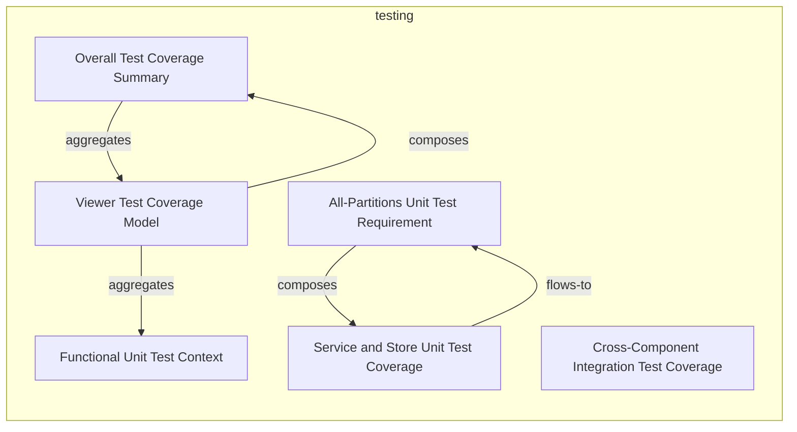
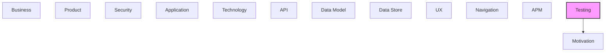

# Testing

[← Back to README](../README.md)

Test strategies, test cases, test data, and test coverage.

## Report Index

- [Layer Introduction](#layer-introduction)
- [Intra-Layer Relationships](#intra-layer-relationships)
- [Inter-Layer Dependencies](#inter-layer-dependencies)
- [Inter-Layer Relationships Table](#inter-layer-relationships-table)
- [Element Reference](#element-reference)

## Layer Introduction

| Metric                    | Count |
| ------------------------- | ----- |
| Elements                  | 6     |
| Intra-Layer Relationships | 5     |
| Inter-Layer Relationships | 17    |
| Inbound Relationships     | 0     |
| Outbound Relationships    | 17    |

**Cross-Layer References**:

- **Downstream layers**: [Motivation](./01-motivation-layer-report.md)

## Intra-Layer Relationships

## Inter-Layer Dependencies

## Inter-Layer Relationships Table

| Relationship ID                                                                                    | Source Node                                                       | Dest Node                                          | Dest Layer   | Predicate                | Cardinality  | Strength |
| -------------------------------------------------------------------------------------------------- | ----------------------------------------------------------------- | -------------------------------------------------- | ------------ | ------------------------ | ------------ | -------- |
| `29043f3a-16fd-4cb7-af1c-660b3aaa63c6-supports-goals-ef84b64d-883c-4471-9b56-a58574bac2b9`         | `29043f3a-16fd-4cb7-af1c-660b3aaa63c6`                            | `ef84b64d-883c-4471-9b56-a58574bac2b9`             | `motivation` | `supports-goals`         | unknown      | unknown  |
| `37a7eff0-e17f-40f8-ac76-ea230513fc63-fulfills-requirements-9df37bbd-8ffd-4d80-899f-9437aa03282a`  | `37a7eff0-e17f-40f8-ac76-ea230513fc63`                            | `9df37bbd-8ffd-4d80-899f-9437aa03282a`             | `motivation` | `fulfills-requirements`  | unknown      | unknown  |
| `37a7eff0-e17f-40f8-ac76-ea230513fc63-supports-goals-ef84b64d-883c-4471-9b56-a58574bac2b9`         | `37a7eff0-e17f-40f8-ac76-ea230513fc63`                            | `ef84b64d-883c-4471-9b56-a58574bac2b9`             | `motivation` | `supports-goals`         | unknown      | unknown  |
| `4e86c557-9c8e-435f-a770-651c0e238306-supports-goals-462e2931-4c7c-4051-a9ac-8817c270d650`         | `4e86c557-9c8e-435f-a770-651c0e238306`                            | `462e2931-4c7c-4051-a9ac-8817c270d650`             | `motivation` | `supports-goals`         | unknown      | unknown  |
| `52cfa9de-541d-44a0-9c21-34539c2e616c-fulfills-requirements-e748118c-b989-43fe-b0d2-9121e931fcd2`  | `52cfa9de-541d-44a0-9c21-34539c2e616c`                            | `e748118c-b989-43fe-b0d2-9121e931fcd2`             | `motivation` | `fulfills-requirements`  | unknown      | unknown  |
| `52cfa9de-541d-44a0-9c21-34539c2e616c-supports-goals-731285cc-dc15-4c64-a342-a933ce00bd61`         | `52cfa9de-541d-44a0-9c21-34539c2e616c`                            | `731285cc-dc15-4c64-a342-a933ce00bd61`             | `motivation` | `supports-goals`         | unknown      | unknown  |
| `cee7be5d-f0f9-4291-a2ae-cf5011a61c2f-fulfills-requirements-9df37bbd-8ffd-4d80-899f-9437aa03282a`  | `cee7be5d-f0f9-4291-a2ae-cf5011a61c2f`                            | `9df37bbd-8ffd-4d80-899f-9437aa03282a`             | `motivation` | `fulfills-requirements`  | unknown      | unknown  |
| `de956804-eabb-4548-8389-73cb6c63ef2f-constrained-by-6ffaff00-8bf8-4580-98ff-8d2a612a9021`         | `de956804-eabb-4548-8389-73cb6c63ef2f`                            | `6ffaff00-8bf8-4580-98ff-8d2a612a9021`             | `motivation` | `constrained-by`         | unknown      | unknown  |
| `de956804-eabb-4548-8389-73cb6c63ef2f-constrained-by-9fe1281a-2547-416f-872f-38e1b066db15`         | `de956804-eabb-4548-8389-73cb6c63ef2f`                            | `9fe1281a-2547-416f-872f-38e1b066db15`             | `motivation` | `constrained-by`         | unknown      | unknown  |
| `de956804-eabb-4548-8389-73cb6c63ef2f-fulfills-requirements-9df37bbd-8ffd-4d80-899f-9437aa03282a`  | `de956804-eabb-4548-8389-73cb6c63ef2f`                            | `9df37bbd-8ffd-4d80-899f-9437aa03282a`             | `motivation` | `fulfills-requirements`  | unknown      | unknown  |
| `de956804-eabb-4548-8389-73cb6c63ef2f-fulfills-requirements-e748118c-b989-43fe-b0d2-9121e931fcd2`  | `de956804-eabb-4548-8389-73cb6c63ef2f`                            | `e748118c-b989-43fe-b0d2-9121e931fcd2`             | `motivation` | `fulfills-requirements`  | unknown      | unknown  |
| `de956804-eabb-4548-8389-73cb6c63ef2f-governed-by-principles-53fad2bb-e97d-44a2-83cf-61201e992163` | `de956804-eabb-4548-8389-73cb6c63ef2f`                            | `53fad2bb-e97d-44a2-83cf-61201e992163`             | `motivation` | `governed-by-principles` | unknown      | unknown  |
| `de956804-eabb-4548-8389-73cb6c63ef2f-governed-by-principles-b3d7f834-dc3f-49fd-8044-8b6aca045dbe` | `de956804-eabb-4548-8389-73cb6c63ef2f`                            | `b3d7f834-dc3f-49fd-8044-8b6aca045dbe`             | `motivation` | `governed-by-principles` | unknown      | unknown  |
| `de956804-eabb-4548-8389-73cb6c63ef2f-supports-goals-462e2931-4c7c-4051-a9ac-8817c270d650`         | `de956804-eabb-4548-8389-73cb6c63ef2f`                            | `462e2931-4c7c-4051-a9ac-8817c270d650`             | `motivation` | `supports-goals`         | unknown      | unknown  |
| `de956804-eabb-4548-8389-73cb6c63ef2f-supports-goals-ef84b64d-883c-4471-9b56-a58574bac2b9`         | `de956804-eabb-4548-8389-73cb6c63ef2f`                            | `ef84b64d-883c-4471-9b56-a58574bac2b9`             | `motivation` | `supports-goals`         | unknown      | unknown  |
| `testing.coveragesummary.fulfills-requirements.motivation.requirement`                             | `testing.coveragesummary.overall-test-coverage-summary`           | `motivation.requirement.wcag-21-aa-compliance`     | `motivation` | `fulfills-requirements`  | many-to-many | medium   |
| `testing.testcoveragetarget.fulfills-requirements.motivation.requirement`                          | `testing.testcoveragetarget.service-and-store-unit-test-coverage` | `motivation.requirement.dr-cli-server-integration` | `motivation` | `fulfills-requirements`  | many-to-many | medium   |

## Element Reference

### Functional Unit Test Context {#functional-unit-test-context}

**ID**: `testing.contextvariation.functional-unit-test-context`

**Type**: `contextvariation`

Standard functional test context for unit, integration, and component tests; runs under Vitest (node/happy-dom environments) against mock data via MSW/mock WebSocket; fastest feedback loop (~262 tests, ~1.6s). Playwright is no longer used for unit/integration tests — it now covers only tests/e2e.

#### Attributes

| Name        | Value      |
| ----------- | ---------- |
| contextType | functional |

#### Relationships

| Type        | Related Element                                        | Predicate    | Direction |
| ----------- | ------------------------------------------------------ | ------------ | --------- |
| intra-layer | `testing.testcoveragemodel.viewer-test-coverage-model` | `aggregates` | inbound   |

### All-Partitions Unit Test Requirement {#all-partitions-unit-test-requirement}

**ID**: `testing.coveragerequirement.all-partitions-unit-test-requirement`

**Type**: `coveragerequirement`

Requirement that all public service methods and store actions have at least one test covering each logical partition; all-partitions criteria applied to dataLoader, nodeTransformer, crossLayerProcessor, and all store methods.

#### Attributes

| Name             | Value          |
| ---------------- | -------------- |
| coverageCriteria | all-partitions |
| priority         | high           |

#### Relationships

| Type        | Related Element                                                   | Predicate  | Direction |
| ----------- | ----------------------------------------------------------------- | ---------- | --------- |
| intra-layer | `testing.testcoveragetarget.service-and-store-unit-test-coverage` | `composes` | outbound  |
| intra-layer | `testing.testcoveragetarget.service-and-store-unit-test-coverage` | `flows-to` | inbound   |

### Overall Test Coverage Summary {#overall-test-coverage-summary}

**ID**: `testing.coveragesummary.overall-test-coverage-summary`

**Type**: `coveragesummary`

Aggregate coverage status across the full test suite: Vitest unit/integration/component suite (~262 tests, tests/unit + tests/integration + tests/components) plus a Playwright E2E suite (~20 tests, tests/e2e) driving the built production bundle with axe-core WCAG 2.1 AA checks. Storybook stories no longer exist (removed in the Heimdall rebuild). Line/branch coverage is now available via @vitest/coverage-v8 (npm run test:cov), though CI's required gate runs plain vitest run.

#### Attributes

| Name              | Value |
| ----------------- | ----- |
| totalRequirements | 3     |
| totalSketches     | 0     |
| totalTargets      | 8     |

#### Relationships

| Type        | Related Element                                        | Predicate               | Direction |
| ----------- | ------------------------------------------------------ | ----------------------- | --------- |
| inter-layer | `motivation.requirement.wcag-21-aa-compliance`         | `fulfills-requirements` | outbound  |
| intra-layer | `testing.testcoveragemodel.viewer-test-coverage-model` | `aggregates`            | outbound  |
| intra-layer | `testing.testcoveragemodel.viewer-test-coverage-model` | `composes`              | inbound   |

### Viewer Test Coverage Model {#viewer-test-coverage-model}

**ID**: `testing.testcoveragemodel.viewer-test-coverage-model`

**Type**: `testcoveragemodel`

Root IEEE 829-style test coverage model for the documentation_robotics_viewer application; spans unit, integration, component, E2E, and accessibility (axe-core) test types. Unit/integration/component tests run under Vitest; E2E and accessibility tests run under Playwright against the built bundle. Storybook-based story testing was removed in the June 2026 Heimdall UX rebuild.

#### Attributes

| Name        | Value                         |
| ----------- | ----------------------------- |
| application | documentation-robotics-viewer |
| version     | 1.0                           |

#### Relationships

| Type        | Related Element                                         | Predicate    | Direction |
| ----------- | ------------------------------------------------------- | ------------ | --------- |
| intra-layer | `testing.coveragesummary.overall-test-coverage-summary` | `aggregates` | inbound   |
| intra-layer | `testing.contextvariation.functional-unit-test-context` | `aggregates` | outbound  |
| intra-layer | `testing.coveragesummary.overall-test-coverage-summary` | `composes`   | outbound  |

### Cross-Component Integration Test Coverage {#cross-component-integration-test-coverage}

**ID**: `testing.testcoveragetarget.cross-component-integration-test-coverage`

**Type**: `testcoveragetarget`

Coverage target for integration tests verifying cross-component data flows: node transformer pipeline, cross-layer worker integration, libavoid routing, chat service, and preference persistence; 7 files under tests/integration/.

#### Attributes

| Name       | Value            |
| ---------- | ---------------- |
| priority   | high             |
| targetType | integration-flow |

### Service and Store Unit Test Coverage {#service-and-store-unit-test-coverage}

**ID**: `testing.testcoveragetarget.service-and-store-unit-test-coverage`

**Type**: `testcoveragetarget`

Coverage target for unit testing of all core services (dataLoader, nodeTransformer, yamlParser, crossLayerProcessor, etc.) and Zustand stores; ~40 spec files under tests/unit/; 1170 total tests via playwright.config.ts.

#### Attributes

| Name       | Value        |
| ---------- | ------------ |
| priority   | high         |
| targetType | ui-component |

#### Relationships

| Type        | Related Element                                                    | Predicate               | Direction |
| ----------- | ------------------------------------------------------------------ | ----------------------- | --------- |
| inter-layer | `motivation.requirement.dr-cli-server-integration`                 | `fulfills-requirements` | outbound  |
| intra-layer | `testing.coveragerequirement.all-partitions-unit-test-requirement` | `composes`              | inbound   |
| intra-layer | `testing.coveragerequirement.all-partitions-unit-test-requirement` | `flows-to`              | outbound  |

---

Generated: 2026-09-19T15:37:38.405Z | Model Version: 0.1.0
